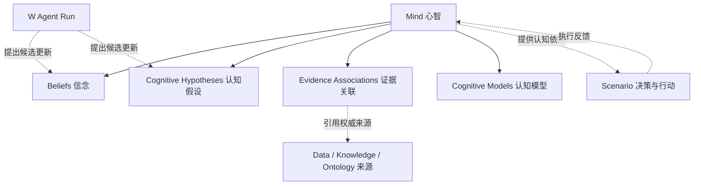

# ECOS 需求规格说明书（全新合并版）

> 来源: 资深需求工程师整理（自 PRD-00~PRD-10 十一册 + 历次裁决合并重写） | 日期: 2026-10-12 | 责任人: 用户（PMO）确认
> 版本: **v2.1-R9（需求基线唯一总入口）**。批准凭证：用户 2026-10-12 对 §九 确认清单 C-1~C-8 全组确认，§八 开放决策项 D-1/D-2/D-3 全部按推荐选项拍板（见该章结案行）。R1 = 同日第二轮意见精化（补业务流程分析 + 需求颗粒度细化），未新增/删减 139 项需求。R3 = 同日四项针对性修订（补安全顽疾、补 TB 软件定位主张、角色合并分析、术语统一），不新增/删减 139 项需求。R4 = 2026-10-14 认知对象关系模型补充（Mind 聚合根），不新增/删减 139 项需求。R5 = 2026-10-14 产品功能结构调整（§4.4 认知域拆分：查询契约/模型注册表/产物落位并入「认知资产」、因果诊断与反事实随场景上下文归经营决策；心智 Mind 迁入 §4.4 场景工作台；§4.5 W Agent 更名「AI 工作台」并降级为系统内置 Agent 编排模板；§4.3~§4.6 重排为四模块编号），仅调整归属与编号，**不新增、不删除、不改编号 139 项需求**。R6 = 2026-10-14 统一 CLI 与 Agent 工具层章节新增：新增 §4.7「统一 CLI 与 Agent 工具层」与需求卡 CL1~CL7（REQ-CLI-01~14），第一阶段严格只读 MVP；**139 项基线 REQ 不变，合计 139 项基线 + REQ-CLI 14 项（R6 新增）**。R7 = 2026-10-14 控制域版本治理并入 §4.6：新增需求卡 S6「控制域版本治理与双写审计（Git × DB 治理闭环）」，续号 **REQ-PLT-30~33 / REQ-SEC-12~13 / REQ-NF-10**（共 7 项），**不新增章节、不新开 REQ 系列、不新增部署模块与数据库表**；139 项基线 REQ 不变，**合计 139 项基线 + REQ-CLI 14 项 + 控制域治理 7 项（R7 新增）**。R8 = 2026-10-14 Redis 缓存架构与一致性治理并入 §4.6：依据 Phase 0《ECOS 缓存现状与差距分析-2026-10-14》（事实基线：Redis **未接入运行链路**、现有缓存全为**单机本地内存**、**无 Spring Cache 抽象**、**无 Outbox/事务消息**、`runtime-event` `EventBusService` 未接线到缓存失效、架构铁律 §2.5 runtime 底座不含 Redis/缓存），在 **§4.6「平台与横切能力」** 新增需求卡 **S7「Redis 缓存架构与一致性治理」**，续号 **REQ-PLT-34~38 / REQ-SEC-14 / REQ-NF-11~13**（共 9 项），覆盖 14 类缓存对象一致性策略矩阵 / 缓存键 `ecos:{env}:{domain}:{objectType}:{scope}:{objectId}:v{version}` / 一致性机制四类（Cache-Aside·版本化缓存·主动失效与事件驱动·「先提交权威数据、再失效缓存」；**Outbox 列为待建设能力**）/ 双写审计可选字段 8 项与 Git 发布状态机分别记录 / 权限·安全隔离（缓存不得绕鉴权、fail-closed）/ 故障降级 9 场景 / 可观测 / 验收；**不新增章节、不新开 REQ 系列、不新增部署模块与数据库表**；建议策略/键规范/指标名称一律标为**建议基线**须核对确认，**139 项基线 REQ 不变，合计 139 项基线 + REQ-CLI 14 项 + 控制域治理 7 项（R7 新增）+ 缓存治理 9 项（R8 新增）**。R9 = 2026-10-15 Git 控制域安全与可信发布治理并入 §4.6：在 S6（控制域版本治理与双写审计）、S7（Redis 缓存架构与一致性治理）之后新增需求卡 **S8「Git 控制域安全与可信发布治理」**，续号 **REQ-SEC-15~21 / REQ-PLT-39 / REQ-NF-14**（共 9 项），覆盖 五条核心原则与可信链宣言（身份与权限→Git 变更→独立审批→安全校验→签名发布授权→领域服务应用→Redis 版本切换→运行时验证→独立审计，任一环节不凭上游"已经成功"自动可信）/ 8 类安全问题基线（仓库访问与身份权限·凭据与密钥安全·变更审批与职责分离·完整性与可信发布·防恶意配置与 Agent 投毒·Redis 与 Git 安全边界·独立审计与防篡改·备份恢复与事件响应）/ 安全测试与验收；**不新增章节、不新开 REQ 系列、不新增部署模块与数据库表**；全卡为**目标设计/建议基线**措辞、非现状描述，须与现有安全体系（`clearance_level` L0~L4 / `audit_mode` / `ClearanceInterceptor` / `AuditHashChainService` / security-engine）核对映射后方可生效，**139 项基线 REQ 不变，合计 139 项基线 + REQ-CLI 14 项 + 控制域治理 7 项（R7 新增）+ 缓存治理 9 项（R8 新增）+ Git 安全 9 项（R9 新增）**。
> 版本沿革：v1.0-draft（台账式首稿）经用户 2026-10-12 三项修订意见（① 主文改产品视角叙事；② 补使用对象与业务场景分析；③ 实现状态/验收进度/裁决过程撤出主文）整册重写为 v2.0；C-1~C-8 确认后定版 v2.0-APPROVED；v1.0-draft 作废且从未生效，正式基线编号取 v2.0。**R1 精化（2026-10-12）**：针对用户第二轮意见"① 业务场景描述不足、无业务流程分析；② 各需求描述太粗"，§3 增补七幕流程分解表/跨角色泳道/12 条异常路径（§3.1.1~3.1.3）与六支撑场景流程卡（§3.2）；§4 七能力域 37 条一句话需求点全部展开为 36 张结构化需求卡（做什么/关键规则/异常边界/验收要点 + REQ 关联）。**不新增 139 项之外的需求，不改变已批准范围**。**R2 语义精化（2026-10-12）**：依据外部深度审查八项核心问题（统一认知对象、因果诊断证据等级、反事实语义、预测四概念三层、知识有效性治理、评估三分与决策依据、行动五阶段与效果归因、学习闭环可证伪）做**语义精化**——§1.3 补主链业务契约引子；新增 §3.1.4 幕间交接契约、§3.3 认知闭环契约（Cognitive Decision Episode，跨域语义契约，非新部署模块/非新数据库表）；§4 相关需求卡以"（R2 精化：…）"补语义边界与验收判据；§五 补"学习闭环可证伪"维度；附录 B 补术语锚点。**不新增、不删除、不改编号 139 项 REQ，不改变已批准范围**。**R4 关系模型补充（2026-10-14）**：依据用户确认的认知对象关系图，§4.4 新增「认知对象关系模型（Mind 聚合根）」小节——Mind 聚合信念（Beliefs）、认知假设（Cognitive Hypotheses）、证据关联（Evidence Associations）与认知模型（Cognitive Models）；证据关联只引用权威来源（Data/Knowledge/Ontology）而不复制；W Agent Run 对信念与假设仅可提出候选更新（受控闸门）；Mind 与 Scenario 双向连接（提供认知依据 / 执行反馈回流）。本补充为关系语义定位，**不新增、不删除、不改编号 139 项 REQ，不改变已批准范围**。**R5 结构调整（2026-10-14）**：按用户产品功能结构优化要求重排 §4 章节——§4.3 知识域更名「认知资产」并并入原 §4.4 的 C1（四类认知查询契约）/C4（认知模型注册表）/C5（产物落位纪律）；原 §4.4 撤销，其 C2（因果诊断）/C3（反事实）与 Mind 心智聚合根（C6，含认知对象关系模型）迁入 §4.4「经营决策与场景工作台」（原 §4.6 A1~A6 场景卡同步并入）；原 §4.5 W Agent 更名「AI 工作台」并明确 W Agent 降级为系统内置 Agent 编排模板（与数据/本体/知识智能体同级）；原 §4.7 顺位为 §4.6。附录 A 追溯表章节列同步重映射，**不新增、不删除、不改编号 139 项 REQ**。**R6 CLI 章节新增（2026-10-14）**：新增 §4.7「统一 CLI 与 Agent 工具层（ECOS 领域 API 与智能体运行时之间的统一工具层）」与需求卡 CL1~CL7（REQ-CLI-01~14）；**139 项基线 REQ 不变，合计 139 项基线 + REQ-CLI 14 项（R6 新增）**；第一阶段仅只读 MVP（命令发现、只读查询、依赖预检、运行与证据读取）。**R7 控制域版本治理并入（2026-10-14）**：依据《ECOS 控制域 Git 版本管理与双写审计》方案第三部分「需求及设计文档修订指令」§3.1~§3.5 与 Phase 0《控制域版本治理现状与差距分析》，在 **§4.6「平台与横切能力」** 新增需求卡 **S6「控制域版本治理与双写审计（Git × DB 治理闭环）」**（REQ-PLT-30~33 / REQ-SEC-12~13 / REQ-NF-10），覆盖 控制域对象目录与五类边界 / 版本契约（稳定 ID·Schema 版本·规范化序列化·内容指纹·差异·引用依赖）/ 历史查询与经授权重发布 / 双写发布状态机与对账 / 敏感数据不入普通 Git / 审计等级—变更风险—审批策略—发布门禁映射（建议基线，须与 `clearance_level` L0~L4 及 `audit_mode` 核对映射后生效）/ 版本治理验收。**不新增章节、不新开 REQ 系列、不新增部署模块与数据库表**；既有能力复用 runtime-access `GitService`/`GitRepositoryService`、`GitRepoRootResolver`（`ecos_git_repo_root` 单源）、`repositoryId` 语义名、ADR-18、`AuditHashChainService`（`ecos_audit_log` SHA-256 链）与 Kafka topic `ecos.audit`；6 类未接入资产与 Git 仓库注册表缺口如实记为「未接入 / 缺口 / 待排期」，**139 项基线 REQ 不变**。**R8 缓存架构与一致性治理并入（2026-10-14）**：依据 Phase 0《ECOS 缓存现状与差距分析-2026-10-14》，在 **§4.6「平台与横切能力」** 新增需求卡 **S7「Redis 缓存架构与一致性治理」**（REQ-PLT-34~38 / REQ-SEC-14 / REQ-NF-11~13，共 9 项），覆盖 14 类缓存对象（机构与组织基础信息/用户基础信息/角色·权限·授权关系/接入数据元数据/Pipeline 定义与配置/数据质量规则/本体模型与映射关系/知识库与知识索引元数据/认知资产与认知模型/心智模型/Agent 协同流程与工具定义/统计汇总·派生指标/任务状态·运行结果/审计记录）一致性策略矩阵 / 缓存键 `ecos:{env}:{domain}:{objectType}:{scope}:{objectId}:v{version}` / 一致性机制四类（Outbox 列为待建设能力）/ 双写审计可选字段 8 项（`cache_strategy`/`cache_namespace`/`cache_version`/`cache_invalidation_event_id`/`cache_invalidation_status`/`cache_verification_status`/`cache_failure_reason`/`cache_verified_at`）与 Git 发布状态机分别记录 / 权限·安全隔离（缓存不得绕鉴权、fail-closed）/ 故障降级 9 场景（**Redis 故障不得绕过认证与授权**）/ 可观测 / 验收。**不新增章节、不新开 REQ 系列、不新增部署模块与数据库表**；可复用 `runtime-event` `EventBusService`（Kafka 主 + 内存降级）、`runtime-monitor`、`SysConfigService.refreshCache()` 主动失效范式、`ClearanceInterceptor` 与 RLS/CLS/ABAC、`AuditHashChainService`（`ecos_audit_log` SHA-256 链）；现状按事实基线如实登记，建议策略/键规范/指标名称为**建议基线**须核对确认，不写成已实现事实或未测量的性能承诺，**139 项基线 REQ 不变**。**R9 Git 安全与可信发布治理并入（2026-10-15）**：依据用户 Git 控制域安全与可信发布治理修订指令，在 **§4.6「平台与横切能力」** S6/S7 之后新增需求卡 **S8「Git 控制域安全与可信发布治理」**（REQ-SEC-15~21 / REQ-PLT-39 / REQ-NF-14，共 9 项）——五条核心原则（Git 记录变更不自动赋予生效权限；提交成功≠审批通过≠允许发布；Git 内容须经安全校验方可进入运行时；Redis 只缓存已授权已发布且版本明确的数据；审计证据不只保存在被审计的 Git 仓库）与可信链宣言（身份与权限→Git 变更→独立审批→安全校验→签名发布授权→领域服务应用→Redis 版本切换→运行时验证→独立审计，任一环节不凭上游"已经成功"自动可信）；8 类安全问题基线：仓库访问与身份权限（企业身份+MFA+最小权限、五权分离、服务专属身份）/ 凭据与密钥安全（秘密禁入 Git、Secret Manager 存秘密 Git 只存引用、Secret Scanning、泄露轮换）/ 变更审批与职责分离（五角色矩阵、高风险双人审批可配置）/ 完整性与可信发布（分支保护、提交标签签名、签名发布清单绑定仓库标识+Commit SHA+内容哈希+目标环境+审批记录+策略版本，Commit SHA≠发布授权）/ 防恶意配置与 Agent 投毒（Schema/引用/依赖校验、白名单、Agent 不得因 Git 写权限获得生产发布权）/ Redis 与 Git 安全边界（不监听 Git 自动发布、未审批分支不进生产缓存、撤权有失效时限）/ 独立审计与防篡改（审计存储与 Git 权限分离、发布事件含 git_commit_sha 等关联项）/ 备份恢复与事件响应（五类预案、独立备份、发布冻结、回滚重新验证授权）。**不新增章节、不新开 REQ 系列、不新增部署模块与数据库表**；全卡为**目标设计/建议基线**措辞、非现状描述，须与现有安全体系（`clearance_level` L0~L4 / `audit_mode` / `ClearanceInterceptor` / `AuditHashChainService` / security-engine）核对映射后方可生效，**139 项基线 REQ 不变**。
> 效力：本册为需求基线唯一总入口；"已批准"仅指需求文本生效 ≠ 已实现，验收载体未建者一律记"未执行"（Q13／铁律 v2.0 §3.1-14）。
> 上游依据: `docs/20-需求/PRD-00~PRD-10`、`docs/20-需求/需求检视报告-2026-09-28.md`（§十二/§十四 = 批准凭证）、`.trae/rules/`（架构铁律 v2.0、数据库访问规范 v1.2 等九册）

---

## 一、产品总览

### 1.1 ECOS 是什么

ECOS（Enterprise Cognitive Operating System，企业认知操作系统）是一套把企业数据资产升级为**可信赖决策能力**的平台。它不是一块 BI 大屏，也不是一个聊天机器人，而是一条完整的认知流水线：把散落的业务事实（D）组织成本体与统一口径（I），从数据和文档中沉淀出可版本化的知识（K），基于知识与事实做确定性认知计算（C），最终支撑行动决策并把行动结果回灌为新的数据（W→D），形成越用越准的闭环。

### 1.2 它解决的四个行业性顽疾

| 顽疾 | 现状 | ECOS 的回答 |
|------|------|------------|
| **看得见，算不准** | 数据在几十个系统里，口径各说各话，同一个"利润"有三个数字 | 口径主权归本体层：指标定义、公式版本、发布审批集中治理，任何计算只引用已发布口径 |
| **算得出，说不清** | Excel/黑盒模型给出数字，但无法回答"这个数字从哪来、换了假设会怎样" | 每个经营数字强制携带六要素（运行 ID、口径版本、时点、输入快照、公式版本、证据引用），不可定位即运行失败——**可复现性高于可用性** |
| **AI 会说话，不敢信** | LLM 直接生成数字和结论，错了无法审计 | 确定性计算与 LLM 严格分界：凡金额、比率、贡献度、评级一律由确定性计算产出且可复算；LLM 只做解释、编排与探索，被禁止写入任何经营数值 |
| **有数据，不安全** | 企业经营数据散落在多系统中，缺乏统一权限边界与审计追踪；敏感数据（利润、成本、薪酬）裸露可导出；AI 调用外部模型时数据出域不可控；租户间隔离由各模块各自实现，存在穿透风险 | 安全引擎单点收敛：权限裁决、数据脱敏、列级/行级过滤、审计、外部访问各只有一条通道，任何模块不得自建旁路；安全组件不可用时默认拒绝（fail-closed）；敏感列强制 AES-256-GCM 加密+KMS 托管；AI 外部调用经统一 LLM 出口代理，出域数据自动脱敏；租户隔离由安全引擎单点裁决，各模块禁止各自实现 |

### 1.3 产品主张（五条，全册的裁决基准）

1. **DIKCW 主认知链**是产品骨架：数据→本体→知识→认知→行动端到端贯通，行动结果必须回流数据层，否则系统只是单向报表。
   > **主链业务契约（R2 引子）**：主链每一段连接都必须回答一个业务契约问题——事实的字段/对象/期间/单位能否映射到统一业务语义（D→I）；知识资产引用哪个本体版本、指标版本与适用范围（I→K）；使用了哪些假设/画像/证据、为何适用于当前对象与期间（K→C）；结论的可信程度/风险/约束/备选方案是否足以支撑行动（C→W）；执行结果是否为真实发生、已验证、归属清晰的事实（W→D）；新事实究竟改变了哪个假设/模型/参数/决策规则（D′→K/C）。六段连接契约的完整定义与统一认知对象**认知决策事件（Cognitive Decision Episode, CDE）**见 §3.3。
2. **确定性与生成式严格分界**：预测、归因、评级可复算；AI 的输出永远是"解释"和"候选"，不是"事实"。
3. **安全与基础设施单点收敛**：权限裁决、数据脱敏、审计、外部访问、调度、事件、LLM 出口、配置各只有一个通道，任何模块不得自建旁路；安全组件不可用时默认拒绝（fail-closed）。
4. **术语即契约**：W 是"行动域"，不等同于 AI Agent；"W Agent"是行动域的编排主体代号（R5 起作为 AI 工作台的系统内置 Agent 编排模板存在，与数据/本体/知识智能体同级）。产品语义混乱会从需求源头引发实现偏差。
5. **一套代码，三档交付**：standard（纯 PostgreSQL）／enterprise（+图数据库）／ultimate（+列数仓），按客户规模与数据量选择，功能语义三档一致。
6. **与传统软件（TB 软件）的定位关系**：传统企业软件中，OLTP（联机事务处理）为业务服务——处理订单、库存、收付款等日常交易；OLAP（联机分析处理）为管理者服务——提供报表、多维分析、趋势统计。ECOS 不替代 OLTP 的交易职能，也不替代 OLAP 的报表职能，而是为这两个过程中的**决策**服务：在 OLTP 产出的业务事实与 OLAP 沉淀的历史统计之上，构建从数据到本体、知识、认知、行动的完整决策链路，涵盖两个决策维度——**业务/流程优化决策**（哪个项目该追加投入、哪个流程环节该调优）与**企业管理/经营决策**（明年利润目标从哪来、风险在哪、经营动作怎么排）。ECOS 因此是 OLTP 和 OLAP 之外的"第三层"——认知决策层。

### 1.4 交付形态

ECOS 以私有化部署交付，由一个统一入口网关和六个业务服务组成（组织认证、数据、本体、知识认知、行动智能、场景工作台），支持七个或多个实例独立启停与横向扩展；基础设施依赖 PostgreSQL、缓存、消息总线，enterprise 档叠加图数据库，ultimate 档再叠加列式数仓（两种引擎部署级二选一）。

---

## 二、使用对象分析：谁会用它

### 2.1 七类使用对象与各自的"任务"

| 使用对象 | 他是谁 | 他要完成的任务（Job to be done） | 他眼中的"成功" |
|----------|--------|----------------------------------|----------------|
| **企业经营决策者** | CEO／CFO／事业部总经理（间接用户） | 在经营会上回答"明年利润从哪来、风险在哪、动哪几个动作能补上缺口" | 屏幕上每个数字点开都能看到来源与假设；换一套假设，结论即时可比较；对赌目标有回测数据背书 |
| **业务分析师／财务 BP** | 最频繁的直接用户 | 建场景、跑预测、做情景比较、给管理层出一页下钻视图 | 不写 SQL、不求 IT，3 步进入向导；一次运行全程 ≤5 击钻到证据；数据缺口以业务语言提醒（"3 个项目缺回款计划"），补上即消失 |
| **数据治理员** | 数据平台团队 | 接入企业数据源、建管道、保证进决策链的数据质量 | 质量门禁自动拦截脏数据；待办队列清晰可处置；批量导入出错能逐行修复而不是整批重来 |
| **本体／口径管理员** | 业务专家兼任 | 定义企业对象模型和指标口径，审批口径变更 | 一个指标全司只有一个权威定义；口径变更有版本链，历史结论永远可按旧口径解释 |
| **模型管理员 / 认知模型负责人** | AI 平台团队与业务属主 | 注册、评估、发布、下线认知模型 | 模型发布四门禁（契约/回归/回测/校准）挡住不合格模型；LLM 型模型被制度性禁止产出数字 |
| **平台管理员** | IT／安全团队 | 管租户、用户、权限、配置、审计 | 默认拒绝的权限面；谁看了敏感数据、AI 调了哪个模型全程可审计；三档升级不动代码 |
| **W Agent（系统用户）** | 自动化编排主体 | 替分析师完成"取数—算—解释—提候选"的例行环节 | 在自己的自动化等级（L0~L3）与权限边界内行事，越界即被熔断；每个产出带证据链，人审后才成为知识 |

#### 2.1.1 角色合并分析：模型管理员 / 认知模型负责人 与 W Agent（系统用户）

**结论：保留独立角色，不合并。** 理由如下：

| 维度 | 模型管理员 / 认知模型负责人 | W Agent（系统用户） | 合并后冲突 |
|:--|:--|:--|:--|
| **职责定位** | 认知模型的**注册、评估、发布、下线**——是模型生命周期管理者，对模型质量负责 | 行动域的**自动化编排主体**——替分析师执行例行取数—算—解释—提候选链路，是模型和知识的**消费者**而非管理者 | 合并后同一主体既发布模型又消费模型，自发布自消费缺乏四眼原则 |
| **权限范围** | 写权限限定于模型注册表（模型元数据、版本、门禁状态、发布/下线操作）；不持有业务数据的写入权 | 写权限限于行动记录（动作发起、执行状态、回灌事实）；模型调用为只读引用，不具备模型发布权 | 合并后权限面从"模型管理+行动执行"合并为一个超大权限面，违反最小权限原则 |
| **操作流程** | 模型发布须经四门禁（契约/回归/回测/校准），是**审批方** | 行动执行须经人审+审批，是**被审批方** | 合并后审批方与被审批方同一，破坏四眼制衡 |
| **安全审计** | 操作审计重点：模型质量门禁是否通过、不合格模型是否被拦住、LLM 型模型是否违规产出数字 | 操作审计重点：自动化等级是否越界、熔断是否触发、产出证据链是否完整、人审是否到位 | 审计关注点正交，合并后审计日志难以区分责任 |
| **自动化等级** | 不适用（人工角色，由 AI 平台团队与业务属主兼任） | L0~L3 四级，每级有明确边界与熔断条件 | 人工角色与自动化主体本质不同，合并在概念上不成立 |

> **保留独立的架构依据**：架构铁律 §0.2 主权三分——"编排权、业务规则主权、数据写入权"分立。模型管理员行使业务规则主权（模型质量规则），W Agent 行使编排权（自动化编排），两者合并即违反主权三分铁律。REQ-SEC-11（新增模型管理员/认知模型负责人角色）的 P1 优先级不变。

### 2.2 直接用户与受益者分层

直接操作产品的是前五类人与一个 Agent；决策者是受益者——产品的界面语言因此必须**业务语言优先**：技术对象（本体、图谱、模型）只出现在高级视图，首屏永远是"预测今年利润""看看哪个项目有风险"这类卡片。这条分层原则贯穿所有界面需求。

---

## 三、业务场景分析：它会怎么被使用

### 3.1 典型场景：企业年度经营预测

首个完整落地场景，也是全产品能力的联合验收剧本。用户旅程七幕：

1. **入数与门禁**：治理员接入项目、合同、成本、回款等业务数据，批量导入；数据经质量规则（完整性/一致性/及时性等 11 条门禁）过滤后才成为"已发布事实"，脏数据进待办而不是进报表。
2. **定口径**：口径管理员把"收入确认口径""成本分摊口径"注册为带版本、带公式、带单位的指标定义，走提案—审批—发布；分析师只能引用已发布口径。
3. **沉淀知识**：系统从历史事实生成数值画像（区间、波动、样本量、置信分级），从制度文档与专家经验形成版本化假设（每条假设带证据、有效期与状态机）。预测用到的"区间"和"假设"必须引用这些已发布版本——不允许现场拍脑袋。
4. **跑预测**：分析师用向导选范围、检查数据、确认假设、发起运行。系统做**确定性计算**：输入快照冻结、公式版本锁定、逐级平衡校验精确相等、三档区间（悲观/基准/乐观）全存全展；同一输入重跑结果必须零差异。结果六要素缺一，运行直接判失败。
5. **看解释**：认知层回答"为什么利润缺口 800 万"——因果链、各因素贡献度（合计严格等于利润差额）、证据引用；分析师改假设做反事实比较，差值同样由确定性重算得出，AI 只负责把结论讲成人话，并诚实标注"未经证实的假设"。
6. **行动与回灌**：针对风险项发起经营动作（谁、何时、做什么、预期、负责人五必填），经审批后执行；执行结果回流数据层，成为下一轮预测的新事实——闭环成立。
7. **回测与滚动**：期间关账后自动切"实际数"展示，回算预测误差（MAE/MAPE/偏差方向/区间覆盖率）；超阈值自动生成口径复审任务，系统因此越用越准。

**场景成功判据（业务可验收）**：任何一个出现在页面上的经营数字，从点击到证据 ≤5 击全部可定位；无演示数据冒充真实数据（演练数据必须带常驻 DEMO 徽标）；换浏览器换时间重跑同一运行，六要素与结果完全一致。

#### 3.1.1 七幕流程分解（步骤 · 门禁 · 分支）

> 七幕是**顺序主干**，每一幕都带"进多少算什么、过了哪道门才放行、不过时往哪走"。下表把每幕拆成可验收的最小流程单元，作为第四、五章需求与体验判据的流程锚点。

| 幕 | 主责角色 | 前置输入（依赖） | 核心步骤（顺序） | 门禁判定（不过则） | 制动输出 | 异常 / 降级路由 |
|----|----------|-----------------|------------------|--------------------|----------|-----------------|
| **1 入数与门禁** | 数据治理员 | 业务系统导出/CSV、管道配置 | ① 接入源 → ② 批量导入（≤100 行/批，逐行校验）→ ③ 跑 11 条 DQ 门禁 → ④ 合格转"已发布事实" | 11 条门禁任一不达即拦截 | 已发布事实（带归属/期间/质量态，只增不改） | 脏数据入待办队列、以业务语言呈现；禁静默缺省兜底；已关账期间拒写 |
| **2 定口径** | 口径管理员 | 业务指标诉求、财务制度 | ① 建指标定义（公式/单位/币种/可加性/血缘）→ ② 绑定实体映射契约 → ③ 提案 → ④ 审批（四眼）→ ⑤ 发布并冻结口径快照 | 三门禁：口径已批准 ∧ 单位币种一致 ∧ 血缘列真实存在 | 已发布口径（版本化、快照冻结） | 任一元数据缺项禁发布；历史结论按当时口径解释 |
| **3 沉淀知识** | 系统 + 领域专家 | 已发布事实、制度文档、专家经验 | ① 五级分层滚动统计 → ② 生成数值画像（P10/P50/P90/样本量/窗口/缺失率/置信分级）→ ③ 从文档抽取候选假设 → ④ 假设走状态机 + 人审 → ⑤ 发布 | 画像四要素（分位/样本量/窗口/置信）齐备才可被引用 | 已发布画像、已批准假设（版本化、带证据） | 抽取完整性只告警不静默；dry-run 与实跑差异必须为 0；无证据假设标"未证实"仍放行但界面带徽标 |
| **4 跑预测** | 业务分析师 | 已发布事实/口径/画像/假设 | ① 四步向导选范围 → ② 查数据覆盖率 → ③ 锁定假设版本 → ④ 冻结输入快照 + 锁定公式版本 → ⑤ 确定性逐级计算 + 平衡校验 → ⑥ 三档区间（悲观/基准/乐观）全存全展 | 结果六要素缺一即失败；逐级平衡校验须精确相等 | 预测运行（六要素全携、可复算） | 规模 >50 项目或 >10 万行转异步；同一输入重跑结果零差异 |
| **5 看解释** | 分析师 + 决策者 | 预测运行 | ① 总览五层下钻 → ② 归因"为什么利润差 800 万"（因果链 + 贡献度）→ ③ 贡献度合计校验 = 利润差（±0.01）→ ④ 改假设做反事实（确定性重算）→ ⑤ AI 讲人话并标注"未证实假设" | 贡献度禁 LLM 生成；数字与核算一致性校验须过 | 可解释结论 + 证据链 + 反事实对比 | 空结果如实返回；依赖不可用原样穿透错误，禁"200 空体"掩盖故障 |
| **6 行动与回灌** | 分析师 / 决策者 | 风险项、经营动作 | ① 发起动作（谁/何时/做什么/预期/负责人 五必填）→ ② 审批 → ③ 执行 → ④ 执行结果回流数据层成新事实 | 五必填缺一不收；行动必须过审批 | 已执行动作 + 回流事实（W→D） | 未回灌则闭环不成立、系统降级为单向报表并告警 |
| **7 回测与滚动** | 系统 + 治理员 | 期间关账后的实际数 | ① 自动切"实际数"展示 → ② 回算误差（MAE/MAPE/偏差方向/区间覆盖率）→ ③ 超阈值自动生成口径复审任务 | 误差超阈值触发口径复审 | 回测报告 + 口径复审任务 | 复审结论回写口径版本链，进入下一轮 |

#### 3.1.2 跨角色流程泳道（谁在哪一幕做什么）

> 泳道读法：行=角色，列=七幕；单元格是该角色在该幕承担的动作，`—`=该幕不直接参与。**横切行**（安全/多租户/审计）不对应单一幕，而是覆盖上面每一幕的每一次读写。

| 角色 | 幕1 入数 | 幕2 口径 | 幕3 知识 | 幕4 预测 | 幕5 解释 | 幕6 行动 | 幕7 回测 |
|------|---------|---------|---------|---------|---------|---------|---------|
| 数据治理员 | 接源 + 导入 + 跑门禁 | — | — | 补数据/查覆盖率 | — | — | 处置口径复审任务 |
| 口径管理员 | — | 建口径 + 提案 + 批准 + 发布 | — | （被引用） | — | — | 复审后升口径版本 |
| 领域专家 | — | — | 审假设、补证据 | 确认假设版本 | — | — | — |
| 业务分析师 | — | — | — | 选范围 + 发起运行 | 下钻 + 改假设反事实 | 发起动作 | — |
| 决策者 | — | — | — | — | 看总览/下钻 | 审批经营动作 | — |
| 系统（自动） | 门禁分选 | 冻结口径快照 | 滚动统计 + 抽候选 + 状态机 | 确定性计算 + 平衡校验 | 归因重算 + 数字比对 | 结果回流数据层 | 关账切实际 + 回测 |
| **横切：安全 / 多租户 / 审计** | 行/列隔离 + 导入审计 | 口径快照脱敏 + 审批留痕 | 假设证据脱敏 + 发布审计 | 运行审计落痕 | 结论引用脱敏 | 动作审批留痕 | 回测数据隔离 + 审计 |

> 横切行读法：安全（行级隔离→列级过滤→脱敏→策略裁决→默认拒绝）、多租户（租户/组织/行版本贯通）、审计（写操作经消息总线统一落链、哈希链分链）不是某一幕的独立活动，而是**对上面每一幕的每一次读写都生效的安全底座**；本行按幕标注它在该幕各自落实的具体动作，安全引擎不可用则**该幕直接 fail-closed（默认拒绝、不放行）**。

#### 3.1.3 关键异常与降级路径（分支穷举）

> 主路径之外的分支，逐条给出"在哪一幕触发、触发条件、系统该做什么、回到绿色的条件"。产品验收时这些路径与主路径同等重要。

| # | 触发幕 | 触发条件 | 系统行为 | 结束 / 恢复条件 |
|---|--------|----------|----------|----------------|
| E-1 | 幕 1 | 任一 DQ 门禁不达 | 数据停留"待处理"，不进入事实层，进待办队列 | 补数/修复后重跑门禁通过 |
| E-2 | 幕 1 | 目标期间已关账 | 拒绝写入 | 需求转下期或走更正（新行 + 旧行作废） |
| E-3 | 幕 2 | 口径元数据缺项 / 血缘列不存在 | 禁止发布，卡住在该领域包 | 补齐后重走提案—审批—发布 |
| E-4 | 幕 3 | 抽取属性不完整 | 只告警不静默，标注缺失面 | dry-run 与实跑差异归零 |
| E-5 | 幕 3 | 假设无证据 | 标"未证实"可发布，界面常驻徽标 | 补证据后按状态机转正 |
| E-6 | 幕 4 | 结果六要素缺一 | 运行判失败，不产运行 ID，不写部分结果 | 修数据/口径/假设后重跑 |
| E-7 | 幕 4 | 逐级平衡校验不相等 | 运行判失败（不产"差不多"的结果） | 定位口径/数据错误后重跑 |
| E-8 | 幕 5 | 认知/安全依赖不可用 | 原样穿透错误，禁"200 空体"掩盖 | 依赖恢复后重试 |
| E-9 | 全部幕 | 安全引擎不可用 | **fail-closed：默认拒绝服务不放行**（写操作恢复后须幂等重放） | 安全恢复后按原请求重放 |
| E-10 | 幕 6 | 行动执行但未回灌 | 闭环告警，系统降级为单向报表 | 结果回流即为闭环成立 |
| E-11 | 幕 7 | 回测误差超阈值 | 自动生成口径复审任务 | 复审改口径版本，进入下一轮 |
| E-12 | 幕 4/6 | 规模超阈值（>50 项目 / >10 万行） | 预测自动转异步，前端显示"运行中/后台" | 异步完成回写运行记录 |

> 分支与主路径的**共同红线**：任何"降级/异常"都不得静默伪装成正常结果——降级必须显式标注（"非实时/降级/未证实/已脱敏"），错误不得用 200 空体掩盖。

#### 3.1.4 七幕产物—输入契约（幕间交接语义）（R2）

> 七幕定义了业务步骤如何串联（§3.1.1）；本节进一步约定**每一幕的产物要满足什么条件才构成下一幕的有效输入**，以及**输入后续变化时历史结论与当前结论如何区分**。这是幕间交接语义契约，验收时与各幕门禁同等生效。

| 交接 | 上游产物 | 成为下游有效输入的条件（引用的版本/质量态/门禁） | 输入后续变化时的语义 |
|------|----------|--------------------------------------------------|----------------------|
| 幕1→幕2 | 已发布事实 | 携带归属/期间/质量态/币种，过 11 条 DQ 门禁，未落入关账期间 | 事实更正以"新行+旧行作废"表达；下游按当时输入快照解析，不回写旧结论 |
| 幕2→幕3 | 已发布口径（版本化+快照冻结） | 发布三门禁全过（口径已批准 ∧ 单位币种一致 ∧ 血缘列真实存在） | 知识资产登记其引用的口径版本；口径演进只影响此后新产物 |
| 幕3→幕4 | 已发布画像 + 已批准假设 | 画像四要素（分位/样本量/窗口/置信）齐备；假设版本明确（无证据假设带"未证实"标注，可用性按用途分级，见 §4.3 K2） | 预测运行锁定假设版本与输入快照；假设/画像后续被替代**不静默升级**旧运行 |
| 幕4→幕5 | 预测运行（六要素全携、可复算） | 六要素缺一即失败；逐级平衡校验精确相等 | 诊断与反事实绑定该运行 ID；口径/知识更新后须基于新运行重新诊断，禁止复用旧结论冒充新解释 |
| 幕5→幕6 | 可解释结论 + 证据链 + 反事实对比 | 贡献度合计=利润差额（±0.01）且带证据等级标注；证据引用可定位（≤5 击）；AI 解释标注"未证实假设" | 行动依据按**决策时点**的证据与版本解析（DecisionBasis 语义，见 §3.3），不随上游升级而静默变化 |
| 幕6→幕7 | 已执行动作 + 回流事实 | 五必填齐备、过审批、执行结果回流数据层成新事实 | **执行记录 ≠ 效果事实 ≠ 效果归因**三者分立；效果尚无法归因时如实记录，禁止把执行完成当效果实现（见 §4.5 W3 R2 精化） |
| 幕7→下一轮 | 回测报告 + 口径复审任务 | 误差超阈值触发复审；复审对象覆盖口径/假设/画像/模型/决策规则 | 复审产物走版本链；新版本优于基线方可发布，允许拒绝发布或回退（见 §五"学习闭环可证伪"） |

**历史结论与当前结论的区分原则（本节核心答案）**：幕间交接的一切引用都是**版本化引用 + 当时快照解析**——下游产物一经产生，其引用的口径/画像/假设/运行版本即告冻结；上游后续变化只影响此后新生成的结论，历史结论永远按当时版本快照解释，系统**不得静默升级**历史结论的解析版本。该原则是 §4.2 O2"历史结论可按当时口径快照解释"向全部幕间交接的扩展。

### 3.2 支撑场景

> 六个支撑场景是典型场景之外的高频独立链路。每条给**触发条件、流程步骤（含判定分支）、异常/边界**，与 §3.1 同一套门禁和横切红线（安全不可用即 fail-closed、降级显式标注）。

| 场景 | 主责角色 | 触发条件 | 流程步骤（含判定 / 分支） | 异常 / 边界 | 主要能力域 |
|------|----------|----------|--------------------------|-------------|-----------|
| **数据治理与质量闭环** | 数据治理员 | 新数据源接入，或周期外批量刷新 | ① 接源 + 配管道 → ② 抽样画像 → ③ 批量入批（≤100 行/批，逐行线上校验）→ ④ 跑 11 条 DQ 门禁 →〔合格？是→转已发布事实 / 否→进待办队列〕→ ⑤ 定位修复 → ⑥ 幂等重传 → ⑦ 回流再过门禁 | 脏数据只进待办不静默缺底；已关账期间拒写；单批超 100 行拆批 | 数据底座 |
| **本体建模与发布** | 口径管理员 | 新对象域 / 指标口径诉求，或口径变更 | ① 建领域包（对象/关系/指标）→ ② 绑定实体映射契约 → ③ 三门禁校验（口径批准 ∧ 单位币种一致 ∧ 血缘列真实）→〔过？否→拦发布〕→ ④ 提案 → ⑤ 审批（四眼：批准人≠提交人）→ ⑥ 发布并冻结口径快照 → ⑦ 旧版本保留可回溯解释 | 元数据缺项 / 血缘列不存在即卡发布；映射契约字段只增不改；预测场景口径不另立第五套表 | 本体口径 |
| **知识提炼与回流** | 分析师 / 领域专家 + Agent | 抽取跑批产出候选，或 Agent 运行产出知识候选 | ① 候选生成（文档抽取 ∨ Agent 产出）→ ② 属性完整性三规则告警（不静默）→ ③ dry-run 与实跑对齐（差异须=0）→ ④ 人审（四眼）→ ⑤ Candidate→Review→Approve→Publish → ⑥ 正文落 Git（commit+tag），库内只存引用+哈希 | 无证据假设标"未证实"徽标可发布；安全组件不可用即拒收；K/C 对象互斥（知识域禁写认知类对象） | 知识 |
| **沙盘演练** | 分析师 | 想"若改这套假设/参数会怎样"，且不允许污染生产 | ① 复制一套情景参数 → ② 改假设/范围/时间 → ③ 确定性重算（**演练正交模式**独立运行）→ ④ 与基准情景总额+增量双列对比 → ⑤ 全程带“演练”水印 | 整链禁写生产事实（只读隔离）；事后丢弃不留痕；水印常驻不可关 | 工作台 / 认知 |
| **Agent 辅助分析** | 分析师 | 自然语言发起（如“分析 A 项目回款风险”） | ① 意图理解（八类封闭枚举；置信<0.7 则澄清 ≤3 句或拒建）→ ② 规划（剧本 Playbook 优先，无剧本的探索性计划→**强制人工确认**）→ ③ DAG 七项校验 → ④ 执行（五检查点全问安全引擎；四轴预算超限即停）→ ⑤ 工具仅取业务语义白名单（无权工具不入上下文）→ ⑥ 产出就绪度四度定级 → ⑦ 人审 → ⑧ 发布进知识库 | 越权/超预算即熔断，全局 Kill Switch 可停；Tool 错误率超阈值自动降级；产出必须带证据链、数字与核算一致 | 行动编排 |
| **经营总览日常使用** | 决策者 | 每日经营会 / 打开首页 | ① 业务语言卡片首页（按"想做的事"分组）→ ② 点利润 KPI 卡 → ③ 单页 KPI→瀑布→风险三层 → ④ 下钻明细 → ⑤ 追到证据（同一运行 ID 贯通 ≤5 击）→ ⑥ 查看口径版本与假设 | 界面上任何数字必显来源；脱敏不显空串（显"已脱敏"）；降级/非实时显标注 | 工作台 / 前端 |

### 3.3 认知闭环契约：认知决策事件（Cognitive Decision Episode, CDE）（R2）

> **定位声明**：CDE 是一次完整经营问题处理全过程的**跨域语义契约**，用于统一回答"这次决策为什么做、做了之后是否真的有效"。它**不是新部署模块、不是新数据库表、不新增 REQ**，由现有对象（预测/运行记录、决策记录、行动、效果回流事实、知识版本链）经**稳定 ID + 版本 + 证据引用**关联而成；各段载体对象的主权归属遵既有裁决（编排权／业务规则主权／数据写入权三分，见 §4.6 A1、§六-6）。

**八段定义**（每段回答什么问题、由哪些现有对象承载、需要什么证据）：

| 段 | 回答的问题 | 载体对象（现有） | 证据要求 |
|----|-----------|------------------|----------|
| Situation 情境 | 当前要解决什么经营问题，涉及哪些对象/指标/期间/约束 | 场景与目标（场景工作台） | 业务语言的问题与范围描述 |
| Evidence 证据 | 有哪些已发布事实、知识、假设及其版本；哪些信息缺失或冲突 | 输入快照、画像/假设版本、证据引用 | 已发布事实 + 版本化知识；缺失/冲突显式登记，禁静默 |
| Reasoning 推理 | 依据什么模型/规则/公式/输入得出哪些结论 | 预测运行、因果诊断、反事实差分 | 确定性可复算（公式版本 + 输入快照冻结） |
| Evaluation 评估 | 结论是否可信、方案是否值得、执行是否允许 | 就绪度评估、风险字段、安全裁决 | **评估三分**：认知结果评估（是否可信）／决策方案评估（是否值得）／执行授权评估（是否允许），不得以单一分数互相替代 |
| Decision 决策 | 有哪些备选方案、最终选了什么、依据与审批是什么 | 决策记录 + 审批凭证 | DecisionBasis 决策依据契约（见下） |
| Action 行动 | 谁执行什么操作、预期改变哪些指标、有何权限与风险约束 | 行动记录（五必填）+ 审批凭证 | 行动五阶段语义（Intent→Proposal→Authorization→Execution→Effect，见 §4.5 W3） |
| Effect 效果 | 实际发生了什么、与预期差多少、能否归因于该行动 | 回流事实 + 效果记录 | 执行记录≠效果事实≠效果归因三者分立；无法归因时如实记录 |
| Learning 学习 | 哪些假设得到支持或被推翻，哪些规则/模型/策略需复审 | 口径复审任务、知识版本替代链 | 学习四触发（数据异常/预测偏差/知识冲突/行动效果偏离，见 §五） |

**DecisionBasis（决策依据契约）**：Decision 段必须可解析出——事实快照及数据质量态、本体/口径版本、知识/假设/证据引用、预测运行及结果、诊断/反事实等推理产物、评估结论与风险、备选方案与比较、授权范围与失效条件。**历史决策一律按"当时"版本解析，不静默升级**（同 §3.1.4 区分原则）。

**六段连接契约**（每段连接必须成立的业务契约，与不成立时的后果）：

| 连接 | 必须成立的业务契约 | 契约不成立的后果 |
|------|--------------------|------------------|
| D→I | 事实中的字段、对象、期间、单位能否映射到统一业务语义 | 同一个收入或成本可能被不同模块理解成不同含义 |
| I→K | 知识资产引用的是哪个本体版本、指标版本与适用范围 | 口径变更后知识仍被错误复用 |
| K→C | 使用了哪些假设、画像、证据，为什么它们适用于当前对象与期间 | 计算正确，但输入前提可能不适用 |
| C→W | 结论的可信程度、风险、约束与备选方案是否足以支撑行动 | 一个预测值被直接误当成行动指令 |
| W→D | 执行结果是否为真实发生的事实、是否已验证、归属哪个行动 | 计划完成被误认为经营效果已实现 |
| D′→K/C | 新事实究竟改变了哪个假设、模型、参数或决策规则 | 数据持续增加，但系统不会因此变得更聪明 |

> 违反连接契约的处置沿用既有门禁：由对应幕的发布/运行/审批门禁拦截，或对结论显式标注不适用；本节不新增工程载体、不新增需求项。

### 3.4 场景与能力域全景

典型场景与六个支撑场景共同消费七个能力域（第四章）；各域之间只通过接口协作、不互相直连数据库。安全、多租户、审计作为横切能力覆盖所有场景的每一次读写。

---

## 四、功能需求：七个能力域与统一工具层要达成什么

> 本章把七能力域与统一 CLI 工具层（§4.7，R6 新增）要求展开为**结构化需求卡**。每条卡片固定四要素：**做什么**（产品要提供什么）、**关键规则**（强制性规则与量化约束）、**异常 / 边界**（不出错的方式）、**验收要点**（可判定通过/异常的判据）；条尾关联编号指向附录 A 中对应 REQ-xxx 项，便于直接查"这条需求对应哪条编号 + 优先级 + 落位"。验收载体建好后回写"通过 / 未通过"；此册从不记录实现进度（见 §7.2、附录 C）。

### 4.1 数据底座（让事实可信）

**目标**：任何进入决策链的数据都是"已发布事实"——有归属、有期间、有质量状态、不可悄悄篡改。

**需求卡 D1 · 五类业务事实模型**（REQ-DATA-01）
- **做什么**：把项目、合同、成本、回款等经营数据统一组织为五类受控事实——归属关系、环节计划/实际、资源、成本分摊、预测输入快照，覆盖经营预测的全部取数需求。
- **关键规则**：事实**只增不改**；更正以"新行 + 旧行作废"表达，不原地修改；每条事实携带归属（项目/主体）、期间（'YYYY-MM' 定长）、质量状态、币种三字码。
- **异常 / 边界**：已关账期间**拒写**；需更正时走下期或"新行 + 旧行作废"（见 §3.1.3 E-2）。
- **验收要点**：对同一事实的多次"更正"在库中保留完整行史；关账期写入被拒并给业务语言提示；抽样任一事实可用归属+期间唯一定位。

**需求卡 D2 · 发布前质量门禁**（REQ-DATA-02 / REQ-DATA-09）
- **做什么**：数据成为"已发布事实"前必须过 11 条 DQ 规则门禁（映射完整性/一致性/及时性等六维度），未过者不进预测。
- **关键规则**：11 条规则集中在质量引擎单模型收敛（不另立多套质量规则源）；异常进待办队列、以**业务语言**呈现（如"3 个项目缺回款计划"），补齐后自动消失。
- **异常 / 边界**：**禁止任何静默缺省值兜底**；客户端 4xx 不得被掩成 500（404 掩蔽禁令）——错误码如实返回；**DQ 门禁属主 = data-engine；场景构建与数据准备侧不设置 DQ 门禁（R6 裁决）。**
- **验收要点**：注入已知脏数据 → 被拦在事实层外且待办可见、可处置；修复重跑后待办自动消失；缺参请求返回真实 4xx 而非 500 空体。

**需求卡 D3 · 批量导入可用**（REQ-DATA-03）
- **做什么**：提供项目/合同/成本三类业务数据的结构化批量导入，逐行在线校验、逐行反馈。
- **关键规则**：三套模板各对应一类事实；错误行可单独下载、修复后**幂等重传**（重传不产生重复行）；单批 ≤100 行，超量拆批。
- **异常 / 边界**：部分行失败不影响已成功行；重传时以业务键去重。
- **验收要点**：混合"好 90 行 + 坏 10 行"批次 → 90 行入库、10 行进错误清单；修复同 10 行重传 → 无重复、无遗漏。

**需求卡 D4 · 管道与告警分级**（REQ-DATA-04）
- **做什么**：数据接入走受控管道，提供超时熔断与失败升级告警；告警统一经监控底座发出（不各管道自建）。
- **关键规则**：超时即熔断；失败按 5min / 15min / 1h / 24h 四档"未确认"逐级升级；拒绝 >30 分钟长任务（规模超阈值转异步，见五-性能）。
- **异常 / 边界**：熔断后不静默丢数据，转待处理并可见；告警有升级记录可查。
- **验收要点**：构造一直未确认的失败 → 按四档依次升级并到达告警阈值；>30min 任务被拒并提示转异步。

**需求卡 D5 · 统一数据湖分层与读写边界**（REQ-DB-05 / REQ-DB-06）
- **做什么**：全平台只认一套分层语言——RAW / CURATED / SEMANTIC / APPLICATION 四层 + 知识库双形态，作为唯一权威分层。
- **关键规则**：各角色对各层的读写边界**固定**（如本体层、知识层禁止直读 RAW 原始层；认知/知识类对象落各自受控层）。
- **异常 / 边界**：跨层直读违规即拦截（治理层单点裁决）；原始层落地形态（如 Parquet 落湖，REQ-DATA-07）不改变分层语义。
- **验收要点**：尝试让本体/知识组件直读 RAW 层 → 被拒并有裁决记录；分层名在代码/配置/库中为同枚举单源。

### 4.2 本体与口径（让全公司说同一种话）

**目标**：指标口径只有一个主人（本体层），版本化、可审批、可追溯；下游一切计算只能引用已发布口径。

**需求卡 O1 · 领域包发布栈**（REQ-ONTO-01）
- **做什么**：对象、关系、指标随**领域包**（首个为经营利润域）管理，走提案 → 审批 → 版本发布的完整栈。
- **关键规则**：发布三门禁必须同时满足——口径已批准 ∧ 单位币种一致 ∧ 血缘列在库中真实存在；一域一次发布、版本号延续。
- **异常 / 边界**：任一门禁不过 → 拦发布、卡在该领域包（§3.1.3 E-3）；审批执行四眼（批准人≠提交人，REQ-SEC-08）。
- **验收要点**：构造单位币种不一致的指标 → 发布被拦并给出缺项清单；三门禁全过 → 生成新版本且旧版保留可回溯。

**需求卡 O2 · 口径元数据完备**（REQ-ONTO-02）
- **做什么**：每个指标注册时强制登记完整元数据，缺项不得进入发布。
- **关键规则**：必带口径 ID、公式版本、**发布时冻结的口径快照**、可加性、期间粒度、币种、血缘；发布后以快照为准。
- **异常 / 边界**：元数据缺任一项禁发布；**历史结论可按当时口径快照解释**（口径演进不回写历史）。
- **验收要点**：故意留空"可加性" → 禁发布；发布后修改指标 → 生成新版本、历史运行仍按旧快照出数。

**需求卡 O3 · 映射契约稳定**（REQ-ONTO-03）
- **做什么**：实体映射是"知识抽取"的唯一契约入口，字段集受版本控制。
- **关键规则**：映射字段**只增不改**（增字段向后兼容，改/删字段须新版本）；预测场景的口径登记只是本体口径的**业务实例（引用视图）**，不另立第五套口径表。
- **异常 / 边界**：试图改既有字段语义 → 走新版本而非覆盖。
- **验收要点**：以契约校验器校验 → 字段只增不改判定通过；预测口径库中确为本体口径的引用而非独立表。

**需求卡 O4 · 函数沙箱可信**（REQ-ONTO-04）
- **做什么**：口径公式以受限函数执行（聚合/计算），带超时与审计。
- **关键规则**：受限聚合白名单、**5 秒超时**、缓存**主动失效**；每次执行留审计。
- **异常 / 边界**：**审计上下文缺失直接拒收**（无 trace/租户即不执行）。
- **验收要点**：注入 >5s 计算 → 超时中断；无审计上下文调用 → 拒收并落记录。

### 4.3 认知资产（知识与认知对象的统一资产域）

**目标**：把"事实之外可被复用的资产"统一沉淀为带版本、带证据、带状态机的可引用资产——既包含知识与统计画像（原知识域 K1~K5），也包含四类认知查询契约、认知模型注册表与计算产物落位纪律（原认知域 C1/C4/C5）；LLM 产出的任何"候选"必须经人审才生效。

> **模块构成（R5 迁移）**：本模块由原 §4.3 知识域（K1~K5）与原 §4.4 认知域中面向"资产"与"查询契约"的部分（C1 四类认知查询契约 / C4 认知模型注册表与四门禁 / C5 产物落位纪律）合并而成，统一命名为**认知资产**，前端主入口为认知资产中心（`#/assets`）。原 §4.4 中面向"诊断与推演"的部分（C2 因果诊断 / C3 反事实）与 Mind 心智聚合根（C6）随业务上下文迁入 §4.4 经营决策与场景工作台。知识→画像→假设→模型→产物的数据查询链路保持完整、不断链。

**需求卡 K1 · 数值画像规格化**（REQ-KB-08 / REQ-KB-02）
- **做什么**：从历史已发布事实按五级分层滚动统计，产出数值画像（区间、波动、样本量、置信）。
- **关键规则**：产出分位值（P10/P50/P90）、样本量、统计窗口、缺失率、置信分级；发布版本**必录四要素**（分位/样本量/窗口/置信），缺一不可被预测引用。
- **异常 / 边界**：画像是**预测区间的唯一来源**（预测不得自造区间）；样本不足时置信降级而非静默给出高精度。（R2 精化：四个概念必须区分——**历史统计画像**（历史分布/样本量/缺失情况）≠**预测输入分布**（按当前对象与已知变化对输入不确定性建模）≠**预测区间**（经明确预测方法计算的未来结果范围）≠**区间校准**（真实值落入区间的频率符合目标覆盖率）；"唯一来源"指画像可作预测区间的必要输入，用作预测区间必须经明确的推导机制，禁止把历史分位数直接当作未来预测区间。）
- **验收要点**：任一回测区间能回溯到具体画像版本；缺四要素的画像不可被预测向导选中。（R2 精化：回测须输出区间覆盖率并跟踪其向目标覆盖率收敛，作为区间校准验收判据；"悲观/基准/乐观"三档是**管理情景**语义，不解释为统计预测区间，也不等于目标/预算。）

**需求卡 K2 · 假设版本化与状态机**（REQ-KB-03）
- **做什么**：把文档制度与专家经验沉淀为可版本化的假设，走受控状态机。
- **关键规则**：状态机 `草稿 → 待批 → 已批准 → 过期/被替代`；支持**增量/绝对双语义**；理由必填；已发布版本**永不可原地修改**（演进走新版本替代链）。
- **异常 / 边界**：**无证据假设自动标注"未证实"**，可依状态发布但界面常驻徽标（§3.1.3 E-5）。（R2 精化：**Resolvable（可被读取解析）≠ EligibleForUse（满足当前用途的使用条件）**——无证据假设可被解析不等于可被当作可信依据，可用性按用途分级：探索性情景分析可用但须显式标注；正式预测可按明确业务策略使用，但须显示影响范围与不确定性；高风险经营决策须补充证据、降低自动化等级或强制人工审批；不可逆动作不得仅因假设处于 ACTIVE 状态就允许自动执行。）
- **验收要点**：对"已批准"假设做修改 → 系统只允许生成新版本；无证据假设在界面可见"未证实"。

**需求卡 K3 · K/C 对象边界**（REQ-KB-06）
- **做什么**：知识域只写"知识类对象"，与认知域对象严格互斥。
- **关键规则**：知识类对象为**封闭枚举 + 防膨胀机制**（新增对象需受控批准）；认知类对象经知识通道写入**必拒**。
- **异常 / 边界**：试图经知识面写认知对象 → 拒绝并有裁决记录。
- **验收要点**：以认知类对象调知识写接口 → 被拒；枚举集为单源且受控。

**需求卡 K4 · 回流正发路径（四眼 + Git 唯一出口）**（REQ-KB-07 / REQ-SEC-08 / REQ-WAG-23）
- **做什么**：Agent 与抽取产出的候选统一走 `Candidate → Review → Approve → Publish` 正发链路进入知识库。
- **关键规则**：**正文存 Git（发布 = commit + tag），库内只存引用与哈希**（Git 唯一出口）；审批执行**四眼原则**（批准人≠提交人）。
- **异常 / 边界**：安全组件不可用时**直接拒收**（fail-closed），不降级放行。
- **验收要点**：审批人=提交人的请求被拒；发布后库中仅见引用+哈希，正文在 Git 且 tag 存在。

**需求卡 K5 · 抽取诚实**（REQ-KB-01 / REQ-KB-05）
- **做什么**：文档/事实抽取产出候选知识时，只"如实 + 可复现"，不静默脑补。
- **关键规则**：属性完整性三规则**只告警不静默**（缺失浮出到界面）；**dry-run 与真实执行结果差异必须为零**。
- **异常 / 边界**：dry-run 与实跑不一致 → 抽取判失败、不产出候选。
- **验收要点**：故意制造缺失场景 → 告警可见、未被填默认值；dry-run 结果与实跑逐字段比对为零差异。

**需求卡 C1 · 四类认知查询契约**（REQ-COG-01 / REQ-API-02）
- **做什么**：提供检测、操作评估、假设、信念四个只读认知端点，构成场景认知视图的契约面。
- **关键规则**：四读端点 + 触发写端点分两组契约，机器可读单源；空结果**如实返回空**（不造数）。（R2 精化：端点输出的归因/贡献度类结论必须携带**证据等级三级标注**——L1 核算事实／L2 模型归因／L3 因果主张，无等级标注视为契约不完整；L1 可直接展示，L2 必须展示方法与适用范围，L3 未经充分验证不得直接作为高自动化等级行动的依据。）
- **异常 / 边界**：依赖不可用**原样穿透错误**，**禁止 200 空体**式掩盖故障（对应 D-2 实测暴露的 SECURITY_ENGINE_UNAVAILABLE 类透传）。
- **验收要点**：依赖被摘除 → 前端收到明确错误（非 200 空体）；空数据集 → 返回结构化的"无结果"。

**需求卡 C4 · 认知模型注册表与四门禁**（REQ-COG-07 / REQ-COG-04 / REQ-COG-05）
- **做什么**：所有认知模型须经注册表管理，能过四门禁才可用。
- **关键规则**：发布过**四门禁（契约/回归/回测/校准）**才可用；版本不可变（演进走替代链）；Agent 对注册表**只读不写**。（R4 精化：**九类分类**——因果/异常与诊断/假设检验/预测/情景与仿真/风险与不确定性/关系与结构/优化与权衡/分群与行为，类型非互斥（同一业务问题可组合使用）；**三层协作**——认知对象（Mind/信念/假设/证据）→ 认知模型资产（本卡）→ 计算与业务执行（预测/仿真/W Agent/场景），层间只经引用与 API 协作、不合并数据；**认知模型 ≠ AI 模型 ≠ 计算引擎**——Cognition 管理模型的业务含义、适用范围与认知状态，算法与运行归预测/仿真等计算服务；**建设分三期**——首期因果/诊断/假设检验+证据关联，二期预测/风险/仿真，三期优化/行为/信念更新。）
- **异常 / 边界**：**LLM 型模型制度性禁止写入概率与金额**（CM-07 数值禁令）。
- **验收要点**：未经四门禁的模型不可被选用；LLM 模型输出中出现金额/概率 → 校验拦截并拒绝。

**需求卡 C5 · 产物落位纪律**（REQ-COG-09 / REQ-DB-02）
- **做什么**：确定性计算产物规范落位，推理过程不强留。
- **关键规则**：确定性计算产物落**业务数仓（经数据引擎唯一写通道）**；认知引擎自身**不建业务事实表**、**不落盘推理中间结果**。
- **异常 / 边界**：认知引擎试图直接新建业务表 → 架构门禁拦截（EngineNoSysmanImpl 反证守护）。
- **验收要点**：实库扫描 → 计算产物落在业务数仓；认知引擎库中无推理中间态表。

### 4.4 经营决策与场景工作台（业务语言的第一界面）

**目标**：分析师 30 秒进入正题，决策者一屏看懂；技术概念只在需要时出现。本模块是业务语言的第一界面，承载经营决策与场景全链路（A1~A6），并承载心智（Mind）构建与管理（C6）、因果诊断（C2）与反事实推演（C3）。

**数据质量边界（R6）**：本模块的场景构建、场景装配与数据准备流程**不承担 DQ 门禁**；数据质量（含 11 条 DQ 规则门禁与待办队列）属主为 **data-engine**（§4.1 D2）；场景侧只消费"已发布事实"，DQ 待办以业务语言引用自 data-engine，不在场景侧重算或重设门禁；预测运行所需的数据检查由 data-engine 门禁执行，场景侧仅调用不重算。

**产品结构与主入口（R4/R5）**：产品界面按四个模块组织，不把技术域并列暴露给用户——**经营决策**（决策者主入口：场景总览与四问面板、场景详情、问 ECOS、决策与行动闭环，并承载**心智（Mind）构建与管理**、因果诊断与反事实推演）；**认知资产中心**（证据与假设、信念、认知模型资产、认知成果、验证与发布的专业治理域，`#/assets`）；**AI 工作台**（智能体构建、编排与治理的统一平台：模型、工具、护栏、回放、用量，`#/aiwork`）；**平台管理**（数据、本体、知识、安全、任务与事件等底座能力，`#/admin`）。R5 起 **W Agent 从独立模块降级为 AI 工作台下的系统内置 Agent 编排模板**，与对内服务的数据智能体/本体智能体/知识智能体同级；场景工作台组织业务上下文，**不作为与场景并列的产品入口**；用户可从「问 ECOS」对话开始，复杂任务最终落到可追溯的业务场景中。

**需求卡 A1 · 业务语言入口与场景完整度**（REQ-WS-01 / REQ-WS-02 / REQ-PLT-13）
- **做什么**：首屏以业务语言卡片组织导航（"预测今年利润""看哪个项目有风险"），并按连接覆盖率量化场景完整度。
- **关键规则**：三层导航按"想做的事"组织；场景完整度 = 连接覆盖率，**分母固定为 3**（映射/抽取/认知三条必需边）；工作台是行动侧编排收口。
- **异常 / 边界**：资源可暂存为"孤岛"但**禁止激活**（必需边不齐即不可用）。
- **验收要点**：孤岛场景 → 可见但不可进入运行；覆盖率分母恒为 3 不随资源数变化。

**需求卡 A2 · 预测向导与利润单页下钻**（REQ-FE-01 / REQ-FE-02 / REQ-FE-04）
- **做什么**：四步向导跑预测，单页承载 KPI→瀑布→风险→明细→证据五层下钻。
- **关键规则**：向导每步给**默认值 + 覆盖率 + 影响提示**；**同一运行 ID 贯通全链、钻到证据 ≤5 击**；情景比较显示**总额与增量双列**，方向用**色盲三重标识**（符号+文字+颜色）。
- **异常 / 边界**：缺数据时向导以业务语言提示缺口（见 FE-03 待办），不静默跳过。
- **验收要点**：从 KPI 卡到任一数字的证据 ≤5 击且不换运行 ID；色盲模式下方向仍可辨（去色后靠符号/文字）。

**需求卡 A3 · 演练隔离**（REQ-WS-04）
- **做什么**：沙盘演练在"正交模式"独立运行，与正式预测物理隔离。
- **关键规则**：沙盘与正式运行以**正交模式列区分**；持久带"演练"水印。
- **异常 / 边界**：**整链禁止写生产事实**（只读隔离）；水印常驻不可关。
- **验收要点**：沙盘变更 → 生产事实零变化；演练页面水印始终可见。

**需求卡 A4 · 诚实呈现红线**（REQ-FE-12 / REQ-SEC-03）
- **做什么**：界面上任何数字与权限状态都"如实可见"，不伪装、不留白。
- **关键规则**：任何数字必须显示来源；**脱敏结果不得显示为空串**（须显示"已脱敏"语义）；**权限四态（允许/脱敏/拒绝/待审）各有明确界面态**；降级运行必须显示"非实时/降级"标注。
- **异常 / 边界**：前端认证头**单源收敛**（一处产生、不各页各读）。
- **验收要点**：脱敏字段 → 显示"已脱敏"而非空白；无权限 → 有明确的"拒绝/待审"界面态而非静默隐藏。

**需求卡 A5 · 体验工程纪律**（REQ-FE-09 / REQ-FE-10 / REQ-FE-11 / REQ-FE-13）
- **做什么**：把无障碍、国际化、多主题、流式承流作为验收级硬标准落进界面工程。
- **关键规则**：全界面**多语言** + **四套主题令牌化**（禁硬编码颜色）；移动端只读总览复用统一组件；**密钥永不回显**；**阈值一律来自配置而非页面内置**；页面导航复用既有路由族；流式承流依赖前置件、兜底显降级。
- **异常 / 边界**：流式通道不可用 → 显式降级（不静默丢失进度）。
- **验收要点**：切四主题 → 无硬编码残留；移动端打开总览 → 只读可用；断流 → 界面显示降级态。

**需求卡 A6 · 新建场景**（REQ-WS-01 / REQ-WS-02，R4 新增）
- **做什么**：决策者在经营决策总览一键创建业务场景，创建后直接进入场景详情开始配置与就绪。
- **关键规则**：表单含**场景名称（必填）**、业务目标、**模板选择**（空白/经营预测/成本诊断等，模板预填业务目标与初始口径，切换模板保留已输入名称）、初始口径（模板联动、只读展示）；名称缺失**阻断创建**并提示；创建成功后场景以**草稿态**入库并跳转详情页。
- **异常 / 边界**：空白模板不预填目标与口径（覆盖度初始全缺、孤岛 0）；模板场景按模板初始化覆盖度与待办；创建只是登记业务上下文，**不触发资源配置与激活**。
- **验收要点**：切换模板 → 目标/口径联动且已填名称不丢失；空名称提交 → 被阻断；创建后 → 草稿态出现在场景列表并跳转详情页。

**认知对象关系模型（Mind 聚合根，R4）**：认知域的对象不是一份散落的资产清单，而是以 Mind（心智）为聚合根组织的关系网络。Mind 围绕明确的认知主体、业务对象或问题情境，聚合信念、认知假设、证据关联与认知模型；W Agent Run 只能提出候选更新；Scenario 消费认知依据，并以执行反馈驱动认知演化。

| 关系 | 类型 | 语义 | 约束 |
|:--|:--|:--|:--|
| Mind → Beliefs / Hypotheses / Evidence Associations / Cognitive Models | 组成（实线） | Mind 是认知聚合根：围绕明确问题组织四类认知对象 | 原子资产（信念/假设/证据/模型）在资产层可共享复用，但"对某问题的认知状态"只属于聚合它的 Mind；Mind ≠ 知识资产，一条知识可被多个 Mind 引用 |
| Evidence Associations ⇢ Data / Knowledge / Ontology | 引用（虚线） | 证据关联只存权威来源引用（来源标识 + 版本 + 支持/反驳/限定关系 + 理由 + 引用时间） | 不复制来源内容；事实归数据域、指标口径归本体域、文档归知识域 |
| W Agent Run ⇢ Beliefs / Hypotheses | 候选更新（虚线） | Agent 运行只能"提出候选更新" | 经受控 API 提交、复核后方可写入；禁止直接修改认知状态 |
| Mind ⇢ Scenario | 认知依据（虚线） | Mind 为 Scenario 的决策与行动提供认知依据（当前判断、验证状态、解释结构、适用模型版本） | Scenario 引用 Mind 的版本快照；历史决策依据不被新版本静默替换 |
| Scenario ⇢ Mind | 执行反馈（虚线） | 行动执行结果与效果回流 Mind | 触发信念/假设复审；新证据不自动改写结论，须经受治理的评估流程 |

**需求卡 C2 · 领域化因果诊断**（REQ-COG-02）
- **做什么**：对一次具体预测运行做"发生了什么、为什么"的因果归因（如"为什么利润差 800 万"）。
- **关键规则**：诊断上下文绑定具体预测运行；输出因果链 + 各因素贡献度 + 证据引用；**贡献度合计严格等于利润差额（±0.01）**；**贡献度禁止由 LLM 生成**（确定性计算）。（R2 精化：因果链装配对 CAUSES/AFFECTS/CORRELATES 三类型语义区分对待——**CAUSES** 为因果主张，须有证据基础与适用条件；**AFFECTS** 仅为方向性影响，不足以确定影响大小；**CORRELATES** 是相关性，禁止直接推断因果；存在共同原因时必须提示**重复归因**风险，不得把相关因素计为独立原因。贡献度合计对账（±0.01）是核算必要条件，**不等于因果关系成立的充分条件**；贡献度输出必须带证据等级标注，见 C1 R2 精化。）
- **异常 / 边界**：数字与核算结果一致性校验不过 → 最多重生成两次，仍不过则不发布。
- **验收要点**：注入一组因素 → 贡献度求和精确等于利润差（±0.01）内；LLM 试图改贡献度值 → 被拒。

**需求卡 C3 · 反事实由运行驱动**（REQ-COG-03）
- **做什么**：支持"改假设再看结果"的反事实对比。
- **关键规则**：情景对比的**差值来自确定性重算**（认知引擎为计算主体、场景工作台只编排，执行 ADR-14 归属）；旧的模拟能力降级为"探索性假设实验"。（R2 精化：区分两个术语——**情景差分（计算反事实）**：模型与公式不变、仅改指定输入的确定性重算，本卡即此语义；**因果反事实**：若真实实施某行动、其他条件按合理机制变化时的结果，需因果假设、约束与验证方可主张。两者不得混用表述，界面中出现因果反事实语义时必须显式标注其因果假设与验证依据。）
- **异常 / 边界**：探索性实验界面**明确标注"非核算口径"**，不与正式运行混淆。
- **验收要点**：同一假设改一处 → 差值与确定性重算一致；探索性页面可见"非核算口径"标注。

**需求卡 C6 · Mind 心智聚合根**（REQ-COG-01 / REQ-COG-04 / REQ-COG-07，R4 新增）
- **做什么**：以 Mind 为聚合根，管理围绕明确认知主体/业务对象/问题情境的认知状态，构成认知资产的组织单元。
- **关键规则**：**六段结构**——认知上下文（主体/范围/关联场景/认知目标/关键问题）、信念、认知假设、证据关联（权威来源引用）、解释结构、演化与治理（版本历史含变化原因与提交方）；**三维状态分离**——认知有效性（有效/待复核/已失效）、审查治理（草稿/待审/已批准）、业务采纳（未采纳/已采纳/已撤回），三轴独立、**禁止合并为单一 status**；**候选更新闸门**——W Agent 对信念/假设的更新一律走"提交 → 复核 → 写入"，不直接修改；已被正式决策引用的版本**不可原地覆盖**，更新走新版本或显式修订记录。
- **异常 / 边界**：Mind ≠ 知识资产（一条知识可被多个 Mind 引用）；Mind ≠ Agent 一次运行结果（运行可提候选，认知状态跨运行持续维护）；新证据触发复审但**不自动改写结论**；撤销 ≠ 删除历史（历史决策仍可查看当时引用版本及状态）。
- **验收要点**：任一 Mind 可展示六段结构与三轴独立状态；Agent 直连写信念/假设 → 被拒并留痕；版本历史每条含变化原因与提交方。

### 4.5 AI 工作台（智能体构建、编排与治理的统一平台）

**目标**：AI 工作台是智能体构建、编排与治理的统一平台，支持用户完成智能体的全生命周期管理——从意图理解、计划编排、受控执行到产出治理与运行观测，并统一编排平台内各内置 Agent 模板。

> **模块定位（R5）**：原 §4.5「W Agent」正式更名为 **AI 工作台**（前端主入口 `#/aiwork`）；**W Agent 从独立模块降级为 AI 工作台下的系统内置 Agent 编排模板**，与对内服务的数据智能体、本体智能体、知识智能体保持**同级别的模板定位**。AI 工作台承载 W1~W7 所述全部编排与治理能力（本次仅调整定位与归属，**不删减任何 REQ 需求**）。
>
> 术语与定位（REQ-WAG-01）：**W = 行动域**；行动域的编排主体代号「W Agent」R5 起以"AI 工作台系统内置 Agent 编排模板"的身份存在，其与数据/本体/知识智能体均为模板级对象，统一由 AI 工作台注册、编排与治理。本节 W1~W7 描述该模板承载的编排与治理能力，全部 REQ 编号保持不变。

**需求卡 W1 · 理解与澄清**（REQ-WAG-05 / REQ-WAG-06 / REQ-WAG-07）
- **做什么**：把分析师的自然语言请求解析为受控意图并补齐必要槽位。
- **关键规则**：意图为**八类封闭枚举**；置信 **<0.7 拒建任务**（单轮最多澄清 3 句）；推断出的槽位**可见可改**；目标改口径/范围/时间即触发**新版本并保留替代链**。
- **异常 / 边界**：歧义无法在 3 句内澄清 → 拒建并说明原因。
- **验收要点**：低置信请求 → 拒建或澄清 ≤3 句；推断槽位在界面上可被分析师改写。

**需求卡 W2 · 计划（剧本优先 + 探索性人工确认）**（REQ-WAG-12 / REQ-WAG-13）
- **做什么**：把任务转为可执行计划，优先走预置剧本，探索性计划留人工闸门。
- **关键规则**：**剧本（Playbook）优先、LLM 只补参**；无剧本的探索性计划**必须过人工确认门**；计划以 **DAG** 表达且执行前过**七项校验**，重规划必须重校验。
- **异常 / 边界**：七项校验不过 → 不进入执行；重规划后不复校 → 阻断。
- **验收要点**：无剧本请求 → 停在人工确认门；篡改计划后未重校验 → 被拒执行。

**需求卡 W3 · 执行受预算与状态机约束**（REQ-WAG-11 / REQ-WAG-15）
- **做什么**：Agent 运行受四轴硬预算与冻结状态机管控。
- **关键规则**：**步数 / Token / 成本 / 墙钟**四轴预算，**超限即停**；运行状态机迁移冻结；Run 幂等；异步任务与事件唤醒**统一走平台底座**，禁自建调度。（R2 精化：行动对象按**行动五阶段**语义管理——Intent 意图→Proposal 提案→Authorization 授权→Execution 执行→Effect 效果；本卡状态机只覆盖 Execution 段，**COMPLETED=执行完成≠经营效果已实现**；**执行记录≠效果事实≠效果归因**三者分立，效果尚无法归因时如实记录"效果尚无法归因"，禁止为形成闭环强行归因。）
- **异常 / 边界**：任一轴超限 → 运行停并保留现场；重复触发同一 Run → 幂等不重复执行。
- **验收要点**：逐步抬高 Token 至超预算 → 自动停；重复提交同 Run → 无副作用。

**需求卡 W4 · 工具受契约与权限约束**（REQ-WAG-07 / REQ-WAG-17 / REQ-WAG-18 / REQ-WAG-19）
- **做什么**：Agent 只能调用受控的、权限足够的"业务语义"工具。
- **关键规则**：工具 **17~24 要素全量登记**方可选用；**无权工具不进上下文**（上下文里出现 = 越权隐患）；规模大走**渐进披露检索**；只暴露业务语义工具，**禁止通用 CRUD/SQL 直递给 Agent**。
- **异常 / 边界**：契约要素不全的工具不可被选中；工具带生命周期与回滚预案。
- **验收要点**：撤掉某工具授权 → 它从 Agent 上下文消失；盘点候选工具集无任何裸 SQL/CRUD。

**需求卡 W5 · 安全接线与自动化等级**（REQ-SEC-06 / REQ-WAG-21 / REQ-WAG-22 / REQ-WAG-10 / REQ-AI-09）
- **做什么**：Agent 每个关键动作都受安全引擎裁决与等级/熔断管控。
- **关键规则**：计划前 / 步前 / 步后 / 提交前 / 输出前**五道裁决检查点全部询问安全引擎**（Agent 侧禁止自建裁决器，策略正文在引擎不在代码）；自动化等级 **L0~L3 只降不升**，L3 必须有审批凭证；工具错误率超阈值**自动熔断**，全局 **Kill Switch** 一键停。（R2 精化：自动化等级不只表达"Agent 能做多少"，还须绑定业务风险——等级的有效上限同时受七因素约束：主体权限、业务操作风险、结论可信程度、证据充分程度、操作可逆性、影响范围、组织政策与人工审批要求；修改正式预算、变更合同、不可逆财务操作等高风险动作须相应压低有效上限，L0~L3 只降不升的既有红线不变。）
- **异常 / 边界**：安全引擎不可用 → **fail-closed 即停**（不放行）；降级必须走**白名单八码**且**运行可见**。
- **验收要点**：五检查点逐一验证都调了安全引擎；摘除安全引擎 → 运行停而非放行；降级态界面可见降级码。

**需求卡 W6 · 产出治理（证据 + 就绪度）**（REQ-WAG-08 / REQ-WAG-24 / REQ-AI-03）
- **做什么**：Agent 产出在进入知识库前必须过证据覆盖与数字一致性校验。
- **关键规则**：**就绪度四度评估定级由确定性计算给出**（探测失败降级为"未知"，禁算"通过"）；**关键结论证据覆盖率 100%**；数字与核算结果一致性校验不通过**最多重生成两次**；所有产出走候选—人审—发布路径（同 §4.3 K4）。
- **异常 / 边界**：就绪度探测失败 → 定级"未知"而非"就绪"；一致性两次仍不过 → 不发布并出人工。
- **验收要点**：抽一份产出 → 关键结论逐条有证据引用；数字篡改一处 → 一致性校验拦截并触发重生成（≤2 次）。

**需求卡 W7 · 事件与承载**（REQ-AI-03 / REQ-PLT-29）
- **做什么**：Agent 运行全链可观测、可回放，事件走统一承载。
- **关键规则**：Agent 事件沿用**平台统一信封与既有 topic 基线**（信封子类扩展、不改全局信封）；Token 计量 + 全链 trace + 可回放。
- **异常 / 边界**：**跨租户场景必须为零（实测验证）**；**新增 topic 属基建变更，需单独批准**。
- **验收要点**：任意 Run 可回放其事件流与 Token 消耗；跨租户事件实测为 0；无未经批准的新增 topic。

### 4.6 平台与横切能力（多租户、安全、审计、运维面）

**目标**：一套代码交付三档客户；安全与运维能力是平台属性，不随业务模块各自实现。

**需求卡 S1 · 多租户与权限**（REQ-PLT-24 / REQ-PLT-25 / REQ-SEC-10 / REQ-SEC-11）
- **做什么**：一套代码服务多租户，隔离贯通全部控制域数据面。
- **关键规则**：新表强制携带**租户 / 组织 / 行版本**；隔离裁决由**安全引擎单点执行**（各模块不得各自实现隔离）；角色覆盖平台管理、数据治理、本体治理、模型治理、审计，**新增模型管理员 / 认知模型负责人两角色**；**小样本聚合保护**（分组 <5 抑制/上卷，阈值配置化）。
- **异常 / 边界**：把一张表绕过租户隔离写入 → 被网关/引擎拒绝。
- **验收要点**：跨租户访问 A 租户数据 → 403/不可见；KPI 分组 <5 → 被抑制或上卷且界面提示"样本不足"。

**需求卡 S2 · 安全八条铁律全链路**（REQ-NF-01 / REQ-SEC-02 / REQ-PLT-20）
- **做什么**：提供一条不可绕、全链路的安全执行链。
- **关键规则**：八条铁律依次生效——**行级隔离 → 列级过滤 → 脱敏 → 策略裁决 → 审计 → 默认拒绝 → 禁自实现 → 集成强制检查**；前端认证头单源收敛。
- **异常 / 边界**：**安全组件不可用 → 默认拒绝服务，不放行**（fail-closed）；集成强制检查进 CI（匿名/越权回归），不通过即阻断合入。
- **验收要点**：摘除安全引擎 → 相关请求一律被拒（非放行）；CI 中跑默认拒绝守护 + 匿名回归绿。

**需求卡 S3 · 审计不可抵赖**（REQ-PLT-22 / REQ-SEC-04 / REQ-SEC-09）
- **做什么**：把每次写操作变成不可抵赖的审计证据。
- **关键规则**：所有写操作经**消息总线统一落审计**；审计**哈希链按租户分链**、**戳记失败即拒绝**、**锚定对象存储防篡改**；预测运行可导出"审计包"（清单+快照+公式+结果+证据索引）。
- **异常 / 边界**：戳记失败不静默丢弃，直接拒绝并要求重试。
- **验收要点**：篡改链中任一记录 → 后续校验失败；导出审计包 → 含六件且可独立核验哈希。

**需求卡 S4 · 敏感数据目录与密级治理**（REQ-SEC-01 / REQ-SEC-07）
- **做什么**：以分级目录驱动"看、导、喂给 AI"三通道一致脱敏。
- **关键规则**：**S2/S3** 分级目录驱动**页面 / 导出 / AI 三通道强制脱敏**；**模型出网密级上限**——超上限内容进提示词前先拒；出网模型默认比内网低一档。
- **异常 / 边界**：把 S3 字段发往出网模型 → 直接被拒（不出网）。
- **验收要点**：同一敏感字段在页面/导出/AI 三处表现一致（同一脱敏态）；出网模型收到的密级不超上限。

**需求卡 S5 · 基础设施单通道 + 契约与运维面**（REQ-PLT-21 / REQ-PLT-26 / REQ-PLT-27 / REQ-PLT-04 / REQ-API-01 / REQ-FE-09）
- **做什么**：把底座能力收敛为唯一通道，把契约与部署当作风险面收敛。
- **关键规则**：外部数据库连接、对象存储、Git 归档、LLM 调用、调度、事件、配置字典**各经唯一底座/门面**，禁模块自建；API 契约**机器可读单源**，未挂契约的新端点 **CI 拒绝**；CLI 只映射契约、走统一网关，**高危操作需审批凭证**；模块与部署基线（七服务 + 既定容器/topic 清单）**只减不增**；引擎禁依赖业务服务（依赖方向门禁）。
- **异常 / 边界**：新增一个未挂契约的端点 → CI 拒合入；LLM 调用不经唯一出口 → 架构测试失败。
- **验收要点**：盘点外部访问路径 → 全部走单通道；CI 拦截未挂契约端点；部署/容器/topic 清单与基线一致、无新增。

**需求卡 S6 · 控制域版本治理与双写审计（Git × DB 治理闭环）**（REQ-PLT-30 / REQ-PLT-31 / REQ-PLT-32 / REQ-PLT-33 / REQ-SEC-12 / REQ-SEC-13 / REQ-NF-10）

> **定位（R7 新增）**：本卡为**平台横切需求**，覆盖「控制域对象的统一版本治理」，**不新增部署模块、不新增数据库表、不新开 REQ 系列**。既有能力直接复用：runtime-access `GitService` / `GitRepositoryService`、`GitRepoRootResolver`（sys_config `ecos_git_repo_root` 单源 + 路径穿越守卫）、`repositoryId` 语义名（`dw-pipeline` / `ontology-model` / `kb-asset-tree` / `cognitive-model` / `agent-collab` / `scenario-def`）、ADR-18（Candidate→Git commit+tag→DB `active_version`）、`AuditHashChainService`（`ecos_audit_log` SHA-256 链）与 Kafka topic `ecos.audit`。三种机制须分清且互不替代：**安全审计**（不可抵赖的操作证据链）／**数据版本管理**（Git 声明式版本，一次发布 = commit + tag）／**运行态持久化**（DB 当前生效版本与执行状态）。

- **做什么**：把控制域的受控配置与模型（机构/用户引用、角色与权限策略、数据接入元数据、Pipeline、质量规则、本体模型、知识库及其受控内容、认知库、心智模型、Agent 定义与协同、场景定义等）纳入统一版本治理——**Git 保存受控变更的版本历史**、**DB 保存当前运行态与生效版本指针**、**独立审计保存变更与执行证据**，三者以不可变 commit SHA、对象内容指纹、发布任务 ID、审计事件互相关联。
- **关键规则**：
  1. **控制域对象目录（数据分类单源，REQ-PLT-30）**：建立统一控制域对象目录，每个对象至少登记——所属领域及数据所有者 / 对象类型与稳定标识 / 是否纳入 Git / 是否敏感 / 版本粒度与序列化方式 / 审计等级与审批策略 / 依赖对象与发布顺序 / 运行态存储方式 / 是否允许自动发布 / 回滚保留策略；并明确 **控制域配置 vs 运行态业务数据 vs 执行状态 vs 审计证据 vs 大规模数据产物** 五类边界。
  2. **版本契约（REQ-PLT-31）**：纳入治理的对象须支持 稳定 ID / Schema 版本 / 规范化序列化 / 内容指纹（基于规范化内容计算，格式差异不算业务变更）/ 版本差异 / 变更原因与操作者 / Git commit SHA 关联 / 目标环境关联 / 依赖解析与完整性检查；**发布任务必须引用明确的 commit SHA，不得只引用可变分支名**，且不得对已固定的发布 commit 隐式移动或重写。
  3. **历史与重发布（REQ-PLT-32）**：支持历史版本查询与**经授权的历史版本重新发布**；回滚优先通过发布已知历史版本实现，不执行任意反向 SQL；不可逆或有外部副作用的变更（权限撤销/用户删除/数据迁移）另走专门恢复流程，不能假定 Git revert 即可完全恢复。
  4. **双写发布一致性（REQ-PLT-33，目标能力）**：定义 Git 版本与运行态 DB 之间的应用协议——变更提案 → 差异与依赖检查 → 审批 → **不可变目标 commit** → 发布任务 → **幂等应用** → 状态持久化 → 失败重试 → **对账** → 补偿或回滚 → 发布后验证。**Git 与 DB 不属于同一持久化系统、不构成天然单一原子事务**，任一侧失败都必须产生**可识别状态**（如 PARTIAL_FAILURE / FAILED / DRIFTED），**禁止把部分成功报为完全成功**；对账须能区分 一致 / 缺失对象 / 意外对象 / 内容漂移 / 版本引用不匹配 / 部分发布 / 依赖不一致 / 无法验证。
  5. **敏感数据不入普通 Git（REQ-SEC-12）**：密码、密钥、令牌、会话信息与不宜长期保留的个人敏感信息**不得直接提交普通 Git**；敏感内容走加密存储、外部版本引用或元数据版本化。**审计记录不可由普通控制域编辑权限删除或篡改**；发布权限与普通编辑权限分离；Agent 只能经受控变更 API 提交提案，不得绕过审批直接发布高风险配置。
  6. **审计分级映射（REQ-SEC-13）**：建立「审计等级—变更风险—审批策略—发布门禁」映射，风险维度至少含 数据敏感性 / 权限与安全影响 / 业务影响范围 / 跨租户影响 / 变更可逆性 / 自动化执行权限 / 对关键服务可用性影响，每个等级明确 身份认证 / 审批人数 / 职责分离 / 变更留痕 / 发布验证 / 对账频率 / 回滚要求。**四级分级（L1 常规 / L2 受控 / L3 高风险 / L4 关键）为「建议基线」，须与现有 `clearance_level` L0~L4（`SecurityConfigService.LEVEL_NAMES`）及 `audit_mode` 字典核对映射后方可生效；不得未经核对替换既有安全等级定义。** 本卡与既有哈希链、Kafka `ecos.audit` 的关系是**互补**：哈希链回答「操作证据是否被篡改」，本卡回答「受控变更如何形成版本、发布与回滚」，两者不可互相替代——**Git 提交成功 ≠ 安全审计通过**。
- **异常 / 边界**：
  - **三份结果分别记录、不得混同**：Git 提交成功 ≠ DB 应用成功；DB 应用成功 ≠ 安全审计合规；**不得把部分成功报为完全成功**。
  - 未审批或审批关联内容/commit 已变化、权限已失效的变更**不得发布**；审批须支持拒绝、撤回、过期与重新审批。
  - **6 类设计资产当前均未接入 Git 归档**：知识库资产树 / 认知模型 / 心智模型 / 场景定义 / Agent 定义 / Agent 协同（后端未找到 `repositoryId`/`GitService` 归档调用）。接入前其版本接口**一律返回 `not_available` 空态，禁止伪成功**；接入按领域 owner 排期。
  - **Git 仓库注册表存在缺口**：仓库注册表**无建表 DDL、无 `repositoryId` 注册种子**（`td_git_repository` / `ecos_git_repo` 命名尚待架构负责人裁决正名与拆分），须先补建表与注册后方可全域接入。
  - 已有真实归档范围（本体资产 `OntologyGitServiceImpl`、数据接入元数据 / Pipeline、sysman 配置同步 `syncToGit`）按既有实现复用、不推翻；其已知偏差（`PipelineGitService` 仍直连 JGit；sysman `syncFromGit` 为 TODO 空实现；datanet `GitController` 的 rollback / branches 恒 `not_available`；本体 rollback 基于 DB 快照而非 git 检出）按**缺口登记、待排期**，不在本卡内假装已闭环。
- **验收要点**：
  1. 创建变更提案并生成 Git 差异；版本提交 / 审批 / 发布三者关联**可追溯**（可关联操作者、审批人、commit SHA、目标环境与最终结果）。
  2. 未审批或权限失效的变更**无法发布**；不同审计等级触发正确审批策略。
  3. Git 成功但 DB 应用失败时，系统**正确报告部分失败**（可识别状态，非伪成功）。
  4. 重复发布**不产生重复对象或重复副作用**（幂等）。
  5. 实际运行态可与指定 commit **对账**；历史版本能经正式发布机制**恢复**。
  6. 敏感信息**不进入普通 Git 历史**。
  7. 未接入控制域返回 `not_available` 空态，**不得误报为已完成**。
  > **验收纪律**：以上每条对应 REQ 编号（见附录 A）；验收载体（隔离测试环境端到端）未建者一律记「未执行」，本册不记录实现进度（见 §7.2、附录 C）。

**需求卡 S7 · Redis 缓存架构与一致性治理**（REQ-PLT-34 / REQ-PLT-35 / REQ-PLT-36 / REQ-PLT-37 / REQ-PLT-38 / REQ-SEC-14 / REQ-NF-11 / REQ-NF-12 / REQ-NF-13）

> **定位（R8 新增）**：本卡为**平台横切需求**，把「缓存作为可重建的加速层」纳入统一治理，**不新增部署模块、不新增数据库表、不新开 REQ 系列**。**现状基线（Phase 0 事实基线，须遵守，不得写成已实现）**：Redis **未接入运行链路**（仅 `sysman-impl` 的 `redis-enabled` profile 单点 `RedisBlacklistStore`，无连接配置、无容器）；现有缓存**全部为单机本地内存**（Caffeine / `ConcurrentHashMap`）；**无 Spring Cache 抽象**；**无 Outbox/事务消息**；`runtime-event` `EventBusService`（Kafka 主 + 内存降级）可作失效广播候选但**未接线**；架构铁律 §2.5 runtime 公共底座**不含 Redis/缓存**（记为**底座缺口**）。可复用能力：`runtime-event` `EventBusService`、`runtime-monitor`、`SysConfigService.refreshCache()` 主动失效范式、`ClearanceInterceptor` 与 RLS/CLS/ABAC 权限链、`AuditHashChainService`（`ecos_audit_log` SHA-256 链）与 Kafka topic `ecos.audit`。三种机制须分清且互不替代：**安全审计**（不可抵赖证据链）／**数据版本管理**（Git 声明式版本）／**运行态持久化**（权威源 DB）。以下**建议策略 / 键规范 / 指标名称**均为**建议基线**，须结合现有业务规则、数据规模与安全策略确认后方可生效。

- **做什么**：把 Redis 定义为**受控的加速层**——为高频读取的控制域对象提供可重建、版本可追溯、失效可观测的缓存与一致性治理，**权威数据源唯一**（Redis 永不是唯一副本）；缓存能力作为新的横切基础构件**纳入 runtime 公共底座**（归属须经架构裁决，现状为缺口）。
- **关键规则**：
  1. **纳入 runtime 底座 + 八条实施原则（REQ-PLT-34）**：① **权威数据源唯一**——Redis 非唯一副本，丢失可从权威源重建；② **缓存可重建**；③ **权限先于缓存返回**（禁绕鉴权）；④ **版本可追溯**（受 Git 治理对象其缓存键/元数据须区分版本）；⑤ **明确一致性等级**（禁统一长 TTL）；⑥ **缓存失效可观测**；⑦ **安全与审计独立**（不缓存密钥/令牌/密码/敏感信息，不替代审计日志）；⑧ **避免过度缓存**（按查询频率 / 响应时间 / 数据体量 / 一致性要求确定范围）。
  2. **缓存对象分类与一致性策略矩阵（REQ-PLT-35，建议基线）**：统一登记 **14 类缓存对象**——① 机构与组织基础信息 ② 用户基础信息 ③ 角色·权限·授权关系 ④ 接入数据元数据 ⑤ Pipeline 定义与配置 ⑥ 数据质量规则 ⑦ 本体模型与映射关系 ⑧ 知识库与知识索引元数据 ⑨ 认知资产与认知模型 ⑩ 心智模型 ⑪ Agent 协同流程与工具定义 ⑫ 统计汇总·派生指标 ⑬ 任务状态·运行结果 ⑭ 审计记录；每类明确 建议策略（Cache-Aside / 版本化 / 主动失效 / 不可缓存）/ 一致性要求 / 失效触发 / 隔离维度。
  3. **缓存键与命名规范（REQ-PLT-36，建议基线）**：逻辑结构 **`ecos:{env}:{domain}:{objectType}:{scope}:{objectId}:v{version}`**；查询结果缓存用**规范化查询参数摘要**；权限敏感数据键须含**足够权限范围维度**或保证隔离；键中**禁明文令牌/密码/密钥/个人敏感信息**；键**不得成为绕权依据**；须定义 最大长度 / 字符规范 / 版本升级 / 冲突处理；高基数查询限制 条目数 / 单项大小 / 生命周期。
  4. **缓存一致性机制（REQ-PLT-37）**：四类模式 **Cache-Aside｜版本化缓存｜主动失效与事件驱动｜「先提交权威数据、再失效缓存」**；**Outbox/事务消息列为待建设能力**；明确 **Git × DB 非单一原子事务**、部分成功**不得报成功**；失效广播候选复用 `runtime-event` `EventBusService`（Kafka 主 + 内存降级），topic 只引用 `KafkaTopics` 常量。
  5. **双写审计与 Git 衔接（REQ-PLT-38）**：缓存不产生第二审计权威；**可选审计字段 8 项**——`cache_strategy` / `cache_namespace` / `cache_version` / `cache_invalidation_event_id` / `cache_invalidation_status` / `cache_verification_status` / `cache_failure_reason` / `cache_verified_at`；受 Git 治理对象的发布状态机须**分别记录**——Git 变更已提交｜变更已审批｜领域数据已发布/应用｜缓存已刷新·失效·切版本｜运行时版本校验通过｜审计证据已持久化；任一步失败须返回**准确状态**，**不得把 Git/DB 成功当「发布成功」**。
  6. **权限·安全（REQ-SEC-14）**：Redis 部署于**受控网络边界 + 认证 + 最小权限 + 传输加密**；**环境命名空间隔离**；**租户 / 机构 / 用户隔离**防跨租户泄漏（键隔离维度须与 `ClearanceInterceptor` 客户端可控 `X-Org-Id` 存量安全偏差一并处置）；权限缓存定义**最大陈旧时间**并证明**撤权生效**；**权限/决策缓存只作加速层，不可作为鉴权唯一依据，失效或不可用时 fail-closed（DENY）**；**不缓存高敏感数据**；**Redis 非唯一审计存储**。
  7. **性能容量与故障降级（REQ-NF-11）**：缓存范围随 查询频率 / 响应时间 / 数据体量 / 一致性要求 确定；Redis 不可用须 **9 场景降级**（按对象分档：读放行/降级回源、写降级、失效降级、异步补偿等），**Redis 故障绝不绕过认证与授权**；**性能目标须基于实际压测与 SLA**，不得宣称未测量的命中率 / 提升比例。
  8. **可观测（REQ-NF-12，建议基线）**：缓存指标（命中率 / 失效 / 降级 / 键基数 等）经 `runtime-monitor` 采集，配 **日志 + 告警**。
  9. **测试验收（REQ-NF-13）**：覆盖 功能一致性 / 安全（含 Redis 故障不得绕过认证与授权）/ 稳定性与性能。
- **异常 / 边界**：
  - **Redis 不可用时不得绕过认证与授权**：鉴权以权威源 + 安全引擎裁决为准；缓存缺失/失效一律 **fail-closed**，绝不因缓存命中或失效而放行。
  - 缓存键**不得成为绕过权限的依据**；含权限范围维度的键缺失或错配 → **拒绝返回**，不降级为「无权限校验返回」。
  - **不得把缓存当作权威数据源**：缓存丢失/清空后系统仍能正确重建；Redis 与权威源不一致时**以权威源为准**，按对象一致性等级处置。
  - **不得把 Git/DB 应用成功与缓存刷新混同**：任一环节失败须返回对应准确状态，**禁止伪成功**。
  - 未接入对象**如实标注**（现有单机内存缓存按缺口登记、待排期），**不得声称已分布式/已接入**。
  - **Outbox/事务消息、Spring Cache 抽象、缓存键隔离维度、Redis 底座归属**均为**待建设 / 待架构裁决缺口**（对齐《ECOS 缓存现状与差距分析-2026-10-14》G1~G9 / Q1~Q10 及《ECOS 控制域版本治理现状与差距分析-2026-10-14》权限事实），本卡内不假装已闭环。
- **验收要点**：
  1. **Redis 故障场景下不得绕过认证与授权**：摘除 Redis → 鉴权仍按权威源 + 安全引擎裁决（fail-closed），无越权放行。
  2. 缓存丢失/清空后系统**可从权威源正确重建**，行为与一致性等级一致（**无统一长 TTL 兜底**）。
  3. 受 Git 治理对象的缓存**版本可追溯**（键/元数据区分版本）；发布状态机**分别记录** Git 提交 / 审批 / DB 应用 / 缓存刷新 / 运行时校验 / 审计持久化，**部分失败可识别、非伪成功**。
  4. 缓存键**不含明文令牌/密码/密钥/个人敏感信息**，且**不构成绕权依据**；跨租户/机构维度隔离**实测无泄漏**。
  5. 缓存**失效 / 降级 / 键基数可观测**（指标挂 `runtime-monitor`），告警可触发。
  6. **性能目标基于实测压测与 SLA**，不以未测量的命中率/提升比例作为承诺；功能一致性、安全、稳定性性能测试通过。
  7. 建议策略 / 键规范 / 指标名称**均标注为「建议基线」**，未核对确认前**不得作为已实现事实验收**。
  > **验收纪律**：以上每条对应 REQ 编号（见附录 A）；验收载体（隔离测试环境端到端）未建者一律记「未执行」，本册不记录实现进度（见 §7.2、附录 C）。

**需求卡 S8 · Git 控制域安全与可信发布治理**（REQ-SEC-15 / REQ-SEC-16 / REQ-SEC-17 / REQ-SEC-18 / REQ-SEC-19 / REQ-SEC-20 / REQ-SEC-21 / REQ-PLT-39 / REQ-NF-14）

> **定位（R9 新增，目标设计 / 建议基线，非现状）**：本卡为**平台横切需求**，把「Git 作为控制域配置版本与变更依据的载体」纳入控制平面安全架构，**不新增部署模块、不新增数据库表、不新开 REQ 系列**。与 S6（Git × DB 治理闭环，回答"版本如何形成与发布"）、S7（Redis 缓存一致性治理，回答"运行时如何读到正确版本"）互补且互不替代：本卡回答"**这条链路上的每个环节凭什么可信**"。**现状基线（如实登记，不得写成已实现）**：S6 卡已登记 6 类设计资产未接入 Git 归档、Git 仓库注册表缺口；后端开发规范 §十一 已登记 VG-1~VG-7 偏差（sysman 自建第二套 Git 接口、`OntologyGitServiceImpl` 空壳假实现、客户端可传 `localPath`、请求 DTO 含明文凭据、仓库根路径双套缺省、客户端可控远端 URL 等）。可复用能力：runtime-access `GitService` / `GitRepositoryService` / `GitRepoRootResolver`、`AuditHashChainService`（`ecos_audit_log` SHA-256 链）与 Kafka topic `ecos.audit`、security-engine（`ClearanceInterceptor` / `clearance_level` L0~L4 / `audit_mode`）。**本卡全部内容为目标设计与建议基线，须与现有安全体系核对映射后方可生效，未核对前不得作为已实现事实。**

- **背景**：Git 承载控制域配置版本与变更依据，仓库被越权读取/篡改/投毒/删除会直接传导到运行时权限、业务数据处理与 Agent 执行行为；Git 安全纳入控制平面安全架构。
- **五条核心原则（目标设计）**：
  1. Git 记录变更，不自动赋予变更生效的权限；
  2. 提交成功不等于审批通过，审批通过不等于允许发布；
  3. Git 中的内容必须经过安全校验，才能进入运行时；
  4. Redis 只能缓存已授权、已发布且版本明确的数据，不能将未经批准的 Git 内容传播到运行时；
  5. 审计证据不能只保存在被审计的 Git 仓库里。
- **可信链宣言（目标设计）**：**身份与权限 → Git 变更 → 独立审批 → 安全校验 → 签名发布授权 → 领域服务应用 → Redis 版本切换 → 运行时验证 → 独立审计**；任何一个环节都不能仅凭上游环节"已经成功"就被视为自动可信。
- **关键规则（8 类安全问题基线 + 测试验收，均为目标设计 / 建议基线）**：
  1. **仓库访问与身份权限（REQ-SEC-15）**：Git 访问一律绑定企业身份并启用 MFA，按最小权限授权；读 / 变更 / 审批 / 发布 / 密钥管理五类权限分离，分别授予不同主体。自动化与服务一律使用专属身份，禁止共享全权 Token。Git 平台权限不等于 ECOS 业务权限，运行时鉴权仍以安全引擎裁决为准。
  2. **凭据与密钥安全（REQ-SEC-16）**：密码、令牌、私钥、API Key、会话凭据等秘密禁止提交进 Git（承接 REQ-SEC-12）；秘密统一存 Secret Manager，Git 中只保存引用。提交 / 合并 / 发布前执行 Secret Scanning；确认已泄露的秘密须评估历史暴露面并立即轮换，不以删除最新提交掩盖。
  3. **变更审批与职责分离（REQ-SEC-17）**：五角色职责与默认禁止事项如下表；高风险变更双人审批为可配置风险策略（与 REQ-SEC-13 审计等级映射核对后生效）。

     | 角色 | 职责 | 默认禁止 |
     |------|------|----------|
     | 变更发起人 | 提交变更提案、变更原因与影响说明 | 审批本人变更；执行发布 |
     | 领域负责人 | 审批业务正确性、影响范围与依赖顺序 | 替代安全审批；持有发布服务身份凭据 |
     | 安全审批人 | 审批权限 / 密级 / 投毒风险等安全影响 | 由变更发起人或发布执行身份兼任 |
     | 发布服务身份 | 以专用服务身份执行签名发布与运行时应用 | 发起变更、参与审批、身份共享 |
     | 审计人员 | 只读核验审计证据完整性与发布合规 | 持有 Git 写权限与发布权限 |
  4. **完整性与可信发布（REQ-SEC-18）**：分支保护禁止直推、禁止强推；关键提交与标签要求签名。签名发布清单绑定 仓库标识 + Commit SHA + 内容哈希 + 目标环境 + 审批记录 + 策略版本，发布验证逐项核对。Commit SHA 只标识内容、不构成发布授权；签名证明来源完整，不替代审批。
  5. **防恶意配置与 Agent 投毒（REQ-SEC-19）**：配置进入运行时前执行 Schema 校验、引用校验与依赖完整性校验；工具与资源范围按白名单收敛；禁止未授权外部地址与危险表达式。Agent 可提议变更，但不得因持有 Git 写权限而获得生产发布权。
  6. **Redis 与 Git 安全边界（REQ-SEC-20）**：Redis 不监听 Git 变更自动发布；缓存刷新只由受控发布完成或受控验证失效触发；未审批分支内容不得进入生产缓存。撤权必须有明确失效时限并证明生效；缓存命中不绕过鉴权（承接 REQ-SEC-14 fail-closed）；Redis 被攻破不得因此获得 Git 写权限或发布权。
  7. **独立审计与防篡改（REQ-SEC-21）**：关键事件写入独立审计存储，其权限与 Git 仓库权限分离（复用 `AuditHashChainService` `ecos_audit_log` 哈希链与 Kafka `ecos.audit`）。发布事件至少关联：发起人 / 审批人 / 执行身份 + 变更请求 ID + 风险等级 + 仓库标识 + Commit SHA + 父提交 + 对象哈希 + 签名验证结果 + 目标环境 + 发布任务 ID + 前后版本 + 运行时校验结果 + Redis 切换状态 + 追踪 ID。审计证据须有完整性校验、保留策略与独立备份。
  8. **备份恢复与事件响应（REQ-PLT-39）**：针对仓库删除/篡改、Token 或签名密钥泄露、恶意提交、未审批发布、版本分歧五类事件制定预案；仓库须有独立备份与恢复演练；密钥泄露即轮换并评估签名历史；确认攻击面期间执行发布冻结；任何回滚恢复须重新验证目标版本授权后方可执行。
  9. **安全测试与验收（REQ-NF-14）**：覆盖越权访问、秘密扫描、签名验证、审批绕过、投毒注入、Git—Redis 信任边界、审计完整性、备份恢复演练等场景的安全测试；建议基线未核对确认前不得作为已实现事实验收。
- **异常 / 边界**：
  - 签名验证失败 → 阻断发布并告警，不得降级为"警告后放行"。
  - 运行时缓存版本与已发布版本不一致 → 进入安全降级并告警，不得以缓存内容冒充已发布版本。
  - 审批通过后提交内容发生变化 → 原审批失效，须重新审批（Commit SHA 变化即内容变化）。
  - 历史秘密泄露 → 轮换优先于历史重写，历史重写不改变"已泄露"事实，须保留事件记录。
  - 恢复 / 回滚前 → 重新验证目标版本完整性、依赖、审批状态与权限影响，不得仅凭 Git 历史存在即恢复。
- **验收要点**：
  1. 无企业身份 / MFA 或越权主体的 Git 访问被拒；读 / 变更 / 审批 / 发布 / 密钥五权分离实测无串权。
  2. 含秘密的提交在扫描环节被拦截；已泄露秘密完成轮换并留有历史暴露评估记录。
  3. 发起人自审、发布身份兼任审批等职责冲突配置被门禁拒绝；高风险变更触发双人审批。
  4. 未签名或签名验证失败的提交 / 标签无法进入发布；签名发布清单任一项不匹配即阻断。
  5. 投毒样本（非法 Schema / 白名单外工具 / 未授权外部地址 / 危险表达式）在安全校验环节被拦截；Agent 持 Git 写权限仍无法直接发布生产。
  6. 未审批分支内容不出现在生产缓存；撤权在声明时限内实测生效；Redis 故障 / 被攻破场景无绕权、无 Git 写权外溢。
  7. 发布事件审计字段齐全（含 git_commit_sha 等关联项）；审计存储与 Git 权限分离、篡改可检出。
  8. 仓库恢复演练通过；发布冻结生效期间无新发布；回滚恢复前重新验证记录完整。
  > **验收纪律**：以上每条对应 REQ 编号（见附录 A）；验收载体（隔离测试环境端到端）未建者一律记「未执行」，本册不记录实现进度（见 §7.2、附录 C）。

### 4.7 统一 CLI 与 Agent 工具层（ECOS 领域 API 与智能体运行时之间的统一工具层）

**目标**：为开发、运维与智能体工具适配器提供一套**统一的领域 API 调用入口**（CLI 名 `ecos`）——把"能查什么、能验什么、在什么前置条件下才能执行"沉淀为标准命令与统一契约。本层**只做调用与编排适配、不承载业务逻辑**；领域 API 是业务规则与权限的权威执行位置；智能体负责理解目标/规划/解释，**不得绕过领域规则**。第一阶段**严格只读**，优先服务「经营预测验证 Agent」。

> **模块定位（R6 新增）**：`ecos` 是**统一调用入口**，**不是新的业务逻辑引擎**。它**不是唯一入口**——前端、后端服务、智能体共享同一批领域 API，CLI 是其中面向开发/运维/智能体工具适配器的标准调用方式。本层分**三层架构**：CLI 用户接口层 / ECOS Client·Tool Contract 层 / 领域 API Adapter 层；第一版优先服务「经营预测验证 Agent」，再逐步覆盖其他领域。**以下命令为**目标设计**，不代表现有 ECOS 已实现**。

**需求卡 CL1 · 统一入口定位与命令发现**（REQ-CLI-01 / REQ-CLI-02）
- **做什么**：把 `ecos` 定位为领域 API 的统一调用入口，并提供能力发现与自描述。
- **关键规则**：CLI **仅作领域 API 调用入口，不承载业务逻辑**；提供能力发现（`ecos capabilities list`）与自描述（`--help` / `--version`）；未接通能力登记为 **BLOCKED / NOT_IMPLEMENTED** 并注明缺失依赖。
- **异常 / 边界**：命令不存在或能力未接通时**不得伪装成功**，须返回 BLOCKED / NOT_IMPLEMENTED 及缺失依赖。
- **验收要点**：`ecos capabilities list` 可列出各命令域及其接通状态；未接通能力明确标注 BLOCKED / NOT_IMPLEMENTED 与缺失依赖。

**需求卡 CL2 · 只读发现与查询命令域**（REQ-CLI-03）
- **做什么**：提供一批只读命令，让 Agent 先判断"系统实际具备什么能力"。
- **关键规则**：查询场景 / 预测范围 / 口径版本 / 知识资产 / 认知状态 / 运行结果与证据；示例 `ecos scenario inspect`、`ecos ontology caliber show`、`ecos cognition status`、`ecos knowledge profile list`、`ecos data quality inspect`。
- **异常 / 边界**：只读命令**不得产生任何写副作用**；数据缺失须保留明确缺失状态，**不补零、不插值、不造假**。
- **验收要点**：上述命令返回真实来源对象 ID / 版本；缺失数据显式标注而非静默为空。

**需求卡 CL3 · 依赖预检与治理**（REQ-CLI-04 / REQ-CLI-11）
- **做什么**：在动任何执行之前，先把前置条件查清楚。
- **关键规则**：`ecos forecast preflight`（**只读，只检查不创建运行**）、`ecos auth whoami`；验证数据完整性 / 口径审批状态 / 调用权限 / 服务可用性 / 运行前置条件；**明确区分通过、失败、阻塞、未知（PASS / FAIL / BLOCKED / UNKNOWN）**；未接通依赖必须显式返回 **BLOCKED / UNAVAILABLE**。
- **异常 / 边界**：**不得把空默认值解释为有效业务数据**，不得伪造成功；无法经真实接口确认的检查项标记为 **NOT_VERIFIED**。
- **验收要点**：preflight 报告逐项状态明确（PASS / FAIL / BLOCKED / UNKNOWN）；盲区项标注 NOT_VERIFIED；预检不创建任何运行。

**需求卡 CL4 · 受控领域执行命令域**（REQ-CLI-05 / REQ-CLI-12）
- **做什么**：为后续写操作预留受控命令域（本阶段只读，不实施）。
- **关键规则**：`ecos forecast run`、`ecos forecast compare`（后续扩展 Candidate、审批、反馈）；**每类写操作有独立权限与风险门禁**；写操作**不得仅依赖交互式确认**，必须在服务端完成权限与业务规则校验；未授权不得发起写请求；**不新增表、不运行迁移、不改生产配置**；默认最小权限。
- **异常 / 边界**：未授权 → 拒绝且不发起写请求；本阶段任何写命令默认不启用。
- **验收要点**：写命令默认关闭；即便启用也须服务端权限校验；无新增表 / 迁移 / 生产配置变更。

**需求卡 CL5 · 运行记录、证据链与统一契约**（REQ-CLI-06 / REQ-CLI-07 / REQ-CLI-08）
- **做什么**：把运行与证据变成可关联、可复现、契约稳定的读取对象。
- **关键规则**：`ecos run show`、`ecos run evidence`；**统一关联 Agent / Goal / Plan / Run / Step / 业务对象 / 版本 / 审批状态 / trace ID**；统一输出参数 `--output json|table`、`--profile`、`--trace-id`、`--timeout`、`--dry-run`；JSON 顶层结构 `ok / status(SUCCESS|FAILED|BLOCKED|UNAVAILABLE|PARTIAL) / data / error / trace_id / source_refs`，要求**稳定字段契约**、明确错误代码与退出码；**统一 Tool Contract**（name / description / domain / input_schema / output_schema / required_permissions / access_mode(READ|WRITE) / side_effects / idempotency_policy / timeout_policy / error_codes / audit_requirements / version），**CLI 与 Agent Tool Adapter 复用同一套 Contract**（未来 MCP 只做适配层，不另造能力定义）。
- **异常 / 边界**：字段契约稳定，不得随版本漂移；错误必须携带错误码与退出码，`status` 不得自造第六种取值。
- **验收要点**：同一命令 `--output json` 与 `--output table` 输出同源；CLI 与 Adapter 引用同一 Contract 定义。

**需求卡 CL6 · 认证、安全、审计与 Agent 工具适配**（REQ-CLI-09 / REQ-CLI-10 / REQ-CLI-13）
- **做什么**：把 CLI 与 Agent 的调用纳入既有安全与审计边界。
- **关键规则**：**优先复用 ECOS 现有认证**；**禁在代码 / 日志 / 命令输出 / 测试报告 / Git 记录密码、令牌、密钥**；优先短期凭据 / 环境变量 / 受控凭据提供器；支持环境配置隔离（开发 / 验收）；**不得因拥有 CLI 即自动授予管理员权限**；每次调用关联调用者 / 环境 / 工具名 / 资源 ID / trace ID；默认只读；`--dry-run` 仅展示计划，**不能作为权限绕过**；Agent Tool Adapter 按权限与环境筛选可用工具、输入 Schema 校验、传递身份 / trace / 取消超时上下文、结构化返回、READ / WRITE 策略检查、关联 Goal / Plan / Run / Step，让 Agent **区分业务失败 / 系统不可用 / 权限拒绝 / 依赖缺失**；**不把 Shell 任意执行权限直接暴露给智能体**。
- **异常 / 边界**：业务失败、系统不可用、权限拒绝、依赖缺失**四类必须可区分**；凭据绝不落日志 / 命令输出 / 测试报告 / Git。
- **验收要点**：调用日志与命令输出无凭据；越权调用被拒；Adapter 返回结构化四类故障区分。

**需求卡 CL7 · 经营预测只读验证流程**（REQ-CLI-14）
- **做什么**：以年度经营预测场景为首个验证流程，验证系统"是否真的具备运行条件"。
- **关键规则**：按 11 步——① 确认真实场景存在；② 查预测范围 / 目标期间 / 项目部门覆盖；③ 读真实口径及明确版本、验审批状态；④ 查事实数据覆盖与质量；⑤ 查知识画像 / 假设 / 证据引用与审批状态；⑥ 检查认知服务 / Mind / 所需能力可用性；⑦ 输出只读 preflight 报告；⑧ 前置不满足 → 返回 BLOCKED 并列出具体依赖、不发起运行；⑨ 前置全满足仍只报告「具备运行条件」、本阶段不创建 run；⑩ 读取已有运行记录时校验状态 / 口径版本 / 来源 / 证据引用一致性；⑪ 无法经真实接口确认的内容标记 NOT_VERIFIED。
- **异常 / 边界**：前置不满足 → BLOCKED 并列依赖，不发起运行；**本阶段即便条件全满足也只报告条件、不创建 run**。
- **验收要点**：报告至少含每检查项状态 / 实际来源 / 对象 ID / 版本 / trace ID / 失败原因 / 建议下一步。

**命令域 → 代表命令 → 作用（目标接口，非现有实现）**

| 命令域 | 代表命令 | 作用 |
|:--|:--|:--|
| doctor | `ecos doctor --json` | 环境与连通性自检 |
| auth | `ecos auth whoami` | 当前调用者身份与权限查询 |
| scenario | `ecos scenario inspect <id>` | 场景只读检查 |
| data | `ecos data quality inspect ...` | 数据覆盖与质量只读检查 |
| ontology | `ecos ontology caliber show ...` | 口径版本与审批状态查询 |
| knowledge | `ecos knowledge profile show ...` | 知识画像 / 假设只读查询 |
| cognition | `ecos cognition status ...` | 认知服务与 Mind 可用性查询 |
| forecast | `ecos forecast preflight ...` / `ecos forecast run ...` / `ecos forecast compare ...` | 预测预检（只读） / 运行（受控写） / 对比 |
| run | `ecos run evidence <id>` | 运行记录与证据链查询 |
| agent | `ecos agent validate ...` | Agent 工具适配校验 |

---

## 五、非功能需求

| 维度 | 产品承诺 |
|------|----------|
| **安全** | 八条安全铁律全量生效；安全组件不可用时宁可拒绝服务不可放行 |
| **可复现性** | 高于可用性：任何经营数字可定位到输入快照，不能定位即运行失败 |
| **性能** | 元数据缓存 5 分钟；抽取速率防御；管道拒绝 >30 分钟任务；函数 5 秒超时；大规模（>50 项目或 >10 万行）预测自动转异步 |
| **可观测** | 全链 traceId 贯穿；关键事件结构化日志；告警统一经监控底座；Agent 运行可回放 |
| **可测试** | 每个能力域至少一组契约/集成用例进 CI；发布最低测试集=计算金标准单测+契约鉴权+导入质量+主路径 E2E+回灌回测 |
| **兼容** | API 只增不改（旧端点只读兼容 ≥2 迭代）；数据表只加不删；产品语义三档一致 |
| **学习闭环可证伪（R2）** | "越用越准"是可检验主张而非愿景：新版本预测在可比测试集上须优于旧版本或简单基线、误差改善须跨期间/跨对象成立、区间校准持续改善；不达标的更新**允许拒绝发布或回退**至已验证版本。学习由**四类触发**驱动——数据异常/预测偏差/知识冲突/行动效果偏离；复审对象覆盖口径、假设、画像、模型与决策规则 |
| **无障碍与多端** | 键盘可达；移动端只读总览；方向信息颜色+文字双标识 |
| **本地化** | 全部界面文案多语言化、主题令牌化，禁止硬编码 |

---

## 六、设计与工程约束（需求生效的硬边界）

以下约束不属"功能"，但违反任何一条即整体不可验收，故纳入需求书正文：

1. **数据 schema 归属**：单库内"五引擎 schema+主控制 schema"为权威形态，业务域数据落独立数仓 schema；不存在"每服务一库"默认路线。
2. **DDL 单一来源**：所有库表变更脚本只落网关迁移目录，后续脚本编号以该目录实测最大号接续。
3. **数值形态**：金额一律 NUMERIC 精度列（禁浮点），Java 侧 BigDecimal 半进位舍入；期间用 'YYYY-MM' 定长字符串，币种三字码必带；金额列不存储加密但逐列登记豁免理由（表、列、原因、批准人、日期）。
4. **主键与结构形态**：字符串 UUID 主键应用侧生成；受控 JSON 以文本列承载并带命名后缀；禁止数据库专有语法破坏多库兼容。
5. **接口纪律**：新端点必过"版本重写+鉴权+场景放行"三检查且双路径登记；跨引擎只调 REST 接口不直连对方库。
6. **基线纪律**：不新增部署模块/容器/消息 topic；不改变既有 API 路径与签名；事件信封全局唯一，扩展以子类进行。

---

## 七、发布规划与验收体系

### 7.1 三阶段发布

| 阶段 | 主题 | 完成标志 |
|------|------|----------|
| **批次 A（P0·场景阻断）** | 事实模型+质量门禁、口径治理、画像/假设版本化、确定性预测运行、安全领域链路、认知查询契约、测试基建 | 典型场景第 1~5 幕可用一条真实链路跑通且数字可复算 |
| **批次 B（P1·生产可用）** | 因果诊断领域化、动作闭环与回灌、回测滚动、导入体验、告警分级、技术债清偿、双代理单源 | 七幕全通 + 生产安全告警面收口 |
| **批次 C（P2·体验与治理）** | 审计包导出、实时流、无障碍/i18n 补全、控制台统一、治理深化 | 运营与合规角色日常可用 |

"批准不排期"：任何批次开工受前置件（测试底座、SSE 通道、API 契约单源）和逐项授权双重约束。

### 7.2 验收体系

- **业务验收**：以 §3.1 场景成功判据与 §4.4 体验红线为判据，逐幕演练；演练数据必须带 DEMO 徽标。
- **技术验收载体**：契约测试、守护测试（架构反证）、E2E 工程（浏览器自动化+接口自动化双 project）、lint 与迁移脚本门禁进 CI。
- **状态纪律（一次性声明）**：验收载体未建立的需求项，状态一律记"未执行"，禁止以任何文字表述替代实跑凭证；本文档所有需求"已批准"仅指文本生效，不等于已实现。实现进展与验收凭证不在本文档维护，见《需求检视报告》§十四·五 与 `docs/50-测试/` 各验收报告。

### 7.3 成功度量（上线后可复盘）

预测运行幂等一致率 100%；关键结论证据覆盖率 100%、数字一致性一次通过 ≥98%；Agent 运行成功率 ≥99.5%、目标卡 P95 ≤3s、预测运行 P95 ≤10min；分析师主路径 ≤5 击到证据；脏数据进入决策链次数 = 0。

---

## 八、决策项（2026-10-12 用户拍板，全部结案）

> 批准口径：C-8 三项均"按推荐执行"（用户 2026-10-12）。本章由"开放决策项"转为结案登记，执行凭证随各行更新。

| # | 决策问题 | 拍板结果 | 执行状态 |
|---|----------|----------|----------|
| **D-1**（原 J-5） | 审计人字段的存储宽度口径统一：把"64"写入规则模板 vs 把"100"升为红线 | **定版 `VARCHAR(64)` 写入规则模板**；`100/128` 的 11 张现网表记 knownLegacy 基线，按 IR03 只停写不迁 | 规则文本已改写（`.trae/rules/` 审计列模板，2026-10-12） |
| **D-2**（原 J-7） | 是否授权复跑端到端回归以闭环管道 execute 红项 | **授权一次复跑**（只读验证，不改代码；失败保持红色可见） | 已复跑（2026-10-12），**红项未闭环**——见下方复跑结果登记 |
| **D-3**（原 J-8） | 三档发布形态各自的 E2E 测试矩阵：推迟 vs 立即建 | **推迟**至测试底座（两态切片/工作区底座）就绪且各册用例落地后再建；现行 `api`/`app` 双 project 维持不变 | 结案（无动作项；建档时在本章追加执行记录） |

**D-2 复跑结果登记（2026-10-12 实跑，只读验证）**

- **环境**：Docker 基础设施 8 容器全部就绪（OPA `ecos-opa` 健康，`/v1/policies` 已加载 `rbac.rego` + `abac.rego`）；后端按测试方案 §八:184（校订 2026-10-10）分档启动 —— **gateway `-Profile enterprise` + 其余 6 模块 `-Profile standard`**；前端 vite :3000；8/8 端口连通。
- **命令**：`cd ecos-tests && npx playwright test`（73 用例，凭据仅从 `.env` 读 `ECOS_USER`/`ECOS_PASS`）。
- **计数**：**32 passed / 37 failed / 4 did-not-run**。分 project：`api` = **25 passed / 24 failed**（与 2026-10-06 B层live-PW-v2 基线**同位数、同条目**：wagent 19 / forecast BT-1+F-8 2 / nonstructured U1.1+U1.2 2 / pipeline C-H 1）；`app` = **7 passed / 13 failed / 4 skipped**（本轮首次跑满全 24 用例，10-06 因登录挂起仅到 12/24）。
- **管道 execute 用例结论（D-2 核心判据）**：**仍红，未闭环**。失败形态由 10-06 的「OPA 零策略 ⇒ fail-closed DENY」**变为**「`Pipeline 执行被 ABAC 策略拒绝: SECURITY_ENGINE_UNAVAILABLE`」——断言 `/DENY_BY_POLICY|OPA.*deny/i` 不匹配。即：OPA 策略缺失这一基础设施层成因**已消除**（策略已加载且健康），但 security-engine 调用链不可用成为新阻塞点，用例**不得记"通过"**。
- **app 侧失败归类（13 红，非本轮授权修复范围）**：页面空白卡 RequireAuth loading ×3（knowledge-workbench 空态、workbench T1/T5）；console 404 ×1；Topbar 主题 select 未出现 ×1（连带 FE-2~FE-5 skip ×4）；网关诊断 B-1 属性断言 ×1；安全审计 SP-1/SP-2/AQ-2 定位/文本/URL 断言 ×3；workbench 画布连线/Mind/ERR_ABORTED ×4。
- **附带缺陷登记（待授权项，本轮未改代码）**：`DatanetServiceApplication.sysConfigServiceBridge` 为 `@Profile("standard")`（commit 8fd39d4 引入）⇒ enterprise 档下 datanet 独立启动因 `PipelineGitService` ctor 缺 `ISysConfigService` bean 失败。修复属业务代码变更，超出 D-2「只读验证」授权，登记为独立待授权项。
- **判定纪律**：遵循 10-06 报告「红色保持」——失败属环境/上游阻塞，不篡改断言、不留白、不掩盖。红项闭环需另立授权批次修复 security-engine 可用性与 app 侧前端缺陷后复跑。

其余历史判断项（改名按红线执行、存量违规只定性不迁等五项）已有回退代价评估与登记，默认维持，如有异议指出编号即可。

---

## 九、确认清单

| 组 | 覆盖 | 确认要点 |
|----|------|----------|
| C-1 | 第一~三章 | 产品定位、四顽疾叙事、七类使用对象、典型场景七幕是否准确代表你要建的 ECOS |
| C-2 | 4.1~4.3 | 数据底座、口径主权、认知资产化的域边界与颗粒度 |
| C-3 | 4.4~4.5 | 经营决策与场景工作台、AI 工作台的定位分界与 Agent 的纪律模型（预算/等级/熔断/人审） |
| C-4 | 4.6 | 横切收敛、多租户安全面与平台底座（R5 起原 4.6 并入 4.4、原 4.7 顺位为 4.6） |
| C-5 | 第五~六章 | 非功能承诺与工程硬边界 |
| C-6 | 第七章 | 三阶段发布、验收纪律（"未执行"制度）、成功度量 |
| C-7 | 附录 A/B | 139 项基线 + REQ-CLI 14 项（R6 新增）+ 控制域治理 7 项（R7 新增）+ 缓存治理 9 项（R8 新增）+ Git 安全 9 项（R9 新增）追溯细目与关键口径锚点是否与历次裁决一致 |
| **C-8** | **第八章** | **D-1/D-2/D-3 逐项拍板** |

**批准登记（2026-10-12）**：用户回复"C-1 到 C-8：确认，D-1 到 D-3 按推荐执行"——八组全部确认、三项逐项拍板（均取推荐项），无打回项。本册随即升格 **v2.0-APPROVED** 成为需求基线唯一总入口；11 分册同日在头部登记"已并入合并版"降为细化支撑件。【校订】原末段"升 v1.0-APPROVED"表述作废：v1.0-draft 从未生效，正式基线编号取 v2.0。打回请注明章-节级修改点（后续修订适用）。

---

## 附录 A · 需求条目全量追溯表（139 项基线 + REQ-CLI 14 项 + 控制域治理 7 项 + 缓存治理 9 项 + Git 安全 9 项，R6/R7/R8/R9 新增）

> 批准凭证=《需求检视报告》§十二（Q1~Q14，2026-09-28）+ §十四（R-1~R-72，2026-09-29 批量批准）；REQ-DATA-09 另立 2026-10-03。编号事实：无 REQ-SEC-05；REQ-KNO-* 作废并入 REQ-KB。详设双编号对应：F10-01~24↔REQ-WAG-01~24；F06-18/F06-21 为详设卷 06 项。

| ID | 一句话职责 | 主 | 落 |
|----|-----------|:--:|----|
| REQ-PLT-01 | 七服务部署形态可独立启停 | P0 | 4.6 |
| REQ-PLT-02 | 网关唯一入口+服务身份头防伪 | P0 | 4.6 |
| REQ-PLT-03 | 一套代码三档发布（列存二选一） | P1 | 1.3/1.4 |
| REQ-PLT-04 | 模块基线守护+跨引擎禁 import 实现 | P0 | 六-6 |
| REQ-PLT-10 | DIKCW 主链七步黄金链路贯通 | P0 | 1.3 |
| REQ-PLT-11 | W→D 行动结果回灌事实层 | P1 | 3.1-6 |
| REQ-PLT-12 | 认知三档落盘口径（推理不落盘/资产版本化/心智五表） | P0 | 4.3/4.4 |
| REQ-PLT-13 | 工作台为行动侧编排收口、完整度=连边覆盖率 | P0 | 4.4 |
| REQ-PLT-20 | 安全统一收敛、不可用默认拒绝 | P0 | 4.6 |
| REQ-PLT-21 | 基础设施收敛唯一底座、LLM 唯一出口 | P0 | 4.6 |
| REQ-PLT-22 | 写操作统一走消息总线审计落库 | P0 | 4.6 |
| REQ-PLT-23 | 事件总线+死信队列命名与重试规则 | P1 | 4.6 |
| REQ-PLT-24 | 控制域新表必带租户/组织/行版本 | P1 | 4.6 |
| REQ-PLT-25 | 行/列隔离由安全引擎单点裁决、禁库内策略 | P1 | 4.6 |
| REQ-PLT-26 | API 契约机器可读单源、未挂契约 CI 拒 | P0 | 4.6 |
| REQ-PLT-27 | CLI 只映射契约走网关、高危需审批凭证 | P2 | 4.6 |
| REQ-PLT-28 | 引擎禁依赖业务服务（依赖方向门禁） | P0 | 六-6 |
| REQ-PLT-29 | 事件信封/Topic 契约单源一致 | P1 | 4.5 |
| REQ-PLT-30 | 控制域对象目录单源+五类边界（数据分类；R7 新增） | P0 | 4.6 |
| REQ-PLT-31 | 控制域对象版本契约（稳定 ID/Schema 版本/规范化序列化/内容指纹/差异/引用依赖；R7 新增） | P0 | 4.6 |
| REQ-PLT-32 | 历史版本查询+经授权历史版本重发布（R7 新增） | P1 | 4.6 |
| REQ-PLT-33 | Git×DB 双写发布状态机+对账（部分失败可识别、幂等、漂移检测；R7 新增） | P0 | 4.6 |
| REQ-PLT-34 | Redis 缓存纳入 runtime 公共底座 + 缓存八条实施原则（权威源唯一/可重建/权限先于缓存/版本可追溯/一致性分级/失效可观测/安全审计独立/避免过度缓存；R8 新增） | P0 | 4.6 |
| REQ-PLT-35 | 缓存对象分类与一致性策略矩阵（14 类对象 × 建议策略 × 一致性要求；建议基线；R8 新增） | P0 | 4.6 |
| REQ-PLT-36 | 缓存键与命名规范及安全约束（`ecos:{env}:{domain}:{objectType}:{scope}:{objectId}:v{version}`；键禁明文凭据/敏感信息、不得成绕权依据；建议基线；R8 新增） | P1 | 4.6 |
| REQ-PLT-37 | 缓存一致性机制四类（Cache-Aside／版本化缓存／主动失效与事件驱动／先提交权威数据再失效缓存；Outbox 待建设；Git×DB 非原子；R8 新增） | P0 | 4.6 |
| REQ-PLT-38 | 缓存双写审计与 Git 发布状态机衔接（8 项可选审计字段；Git 提交/审批/DB 应用/缓存刷新/运行时校验/审计持久化分别记录、禁伪成功；R8 新增） | P0 | 4.6 |
| REQ-PLT-39 | Git 备份恢复与事件响应（仓库删除/篡改、Token/签名密钥泄露、恶意提交、未审批发布、版本分歧五类预案；独立备份+恢复演练+密钥轮换+发布冻结+回滚重新验证授权；目标设计/建议基线；S8；R9 新增） | P1 | 4.6 |
| REQ-DATA-01 | 五类业务事实模型+已发布不可改 | P0 | 4.1 |
| REQ-DATA-02 | DQ 发布前 11 规则门禁+待办队列 | P0 | 4.1 |
| REQ-DATA-03 | 批量导入三模板逐行修复幂等重传 | P0 | 4.1 |
| REQ-DATA-04 | 质量引擎修复+告警分级升级 | P1 | 4.1 |
| REQ-DATA-05 | 数据库直连清偿收敛统一连接器 | P1 | 4.6 |
| REQ-DATA-06 | Git 归档路径穿越校验 | P1 | 4.6 |
| REQ-DATA-07 | 原始层 Parquet 落湖 | P2 | 4.1 |
| REQ-DATA-08 | 非结构化过渡态退出迁数据工作台 | P1 | 4.1 |
| REQ-DATA-09 | 质量治理单模型收敛+404 掩蔽禁令 | P0 | 4.1 |
| REQ-ONTO-01 | 领域包发布栈+三门禁 | P0 | 4.2 |
| REQ-ONTO-02 | 指标口径元数据完备（快照冻结） | P0 | 4.2 |
| REQ-ONTO-03 | 实体映射契约字段只增不改 | P0 | 4.2 |
| REQ-ONTO-04 | 函数沙箱审计完备（缺上下文拒收） | P1 | 4.2 |
| REQ-KB-01 | 抽取属性完整性三规则告警不静默 | P1 | 4.3 |
| REQ-KB-02 | 数值画像版本化+置信分级 | P0 | 4.3 |
| REQ-KB-03 | 假设库状态机+双语义+证据标注 | P0 | 4.3 |
| REQ-KB-04 | 心智资产表对场景侧只读契约守护 | P0 | 4.3/4.4 |
| REQ-KB-05 | dry-run 与真实执行差异为零 | P1 | 4.3 |
| REQ-KB-06 | 知识/认知对象写入白名单互斥 | P0 | 4.3 |
| REQ-KB-07 | 知识回流 Candidate→Publish 正发路径 | P1 | 4.3 |
| REQ-KB-08 | 画像四要素规格化=区间唯一来源 | P0 | 4.3 |
| REQ-KB-09 | 旧候选载体收编停写只读 | P1 | 4.3 |
| REQ-COG-01 | 四类认知查询契约+错误矩阵 | P0 | 4.3 |
| REQ-COG-02 | 领域化因果诊断（贡献度禁 LLM） | P1 | 4.4 |
| REQ-COG-03 | 反事实由确定性运行驱动、旧模拟降探索 | P0 | 4.4 |
| REQ-COG-04 | 能力掩码枚举单源 | P1 | 4.3/4.4 |
| REQ-COG-05 | 认知五条铁律守护 | P0 | 4.3 |
| REQ-COG-06 | 认知对象目录单源+命名对齐 | P0 | 4.3 |
| REQ-COG-07 | 认知模型注册表+四门禁+CM-07 数值禁令 | P0 | 4.3/4.4 |
| REQ-COG-08 | 决策底座归属认知域、对 Agent 只读 | P1 | 4.3/4.4 |
| REQ-COG-09 | 确定性计算产物经唯一写通道落业务数仓 | P0 | 4.3 |
| REQ-AI-01 | Agent 工具调用强制安全裁决 | P0 | 4.5 |
| REQ-AI-02 | 会话压缩与记忆治理配额 | P1 | 4.5 |
| REQ-AI-03 | 全链可观测+Token 计量+回放 | P1 | 4.5 |
| REQ-AI-04 | 场景受控工具集首批五件 | P1 | 4.5 |
| REQ-AI-05 | 七类错误分类降级矩阵 | P2 | 4.5 |
| REQ-AI-06 | 编排内核：状态机+规划执行分离+四轴预算 | P0 | 4.5 |
| REQ-AI-07 | 工具契约 17 要素登记方可选用 | P0 | 4.5 |
| REQ-AI-08 | 能力抽象与模型路由（风险级出自安全引擎） | P0 | 4.5 |
| REQ-AI-09 | 自动化等级 L0~L3+Kill Switch | P0 | 4.5 |
| REQ-AI-10 | 单一自建 Agent Runtime、外部框架降为可选 SPI | P0 | 4.5 |
| REQ-AI-11 | CLI 契约同源 | P1 | 4.6 |
| REQ-SEC-01 | 敏感数据目录+三通道强制点 | P0 | 4.6 |
| REQ-SEC-02 | 默认拒绝守护+匿名回归进 CI | P0 | 4.6 |
| REQ-SEC-03 | 前端认证头单源收敛 | P1 | 4.4 |
| REQ-SEC-04 | 预测运行审计包导出 | P2 | 4.6 |
| REQ-SEC-06 | 五检查点策略裁决接线（正文在引擎不在代码） | P0 | 4.5/4.6 |
| REQ-SEC-07 | 模型密级上限×白名单 | P0 | 4.6 |
| REQ-SEC-08 | 四眼原则+审批载体单源 | P0 | 4.3 |
| REQ-SEC-09 | 审计哈希链四项补强 | P1 | 4.6 |
| REQ-SEC-10 | 小样本聚合保护 | P1 | 4.6 |
| REQ-SEC-11 | 新增模型管理员/认知模型负责人角色 | P1 | 2.1/4.6 |
| REQ-SEC-12 | 控制域敏感数据（密码/密钥/令牌/会话/个人敏感信息）不入普通 Git（R7 新增） | P0 | 4.6 |
| REQ-SEC-13 | 审计等级—变更风险—审批策略—发布门禁映射（建议基线，须与 clearance_level/audit_mode 核对映射；R7 新增） | P0 | 4.6 |
| REQ-SEC-14 | 缓存权限·安全边界（受控网络+认证+最小权限+传输加密；环境/租户/机构/用户隔离；权限先于缓存返回且 fail-closed；不缓存密钥/令牌/密码/敏感信息；Redis 非唯一审计存储；R8 新增） | P0 | 4.6 |
| REQ-SEC-15 | Git 仓库访问控制权限矩阵（企业身份+MFA+最小权限；读/变更/审批/发布/密钥五权分离；服务专属身份禁共享全权 Token；Git 权限≠ECOS 业务权限；目标设计/建议基线；S8；R9 新增） | P0 | 4.6 |
| REQ-SEC-16 | 凭据扫描与秘密管理引用（密码/令牌/私钥/API Key/会话凭据禁入 Git；Secret Manager 存秘密、Git 只存引用；提交/合并/发布前 Secret Scanning；已泄露评估历史+轮换；目标设计/建议基线；S8；R9 新增） | P0 | 4.6 |
| REQ-SEC-17 | 变更审批职责分离矩阵（变更发起人/领域负责人/安全审批人/发布服务身份/审计人员五角色职责与默认禁止事项；高风险双人审批为可配置风险策略；目标设计/建议基线；S8；R9 新增） | P0 | 4.6 |
| REQ-SEC-18 | 签名发布清单与验证（分支保护禁直推禁强推；关键提交/标签签名；清单绑定仓库标识+Commit SHA+内容哈希+目标环境+审批记录+策略版本；Commit SHA≠发布授权、签名不替代审批；目标设计/建议基线；S8；R9 新增） | P0 | 4.6 |
| REQ-SEC-19 | 控制域配置发布前安全校验（Schema/引用/依赖校验；工具与资源白名单；禁未授权外部地址与危险表达式；Agent 不得因 Git 写权限获得生产发布权；目标设计/建议基线；S8；R9 新增） | P0 | 4.6 |
| REQ-SEC-20 | Git—Redis 信任边界与撤权失效时限（Redis 不监听 Git 自动发布；缓存刷新只由受控发布/验证失效触发；未审批分支不进生产缓存；撤权有明确失效时限；缓存命中不绕鉴权；Redis 被攻破不得获得 Git 写/发布权；目标设计/建议基线；S8；R9 新增） | P0 | 4.6 |
| REQ-SEC-21 | 独立审计证据关联与防篡改（关键事件写独立审计存储且与 Git 权限分离；发布关联发起人/审批人/执行身份+变更请求 ID+风险等级+仓库标识+git_commit_sha+父提交+对象哈希+签名验证+目标环境+发布任务 ID+前后版本+运行时校验+Redis 切换状态+追踪 ID；完整性校验/保留/独立备份；目标设计/建议基线；S8；R9 新增） | P0 | 4.6 |
| REQ-WS-01 | 业务语言三层入口 | P0 | 4.4 |
| REQ-WS-02 | 场景完整度分母固定 3+孤岛禁激活 | P0 | 4.4 |
| REQ-WS-03 | 主路径 E2E 六用例×6 态×4 主题 | P0 | 7.2 |
| REQ-WS-04 | 沙盘演练正交模式隔离 | P1 | 4.4 |
| REQ-FE-01 | 预测向导四步三件套 | P0 | 4.4 |
| REQ-FE-02 | 利润单页下钻 ≤5 击同 runId | P0 | 4.4 |
| REQ-FE-03 | 数据质量待办业务语言化 | P0 | 4.4 |
| REQ-FE-04 | 情景比较总额+增量双显三重标识 | P1 | 4.4 |
| REQ-FE-05 | SQL 控制台统一 Monaco | P2 | 4.4 |
| REQ-FE-06 | 任务 API 统一单文件 | P1 | 4.4 |
| REQ-FE-07 | lint 门禁三项 | P2 | 4.4 |
| REQ-FE-08 | 任务中心网络量降 ≥80% | P2 | 4.4 |
| REQ-FE-09 | 双代理配置单源化 | P1 | 4.6 |
| REQ-FE-10 | 页面导航落位复用既有路由族 | P0 | 4.4 |
| REQ-FE-11 | 流式承流依赖前置件、兜底显降级 | P0 | 4.4 |
| REQ-FE-12 | 认知与裁决结果诚实呈现 | P0 | 4.4 |
| REQ-FE-13 | 验收/凭据/配置消费纪律 | P0 | 4.4 |
| REQ-FC-01 | 财务口径治理（引用视图+DSL+版本链） | P0 | 3.1-2 |
| REQ-FC-02 | 确定性预测运行服务 | P0 | 3.1-4 |
| REQ-FC-03 | 结果六要素缺一即败 | P0 | 3.1-4 |
| REQ-FC-04 | 经营动作闭环五必填+回灌 | P1 | 3.1-6 |
| REQ-FC-05 | 回测与滚动预测+复审任务 | P1 | 3.1-7 |
| REQ-FC-06 | 主数据完备为硬前置 | P0 | 3.1-1 |
| REQ-FC-07 | 规模转异步+运维指标 | P1 | 4.1/五 |
| REQ-WAG-01 | W≠Agent 术语与代号辨析 | P0 | 1.3-4 |
| REQ-WAG-02 | 行动域属主=智能引擎 | P0 | 4.5 |
| REQ-WAG-03 | 编排三红线 | P0 | 4.5 |
| REQ-WAG-04 | 控制面数据落位合规 | P0 | 六 |
| REQ-WAG-05 | 对象链与意图八类+拒建阈值 | P0 | 4.5 |
| REQ-WAG-06 | 槽位四来源+澄清配额 ≤3 | P1 | 4.5 |
| REQ-WAG-07 | 口径变更触发目标新版本链 | P0 | 4.5 |
| REQ-WAG-08 | 就绪度四度定级确定性计算 | P0 | 4.5 |
| REQ-WAG-09 | 缺口补齐循环 ≤3 轮 | P1 | 4.5 |
| REQ-WAG-10 | 降级白名单八码+运行可见 | P0 | 4.5 |
| REQ-WAG-11 | Run 状态机预算与幂等 | P0 | 4.5 |
| REQ-WAG-12 | 计划 DAG 七校验剧本优先 | P0 | 4.5 |
| REQ-WAG-13 | 探索计划强制人工确认 | P0 | 4.5 |
| REQ-WAG-14 | 步骤承流六型只存引用 | P0 | 4.5 |
| REQ-WAG-15 | 异步任务经平台底座 | P0 | 4.5 |
| REQ-WAG-16 | 进度通道 SSE∨轮询禁自建流式 | P1 | 4.5 |
| REQ-WAG-17 | 工具契约生命周期+回滚预案 | P0 | 4.5 |
| REQ-WAG-18 | 渐进披露+无权工具不入上下文 | P0 | 4.5 |
| REQ-WAG-19 | 业务语义工具优先禁 CRUD | P1 | 4.5 |
| REQ-WAG-20 | 候选统一治理 12 类 TTL30 | P0 | 4.3 |
| REQ-WAG-21 | 等级熔断与 Kill Switch | P0 | 4.5 |
| REQ-WAG-22 | 五检查点故障关闭 | P0 | 4.5 |
| REQ-WAG-23 | 发布链 Git 唯一出口 commit+tag | P0 | 4.3 |
| REQ-WAG-24 | 证据绑定与数字一致性 | P0 | 4.5 |
| REQ-NF-01 | 安全八条铁律全量生效 | P0 | 五 |
| REQ-NF-02 | 可复现性高于可用性 | P0 | 1.2/五 |
| REQ-NF-03 | 性能五限流点 | P1 | 五 |
| REQ-NF-04 | traceId 全链+统一告警 | P1 | 五 |
| REQ-NF-05 | 每引擎契约用例+发布最低测试集 | P0 | 五/7.2 |
| REQ-NF-06 | API 只增不改+旧端点兼容 ≥2 迭代 | P0 | 六-5 |
| REQ-NF-07 | 单库 5+1 数据隔离权威口径 | P1 | 六-1 |
| REQ-NF-08 | 无障碍/移动端只读 | P2 | 五 |
| REQ-NF-09 | i18n/主题/组件行限 | P1 | 五/4.4 |
| REQ-NF-10 | 控制域版本治理验收（提案→审批→发布→对账可追溯、禁伪成功、缺口 not_available 显式化；R7 新增） | P0 | 4.6 |
| REQ-NF-11 | 缓存故障降级与性能容量（9 场景降级且 Redis 故障不得绕过认证与授权；性能目标基于实测与 SLA；R8 新增） | P0 | 4.6 |
| REQ-NF-12 | 缓存可观测（命中率/失效/降级/键基数指标经 runtime-monitor + 日志 + 告警；建议基线；R8 新增） | P1 | 4.6 |
| REQ-NF-13 | 缓存一致性验收（功能一致性/安全（Redis 故障不得绕权）/稳定性性能；R8 新增） | P0 | 4.6 |
| REQ-NF-14 | Git 安全测试与验收（越权访问/秘密扫描/签名验证/审批绕过/投毒注入/Git—Redis 信任边界/审计完整性/备份恢复演练八类场景；建议基线未核对前不作已实现事实验收；S8；R9 新增） | P0 | 4.6 |
| REQ-DB-01 | 数据库红线 30 条全守 | P0 | 六-3/4 |
| REQ-DB-02 | 禁认知引擎建事实表 | P0 | 4.3 |
| REQ-DB-03 | 场景数据只用现有字段 | P0 | 4.4 |
| REQ-DB-04 | 金额非浮点+期间币种标准化 | P0 | 六-3 |
| REQ-DB-05 | 数据湖分层枚举唯一权威 | P0 | 4.1 |
| REQ-DB-06 | 分层读写边界固定 | P0 | 4.1 |
| REQ-API-01 | 新端点三滤波器双路径 | P0 | 六-5 |
| REQ-API-02 | 认知读侧四 GET+触发四 POST 两组契约 | P0 | 4.3 |
| REQ-API-03 | 跨引擎只调 REST（水位增量协议） | P0 | 六-5 |
| REQ-API-04 | 前端调用统一单源封装 | P1 | 4.4 |
| REQ-API-05 | 认知契约纳入公共 API 文档 | P2 | 4.6 |
| REQ-API-06 | 预测运行 API 族六要素全携 | P0 | 3.1 |
| REQ-CLI-01 | [CL1] CLI 仅作领域 API 调用入口，不承载业务逻辑 | P0 | 4.7 |
| REQ-CLI-02 | [CL1] 命令发现（capabilities list）与自描述（--help/--version），未接通登记 BLOCKED/NOT_IMPLEMENTED | P1 | 4.7 |
| REQ-CLI-03 | [CL2] 只读发现与查询命令域（场景/预测范围/口径/知识/认知/运行证据） | P0 | 4.7 |
| REQ-CLI-04 | [CL3] 只读依赖预检（forecast preflight / auth whoami） | P0 | 4.7 |
| REQ-CLI-05 | [CL4] 受控领域执行命令域（forecast run / compare，后续扩展） | P2 | 4.7 |
| REQ-CLI-06 | [CL5] 运行记录与证据链查询（run show / run evidence），统一关联 Run/Step/对象/版本 | P0 | 4.7 |
| REQ-CLI-07 | [CL5] 统一输出契约（--output json\|table 等参数 + 稳定 JSON 顶层结构） | P0 | 4.7 |
| REQ-CLI-08 | [CL5] 统一 Tool Contract，CLI 与 Agent Tool Adapter 复用同一套定义 | P0 | 4.7 |
| REQ-CLI-09 | [CL6] 复用现有认证与凭据安全，凭据禁落日志/输出/测试报告/Git | P0 | 4.7 |
| REQ-CLI-10 | [CL6] 审计与身份关联（调用者/环境/工具名/资源 ID/trace ID） | P1 | 4.7 |
| REQ-CLI-11 | [CL3] 预检状态四分类 PASS/FAIL/BLOCKED/UNKNOWN，禁空默认值造假成功 | P1 | 4.7 |
| REQ-CLI-12 | [CL4] 写操作独立权限与风险门禁，服务端校验，默认最小权限 | P1 | 4.7 |
| REQ-CLI-13 | [CL6] Agent Tool Adapter 契约（Schema 校验/身份 trace 透传/READ·WRITE 策略/四类故障区分） | P1 | 4.7 |
| REQ-CLI-14 | [CL7] 经营预测只读验证流程（11 步 preflight，只报告条件不创建 run） | P0 | 4.7 |

## 附录 B · 关键口径锚点（历史裁决中与产品语义强相关者）

口径主权归本体（R-6）｜确定性预测计算主体=认知引擎、场景层只编排（Q3/R-59/ADR-14）｜单一自建 Agent Runtime、外部框架降 SPI（R-39）｜三档 yml 生效、flagship 作废（Q5）｜单库 5+1 权威（Q6/ST07）｜DDL 单源目录（Q7）｜金额 NUMERIC+逐列豁免登记（Q2/R-65）｜发布=commit+tag 经 Git 唯一出口（R-40）｜库内策略块作废改安全引擎单点裁决（R-35）｜事件子类扩展不动全局信封、新 topic 单独批准（R-68/R-70）｜E2E 全量工程化、无测试即"未执行"（Q14 补记/Q13/铁律 :14）｜不新增模块/容器/topic（铁律）。

R2 语义精化新增锚点（2026-10-12）：认知决策事件（Cognitive Decision Episode, CDE）=跨域语义契约非工程新增（§3.3）｜证据等级三级 L1 核算事实/L2 模型归因/L3 因果主张（§4.3 C1/§4.4 C2）｜CAUSES/AFFECTS/CORRELATES 三类型因果语义（§4.4 C2）｜历史统计画像≠预测输入分布≠预测区间≠区间校准（§4.3 K1）｜管理情景≠统计预测区间≠目标/预算（§4.3 K1/§3.1-4）｜Resolvable≠EligibleForUse（§4.3 K2）｜评估三分：认知结果/决策方案/执行授权（§3.3）｜DecisionBasis 按"当时"版本解析不静默升级（§3.3/§3.1.4）｜行动五阶段 Intent→Proposal→Authorization→Execution→Effect，执行记录≠效果事实≠效果归因（§4.5 W3）｜自动化等级绑定业务风险七因素（§4.5 W5）｜学习四触发与学习闭环可证伪（§五）。

## 附录 C · 本册与其他文档的关系

本册是需求基线唯一总入口；PRD-00~10 降为域级细化支撑件（冲突时裁决顺序：架构铁律 > 本册 > 分册 > ARCH_SPEC/详细设计）；实现状态、验收凭证与"未执行"明细**不在本册维护**（见《需求检视报告》§十四·五 与 `docs/50-测试/` 各报告）；139 项基线需求 + REQ-CLI 14 项（R6 新增）+ 控制域治理 7 项（R7 新增）+ 缓存治理 9 项（R8 新增）+ Git 安全 9 项（R9 新增）与历次批准的关系凭证为报告 §十二/§十四（依 Q12 不另补批准记录 JSON）。

---

*（全文完 — v2.1-R9；C-1~C-8 已确认、D-1~D-3 已拍板；R1 为同日精化（§3 业务流程分析补全 + §4 七域 37 条 → 36 张结构化需求卡）；R2 为语义精化轮（认知决策事件/证据等级三级/预测四概念/行动五阶段/学习闭环可证伪，来源=外部深度审查八项）；R4 为认知对象关系模型补充（Mind 聚合根）；R5 为产品功能结构调整（认知域拆分并入认知资产、心智迁场景工作台、W Agent 更名 AI 工作台并降级为内置编排模板、§4.3~§4.6 重排为四模块编号），均未新增 139 项之外的需求、不改变已批准范围（R6 为统一 CLI 与 Agent 工具层章节新增：新增 §4.7 与 REQ-CLI-01~14，139 项基线不变，第一阶段只读 MVP）；R7 为控制域版本治理并入 §4.6：新增需求卡 S6 与续号 REQ-PLT-30~33 / REQ-SEC-12~13 / REQ-NF-10 共 7 项，不新增章节、不新开 REQ 系列，139 项基线不变；R8 为 Redis 缓存架构与一致性治理并入 §4.6：依据 Phase 0《ECOS 缓存现状与差距分析-2026-10-14》，新增需求卡 S7 与续号 REQ-PLT-34~38 / REQ-SEC-14 / REQ-NF-11~13 共 9 项，不新增章节、不新开 REQ 系列、不新增部署模块与数据库表，现状按事实基线如实登记（Redis 未接入运行链路、现有缓存为单机内存、无 Spring Cache 抽象、无 Outbox、runtime 底座不含 Redis/缓存），建议策略/键规范/指标名称标为建议基线，139 项基线不变；R9 为 Git 控制域安全与可信发布治理并入 §4.6：在 S6/S7 之后新增需求卡 S8 与续号 REQ-SEC-15~21 / REQ-PLT-39 / REQ-NF-14 共 9 项，不新增章节、不新开 REQ 系列、不新增部署模块与数据库表，全卡为目标设计/建议基线措辞、非现状描述，139 项基线不变）。影响 §一/§二/§五/§六/§七/§八/§九/附录者后续修订另立 R 号。）*
