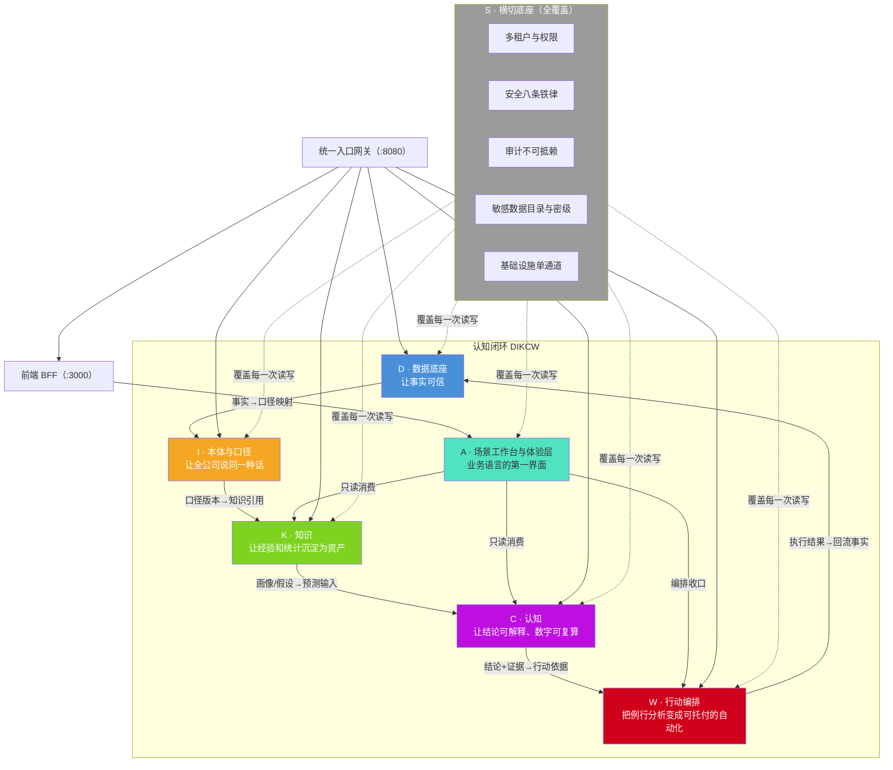
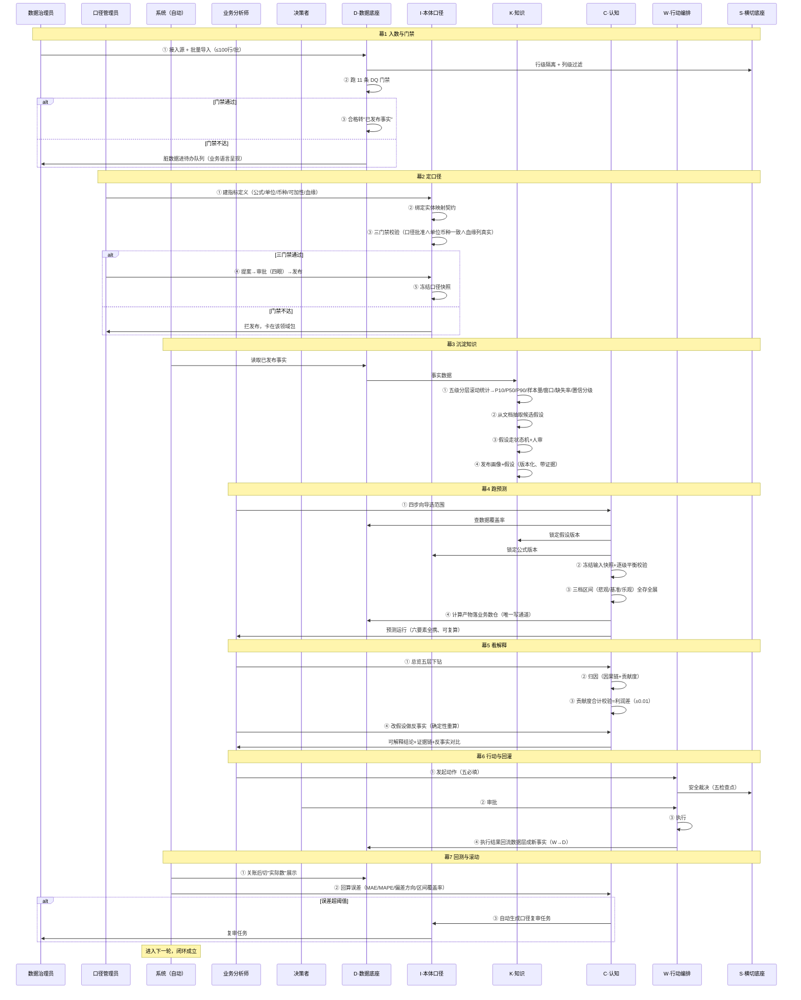
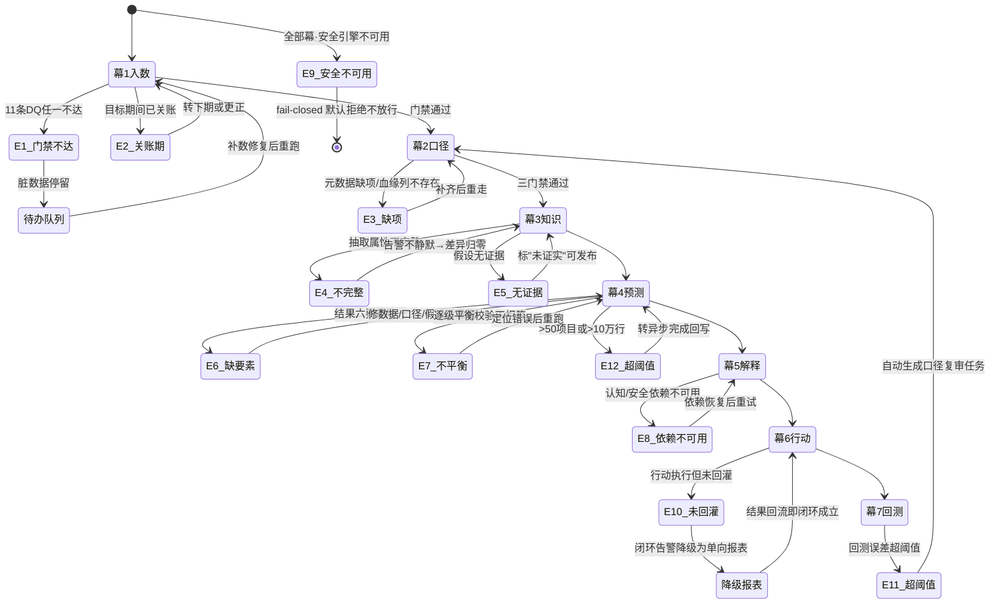
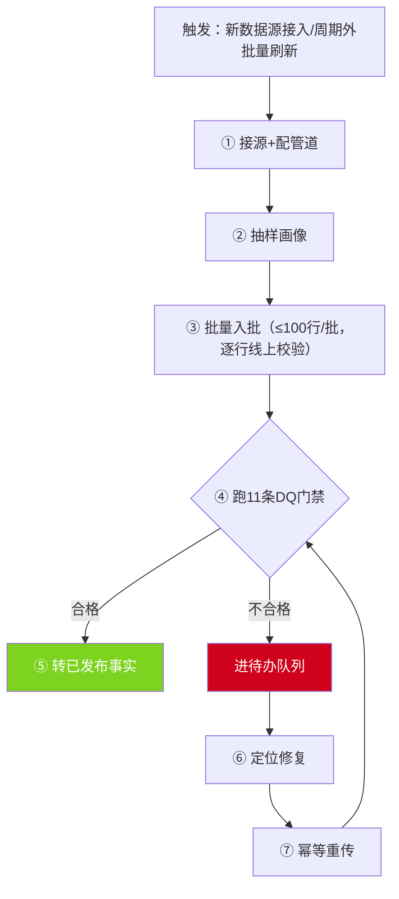
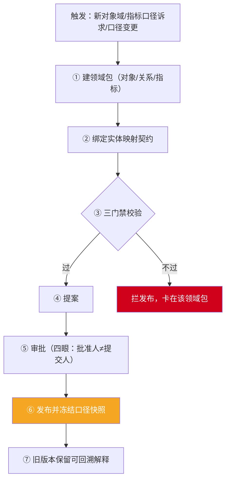
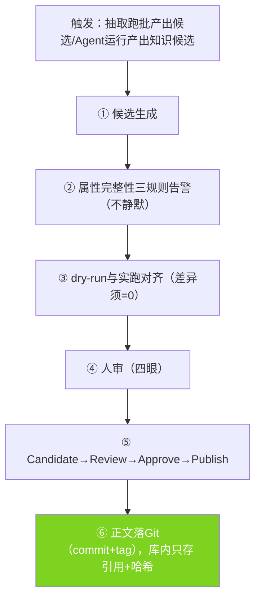
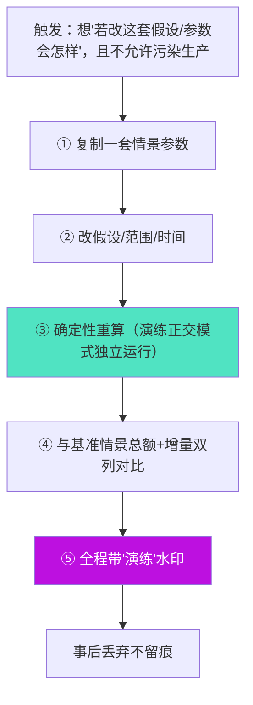
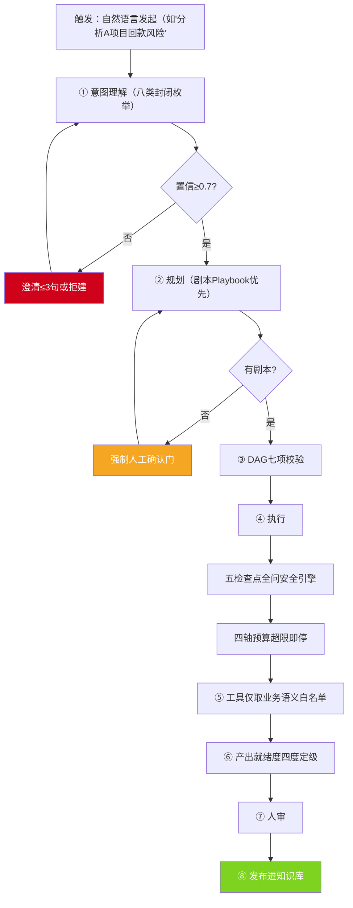
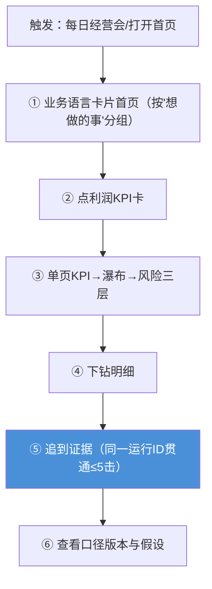

# ECOS 功能结构图与场景映射图

> 来源: 资深需求工程师 + 资深软件设计师 | 日期: 2026-10-12 | 责任人: PMO
> 版本: v1.1（R5 产品结构轮，2026-10-14）
> 追溯: ECOS需求规格说明书 v2.1-R5（§3 业务场景 + §4 六节能力域 38 张需求卡 + §3.3 CDE 八段契约）
> 效力: 本文档是功能结构、场景路径、双向映射的**设计侧产出**，用于开发与测试团队理解需求并开展后续工作。所有功能点、场景路径均**可追溯到需求册 REQ 编号**。
>
> **v1.1 沿革（R5）**：与需求册 v2.1-R5 同步——① §4.4 认知模块撤销，原「知识资产查询」并入 §4.3 并统一命名「认知资产」（K1~K5 + C1/C4/C5）；② Mind 心智构建（需求卡 C6）迁入 §4.4 经营决策与场景工作台（与 C2 因果诊断 / C3 反事实同归）；③ 原 §4.5 W Agent 更名「AI 工作台」，W Agent 降级为系统内置 Agent 编排模板；④ 原 §4.7 顺位 §4.6。**139 项 REQ 编号不变**。本文保留七能力域技术视图，并新增 R5 四模块产品视图注（§1.1 / §1.2 / §1.3）。

---

## 〇、阅读导引

| 章节 | 内容 | 用途 |
|:--|:--|:--|
| §一 | 功能结构图（七能力域 → 子模块 → 功能节点三层树 + 调用依赖；R5 附四模块产品视图注） | 开发团队定位"我做的功能在哪个域、属于哪张需求卡" |
| §二 | 业务场景图（典型场景七幕 + 六支撑场景，每条含操作路径/系统响应/数据流转） | 测试团队按场景路径设计端到端用例 |
| §三 | 双向映射矩阵（场景 ↔ 功能模块互查表） | 确保无功能点遗漏、无场景脱节 |
| 附录 A | 功能点全覆盖校验清单（38 张需求卡 × 7 能力域） | 需求覆盖率核验 |
| 附录 B | 场景全覆盖校验清单（7 幕 + 6 支撑 + CDE 八段） | 场景覆盖率核验 |

---

## 一、功能结构图

### 1.1 总览：能力域层级树（R5：能力域视图 ↔ 四模块产品视图）

> 架构铁律 §0.2 主权三分：编排权（场景工作台）、业务规则主权（本体/口径/模型）、数据写入权（数据引擎）分立。下图展示 D→I→K→C→W→A 主认知链 + S 横切底座的层级归属与调用方向（**能力域视图**）。
>
> **R5 双视图对照**：本图与 §1.2 采用**七能力域**（D/I/K/C/W/A/S）刻画技术结构；**产品界面**按**四模块**组织（不把技术域并列暴露给用户）：**经营决策**（`#/decision`，承载场景工作台 A1~A6 + Mind 心智构建 C6 + 因果诊断 C2 / 反事实 C3）、**认知资产**（`#/assets`，= §4.3，K1~K5 + C1/C4/C5）、**AI 工作台**（`#/aiwork`，= §4.5，W1~W7 + W Agent 内置编排模板）、**平台管理**（`#/admin`，= §4.6，S1~S5）。能力域 ↔ §4.x 章节映射：D/I → §4.1、§4.2；K + C1/C4/C5 → §4.3；A + C2/C3/C6 → §4.4；W → §4.5；S → §4.6。**139 项 REQ 编号不变**。



### 1.2 功能节点树（能力域 → 子模块 → 功能节点）

> 38 张需求卡（D1-D5 / O1-O4 / K1-K5 / C1-C6 / W1-W7 / A1-A6 / S1-S5）的完整归属树。每张卡尾部关联 REQ 编号见需求册附录 A。
>
> **R5 双视图（2026-10-14，需求册 v2.1-R5）**：能力域（架构视角 D/I/K/C/W/A/S）与**产品模块（界面视角）**并存，映射如下——`D/I → §4.1 数据底座 / §4.2 本体与口径`；`K + C1/C4/C5 → §4.3 认知资产`；`C2/C3 + A（含 Mind 心智构建）→ §4.4 经营决策与场景工作台`；`W → §4.5 AI 工作台`（原「W Agent」模块更名，W Agent 降级为系统内置 Agent 编排模板，与数据/本体/知识智能体同级）；`S → §4.6 平台与横切能力`。**产品主导航四入口**：经营决策 `#/decision` / 认知资产 `#/assets` / AI 工作台 `#/aiwork` / 平台管理 `#/admin`。139 项 REQ 编号不变。

#### D · 数据底座（5 张卡）

```
D · 数据底座（让事实可信）
├── D1 · 五类业务事实模型（REQ-DATA-01）
│   ├── 归属关系事实
│   ├── 环节计划/实际事实
│   ├── 资源事实
│   ├── 成本分摊事实
│   └── 预测输入快照事实
├── D2 · 发布前质量门禁（REQ-DATA-02 / REQ-DATA-09）
│   ├── 11 条 DQ 规则门禁（完整性/一致性/及时性等六维度）
│   ├── 异常进待办队列（业务语言呈现）
│   └── 禁止静默缺省值兜底
├── D3 · 批量导入可用（REQ-DATA-03）
│   ├── 三套模板（项目/合同/成本）
│   ├── 逐行在线校验 + 逐行反馈
│   └── 幂等重传（业务键去重）
├── D4 · 管道与告警分级（REQ-DATA-04）
│   ├── 受控管道（超时熔断）
│   ├── 失败升级告警（5min/15min/1h/24h 四档）
│   └── 拒绝 >30 分钟长任务
└── D5 · 统一数据湖分层与读写边界（REQ-DB-05 / REQ-DB-06）
    ├── 四层分层（RAW/CURATED/SEMANTIC/APPLICATION）
    ├── 知识库双形态
    └── 各角色读写边界固定（本体/知识层禁止直读 RAW）
```

#### I · 本体与口径（4 张卡）

```
I · 本体与口径（让全公司说同一种话）
├── O1 · 领域包发布栈（REQ-ONTO-01）
│   ├── 对象/关系/指标随领域包管理
│   ├── 提案 → 审批 → 版本发布
│   └── 发布三门禁（口径已批准 ∧ 单位币种一致 ∧ 血缘列真实存在）
├── O2 · 口径元数据完备（REQ-ONTO-02）
│   ├── 口径 ID / 公式版本 / 口径快照冻结
│   ├── 可加性 / 期间粒度 / 币种 / 血缘
│   └── 历史结论按当时口径快照解释
├── O3 · 映射契约稳定（REQ-ONTO-03）
│   ├── 实体映射是知识抽取的唯一契约入口
│   ├── 映射字段只增不改（改/删须新版本）
│   └── 预测场景口径 = 本体口径的业务实例（引用视图）
└── O4 · 函数沙箱可信（REQ-ONTO-04）
    ├── 受限聚合白名单
    ├── 5 秒超时
    ├── 缓存主动失效
    └── 审计上下文缺失直接拒收
```

#### K · 知识（5 张卡 · R5 并入 §4.3 认知资产）

> **R5 归属**：K1~K5 与 C1（查询契约）/ C4（模型注册表）/ C5（产物落位）在 **§4.3 认知资产**下合并，统一命名「认知资产」，前端主入口为认知资产中心（`#/assets`）；知识→画像→假设→模型→产物的查询链路保持完整。

```
K · 知识（让经验和统计沉淀为可引用的资产）
├── K1 · 数值画像规格化（REQ-KB-08 / REQ-KB-02）
│   ├── 五级分层滚动统计
│   ├── P10/P50/P90 + 样本量 + 窗口 + 缺失率 + 置信分级
│   ├── 画像四要素必录（缺一不可被预测引用）
│   └── 画像 = 预测区间的唯一来源（须经明确推导机制）
├── K2 · 假设版本化与状态机（REQ-KB-03）
│   ├── 状态机：草稿→待批→已批准→过期/被替代
│   ├── 增量/绝对双语义
│   ├── 无证据假设标"未证实"（可用性按用途分级）
│   └── Resolvable ≠ EligibleForUse
├── K3 · K/C 对象边界（REQ-KB-06）
│   ├── 知识类对象封闭枚举 + 防膨胀机制
│   └── 认知类对象经知识通道写入必拒
├── K4 · 回流正发路径（REQ-KB-07 / REQ-SEC-08 / REQ-WAG-23）
│   ├── Candidate → Review → Approve → Publish 正发链路
│   ├── 正文存 Git（commit + tag），库内只存引用与哈希
│   └── 审批四眼原则（批准人 ≠ 提交人）
└── K5 · 抽取诚实（REQ-KB-01 / REQ-KB-05）
    ├── 属性完整性三规则只告警不静默
    ├── dry-run 与真实执行结果差异 = 0
    └── 缺失浮到界面，不脑补
```

#### C · 认知（6 张卡 · R5 拆入 §4.3 / §4.4）

> **R5 归属**：C1（查询契约）/ C4（模型注册表）/ C5（产物落位）随认知对象资产归 **§4.3 认知资产**；C2（因果诊断）/ C3（反事实）/ C6（Mind 心智聚合根，R4 新增）随场景上下文归 **§4.4 经营决策与场景工作台**。

```
C · 认知（让结论可解释、数字可复算 · R5 归属见上）
├── C1 · 四类认知查询契约（REQ-COG-01 / REQ-API-02）
│   ├── 检测端点（发生了什么）
│   ├── 操作评估端点（会怎样）
│   ├── 假设端点（如果改…会怎样）
│   ├── 信念端点（该怎么相信）
│   ├── 证据等级三级标注（L1 核算/L2 模型归因/L3 因果主张）
│   └── 空结果如实返回空（禁 200 空体）
├── C2 · 领域化因果诊断（REQ-COG-02）
│   ├── 绑定具体预测运行
│   ├── 因果链 + 贡献度 + 证据引用
│   ├── 贡献度合计 = 利润差额（±0.01）
│   ├── 贡献度禁 LLM 生成（确定性计算）
│   └── CAUSES/AFFECTS/CORRELATES 三类型语义区分
├── C3 · 反事实由运行驱动（REQ-COG-03）
│   ├── 情景差分 = 确定性重算
│   ├── 探索性实验标"非核算口径"
│   └── 情景差分 ≠ 因果反事实（不可混用）
├── C4 · 认知模型注册表与四门禁（REQ-COG-07 / REQ-COG-04 / REQ-COG-05）
│   ├── 模型分类枚举冻结
│   ├── 四门禁（契约/回归/回测/校准）
│   ├── 版本不可变（演进走替代链）
│   ├── Agent 对注册表只读不写
│   └── LLM 型模型制度性禁止写入概率与金额
├── C5 · 产物落位纪律（REQ-COG-09 / REQ-DB-02）
│   ├── 确定性计算产物落业务数仓（经数据引擎唯一写通道）
│   ├── 认知引擎自身不建业务事实表
│   └── 认知引擎不落盘推理中间结果
└── C6 · Mind 心智聚合根（REQ-COG-01 / REQ-COG-04 / REQ-COG-07，R4 新增；R5 迁入 §4.4）
    ├── 六段结构（认知上下文/信念/认知假设/证据关联/解释结构/演化治理）
    ├── 三维状态分离（有效性/审查治理/业务采纳，三轴独立、禁合并单 status）
    └── 候选更新闸门（提交→复核→写入；W Agent 提候选，禁直接改认知状态）
```

#### W · AI 工作台（7 张卡 · R5 更名）

> **R5 更名**：原「W Agent」模块正式更名为 **AI 工作台**，定位为智能体构建、编排与治理的统一平台，覆盖智能体全生命周期；**W Agent 从独立模块降级为 AI 工作台下的系统内置 Agent 编排模板**，与对内服务的数据智能体、本体智能体、知识智能体保持同级模板定位。

```
W · AI 工作台（原「W Agent」更名；W Agent 降级为系统内置 Agent 编排模板）
├── W1 · 理解与澄清（REQ-WAG-05/06/07）
│   ├── 自然语言 → 受控意图（八类封闭枚举）
│   ├── 置信 <0.7 拒建任务（单轮最多澄清 3 句）
│   ├── 推断槽位可见可改
│   └── 目标改口径/范围/时间触发新版本
├── W2 · 计划（剧本优先 + 探索性人工确认）（REQ-WAG-12/13）
│   ├── 剧本 Playbook 优先、LLM 只补参
│   ├── 无剧本探索性计划 → 强制人工确认门
│   ├── DAG 表达 + 执行前七项校验
│   └── 重规划必须重校验
├── W3 · 执行受预算与状态机约束（REQ-WAG-11/15）
│   ├── 四轴硬预算（步数/Token/成本/墙钟）
│   ├── 运行状态机冻结
│   ├── Run 幂等
│   ├── 异步任务与事件唤醒走平台底座
│   └── 行动五阶段（Intent→Proposal→Authorization→Execution→Effect）
├── W4 · 工具受契约与权限约束（REQ-WAG-07/17/18/19）
│   ├── 工具 17~24 要素全量登记
│   ├── 无权工具不进上下文
│   ├── 渐进披露检索
│   └── 禁通用 CRUD/SQL 直递给 Agent
├── W5 · 安全接线与自动化等级（REQ-SEC-06 / REQ-WAG-21/22/10 / REQ-AI-09）
│   ├── 五道裁决检查点（计划前/步前/步后/提交前/输出前）
│   ├── 自动化等级 L0~L3 只降不升
│   ├── 工具错误率超阈值自动熔断
│   ├── 全局 Kill Switch 一键停
│   └── 等级有效上限受七因素约束
├── W6 · 产出治理（证据 + 就绪度）（REQ-WAG-08/24 / REQ-AI-03）
│   ├── 就绪度四度评估定级（确定性计算给出）
│   ├── 关键结论证据覆盖率 100%
│   ├── 数字与核算一致性校验（最多重生成 2 次）
│   └── 所有产出走候选—人审—发布路径
└── W7 · 事件与承载（REQ-AI-03 / REQ-PLT-29）
    ├── 平台统一信封 + 既有 topic 基线
    ├── Token 计量 + 全链 trace + 可回放
    └── 跨租户场景 = 0
```

#### A · 经营决策与场景工作台（6 张卡 A1~A6 · R5 并入 §4.4；承载 Mind 心智构建 C6 与因果诊断 C2 / 反事实 C3）

> **R5 归属**：场景工作台并入 **§4.4 经营决策与场景工作台**（内容 A1~A6）；原 §4.4 的 Mind（心智构建/管理，需求卡 **C6**）整体迁入本域承载，心智构建流程遵循认知对象关系模型（Mind 聚合根六段 + 三维状态 + 候选更新闸门）；因果诊断（**C2**）与反事实推演（**C3**）随场景上下文一并归本域（C 类对象详见 C 域）。

```
A · 经营决策与场景工作台（业务语言的第一界面 · 含 Mind 心智构建）
├── A1 · 业务语言入口与场景完整度（REQ-WS-01/02 / REQ-PLT-13）
│   ├── 三层导航按"想做的事"组织
│   ├── 场景完整度 = 连接覆盖率（分母固定为 3）
│   └── 孤岛资源禁止激活
├── A2 · 预测向导与利润单页下钻（REQ-FE-01/02/04）
│   ├── 四步向导跑预测
│   ├── 单页 KPI→瀑布→风险→明细→证据五层下钻
│   ├── 同一运行 ID 贯通全链、≤5 击到证据
│   └── 情景比较总额+增量双列、色盲三重标识
├── A3 · 演练隔离（REQ-WS-04）
│   ├── 沙盘演练正交模式独立运行
│   ├── 整链禁止写生产事实（只读隔离）
│   └── 水印常驻不可关
├── A4 · 诚实呈现红线（REQ-FE-12 / REQ-SEC-03）
│   ├── 数字必显来源
│   ├── 脱敏显示"已脱敏"非空串
│   ├── 权限四态界面（允许/脱敏/拒绝/待审）
│   └── 降级运行显示"非实时/降级"标注
├── A5 · 体验工程纪律（REQ-FE-09/10/11/13）
│   ├── 全界面多语言 + 四套主题令牌化
│   ├── 移动端只读总览复用统一组件
│   ├── 密钥永不回显
│   ├── 阈值一律来自配置
│   └── 流式承流依赖前置件、兜底显降级
└── A6 · 新建场景（REQ-WS-01 / REQ-WS-02，R4 新增）
    ├── 总览一键创建业务场景 → 跳转详情
    ├── 表单：名称必填 / 业务目标 / 模板选择 / 初始口径
    ├── 名称缺失阻断创建，成功后以草稿态入库
    └── 仅登记业务上下文，不触发资源配置与激活
```

#### S · 平台与横切能力（5 张卡 · R5 顺位为 §4.6）

> **R5 顺位**：原 §4.7 顺位为 **§4.6 平台与横切能力**，内容不变。

```
S · 平台与横切能力（多租户、安全、审计、运维面 · R5 顺位为 §4.6）
├── S1 · 多租户与权限（REQ-PLT-24/25 / REQ-SEC-10/11）
│   ├── 一套代码服务多租户
│   ├── 新表强制携带租户/组织/行版本
│   ├── 隔离裁决由安全引擎单点执行
│   ├── 角色覆盖平台管理/数据治理/本体治理/模型治理/审计
│   ├── 新增模型管理员/认知模型负责人两角色
│   └── 小样本聚合保护（分组 <5 抑制/上卷）
├── S2 · 安全八条铁律全链路（REQ-NF-01 / REQ-SEC-02 / REQ-PLT-20）
│   ├── 行级隔离 → 列级过滤 → 脱敏 → 策略裁决 → 审计 → 默认拒绝 → 禁自实现 → 集成强制检查
│   ├── 安全组件不可用 → fail-closed
│   └── 集成强制检查进 CI
├── S3 · 审计不可抵赖（REQ-PLT-22 / REQ-SEC-04/09）
│   ├── 写操作经消息总线统一落审计
│   ├── 哈希链按租户分链
│   ├── 戳记失败即拒绝
│   └── 锚定对象存储防篡改
├── S4 · 敏感数据目录与密级治理（REQ-SEC-01 / REQ-SEC-07）
│   ├── S2/S3 分级目录驱动页面/导出/AI 三通道脱敏
│   ├── 模型出网密级上限
│   └── 出网模型默认比内网低一档
└── S5 · 基础设施单通道 + 契约与运维面（REQ-PLT-21/26/27/04 / REQ-API-01 / REQ-FE-09）
    ├── 外部 DB 连接/对象存储/Git 归档/LLM 调用/调度/事件/配置字典各经唯一底座
    ├── API 契约机器可读单源
    ├── 未挂契约新端点 CI 拒绝
    ├── CLI 只映射契约、走统一网关
    ├── 模块与部署基线只减不增
    └── 引擎禁依赖业务服务（依赖方向门禁）
```

### 1.3 核心功能调用与依赖关系矩阵

> 纵轴=调用方，横轴=被调用方，●=直接调用，○=间接消费，×=禁止依赖。

| 调用方 ↓ \ 被调用方 → | D 数据底座 | I 本体口径 | K 知识 | C 认知 | W 行动编排 | A 场景工作台 | S 横切底座 |
|:--|:--:|:--:|:--:|:--:|:--:|:--:|:--:|
| **D 数据底座** | — | × | × | × | × | × | ● |
| **I 本体口径** | ●（读事实） | — | × | × | × | × | ● |
| **K 知识** | ●（读事实） | ●（读口径版本） | — | × | × | × | ● |
| **C 认知** | ●（写计算产物） | ●（读口径快照） | ●（读画像/假设） | — | × | × | ● |
| **W 行动编排** | ●（回灌事实） | ●（读口径） | ●（写候选） | ●（读认知结果） | — | × | ● |
| **A 场景工作台** | ○（只读） | ○（只读） | ○（只读） | ●（编排调用） | ●（编排收口） | — | ● |
| **S 横切底座** | ●（覆盖） | ●（覆盖） | ●（覆盖） | ●（覆盖） | ●（覆盖） | ●（覆盖） | — |

> **依赖方向铁律**：D→I→K→C→W 单向；W→D 回灌；A 编排 C 和 W（只读 K/C）；S 覆盖全部。引擎禁止反向依赖业务服务（架构铁律 §0.2 主权三分）。

> **R5 四模块映射注**：上表轴（D/I/K/C/W/A/S）为**能力域**（技术结构），依赖方向铁律**不变**；R5 产品界面按**四模块**归并，映射为——**经营决策**（`#/decision`：A 场景工作台 + C 认知中的诊断/推演/Mind）、**认知资产**（`#/assets`：K 知识 + C 认知中的查询契约/模型注册表/产物落位）、**AI 工作台**（`#/aiwork`：W 行动编排/W Agent）、**平台管理**（`#/admin`：S 横切底座）。四模块归并**仅改变界面组织与 §4.x 章节归属**，不改能力域间的调用与禁止依赖关系。

---

## 二、业务场景图

### 2.1 典型场景：企业年度经营预测（七幕全链路）

> 场景来源：需求册 §3.1。七幕是**顺序主干**，每幕含门禁判定与异常降级分支。下图为操作路径 + 系统响应 + 数据流转的完整执行链路。

#### 2.1.1 七幕主路径时序图



#### 2.1.2 关键异常与降级分支图

> 来源：需求册 §3.1.3。12 条异常路径与主路径同等重要。



### 2.2 六个支撑场景图

> 来源：需求册 §3.2。每条含触发条件、流程步骤（含判定分支）、异常/边界。

#### 场景一：数据治理与质量闭环



**异常/边界**：脏数据只进待办不静默缺底；已关账期间拒写；单批超 100 行拆批。
**覆盖功能模块**：D1 五类事实模型 / D2 质量门禁 / D3 批量导入 / D4 管道告警 / S2 安全铁律。

#### 场景二：本体建模与发布



**异常/边界**：元数据缺项/血缘列不存在即卡发布；映射契约字段只增不改；预测场景口径不另立第五套表。
**覆盖功能模块**：O1 领域包发布栈 / O2 口径元数据完备 / O3 映射契约稳定 / O4 函数沙箱 / S3 审计。

#### 场景三：知识提炼与回流



**异常/边界**：无证据假设标"未证实"徽标可发布；安全组件不可用即拒收；K/C 对象互斥。
**覆盖功能模块**：K1 数值画像 / K2 假设版本化 / K3 K/C 对象边界 / K4 回流正发路径 / K5 抽取诚实 / S2 安全。

#### 场景四：沙盘演练



**异常/边界**：整链禁写生产事实（只读隔离）；事后丢弃不留痕；水印常驻不可关。
**覆盖功能模块**：A3 演练隔离 / C3 反事实由运行驱动 / A2 预测向导 / C5 产物落位纪律。

#### 场景五：Agent 辅助分析



**异常/边界**：越权/超预算即熔断；全局 Kill Switch 可停；Tool 错误率超阈值自动降级；产出必须带证据链。
**覆盖功能模块**：W1 理解与澄清 / W2 计划 / W3 执行 / W4 工具 / W5 安全接线 / W6 产出治理 / W7 事件 / K4 回流正发 / S2 安全。

#### 场景六：经营总览日常使用



**异常/边界**：界面上任何数字必显来源；脱敏不显空串（显"已脱敏"）；降级/非实时显标注。
**覆盖功能模块**：A1 业务语言入口 / A2 预测向导 / A4 诚实呈现 / A5 体验工程 / S4 敏感数据目录。

### 2.3 CDE 认知决策事件八段流转图

> 来源：需求册 §3.3。CDE 是跨域语义契约，非新部署模块。八段回答一次完整经营问题处理全过程。

```mermaid
flowchart LR
    SIT["① Situation<br/>情境<br/>当前要解决什么经营问题"] --> EVI["② Evidence<br/>证据<br/>有哪些已发布事实/知识/假设"]
    EVI --> REA["③ Reasoning<br/>推理<br/>依据什么模型/公式/输入得出结论"]
    REA --> EVA["④ Evaluation<br/>评估<br/>结论是否可信/方案是否值得/执行是否允许"]
    EVA --> DEC["⑤ Decision<br/>决策<br/>有哪些备选方案、最终选了什么"]
    DEC --> ACT["⑥ Action<br/>行动<br/>执行什么操作、预期改变哪些指标"]
    ACT --> EFF["⑦ Effect<br/>效果<br/>实际发生了什么、与预期差多少"]
    EFF --> LEA["⑧ Learning<br/>学习<br/>哪些假设被支持/推翻，哪些规则需复审"]
    LEA -.->|新事实回流、知识更新| SIT

    style SIT fill:#4A90D9,color:#fff
    style EVI fill:#F5A623,color:#fff
    style REA fill:#7ED321,color:#fff
    style EVA fill:#BD10E0,color:#fff
    style DEC fill:#D0021B,color:#fff
    style ACT fill:#50E3C2,color:#333
    style EFF fill:#9B9B9B,color:#fff
    style LEA fill:#B8D8E8,color:#333
```



---

## 三、双向关联映射矩阵

### 3.1 场景 → 功能模块（每个场景用了哪些功能）

| 场景 | 幕/段 | D1 | D2 | D3 | D4 | D5 | O1 | O2 | O3 | O4 | K1 | K2 | K3 | K4 | K5 | C1 | C2 | C3 | C4 | C5 | W1 | W2 | W3 | W4 | W5 | W6 | W7 | A1 | A2 | A3 | A4 | A5 | S1 | S2 | S3 | S4 | S5 |
|:--|:--|:--:|:--:|:--:|:--:|:--:|:--:|:--:|:--:|:--:|:--:|:--:|:--:|:--:|:--:|:--:|:--:|:--:|:--:|:--:|:--:|:--:|:--:|:--:|:--:|:--:|:--:|:--:|:--:|:--:|:--:|:--:|:--:|:--:|:--:|:--:|:--:|:--:|
| **典型场景·幕1** | 入数与门禁 | ● | ● | ● | ● | | | | | | | | | | | | | | | | | | | | | | | | | | | | | | ● | ● | ● | | ● |
| **典型场景·幕2** | 定口径 | | | | | | ● | ● | ● | ● | | | | | | | | | | | | | | | | | | | | | | | | | ● | ● | ● | | ● |
| **典型场景·幕3** | 沉淀知识 | ● | | | | | | ● | ● | | ● | ● | ● | | ● | | | | | | | | | | | | | | | | | | | | ● | ● | ● | | ● |
| **典型场景·幕4** | 跑预测 | ● | | | | ● | ● | ● | | ● | ● | ● | | | | | ● | | ● | ● | | | | | | | | | | | | | | | ● | ● | ● | | ● |
| **典型场景·幕5** | 看解释 | | | | | | | ● | | | | ● | | | | ● | ● | ● | | | | | | | | | | | | ● | | | ● | | ● | ● | ● | ● | ● |
| **典型场景·幕6** | 行动与回灌 | ● | | | | | | | | | | | | | ● | | | | | | | ● | ● | ● | ● | ● | ● | ● | | | | | ● | | ● | ● | ● | ● | ● |
| **典型场景·幕7** | 回测与滚动 | | | | | | | ● | | | | | | | | | ● | | | ● | | | | | | | | | | | | | | | | ● | ● | ● | | ● |
| **支撑·数据治理** | — | ● | ● | ● | ● | | | | | | | | | | | | | | | | | | | | | | | | | | | | | | ● | ● | ● | | ● |
| **支撑·本体建模** | — | | | | | | ● | ● | ● | ● | | | | | | | | | | | | | | | | | | | | | | | | | ● | ● | ● | | ● |
| **支撑·知识提炼** | — | | | | | | | ● | | | ● | ● | ● | ● | ● | | | | | | | | | | | | | | | | | | | | ● | ● | ● | ● | ● |
| **支撑·沙盘演练** | — | | | | | | | | | | | ● | | | | | | | ● | | ● | | | | | | | | | ● | ● | | ● | | | ● | | | | ● |
| **支撑·Agent辅助** | — | | | | | | | | | | | | | | ● | | ● | | | | | ● | ● | ● | ● | ● | ● | ● | | | | | ● | | ● | ● | ● | ● | ● |
| **支撑·经营总览** | — | | | | | | | ● | | | | ● | | | | | ● | | | | | | | | | | | | | ● | ● | | ● | ● | ● | ● | ● | ● | ● |

> 读法：●=该场景直接使用该功能卡。空白=该场景不直接使用。S1-S5 作为横切底座，理论上覆盖全部场景，表中仅标注该场景中 S 域有明显交互的卡。

### 3.2 功能模块 → 场景（每个功能卡被哪些场景覆盖）

| 功能卡 | REQ 编号 | 覆盖场景 | 覆盖率 |
|:--|:--|:--|:--:|
| **D1** 五类事实模型 | REQ-DATA-01 | 典型幕1/幕3/幕4/幕6、支撑·数据治理 | 5/13 |
| **D2** 质量门禁 | REQ-DATA-02/09 | 典型幕1、支撑·数据治理 | 2/13 |
| **D3** 批量导入 | REQ-DATA-03 | 典型幕1、支撑·数据治理 | 2/13 |
| **D4** 管道与告警 | REQ-DATA-04 | 典型幕1、支撑·数据治理 | 2/13 |
| **D5** 数据湖分层 | REQ-DB-05/06 | 典型幕4、支撑·沙盘 | 2/13 |
| **O1** 领域包发布 | REQ-ONTO-01 | 典型幕2/幕7、支撑·本体建模 | 3/13 |
| **O2** 口径元数据 | REQ-ONTO-02 | 典型幕2/幕3/幕4/幕5/幕7、支撑·本体建模、经营总览 | 6/13 |
| **O3** 映射契约 | REQ-ONTO-03 | 典型幕2/幕3、支撑·本体建模 | 3/13 |
| **O4** 函数沙箱 | REQ-ONTO-04 | 典型幕2/幕4、支撑·本体建模 | 3/13 |
| **K1** 数值画像 | REQ-KB-08/02 | 典型幕3/幕4/幕5、支撑·知识提炼、沙盘、经营总览 | 5/13 |
| **K2** 假设版本化 | REQ-KB-03 | 典型幕3/幕4/幕5、支撑·知识提炼、经营总览 | 4/13 |
| **K3** K/C 对象边界 | REQ-KB-06 | 典型幕3、支撑·知识提炼 | 2/13 |
| **K4** 回流正发路径 | REQ-KB-07 | 典型幕6、支撑·知识提炼、Agent 辅助 | 3/13 |
| **K5** 抽取诚实 | REQ-KB-01/05 | 典型幕3、支撑·知识提炼 | 2/13 |
| **C1** 四类查询契约 | REQ-COG-01 | 典型幕5/幕7、支撑·Agent、经营总览 | 3/13 |
| **C2** 因果诊断 | REQ-COG-02 | 典型幕5/幕7 | 2/13 |
| **C3** 反事实 | REQ-COG-03 | 典型幕5、支撑·沙盘 | 2/13 |
| **C4** 模型注册表 | REQ-COG-07 | 典型幕4/幕7 | 2/13 |
| **C5** 产物落位 | REQ-COG-09 | 典型幕4、支撑·沙盘 | 2/13 |
| **C6** Mind 心智聚合根 | REQ-COG-01/04/07 | 典型幕5/幕7、支撑·经营总览 | 3/13 |
| **W1** 理解与澄清 | REQ-WAG-05 | 典型幕6、支撑·Agent | 2/13 |
| **W2** 计划 | REQ-WAG-12 | 典型幕6、支撑·Agent | 2/13 |
| **W3** 执行 | REQ-WAG-11 | 典型幕6、支撑·Agent | 2/13 |
| **W4** 工具 | REQ-WAG-07 | 典型幕6、支撑·Agent | 2/13 |
| **W5** 安全接线 | REQ-SEC-06 | 典型幕6、支撑·Agent | 2/13 |
| **W6** 产出治理 | REQ-WAG-08 | 典型幕6、支撑·Agent | 2/13 |
| **W7** 事件与承载 | REQ-AI-03 | 典型幕6、支撑·Agent | 2/13 |
| **A1** 业务语言入口 | REQ-WS-01 | 典型幕5、支撑·经营总览 | 2/13 |
| **A2** 预测向导 | REQ-FE-01 | 典型幕5、支撑·沙盘、经营总览 | 3/13 |
| **A3** 演练隔离 | REQ-WS-04 | 支撑·沙盘 | 1/13 |
| **A4** 诚实呈现 | REQ-FE-12 | 典型幕5/幕6、支撑·沙盘、Agent、经营总览 | 4/13 |
| **A5** 体验工程 | REQ-FE-09 | 典型幕5、支撑·经营总览 | 2/13 |
| **A6** 新建场景 | REQ-WS-01/02 | 典型幕5、支撑·经营总览 | 2/13 |
| **S1** 多租户与权限 | REQ-PLT-24 | 横切全覆盖 | 13/13 |
| **S2** 安全八条铁律 | REQ-NF-01 | 横切全覆盖 | 13/13 |
| **S3** 审计 | REQ-PLT-22 | 横切全覆盖 | 13/13 |
| **S4** 敏感数据目录 | REQ-SEC-01 | 横切全覆盖 | 13/13 |
| **S5** 基础设施单通道 | REQ-PLT-21 | 横切全覆盖 | 13/13 |

> **覆盖率校验**：38 张功能卡全部被至少 1 个场景覆盖 ✅。S1-S5 横切底座覆盖全部 13 个场景（7 幕 + 6 支撑）✅。无孤立功能卡、无场景脱节 ✅。

---

## 附录 A：功能点全覆盖校验清单

| 域 | 功能卡数 | 需求卡编号 | 全覆盖 |
|:--|:--:|:--|:--:|
| D 数据底座 | 5 | D1-D5 | ✅ |
| I 本体口径 | 4 | O1-O4 | ✅ |
| K 知识 | 5 | K1-K5 | ✅ |
| C 认知 | 6 | C1-C6 | ✅ |
| W 行动编排 | 7 | W1-W7 | ✅ |
| A 场景工作台 | 6 | A1-A6 | ✅ |
| S 横切底座 | 5 | S1-S5 | ✅ |
| **合计** | **38** | — | **✅** |

> 追溯：38 张需求卡对应需求册附录 A 的 139 项 REQ 编号（一对多映射），可通过 `rg "REQ-" docs/20-需求/ECOS需求规格说明书-全新合并版-2026-10-12.md` 溯源。

## 附录 B：场景全覆盖校验清单

| 场景类别 | 场景数 | 来源 | 全覆盖 |
|:--|:--:|:--|:--:|
| 典型场景七幕 | 7 | 需求册 §3.1 | ✅ |
| 支撑场景 | 6 | 需求册 §3.2 | ✅ |
| CDE 八段 | 8 | 需求册 §3.3 | ✅ |
| 异常降级路径 | 12 | 需求册 §3.1.3 | ✅ |
| **合计** | **33** | — | **✅** |

---

> 版本: v1.0 | 2026-10-12 | 状态：待评审
