# ECOS 详细设计说明书（从零实施版）

> 来源: `docs/10-架构/架构设计说明书-2026-09-28.md`（ARCH_SPEC，总纲）+ `docs/30-设计/详细设计-00…10`（十一份分册）+ `.trae/rules/架构铁律.md` v2.1（宪法）+ `.trae/rules/数据库访问规范.md` v1.6（37 条红线）+ `.trae/rules/数据湖存储分层规范.md` v2.0 + `.trae/rules/前端开发规范.md` v1.1 | 日期: 2026-10-12 | 责任人: 架构与设计组
> 版本: v1.0-R12（R12 裁决回写轮 · 2026-10-16）
> 版本沿革: 2026-10-12，R2 语义精化轮：依据外部深度审查 8 项核心问题，新增 CDE 契约与术语体系（§1.17）、知识有效性治理、证据分级、行动五阶段、主权三分、学习四触发；R9 只加不删、无接口/表结构变更。R3 同步修订轮：同步需求册 v2.1-R3 四项针对性修订——§1.1 补 TB 软件定位关系（OLTP/OLAP/ECOS 三层）、§1.2 五条公理→六条公理（新增 A6 安全无旁路）、§1.5 补模型管理员 vs W Agent 权限边界；术语"北极星场景"在设计册无残留，无需替换。R4 关系模型与产品结构轮（2026-10-14）：同步需求册 v2.1-R4——§8.1 新增 8.1.4 认知对象关系模型（Mind 聚合根）并修订能力域解读与 F-CG-02/F-CG-13；§8.4 直接修订 DDL——`ecos_cognitive_mind` 重构为聚合根（六段 + 三维状态 + 版本历史）、新增 `ecos_cognitive_mind_update` 候选更新表、`ecos_cognitive_model` 补九类分类/三期/计算归属/适用限制/IO 契约字段；§8.6.1 认知工作台七 Tab 重组为认知资产中心六 Tab（新增 minds 页与模型分类资产页）；§11.6/§9.6/§10.6 路由导航对齐四模块产品结构（经营决策/认知资产/AI 工作台/平台管理）。
> 版本沿革（续）R5 产品功能结构轮（2026-10-14）：同步需求册 v2.1-R5——原 §4.4 撤销，认知资产 = K1~K5 + C1（查询契约）/C4（模型注册表）/C5（产物落位）+ 证据/信念/模型/成果/治理；C2（因果诊断）/C3（反事实）随场景上下文归「经营决策与场景工作台」，**Mind 构建/管理整体迁入场景工作台**（认知资产中心移除 minds 页）；原 §4.5 W Agent 更名「AI 工作台」并明确其为智能体构建/编排/治理统一平台，W Agent 降级为系统内置 Agent 编排模板（与数据/本体/知识智能体同级）；原 §4.6 场景工作台归并为 §4.4、原 §4.7 顺位 §4.6。本篇同步：§8.6.1 认知资产中心去 minds 页（六 Tab 单实现，Mind 归场景工作台）、场景工作台补 MindTab/心智构建与治理归属；§9.6 追加 R5 说明（第 10 篇 W Agent 编排域一并归「AI 工作台」模块）；第 10 篇 W Agent 编排域标注归「AI 工作台」模块并作为系统内置 Agent 编排模板，不新增模块/JAR/schema/容器、不改 139 项 REQ 编号。**R6 统一 CLI 与 Agent 工具层设计轮（2026-10-14）**：同步需求册 v2.1-R6，新增第 16 篇「统一 CLI 与 Agent 工具层设计（领域 API 调用入口 · 只读 MVP 优先）」，承接需求册 §4.7 与需求卡 CL1~CL7（REQ-CLI-01~14）；CLI 名 `ecos`，是领域 API 统一调用入口而非新引擎，第一阶段严格只读；不新增模块/JAR/schema/容器、不改 139 项基线 REQ 编号。
> 版本沿革（续）R7 控制域 Git 版本管理与双写审计设计并入轮（2026-10-14）：依据《ECOS 控制域 Git 版本管理与双写审计》总体/领域设计（Phase 2~5）与 Phase 0 事实核查《ECOS控制域版本治理现状与差距分析-2026-10-14》，**并入既有 §2.9 版本段落**（§2.9.4 控制域版本治理模型 · 七组件职责映射与统一对象契约与审计字段组与审计四级建议基线；§2.9.5 控制域 Git 仓库规范与数据类型区别处理（**建议结构，非现状**）；§2.9.6 发布/双写 16 态状态机、失败恢复与对账；§2.9.7 图表与「需求—设计—实现」追踪矩阵）。**不新增篇/章编号**（第 11/16 篇等既有编号不动），不新增模块/JAR/schema/容器/服务名/表/协议；未接入资产一律标 `not_available`；审计四级仅为**建议基线**，须与既有 `clearance_level` L0~L4 核对映射后方可生效，**不替换现有安全等级定义**。
> 版本沿革（续）R8 Redis 缓存与一致性治理设计并入轮（2026-10-14）：依据《ECOS 缓存架构与一致性治理》设计前置指令与 Phase 0 事实核查《ECOS缓存现状与差距分析-2026-10-14》，**并入既有 §2.9 版本段落**，新增 §2.9.8「Redis 缓存与一致性治理（**建议基线 · 目标设计 · 非现状**）」——含 14 类缓存对象一致性矩阵、缓存键与命名规范、Cache-Aside/版本化缓存/主动失效与事件驱动/数据库提交与缓存失效顺序四类一致性机制、8 项 `cache_*` 建议审计字段与发布 6 态、权限·安全 8 条红线、性能与容量 10 项、故障处理与降级 9 场景 × 8 要素、可观测性指标、测试与验收矩阵、「需求—设计—实现—测试」追踪矩阵与 Q1~Q10 待决策清单。**不新增篇/章编号**（第 11/16 篇等既有编号不动），不新增模块/JAR/schema/容器/服务名/表/协议；全部为**建议基线/目标设计，非现状**；Outbox/事务性事件发布现状不具备，列为**待建设**。
> 版本沿革（续）R9 Git 控制域安全与可信发布治理设计并入轮（2026-10-15）：同步需求册 v2.1-R9 需求卡 S8（REQ-SEC-15~21 / REQ-PLT-39 / REQ-NF-14），依据 Phase 0 事实核查（2026-10-15），**并入既有 §2.9 版本治理区**，于 §2.9.8 之后新增 §2.9.9「Git 控制域安全与可信发布治理（**建议基线 · 目标设计 · 非现状**）」——含现状审计摘要（R1~R9 可复用能力 / G1~G10 缺口）、五条核心原则与可信链宣言、威胁模型与资产清单（7 资产 × 8 威胁）、Git 访问控制权限矩阵、凭据与敏感信息治理、变更审批五角色职责分离与三档风险审批矩阵、签名发布清单与可信发布、发布前安全校验、Git—领域服务—Redis 信任边界与五条禁止、可信发布时序、独立审计与证据保护（12 项增量审计字段）、备份恢复与事件响应六场景预案、测试与验收矩阵（10 项）、五阶段实施路线、Q1~Q8 待决策清单与「需求—设计—现状—能力」追踪矩阵。**不新增篇/章编号**（第 11/16 篇等既有编号不动），不新增模块/JAR/schema/容器/服务名/表/协议；全部为**建议基线/目标设计，非现状**；实施须另行授权排期。
> 版本沿革（续）R10 规则统一治理与解释分层并入轮（2026-10-15）：同步需求册 REQ-ONTO-05（规则统一治理与解释分层），在第六篇本体域并入——6.1.2 功能清单追加 F6-17、6.2.2 内部件表追加 RuleRegistry、§6.2 末尾新增 6.2.6「规则统一治理与解释分层」（OntologyRule 升级为规则单一事实源 +rule_carrier/scope/version_no/git_ref、三载体边界固化、解析三层复用 CaliberDsl+FunctionValidator、mermaid 链路图、安全与版本化要点）、§6.4 补 ecos_ontology.ecos_ontology_rule 新增列（rule_carrier/scope/version_no/git_ref，R10 扩展接版本治理）。不新增篇/章编号，不新增模块/JAR/schema/容器/服务名/表、不 DROP 列；全部为目标设计·建议基线（现状仅 OntologyRule 雏形，DQ/KB 规则尚未收敛）。
> 版本沿革（续）R11 规则作为行为语言与规则中心并入轮（2026-10-16）：同步需求册 v2.1-R11（§1.5 领域模型总图 + §4.2 O5 五层规则扩展 + §4.3 K6 知识七分类 + §4.6 S9 规则中心；新增 REQ-ONTO-06 / REQ-PLT-40 / REQ-SEC-22 / REQ-KB-10）。在第六篇本体域 **R11 修订 R10 落位**——6.1.2 追加 F6-18、6.2.2 `RuleRegistry` 升格为「规则中心（Rule Center）」登记/路由收口点（目标态待建）、§6.2.6 由「规则统一治理与解释分层」**以显式演进方式**扩为「规则中心（Rule Center）· 规则作为行为语言」（三载体表 → 五层规则执行分发 + 14 组件现状→目标态映射 + OPA=PDP 边界 + 合规=治理子域）、§6.4.4 `ecos_ontology_rule` 增 `rule_layer` 列（与 `ruleType` 正交）；第七篇知识域补 F-KB-18 知识对象七分类（Fact/Concept/Procedure/Rule/Case/Evidence/Pattern，Rule 经 `rule_carrier=KNOWLEDGE_ASSET` 与规则中心同源）；第四篇安全域 §4.2.6 强化 OPA=PDP 定位（仅承接 Policy 层、不管理业务规则）与合规=Governance 子域边界说明。**不新增篇/章编号**（第 11/16 篇等既有编号不动），不新增模块/JAR/schema/容器/服务名/表、不 DROP 列；Rule Center 为横切逻辑能力域（沿用「W Agent 编排域 = ai-engine 内能力域」先例），7 服务部署基线不变；全部为目标设计·建议基线（现状仅 OntologyRule 雏形 + OPA 真实集成，RuleRegistry/Interface 要素/知识七分类枚举均为缺口）。**R10 的落位（并入本体章节）不静默改写，R11 以显式演进承接。**
> 版本沿革（续）R12 **PMO 裁决回写轮（2026-10-16）**：依据 PMO 对 R7~R11 增量 8 项待裁决事项的最终裁定，将裁定**合并回写**至既有章节原位（**不新增篇/章编号**）——§2.9.4④ 审计分级**采用 L1~L4 四级**（「可简化为三级」为允许的降级选项、非默认；仍须与 `clearance_level` L0~L4 / `audit_mode` 核对映射，**不替换既有等级**）；§2.9.5 仓库注册表**定名 `ecos_git_repo`**（`td_git_repository` 作废，补建表 DDL + `repositoryId` 注册种子）；§2.9.6 4 张废弃版本表 **DROP 按原处置建议**（停写 → 读写切 git → `pg_dump` 备份后 DROP）；§2.9.8 Redis **归 runtime 公共底座、由 Runtime 统一管理缓存连接/失效策略/粒度配置**（缓存键隔离与 `X-Org-Id` 偏差一并处置；Outbox/Spring Cache 列入待建设）；§6.2.6 **Rule Center 不升格物理模块**、产品面前端口合入知识工作台（**F-KB-16 新增「规则」Tab**、六 Tab → 七 Tab）、**不引入 Drools 等外部重型规则引擎**（确认）。**不新增模块/JAR/schema/容器/服务名/表/协议；R12 为裁决回写，不新增/删减 REQ 编号。**（同一口径同步落于需求册 §八「R12 裁决登记」、补充需求册 §7、补充设计册 §3.2。）
> 定位: 面向**从零开始的实现者**的唯一完整设计入口。本文只描述**目标态设计**（应当建成什么），不描述任何历史实现、迁移过程或验收取证；与代码现状不一致时，以本文的目标态为待实现差距，不以任何一侧作为"既成事实"反向修改设计。

---

## 0.1 这份文档解决什么问题

ECOS（Enterprise Cognitive Operating System，企业认知操作系统）要交付的是企业级"数据 → 知识 → 认知 → 行动"闭环：把散落在企业各业务库、文档系统、对象存储里的原始数据治理成可信事实，把事实沉淀为可推理的知识（图谱 + 向量 + 统计画像 + 假设），在知识之上做确定性认知（检测、评估、诊断、反事实、规划评审），最后由受治理的 AI 能力（火 W）把认知转化为可审批、可回溯、可度量的行动。

从零实施这套系统时，最容易出问题的不是"某个功能怎么写"，而是**四条全局约束被反复违反**：

1. 数据落点失控 —— 表建在错误的 schema、金额列类型不统一、JSON 进了索引、跨域直查别人的表；
2. 安全裁决旁路 —— 各自实现过滤逻辑、依赖不可用时静默放行、把 5xx 掩成 404、把权限失败渲染成空数据；
3. 底座重复封装 —— 每个引擎各自持数据库/图库/对象存储连接池、各自 `new` 线程池与定时器、各自直连大模型；
4. 数值与文本混淆 —— 让大模型产出金额、让推理结果落库、让同一次计算重跑得到不同结果。

因此本文的编排原则是**先约束、后功能**：第一篇与第二篇把全局契约和数据宪法定死，第十三篇之前的每一篇都在这些约束下展开一个域的功能、技术、接口、数据库、界面设计；第十二篇用一个完整业务场景把所有域串成端到端链路；第十四、十五篇给出跨域接缝与实施路线。

## 0.2 怎么读

| 你的角色 | 最小必读 | 然后读 |
|:--|:--|:--|
| 后端实现者（某域） | 第 1 篇（全局契约、信任链、门禁）+ 第 2 篇（数据宪法 + 该域 ER 图） | 该域对应篇（3～12）+ 第 14 篇该域参与的接缝 |
| 前端实现者 | 第 1 篇 §1.9 全局契约 + 第 13 篇 | 所负责页面对应域的 §N.6 八要素 |
| 数据库 / 治理实现者 | 第 2 篇全篇 | 第 5、6、7、8 篇的数据库节 + 附录 B |
| 架构评审 / 新成员 | 第 1 篇 + 第 2 篇 + 第 12 篇 | 按需下钻 |
| 测试设计 | 第 1 篇 §1.14 门禁矩阵 | 各篇 §N.7 + 第 15 篇验收索引 |

三个阅读约定：

- **术语先查附录 F**。本文对若干词做了强制区分（最典型的是 `W = 五行之「火」= C→W 转化，W ≠ Agent`），术语误用会直接导致模块边界误判。
- **标有「红线」的条目不是建议**。凡引用 IR/DR/EN/ST/DA/MC 编号或写"禁"字的，都是合并门禁的判据，违反即 FAIL。
- **接口与表名以本文为准**。每篇的 `N.3` 与 `N.4` 是该域接口/表的唯一清单来源，附录 A/B 只做汇总，不做新增。

## 0.3 文档结构（从总到分）

```
第一篇 总体设计 ──────────── 系统定位 · 分层 · 模块 · 部署 · 选型 · 全局契约 · NFR · 门禁 · 风险
  │
第二篇 数据架构 ──────────── 数据域二分 · Schema 主权 · 37 红线 · 建表模板 · 五层湖 · 双形态 · ER 图群
  │
  ├── 第三篇  平台入口与横切底座（gateway 单体承流 + runtime 四底座 + 审计事件）
  ├── 第四篇  安全域 护 ─────── 信任链 · RLS/CLS/脱敏/OPA 单点裁决 · 加密与豁免登记
  │
  ├── 第五篇  数据域 土D ────── 采集 · 管道 · DQ · 血缘 · 业务事实 · ecos_dw 唯一写通道
  ├── 第六篇  本体域 金I ────── 对象/关系/域 · 口径与指标主权 · 发布三门禁 · Function · workflow
  ├── 第七篇  知识域 水K ────── 图谱双形态 · 抽取闸链 · RAG · 画像与假设 · 本体快照消费
  ├── 第八篇  认知域 木C ────── Mind 注册 · 检测/评估/诊断/反事实 · 确定性计算 · 不落盘纪律
  ├── 第九篇  智能域 火W ────── llm-gateway 唯一出口 · 工具执行咽喉链 · SSE · 计量与预算
  ├── 第十篇  W Agent 编排域 ── 13 类控制面对象 · Run 状态机 · Tool Contract · Readiness 定级 · Git 发布
  │
  ├── 第十一篇 场景层 ───────── 业务子图 + 横切能力 + 出口三层组合 · 场景工作台
  ├── 第十二篇 端到端场景 ───── 场景年度经营预测：九步闭环与三级平衡
  ├── 第十三篇 前端与 BFF ───── 信息架构 · 状态三层 · 请求单通道 · 主题/i18n/移动端 · 页面八要素
  │
  ├── 第十四篇 端到端时序与跨域接缝
  ├── 第十五篇 实施路线、门禁与验收索引
  ├── 第十六篇 统一 CLI 与 Agent 工具层 ── 三层架构 · Tool Contract · JSON 契约 · 只读 preflight
  └── 附录 A 接口总表 · B 数据表总表 · C 错误码总表 · D 事件与 Topic 总表
      E 模块与端口清单 · F 术语与命名规范 · G 功能—接口—数据—页面追溯矩阵
```

## 0.4 设计源与优先级

本文不是新的设计决策集，而是既有设计资产的**去噪重排**。当各源之间出现口径差异时，按下列优先级取高：

| 优先级 | 源 | 性质 |
|:--|:--|:--|
| 1 | `.trae/rules/架构铁律.md` | 宪法：模块边界、底座收敛、档位机制、术语 |
| 2 | `.trae/rules/数据库访问规范.md`（IR/DR/EN/ST/DA/MC）+ `数据湖存储分层规范.md` | 数据红线与分层宪法 |
| 3 | `docs/10-架构/架构设计说明书`（ARCH_SPEC）+ ADR | 全局架构与决策记录 |
| 4 | `docs/30-设计/详细设计-00…10` 分册 | 域内功能/接口/数据/界面终态 |
| 5 | `.trae/rules/前端开发规范.md`、`Git提交规范.md`、`文档编写规范.md` | 工程与文档纪律 |

凡本文与上述任一源冲突，视为本文编辑错误，以源为准并回改本文；本文各篇之间冲突时，以更下游（编号更大）的域内专篇为准，因其字段级细节更完整。

## 0.5 全局设计图索引

| 图 | 类型 | 所在节 |
|:--|:--|:--|
| 五层功能分层与横切面 | `flowchart TB` + ASCII 盒图 | 1.4 |
| 模块边界与依赖方向（含禁止边） | `graph TB` | 1.6 |
| 部署拓扑（7 JAR + 8 基础设施容器 + 前端） | `flowchart LR` | 1.7 |
| 请求信任链与鉴权 | `sequenceDiagram` | 1.10 |
| DIKCW 主链与 W→D 回环 | `flowchart LR` | 1.11 |
| 审计事件流与失败兜底 | `sequenceDiagram` | 1.11 |
| 三档形态叠加关系 | `flowchart TB` | 1.9 |
| 数据域二分 | `flowchart TB` | 2.1 |
| Schema 主权与只停写遗留 | `graph TB` | 2.2 |
| 业务域五层数据流 | `flowchart LR` | 2.6 |
| 知识层双形态（图谱 ∨ 向量） | `flowchart TB` | 2.7 |
| 跨域读写边界 | `flowchart LR` | 2.10 |
| 控制域 IAM/配置/决策/审计 ER 与列级豁免登记 | `erDiagram` | 2.10.3 |
| 数据域 / 本体域 / 知识域 / 认知域 ER 骨架 | `erDiagram` ×4 | 2.11 |
| DDL 单源到库内生效流程 | `flowchart TB` | 2.12 |
| 统一 CLI 三层架构 | `graph TD` | 16.1 |

## 第1篇　总体设计

### 1.1 系统定位与能力主张

ECOS 是面向企业的经营级认知操作系统，其唯一主张是：**把企业的数据变成可信的判断，并把判断变成受治理的行动**。为此系统必须同时满足四个能力层，缺一即退化为普通 BI 或聊天机器人：

| 能力层 | 交付什么 | 对应域 | 一句话判据 |
|:--|:--|:--|:--|
| 治理层 | 可信事实（带质量状态与血缘） | 数据域 土D | 任何金额可追溯到源表行列与批次 |
| 语义层 | 统一口径与本体（对象/关系/指标） | 本体域 金I | 同一指标全企只有一个口径与版本 |
| 知识层 | 图谱 + 向量 + 统计画像 + 假设 | 知识域 水K | 结论能给出证据链与置信区间 |
| 认知与行动层 | 检测/评估/诊断/反事实/规划 + 受控 AI 行动 | 认知域 木C、智能域 火W、场景层 | 重跑同一输入必得同一数值 |

主数据链按五行生克编排为 **DIKCW 主链**，并由行动回灌数据形成闭环：

```
      格物 (ge)              致知 (zhi)            诚 (cheng)         明 (ming)
土 D ────────→ 金 I ────────→ 水 K ────────→ 木 C ────────→ 火 W
数据治理       本体/口径        图谱/画像/假设     确定性认知         行动与 Agent
  ↑                                                                  │
  └────────────────────────── W → D 行动结果回灌 ─────────────────────┘

横切：护 = security-engine（一切读写的裁决面）    器 = runtime（底座：接入/LLM/调度/事件/监控）
```

其中"格物 / 致知 / 诚 / 明"是四个转化环节的服务层命名（对应 `service/{ge,zhi,cheng,ming}` 的 API 文档占位），不是独立部署单元；**可部署单元只有 7 个 JAR**（见 §1.7）。

> **与传统软件（TB 软件）的定位关系（R3 同步，2026-10-12）**：传统企业软件中，OLTP（联机事务处理）为业务服务——处理订单、库存、收付款等日常交易；OLAP（联机分析处理）为管理者服务——提供报表、多维分析、趋势统计。ECOS 不替代 OLTP 的交易职能，也不替代 OLAP 的报表职能，而是为这两个过程中的**决策**服务：在 OLTP 产出的业务事实与 OLAP 沉淀的历史统计之上，构建从数据到本体、知识、认知、行动的完整决策链路，涵盖两个决策维度——**业务/流程优化决策**（哪个项目该追加投入、哪个流程环节该调优）与**企业管理/经营决策**（明年利润目标从哪来、风险在哪、经营动作怎么排）。ECOS 因此是 OLTP 和 OLAP 之外的"第三层"——认知决策层。此定位决定设计侧的三条硬约束：① 不建交易型 OLTP 表（业务事实只读不增写交易）；② 不建报表型 OLAP 宽表（预测产物落 `ecos_dw` 五层，非物化视图）；③ 与既有 OLTP/OLAP 系统通过受控管道对接，不侵入其内部。

### 1.2 六条设计公理

这六条是全文所有具体规则的"父条款"。任何局部设计若与公理冲突，局部设计作废。

**公理 A1｜数据域二分，主权唯一。** 全库只有两类数据：控制域（平台自身运行数据）与业务域（企业数据资产）。控制域 = 主控制 schema `ecos_control` + 5 个引擎 schema；业务域 = `ecos_dw` 五层 + MinIO + 可选列存。一张表只能有一个属主引擎，非属主写入即违规；业务域 `ecos_dw` 的唯一外部写入口是数据域写通道。

**公理 A2｜默认 DENY，安全只有一个裁决入口。** 所有读写经安全域 `SecurityDecisionService#decide` 产出决策包（行过滤 + 列过滤 + 脱敏 + OPA 义务）。裁决不可用时必须是显式失败（透传 503 并拒绝），禁止放行、禁止返回空集合冒充"无数据"、禁止把 5xx 掩成 404。

**公理 A3｜数值由确定性计算产生，文本由语言模型产生，二者不得互换。** 金额、比率、概率、分位数的唯一来源是确定性计算器（BigDecimal + 显式精度 + 显式舍入）；LLM 只能生成解释文本、检索线索与候选计划，且必须经 llm-gateway 单点。同一次运行的输入快照可定位、可重放、重跑数值差为 0。

**公理 A4｜能力经底座收敛，禁止各自封装。** 数据源 Driver / 对象存储 / 图库池 / Git 客户端只由 `runtime-access` 持有；LLM 调用只由 `llm-gateway` 出口；调度只由 `runtime-task` 的 `ITaskManagementService`；事件只由 `runtime-event` 的 `EventBusService`；配置与字典只经 sysman api 门面。任何引擎内自建上述能力即违规。

**公理 A5｜一套代码三档交付，档位只叠加不减。** standard（仅 PostgreSQL）→ enterprise（+ Neo4j 图谱形态）→ ultimate（+ Doris ∨ ClickHouse 列存，二选一）。生效机制只有 `spring.profiles.active`，Maven profile 只用于依赖裁剪；standard 档禁止实际启动图库与列存。

**公理 A6｜安全无旁路，单点收敛。（R3 新增，2026-10-12）** 企业经营数据散落在多系统中，缺乏统一权限边界与审计追踪；敏感数据（利润、成本、薪酬）裸露可导出；AI 调用外部模型时数据出域不可控；租户间隔离由各模块各自实现，存在穿透风险。ECOS 的回答是安全引擎单点收敛：权限裁决、数据脱敏、列级/行级过滤、审计、外部访问各只有一条通道，任何模块不得自建旁路；安全组件不可用时默认拒绝（fail-closed）；敏感列强制 AES-256-GCM 加密+KMS 托管；AI 外部调用经统一 LLM 出口代理，出域数据自动脱敏；租户隔离由安全引擎单点裁决，各模块禁止各自实现。此公理是公理 A2 的扩展——A2 解决"默认 DENY"的裁决面，A6 解决"安全能力不旁路"的收敛面；二者共同构成"有数据，不安全"顽疾的设计侧回答。

> **主权三分（R2 语义精化，2026-10-12）**：在五条公理之上补充一条跨域主权原则——编排权（谁发起并推进流程）、业务规则主权（谁定义业务含义与规则）、数据写入权（谁写哪类数据）三者可分属不同组件，但必须契约化分离，任一域不得因参与编排而默认取得业务规则定义权；逐域落实见 §1.5 职责边界矩阵，逐对象归属见 §1.17 统一认知契约。

### 1.3 术语与命名红线

| 术语 | 强制含义 | 禁止用法 |
|:--|:--|:--|
| 五引擎 + 横切 | data / ontology / kb / cognitive / ai 五引擎 + security 护 + runtime 器 | 禁写"六引擎" |
| 土D / 金I / 水K / 木C / 火W | 五行代称 = data / ontology / kb / cognitive / ai | 禁与部署 JAR 名混用 |
| **W** | 五行之「火」= **C→W 转化**，即认知到行动的转化域，落在 ai-engine 内 | **禁把 W 解释为 Agent**；"W Agent 编排域"是 ai-engine 内部能力域，不是模块、不是 JAR、不是 schema |
| 控制域 / 业务域 | 数据域二分（A1） | 禁用"应用库/业务库"等模糊说法 |
| `SOURCE/RAW/CURATED/SEMANTIC/APPLICATION` | 业务域五层，权威枚举 = `data-engine-api` 的 `DataLayer` | **禁使用 ODS / DWD / DWS 等层名** |
| 双形态 | 知识层图谱（Neo4j ∨ PG 关系表）+ 向量（pgvector） | 禁把向量写入控制域 schema |
| 在用版本 / 历史版本 | 库内只存在用版本，历史版本走 Git 归档 | 禁在库内堆历史行 |
| 口径（caliber） | 指标的业务定义 + 公式 + 单位 + 版本，主权属本体域 | 禁在消费方复制公式或另立口径 |
| 决策包（DecisionBundle） | 安全裁决的返回结构 | 禁引擎自行拼装 RLS 条件 |
| 咽喉点（choke point） | 工具执行唯一收口 `ToolExecutorService.execute()` | 禁旁路调度工具 |
| knownLegacy | 已停止写入的遗留 schema/表，只停写不迁不删 | 禁在其中建任何新表 |

### 1.4 分层架构

自上而下五层 + 左右两条横切面。任何跨层直连（例：前端 → 引擎、引擎 → 他域表）都是禁止边。

```
┌──────────────────────────────────────────────────────────────────────────┐
│ L5 场景与工作台层   workspace :18090  ·  React 前端 + Express BFF :3000   │  ← 业务语义、编排、展示
├──────────────────────────────────────────────────────────────────────────┤
│ L4 智能与认知层     ai-engine(火W) · cognitive-engine(木C) · W Agent      │  ← 推理、诊断、行动编排
├──────────────────────────────────────────────────────────────────────────┤
│ L3 知识与语义层     kb-engine(水K) · ontology-engine(金I)                │  ← 图谱/画像/假设、口径与本体
├──────────────────────────────────────────────────────────────────────────┤
│ L2 数据治理层       data-engine(土D)                                     │  ← 采集/管道/DQ/血缘/事实
├──────────────────────────────────────────────────────────────────────────┤
│ L1 平台入口与底座   gateway :8080（唯一承流单体）· runtime 五底座         │  ← 路由/鉴权/接入/调度/事件/LLM
└──────────────────────────────────────────────────────────────────────────┘
   横切·护 security-engine：信任链 · 行过滤 · 列过滤 · 脱敏 · OPA · 加密 · 审计
   横切·器 runtime：access(Driver/MinIO/图库/Git) · task · event · monitor · llm-gateway
```

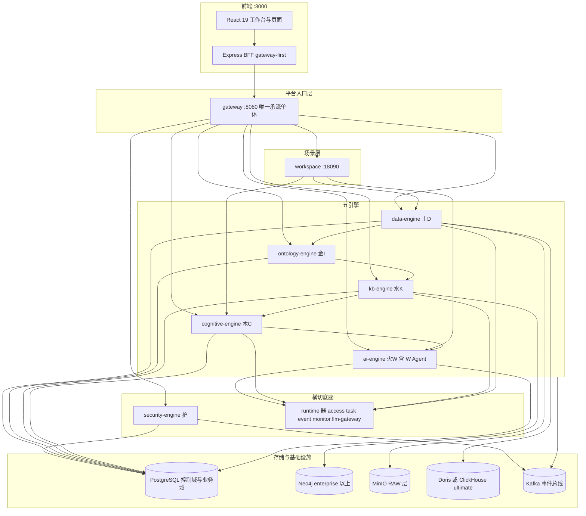

### 1.5 职责边界矩阵

每域"做什么 / 不做什么"是实施时最先要钉死的内容。下表是全文的边界总纲，各篇的 §N.1 只做展开。

| 域 | 负责 | 明确不负责 |
|:--|:--|:--|
| gateway | 唯一入口、路由与版本前缀重写、信任头签发、认证与组织/权限 facade、聚合承载全部引擎 Controller | 不实现业务规则；不做数值计算 |
| security 护 | 信任链校验、行级过滤模板、列级过滤与脱敏、OPA 裁决、加密与豁免登记、审计写入、数据密级 | 不定义业务口径；不实现事件总线 |
| runtime 器 | 外部数据源 Driver、对象存储、图库池、Git 客户端、调度、事件总线、监控、LLM 网关 | 不做业务裁决；不持有业务语义 |
| data 土D | 数据源接入、采集、管道执行、DQ 治理、血缘、业务事实供数、`ecos_dw` 唯一写通道、五层载体登记 | 不实现安全裁决管道本体；不定义口径；不做预测编排 |
| ontology 金I | 对象/关系/域、口径与指标定义、发布三门禁、Function 表达式、提案与版本、workflow、术语 | **只产定义与版本，不产数值** |
| kb 水K | 图谱双形态、文档接入与抽取、RAG、统计画像、假设库、本体快照消费、知识导航 | 不定义口径（只引用编码）；不提供认知写代理；不自持图库池；不直连 LLM |
| cognitive 木C | Mind 注册与场景绑定、检测/评估/假设/信念读、因果诊断、反事实差分、规划评审、确定性计算器 | **零新增业务事实表**；推理结果不落盘；不产金额（金额唯一来源是预测运行服务）；场景语义不下沉 |
| ai 火W | 智能体与工具、Agent 循环、W Agent 控制面、SSE 流式、token 计量与预算 | 不新增模块/JAR/schema/容器；不自持模型密钥；不绕过咽喉点执行工具 |
| workspace 场景层 | 场景组合（业务子图 + 横切能力 + 出口）、场景工作台、预测运行编排、动作闭环 | 不生产数值（只编排）；不实现引擎能力副本 |
| 前端与 BFF | 信息架构、状态三层、请求单通道、页面八要素、主题/i18n/移动端 | 不硬编码后端地址/端口/颜色/中文字符串；不推断权限；不直连存储 |

**主权三分精化（R2 语义精化，2026-10-12）**：上表按"域"划定职责边界，跨域对象还须进一步区分三种可分离的主权——**编排权**（谁发起并推进流程，如 Workspace 发起预测运行与行动编排）、**业务规则主权**（谁定义业务含义与规则，如本体域定义口径、认知域定义计算规则）、**数据写入权**（谁写哪类数据，如数据域写通道为 `ecos_dw` 唯一写入口）。三者可以分属不同组件，但必须契约化分离且各自有唯一属主：Workspace 可发起运行不等于可定义预测算法，可组织行动流程不等于可自行裁决业务规则是否成立，数据域提供统一写通道不等于拥有业务对象生命周期。此三分是防止场景层演化为承载业务规则的"超级模块"的硬约束；逐对象主权归属见 §1.17。

> **模型管理员 / 认知模型负责人 vs W Agent 权限边界（R3 新增，2026-10-12）**：需求册 §2.1.1 已明确"保留独立角色、不合并"，设计侧据此固化权限边界。模型管理员 / 认知模型负责人行使**业务规则主权**（模型生命周期管理：注册、评估、发布、下线），其写权限限定于模型注册表（模型元数据、版本、门禁状态、发布/下线操作），不持有业务数据的写入权；W Agent（行动域编排主体）行使**编排权**（自动化编排：取数—算—解释—提候选），其写权限限于行动记录（动作发起、执行状态、回灌事实），模型调用为只读引用，不具备模型发布权。两角色合并将破坏四眼制衡（审批方与被审批方同一）、扩大最小权限面（模型管理+行动执行合并为超大权限面）、混淆审计责任（模型质量门禁审计与 Agent 越界/熔断审计难以区分）。设计实现上，模型管理员角色在 `ecos_control` 的角色表中单列，与 W Agent 的系统用户身份隔离；安全引擎对两类主体的裁决策略分别配置，互不透权。

### 1.6 模块结构与依赖方向

工程基线 = **7 个部署 JAR + 49 个根 reactor 构建模块**；全仓 POM 总数 53 = 根聚合 1 + reactor 49 + 已归档遗留 3（排除 `archive/` 后为 50）。**不得新增 Maven 模块**；新增模块的门禁双处（脚本基线数与架构测试基线数）必须同批改。

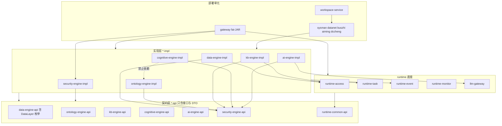

依赖方向规则（可被架构测试断言的部分）：

| 序号 | 规则 | 门禁 |
|:--|:--|:--|
| 1 | `*-impl` 只依赖本域 `*-api` 与底座 api，域间只经 REST 或事件，**禁直接依赖他域 impl** | `ModuleDependencyArchTest#engineMustNotDependOnServices` |
| 2 | 引擎禁依赖部署服务（`services/*`），服务可依赖引擎 api/impl | 同上 |
| 3 | 非 data-engine 模块禁持有 `ecos_dw` 的 Mapper | `BusinessDomainWriteArchTest` |
| 4 | 本体域表禁出现度量金额列 | `OntologyNoFactValueArchTest` |
| 5 | 底座禁依赖引擎（`runtime-*` 不得 import `engine.*`） | runtime 依赖审计测试 |
| 6 | 服务态与网关态鉴权等价 | 两态鉴权等价测试 |

### 1.7 部署架构与端口

微服务不在容器内运行是既定部署形态：容器只承载基础设施，应用以 Windows 本机 JAR 形式运行。

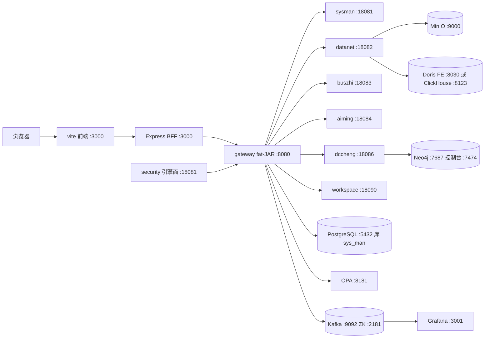

| 单元 | 端口 | 形态 | 说明 |
|:--|:--|:--|:--|
| gateway | 8080 | 部署 JAR | 唯一 monolith fat-JAR：入口 + 认证/组织 facade + 承载全部引擎 Controller |
| sysman | 18081 | 部署 JAR | 配置/字典/组织/系统管理门面 |
| datanet | 18082 | 部署 JAR | 数据域服务面 |
| buszhi | 18083 | 部署 JAR | 本体域服务面（workflow 单点归属） |
| aiming | 18084 | 部署 JAR | 认知域服务面 |
| dccheng | 18086 | 部署 JAR | 知识域服务面 |
| workspace | 18090 | 部署 JAR | 场景层 |
| `*-boot` | 基端口 + 1000 | 调试形态 | 引擎独立启动调试用，非交付形态；ai boot 用 19084 口径 |
| PostgreSQL | 5432 | 容器 | 控制域 + 业务域主存储 |
| Neo4j | 7687 / 7474 | 容器 | enterprise 及以上档的图谱形态 |
| MinIO | 9000 | 容器 | RAW 层近源不可变留痕 |
| OPA | 8181 | 容器 | 策略裁决 |
| Kafka / ZooKeeper | 9092 / 2181 | 容器 | 事件总线 + 一次性 init 建 topic |
| Grafana | 3001 | 容器 | 可观测面板 |
| 前端 vite / BFF | 3000 | 本机 | dev 直连引擎前缀 + 生产 BFF gateway-first |

**制品口径 ≠ 承流口径。** 上表的独立服务是"可部署制品"；在单体内置目标态下，各域 Controller 由 gateway 统一承载，服务端口自身拥有的业务 Controller 数量可为零。设计任何跨服务调用时必须同时定义"网关态"与"服务态"两条路径，并保证鉴权等价（见 §1.10）。

### 1.8 技术选型与被否决的替代方案

| 关注点 | 选型 | 理由 | 被否决的替代方案（否决原因） |
|:--|:--|:--|:--|
| 语言/框架 | Java 17 + Spring Boot 3.2.x | 现网生态与团队栈一致 | — |
| 持久层 | MyBatis + Mapper XML | 治理 SQL 复杂（RLS 注入、schema 限定名、批量 upsert）需完全掌控 | JPA：多库方言 + 控制域 schema 限定名 + 血缘元数据抓取不可控（Hibernate 自动配置排除） |
| 迁移 | 禁用 Flyway，DDL 走单源脚本目录 + lint | 只加不删的纪律需静态校验 | Flyway 自动执行：绕过审查、库内自动建列 |
| 控制域存储 | PostgreSQL 16 单库 5+1 schema | 与既有实例形态一致，零存量迁移 | 每 service 独立 database：需存量迁移且违反新表落点规则 |
| 多库兼容 | 应用侧 UUID + 类型白名单 + `databaseId` 方言分支 | 国产化替代是商务前置条件 | PG 方言优先：等于放弃兼容承诺 |
| 金额类型 | `NUMERIC(p,s)` 显式精度 | 财务可核对要求十进制精确 | 整数分：需全域单位换算约定，展示/导出/回测三处易错 |
| 图谱形态 | Neo4j（enterprise+）∨ PG 关系表（standard） | 因果链 >3 层遍历性能；standard 档不引依赖 | 全档统一 PG 递归 CTE：因果/子图遍历性能不可控 |
| 图库接入 | `runtime-access` 统一持有 driver/pool | 消除"谁持池"的口径矛盾 | 引擎自持连接池：固化底座违规 |
| 向量形态 | PG + pgvector（全档基线，HNSW） | 零新容器、与业务域同库 | 专用向量引擎：引入容器与运维面，仅在实测瓶颈时另立决策 |
| 列存 | Doris ∨ ClickHouse 单选择（`dw.olap.engine`） | 甲方环境二选一常见 | 双 OLAP 并存：一致性与成本不可控，禁双写 |
| 对象存储 | MinIO（三档同构 RAW） | 近源层不可变留痕 | HDFS/云 OSS：部署形态不符 |
| LLM | DeepSeek 经 `llm-gateway` 唯一出口 + provider 抽象 | 统一 token 计量与密钥治理的前提 | 引擎直连 provider：破坏可观测与密钥收敛 |
| 前端 | React 19 + Vite 6 + TS + Tailwind 4 + zustand + @tanstack/react-query + Express BFF | 组件规模与状态分层匹配 | Vue3：全量重写无收益 |
| 路由 | HashRouter | 内网静态托管免服务端 rewrite | BrowserRouter：需部署侧改造 |
| E2E | Playwright 正式工程（`ecos-tests/`：`playwright.config.ts` + `tests/{api,e2e}/*.spec.ts`） | 浏览器 E2E 必查三项（渲染无 ErrorBoundary / console 无 error / network 无意外 4xx·5xx）需可判定载体 | 仅脚本冒烟：UI 层验收缺位；冒烟与 E2E 双轨：同场景两套脚本必然漂移；直接声称"Playwright 通过"= 虚假验收，禁止 |
| 消息 | Kafka（`ecos.audit` / 域事件 / `<topic>.DLT`） | 审计解耦与事件总线 | 同步 HTTP 链式调用：审计缺失且跨引擎耦合 |
| 部署 | Docker Compose 仅基础设施 + 本机 7 JAR | 容器只承载有状态基础设施 | 应用容器化：与基础设施镜像基线冲突，禁新增容器 |

### 1.9 三档形态与全局契约

#### 1.9.1 档位

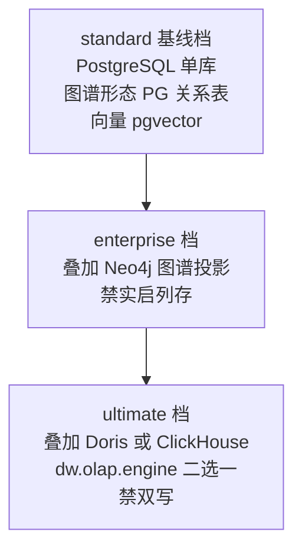

| 项 | 规则 |
|:--|:--|
| 生效机制 | 只有 `spring.profiles.active=standard\|enterprise\|ultimate` 生效；Maven profile 只裁依赖，不改变运行时行为 |
| 叠加性 | 高档 = 低档 + 附加形态，业务代码同一套；档位差异体现为"能力可见性"，不体现为功能分叉 |
| 禁项 | standard 档禁止实际启动 Neo4j 与列存；列存禁止双写；历史别名 `flagship` 全仓作废 |
| 配置键 | `dw.olap.engine=doris\|clickhouse`、`ecos.kb.graph.neo4j.enabled`、`ecos.cognitive.enabled`、`ecos.route.<svc>=monolith\|service` |

#### 1.9.2 全局接口契约

| 契约 | 规定 |
|:--|:--|
| 响应体 | `ApiResponse{code, errorCode, message, data, timestamp}` + `traceId`；成功 `code=0`，失败使用显式 `errorCode` |
| 异常出口 | 每域自有 `@RestControllerAdvice`；**禁止把未捕获异常统一掩成 404**；客户端消息禁包含 `e.getMessage()` 原文（服务端 `log.error(..., e)` 记录） |
| 分页 | 请求 `page`（从 1）/`size`，响应 `{items, total, page, size}`；列表默认 50、上限 500，超限拒绝而非截断 |
| 批量 | 事实导入 ≤100 行/批；写通道 ≤500 行/批；超出必须转异步任务 |
| 路径 | `/api/v1/{域}/{资源}`，废弃别名保留 ≥2 个迭代并带 `Deprecation` / `Sunset` / `Link: rel="successor-version"`；同一路径只允许一个属主 Controller |
| 签名纪律 | **只增不改**：既有路径与参数签名不可变更 |
| operationId | `{动词}{资源}` 小驼峰，全局唯一，作为契约↔分册↔Controller 一致性断言的键 |
| 幂等 | 写操作必须携带 `idempotencyKey`；确定性运行的幂等键由输入要素哈希构成（见第 12 篇） |
| 流式 | SSE 帧序固定 `meta → step → token → delta → citation → error → done`，每帧带 `traceId` |
| 三滤波器 | 新增 Controller 必须同时处理 `VersionPrefixRewriteFilter` 映射、`SecurityConfig` permitAll 决策、`ClearanceInterceptor` 豁免，且 `/api/v1/...` 与 `/api/...` 双路径各写一遍 |
| 错误码族 | `ECOS-{域缩写}-{序号}`（`SEC` / `DATA` / `DQ` / `ONTO` / `WF` / `KB` / `COG` / `AI` / `E-WA-*`），码值与 HTTP 状态严格一致；同一语义全域只用一个码 |

### 1.10 信任链与鉴权

平台的安全边界不是"网络隔离"，而是**一条不可伪造的信任头链**。外部请求只能带 JWT，任何外部传入的 `X-ECOS-*` 头在进入 gateway 的第一步就被剥除；进入下游服务的请求必须携带由 gateway 签发的信任头，否则 403 DENY。

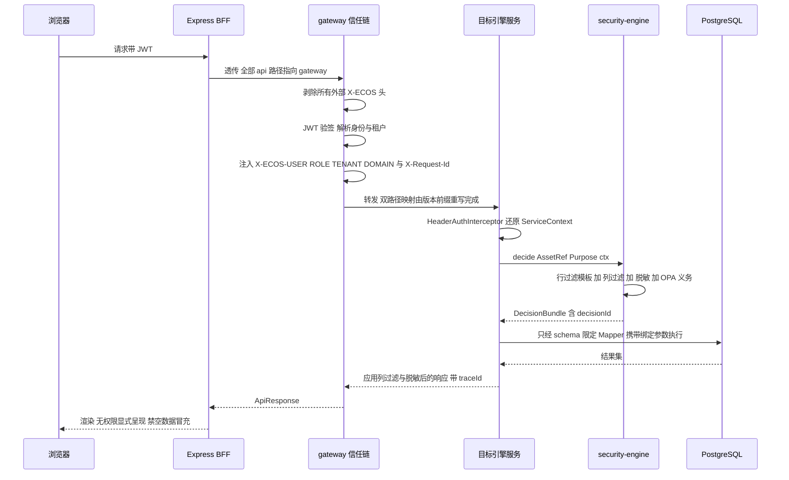

| 环节 | 强制规则 |
|:--|:--|
| 头剥除 | 进入 gateway 的第一个过滤器无条件删除全部 `X-ECOS-*`，禁止"白名单来源可透传"这类例外 |
| 身份签发 | JWT 私钥仅由启动脚本从本地 pem 注入环境变量；私钥禁入库、禁入日志、禁入代码 |
| 上下文 | `ServiceContext{userId, tenantId, orgId, roles, clearance}`，其中 `orgId` **必须由服务端解析**，禁接受请求头直传的 `X-Org-Id` |
| 缺头处理 | 下游服务无信任头 = 403 DENY，禁默认租户、禁 `tenantId=default` 硬编码兜底 |
| 两态等价 | 网关态与服务态的鉴权结果必须等价，由"两态鉴权等价测试"锁定；服务态禁关闭鉴权开关 |
| 匿名面 | 匿名可达端点必须显式列举并纳入 lint 基线；新增端点默认不得进入重写白名单、permitAll 清单、豁免清单 |
| 健康探测 | 引擎健康端点必须真实探测依赖，禁返回常量 `UP` |
| 越权语义 | 无权数据的读请求返回空集时不得泄露资源存在性；越权写返回 403 且带 `decisionId` 可追溯 |

### 1.11 事件、审计与可观测

**一次请求产生三条可观测记录**：traceId 贯穿的日志、结构化审计事件、指标埋点。审计是业务义务而非调试手段，因此审计失败必须有兜底、兜底失败必须让业务失败。

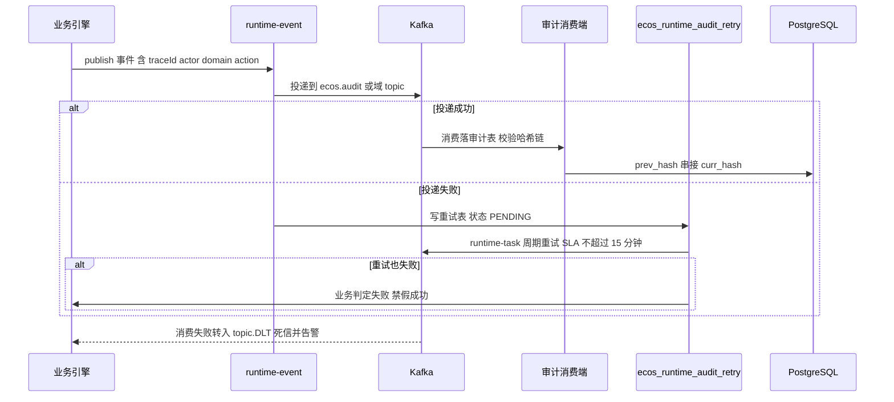

| 主题 | 用途 | 关键约束 |
|:--|:--|:--|
| `ecos.audit` | 全域审计：裁决、导出、工具执行、管道执行、预测运行、发布 | 每次有副作用的操作恰好一条；禁假成功 |
| `ecos.identity` | 用户/角色/租户变更 | 下游幂等消费 |
| `ecos.catalog` | 数据资产与载体登记变更 | 携带 `layer` |
| `ecos.ontology` | 本体与口径发布 | 必带 `versionNo` + `traceId`，知识域幂等键 `(eventId, snapshot_version)` |
| `ecos.object` | 业务对象实例变更 | — |
| `ecos.workflow` | 流程定义与实例流转 | — |
| `ecos.agent` | Agent/Run 生命周期 | 与 `GUARDRAIL_EVAL` 审计配对 |
| `ecos.knowledge` | 图谱/画像/假设变更 | — |
| `<topic>.DLT` | 死信 | 积压 lag 超阈值告警 |

traceId 规则：入口生成或透传 `X-Request-Id`，全链不得更换；日志 MDC 必含 `traceId, tenantId, domain, op`；所有错误响应回传 `traceId`；审计事件必须携带 `traceId`，且不可定位输入快照的写操作判为失败（见 §1.13 可复现性）。

指标面（Grafana :3001）按四类基线：业务量（创建/更新/发布计数）、降级率（`*_degraded_ratio`、`*_masked_total`）、失败率（`*_fail_total`、DLQ lag）、资源水位（连接池、内存 RSS、GC）。

### 1.12 核心端到端数据流

#### 1.12.1 DIKCW 主链

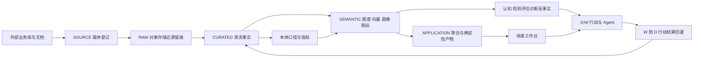

#### 1.12.2 确定性产物回写（唯一入口）

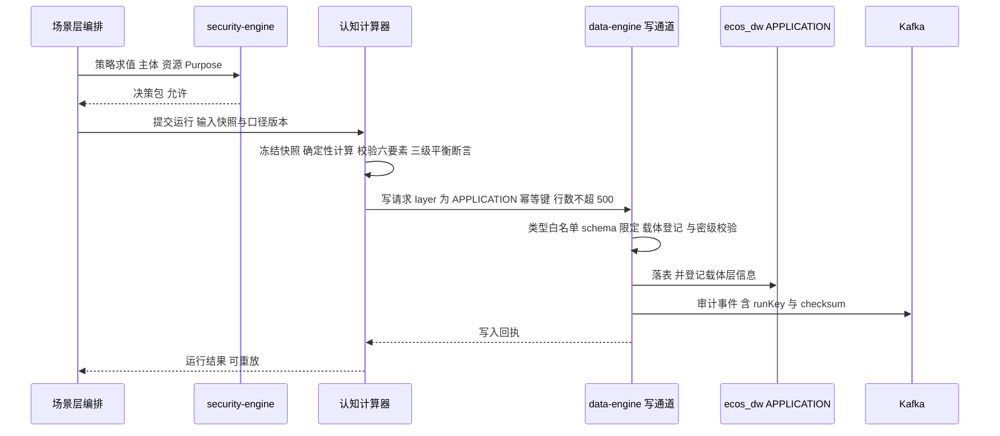

要点：`layer` 必须显式传 `APPLICATION`；写通道内部完成多库兼容校验（类型白名单、方言分支）与载体登记；幂等键由 `(口径与公式版本, 截止时刻, 范围哈希, 情景集哈希, 覆盖项哈希)` 组成，重跑数值差必须为 0。

#### 1.12.3 读侧水位线模式

大批量只读消费（抽取、画像计算、导出预检）统一使用水位线游标：

```
GET {resource}?watermark={lastCursor}&limit=500
  → 200 { rows: [...], nextWatermark: "...", hasMore: true }
```

规则：单次 `limit` 上限 500；游标不透明且服务端生成；`hasMore=false` 才允许推进业务水位线；dry-run 与真实执行共用同一取数与校验路径，二者差异只能来自是否实际写库。

### 1.13 非功能要求

**优先级次序：可复现性 > 正确性 > 可用性 > 性能 > 体验。** 企业认知系统若不能复现，其余指标无意义。

| 类别 | 指标 | 阈值 | 失败判据 |
|:--|:--|:--|:--|
| 可复现性 | 任一确定性运行的输入快照可定位 | 不可定位 `inputSnapshotRef` 即视为不通过 | 缺快照或快照与结果 checksum 不符 |
| 可复现性 | 同输入重跑数值差 | 0 | 任一等列不等 |
| 正确性 | 三级平衡（项目→部门→企业） | 断言精确成立，容差 0.01 | 不平即拒绝落库 |
| 正确性 | 概率/比例值域 | `[0,1]` | 越界报错，禁 clamp 静默 |
| 性能 | gateway 单请求 P95（不含 LLM） | < 300ms | 超阈值定位到具体链路 |
| 性能 | 认知/评估类只读端点 P95 | ≤ 800ms | 超时显式 503 |
| 性能 | Function 表达式单次执行 | ≤ 5s，超时中断 | 超时即失败并审计 |
| 性能 | 缓存 | Caffeine，TTL 5min，发布后主动失效 | 陈旧读超过一个 TTL |
| 性能 | 批量 | 单次抽取 500×200；事实导入 100 行/批；写通道 500 行/批 | 超出转异步 |
| 容量 | 管道单次执行 | > 30min 拒绝并提示拆分 | 无超时保护 |
| 可靠性 | 依赖不可用 | 显式降级标记 + 原因 + 影响 | 静默回退或假成功 |
| 可靠性 | 死信积压 | lag > 100 条 / 5min 告警 | 无告警 |
| 资源 | 连接池水位 | < 80% | 持续超阈值 |
| 资源 | 内存 RSS | < 基线 × 1.2 且无连续 3 次 Full GC | 存在无界缓存或线程池 |
| 安全 | 匿名可达端点 | 白名单外一律 401/403 | 匿名返回 200 |
| 安全 | 审计落库 | 副作用操作 100%，兜底 SLA ≤ 15min | 缺审计即视为未完成 |
| 兼容 | 多库 | 方言分支经 `databaseId`；类型白名单 | 出现 PG 专有语法未分支 |
| 前端 | 组件规模 | 单组件 ≤ 800 行，每 Tab 独立文件 | 超限拆分 |

### 1.14 门禁矩阵

合并前必须全绿的静态门禁集合。**验收标识只允许 `mvn -Dtest=类#方法` 或 Playwright `*.spec.ts › 用例名`（或 lint 脚本名）**；"人工确认"、"Playwright 通过"这类无载体表述视为虚假验收。

| 门禁 | 类型 | 断言 |
|:--|:--|:--|
| 工程基线 | `mvn validate` + `check-legacy-modules.ps1` | reactor 模块数与基线一致；新增模块需同时改两处基线 |
| 依赖方向 | ArchUnit | 引擎不依赖服务；impl 不跨域依赖；runtime 不依赖引擎 |
| 域写主权 | ArchUnit | 非属主模块禁持他域 Mapper；本体域禁度量金额列 |
| 路由完整性 | `GatewayRouteIntegrityTest` | 重写表须同时断言"注册态 + 运行态"，并含反身用例（请求实际到达属主 Controller） |
| 匿名面 | `preflight.ps1` 匿名鉴权基线 | 白名单外匿名返回 200 即失败 |
| 信任链 | `TrustHeaderStripTest` / `HeaderAuthDenyTest` | 外部 `X-ECOS-*` 必被剥除；缺头 6 类场景一律 403 |
| DDL 合规 | `db-migration-lint.ps1` | 单源目录、schema 只加不删、类型白名单、命名基线 |
| DDL↔库内 | schema 预检测试 | 新表落位与列存在性断言 |
| 契约一致 | 契约↔分册↔Controller 一致性测试 | operationId 集合相等；路径集合相等 |
| 术语 | 前缀单源门禁 | W-Agent 前缀只允许一处定义；`DataLayer` 枚举单源 |
| 确定性 | `ReadinessGraderTest#gradeIsDeterministicFromThresholdsNotLlm` | 定级只由阈值推导 |
| 发布 | `PublishServiceTest#publishWritesGitRefAndDbActiveVersionOnly` | 库内只写在用版本与 Git 指针 |
| 叙事一致 | `NarrativeNumberConsistencyTest` | 文本中的数字与结构化数值容差 ≤ 1e-4 |
| 流式承流 | SSE 承流用例 | 帧序固定、断连可恢复、错误帧必达 |
| 前端 | `tsc --noEmit` + vitest + i18n 键奇偶性检查 | 类型零错；键无缺失/孤儿；无硬编码颜色与中文 |
| E2E | `ecos-tests` Playwright（project `api` / `app`） | 三查：渲染无 ErrorBoundary / console 无 error / network 无意外 4xx·5xx |
| 凭据 | 密钥扫描 | 提交禁含私钥、api key、明文凭据 |

### 1.15 风险登记

| 编号 | 风险 | 触发条件 | 后果 | 消解设计 |
|:--|:--|:--|:--|:--|
| R1 | "默认 DENY"成为空声明 | 引擎 catch 异常后返回空集或放行 | 越权数据可见 | 裁决不可用即 503 显式失败；缺头 403；空集与错误严格可分（§1.10、第四篇） |
| R2 | 金额与模型推理混淆 | LLM 输出被当作数值落库 | 财务不可核对 | 公理 A3；金额唯一来源；LLM 文本与数值分栏且文本禁含未校验数字 |
| R3 | 浮点漂移致三级不平 | 使用 double 或隐式舍入 | 同一口径两本账 | BigDecimal + HALF_UP + 显式 `NUMERIC(p,s)` + 平衡断言拒写 |
| R4 | 跨引擎直查扩张 | 图省事直连他域表 | 主权崩坏、无法演进 | 依赖方向 ArchUnit + 写通道唯一入口 + Mapper 归属断言 |
| R5 | 测试载体缺失致验收不可判定 | 用"人工确认"充当 E2E | 虚假验收 | Playwright 正式工程；验收标识白名单（§1.14） |
| R6 | 主控制 schema 更名牵连面广 | 主控制 schema 由 `public` 迁至 `ecos_control` | 大量限定名失效 | 三步走：配置化 → 双写兼容视图 → 读切换；表名经配置拼接（MC06） |
| R7 | 虚假"已实现"进入设计 | 设计文档混入现状口径 | 新人误信、返工 | 本文只写目标态；取证语言列为禁用词（§0.1） |
| R8 | 画像/假设落点退化 | 统计制品落进控制域或 APPLICATION | 供数链断裂、口径失控 | 明确 SEMANTIC 层输入侧归属；数值落 APPLICATION 必经写通道 |
| R9 | standard 档误启图库/列存 | 配置或依赖裁剪不一致 | 交付环境不可用 | 档位生效只认 profile；启动前置检查 + 架构测试基线 |

### 1.16 建设路线（阶段划分）

实施按五个成熟度阶段推进，每阶段有明确出口条件；**出口条件未满足不得进入下一阶段，不得切换承流形态**。

| 阶段 | 目标 | 主要交付 | 出口条件 |
|:--|:--|:--|:--|
| S0 入口与底座 | 单一入口 + 信任链 + 四底座可用 | gateway、security、runtime 五底座、基础设施容器 | 匿名面白名单为 0 例外；信任链 6 类缺头场景 403；审计兜底闭环可验证 |
| S1 数据治理 | 五层贯通 + 可信事实 | 数据域：源接入、管道 JSON DAG、DQ、血缘、事实五表、写通道 | 端到端"外部源 → CURATED 事实"可复现；写通道唯一入口断言绿 |
| S2 语义与知识 | 口径主权 + 双形态知识 | 本体域（口径/指标/三门禁/Function/workflow）、知识域（抽取闸链/图谱/画像/假设） | 口径单一来源；缺本体快照即拒；画像分层退化链与置信区间可算 |
| S3 认知与场景 | 确定性认知 + 场景闭环 | 认知域（Mind 注册/四端点/诊断/反事实）、场景层、预测端到端 | 三级平衡断言绿；重跑 diff=0；场景工作台可演示 |
| S4 智能与行动 | 受治理的 AI 行动 | 智能域 + W Agent 控制面（Run 状态机/Tool Contract/Readiness/Git 发布） | 咽喉点单入口；L3 无自动路径；发布只写 Git 指针与在用版本 |

服务态切流（`ecos.route.<svc>=service`）的前置条件在 S1～S4 各自门禁中定义，通用五条：跨服务寻址组件建成并接线、服务态鉴权与网关态等价、双态路由等价测试绿、schema 落位预检上线、审计 fail-closed 落地。任一未满足不得切流。

### 1.17 统一认知契约：认知决策事件（CDE）（R2 语义精化，2026-10-12）

> **定位声明**：认知决策事件（Cognitive Decision Episode, CDE）是一次完整经营问题处理全过程的**跨域领域契约**，用于统一回答"这次决策为什么做、做了之后是否真的有效"。CDE **不是新的部署模块、不是新的数据库表、不新增接口**；它由现有对象（预测运行 ForecastRun / 决策记录 DecisionRecord / 行动 Action / 效果 Effect / 输入快照 / 画像与假设版本等）经**稳定 ID + 版本 + 证据引用**关联而成。全册各篇凡涉及认知闭环对象关联处，以本节为权威定义（需求侧同义定义见需求规格说明书 §3.3，两册语义一致；本节偏工程视角——对象与引用关系）。本节只立契约，不改任何既有接口路径、表名、字段名、事件主题与错误码；各段连接契约的拦截沿用既有门禁（发布三门禁、确定性门禁、审批门禁、审计门禁），不新增工程载体。

**八段定义**（每段回答什么问题、由哪些现有对象承载、需要什么证据）：

| 段 | 回答的问题 | 载体对象（现有，不新建） | 证据要求 |
|:--|:--|:--|:--|
| Situation 情境 | 要解决什么问题、涉及哪些业务对象/指标/期间/约束 | 场景与目标（场景工作台） | 业务语言的问题与范围描述 |
| Evidence 证据 | 已发布事实/知识/假设及版本、缺失与冲突 | 输入快照、画像/假设版本、证据引用 | 已发布事实 + 版本化知识；缺失/冲突显式登记，禁静默 |
| Reasoning 推理 | 用什么模型/规则/公式/输入得出哪些结论 | 预测运行（ForecastRun）、因果诊断、反事实差分 | 确定性可复算（公理 A3：公式版本 + 输入快照冻结，重跑 diff=0） |
| Evaluation 评估 | 结论有效性/适用性/不确定性/风险/行动后果 | 就绪度评估、风险字段、安全裁决 | **评估三分**：认知结果评估（是否可信）／决策方案评估（是否值得）／执行授权评估（是否允许），不得以单一分数互相替代 |
| Decision 决策 | 备选方案、最终选择、依据与审批 | 决策记录（DecisionRecord）+ 审批凭证 | DecisionBasis 决策依据契约（见下）；历史决策按"当时"版本解析 |
| Action 行动 | 谁执行什么、预期改变哪些指标、权限与风险约束 | 行动记录（Action）+ 审批凭证 | 行动五阶段（Intent→Proposal→Authorization→Execution→Effect）；Execution 完成 ≠ Effect 实现 |
| Effect 效果 | 实际发生什么、与预期差多少、变化能否归因于该行动 | 回流事实 + 效果记录（Effect） | 执行记录 ≠ 效果事实 ≠ 效果归因，三者分立；无法归因时如实记录"效果尚无法归因"，禁强行归因 |
| Learning 学习 | 哪些假设被支持/推翻、哪些规则/模型/决策策略需复审 | 口径复审任务、知识版本替代链 | 学习四触发（数据异常/预测偏差/知识冲突/行动效果偏离）；复审对象含假设/画像/模型/决策策略，不限于口径 |

**DecisionBasis（决策依据契约）**：Decision 段必须可解析出——事实快照及数据质量状态、本体/口径/公式版本、知识/画像/假设/证据引用、预测运行及结果、诊断/反事实等推理产物、评估结论与风险及未解决问题、备选方案与比较、授权范围/审批要求/失效条件。**历史决策一律按"当时"版本解析，不静默升级到最新版本**（与 §1.3 在用版本/历史版本二分一致）。

**六段连接契约**（每段连接必须成立的业务契约，与契约不成立时的后果）：

| 连接 | 必须成立的业务契约 | 契约不成立的后果 |
|:--|:--|:--|
| D→I 事实映射统一语义 | 事实中的字段、对象、期间、单位能否映射到统一业务语义 | 同一个收入或成本可能被不同模块理解成不同含义 |
| I→K 知识引用本体与指标版本 | 知识资产引用的是哪个本体版本、指标版本与适用范围 | 口径变更后知识仍被错误复用 |
| K→C 假设画像证据适用性 | 使用了哪些假设、画像、证据，为什么它们适用于当前对象与期间 | 计算正确，但输入前提可能不适用 |
| C→W 结论可信度与约束足以支持行动 | 结论的可信程度、风险、约束与备选方案是否足以支撑行动 | 一个预测值被直接误当成行动指令 |
| W→D 执行结果为已验证事实并归属行动 | 执行结果是否真实发生的事实、是否已验证、归属哪个行动 | 计划完成被误认为经营效果已实现 |
| D′→K,C 新事实改变哪个假设模型参数规则 | 新事实究竟改变了哪个假设、模型、参数或决策规则 | 数据持续增加，但系统不会因此变得更聪明 |

**"七问可追溯"清单**（任一 CDE 必须可回答；回答载体是上述现有对象的 ID 与版本引用，不允许无引用断言）：

1. 这个行动针对哪个经营问题？（→ Situation）
2. 当时的预测运行与口径版本是什么？（→ Reasoning：ForecastRun + 口径版本）
3. 当时引用了哪些证据、假设与知识版本？（→ Evidence：版本化引用）
4. 有哪些备选方案、为什么选中其中一个？（→ Decision：DecisionBasis）
5. 行动实际改变了什么？（→ Action→Effect：预期指标 vs 实际变化）
6. 结果是否符合原来的预期？（→ Effect：对照与归因状态）
7. 这个结果改变了什么知识或后续决策？（→ Learning：被复审/替代的假设、模型、规则）

> **主权归属**：CDE 各段载体对象的主权遵 §1.5 主权三分（编排权／业务规则主权／数据写入权），本契约不新增属主、不迁移既有主权；关联引用不存在或版本不匹配时按显式失败处理，禁静默降级为最新版本。

## 第2篇　数据架构

数据架构是全平台的硬约束层：它的规则数量不多但每一条都是红线，且绝大多数后续返工都源自这一层。本篇定义"数据放在哪、谁能写、以什么形态放、如何变更"，各域的字段级设计在对应篇的 §N.4 展开。

### 2.1 数据域二分

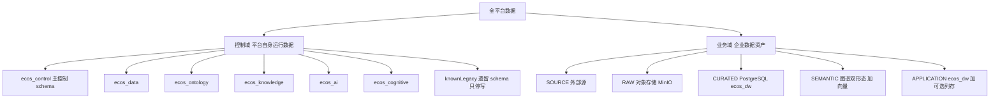

| 判据 | 控制域 | 业务域 |
|:--|:--|:--|
| 数据是什么 | 平台运行所需：身份、配置、字典、审计、策略、管道定义、本体定义、Agent 控制面、认知 Mind 注册 | 企业真实经营数据：事实、快照、图谱实例、画像、假设、聚合结果 |
| 谁能写 | 属主引擎 | 只有 data-engine 写通道（RAW 由管道 sink 写） |
| 新表落点 | 只允许落 5 引擎 schema 或主控制 schema | `ecos_dw`（含五层归属） |
| 生命周期 | 随平台版本演进，DDL 单源 | 随业务与治理规则演进，受质量状态约束 |
| 列级加密 | **永不可豁免** | 金额列可走豁免登记（登记制，非默认） |
| 典型误建 | 把业务事实表建进控制域（禁） | 把平台配置表建进 `ecos_dw`（禁） |

### 2.2 Schema 主权矩阵

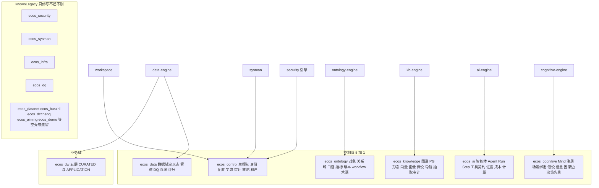

| Schema | 归属 | 属主引擎 | 承载内容 | 新表 |
|:--|:--|:--|:--|:--|
| `ecos_control` | 控制域 | gateway / security / sysman / workspace 按表分属 | 身份与租户、配置与字典、审计与哈希链、策略与豁免登记、场景与运行编排、规则 | 允许（受 ST07 落点约束） |
| `ecos_data` | 控制域 | data-engine | 数据源与载体登记、管道定义与运行、DQ 规则与工单与评分、血缘 | 允许 |
| `ecos_ontology` | 控制域 | ontology-engine | 对象/关系/域、口径与口径版本、指标定义、Function 与审计、workflow 与审批、术语、设计资产版本指针 | 允许 |
| `ecos_knowledge` | 控制域 | kb-engine | 图谱 PG 形态（节点/边）、本体快照、抽取任务与审计与水位线、导航分类、同步日志 | 允许 |
| `ecos_ai` | 控制域 | ai-engine | 智能体定义与在用版本、W Agent 13 类控制面对象、工具契约、运行与步骤、证据与结论、token 与成本计量 | 允许 |
| `ecos_cognitive` | 控制域 | cognitive-engine | Mind 注册、场景-Mind 绑定、假设/信念/证据、因果边、决策先例 | 允许（**禁业务事实表**） |
| `ecos_dw` | 业务域 | data-engine | CURATED 清洗事实、`doc`/`doc_chunk` 文档载体、APPLICATION 聚合与确定性产物、数据资源登记 | 允许（经写通道或属主） |
| MinIO 桶 | 业务域 RAW | data-engine 管道 sink | 结构化与非结构化近源对象 | — |
| Neo4j | 业务域 SEMANTIC（enterprise+） | kb 经 `runtime-access` | 图谱实例投影 | — |
| Doris ∨ ClickHouse | 业务域 CURATED/APPLICATION（ultimate） | data-engine | 列存物化，单选择禁双写 | — |
| `ecos_security` / `ecos_sysman` / `ecos_infra` / `ecos_dq` / `ecos_datanet` / `ecos_buszhi` / `ecos_dccheng` / `ecos_aiming` / `ecos_demo` | knownLegacy | — | 遗留数据 | **禁止新增任何表**，只停写、不迁移、不删除 |

主控制 schema 由历史名 `public` 更名为 `ecos_control`，迁移采用三步：**配置化（表名经配置拼接）→ 双写兼容视图 → 读切换**。在实施层面，这条路径意味着一条不可绕过的规则：**所有表名必须带 schema 限定，且 schema 名来自配置项**，出现裸表名即 FAIL。

### 2.3 数据红线清单（37 条）

按类归纳为下表。实施时把每条映射到可执行断言（lint 规则或架构测试），"知道但不断言"的红线等同不存在。

| 类 | 编号 | 内容 |
|:--|:--|:--|
| 隔离与访问 | IR01 | 跨域禁访：非属主引擎禁读写他域表 |
| | IR02 | 一切数据访问经属主 api/REST 或写通道 |
| | IR03 | schema 只加不删；唯一例外是 4 张设计资产历史版本表可 DROP（前置为备份且读写已切 Git 链路） |
| | IR04 | 禁 `SELECT *`，列必须显式 |
| | IR05 | 参数化查询，禁字面量拼接 |
| | IR06 | 禁 `DriverManager` 直连，驱动只经 `runtime-access` |
| 数据落点 | DR01 | 表名小写下划线，禁中文表名新增 |
| | DR02 | 新表 `ecos_` 前缀 |
| | DR03 | 禁 `_v2` 之类版本后缀命名 |
| | DR04 | JSON 列以 `_json` 结尾且类型为 `TEXT` |
| | DR05 | 布尔列以 `is_` 开头 |
| | DR06~DR08 | 基线审计列 `create_time` / `update_time` / `create_by` / `update_by` 齐备 |
| 实体与命名 | EN01 | 实体名与表名一一对应，映射单源 |
| | EN02 | 列名与属性名 snake_case / camelCase 映射规则固定 |
| | EN03 | 批量入参上限：导入 100 行、写通道与游标读 500 行 |
| 存储与形态 | ST01 | 控制域与业务域不得混表 |
| | ST02 | standard 档禁实启 Neo4j |
| | ST03 | 敏感列必须加密；业务域金额列例外须登记（ST03-A 登记表） |
| | ST04 | 密级 L1~L4 与列级过滤绑定 |
| | ST05 | 审计表哈希链不可变 |
| | ST06 | 禁 `CREATE POLICY`，行过滤由应用侧模板 + 绑定参数实现 |
| | ST07 | 新表只准落 5 引擎 schema 或主控制 schema |
| | ST08 | 业务数据禁入控制域 |
| | ST09 | 跨域只存定位符（对象 key、表引用、Git ref），不复制内容 |
| | ST10 | **DDL 单一真源 = `ecos_backend/canonical/ddl/`**；任何 `*/src/main/resources/db/migration/` 下新增 `V*n__*.sql` 即 FAIL |
| 数据治理 | DA01 | 层归属显式：每张业务表登记 `layer` |
| | DA02 | 载体登记与实存一致（对象 key 可解析） |
| | DA03 | 质量状态参与可读性（仅 `PUBLISHED` 可作下游快照引用） |
| | DA04 | 新表三件套：DDL + 同 commit seed + schema 落位单测（并同步 lint 白名单） |
| | DA05 | 版本与分层矩阵一致（见 §2.9） |
| 多库兼容 | MC01 | 主键 `VARCHAR(36)`，应用侧生成 UUID；DDL 禁 `gen_random_uuid()` |
| | MC02 | JSON 一律 `TEXT` |
| | MC03 | 禁无 `databaseId` 分支的 `::` / `ILIKE` / `ON CONFLICT` / `RETURNING` |
| | MC04 | 列存单选择，禁双写 |
| | MC05 | 向量禁入控制域 schema |
| | MC06 | 表名经配置做 schema 限定 |

### 2.4 标准建表模板

任何新表必须从下列模板起步（`{schema}` 与 `{table}` 由配置与命名规则给出）：

```sql
-- canonical/ddl/V{n}__{语义}.sql
CREATE TABLE IF NOT EXISTS {schema}.ecos_{domain}_{entity} (
    id                 VARCHAR(36)   NOT NULL,               -- MC01 应用侧 UUID
    tenant_id          VARCHAR(36)   NOT NULL,               -- 多租户过滤列
    -- 业务列（金额 NUMERIC(18,2) / 比率 NUMERIC(9,6) / 比例概率 NUMERIC(5,4) / 分位统计 NUMERIC(18,4)）
    -- 定位符列（对象 key / 表引用 / Git ref），跨域只存定位符 ST09
    {col}_json         TEXT,                                 -- DR04/MC02 JSON 只作载体，禁进条件与索引
    is_{flag}          SMALLINT      NOT NULL DEFAULT 0,     -- DR05
    status             VARCHAR(24)   NOT NULL,               -- 值域由枚举单源约束
    version_no         VARCHAR(20)   NOT NULL,               -- 在用版本；历史走 Git
    domain             VARCHAR(32)   NOT NULL,               -- 域归属，必填不依赖默认值
    trace_id           VARCHAR(64),
    create_time        TIMESTAMP     NOT NULL,
    update_time        TIMESTAMP     NOT NULL,
    create_by          VARCHAR(64)   NOT NULL,
    update_by          VARCHAR(64)   NOT NULL,
    is_deleted         SMALLINT      NOT NULL DEFAULT 0,     -- 软删，禁 DELETE
    PRIMARY KEY (id)
);
CREATE UNIQUE INDEX IF NOT EXISTS uniq_{table}_{cols} ON {schema}.ecos_{domain}_{entity} ({cols}, is_deleted);
CREATE INDEX IF NOT EXISTS idx_{table}_{cols}        ON {schema}.ecos_{domain}_{entity} (tenant_id, {cols});
COMMENT ON TABLE {schema}.ecos_{domain}_{entity} IS '{用途}；属主={engine}；layer={layer}';
```

#### 2.4.1 类型与精度白名单

| 语义 | 唯一形态 | 精度 | 说明 |
|:--|:--|:--|:--|
| 主键 / 外键引用 | `VARCHAR(36)` | — | 应用侧 UUID，禁序列、禁 `bigserial`、禁数据库函数生成 |
| 金额、成本、收入 | `NUMERIC(18,2)` | 2 位小数 | 全平台金额唯一形态；禁 `float`/`double`/整数分 |
| 比率、差值、增长率 | `NUMERIC(9,6)` | 6 位 | 含 token 成本换算率 |
| 比例、概率、置信 | `NUMERIC(5,4)` | 4 位 | 值域 `[0,1]`，越界报错不 clamp |
| 分位数、均值、置信区间 | `NUMERIC(18,4)` | 4 位 | 画像统计制品 |
| 工时 / FTE | `NUMERIC(8,1)` / `NUMERIC(5,2)` | 1 / 2 | 资源事实 |
| 期间 | `VARCHAR(7)` | — | `YYYY-MM` 字符串，禁 `date` 存期间 |
| 状态与类型 | `VARCHAR(16~32)` | — | 值域由代码枚举单源约束并在注释中列出 |
| 布尔 | `SMALLINT` | 0/1 | 列名 `is_` 前缀 |
| JSON | `TEXT` | — | 列名 `_json` 后缀 |
| 时间 | `TIMESTAMP` | — | 统一服务端时钟；期间维度另用 `VARCHAR(7)` |
| 密文 | `TEXT` | — | `base64(version(1B)\|IV(12B)\|ciphertext\|tag)`，AES-256-GCM |

#### 2.4.2 禁止清单

| 禁止项 | 原因 |
|:--|:--|
| `gen_random_uuid()`、`nextval`、`serial` | 破坏多库兼容与主键可控（MC01） |
| `JSONB` / `JSON` 列类型 | 方言绑定且易被索引用（MC02/DR04） |
| 在 JSON 列上做 `WHERE` / `JOIN` / 索引 | 不可移植、不可解释 |
| `::type` 强转、`ILIKE`、`ON CONFLICT`、`RETURNING` 无 `databaseId` 分支 | PG 专有（MC03） |
| `CREATE POLICY`、行级安全数据库原生策略 | 与多库目标冲突，改由应用侧模板（ST06） |
| 分区表、部分索引 | 跨库不可移植，改用期间列 + 归档策略 |
| `DELETE FROM` 业务数据 | 只软删；硬删仅限显式数据治理动作 |
| 裸表名 | 主控制 schema 更名迁移的阻断项（MC06） |
| 控制域列不加密 | ST03 唯一豁免通道只适用于业务域金额列 |
| 在 knownLegacy schema 建表 | ST07 |

### 2.5 业务域五层


| 层 | 权威载体 | 生产者 | 消费者 | 关键约束 |
|:--|:--|:--|:--|:--|
| `SOURCE` | 外部库（PG / MySQL / Oracle / ClickHouse 等）与文档系统 | — | 采集型管道 | 只经 `runtime-access` Driver；平台不复制其结构定义 |
| `RAW` | MinIO `raw/structured/…`、`raw/unstructured/…` | 采集管道 sink | 管道、DQ、文档解析 | 不可变留痕；对象 key 由统一组装器生成；只写不改 |
| `CURATED` | PostgreSQL `ecos_dw`（ultimate 可物化到列存） | 数据管道、DQ | 本体、知识、认知、预测 | 金额列受 ST03-A 管辖；仅 `PUBLISHED` 可作下游快照 |
| `SEMANTIC` | 图谱 Neo4j（enterprise+）∨ PG 关系表（standard）；向量 pgvector；画像与假设表 | 本体事件同步、抽取、画像任务 | RAG、认知、场景 | 向量禁入控制域（MC05）；画像与假设属**输入侧**制品 |
| `APPLICATION` | PostgreSQL `ecos_dw`（ultimate 可列存物化） | 聚合管道 + 认知确定性产物经写通道 | 场景工作台、报表、回测 | 预测结果与回测指标落此层；幂等键必带 |

层的权威定义只有一处：`data-engine-api` 的 `DataLayer` 枚举。任何地方出现 `ODS`/`DWD`/`DWS` 层名即为术语违规（REQ-DB-05）。

### 2.6 RAW 层对象存储规范

对象 key 由统一组装器生成，禁业务代码手拼：

```
结构化：raw/structured/{sourceSystem}/{schemaOrTable}/dt=YYYY-MM-DD/{table}_{timestamp}.{csv|parquet}
非结构：raw/unstructured/{sourceSystem}/{documentId}/{originalFileName}
域归档：raw/unstructured/{domain}/{yyyy}/{mm}/{contentHash}
```

| 规则 | 内容 |
|:--|:--|
| 不可变 | 一旦写入不覆盖；修订产生新 key，由 `dt` 与时间戳区分 |
| 登记 | 每个对象在 `td_data_resource` 登记 `layer=RAW`、`carrier_ref`（bucket/key）、`storage_kind=MINIO` |
| 格式 | csv 为基线格式；parquet 需要列式写入能力可用（不可用时显式拒绝而非降级为 csv 冒充） |
| 访问 | 只有数据管道与文档解析可读；本体与知识域禁直读 RAW（见 §2.8） |
| 生命周期 | 保留策略由配置给出；清理属数据治理动作，禁随手删除 |

### 2.7 知识层双形态

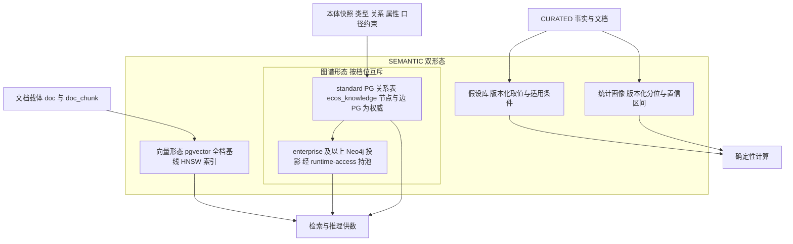

| 形态 | 标准实现 | 增强实现 | 一致性要求 |
|:--|:--|:--|:--|
| 图谱 | PG 关系表（节点表 + 边表，schema 限定，UUID 主键） | Neo4j 投影（enterprise+） | **PG 为权威**，图库为投影；同步后必须做节点/边计数对账，差异显式报错 |
| 向量 | PostgreSQL + pgvector（`vector(1536)` + HNSW），落 `ecos_dw`/知识载体所在业务域位置 | 专用向量引擎需另立决策 | 向量禁入控制域 schema（MC05）；不可用时必须显式返回 `vectorDegraded=true` 与原因影响，禁静默回退 |

图库连接池与 driver 由 `runtime-access` 统一持有，知识引擎通过其接口访问；`standard` 档配置为不启用（ST02）。

### 2.8 跨域读写边界

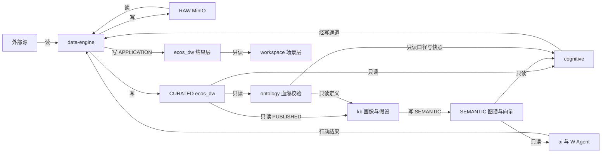

| 主体 | 读 | 写 | 禁 |
|:--|:--|:--|:--|
| data-engine | 外部源、RAW、CURATED | RAW、CURATED、APPLICATION（含代认知域写入） | 不操作其他引擎表；不定义口径 |
| ontology-engine | CURATED 的表与列元数据（经数据域 REST） | `ecos_ontology` | 不产数值；不读 RAW；不写 `ecos_dw` |
| kb-engine | CURATED（仅 `PUBLISHED`，经数据域 REST）、本体快照 | `ecos_knowledge`、SEMANTIC 载体、`ecos_dw.doc/doc_chunk` | **禁直读 RAW、禁直连外部源**；不提供认知写代理 |
| cognitive-engine | SEMANTIC（图谱、画像、假设、证据）、CURATED、口径快照 | `ecos_cognitive` 定义类表；确定性产物经数据域写通道落 APPLICATION | **零新增业务事实表**；推理/诊断/模拟结果不落库；不产金额 |
| ai-engine / W Agent | SEMANTIC、认知产物、场景上下文 | `ecos_ai` | 不自持模型密钥与图库池；不绕过咽喉点；不新增 schema |
| workspace 场景层 | 各域 api（只读为主） | `ecos_control` 场景与运行编排表 | 不生产数值，只编排 |
| 前端 / BFF | 只经 gateway api | 无 | 禁直连数据库、MinIO、Neo4j；上传下载只经后端 |

### 2.9 分层 × 分区 × 档位 × 版本矩阵

#### 2.9.1 层 × 数据区（zone）合法性

业务域表在登记 `layer` 的同时登记 `zone`（`OPERATIONAL` 经营事实 / `REFERENCE` 参考与维度 / `STATISTIC` 统计制品 / `RESULT` 计算结果 / `ARCHIVE` 归档）。非法组合在建表评审阶段即拒绝：

| layer ＼ zone | OPERATIONAL | REFERENCE | STATISTIC | RESULT | ARCHIVE |
|:--|:--|:--|:--|:--|:--|
| SOURCE | 不适用（外部） | 不适用 | 不适用 | 不适用 | 不适用 |
| RAW | 允许（对象） | 允许 | 禁止 | 禁止 | 允许 |
| CURATED | 允许 | 允许 | 允许 | 禁止 | 允许 |
| SEMANTIC | 允许 | 允许 | 允许 | 禁止 | 允许 |
| APPLICATION | 禁止 | 允许 | 允许 | **允许** | 允许 |

关键判据：**确定性计算结果只能落 `APPLICATION` + `RESULT`**；`STATISTIC` 只放版本化统计制品（画像、回测指标）；`RESULT` 禁出现在 CURATED/SEMANTIC。

#### 2.9.2 版本 × 分层

| 制品 | 版本语义 | 库内存什么 | 历史存什么 |
|:--|:--|:--|:--|
| 本体对象/关系/属性 | 定义版本 | 在用版本 + `version_no` | Git 归档（设计资产历史版本表可 DROP，IR03 唯一例外） |
| 口径与口径版本 | `DRAFT→REVIEWING→APPROVED→RETIRED` | 各状态行 + 冻结快照 | Git |
| 智能体 / 规则 / 工具契约 | 发布即 Git commit + tag | **只写 `active_version` + `git_ref`** | Git |
| 画像 / 假设 | `DRAFT→PUBLISHED→SUPERSEDED`（假设另有 `ACTIVE`/`EXPIRED`） | 全状态行（属版本化制品，非历史堆） | 不可变，修订产生新版本 |
| 事实数据 | 无版本，有质量状态 | `dq_status` + `is_active` | 新行替代旧行，旧行置 `is_active` 为空 |
| 运行结果 | 幂等键 + checksum | 每次运行一行结果头 | 保留全部运行记录（属事实，不属历史版本） |

#### 2.9.3 档位 × 分层

| 层 | standard | enterprise | ultimate |
|:--|:--|:--:|--|
| SOURCE | 外部 | 外部 | 外部 |
| RAW | MinIO | MinIO | MinIO |
| CURATED | `ecos_dw` | `ecos_dw` | `ecos_dw` ∨ 列存物化（`dw.olap.engine` 单选择） |
| SEMANTIC 图谱 | PG 关系表 | Neo4j 投影 + PG 权威 | Neo4j 投影 + PG 权威 |
| SEMANTIC 向量 | pgvector | pgvector | pgvector |
| APPLICATION | `ecos_dw` | `ecos_dw` | `ecos_dw` ∨ 列存物化 |

列存接入四规则：单引擎选择、禁双写、物化为可选加速而非权威、读降级必须显式标 `degraded`（写路径禁降级）。

#### 2.9.4 控制域版本治理模型（目标态 · 并入既有 Git 归档链路）

> **性质声明**：本小节为**目标态设计**，来源为《ECOS 控制域 Git 版本管理与双写审计》总体/领域设计（Phase 2）。下列「七组件」是该方案对控制域版本治理的**职责划分建议，不是 ECOS 既有服务名**；落地一律映射到既有能力，**禁止据此新增服务/表/协议**。现状事实核查见《ECOS控制域版本治理现状与差距分析-2026-10-14》。

**① 七组件职责分工（目标态）与既有能力映射**

| 目标态组件 | 职责（目标态） | 映射到的既有能力（真实存在） | 落地约束 |
|:--|:--|:--|:--|
| Control Domain Registry | 登记纳入版本管理的对象类型、Schema、所属领域、依赖关系、风险等级与发布策略；不接管领域业务逻辑 | §2.2 Schema 主权矩阵 + 各引擎控制面实体（本体版本、管道定义、Agent 控制面）；**无独立注册表** | 只登记不代管；禁新建注册表/重复版本表 |
| Version Service | 对象规范化、Schema 校验、内容指纹、差异生成、版本引用、变更包、依赖图、Git commit 与发布目标关联 | runtime-access `GitService`（`commitAllChanges`/`diff`/`getCurrentCommitId`/`createTag`）+ 引擎版本编排（`PipelineGitService`、`OntologyGitServiceImpl`） | 复用唯一 Git 出口（§3.2.4）；禁第二套 Git 接口 |
| Change Governance Service | 变更提案、风险评估、审批策略匹配、职责分离、审批结果持久化、发布资格判断 | security-engine ABAC（`AbacController`/PolicyEngine）+ 审批流（buszhi `WorkflowService`）+ ADR-18 四眼（`CandidateService`/`BulkApproveGuard`） | 审批结果须服务端持久化，**禁**只存可编辑 YAML/`status: approved` |
| Git Repository Adapter | 仓库与分支配置、变更分支与 PR、Commit SHA 固定、Tag/发布标记、仓库权限、签名/可信身份、仓库不可用失败处理 | runtime-access `GitService`/`GitRepositoryService`（`repositoryId` 单参）+ `GitRepoRootResolver`（`ecos_git_repo_root` 单源 + 路径守卫） | 领域服务**禁**散布 Git 命令；**禁** `import org.eclipse.jgit.*`（现 `PipelineGitService` 仍违后端规范 §十一.3，整改中） |
| Apply / Deployment Service | 按固定 commit 解析发布清单、校验目标环境与审批有效性、按依赖顺序调用领域 API/服务、持久化发布任务与应用状态、幂等/重试/补偿/对账、记录实际生效 commit 与指纹 | runtime-task（`ITaskManagementService` 回**真实 `taskId`**）+ 引擎发布服务（ontology `OntologyVersionService.publishVersion`） | 优先调领域 API，**禁**统一发布器绕过领域不变量直写业务表 |
| Audit Service | 独立记录变更/审批/发布/失败/重试/补偿/回滚/对账 | security-engine `AuditHashChainService`（`ecos_audit_log` SHA-256 链）+ `AuditEventProducer`（`ecos_runtime_audit_retry` 兜底）+ runtime-event Kafka `ecos.audit`（ST06） | 审计证据独立于被审计的控制域数据；普通控制域写权限**禁**删改审计 |
| Reconciliation Service | 目标 commit 对象清单与实际（DB 生效版本、领域内容指纹）对账：缺失/多余/漂移/部分发布，产出修复提案 | 目标态缺口：现 `GitController.rollback/branches/branch` 恒返 `not_available`；`OntologyVersionService.rollback()` 基于 DB 快照 | 未接入资产一律返回 `not_available`，**禁**伪成功 |

**② 统一对象契约（目标契约，须与既有实体字段核对后落地）**

每个纳入版本管理的控制域对象建议具备下列通用信息。**本表为目标契约，不等同既有实体字段**；实施前须与 §2.2、§2.11 既有实体及需求文档逐字段核对，可经通用元数据、独立版本索引或既有领域模型扩展落地。

| 字段 | 用途 |
|:--|:--|
| `id` | 跨环境稳定的业务对象标识 |
| `kind` | 对象类型 |
| `apiVersion` | 对象契约（配置模式）版本 |
| `schemaVersion` | 序列化结构版本 |
| `metadata` | 名称、标签、所有者、来源等 |
| `spec` | 声明式期望配置 |
| `references` | 对其他控制域对象的依赖 |
| `contentHash` | 规范化内容指纹（基于规范化内容计算，格式化差异不得当业务变更） |
| `lifecycle` | 草稿/已审批/已发布/已废弃等生命周期（审批结果须服务端独立记录，不得只依赖文件内 `status: approved`） |

**③ 审计事件字段组（建议字段，须与现行审计模型合并）**

目标态审计事件建议关联下列信息（**为建议字段，最终须与现行审计模型合并，避免重复建设**），映射到既有 `AuditHashChainService` / `ecos_audit_log`（`prev_hash`/`curr_hash` 链）/ Kafka `ecos.audit`：

`audit_event_id`、`change_request_id`、`actor_id`、`approver_ids`、`domain`、`object_type`、`object_id`、`risk_level`、`git_repository`、`git_commit_sha`、`git_parent_sha`、`content_hash`、`target_environment`、`approval_policy_version`、`deployment_id`、`before_hash`、`after_hash`、`apply_status`、`verification_status`、`timestamp`、`trace_id`（共 22 项）。

**④ 审计四级映射（建议基线，不得替换现有安全等级；R12 裁定采用 L1~L4 四级、可降三级为非默认选项）**

> 🔴 **红线**：下表 L1~L4 为**建议基线**，**须与既有 `clearance_level`（L0 公开 / L1 内部 / L2 保密 / L3 机密 / L4 绝密，落 `td_user_security_profile`/`td_role_security_profile`）及既有安全策略核对映射后方可生效**；**严禁替换现有安全等级定义**。等级由数据敏感性、权限影响、业务影响、变更可逆性与影响范围综合决定，不得只按模块名决定。**（R12 裁决 2026-10-16：采用 L1~L4 四级；「可简化为三级」为允许的降级选项、非默认。）**

| 建议等级 | 典型对象 | 版本与审批要求 | 运行态发布要求 |
|:--|:--|:--|:--|
| L1 常规 | 非敏感描述、展示配置、低风险标签 | Git 版本 + 自动校验 + 常规留痕 | 授权范围内可自动发布 |
| L2 受控 | 数据接入元数据、Pipeline、质量规则、知识内容 | Git 差异审查 + 变更原因 + 责任人审批 | 发布前校验依赖，发布后验证 |
| L3 高风险 | 组织用户关系、权限策略、本体结构、认知规则、心智模型、Agent 协同流程 | 强制评审 + 明确审批人 + 固定 commit + 影响分析 | 强制发布门禁 + 独立审批 + 完整对账与回滚方案 |
| L4 关键 | 管理员授权、关键安全策略、跨租户访问边界、可致大范围暴露/执行的变更 | 双人或职责分离审批 + 强制审计 + 不可篡改证据 | 独立授权 + 分阶段发布 + 失败即阻断或受控恢复 |

#### 2.9.5 控制域 Git 仓库规范与数据类型区别处理（**建议结构 · 非现状**）

**① 建议仓库目录结构**

> 下列目录树为**建议结构，不代表 ECOS 当前已存在这些文件或领域模块**；实施前须对照现有目录、DDL 单源（ST10）与领域模型复用既有命名与 Schema。现仓库根路径单一事实源 = sys_config `ecos_git_repo_root`（`general` 组，由 `GitRepoRootResolver` 解析、含路径穿越守卫）；仓库注册表 DDL 与 `repositoryId` 注册种子为**现状缺口**（`td_git_repository` 无建表脚本、三方命名不一致）。**（R12 裁决 2026-10-16：仓库注册表定名 `ecos_git_repo`，`td_git_repository` 作废；补建表 DDL + `repositoryId` 注册种子并清理残留后方可全域接入。）**

```
ecos-control-plane/          # 建议：单仓库按领域分区；仅在隔离/团队所有权/规模/独立发布确需时再拆分
├── manifest.yaml
├── schemas/                 # organization / identity-reference / permission-policy / ingestion-metadata /
│                            # pipeline / quality-rule / ontology / knowledge-base / cognition / mind-model / agent-workflow
├── domains/                 # organization / identity / access-control / ingestion / pipeline / quality /
│                            # ontology / knowledge / cognition / mind-model / agent-workflow
├── policies/                # change-risk.yaml / approval-policy.yaml / deployment-policy.yaml
├── environments/            # dev/ / acceptance/
├── releases/                # release-manifest.yaml
└── README.md
```

**② 四个版本概念不得混用**

| 概念 | 含义 |
|:--|:--|
| Git commit | 仓库历史中的不可变提交 |
| 对象内容版本 | 单个领域对象的内容身份/修订 |
| 发布版本 | 面向环境的一组经审批对象版本 |
| 运行态生效版本 | 某环境当前实际应用、由 DB 在用行 / `active_version` + `git_ref` 承载的版本 |

**③ 数据类型区别处理（纳入 / 不应纳入 Git）**

| 数据类型 | 推荐纳入 Git 的内容 | 不应直接提交到 Git 的内容 |
|:--|:--|:--|
| 机构与用户 | 稳定标识、组织关系、必要的用户配置引用 | 密码、会话令牌、密钥、无必要个人敏感信息 |
| 权限 | 角色定义、权限策略、授权规则、策略版本 | 临时会话、动态令牌、未审查的运行态授权缓存 |
| 数据接入 | 连接器类型、字段映射、调度配置、非敏感连接引用 | 密码、私钥、访问令牌 |
| Pipeline | 节点、依赖、参数 Schema、执行策略、版本引用 | 大规模运行日志、运行中状态、临时执行产物 |
| 质量规则 | 规则定义、阈值、作用范围、版本与依赖 | 每次质量检查的全部明细结果 |
| 本体模型 | 类、属性、关系、约束、版本与依赖 | 运行态索引、大规模动态查询缓存 |
| 知识库 | 知识条目、分类、关系、来源引用、受控内容版本 | 无审查的敏感资料、运行态检索缓存 |
| 认知库与心智模型 | 认知结构、模型定义、参数声明、版本引用、依赖 | 临时推理状态、执行会话、未经治理的运行记录 |
| Agent 协同流程 | 工作流定义、工具引用、权限声明、重试策略、版本 | 运行会话、临时计划、执行令牌、运行日志 |

敏感数据可采用**加密对象存储 + 版本化引用、受控加密仓库或只版本化元数据**；**禁**为「全量版本化」而把密码、令牌、私钥或不适合长期保留的个人敏感数据放入普通 Git 仓库。

#### 2.9.6 发布 / 双写状态机、失败恢复与对账（目标态）

> **红线**：Git 与 DB 属不同持久化系统，**不构成天然单一原子事务**；Git 提交成功 ≠ DB 应用成功 ≠ 安全审计通过，三者须分别记录结果。任何一侧失败都必须产生可识别状态，**禁**把部分成功报告为完全成功。

**① 发布状态机（16 态，目标态；状态名可与既有实现协调，但须形成完整状态机与合法转换表）**

`DRAFT → VALIDATING → PENDING_APPROVAL → APPROVED → READY_TO_APPLY → APPLYING → APPLIED → VERIFYING → SUCCEEDED`；旁支：`REJECTED`、`PARTIAL_FAILURE`、`FAILED`、`ROLLBACK_PENDING`、`ROLLING_BACK`、`ROLLED_BACK`、`DRIFTED`。

**② 失败状态与恢复**

| 场景 | 处理策略 |
|:--|:--|
| Git 写入失败 / 审批过期 / 依赖版本冲突 | 进入明确失败/等待状态，保留上下文待重试或人工处理 |
| DB 部分成功 | 标 `PARTIAL_FAILURE`，按幂等应用 + 补偿/重试，**禁**报完全成功 |
| 领域 API 超时 | 持久化发布任务（runtime-task 真实 `taskId`）+ 安全重试 + 对账 |
| 回滚 | **优先「发布已知的历史版本」**（从 git ref 检出并经正式发布机制重应用），**非**执行任意反向 SQL |
| 不可逆变更（权限撤销 / 用户删除 / 数据迁移） | 有外部副作用的变更需**专门恢复流程**；**不能保证仅靠 Git revert 即完全恢复** |
| 审计系统不可用 | 按既有安全策略决定是否阻断；**关键安全变更须遵循 fail-closed** |

**③ 对账（Reconciliation）判定类**：一致 / 缺失对象 / 多余对象 / 内容漂移 / 版本引用不匹配 / 部分发布 / 依赖不一致 / 无法验证。自动修复**不得绕过审批**；高风险对象漂移须生成修复提案或走已审批应急策略。

**④ 事务与审计独立性**：以不可变 Git commit 作为发布目标，以持久化变更任务、应用状态、重试与对账处理部分失败；审计日志**独立**于被审计的控制域数据，普通控制域编辑权限**禁**删除审计证据。

**⑤ 现状对齐（缺口登记，禁伪成功）**：`OntologyVersionService.rollback()` 基于 DB 快照创建新 Draft（**非** git 检出）；`GitController.rollback/branches/branch` 恒返 `not_available`；`ConfigGitSyncServiceImpl.syncFromGit` 为 TODO 空实现；ADR-18 Candidate 链路三 Port（`CandidateCommitPort`/`GitArchivePort`/`AuditEventPublisher`）仅定义未实现（`CandidateService`/`CommitService` 内存态）；`ModelRegistryService` 仅 DB、无 Git；`V170.1` 本体快照列 `snapshot_json TEXT`（历史仍在 DB）；4 张废弃版本表（`ecos_ontology_version`/`ecos_object_version`/`ecos_agent_version`/`sys_rule_version`）待备份后 DROP（IR03 唯一例外）。**（R12 裁决 2026-10-16：DROP 按原处置建议执行——停写 → 15 处读写切 git 归档链路 → `pg_dump` 备份后 DROP；过渡期禁新增读写依赖。）**

#### 2.9.7 控制域版本治理图表与「需求—设计—实现」追踪矩阵（目标态视图）

> 图表须与实际模块职责一致，**不得把计划中/未实现的组件标记为已上线**。

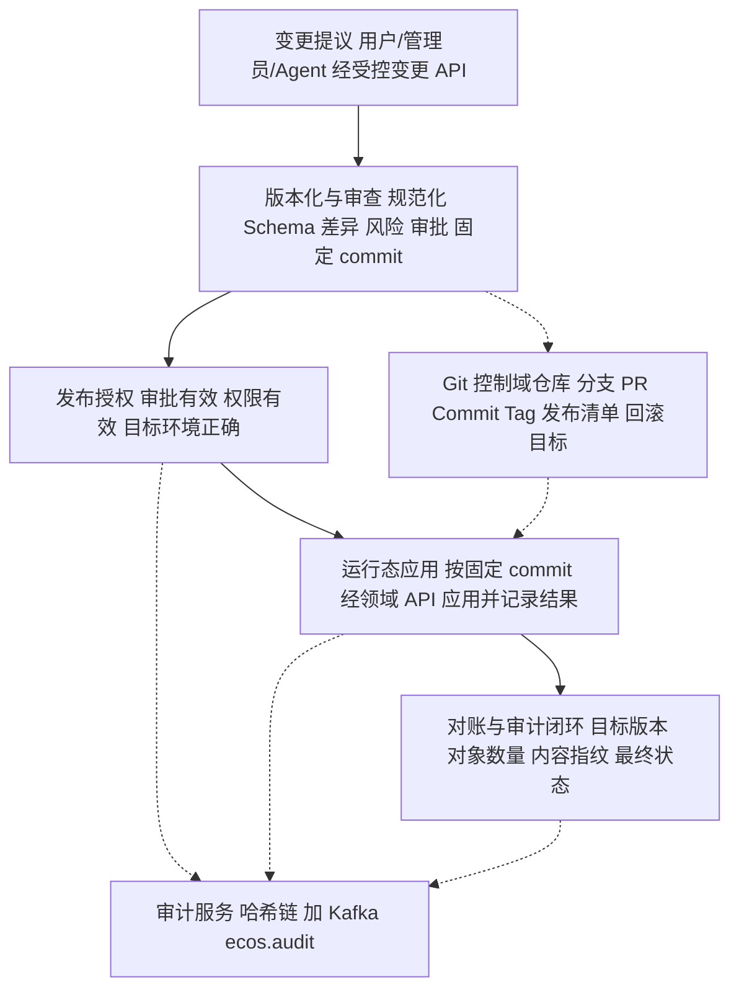

变更发布时序（文本）：① 变更提案 → ② 规范化变更包 + Schema/引用/依赖/安全检查 → ③ 风险评级 + 差异与影响分析 → ④ 提交受控分支 + PR/等效审批记录 → ⑤ 按风险等级评审审批（关键变更职责分离）→ ⑥ 固定不可变 commit SHA + 生成发布清单 → ⑦ 发布服务按 commit 应用目标环境 → ⑧ 记录 DB 应用状态与生效对象指纹 → ⑨ 对账（实际 vs 目标 commit）→ ⑩ 失败进入明确失败状态，按补偿/重试/回滚处理。

**「需求—设计—实现—测试」追踪矩阵（目标态）**

| 能力 / 需求 | 设计（本文落点） | 实现（既有 / 目标） | 测试 |
|:--|:--|:--|:--|
| 发布 = Git commit + tag，库内只存在用版本（REQ-WAG-23 / K4 语义） | §2.9.2、§6.4.5（`ecos_ontology_version` + `git_ref`）、§10.5.3 | ontology 归档已落地；其余多数未接入 | `OntologyGitServiceImplTest`、`PipelineGitServiceH4Test` |
| 未接入资产返回 `not_available` | §2.9.4①、§2.9.6⑤ | `GitController` rollback/branches/branch；`OntologyGitServiceImpl` 缺参/失败分支 | `GitService` 相关测试 |
| Git 唯一出口、只传 `repositoryId` | §3.2.4、§3.3.2 | runtime-access `GitService`/`GitRepositoryService` | `GitPathSafetyTest`、`GitRepoRootResolverTest` |
| 审计不可抵赖（哈希链 + Kafka `ecos.audit`） | §2.9.4③ | `AuditHashChainService`/`ecos_audit_log`/runtime-event | `AuditChainConsumerTest`、`KbAuditChainTest` |
| 双写部分失败可识别、可对账 | §2.9.6 | 目标态缺口（ADR-18 三 Port 未实现） | 待补集成测试 |
| 4 张废弃版本表停写并 DROP | §2.9.6⑤、§2.12 | 15 处读写待切 Git（IR03 例外） | 备份后 DROP（部署窗口） |

#### 2.9.8 Redis 缓存与一致性治理（**建议基线 · 目标设计 · 非现状**）

> **性质声明**：本小节为**目标态设计与建议基线**，来源为《ECOS 缓存架构与一致性治理》设计前置指令与 Phase 0 事实核查《ECOS缓存现状与差距分析-2026-10-14》。下列分类矩阵、键规范、一致性机制、审计字段、指标、状态机、测试矩阵**均为建议**，**须结合现有业务规则、数据规模与安全策略确认后落地**；**严禁据此断言 ECOS 已具备 Redis 部署 / 缓存组件 / 消息协议 / 表 / 服务**。现状事实见该分析册；涉及权限与审计的现状直接复用《ECOS控制域版本治理现状与差距分析-2026-10-14》§2.3，不重复核查。

**最终宣言**：**「Redis 负责提升读取性能；权威数据源负责正确性；版本机制负责识别数据版本；权限体系负责访问边界；审计系统负责提供可验证的证据。」**

**① 《ECOS 缓存分类与一致性矩阵》**

> **权威数据源唯一**：每个可缓存对象必须有**唯一权威数据源**，取值为**业务 DB** / **已发布 Git 控制域版本** / **领域服务**三者之一；缓存一律只是权威源的**加速副本**，**不得成为任何对象的事实来源或鉴权依据**。下表 14 类对象名使用简称，其全称见架构册 §2.4 统一缓存契约（本表简称与《ECOS缓存现状与差距分析-2026-10-14》§四一致），**为建议基线，须结合现有业务规则、数据规模与安全策略确认**。

| # | 缓存对象 | 权威数据源（现状） | 建议缓存策略 | 一致性要求 |
|:--|:--|:--|:--|:--|
| 1 | 机构组织 | 业务 DB（sysman `TD_USER`/`ecos_tenant`） | 读多写少，短 TTL 缓存 | 变更后主动失效；按 `tenant_id` 隔离 |
| 2 | 用户 | 业务 DB（sysman `TD_USER`） | 读多写少，短 TTL | 变更/禁用后立即失效；凭据/密级字段禁明文入缓存 |
| 3 | 角色权限 | 业务 DB + security-engine（ABAC/RLS/CLS）领域服务 | **仅加速层**，TTL + fail-closed | 撤权后须在最大陈旧时间内失效；按租户/密级隔离；**不得作鉴权权威** |
| 4 | 接入元数据 | 业务 DB + 已发布 Git 控制域版本（`MetadataCollectGitArchive`） | 读多写少，写后失效 | 元数据变更/发布后失效（既有 `invalidate(datasourceId)` 范式） |
| 5 | Pipeline | 业务 DB + 已发布 Git 控制域版本（`PipelineGitService`） | 定义体缓存，**版本化** | 发布=commit 后版本指针前滚并失效旧版本 |
| 6 | 质量规则 | 业务 DB（dq `DqRuleEntity`/`QualityRule`） | 读多写少 | 规则变更后失效 |
| 7 | 本体映射 | 业务 DB + 已发布 Git 控制域版本（`OntologyGitServiceImpl`） | **版本化缓存** | 发布（commit+tag）后绑定新版本 |
| 8 | 知识库索引 | 领域服务（kb-engine 图谱 + pgvector）；**无 Git 归档** | 热词/检索结果短 TTL | 写后失效；向量一致性要求高 |
| 9 | 认知资产模型 | 业务 DB（`ModelRegistryService`，`ecos_cognitive_model`） | **版本化缓存** | 注册新版本后失效 |
| 10 | 心智模型 | 业务 DB（cognitive2 `CognitiveBeliefService`）；**无 Git 归档** | 事件驱动失效 | 可复用 `ecos.cognitive` topic 广播失效 |
| 11 | Agent 协同 | 业务 DB（14 张 `ecos_wagent_*`）+ 已发布 Git（ADR-18，**未接线**，`CandidateService` 内存态） | 状态类**不宜缓存**或强一致 | 候选态须先持久化；发布链未落地前返回 `not_available` |
| 12 | 统计派生 | **未找到**明确单一权威源（疑似 data-engine/workspace 派生） | 待权威源确认后评估 | `E`：须先确认权威源再评估 |
| 13 | 任务状态 | 领域服务 runtime-task（`td_runtime_task_status` 单一事实源） | 热状态短 TTL | **不得与 runtime 表互为备份**（后端规范 §九.3） |
| 14 | 审计记录 | 领域服务 security-engine（`ecos_audit_log` 哈希链）+ Kafka `ecos.audit` | **不作为可篡改副本缓存**；只读镜像须 hash 校验 | 只读镜像须与权威哈希一致 |

**② 缓存键与命名规范（建议）**

逻辑结构（统一契约）：

```
ecos:{env}:{domain}:{objectType}:{scope}:{objectId}:v{version}
```

| 段 | 含义 | 规则 |
|:--|:--|:--|
| `env` | 环境命名空间 | 隔离 dev/test/acceptance/prod；**跨环境不复用键** |
| `domain` | 业务域/引擎 | 小写短横线（如 `data-engine`/`ontology`/`cognitive`） |
| `objectType` | 14 类对象类型标识 | 与小节①矩阵对象一一对应 |
| `scope` | 隔离范围维度 | 至少含 `tenant_id`；权限敏感对象**必须**含租户/机构/密级维度 |
| `objectId` | 对象标识 | 稳定业务 ID |
| `v{version}` | 对象版本 | 版本化对象**必须显式携带**；非版本化对象可用内容摘要替代 |

- **查询结果缓存**：以**规范化查询参数摘要**（canonical query hash）作为末段，禁止把原始查询串直接作键。
- **字符与长度**：仅允许 `[a-z0-9:._-]`、全小写；总长**建议 ≤ 512 字符**；超长用哈希摘要收口。
- **版本升级**：对象契约/schema 版本升级时键结构版本段（`v{version}` 或独立键前缀）随之升级，避免新旧结构混淆。
- **冲突处理**：同名跨域冲突以 `domain` 段消歧；同一对象多 `scope` 不得相互覆盖。
- **高基数查询限制**：高基数/组合爆炸查询（自由筛选、全文检索）**禁止无界缓存**，须限制维度组合或以摘要键 + 短 TTL 兜底。
- 🔴 **安全**：权限敏感数据键须含**足够权限范围维度**或保证隔离；**键中禁明文令牌/密码/密钥/个人敏感信息**；**键本身不得成为绕权依据**（命中仍须鉴权，见③a）。

**③ 缓存一致性与失效机制（统一契约 · 建议）**

**a. Cache-Aside（缓存旁路，5 步）**
1. 读取缓存（**命中仍须执行鉴权与数据范围校验**）；
2. 未命中**回源权威数据源**（业务 DB / 已发布 Git 版本 / 领域服务）；
3. 校验一致性与版本；
4. 写回缓存（控制单项大小 / TTL）；
5. 返回结果。

> 🔴 **命中缓存不得跳过鉴权与数据范围校验**：缓存键与值**不得作为授权依据**；权限/密级相关对象命中后仍须经 security-engine（PEP/PDP）判定（承接 PRD-06:209 fail-closed / PRD-07:233「缓存判定不作唯一依据」）。

**b. 版本化缓存（Git 治理对象）**
- 缓存**显式绑定对象版本**，**不依赖可能变化的 latest**；
- 仅当**发布校验通过**才更新版本指针（`active_version` / `git_ref` 对应版本）；
- 旧版本按**保留策略**清理，**运行任务引用期内不得删除**（运行态任务须能读其启动时绑定的版本）。

**c. 主动失效与事件驱动**
- 失效事件字段（建议）：`object_type`、`object_id`、`version`（或变更序号）、`event_id`、`timestamp`、`trace_id`；
- 消费端**幂等**：按 `event_id` 去重；须处理**重复 / 乱序 / 延迟**（乱序取版本高者，迟到事件按版本校验丢弃）；
- **丢失 / 失败 / Redis 不可用**时：**补偿扫描（对账）+ 版本校验 + 短 TTL 兜底**，**不得静默放行过期数据**；
- 🔴 **「事件已发送」≠「缓存已失效」**：投递成功不保证消费生效，须有终态校验与补偿；
- 广播载体**优先复用** runtime-event `EventBusService`（Kafka 主 + 内存降级）；**但须注意该能力现状未接线到任何缓存失效**（见本节『现状基线声明』）。

**d. 数据库提交与缓存失效顺序**
- 优先 **「先提交权威数据，再失效缓存」**；
- **风险分析**：**提交成功但失效失败**时数据已更新而缓存未清 → 出现陈旧读；须由补偿扫描 / 短 TTL / 版本校验收敛；
- **Outbox / 事务性事件发布**：现状**不具备**（Phase 0 核查 0 命中），列为**待建设**，**不得假设已存在**；具备前以「提交后再失效 + 补偿对账」兜底。

**④ 双写审计与 Git 版本治理衔接（统一契约 · 建议）**

> 🔴 缓存失效/刷新**不等于** Git/DB 双写。本部分独立于 §2.9.4~§2.9.7 的控制域 Git 归档链路，只描述**缓存侧与审计/版本的关联**。

- 关键发布应能关联 §2.9.4③ 既有字段 `git_commit_sha` / `content_hash` / `deployment_id` / `target_environment` 及缓存版本、`trace_id`，形成**可追溯链路**（承接 §2.9.4③ 审计事件字段组，**字段名以 §2.9.4③ 为准**；本治理域仅在既有字段基础上**新增**下述 8 项 `cache_*`，不重复定义其他字段）；
- **新增字段须遵守现有审计数据模型**（`AuditHashChainService` / `ecos_audit_log` 哈希链 + Kafka `ecos.audit`），以**可选字段**方式提出，**不破坏既有接口兼容性**。
- **建议可选审计字段（8 项 `cache_*`）**，与既有审计行合并、避免重复建设：

| 字段 | 用途 |
|:--|:--|
| `cache_strategy` | 本次变更采用的缓存一致性策略（Cache-Aside / 版本化缓存 / 主动失效与事件驱动 / 先提交权威数据、再失效缓存 之一） |
| `cache_namespace` | 缓存所在环境/域名命名空间（对应键结构 `env`/`domain` 段） |
| `cache_version` | 缓存绑定的对象版本（对应键结构 `v{version}` 段） |
| `cache_invalidation_event_id` | 失效事件 ID（幂等去重键） |
| `cache_invalidation_status` | 失效结果状态（成功 / 失败 / 补偿中） |
| `cache_verification_status` | 发布后缓存一致性验证结果（已校验 / 不一致 / 未校验） |
| `cache_failure_reason` | 缓存相关失败原因（失效 / 刷新 / 版本漂移等） |
| `cache_verified_at` | 一致性验证时间戳 |

- **发布状态机须分别记录的 6 项状态（本节记录口径）**：Git 变更已提交｜变更已审批｜领域数据已发布/应用｜缓存已刷新·失效·切版本｜运行时版本校验通过｜审计证据已持久化；**任一步失败须返回准确状态**，**不得把 Git/DB 成功当「发布成功」**。本节只记录这 6 项状态，全量十六态状态机见 §2.9.6，本节**不新增独立状态机**。

**⑤ 权限 · 安全与敏感数据（8 条红线 · 建议）**
1. Redis 须处于**受控网络边界**，强制**认证 + 最小权限**，**传输加密**（静态加密依环境与风险评估）；
2. **环境命名空间隔离**（`env` 段），跨环境键不复用；
3. **租户/机构/用户隔离**，防跨租户泄漏（`scope` 段必含租户维度）；
4. **权限授权缓存**须定义**最大陈旧时间**，并以**测试证明撤权生效**（fail-closed；现状 `InMemoryPermissionCacheService` / `InMemoryDecisionCacheService` 未见按租户/密级隔离的撤权保证）；
5. **不缓存密码/私钥/会话凭据**（既有 `RedisBlacklistStore` 仅作黑名单哈希，不作凭据存储）；
6. Redis **非唯一审计存储**，**不存无法从权威源恢复的关键业务数据**；
7. **限制 Redis 命令权限**，应用侧**无多余管理能力**（禁 `FLUSHALL`/`CONFIG` 等）；
8. 定义**凭据管理 / 轮换 / 备份 / 网络故障处理 / 安全事件响应**流程。

**⑥ 性能与容量（10 项 · 建议）**

> 🔴 **性能目标须基于实际压测与 SLA**，**不得宣称未测量的命中率或提升比例**。

1. 核心接口基线 **P50 / P95 / P99 / 吞吐 / 错误率**；
2. 预期**命中率与回源比例**（回源比例须实测，不臆测）；
3. **单项大小 / 条目数 / 内存占用 / 增长率**上限；
4. **热点 Key、击穿、雪崩、穿透**防护（热点探测 / 空值缓存 / 互斥重建 / TTL 抖动）；
5. **TTL 随机抖动** + **请求合并 / 互斥回源**（防同时回源）；
6. **大 Key、批量删除、高频失效**治理（拆分大 Key / `SCAN` + 批量 / 批量失效聚合）；
7. **连接池 / 超时 / 重试 / 并发限制 / 熔断**参数化；
8. **Redis 故障降级与数据库保护**（降级不得形成 DB 雪崩，见⑦）；
9. **容量扩展 / 持久化 / 高可用模式**（主从 / 哨兵 / 集群，依档位）；
10. 成本与档位对齐（standard / enterprise / ultimate）。

**⑦ 故障处理与降级（9 场景 × 8 要素 · 建议）**

> 每场景须给：**检测方式 / 业务影响 / 是否允许回源 / 是否拒绝请求 / 重试规则 / 补偿方法 / 告警条件 / 审计要求**。
> 🔴 **权限与关键控制域版本等安全敏感场景，不得在无法确认授权或版本正确性时静默返回旧缓存**（fail-closed）。

| # | 场景 | 检测方式 | 业务影响 | 允许回源 | 拒绝请求 | 重试规则 | 补偿方法 | 告警条件 | 审计要求 |
|:--|:--|:--|:--|:--:|:--:|:--|:--|:--|:--|
| 1 | 连接超时/不可用 | 连接异常计数 | 回源压力上升 | 是（非敏感） | 敏感面 DENY | 有界重试 + 熔断 | 降级本地 / 短 TTL | 连接错误率 | 记录降级 |
| 2 | 反序列化失败 | 解析异常 | 单键不可用 | 是 | 否 | 不重试（脏数据） | 驱逐该键 + 回源 | 反序列化错误率 | 记录脏键摘要 |
| 3 | 失效失败 | 失效返回失败 | 陈旧读风险 | 是（校验后） | 敏感面 DENY | 有界重试 | 补偿扫描 / 版本校验 | 失效失败率 | 必须记录 |
| 4 | 失效事件丢失/重复/乱序 | 事件序号缺口/重复 | 陈旧读 | 是 | 敏感面 DENY | 按事件重试 | 对账重放（参考 `AuditRetryTask`） | 事件异常 | 记录事件 ID |
| 5 | 缓存版本与发布版本不一致 | 版本比对 | 读到旧/错版本 | 否（版本化对象） | 是 | 重拉权威版本 | 版本指针回正 | 版本漂移 | 必须记录 |
| 6 | 内存达上限 / 驱逐 | 内存/驱逐指标 | 命中率下降 | 是 | 否 | — | 扩容 / 淘汰策略调优 | 内存水位 / 驱逐 | 记录驱逐 |
| 7 | 大量同时过期致回源激增 | 回源 QPS 突增 | DB 压力上升 | 受控（限额） | 超限 DENY | 退避 | TTL 抖动 + 互斥回源 | 回源流量异常 | 记录回源峰值 |
| 8 | 跨租户 / 跨权限污染 | 键/值范围校验 | **越权风险** | 否 | **是（DENY）** | — | 驱逐污染键 + 审计 | 严重告警 | 必须记录（安全事件） |
| 9 | 刷新成功但运行时仍读旧版本 | 运行时版本比对 | 语义不一致 | 否 | 是 | 重取 | 强制版本校验 | 版本不一致 | 必须记录 |

**⑧ 可观测性与运维（建议指标名，可依 ECOS 现有监控规范调整）**

- **统一指标**：`redis_cache_hit_total`、`redis_cache_miss_total`、`redis_cache_errors_total`、`redis_cache_invalidation_total`、`redis_cache_invalidation_failures_total`、`redis_cache_stale_read_total`、`redis_cache_load_duration`、`redis_cache_entry_count`、`redis_memory_used_bytes`、`redis_evicted_keys_total`；
- **日志 / 追踪**：关联**业务域 · 缓存策略 · 对象版本 · 回源结果 · `trace_id`**；**禁写敏感数据 / 完整凭据**；
- **告警**：覆盖错误率 / 延迟 / 内存 / 驱逐 / 失效失败 / 版本不一致 / 回源流量异常，接入 runtime-monitor。
- **现状**：`runtime-monitor`（`MonitorDataServiceImpl`）**未挂载任何 Redis/缓存指标**，缓存监控项为**缺口**。

**⑨ 测试与验收矩阵（建议）**

| 维度 | 用例要点 |
|:--|:--|
| 功能一致性 | 命中与未命中 / TTL 到期重建 / 变更后失效 / Git 新版本切换 / 历史版本任务可读对应版本 / 重复·延迟·乱序失效事件 / 发布中断重试补偿 / 缓存与运行时版本不一致检测 |
| 安全 | 跨租户隔离 / 跨组织隔离 / 撤权后旧缓存不得继续授权 / 用户禁用后缓存不得继续有效 / 敏感信息不得入键·日志·值 / Redis 故障不得绕认证授权 |
| 稳定性性能 | 不可用降级恢复 / 击穿雪崩穿透热点 / 内存压力驱逐大 Key / 并发发布刷新读取竞态 / 基于真实数据分布压测并比较缓存前后 P50·P95·P99·吞吐·DB 负载·错误率 |

> 🔴 **验收报告须区分 单元 / 集成 / 压力 / 真实部署环境验证**，**不得把模拟测试描述为生产验证**。

**⑩ 「需求—设计—实现—测试」追踪矩阵（目标态）**

| 能力 / 需求条目 | 设计（本文落点） | 代码模块（真实类名 / 目标） | 测试 |
|:--|:--|:--|:--|
| 缓存只作加速层、不作鉴权权威（PRD-07:233 / REQ-SEC） | §2.9.8①③⑤ | `InMemoryPermissionCacheService`、`InMemoryDecisionCacheService`、`ClearanceInterceptor`（RLS/CLS/ABAC） | `docs/50-测试/` 专项缓存一致性用例 **not_available** |
| 配置 / 字典缓存写后刷新 | §2.9.8① | `SysConfigService.refreshCache()`、`DictService.refreshCache()` | `SysConfigAuditEgressTest` 等（**缓存专项待补**） |
| 元数据缓存写后失效 | §2.9.8①③ | `MetadataCollectionService.invalidate(datasourceId)` | `docs/50-测试/`（**待补**） |
| 函数结果缓存失效 | §2.9.8① | `FunctionCacheManager.invalidateByEntity` | `FunctionAuditRejectWithoutContextTest`（**间接**） |
| 失效广播复用事件总线 | §2.9.8③ | `EventBusService`（Kafka 主 + 内存降级） | `KafkaEventBusServiceImplTest` |
| 审计不可抵赖 + 缓存审计字段 | §2.9.8④ | `AuditHashChainService`、`ecos_audit_log`、runtime-event | `AuditChainConsumerTest`、`KbAuditChainTest` |
| Token 黑名单（Redis/Caffeine 双态） | §2.9.8⑤ | `RedisBlacklistStore`（半接入，standard 档排除） | **not_available**（无对应测试） |
| 缓存键租户/机构/密级隔离 | §2.9.8②⑤⑦ | 目标态（现状**无隔离证据**） | **待建** |
| Redis 运行接入 + 缓存监控指标 | §2.9.8⑧ | 现状**缺口**（无容器 / 无配置 / 无指标） | **待建** |
| 权限撤权后旧缓存不生效 | §2.9.8⑤⑨ | 目标态（现状 `InMemory*` 无 TTL 撤权保证） | **待建** |

**⑪ 未决策事项、风险、兼容性影响与实施阶段建议（仅设计，不实施）**

**承接 Phase 0 审计 Q1~Q10 待决策清单**（注明需谁裁决）：

| # | 事项 | 需谁裁决 |
|:--|:--|:--|
| Q1 | Redis 是否纳入 runtime 公共底座（新横切基础构件）还是业务侧自建 | 架构负责人（+ PMO） → **R12 已裁定（2026-10-16）：归 runtime 公共底座，由 Runtime 统一管理配置；登记铁律 §2.5 底座清单增补待办** |
| Q2 | 生产/企业档是否真正部署 Redis（连接配置 + 容器 + 运维编排） | 架构 + 运维 |
| Q3 | 是否建设 Outbox/事务消息，及其与 `EventBusService` + 审计兜底表的关系 | 架构负责人 → **R12 已裁定（2026-10-16）：列入待建设清单** |
| Q4 | 失效广播是否复用 `EventBusService`，topic 命名与事件契约 | 架构 + runtime-event owner |
| Q5 | 缓存键隔离维度（`tenant_id`/机构 `X-Org-Id`/密级/domain）如何统一 | 安全 + 架构 → **R12 已裁定（2026-10-16）：与 `ClearanceInterceptor` 客户端可控 `X-Org-Id` 存量偏差一并处置** |
| Q6 | 是否引入 Spring Cache 抽象替代散落手写缓存 | 架构 + 后端 owner → **R12 已裁定（2026-10-16）：列入待建设清单** |
| Q7 | 权限缓存「不得作鉴权唯一依据 + fail-closed」如何落地校验 | 安全负责人 |
| Q8 | `InMemoryPermissionCacheService`/`InMemoryAbacPolicyCacheService` 装配方式确认 | 后端 owner |
| Q9 | 单机 Caffeine 缓存是否迁移分布式缓存及批次 | 架构 + 各 engine owner |
| Q10 | 缓存配置项是否统一到 `sys_config` 分组并纳入缓存监控 | 架构 + 运维 |

- **风险**：`ClearanceInterceptor` 超管旁路 + `X-Org-Id` 客户端可控（安全域 S-14）会污染缓存键隔离维度；`runtime` 公共底座**不含 Redis**，若业务侧自建将违宪（架构铁律 §2.5）。**（R12 裁决 2026-10-16：Redis 归 runtime 公共底座、由 Runtime 统一管理配置，各服务不自建缓存配置，从根因上消除"业务侧自建违宪"风险；底座清单增补与 `X-Org-Id` 偏差转为登记待办。）**
- **兼容性影响**：本小节**不新增模块/JAR/schema/容器/服务名/表/协议**；审计字段以**可选**方式扩展，不破坏既有接口；键结构为**建议**，未落地前不得作为既成接口。
- **实施阶段建议（仅设计，不实施）**：① 决策（Q1~Q10）→ ② 底座归属与键/事件契约定稿 → ③ 只读高频对象（配置/字典/元数据）分布式缓存迁移试点 → ④ 权限/决策缓存加固（TTL + fail-closed + 隔离维度）→ ⑤ 失效广播接线 `EventBusService` → ⑥ 审计字段可选扩展 + 对账补偿 → ⑦ 压测与 SLA 验证。**每阶段前置对应负责人裁决，未裁决不得进入实施。**

**现状基线声明**：ECOS 现状为「**Redis 未接入运行链路、缓存为单机本地内存（Caffeine / 自建 Map）、无 Spring Cache 抽象、无 Outbox/事务消息、`EventBusService` 未接线到缓存失效、runtime 公共底座不含 Redis**」；本小节全部内容为**建议基线 · 目标设计，非现状**，落地不得据此断言 ECOS 已具备 Redis 部署 / 缓存组件 / 消息协议 / 表 / 服务。**（R12 裁决 2026-10-16：目标态归属已定——Redis 缓存能力归 runtime 公共底座、由 Runtime 统一管理配置；现状仍为底座缺口，未落地前上述"非现状"声明不变。）**

#### 2.9.9 Git 控制域安全与可信发布治理（**建议基线 · 目标设计 · 非现状**）

> **性质声明**：本小节为**建议基线 · 目标设计，非现状**，同步需求册 v2.1-R9 需求卡 S8（REQ-SEC-15~21 / REQ-PLT-39 / REQ-NF-14，需求册侧同样标注"目标设计/建议基线"）。除 **2.9.9.0 现状审计摘要**引用已核实事实外，本节全部矩阵、流程、字段、机制**均为目标设计**；**严禁据此断言 ECOS 已具备分支保护服务端强制 / 提交与发布签名 / 审批持久化 / Secret Scanning / Git 仓独立备份 / 发布冻结能力**；实施须另行授权排期（见 2.9.9.13）。

**2.9.9.0 现状审计摘要（Phase 0 事实基线，2026-10-15）**

> 本小节为已核实事实（逐条引用现状核查，可压缩引用但不得改动事实与行号），与后续目标设计严格区分。

- **托管**：`origin` = GitHub 个人账号仓（`git remote -v` 实测），无组织权限矩阵。
- **凭据**：`runtime-access/.../git/GitServiceImpl.java:103,127,183-188` 凭据为明文方法入参，username 空则匿名；security-engine 加密注入未接线；无服务专属身份。
- **鉴权收口**：`GitController`（`/api/v1/ecos/git`）与 `PipelineGitController` 共 6 个 git 端点未登记 `AnonymousEndpointRegistry` → 强制 JWT + clearance；无 `@PreAuthorize` 细粒度门。
- **Secret Scanning**：仓内无 CI 钩子/工具配置；`login_body.json:1`、`ecos-docker/k6-72h.js:29-33`、`seed-2h.sh:92`、`soak-72h.sh:96` 明文 `admin/admin123` 仍在仓。
- **审批**：ADR-18 四眼链路 `CandidateService`/`CommitService` 内存态，三 Port 抛 `UnsupportedOperationException`；`V239__wagent_candidate_review.sql` 建表未实跑未消费；分支保护为纯流程约束，无服务端强制。
- **签名**：HEAD 提交无签名；`GitServiceImpl` commit/tag 未调 JGit 签名 API；发布清单（manifest）与签验机制未找到；发布授权与 Commit SHA 无绑定。
- **投毒防护**：`AgentToolPolicyGate.java:20-59`（ABAC + FAIL_CLOSED + 危险关键字）、`AgentToolSqlWhitelist.java:20-48`（fail-closed 白名单）已存在；`OntologyGitServiceImpl:74-77,224-229` 拒客户端 `localPath`/`gitUrl`；Candidate 内容级静态安检未找到。
- **审计断链**：security-engine 内 grep `git_commit`/`commit_sha`/`commitId` = 0 命中 → `AuditHashChainService` 哈希链与 Git 归档无关联。
- **备份/应急**：Git 仓备份机制无；`OntologyVersionService.rollback():300-316` 走 DB 快照（违后端规范 §十一.2）；发布冻结/紧急吊销未找到。

可复用能力（R1~R9）：

| # | 能力 | 现状落点 |
|:--|:--|:--|
| R1 | runtime Git 唯一出口 | runtime-access `GitService` / `GitRepositoryService` |
| R2 | 仓库根路径单源 + 路径守卫 | `GitRepoRootResolver`（sys_config `ecos_git_repo_root`） |
| R3 | 引擎归档编排范例 | `OntologyGitServiceImpl`（注入 runtime `GitService`） |
| R4 | 鉴权单源收口 | 未登记端点强制 JWT + clearance（`AnonymousEndpointRegistry`） |
| R5 | 审计哈希链 | `AuditHashChainService`（`ecos_audit_log`） |
| R6 | Agent 工具投毒防护 | `AgentToolPolicyGate` + `AgentToolSqlWhitelist` |
| R7 | 评审留痕 DDL | `V239__wagent_candidate_review.sql`（未实跑未消费） |
| R8 | 审计投递兜底 | `AuditEventProducer` / `ecos_runtime_audit_retry` |
| R9 | 前端 git 单通道 | `src/services/gitService.ts` |

缺口（G1~G10，按严重度）：**G1** 发布授权与 Commit SHA 无绑定｜**G2** 提交/标签零签名｜**G3** 凭据明文入参 + 无服务专属身份｜**G4** 四眼审批零工程强制｜**G5** 审计无 `git_commit_sha` 关联｜**G6** 无 Secret Scanning + 明文 `admin123` 在仓｜**G7** 无备份 / 回滚走 DB 快照偏离 / 无发布冻结｜**G8** 个人账号托管无组织权限矩阵｜**G9** `refreshCache` 无细粒度门｜**G10** `PipelineGitService` 直连 JGit 残余。

**2.9.9.1 目标（五条核心原则 + 可信链宣言）**

五条核心原则（逐字）：

1. Git 记录变更，不自动赋予变更生效的权限；
2. 提交成功不等于审批通过，审批通过不等于允许发布；
3. Git 中的内容必须经过安全校验，才能进入运行时；
4. Redis 只能缓存已授权、已发布且版本明确的数据，不能将未经批准的 Git 内容传播到运行时；
5. 审计证据不能只保存在被审计的 Git 仓库里。

可信链宣言（逐字）：

**身份与权限 → Git 变更 → 独立审批 → 安全校验 → 签名发布授权 → 领域服务应用 → Redis 版本切换 → 运行时验证 → 独立审计**。任何一个环节都不能仅凭上游环节"已经成功"就被视为自动可信。

**2.9.9.2 威胁模型与资产清单（目标设计）**

资产 7 类：① 仓库 / 分支 / 标签 / 历史 / 发布清单；② 机构用户角色权限授权关系；③ 接入元数据 / Pipeline / 质量规则；④ 本体 / 知识 / 认知 / 心智 / Agent 协同；⑤ Git 凭据 / 签名密钥 / 服务身份 / 发布凭据；⑥ Redis 缓存与运行时版本；⑦ 审批 / 发布 / 审计证据。

威胁 8 类矩阵（"现有控制"引用 R1~R9，仅表示存在可复用抓手，**不代表威胁已消除**）：

| 威胁 | 资产 | 攻击路径 | 影响 | 现有控制 | 剩余风险 | 验证方法 |
|:--|:--|:--|:--|:--|:--|:--|
| T1 未授权读/写/删 | ①②③④ | 盗用身份或利用未受控端点直连仓库 / 控制域对象 | 未授权变更进入历史、对象泄露 | R1 R2 R4 | G8 G9（无细粒度门、无组织矩阵） | 越权访问测试（2.9.9.12-1） |
| T2 越权提交自批绕过 | ②⑦ | 发起人兼任审批、内存态审批被绕过 | 高风险变更无独立审批即发布 | R4 R7 | G4 | 审批绕过测试（2.9.9.12-2/4） |
| T3 Token/密钥泄露与服务身份滥用 | ⑤ | 明文凭据入参、仓内明文秘密被捞取、共享全权 Token | 以合法凭据提交恶意变更 | R2 R9 | G3 G6 | 凭据扫描测试 + 轮换演练（2.9.9.12-5/10） |
| T4 恶意配置与 Agent 投毒 | ③④ | Agent 提交危险表达式 / 未授权外部地址 / 恶意工具调用 | 运行时执行恶意逻辑 | R6 + `OntologyGitServiceImpl` 拒 `localPath`/`gitUrl` | Candidate 内容级静态安检缺失；G10 | 投毒注入测试（2.9.9.12-2） |
| T5 未审批进生产 | ①⑥ | 未审批分支直写生产、缓存被未批准内容刷新 | 生产运行未授权版本 | R1 R3 | G1 G4 | 未审批发布阻断测试（2.9.9.12-3） |
| T6 Git—权威源—Redis 版本分歧 | ⑥ | 缓存版本与发布版本漂移、撤权后旧缓存继续授权 | 运行时读旧权限 / 旧版本 | §2.9.8 目标态机制（非现状） | G7；撤权时限未定（Q7） | 版本不一致检测测试（2.9.9.12-6/7） |
| T7 审计篡改伪造 | ⑦ | 删改审计行、伪造发布成功证据 | 不可追责 | R5 R8 | G5 | 审计完整性测试（2.9.9.12-9） |
| T8 恶意历史与备份污染 | ① | 篡改历史、污染备份后恢复即回灌恶意内容 | 恢复后恶意版本复活 | 无（备份机制缺失） | G7 | 备份恢复演练（2.9.9.12-10） |

**2.9.9.3 Git 访问控制（目标设计）**

权限矩阵（权限项 × 角色；✓=允许，—=默认禁止）：

| 权限项 | 变更发起人 | 领域负责人 | 安全审批人 | 发布服务身份 | 审计人员 | 仓库管理员 |
|:--|:--:|:--:|:--:|:--:|:--:|:--:|
| 读取 | ✓ | ✓ | ✓ | ✓（发布范围） | ✓ | ✓ |
| 创建分支 | ✓ | ✓ | — | — | — | ✓ |
| 提交 | ✓（变更分支） | ✓（变更分支） | — | — | — | — |
| 审批 | —（本人高风险变更禁） | ✓（业务正确性） | ✓（安全影响） | — | — | — |
| 合并 | — | ✓（审批通过后） | —（高风险须双审会签） | — | — | ✓（库务操作） |
| 发布标签 | — | — | — | ✓（已授权发布） | — | — |
| 发布 | — | — | — | ✓（签名清单限定范围） | — | — |
| 仓库管理 | — | — | — | — | — | ✓ |
| 密钥管理 | — | — | — | — | — | ✓（含轮换） |

访问控制要求：

1. **企业身份 + MFA + 最小权限**：Git 访问一律绑定企业身份并启用 MFA，按最小权限授权（REQ-SEC-15）；
2. **服务专属身份**：自动化与服务一律使用专属身份，**禁止共享全权 Token**（现状缺口 G3）；
3. **分支保护**：禁直推、禁强推；目标态要求服务端强制（现状为纯流程约束，缺口 G4）；
4. 🔴 **Git 权限 ≠ ECOS 领域授权**：仓库的读/写/合并权限**不构成**运行时生效权限；运行时鉴权仍以 security-engine（PEP/PDP）裁决为准，任何主体不得因持有 Git 写权限而获得生产发布权；
5. **定期复核与紧急访问**：权限定期复核；紧急访问（break-glass）必须全程记录并事后审计。

**2.9.9.4 凭据与敏感信息治理（目标设计）**

- **禁提交清单**：密码 / 令牌 / 私钥 / API Key / 会话凭据 / 未批准的个人敏感信息；
- **秘密存引用不存值**：秘密统一存 Secret Manager，Git 中只保存引用；
- **三道扫描**：提交前 / 合并前 / 发布前执行 Secret Scanning（现状三道均缺失，缺口 G6）；
- **泄露处置**：确认泄露后评估历史 + 分支 + 标签 + 缓存 + 备份暴露面，**撤销与轮换优先于历史重写**，不得以删除最新提交掩盖泄露；
- **秘密不出现在**：日志 / 提交信息 / 审计事件 / 缓存键（承接 §2.9.8②键规范与⑤红线 5）。

**2.9.9.5 变更审批与职责分离（目标设计）**

五角色职责与默认禁止（逐字沿用）：

| 角色 | 职责 | 默认禁止 |
|:--|:--|:--|
| 变更发起人 | 提交变更提案、变更原因与影响说明 | 审批本人变更；执行发布 |
| 领域负责人 | 审批业务正确性、影响范围与依赖顺序 | 替代安全审批；持有发布服务身份凭据 |
| 安全审批人 | 审批权限 / 密级 / 投毒风险等安全影响 | 由变更发起人或发布执行身份兼任 |
| 发布服务身份 | 以专用服务身份执行签名发布与运行时应用 | 发起变更、参与审批、身份共享 |
| 审计人员 | 只读核验审计证据完整性与发布合规 | 持有 Git 写权限与发布权限 |

风险分级审批矩阵（三档）：

| 风险档 | 典型对象 | 审批要求 |
|:--|:--|:--|
| 普通配置 | 非敏感描述、展示配置、低风险标签 | 单审（领域负责人）+ 自动校验 + 常规留痕 |
| 业务规则模型 | 质量规则、本体结构、认知规则、心智模型、Agent 工作流 | 领域负责人 + 安全审批人双审 |
| 机构身份权限认证与高风险 Agent 工具授权 | 用户/机构关系、角色权限策略、认证配置、高风险 Agent 工具授权 | 双人审批（职责分离）+ 强制审计 + 不可篡改证据 |

- **高风险双人审批为可配置策略**，与 §2.9.4④ 审计四级建议基线（L1~L4）及既有 `clearance_level` 核对映射后生效；
- 审批记录必须绑定：**不可变 Commit SHA + 目标环境 + 对象范围 + 风险等级 + 审批策略版本**；
- **提交内容变化须重审**：Commit SHA 变化即内容变化，原审批失效，须重新审批。

**2.9.9.6 提交完整性与可信发布（目标设计）**

Commit SHA ≠ 发布授权（两概念必须区分）：

| 概念 | 语义 | 不构成 |
|:--|:--|:--|
| Commit SHA | 仓库历史中的不可变内容标识（内容寻址） | 审批通过、发布授权、运行时生效 |
| 发布授权 | 经独立审批 + 安全校验 + 签名清单 + 目标环境确认的显式授权 | 由 Commit SHA 自动派生 |

签名发布清单（manifest）字段：

1. 仓库标识 + Commit SHA；
2. 对象清单及规范化内容哈希；
3. 目标环境 + 发布任务 ID；
4. 变更请求 + 审批记录 + 安全校验结果；
5. 发布策略版本 + 签名身份 + 签验结果；
6. 依赖版本与兼容性。

发布服务独立验证项：验签 / 信任链 / 审批状态 / 目标环境 / 依赖完整性 / 授权范围；签名验证须验**签名身份 + 信任根 + 密钥有效性 + 授权范围**。关键提交与标签要求签名（现状零签名，缺口 G2）；分支保护禁直推禁强推（缺口 G4）。

**2.9.9.7 控制域配置安全校验（目标设计）**

发布前校验清单：

1. Schema / 类型 / 必填 / 版本兼容；
2. 跨域引用 / 依赖闭包 / 循环依赖；
3. 权限范围 / 租户范围 / 敏感数据访问；
4. 未授权脚本 / 危险表达式 / 外部地址 / 工具调用；
5. Agent 工具白名单（复用 R6 `AgentToolPolicyGate` + `AgentToolSqlWhitelist`）；
6. 模型 / 规则 / 工作流的来源、版本与审批状态。

失败处理：**阻断 + 结构化错误 + 追踪 ID**，**禁止静默跳过**任何校验项。

**2.9.9.8 Git—领域服务—Redis 信任边界（目标设计）**

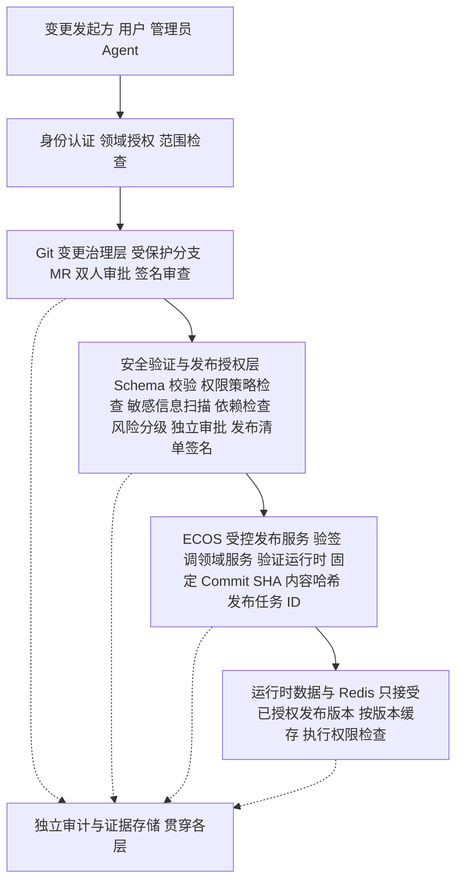

五条禁止（逐字）：

1. 禁止直接将未审批分支内容写入生产 Redis；
2. 禁止仅依据缓存命中返回未经授权的数据；
3. 禁止以缓存刷新成功代替运行时发布校验；
4. 禁止将 Git、数据库和 Redis 描述为天然原子的一致事务；
5. 禁止在版本或授权无法确认时静默使用高敏感旧缓存。

- **缓存切换绑定已批准版本**：Redis 版本切换只接受签名发布清单限定的 Commit SHA + 内容哈希（承接 §2.9.8③b 版本化缓存）；
- **撤权 / 身份状态变更**：须定义**可量化最长生效时间**并以测试证明生效（时限值与广播通道待 Q7 裁决）。

**2.9.9.9 可信发布时序（目标设计）**

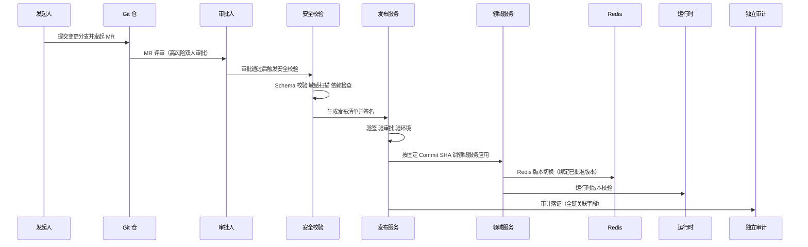

失败纪律：每一步失败各回准确状态——**不得将 Git 提交成功 / DB 写入成功直接标记为发布成功**；状态分记与 §2.9.6 十六态状态机、§2.9.8④ 缓存侧 6 态记录口径衔接，本节不新增独立状态机。

**2.9.9.10 独立审计与证据保护（目标设计）**

审计事件关联字段分两组（与 §2.9.4③ 22 项、§2.9.8④ 8 项 `cache_*` 合并落地、避免重复建设，以可选字段方式提出）：

**① 复用 §2.9.4③ 既有字段（7 项，字段名与语义以 §2.9.4③ 为准，本节不重复定义）**：`git_commit_sha`（发布绑定的不可变提交）、`git_parent_sha`（父提交，历史链核验）、`content_hash`（对象规范化内容哈希）、`target_environment`（目标环境）、`risk_level`（风险等级）、`approval_policy_version`（审批策略版本）、`deployment_id`（发布任务 ID，runtime-task 真实 `taskId`）。

**② 本治理域新增字段（5 项，§2.9.4③ 与 §2.9.8④ 中均不存在）**：

| 字段 | 用途 |
|:--|:--|
| `manifest_signature_id` | 发布清单签名标识 |
| `signature_verification_result` | 签验结果 |
| `approval_record_id` | 审批记录 ID |
| `publisher_identity` | 发布执行身份（服务专属身份） |
| `redis_version_switch_status` | Redis 版本切换状态 |

证据保护要求：

- 审计存储的**写入身份 / 修改权限 / 保留策略与 Git 仓库管理权限分离**；普通控制域写权限禁删改审计（承接 §2.9.4① Audit Service 约束）；
- 完整性校验（哈希链，复用 R5）+ **独立备份**（复用 R8 兜底通道）；
- 🔴 **不得只在 Git 中保存能证明 Git 自身安全的唯一证据**。

**2.9.9.11 备份恢复与事件响应（目标设计）**

六场景预案表：

| # | 场景 | 检测 | 影响 | 处置 | 恢复验证 |
|:--|:--|:--|:--|:--|:--|
| 1 | 仓库删除 / 篡改 | 远端仓不可用、历史哈希对账不符 | 控制域历史不可用 | 启用独立备份恢复 + 发布冻结 | 恢复后全量对账（对象清单 + 内容哈希） |
| 2 | Token 泄露 | 凭据扫描告警、异常克隆拉取 | 以合法身份读写仓 | 立即吊销轮换 + 评估历史 / 分支 / 标签 / 缓存 / 备份暴露面 | 轮换后验证旧凭据全失效 |
| 3 | 签名密钥泄露 / 信任根失效 | 签验异常、密钥未授权使用 | 伪造签名清单风险 | 发布冻结 + 密钥轮换 + 评估签名历史 | 信任链重建后抽验历史签名 |
| 4 | 合法账户恶意提交 | 内容级安检命中、审计异常模式 | 恶意内容进入历史 | 阻断发布 + 吊销账户权限 + 影响面分析 | 相关对象全量重校验 |
| 5 | 未审批版本误发布 | 发布记录无有效审批 / 签验 | 生产运行未授权版本 | 发布冻结 + 回滚至已授权版本 | 回滚后重验目标版本完整性 / 依赖 / 审批 / 权限影响 |
| 6 | Git—运行时—Redis 版本分歧 | 版本比对漂移告警 | 运行时读旧 / 错版本 | 版本指针回正 + 强制版本校验 | 恢复后重查运行时与 Redis 版本，防旧权限复活 |

通用要求：仓库**独立备份** + 定期**恢复演练** + **密钥轮换** + 确认攻击面期间**发布冻结**；**任何回滚恢复须重新验证目标版本完整性 / 依赖 / 审批 / 权限影响后方可执行**；恢复后必须重查运行时与 Redis 版本，防止旧权限复活。

**2.9.9.12 测试与验收（目标设计）**

测试矩阵（10 项）：

| # | 用例 | 类型 |
|:--|:--|:--|
| 1 | 无权读 / 改受限域被阻断 | 单元 + 集成 |
| 2 | Agent 绕过审批发布被阻断 | 集成 + 模拟攻击 |
| 3 | 未审批 / 错签名 / 哈希不匹配 / 依赖不完整的发布被阻断 | 集成 |
| 4 | 审批后提交内容变化 → 旧审批不适用于新提交（SHA 变化即重审） | 集成 |
| 5 | 凭据扫描阻断含秘密样例的提交 | 单元 + 集成 |
| 6 | 撤权后缓存不再授权（最长生效时间内收敛） | 集成 + 真实部署验证 |
| 7 | Git—运行时—Redis 版本不一致检测与告警 | 集成 |
| 8 | 发布失败幂等重试，无重复副作用 | 集成 |
| 9 | 审计证据全链关联（发起人 → 审批 → 签名 → 发布 → 缓存切换） | 集成 |
| 10 | 备份恢复与密钥轮换演练 | 模拟攻击 + 真实部署验证 |

验收纪律：区分**单元 / 集成 / 模拟攻击 / 真实部署环境验证**；**未执行的用例不得描述为已通过**；建议基线未核对确认前不得作为已实现事实验收（承接 REQ-NF-14）。

**2.9.9.13 五阶段实施路线（仅设计，不实施）**

1. **审计现状与资产分类**：完成资产 7 类分级与 G1~G10 缺口确认；
2. **最小可信发布链**：分支保护服务端强制 + 独立审批持久化 + 版本固定 + 发布清单 + 发布前安检；
3. **Git—领域服务—Redis 版本链**：低风险控制域试点后推广；
4. **高风险控制域保护加强**：用户 / 机构 / 权限 / 认证域；
5. **攻击模拟与恢复验证**。

> 🔴 本文档为设计基线，实施须另行授权排期。

**2.9.9.14 待决策清单（Q1~Q8）**

| # | 事项 |
|:--|:--|
| Q1 | 托管平台权限矩阵（个人账号迁组织仓？分支保护服务端强制？） |
| Q2 | 签名机制选型（GPG / SSH signing / sigstore） |
| Q3 | 审批持久化落点（V239 实跑通用化 vs 扩 `ecos_decision_approval`） |
| Q4 | 发布清单格式与落点（runtime-access vs 引擎编排层） |
| Q5 | Secret Scanning 工具与接入点 + 历史明文清洗范围 |
| Q6 | 审计关联 `git_commit_sha` 落点（扩列 vs 关联表） |
| Q7 | 撤权缓存失效时限与广播通道 |
| Q8 | Git 仓备份责任归属 |

**2.9.9.15 「需求—设计—现状—能力」追踪矩阵（目标态）**

| 需求条目（需求册 S8） | 本章节小节 | 现状缺口 | 可复用能力 |
|:--|:--|:--|:--|
| REQ-SEC-15 仓库访问与身份权限 | 2.9.9.3 | G8 G9 | R1 R2 R4 |
| REQ-SEC-16 凭据与密钥安全 | 2.9.9.4 | G3 G6 | R2 R9 |
| REQ-SEC-17 变更审批与职责分离 | 2.9.9.5 | G4 | R4 R7 |
| REQ-SEC-18 完整性与可信发布 | 2.9.9.6 | G1 G2 G4 | R1 R3 |
| REQ-SEC-19 防恶意配置与 Agent 投毒 | 2.9.9.7 | G10（+Candidate 内容级静态安检缺失） | R6 |
| REQ-SEC-20 Git—Redis 信任边界 | 2.9.9.8 | G7（撤权时限待 Q7） | R3 + §2.9.8 目标态机制 |
| REQ-SEC-21 独立审计与防篡改 | 2.9.9.10 | G5 | R5 R8 |
| REQ-PLT-39 备份恢复与事件响应 | 2.9.9.11 | G7 | R5 |
| REQ-NF-14 安全测试与验收 | 2.9.9.12 | G1~G10 全量验证 | R1~R9 |

**交付物承载说明**：本治理域各交付物由本节各小节分别承载——威胁模型（§2.9.9.2）、权限矩阵（§2.9.9.3）、敏感信息处理规范（§2.9.9.4）、审批策略矩阵（§2.9.9.5）、签名与密钥管理设计（§2.9.9.6）、信任边界图与 Redis 一致性与安全策略（§2.9.9.8）、可信发布时序图（§2.9.9.9）、审计证据模型（§2.9.9.10）、风险追踪表（§2.9.9.2 剩余风险列与 §2.9.9.11 六场景预案表）、测试矩阵（§2.9.9.12）。

**最终宣言**：本小节除 2.9.9.0 现状审计摘要外，全部为**建议基线 · 目标设计，非现状**；落地不得据此断言 ECOS 已具备分支保护服务端强制 / 提交与发布签名 / 审批持久化 / Secret Scanning / Git 仓独立备份 / 发布冻结能力；实施须另行授权排期。

### 2.10 多租户与数据面安全

#### 2.10.1 租户隔离形态

| `isolation_mode` | 实现 | 适用 | 断言 |
|:--|:--|:--|:--|
| `ROW_FILTER`（基线） | 所有带 `tenant_id` 的表强制行过滤模板 + 绑定参数 | 默认形态 | 每条 SQL 的租户谓词存在；缺谓词即失败 |
| `schema` | 按租户分 schema | 强隔离要求 | schema 名来自配置，禁字符串拼接表名 |
| `database` | 按租户分库 | 最高隔离 | 数据源路由经 `runtime-access` |

#### 2.10.2 数据面安全五件套

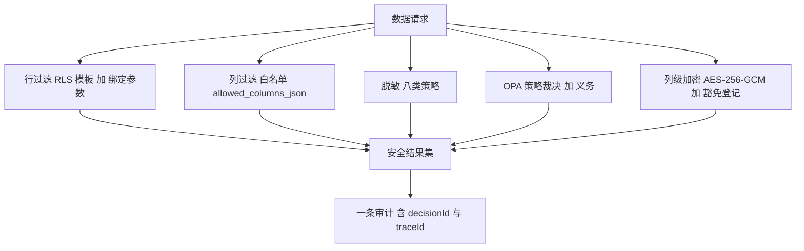

| 件 | 设计要点 |
|:--|:--|
| 行过滤 | 安全域返回 `predicateTemplate` + `bindings[]`，绑定来源限定 6 种白名单（上下文用户/租户/组织/许可级别、静态清单 ≤50、项目归属子查询）；`denyIfEmpty=true` 时空谓词必须拒绝而不是全放行 |
| 列过滤 | 资产元数据维护列白名单；未列入者不出结果，且不报错（避免结构探测） |
| 脱敏 | 八类策略 `ID_CARD / PHONE / NAME / EMAIL / BANK_CARD / AMOUNT / STAFF_REF / FREE_TEXT`；派生统计量（如画像分位）按列逐一登记是否需要脱敏 |
| OPA | 返回 `allow` + `policyRef` + `obligations[]`（`deniedReason / maskHints / watermark / rateLimitKey`）；导出用途必须带水印义务 |
| 加密 | 只允许 AES-256-GCM；密文形态 `base64(version(1B)\|IV(12B)\|ciphertext\|tag)`；禁自动生成密钥；主密钥只来自环境变量或 KMS；控制域列不可豁免 |

密级 `L1~L4` 与列绑定，`Purpose ∈ {page, export, ai}` 三用途下同一资产可有不同结果——这是导出与大模型供数必须独立裁决的原因，禁止复用页面查询结果。

#### 2.10.3 控制域权威实体骨架与列级豁免登记

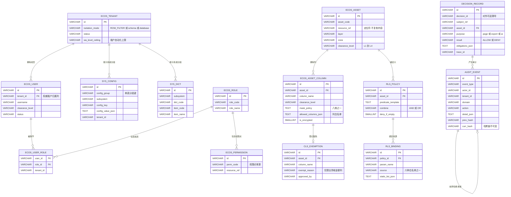

业务域金额列如需明文存储（为可核算与可导出），必须逐列登记于豁免表，登记要素为：资产、列、理由、批准人、生效范围。未登记的明文金额列写入即视为违规。豁免表本身属控制域，其列不可再被豁免。

### 2.11 按域 ER 骨架

以下七张图给出各域的**权威实体与关键关系**，字段级完整清单见各篇 §N.4。类型只标形态，精度统一按 §2.4.1 白名单。

#### 2.11.1 数据域（控制域定义态 + 业务域事实）

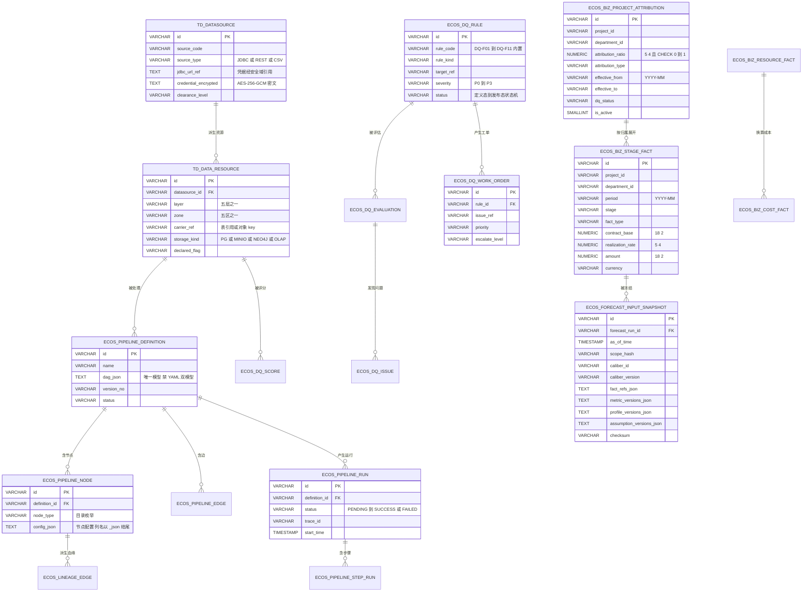

#### 2.11.2 本体域（口径主权）

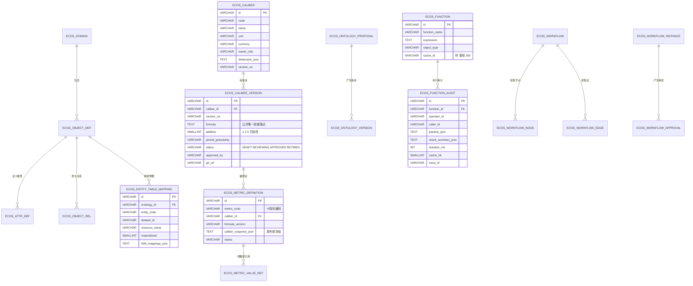

#### 2.11.3 知识域（双形态 + 画像 + 假设）

```mermaid
erDiagram
    KB_ONTOLOGY_SNAPSHOT ||--o{ KB_EXTRACT_TASK : "约束抽取"
    KB_EXTRACT_TASK ||--o{ KB_EXTRACT_AUDIT : "留审计"
    KB_EXTRACT_TASK ||--o{ KB_EXTRACT_WATERMARK : "推进水位线"
    GRAPH_NODE ||--o{ GRAPH_EDGE : "相连"
    GRAPH_NODE ||--o{ KNOWLEDGE_EMBEDDING : "被向量化"
    DOC ||--o{ DOC_CHUNK : "切片"
    DOC_CHUNK ||--o{ KNOWLEDGE_EMBEDDING : "被向量化"
    DOC ||--o{ KB_EXTRACT_TASK : "触发"
    ECOS_KB_PROFILE ||--o{ ECOS_KB_ASSUMPTION : "被假设参照"
    KB_NAV_CATEGORY ||--o{ KB_NAV_ASSET : "分类"
    ECOS_KB_ASSUMPTION ||--o{ ECOS_KB_ASSUMPTION : "基于基线假设派生"
    KB_ONTOLOGY_SNAPSHOT {
        VARCHAR id PK
        VARCHAR event_id "幂等键之一"
        VARCHAR snapshot_version
        VARCHAR ontology_version_no
        TEXT content_json
        VARCHAR content_hash
        TEXT entity_codes_json
    }
    GRAPH_NODE {
        VARCHAR id PK
        VARCHAR node_key
        VARCHAR node_type "受本体类型约束"
        VARCHAR domain
        TEXT props_json
        VARCHAR source_layer
    }
    GRAPH_EDGE {
        VARCHAR id PK
        VARCHAR from_node FK
        VARCHAR to_node FK
        VARCHAR edge_type "关系合法性由本体约束"
        NUMERIC weight "9 6"
        TEXT props_json
    }
    KNOWLEDGE_EMBEDDING {
        VARCHAR id PK
        VARCHAR owner_type "node 或 chunk"
        VARCHAR owner_id
        TEXT embedding_vector "pgvector 与 HNSW 禁入控制域"
        VARCHAR model_version
        INT dim "1536"
    }
    DOC {
        VARCHAR id PK
        VARCHAR object_key "MinIO 定位符"
        VARCHAR source_system
        VARCHAR mime_type
        BIGINT size_bytes
        VARCHAR parse_status
    }
    DOC_CHUNK {
        VARCHAR id PK
        VARCHAR doc_id FK
        INT chunk_no
        TEXT content
        TEXT content_hash
        VARCHAR token_count
    }
    ECOS_KB_PROFILE {
        VARCHAR id PK
        VARCHAR profile_key "指标乘维度乘期间"
        VARCHAR metric_code
        TEXT group_dims_json
        VARCHAR window_from "YYYY-MM"
        VARCHAR window_to
        INT sample_count
        NUMERIC missing_rate "5 4"
        NUMERIC p10 "18 4"
        NUMERIC p50 "18 4"
        NUMERIC p90 "18 4"
        NUMERIC mean_value "18 4"
        NUMERIC ci_low "18 4"
        NUMERIC ci_high "18 4"
        VARCHAR ci_level "默认 95"
        VARCHAR stats_method
        VARCHAR confidence "HIGH MEDIUM LOW"
        TEXT degrade_path_json
        VARCHAR profile_version
        VARCHAR status "DRAFT PUBLISHED SUPERSEDED"
    }
    ECOS_KB_ASSUMPTION {
        VARCHAR id PK
        VARCHAR assumption_key
        VARCHAR scenario_type "BASE CONSERVATIVE AGGRESSIVE 自定义"
        VARCHAR metric_code
        TEXT dim_scope_json
        VARCHAR value_type "RATE AMOUNT DAYS"
        NUMERIC value "18 4"
        VARCHAR value_semantic "ABSOLUTE DELTA"
        VARCHAR base_assumption_id FK
        VARCHAR valid_from
        VARCHAR valid_to
        VARCHAR reason "必填"
        VARCHAR evidence_ref
        SMALLINT is_unverified
        VARCHAR assumption_version
        VARCHAR status "DRAFT PENDING_APPROVAL ACTIVE EXPIRED SUPERSEDED"
    }
```

#### 2.11.4 认知域与场景层的接缝

```mermaid
erDiagram
    ECOS_COGNITIVE_MIND ||--o{ ECOS_COGNITIVE_SCENARIO_MIND : "绑定场景"
    SCENARIO ||--o{ ECOS_COGNITIVE_SCENARIO_MIND : "被装配"
    SCENARIO ||--o{ ECOS_SCENARIO_BINDING : "组合子图与出口"
    ECOS_COGNITIVE_HYPOTHESIS ||--o{ ECOS_COGNITIVE_BELIEF : "证据支持"
    ECOS_COGNITIVE_BELIEF ||--o{ ECOS_COGNITIVE_EVIDENCE : "有证据"
    COG_CAUSAL_LINK ||--o{ ECOS_COGNITIVE_BELIEF : "构成因果路径"
    SCENARIO ||--o{ SCENARIO_RUN : "产生运行"
    SCENARIO_RUN ||--o{ FORECAST_RUN : "编排预测"
    ECOS_COGNITIVE_MIND {
        VARCHAR id PK
        VARCHAR mind_key
        VARCHAR name
        TEXT capability_mask_json "DETECT FORECAST SIMULATE PLAN REVIEW"
        TEXT closed_loop_bounds_json
        VARCHAR status "DRAFT PUBLISHED SUPERSEDED"
        SMALLINT is_active
        VARCHAR mind_version
    }
    ECOS_COGNITIVE_SCENARIO_MIND {
        VARCHAR id PK
        VARCHAR scenario_id FK
        VARCHAR mind_id FK
        VARCHAR binding_role "PRIMARY 或 SUPPORTING"
        INT priority
    }
    ECOS_SCENARIO_BINDING {
        VARCHAR id PK
        VARCHAR scenario_id FK
        VARCHAR binding_type "子图 横切 出口三类"
        VARCHAR target_type
        VARCHAR target_id
        TEXT binding_config_json
    }
    ECOS_COGNITIVE_HYPOTHESIS {
        VARCHAR id PK
        VARCHAR scenario_id
        VARCHAR statement
        VARCHAR status "PROPOSED EVIDENCED BELIEVED REFUTED 四值"
        NUMERIC probability "5 4"
        TEXT source_json
    }
    ECOS_COGNITIVE_BELIEF {
        VARCHAR id PK
        VARCHAR variable
        NUMERIC probability "5 4 值域 0 到 1"
        VARCHAR mind_id FK
        TEXT evidence_refs_json
    }
    COG_CAUSAL_LINK {
        VARCHAR id PK
        VARCHAR from_variable
        VARCHAR to_variable
        VARCHAR link_type "CAUSES AFFECTS CORRELATES"
        NUMERIC weight "9 6"
        SMALLINT is_verified
    }
    FORECAST_RUN {
        VARCHAR id PK
        VARCHAR scenario_run_id FK
        VARCHAR run_key "幂等唯一"
        VARCHAR caliber_id
        VARCHAR caliber_version
        TIMESTAMP as_of_time
        VARCHAR status
        VARCHAR scope_hash "64 位十六进制摘要"
        TEXT input_snapshot_ref
    }
```

### 2.12 DDL 单一真源与变更流程

```mermaid
flowchart TB
    DESIGN["设计 表与列的字段级定义 见各篇 N 4"] --> PR["变更包 三件套"]
    PR --> DDL["canonical ddl V{n} 语义 sql"]
    PR --> SEED["canonical 99-seed 同 commit 种子"]
    PR --> GUARD["单测护栏 schema 落位与列存在性"]
    DDL --> LINT["db-migration-lint 静态检查"]
    LINT --> REVIEW["人工审查项 IR01 ST03 ST06 R9"]
    REVIEW --> APPLY["执行到目标库 逐档位验证"]
    APPLY --> MAP["Mapper 与实体映射同步 只加不改"]
    MAP --> GATE["架构测试与契约一致性门禁"]
    GATE --> DONE["合并"]
    LINT -->|FAIL| DESIGN
    GUARD -->|FAIL| DESIGN
```

| 规则 | 内容 |
|:--|:--|
| 单源目录 | `ecos_backend/canonical/ddl/`（ST10）；历史 `gateway/src/main/resources/db/migration/` 只作只读遗留，**在其中新增即 FAIL** |
| 命名 | `V{n}__{语义}.sql`，`{n}` 全域单调递增、不复用、不跳号占位需显式声明 |
| 三件套（DA04） | ① DDL ② 同 commit 的 `canonical/99-seed` 种子 ③ schema 落位与列存在性单测护栏；并同步更新 lint 白名单 |
| 只加不删 | 新增列/表允许；删除列/表禁止（唯一例外：4 张设计资产历史版本表，前置为备份 + 读写已切 Git） |
| 方言 | 同一变更需给出目标库方言分支（经 `databaseId`），或在评审中显式声明 PG-only 及理由 |
| 审查人工项 | 跨域访问、敏感列加密、行过滤策略、文档编号连续性四项由人工审查，脚本不判 |
| 档位验证 | 变更需在 standard / enterprise / ultimate 三档配置下分别通过预检（禁实启项不得出现在 standard 预检路径） |
| 回滚 | 只加不删的语义下回滚 = 新增反向脚本（补数据或停用），禁 DROP 回滚 |

### 2.13 查询与存储访问纪律

| 纪律 | 规则 | 断言载体 |
|:--|:--|:--|
| 访问路径 | 业务代码经 MyBatis Mapper；Service 层禁直接使用模板化 JDBC 工具 | 架构测试 |
| 列显式 | 禁 `SELECT *` | lint |
| 谓词参数化 | 动态条件经 `<if>` + 绑定参数，禁字符串拼接 | lint + 代码审查 |
| 分页 | 一律游标或 `limit/offset`，上限 500；无上限全表扫描禁 | 契约测试 |
| 排序稳定 | 分页查询必须含唯一列兜底排序，避免翻页漂移 | 单测 |
| 计数 | 列表总数与条目分离查询，导出走异步计数 | 性能测试 |
| 软删 | 查询默认带 `is_deleted=0`；跨租户查询默认带租户谓词 | 落位护栏测试 |
| 批写 | 批量插入 ≤500 行/语句；超出分片 | 单测 |
| 时间 | 期间维度用 `VARCHAR(7)`，事件时刻用 `TIMESTAMP`，禁混用 | lint |
| 慢查询 | 超阈值记录并告警；连接池水位 <80% | 监控基线 |

## 第3篇　平台入口与横切底座

本篇定义 ECOS **平台入口（gateway）与横切底座（runtime）** 的目标态设计，是全套设计的地基：第4篇（安全域）与第5~9篇（五引擎业务域）的请求链、上下文、错误包络、事件、调度、配置全部建立在本篇契约之上。覆盖范围：gateway 单入口与路由单源、认证与信任链、限流与配额、匿名面治理、runtime 五底座、traceId 与审计兜底、三档发布装配、测试与验证链。不覆盖：安全裁决语义（第4篇）、各引擎自身数据与流程（第5~9篇）。

### 3.1 功能设计
#### 3.1.1 功能清单

| 功能编号 | 功能名 | 一句话描述 | 优先级 | 归属批次 |
|:--|:--|:--|:--:|:--:|
| F03-01 | 统一对外入口与路由 | gateway 为唯一对外入口；路由以 `route-manifest` 单源生成，BFF / vite / gateway 三处共同消费 | P0 | M0 |
| F03-02 | 认证与会话 | JWT 验签、类型校验、黑名单检查；失败与依赖异常一律 DENY，租户缺失显式拒绝 | P0 | M0 |
| F03-03 | 信任头与跨 JVM 身份还原 | `EcosTrustHeaderFilter` 先无条件剥除外部 `X-ECOS-*`，验签通过后重注入；下游 `HeaderAuthInterceptor` 还原 `ServiceContext` | P0 | M0 |
| F03-04 | 限流与租户配额 | 固定链序，`QuotaFilter` 显式 `@Order` 且晚于认证；响应携 `X-RateLimit-*` 与统一 429 包络 | P1 | M1 |
| F03-05 | 准入等级与匿名面治理 | 单一豁免清单 `AnonymousEndpointRegistry`，permitAll / MVC exclude / 拦截器豁免三处同源；未登记即 DENY | P0 | M0 |
| F03-06 | runtime-access 基础设施唯一出口 | 数据源 Driver、MinIO、DuckDB、文档解析、Git 客户端全部收敛；引擎侧零基础设施驱动 import | P1 | M1 |
| F03-07 | llm-gateway 唯一出口与计量 | 全仓除 `llm-gateway` 外无 LLM 端点字面量；调用计量落 `ecos_runtime_llm_usage` | P1 | M1 |
| F03-08 | runtime-task 统一调度 | 任务入口唯一 `ITaskExecutor`、管理入口唯一 `ITaskManagementService`；超时取消重试配置化 | P2 | M2 |
| F03-09 | runtime-monitor 分级告警 | 规则与记录持久化，`INotificationService` 提供 log / webhook 两通道，支持 ack 与升级 SLA | P1 | M1 |
| F03-10 | runtime-event 总线与死信兜底 | `KafkaTopics` 与 compose kafka-init 单源；每 topic 配 `<topic>.DLT` 消费者、lag 告警与人工重放 | P1 | M1 |
| F03-11 | traceId 全链贯穿 | `X-Request-Id` 生成与透传，入 MDC、日志、`ApiResponse.traceId`、审计事件 | P0 | M0 |
| F03-12 | 审计投递兜底与重放 SLA | 投递失败落 `ecos_runtime_audit_retry`，周期重放，超阈值转 critical 告警 | P1 | M1 |
| F03-13 | 三档发布装配 | Maven profile 只裁依赖，`spring.profiles.active` 决定生效能力；standard 档启动即断言无图与列存 bean | P1 | M1 |
| F03-14 | 测试工程与 V1~V4 验证链 | `ecos-tests` Playwright 工程化，V1~V4 门禁进 CI，失败即阻断 | P2 | M2 |
| F03-15 | 配置与字典单源 | 引擎取配置与字典只经 sysman api 门面，按 `config_group` / `subsystem` 单表分组消费 | P2 | M2 |

#### 3.1.2 能力域解读

**入口域（F03-01 ~ F03-05）= 唯一收敛面。** 主张是"入口只有一处、事实只有单源"：所有外部流量经 gateway :8080，service 端口仅内网可达；身份只在 gateway 建立，下游只还原不裁决；匿名面只在一份代码枚举里登记，并由该枚举反向生成 Security、MVC、拦截器三处配置。"在 service 里再写一次鉴权""在 yml 里再写一条白名单"这类便利性会破坏不变式，故在设计上被禁止而非规劝。

**底座域（F03-06 ~ F03-10）= 横切公共器。** 五底座分别收口五类极易重复建设的能力：物理连接、模型调用、时间（调度与长任务生命周期）、观测（告警）、异步（事件与死信）。判定标准是行为而非位置——若引擎内还能写出"自己 new 一个 KafkaTemplate 发送"，该能力就必须由 ArchUnit 与源码正则门禁拦住，底座域的价值才成立。

**可追溯域（F03-11 ~ F03-12）= 一次动作的可查证链。** traceId 是横向轴（跨 JVM、跨线程不断链），审计事件与死信记录是纵向轴（落库、可重放、可告警）；两轴共享同一批字段（`trace_id` / `tenant_id` / `domain`），故第4篇的 `decisionId` 与本篇的 traceId 可互相定位。**发布与验证域（F03-13 ~ F03-15）**解决"一套代码三种交付"的一致性：档位由 `spring.profiles.active` 生效，standard 档在启动期主动断言 Neo4j 与列存 bean 不存在，使"错档"成为启动失败而非运行时降级；门禁再把上述全部约束固化为可执行标识（3.7）。

### 3.2 技术设计
#### 3.2.1 部署基线与端口

部署基线 = **7 个部署 JAR**；禁新增 Maven 模块、禁新增 Docker 容器。制品口径与承流口径分离：7 个 JAR 是"可构建可部署产物"，承流单元由 `ecos.route.<service>` 逐服务切换（3.2.6、3.5.2）。

| 制品 | 基线端口 | 调试 boot 端口 | 承载内容 |
|:--|:--:|:--:|:--|
| `gateway` | 8080 | — | 唯一对外入口；monolith 态承载全部引擎 Controller、认证、限流、路由 |
| `services/sysman` | 18081 | 19081 | IAM、菜单、配置字典门面、审计消费落库；封装 security 能力 |
| `services/datanet` | 18082 | 19082 | data 引擎（土 D） |
| `services/buszhi` | 18083 | 19083 | ontology 引擎（金 I） |
| `services/aiming` | 18084 | 19084 | ai 引擎（火 W）与 cognitive 引擎（木 C）能力域 |
| `services/dccheng` | 18086 | 19086 | kb 引擎（水 K） |
| `workspace` | 18090 | 19090 | 场景层，只经 REST 调下游 |

引擎口径 = **五引擎 + 横切**：`data`（土 D，`ecos_data`）、`ontology`（金 I，`ecos_ontology`）、`kb`（水 K，`ecos_knowledge`）、`cognitive`（木 C，`ecos_cognitive`）、`ai`（火 W，`ecos_ai`）；横切 = `security`（护）+ `runtime`（器）。术语红线：**W 是五行之"火"（C→W 转化），不等于 Agent**；"W Agent 编排域"是 ai 引擎内的能力域，不新增 JAR / schema / 模块。一个端口只允许一个制品监听；`*-boot` 调试形态端口 = 基端口 + 1000。

```mermaid
graph LR
    BR[浏览器] --> BFF[BFF 3000] --> GW[gateway 8080]
    GW --> SYS[sysman 18081]
    GW --> DN[datanet 18082]
    GW --> BZ[buszhi 18083]
    GW --> AM[aiming 18084]
    GW --> DC[dccheng 18086]
    GW --> WS[workspace 18090]
    SYS --> PG[(PostgreSQL 5432)]
    DN --> PG
    BZ --> PG
    DC --> PG
    AM --> PG
    DN --> MIN[(MinIO 9000)]
    BZ --> NEO[(Neo4j 7687)]
    AM --> LLM[LLM 供应商]
    SYS --> KAF[(Kafka 9092)]
    GW --> OPA[OPA 8181]
```

#### 3.2.2 gateway 请求处理链（规定序）

链序是契约而非实现细节，`FilterOrderTest` 逐位断言。

| 序位 | 组件 | `@Order` 目标值 | 职责 | 失败语义 |
|:--:|:--|:--|:--|:--|
| 1 | `VersionPrefixRewriteFilter` | `HIGHEST_PRECEDENCE+10` | `/api/v1/*` 重写为 `/api/*`，与 route-manifest 同源 | 未登记前缀 404 并计数 |
| 2 | `RequestContextFilter` | `HIGHEST_PRECEDENCE+11` | 接收或生成 `X-Request-Id` 入 MDC | 不阻断，缺省并计数 |
| 3 | `EcosTrustHeaderFilter` | `HIGHEST_PRECEDENCE+20` | 两段式：进入即无条件剥除 `X-ECOS-*`；JWT 通过后重注入 | 剥除非拒绝；验签失败 401 |
| 4 | `SecurityHeadersFilter` | `HIGHEST_PRECEDENCE+30` | HSTS、`X-Content-Type-Options`、CSP | 不阻断 |
| 5 | `JwtAuthenticationFilter` | Security 链内 | 验签、类型、黑名单、`tenant_id` | 失败与依赖异常一律 DENY |
| 6 | `RateLimitFilter` | 5 | 主体维度限流 | 429 `ECOS-RATE-429` |
| 7 | `QuotaFilter` | 6 | 租户日配额 | 429 `ECOS-RATE-430` |
| 8 | `springSecurityFilterChain` 到 DispatcherServlet | — | 授权与派发 | 未登记即拒 403 |
| 9 | `ClearanceInterceptor` 与 `@RequirePermission` AOP | MVC 拦截器 / AOP | 准入等级门槛（豁免来自 registry）与方法级权限 | 403 `ECOS-AUTH-403` |

不变式：**重写先于鉴权；剥除先于鉴权；重注入晚于鉴权；限流与配额晚于认证（`RateLimit(5)` 小于 `Quota(6)`，且均在 JWT 链之后）**。

```mermaid
flowchart TB
    REQ[外部请求] --> S1[前缀重写] --> S2[traceId 生成或透传] --> S3[剥除全部 X-ECOS 头] --> S4[安全响应头] --> S5[JWT 验签 黑名单 租户校验]
    S5 -->|失败| E1[401 或 403]
    S5 -->|依赖不可用| E2[503 fail-closed]
    S5 -->|通过| S6[重注入信任头] --> S7[限流] --> S8[租户配额] --> S9[授权链] --> S10[准入等级] --> S11[Controller 到 Service]
    S7 -->|超频| E3[429 ECOS-RATE 族]
    S8 -->|配额耗尽| E3
    S9 -->|未登记即拒| E1
    S10 -->|等级不足| E1
```

**新增 Controller 必过三滤波器**，三处逐条同步登记，缺任一即视为安全缺陷：

| 滤波器 | 位置 | 登记内容 | 双路径要求 |
|:--|:--|:--|:--|
| `VersionPrefixRewriteFilter` 映射 | 与 route-manifest 同源 | 前缀归属制品、重写目标、承流模式 | `/api/v1/x` 与 `/api/x` 均可达 |
| `SecurityConfig` permitAll 决策 | 由 registry 生成 | 是否匿名、理由、批准人 | 两形态各生成一条 |
| `ClearanceInterceptor` 豁免 | `excludePathPatterns` | 是否免准入等级 | `/api/v1/*` 与 `/api/*` 各写一遍 |

#### 3.2.3 信任链与跨 JVM 上下文（ADR-7）

| 头 | 必填 | 语义 | 缺失处置 |
|:--|:--:|:--|:--|
| `X-ECOS-USER` | 是 | JWT `sub` 即 userId | 403 DENY |
| `X-ECOS-TENANT` | 是 | 租户 id，只从 JWT 或服务端解析 | 403 `ECOS-AUTH-403`，禁任何兜底租户 |
| `X-ECOS-ROLE` / `X-ECOS-DOMAIN` | 否 | 逗号分隔角色集 / 业务域标识 | 角色缺失视为空集并按最小权限裁决；域由资源归属推导，不参与鉴权绕过 |
| `X-ECOS-SERVICE` | service 间必填 | `serviceId.hmac` 服务凭证 | 验签失败 403 `ECOS-AUTH-410` |
| `X-Request-Id` | 缺失则生成 | 端到端 traceId | 下游补生成，不断链 |

`HeaderAuthInterceptor` 职责边界被限定为**只还原上下文、不裁决、不查安全策略表**：校验 `X-ECOS-USER` 与 `X-ECOS-TENANT` 必存在，校验 `X-ECOS-SERVICE` 签名，命中匿名清单则跳过，构造 `ServiceContext{userId, tenantId, orgId, roles, clearance}` 入 ThreadLocal，并在 `afterCompletion` 强制 clear（防线程池串号）。`orgId` 只由服务端解析，`X-Org-Id` 在 gateway 作为无效头剥除。两态寻址由同一配置项切换，跨服务调用必须同时给出两态：

```
ecos.route.<service> = monolith | service     默认 monolith
monolith  → 优先本地 Bean，回退 http://127.0.0.1:8080/api/...
service   → 由 route-manifest 解析 http://<host>:180xx/api/...
唯一出口  → ServiceEndpointResolver#resolve(service, RouteMode)
```

#### 3.2.4 runtime 五底座职责边界

| 底座 | 唯一职责 | 强制接口 | 引擎侧禁止 |
|:--|:--|:--|:--|
| `runtime-access` | 持有全部数据源 Driver（PG / Neo4j / MySQL / Doris / ClickHouse）、MinIO、DuckDB、文档解析、Git 客户端 | `ConnectorFactory`、`ServiceEndpointResolver`、`EcosServiceCredentialSigner`、`GitAccessService#open(repositoryId)` | import 基础设施驱动；自拼 base-url；Git 传路径参数 |
| `llm-gateway` | 唯一 LLM 出口、重试与配额、token 计量 | `LlmGatewayService#chat / #embedding / #rerank`；密钥经 `SecurityEngineBridge.resolveSecret(apiKeyRef)` | 直连供应商域名；引擎自持 api key；绕过 `TokenMeterAspect` |
| `runtime-task` | 调度与长任务生命周期 | `ITaskExecutor#submit(TaskDescription)`（`timeoutMs` 必填，长任务上限 30min 在此强制）、`ITaskManagementService` | `@Scheduled`；`Executors.new*`；自建线程池跑周期任务 |
| `runtime-event` | 事件总线与死信 | `EventBusService#publish`、`KafkaTopics` 常量、`DltConsumer` | 反射调用 `KafkaTemplate.send`；裸写 topic 字面量 |
| `runtime-monitor` | 告警规则、记录、通知、ack、升级 | `IAlertService#raise / #ack / #close`、`INotificationService`（log / webhook） | 内存 Map 作唯一存储；自建通知通道 |

配置与字典不入底座：引擎取配置只经 sysman api 门面（单表分组 `config_group` / `subsystem`），禁引擎自建配置表。

#### 3.2.5 事件与 Topic 单源

Topic 基线 8 条：`ecos.identity`、`ecos.catalog`、`ecos.ontology`、`ecos.object`、`ecos.workflow`、`ecos.agent`、`ecos.knowledge`、`ecos.audit`；另配引擎扩展 3 条 `ecos.data.security-tagged`（第4篇打标消费）、`ecos.ontology.published`、`ecos.cognitive`。每条强制配 `<topic>.DLT` 死信 topic。单源机制：构建期由 `KafkaTopics` 常量反射生成清单产物 `gateway/src/main/resources/kafka/topics.txt`，compose 的 kafka-init 从同一清单建 topic；`KafkaTopicParityTest` 断言常量集超集包含 compose 集，出现差集即构建失败。

#### 3.2.6 三档发布装配

| 档位 | profile 生效能力 | Maven profile 裁剪 | 启动期断言 |
|:--|:--|:--|:--|
| standard | 仅 PostgreSQL，图谱形态由 PG 表承载 | 剔除 Neo4j / Doris / ClickHouse 驱动 | 断言 Neo4j 与列存 bean **不存在**，违反即启动失败（红线 ST02） |
| enterprise | PostgreSQL + Neo4j | 保留 Neo4j 驱动 | Neo4j 不可达时降级 PG 表形态并置 `graphDegraded=true` 告警 |
| ultimate | PostgreSQL + Neo4j + Doris 或 ClickHouse | 保留两类列存驱动 | `dw.olap.engine` 必须二选一，禁双写（红线 MC04） |

生效机制唯一为 `spring.profiles.active`；Maven profile 只决定依赖是否进入制品，不产生运行时语义。档位、profile 与能力开关三处一致由 `EditionProfileGuardTest` 逐档校验。

#### 3.2.7 统一响应包络与错误码族

`ApiResponse{code, errorCode, message, data, timestamp, traceId}`；分页响应 `{items, total, page, size}`，列表默认 limit 50、上限 500。`traceId` 经新增工厂 `withTraceId(String)` 写入，既有 5 个静态工厂签名不变。

| 族 | 归属 | 码与语义 |
|:--|:--|:--|
| `ECOS-AUTH-*` | 本篇认证与准入 | `401` 未认证或 JWT 校验失败；`403` 信任上下文缺失 / 租户缺失 / 等级不足；`410` 服务凭证验签失败；`503` 认证依赖不可用 fail-closed |
| `ECOS-RATE-*` | 本篇限流与配额 | `429` 请求超频；`430` 租户日配额耗尽 |
| `ECOS-SEC-*` | 第4篇安全域 | 见 4.3.3，本篇不定义 |
| `ECOS-SYS-*` | 本篇内部错误 | `400` 入口参数校验/格式/请求体非法；`401` 入口兜底未认证；`403` 入口兜底无访问权限；`404` 路由/资源不存在（唯一合法 404 业务外路径）；`409` 唯一约束/必填冲突；`500` 未分类内部错误；`503` 下游制品不可用 |

> **`ECOS-SYS-400`／`ECOS-SYS-401`／`ECOS-SYS-403`／`ECOS-SYS-503` 登记依据（#142/B4-3e-27，差距 D-B4-65）**：`ApiResponse` 的 `badRequest`／`unauthorized`／`forbidden`／`notFound`／`internalError` 五枚单参工厂走三参私有构造器，**从不填** `errorCode`，而该类带 `@JsonInclude(NON_NULL)` ⇒ JSON 面连 `errorCode` 这个键都不出现（不是空串、不是 `null` 值），调用方按机读码分派时拿到的是「字段不存在」。这与 D-B4-55（把 `String.valueOf(int)` 当机读码填进去）是同一坑的两半：55 是「填了假的」，本条是「干脆没填」。本批按表内既有形态**追加**四枚平台码并把 gateway 入口七枚兜底腿中的六枚改指带码重载（`badRequest`×3、`unauthorized`×1、`forbidden`×2），第七枚 `handleNotFound` **有意保留单参并登记豁免**：业务域「资源不存在」的码归各域码表，信封类无权替全仓 255 处 `notFound` 指定一个平台码，那是用批量替换冒充归因。三项配套裁决：① 带码重载形参顺序取 `(errorCode, message)`，与既有三参 `error(int, String, String)` 的「码在消息前」一致；② `internalError` 的带码重载 `code` 取新增 `CODE_SERVER_ERROR = 500`（与状态行同号），单参版仍取 `CODE_INTERNAL_ERROR = -1`（信封 v1「`code < 0` ＝系统错误」约定，改属另批裁决，由棘轮门只减不增追缴）；③ `ECOS-SYS-401`/`403` 与 `ECOS-AUTH-401`/`403` 的分工 = 前者只承载**平台入口兜底**（Spring 安全链抛到 handler 的 `AuthenticationException`/`AccessDeniedException`），后者承载认证与准入域的具名拒绝；两族归并与否属待裁项，本批不裁。代码侧常量单源仍是 `com.chinacreator.gzcm.common.error.SystemErrorCode`；`ECOS-SYS-403` 禁用于 ABAC/OPA 策略拒绝（那属 `ECOS-SEC-*`），`ECOS-SYS-503` 此前仅在 `SystemEventTopicsV1Controller` 内以字面量存在，本批升为常量。判据门＝`common-api` 的 `NoMachineCodeFactoryFaceRatchetTest`（余面 939 处／151 文件只减不增＋入口六枚带码腿不得回退＋豁免反查＋重载契约与同号性）。

> **`ECOS-SYS-*` 状态行同号性追加登记（#142/B4-3e-28，差距 D-B4-56）**：本节「状态行与 body `code` 同号」与 §4.7.2「不可用 ≠ 无权限」在 `BusinessException` 这条异常面上曾被**构造器静默作废**——该类两枚既有构造都把 HTTP 状态硬写成 `DEFAULT_HTTP_STATUS = 400`（`BusinessException(String)` 与 `BusinessException(int errorCode, String message)` 的第二形参只进 `errorCode`，不进状态），因此调用方写 `new BusinessException(404, …)`／`(409, …)`／`(503, …)` 时，body 携带的域码是 404/409/503，状态行却一律回落 400。实测 main 源码面「双参首参非 400」的站点共 **23 枚**（500×8／404×8／409×3／501×3／503×1，迁移后由三参腿逐值入基线），全部落在 400 通道＝「资源不存在」「冲突」「上游不可用」被折成「请求参数错」，客户端按状态行分派时拿不到分态。修法守 API 只增不改红线：**新增**三参构造 `BusinessException(int httpStatus, int errorCode, String message)` 作显式载体通道（不改旧两枚的恒 400 语义，避免既有 100 枚 `new BusinessException(400, msg)` 站点被隐式改判），23 枚站点迁 `new BusinessException(V, V, msg)` 使状态与码同号，gateway `handleBusiness` 返体改 `ResponseEntity` 并**只经** `resolveHttpStatus(ex.getHttpStatus())` 单源裁决（400..599 之外一律 500；非法携带在出口判、不在构造器判）。方法上的 `@ResponseStatus(BAD_REQUEST)` 有意保留为「未显式携带时的默认声明面」兼 `ServerDefectExceptionStatusTest` 判据 B 的反射锚。曾考虑过但否决的另一改法＝handler 从 `errorCode` 反推状态行：#142/B4-3e-15 已写明「而不是改 handler 去猜 body 码」，反推会 reversal 掉 D-B4-53 的裁决。判据门＝`common-api` 的 `BusinessExceptionStatusParityRatchetTest`（六腿：非 400 双参零容忍／三参必须同号且落 400..599／双向分枚基线只减不增／四类站点分枚之和＝全站点 232 的对账／构造面反射钉 3 枚／`@TempDir` 合成夹具证「能变红」）。**余项在册（→ 已由 #142/B4-3e-29 收口，见下一段登记）**：`services/sysman/impl/sysman-boot` 的 `GlobalExceptionHandler#handleDataBridgeException` 仍是裸 `ApiResponse` ＋ `@ResponseStatus(INTERNAL_SERVER_ERROR)` 的第二渲染面（承载态与状态行不可能同号），本批不扩面。

> **`ECOS-SYS-*` 根异常型携带腿状态行单源追加登记（#142/B4-3e-29，差距 D-B4-66）**：缺陷面按「参数型可携带状态、状态行却由注解锁死」精确圈定，不是按「裸回腿」泛化：`@ExceptionHandler` 腿全后端 main 面实测 **50 枚／8 文件**（按 annotation 带参形态逐处计数，剥注释前后同数＝无注释虚计），其中参数型恰为根异常型 `DataBridgeException` 者**3 枚／3 文件**（gateway `handleDataBridge` 已收口、kb `onBridge` 显式常量覆盖、sysman-boot `handleDataBridgeException` 未收口）。根类三枚构造的首参就是 `httpStatus` 且**没有** `DEFAULT_HTTP_STATUS` 锚定 ⇒ 该腿上「注解锁 500」与「异常自述状态」不可能保证同号，403 策略拒绝在 HTTP 面报成 500，方法头注释「使用异常内置的 httpStatus」凭注释成立。子类型不扩面的凭据（实测而非推断）：`ValidationException`／`NotFoundException`／`UnauthorizedException`／`ForbiddenException`／`DataAccessException` 五枚**只有 message 形态构造**，无携带通道，`DEFAULT_HTTP_STATUS` 全仓实测 7 枚常量（400×2／401／403×2／404／500），且「首参为数值字面量」的构造点实测 **0 处** ⇒ 它们的注解锁死与携带值恒同号，本批不动。修法先解决**判据归属**：区间裁决 `400..599` 收口前只存在于 gateway handler 的包内私有静态方法，而根型腿分属三个模块 ⇒ 留在任一宿主必然逼出第二份复制。现把它**下沉到携带者所在的 common-api**（`DataBridgeException.resolveHttpStatus(int)`，`public static`，纯追加），gateway 原方法保留为**委托**（既有 `DataBridgeHttpStatusFidelityTest` 的`GlobalExceptionHandler.resolveHttpStatus(...)` 锚点不动、取值逐字不变）；sysman-boot 那枚返体改 `ResponseEntity<ApiResponse<Void>>` 并只经该单源裁决，同批把该腿的 `errorCode` 从两参无码工厂改走三参 + `MachineErrorCode.orNumeric`（＝D-B4-65 在本腿的余面，收口前 JSON 面连 `errorCode` 键都不出现）；方法上的 `@ResponseStatus(INTERNAL_SERVER_ERROR)` 有意保留为默认声明面——它与单源的回退值同号，且在 `ResponseEntity` 路径上不再决定状态行，删它属另批裁决。同批顺手收掉 kb `onDomain` 的第二个判据源：收口前写 `ex.getHttpStatus() > 0 ? … : 500`，只判正数不判区间 ⇒ 200／700 这类越界携带值会被原样写进状态行，现改走单源（合法 4xx/5xx 取值逐字不变）。曾考虑并否决三条：①在 sysman-boot 复制一份 `resolveHttpStatus`（双源，两域可各自漂移）；②让 sysman-boot 依赖 gateway 类（gateway 是 fat-jar 聚合宿主，反向依赖破模块边界）；③把 kb `onBridge` 一并改成跟随携带值（该腿注释即契约「别家 DataBridge 领域异常 → 502」，状态行取显式常量既非裸回也非折成 403，但它确实把别域 403 报成 502，属 §4.7.2 的反向可疑面，是否改判需 kb 域裁决 ⇒ 登记 **D-B4-67** 前半，由门禁的点名豁免表双向钉住：该腿一旦改走单源，残留豁免条目即红）。判据门＝`common-api` 的 `RootCarrierHttpStatusSingleSourceRatchetTest`（A 根型腿分枚基线 3 枚／3 文件＋逐枚 `ResponseEntity`＋单源或点名覆盖豁免的双向表；B 区间字面量 main 面唯一 1 处＝单源本身，另扫 handler 腿窗口内自带比较式＝0 处；C 锁死子类型数值首参构造点＝0 处，即本批不扩面的凭据；D 反射钉单源语义的区间边界与回退值；E `@TempDir` 仓外合成夹具证「能变红」）＋ `sysman-boot` 的 `SysmanBootDataBridgeStatusFidelityTest`（行为面五腿：403 上状态行且机读码取自 message 起始位／503 与拒绝分态不互折／7 个非法携带值一律回退 500／10 个携带值下状态行恒 ≥400 不裸回成功／反射钉方法签名与注解声明面只增不改）。**余项 D-B4-67 登记**：后半＝`kb-engine-impl` 的 `KbAssumptionController#mapDomain`以 `e.getHttpStatus() == 0 ? 500 : …` 把携带值当 body `code` 用，且该 Controller 腿返裸 `ApiResponse`（状态行恒 200），属全后端裸回棘轮门面（**读数订正，#142/B4-3e-30 实测**：该棘轮基线现值 27 处／9 文件在 B4-3e-29 前后未变，本批未改动该门——sysman-boot 那枚 handler 腿的码形参是变量而非常量字面量，判据 A 从不计量它；此处原文「本批消 1 枚、改前 27＋1＝28 枚」属误记，照登订正），另批处置。**→ 前后两半已由 #142/B4-3e-30 收口，见下一段登记；同批新登记 D-B4-68 判据盲区。**

> **`ECOS-KB-*` 域状态行保真追加登记（#142/B4-3e-30，收口差距 D-B4-67 前半＋后半）**：缺陷面按两枚实测腿圈定，不泛化到 kb 全部门面。（一）**前半＝`KbErrorAdvice#onBridge` 恒 502**。`@ExceptionHandler` 根型腿全后端实测 3 枚／3 文件（gateway `handleDataBridge`、kb `onBridge`、sysman-boot `handleDataBridgeException`），前两枚与第三枚在 B4-3e-29 分别收口／显式常量豁免／收口，本次只剩 kb 这一枚取显式常量 `BAD_GATEWAY`。裁决依据：该类的存在理由是「不被网关 `Exception→404` 兜底吞掉」（W94 三级掩蔽链），而不是「把别域状态改写成 kb 偏好的状态」——恒 502 会把别域自述的 **403 策略拒绝与 503 不可用一并折成「上游坏掉」**，客户端按状态行分派时会对一枚本该 fail-closed 的 DENY 做重试，正是 §4.7.2「不可用 ≠ 无权限」的反向折叠面。修法＝状态行改走 `DataBridgeException.resolveHttpStatus` 单源（越界携带值回退 500，与同域 `onDomain` 同构），**渲染域归属证据移到机读码 `ECOS-KB-501` 与 message 前缀**，两者不再互相覆盖；同批把 `RootCarrierHttpStatusSingleSourceRatchetTest.EXEMPT_OVERRIDE_LEGS` 里点名的 `KbErrorAdvice.java#onBridge` 一条删除（该表双向：腿走单源而豁免未删＝陈旧即红），清空后实测覆盖腿 0 枚。**后半＝`KbAssumptionController#mapDomain` 裸回**。该私有 helper 由 `submit`／`approve` 两枚 `@PostMapping` 腿调用，收口前返裸 `ApiResponse`：路径、入参、信封字段一项未变，但 Spring 落的状态行恒 **HTTP 200**，于是 D.3 契约里的「409 非法跃迁／403 非知识管理员／410 假设已过期」在传输层与成功同形（前端 `if (!res.ok) throw` 读成成功、网关与 Playwright 只看状态行的分派面拿不到分态），且它自写 `e.getHttpStatus() == 0 ? 500 : …` 作第二判据源（只判零不判区间，200／700 这类越界值会原样进 body 码）。修法＝helper 返 `ResponseEntity<ApiResponse<KbAssumptionDO>>`、区间裁决只经单源、body `code` 与状态行同号，成功腿显式 `ResponseEntity.ok(...)` 保持 200（API 面只增不改：不动路径与签名，只补状态行，同 D-B4-59 属主端点先例）。判据门＝kb-engine-impl 的 `KbAssumptionDomainStatusFidelityTest` 五腿（①409/403/410 上状态行且 body 同号＋机读码取异常自带值 ②成功腿仍 200 ③7 个非法携带值一律回退 500、7 个合法携带值恒 ≥400 逐字透出 ④`onBridge` 403→403／503→503、6 个越界值→500，且机读码仍 `ECOS-KB-501` ⑤源码形态锚：helper 含单源调用、`== 0` 第二判据源零残留、两腿返体为 `ResponseEntity`、advice 不再含 `BAD_GATEWAY`、反射钉方法返回类型）。**能变红取证（真仓内容变异，非合成夹具）**：A 组把 `onBridge` 的单源行改 `int status = 502`（去掉 `resolveHttpStatus` 调用文本）⇒ common-api 静态门 `rootCarrierLegsCarryTheirOwnStatus` 报「根型腿未走状态行承载手段共 1 枚」＋ kb 行为门④报「expected 403 but was 502」；B 组把 `mapDomain` 改 `int status = 200` ⇒ kb 行为门①③⑤三条同时红（409 未上状态行／回退值失效／单源锚失效）；两组还原后 `MUTANT` 复扫 0 处。**本批不扩面并新登记 D-B4-68（判据 A 类型见证盲区）**：`SecurityDenialHttpStatusRatchetTest` 的 `BARE_DENIAL_LEG` 正则写的是 `return ApiResponse.error(401|403|503`／`forbidden(`／`unauthorized(`，对泛型类型见证形态 `return ApiResponse.<T>error(403, …)` 恒不命中——实测该盲区在 ecos_backend 主源码藏 **5 处／2 文件**（gateway `RuntimeAlertV1Controller` 3×503、kb `KbProfileController` 1×503＋1×403），即真实裸回拒绝态面＝基线 27＋盲区 5＝**32 处／11 文件**，B4-3e-18 当时登记的「27 处／9 文件」因此是低读；修法（判据补类型见证分支＋按实测逐文件重设基线＋配「能变红」用例）需另批处置，本批不动该门基线。构建面事故照登：单模块 `-pl engine/kb-engine/kb-engine-impl test` 编译报 3 处「找不到符号」，根因＝`.m2` 里 `common-api` 旧 JAR 不含 `resolveHttpStatus`（与 B4-3e-29 登记的同一事故），有效门禁调用必须把 `common-api` 放进同一 reactor 会话；测试面事故照登：Mockito 在同参数重复 `when(...).thenThrow(...)` 时会在**打桩行本身**抛出上一条配置的异常（首跑 2 枚 Error 的真实堆栈只到测试行、不进 Controller），改为每条用例独立 id 后消除。实跑＝四模块同会话 `runtime/common-api,engine/kb-engine/kb-engine-api,engine/kb-engine/kb-engine-impl,gateway` 全量 test（见登记行读数）＋ kb-engine-impl 全量 159 用例 0 失败 0 错误 2 skip；§2.1 计数维持 已 145／部分 206／未 37（D-B4-67 系 B4 台账余项，不入 §2.1 面）。单主题 commit，未 push。

> **裸回棘轮门判据补盲追加登记（#142/B4-3e-31，收口差距 D-B4-68）**：本批**零生产代码改动**，只把门的读数面修准——差距形态不是「有条腿没登记」，而是「判据结构上看不见一类腿」，因此它的危险大于单枚违例：基线与上限都从同一个失明判据产出，读数自洽、门禁恒绿，而真实面比登记面大。缺陷定位＝`SecurityDenialHttpStatusRatchetTest` 的两枚正则把 `ApiResponse` 与方法名之间写成只允许空白，而 Java 允许显式类型见证 `return ApiResponse.<Map<String, Object>>error(503, …)`：点号后先遇 `<` 即断链。实测盲区面 **5 处／2 文件**（gateway `RuntimeAlertV1Controller` 3×503、kb `KbProfileController` 1×503＋1×403），与 B4-3e-30 的独立 grep 两处口径一致 ⇒ 补盲后判据 A 真实面＝27＋5＝**32 处／11 文件**（该 32 由门禁会话内的双向基线断言产出：基线合计 32＝实扫合计 32 且无未登记持有者）。修法＝两枚判据各补一个可选见证分组 `(?:<[^();]*?>\s*)?`：禁 `(` 与 `;` 保证只吃类型参数、绝不跨进实参表或下一条语句（同批用 `ApiResponse.<Void>error(ApiResponse.CODE_BAD_REQUEST, "BAD_REQUEST")` 与 `.<String>notFound(...)` 两条合成断言钉住这条边界），`return` 锚点保留使 `ResponseEntity...body(ApiResponse.<T>error(503, ...))` 这类**已收口形态仍不命中**（否则判据把修法本身拦在门外，基线永远降不下去）。判据 B（非拒绝态登记量）同批补同一分支：它若仍瞎，「面外量化」就只是同一盲区的另一个读数，上限会冒充成已收口证据；补盲后按门禁断言实测重设上限＝**921 处**（盲前 910 ⇒ 净新增 11 处；同批手工 grep 估成 922，被该实测读数推翻后照实订正，记为「入册数字必须来自实跑」的又一次自我纠偏）。两枚新持有者按实测逐文件入基线（3／2），基线注释写明入面批次。**能变红取证（真仓内容变异，非合成夹具）**：①把判据 A 的见证分组摘掉（复现 D-B4-68 失明态）⇒ 同一门禁会话两条红：`bareDenialLegsMatchTheRegisteredBaselineExactly` 报「实扫合计 27 处／基线合计 32 处」（＝盲区面被读出来）＋`matcherTurnsRedOnSyntheticBareLiteral` 报「对 `ApiResponse.<T>error(503,…)` 类型见证形态失明 expected 1 but was 0」；②上限探针（把 `OTHER_LEG_CEILING` 临时置 0）⇒ 断言消息直接产出真实读数 921。两处均还原后复跑，`MUTANT` 复扫 0 处。**范围裁决**：这 5 枚裸回腿的属主侧修法（补 `ResponseEntity` 状态行）本批**有意不做**——判据面与修法面分批复现过 D-B4-59／D-B4-52 两次「一边改判据一边改宿主导致读数无法归因」的问题，且 kb `KbProfileController`／gateway `RuntimeAlertV1Controller` 的腿改判需各自域批；本轮先把「看见」修准，基线 32 处／11 文件从此只减不增。实跑＝门禁所在模块 `runtime/common-api` 全量 **242/0/0/0**（BUILD SUCCESS 04:25 min，日志 `_win_tasks/logs/b43e31-full.log`；用例枚数与补盲前同为 242，因本批是既有方法内加断言＋基线改值，未新增测试方法）；§2.1 计数维持 已 145／部分 206／未 37（D-B4-68 系 B4 台账余项，不入 §2.1 面）。单主题 commit，未 push。

> **裸回面属主侧状态行追加登记（#142/B4-3e-32，收口差距 D-B4-59 的类型见证腿余面）**：上一批「先修看见」之后，本批把入面的两枚持有者补上属主侧修法——gateway `RuntimeAlertV1Controller` 的 `list`／`close`／`dlq` 与 kb `KbProfileController` 的 `generate`／`publish`（含私有 helper `mapMessage`）返体改为 `ResponseEntity<ApiResponse<…>>`，**路径、入参、信封字段与签名零改动**（承 D-B4-59／D-B4-67 先例：只补状态行）。状态值一律取单源、禁两处各写一遍：gateway 三枚不可用腿取 `RlsExecutionContract.SEC_UNAVAILABLE_HTTP`；kb 的 403／503／409 由新增私有 helper `statusOf(KbError, ApiResponse<T>)` 把 `KbError.httpStatus()` 与 `code()` 成对取出（改码不改行＝保真会漂移），并顺带把 `mapMessage` 里两枚 `"ECOS-KB-06x"` 字面量比对改指 `KbErrorCodes.*.code()`。同处共面的 **6 枚非裁决线腿**（gateway 404／400、kb 400／409×2／404）一并落真状态行——只折拒绝腿而把同方法内的 404 折成 `ok()`，会让该腿静默退出判据 B 计量面（＝本门自己的假绿），故取同号。**基线订正（全部由门禁断言实跑产出）**：两枚持有者判据 A 计数 3／2 → **0**（钉 0＝回退即红），全后端裸回拒绝面 **32 处／11 文件 → 27 处／9 文件**；判据 B 上限 **921 → 915**（−6 与本批改动逐腿对账，非推算；该 915 由一次「上限探针置 0」的红色断言消息产出后回填，探针已还原）。静态门新增 `convertedOwnersCarryTheirStatusLine`（COMMON 面：判据 A 零命中＋确有 `ResponseEntity.status(` 在链上＋两域各自的单源常量在引用）。**新增行为门 `KbProfileStatusFidelityTest` 十腿**：403/503/409/404/400/200 逐枚上状态行且 body `code` 同号、机读码取本域码表、缺角色头即 DENY、无码 ISE 落 404 而不折成 403、成功腿 200 不被抬走、反射钉返体类型与 `@PostMapping` 仍在。**本批实测出的静态门失明面（为何行为门不可省）**：两枚真仓变异把属主腿折成 200（MUTANT-M1＝`ResponseEntity.ok(...)`、MUTANT-M2＝`ResponseEntity.status(HttpStatus.OK)`）时，`SecurityDenialHttpStatusRatchetTest` **三跑全绿 5/5**（判据 A 与 `contains` 锚点都只看形态、不看状态值），红点只出现在行为门——kb 门 2 红 `expected: <403> but was: <200>`、gateway 门 1 红 `expected: <503> but was: <200>`；夹具用后已清、`MUTANT` 复扫 0。⇒ 只补静态门即宣布 D-B4-59 收口＝半只眼，两门互补自此为关账前提。前端消费面已核（`apiFetchData`／`kbFetchData` 对 `!res.ok` 抛错：改前这些拒绝被读成「成功 0 行」，改后拒绝态可达）；本批未起服务，**证据等级＝单元＋静态门禁**。实跑＝门禁所在模块 `runtime/common-api` **243/0/0/0**（+1＝新方法）、`engine/kb-engine/kb-engine-impl` **169/0/0/2skip**（+10＝新门）、`gateway` **240/0/0/4skip**，三模块同会话全量 **652/0/0/6skip**，BUILD SUCCESS 23:28 min，日志 `_win_tasks/logs/mvn_b4-3e-32_final_gate.log`；§2.1 计数维持 已 145／部分 206／未 37（D-B4-59 系 B4 台账余项，不入 §2.1 面）。余项在册＝裸回 27 处／9 文件的属主侧状态行批。单主题 commit，未 push。

> **裸回面最大持有者归零追加登记（#142/B4-3e-33，收口差距 D-B4-59 的 kb 导航余面）**：本批把上一批留下的 27 处／9 文件中**最大单一持有者**——kb-engine 导航控制器 `NavTaxonController` 的 13 枚 `forbidden` 裸回腿——按属主侧修法归零，并顺带把同文件 31 枚判据 B 腿（`badRequest`／`notFound`／`internalError`）一并接上状态行。
>
> 判据形态：`ApiResponse` 只描述 body，方法返回裸 `ApiResponse` ⇒ 任何拒绝在 HTTP 面恒为 200。修法保持信封不动，改由 `ResponseEntity` 承载状态行，且**状态行一律从 `body.getCode()` 经 `DataBridgeException.resolveHttpStatus(int)` 单源推出**（`400..599` 取自身，否则 500），不在本类第二处写死数字——即「改码即改行」不变式；17 个方法转为 `ResponseEntity<ApiResponse<T>>`，`modulesList()` 按实测（无失败出口）保持 `ApiResponse<NavModulesVO>` 原签名。REST 路径、参数签名、body 结构零改动。
>
> 两门同时在链（本批的关账形态）：**静态棘轮门**（`SecurityDenialHttpStatusRatchetTest`）把该文件的基线 13 → **0**、`CONVERTED_OWNERS` 由两枚增至三枚并新增「NavTaxon 状态行仍从信封 code 单源推出」的尾部断言，判据 B 上限 **915 → 871**（净减 44，读数出自「上限置 0 让红信息打印真值」的探针跑，非估算）；**属主行为门**（新建 `NavTaxonStatusFidelityTest`，11 枚）直接调用方法读 `getStatusCode()`，覆盖 403/404/400/500 与成功腿、一枚 `deleteCategory` 五态不折叠用例、`signaturesArePinned` 反射钉签名、map 载荷形态不变式。
>
> 互补性第三次实证（夹具已清）：MUTANT-M1 把拒绝腿折成 `ok(...)` 形态——**静态门保持绿、行为门转红**（`expected: <403> but was: <200>`），证明「形式已修／状态值被折叠」这一类违例只能由行为门捕获，静态棘轮门结构上看不见。变异残留复扫：活性 `MUTANT` = **0**（仓内 4 处命中全部位于既往批次的 javadoc 说明文本）。附带排除一条会引入假修的路线：真正服务本类 `@RequirePermission` 的是 gateway `PermissionAspect`，其 DENY 腿**抛 `AccessDeniedException`** 而非裸回，故与新的 `ResponseEntity` 返回类型无冲突；sysman 的 `RequirePermissionAspect`（确实裸回）只挂 `TaskController`／`ConfigController`，二者无 `ResponseEntity` 方法——切面／返回类型碰撞面实测 **0**。
>
> 同批为下一批登记判据盲区：对余下 14 处逐腿解析上位方法注解块后实测，其中 **5 处**（gateway `GlobalExceptionHandler` 3＋sysman-boot `GlobalExceptionHandler` 2）位于带 `@ResponseStatus` 的 `@ExceptionHandler` 方法上——状态行由注解**真实承载**、属非缺陷，而判据 A 只看 `return ApiResponse.` 形态对其不可见 ⇒ 基线虚高、台账计数失真；真裸回 **9 处**（`RequirePermissionAspect` 3 须走携带异常路线，`SecurityPolicyController`／`WriteChannelController`／`AIPAgentController`／`DecisionController` 2 共 5，`PublishGateService` 1 属消费侧）。
>
> 验收凭证：三模块同会话全量 **663/0/0/6skip**（common-api 243／kb-engine-impl 180／gateway 240），BUILD SUCCESS **41:21 min**，日志 `_win_tasks/logs/mvn_b4-3e-33_final_gate.log`；§2.1 计数维持 已 145／部分 206／未 37（D-B4-59 系 B4 台账余项，不入 §2.1 面）。余项在册＝真裸回 9 处＋判据 A 注解承载态盲区。单主题 commit，未 push。

> **`ECOS-SYS-404`／`ECOS-SYS-409` 登记依据（#142/B4-3e-25，差距 D-B4-64）**：gateway `GlobalExceptionHandler` 的 404 路由腿与 409 冲突腿此前把 HTTP 状态码的十进制串（`"404"`／`"409"`）当机读码写进 `ApiResponse.errorCode`，与 D-B4-55 是同一缺陷形态的另一面值（数字冒充机读码）——调用方按 `errorCode` 匹配时拿到的是 `code` 字段的字符串化副本，既不可枚举也无域语义。本族原表只登记 `500`／`503`，缺 404／409 对应码，故按表内既有形态**追加**这两枚（`code` 与状态行不变，只填 `errorCode` 字段）。代码侧常量单源为 `common-api` 的 `com.chinacreator.gzcm.common.error.SystemErrorCode`（`ECOS_SYS_404`／`ECOS_SYS_409`／`ECOS_SYS_500`）；`ECOS-SYS-*` 只承载平台入口/兜底语义，域内业务错误仍归各域码表，禁把域错误塞进本族以绕过归属。

> **裸回判据识别 `@ResponseStatus` 注解承载态追加登记（#142/B4-3e-34，收口差距 D-B4-69）**：本批**零生产代码改动**，只动 `runtime/common-api` 的一枚门——差距形态与 D-B4-68（类型见证盲区）同族，仍是「判据结构性看不见」而非「有条腿没登记」：`SecurityDenialHttpStatusRatchetTest` 的判据 A 锚 `return ApiResponse.` 文本形态，而 `@ExceptionHandler` 方法上的 `@ResponseStatus` 由 Spring 在异常解析阶段直接写状态行，这类裸回**并不恒 200**。危险方向不是「基线虚高」本身，而是「已保真的与未保真的在同一个数字里长得一样」⇒ 收口进度不可读、后续批次差异归因失去基准。
>
> 逐腿实测（对余面 14 处解析上位方法注解块）：**5 处**注解承载（gateway `GlobalExceptionHandler` L165/175/204、sysman-boot `GlobalExceptionHandler` L114/126，签名行 L163/173/202 与 L112/124 均为 `public ApiResponse<Void> handleXxx(...)`，注解与签名紧邻）＋**9 处**真裸回（`RequirePermissionAspect` 3、`DecisionController` 2、`SecurityPolicyController`/`PublishGateService`/`AIPAgentController`/`WriteChannelController` 各 1），5＋9＝14 与旧口径总数相符——拆分只改变「哪个面记账」，不改变「看见多少腿」，门里另有 `assertEquals(countHits(旧判据), 两面之和)` 的守恒断言把这条钉死。另实测跨行 `.forbidden(` 形态＝0，故行内匹配无真实受害者（以实测登记，非假设）。
>
> 豁免口径写成「同一方法**同时**带 `@ExceptionHandler` 与 `@ResponseStatus`」，而非「方法上有 `@ResponseStatus`」：普通 `@RequestMapping` 方法单挂该注解对成功腿同样生效 ⇒ 单注解不构成豁免，否则任何人为降基数的补注解动作都会造出「成功腿配 403 行」的新缺陷。解析方向必须是**从签名向上**收集连续注解行：首版误写成从签名向下扫，实测把 14 腿恒判 NONE＝把 5 处真实注解承载读成裸回的反向假读数（差点被登记成 5 枚新缺陷）；定不到属主方法时**不豁免**，使解析器自身的失效方向是「多报」而非「漏报」。
>
> 门禁形态：判据 A 基线里 gateway handler 3→**0**、sysman-boot handler 2→**0**（钉 0＝注解被摘即回退成红），新增 `ANNOTATION_CARRIED_BASELINE`（同名两文件 3/2）做**双向等值**——豁免面上涨＝新拒绝腿只靠注解兜底、属主侧未落地；下跌＝注解被摘或改到解析器看不见，那枚腿会同时出现在判据 A 面被抓；未登记的豁免持有者即红（豁免必须点名，否则「看不见」冒充「已判过」）。反向取证全部用仓外合成夹具（不落仓、无需变异残留复扫）：带双注解 handler ⇒ `[裸回, 注解]＝[0,1]`；同段删掉 `@ResponseStatus` ⇒ `[1,0]`（拆注解即变红）；只有 `@ResponseStatus` 无 `@ExceptionHandler` ⇒ 仍留违例面；定不到属主的孤儿腿 ⇒ 向红兜底。
>
> 批次拆分依据：沿用本域既有「先修看见、再修属主」惯例（同 #142/B4-3e-31 → -32 序列），本批只改判据侧，把 9 处真裸回腿的属主侧状态行另立 **#142/B4-3e-35**——其中 `RequirePermissionAspect` 3 枚涉 AOP 切面返回形态与方法声明的碰撞（切面返 `ResponseEntity`／声明 `ApiResponse` 会被当 body 序列化成假修，反向则 ClassCastException），必须与行为门同批，不宜与判据改动混在一次事务里。
>
> 验收凭证：`runtime/common-api` 单模块全量实跑 **245/0/0/0**（上一读数为 #142/B4-3e-33 的 243，本批净增 2 条用例：`annotationCarriedLegsArePinnedNotSilentlyExcluded`＋`carrierSplitTurnsRedWhenAnnotationIsRemoved`），`SecurityDenialHttpStatusRatchetTest` 由 5 增至 **7** 全绿，BUILD SUCCESS **11:17 min**，日志 `_win_tasks/logs/mvn_b4-3e-34_gate.log`；§2.1 计数维持 已 145／部分 206／未 37（本批为判据侧收口，不改需求侧完成度）。
>
> **真裸回面属主侧收口追加登记（#142/B4-3e-35，收口差距 D-B4-59 的属主侧 4 枚真裸回持有者）**：本批把判据 A 剩下的 9 处真裸回中**除 AOP 切面之外的 4 枚属主端点**（security `DecisionController` 2、sysman `SecurityPolicyController` 1、ai `AIPAgentController` 1、data `WriteChannelController` 1）折成 `ResponseEntity<ApiResponse<T>>`——路径／入参／信封字段／签名语义四样零改动，状态行一律从信封 `body.getCode()` 经 `DataBridgeException.resolveHttpStatus(int)` 单源推出（改码即改行，禁在这四类里再写第二个状态字面量）。`DecisionController` 的不可用腿同时把 `ApiResponse.error(503, …)` 的字面量改取 `RlsExecutionContract.SEC_UNAVAILABLE_HTTP`，与该类此前已引用的 `SEC_UNAVAILABLE_CODE` 合流——码与行分写两处正是 D-B4-52 的漂移形态，而本端点是 §4.7.2「不可用 ≠ 无权限」最要吃分态的那一枚。
>
> **签名折叠的连带效应必须如实记账**：折叠使同方法内的非裁决腿（400/404/500）一并上状态行，于是它们从判据 B 的「裸 `ApiResponse` 读数面」消失 ⇒ `OTHER_LEG_CEILING` 不能用算式推算，只能**上限置 0 探测**重测：实测 **871→863**（−8 ＝ WriteChannel 1＋Decision 3＋SecurityPolicy 2＋AIPAgent 2，逐枚与折叠前后行数差相符）。`WriteChannelController` 内部错误腿的信封值仍是 `CODE_INTERNAL_ERROR = -1` 而状态行落 500，这个同号差属 **D-B4-65 余项**、不在本批收口面内，由行为门显式钉住两侧读数而非沉默掩盖。
>
> 四枚行为门（每枚钉「状态行＝预期值＋状态行与信封同号」并各带一条 `resolveHttpStatus` 反向腿）：`WriteChannelStatusFidelityTest` 5、`SecurityPolicyExprStatusFidelityTest` 5、`AipDeleteAgentStatusFidelityTest` 6、`BundleColumnSurfaceTest.EntryParsing` 由 10 增至 **14**（401/403/400/503 四腿）。棘轮侧把 4 枚属主基线钉 **0**（被折叠掉的腿一旦回退即红）＋新增 `DENIAL_OWNERS_3E35`／`BEHAVIOR_GATES_3E35` 两条清单与 `the3e35OwnersAreClosedAndTheirBehaviorGatesExist`（缺行为门即红，落实「关账必须以两门同时在链为前提」）；`totalBare` 由 9 改 **4**。
>
> 一处真实红与订正：`badRequestLegCarries400` 首版用 `body(null)` 造 400，实跑读到 **503**——该夹具带合法 `assetRef.table`，请求走到了未打桩的 `SecurityDecisionService` mock（返回 null ⇒ NPE ⇒ 被 catch 折成不可用腿），即「断言的不是想测的那条腿」。改法是造缺 `table` 的真 400 入参并补 `verifyNoInteractions(service)`，把「service 不得被调用」写进门里。
>
> 验收凭证：五模块全量实跑 **BUILD SUCCESS／0 失败**（common-api **246/0/0/0**、sysman-impl **42/0/0/0**、security-engine-impl **302/0/0/0**、data-engine-impl **515/0/0/1**（该 skip 系既有登记项）、ai-engine-impl **553/0/0/0**，合计 1658），`SecurityDenialHttpStatusRatchetTest` 7→**8** 全绿，Total time **24:35 min**，日志 `_win_tasks/logs/mvn_b4-3e-35_gate2.log`；§2.1 计数维持 已 145／部分 206／未 37（关的是缺陷不是需求行）。
>
> 本批不做、另立 **#142/B4-3e-36** 的余面：`RequirePermissionAspect` 3 枚（L68 401／L106 403／L122 403）与 `PublishGateService` 1 枚不可用腿。切面这 3 枚不能同法折叠——`@Around` 的返回值按**被拦截方法声明类型** cast，切面返 `ResponseEntity`／声明 `ApiResponse` 会被当 body 序列化＝假修，反向则 ClassCastException。实测该切面当前只圈 gateway `TaskController`＋sysman `ConfigController`（注解全名 `sysman.security.RequirePermission`，仅 2 个属主文件），其被拦截方法现均声明裸 `ApiResponse` ⇒ 今天不炸；但这是**定时炸弹**：任何后续批次把这两枚端点折成 `ResponseEntity` 就会当场炸出 500。故 3e-36 的路线定为**改抛** `UnauthorizedException`／`ForbiddenException`（二者 extends `DataBridgeException`，`DEFAULT_HTTP_STATUS` 401/403），状态行由既有注解承载面承担（gateway `GlobalExceptionHandler` L161/171、sysman-boot L110/122 均 `@ExceptionHandler`＋`@ResponseStatus`），抛异常与返回类型无关，天然消歧。

5xx 必须透传：禁把 5xx 伪装成 404，禁静默返回空集。API 路径前缀 `/api/v1/{域}/...` **只增不改**；废弃别名保留不少于 2 个迭代并带 `Deprecation` / `Sunset` / `Link: rel="successor-version"` 头；operationId 规范 `{动词}{资源}` 小驼峰且全仓唯一，既有 `/api/...` 形态作为兼容别名保留。

#### 3.2.8 路由与代理单源

`route-manifest.json` 是前缀归属唯一真源，结构 `{entries:[{prefix, owner, artifact, ports:{monolith, service}, rewrite, anonymous, route}]}`，四个消费方不得内联常量：`ServiceEndpointResolver`（后端寻址）、`server.ts`（Express BFF，默认全部 `/api/*` 到 gateway :8080）、`vite.config.ts`（dev 直连引擎前缀，仅 dev 生效）、`GatewayRouteIntegrityTest`（一致性断言）。CI 的 `manifest-drift` 检查：源码新增 `/api/v1/` 字面量而未登记 → 先 WARN 后 FAIL。生产语义固定 gateway-only：vite 直连不得当生产路由，BFF 定向直连仅在显式调试开关下解锁。

### 3.3 接口设计
#### 3.3.1 HTTP 端点

| 方法 | 路径 | operationId | 用途 | 鉴权与档位 | 请求要点 | 响应要点（data） | 错误码 |
|:--|:--|:--|:--|:--|:--|:--|:--|
| GET | `/api/v1/system/gateway-diagnostics` | `getGatewayDiagnostics` | 探测入口链、路由、匿名面、档位矩阵 | L3；三档通用 | `tab` ∈ `filters` / `routes` / `anonymous` / `editions`，默认 `filters` | `{artifacts[], filterChain[{name, order, expectedOrder, consistent}], routeManifest[{prefix, owner, mode, carried}], anonymousEndpoints[{pattern, dualPath, justification, approver}], editionMatrix[], traceId}` | `ECOS-AUTH-403` / `ECOS-SYS-503` |
| GET | `/api/v1/monitor/alerts` | `listAlerts` | 告警分页 | L1 | `severity`、`status` ∈ `open` / `acked` / `closed`、`page`、`size` | `{items, total, page, size}` | `ECOS-SYS-503` |
| GET | `/api/v1/monitor/alerts/{id}` | `getAlertDetail` | 告警详情含规则快照与通知投递记录 | L1 | path `id` | 告警详情对象 | `ECOS-AUTH-403` |
| POST | `/api/v1/monitor/alerts/{id}/ack` | `ackAlert` | 人工确认告警 | **L2 及以上** | path `id`，body `remark` 可选 | `{id, status:"acked", ackBy, ackTime}` | `ECOS-AUTH-403` |
| POST | `/api/v1/monitor/alerts/{id}/close` | `closeAlert` | 关闭告警 | L2 及以上 | path `id` | `{id, status:"closed", closeTime}` | `ECOS-AUTH-403` |
| GET | `/api/v1/monitor/dlq` | `listDeadLetterEvents` | 死信事件分页 | L1 | `topic`、`status`、分页 | `{items[{id, topic, dltTopic, errorMessage, attempts, status, firstSeenAt}], total, page, size}` | `ECOS-SYS-503` |
| POST | `/api/v1/monitor/dlq/{id}/replay` | `replayDeadLetterEvent` | 死信重投 | L2 及以上 | path `id` | `{id, replayed, status}` | `ECOS-AUTH-403` / `ECOS-SYS-503` |
| GET | `/api/v1/system/events/topics` | `listEventTopics` | 暴露 `KafkaTopics` 清单与 lag | L1 | — | `{topics[{name, dltTopic, lag, lastProducedAt}]}` | `ECOS-SYS-503` |
| GET | `/api/v1/system/config/group` | `getConfigByGroup` | 引擎经 sysman 门面读配置与字典 | L0，需服务凭证 | `configGroup`、`subsystem`、`keys[]` | `{items[{key, value, valueType, versionNo}]}` | `ECOS-AUTH-410` |

#### 3.3.2 内部契约（非 HTTP）

| 接口 / 方法 | 模块 | 签名要点 | 消费方 |
|:--|:--|:--|:--|
| `ServiceEndpointResolver#resolve(service, RouteMode)` 与 `EcosServiceCredentialSigner#sign(builder)` | runtime-access | 前者是唯一寻址出口返回 base-url（调用方不自拼 host 与 port）；后者生成 `X-ECOS-SERVICE: <serviceId>.<hmac>` | 全部引擎跨服务调用与 client |
| `ConnectorFactory#open(ConnectorSpec)` 与 `GitAccessService#open(String repositoryId)` | runtime-access | `type` ∈ `postgres` / `neo4j` / `mysql` / `doris` / `clickhouse` 分流且凭据经 `apiKeyRef` 间接引用；Git 只接受 `repositoryId` 单参，禁路径参数（防目录穿越） | data 引擎、第4篇、版本×Git 归档链路 |
| `LlmGatewayService#chat / #embedding / #rerank` | llm-gateway | 携 `purpose` / `callerModule` / `scenarioId`，`TokenMeterAspect` 统一计量 | ai 引擎、kb 引擎 RAG |
| `ITaskExecutor#submit(TaskDescription)` / `ITaskManagementService` | runtime-task | `timeoutMs` 必填；`cancel` / `retry` / `queryInstance` | 管道、图谱发布、场景批处理 |
| `EventBusService#publish(DomainEvent)` / `DltConsumer` | runtime-event | topic 只从 `KafkaTopics` 取；DLQ 命名 `<topic>.DLT` 并暴露 lag 指标 | 全部引擎 |
| `IAlertService` / `INotificationService` | runtime-monitor | `raise` / `ack` / `close`；`channel` ∈ `log` / `webhook`；进程内 Map 仅作缓存 | 全部引擎 |
| `AnonymousEndpointRegistry#isAnonymous(String effectivePath)` 与 `HeaderAuthInterceptor` | common-security | 前者单源生成 permitAll / exclude / inline 三处；后者还原 `ServiceContext` 不裁决 | SecurityConfig、MvcConfig、拦截器、6 个 service |

### 3.4 数据库设计
#### 3.4.1 归属与建表纪律

本篇全部表属**控制域主控制 schema**（目标态 `ecos_control`），前缀 `ecos_runtime_`；业务域不落本篇任何表。DDL 单一真源 = `ecos_backend/canonical/ddl/`（红线 ST10），配套 `canonical/99-seed` 同 commit 提供 seed、单测护栏与 lint 白名单（DA04）；迁移脚本命名 `V{n}__{语义}.sql`，本篇序列：`V201__ecos_runtime_alert.sql`、`V202__ecos_runtime_event_dlq.sql`、`V203__ecos_runtime_audit_retry.sql`、`V204__ecos_runtime_llm_usage.sql`。

类型与结构纪律：主键 `VARCHAR(36)` 应用侧生成 UUID，DDL 禁 `gen_random_uuid()`（MC01/MC02）；金额唯一形态 `NUMERIC(p,s)`（18,2 金额 / 9,6 比率与差值 / 5,4 概率与比例）；JSON 一律 `*_json TEXT` 且禁进 WHERE / JOIN / 索引（MC03/DR04）；布尔 `SMALLINT` 0/1、枚举 `VARCHAR`；表名 `ecos_` 前缀、小写下划线、经配置做 schema 限定（DR01/DR02/MC06）；禁分区表、禁 partial index、禁 `CREATE POLICY`（行级安全一律由服务端谓词强制，见第4篇）；Mapper 与 Service 层禁用 `JdbcTemplate`，数据访问只经 schema 限定的 MyBatis Mapper，禁 `SELECT *`（IR04）。

基线列模板（所有表必含）：`create_time TIMESTAMP NOT NULL` / `update_time TIMESTAMP NOT NULL` / `create_by VARCHAR(36)` / `update_by VARCHAR(36)` / `is_deleted SMALLINT NOT NULL 默认 0` / `version_no INT NOT NULL` / `domain VARCHAR(32) NOT NULL` / `trace_id VARCHAR(64)` / `tenant_id VARCHAR(36) NOT NULL`。**凡含 `tenant_id` 的表必须有租户过滤断言**，由 Mapper 层单测护栏强制。连接层口径：引擎 schema 归属由 **Mapper / DDL 的限定名**保证，不由连接 `currentSchema` 保证（gateway 与 datanet 连接均 `currentSchema=ecos_control`，datanet Mapper 内写 `ecos_data.xxx`）；禁 `jdbc:postgresql://localhost` 之类本机字面量（MC06）。

#### 3.4.2 表清单

| 表名（schema 限定） | 属主 | 用途 | 关键唯一键 |
|:--|:--|:--|:--|
| `ecos_control.ecos_runtime_alert_rule` | runtime-monitor | 告警规则：指标、阈值、窗口、严重度、通道、升级 SLA | `uk_alert_rule_code` (`tenant_id`,`rule_code`) 且 `is_deleted`=0 |
| `ecos_control.ecos_runtime_alert_record` | runtime-monitor | 告警实例与 open / acked / closed 状态机 | `uk_alert_once` (`tenant_id`,`rule_code`,`fingerprint`) |
| `ecos_control.ecos_runtime_event_dlq` | runtime-event | 死信事件原文、错误、尝试、重放状态 | `uk_dlq_msg` (`tenant_id`,`dlt_topic`,`message_key`) |
| `ecos_control.ecos_runtime_audit_retry` | runtime-event 与第4篇 | 审计投递失败兜底与重放队列 | `uk_audit_retry_evt` (`tenant_id`,`event_type`,`event_digest`) |
| `ecos_control.ecos_runtime_llm_usage` | llm-gateway | LLM token 与成本计量 | `uk_llm_usage_call` (`tenant_id`,`call_id`) |

#### 3.4.3 关键字段设计

`ecos_control.ecos_runtime_alert_rule`

| 列 | 类型 | 可空 | 语义 | 约束 |
|:--|:--|:--:|:--|:--|
| `id` | VARCHAR(36) | 否 | 主键 UUID | PK |
| `rule_code` | VARCHAR(64) | 否 | 规则业务码，稳定标识 | 唯一键成员 |
| `metric_key` | VARCHAR(128) | 否 | 指标键 `kafka.dlt.lag` / `llm.error.ratio` / `audit.retry.pending` | 非空 |
| `severity` | VARCHAR(16) | 否 | `info` / `warn` / `error` / `critical` | MC02 枚举 VARCHAR |
| `threshold_num` / `window_sec` | NUMERIC(18,4) / INT | 否 | 触发阈值（显式精度，禁裸浮点）与统计窗口秒数 | 均大于 0 |
| `upgrade_min` / `enabled` | SMALLINT / SMALLINT | 是 / 否 | 未 ack 升级分钟数（空表示不升级）；1 启用 0 停用 | 默认 1 |
| `channel` / `webhook_url` | VARCHAR(32) / VARCHAR(512) | 否 / 是 | `log` / `webhook` 与通知地址 | webhook 通道时地址必填；**该列属控制域，列级加密强制且永不可豁免**（口径见 4.4.5） |

`ecos_control.ecos_runtime_event_dlq`

| 列 | 类型 | 可空 | 语义 | 约束 |
|:--|:--|:--:|:--|:--|
| `id` | VARCHAR(36) | 否 | 主键 UUID | PK |
| `topic` / `dlt_topic` | VARCHAR(128) / VARCHAR(160) | 否 | 原 topic 与死信 topic | 由 `KafkaTopics` 常量派生 |
| `message_key` | VARCHAR(192) | 否 | 幂等键（事件 id 或业务键） | 唯一键成员 |
| `payload` | TEXT | 否 | 消息原文，**落库前经第4篇 mask 通道处理，禁存明文凭据** | 禁 JSONB 直操，不进 WHERE |
| `attempts` / `first_seen_at` / `replayed_at` | SMALLINT / TIMESTAMP / TIMESTAMP | 否 / 是 / 是 | 已尝试次数与两次时间戳 | attempts 默认 0 |
| `error_message` / `status` | VARCHAR(1000) / VARCHAR(16) | 是 / 否 | 失败原因摘要（截断 1000）；`pending` / `replayed` / `discarded` | `idx_dlq_status (status, first_seen_at)` |

`ecos_control.ecos_runtime_audit_retry`

| 列 | 类型 | 可空 | 语义 | 约束 |
|:--|:--|:--:|:--|:--|
| `id` | VARCHAR(36) | 否 | 主键 UUID | PK |
| `event_type` | VARCHAR(64) | 否 | `DATA_ACCESS` / `POLICY_CHANGE` / `OPA_EVALUATE` 等 | 非空 |
| `payload` | TEXT | 否 | 待重放事件 JSON 文本（已脱敏） | 不进 WHERE |
| `event_digest` | VARCHAR(64) | 否 | `sha256(canonicalJson(event))` 前 64 位 | 唯一键成员，重放幂等 |
| `attempts` / `next_retry_at` / `status` | SMALLINT / TIMESTAMP / VARCHAR(16) | 否 | 重放次数（上限 3 后转 critical）、退避到期时刻、`pending` / `replayed` / `alerted` | `idx_audit_retry_due (status, next_retry_at)` |

`ecos_control.ecos_runtime_alert_record`（实例表）：`id VARCHAR(36)` PK、`rule_code VARCHAR(64)`、`severity VARCHAR(16)`、`status VARCHAR(16)` 默认 `open`、`title VARCHAR(256)`、`fingerprint VARCHAR(64)`（去重指纹）、`detail_json TEXT`（不进 WHERE）、`source_module VARCHAR(64)`、`trace_id VARCHAR(64)`、`ack_by VARCHAR(36)` / `ack_time TIMESTAMP` / `close_time TIMESTAMP`、`occurred_at TIMESTAMP NOT NULL`，索引 `idx_alert_record_status (status, occurred_at)`。

`ecos_control.ecos_runtime_llm_usage`（计量表）：`id VARCHAR(36)` PK、`call_id VARCHAR(64)` NOT NULL、`provider VARCHAR(32)`（由 llm-gateway 配置映射，禁端点字面量）、`model VARCHAR(64)`、`purpose VARCHAR(32)` ∈ `chat` / `embedding` / `rerank`、`prompt_tokens INT`、`completion_tokens INT`、`cost_amount NUMERIC(18,6)`（金额唯一形态，token 计费精度 6 位）、`caller_module VARCHAR(64)`、`caller_id VARCHAR(36)`、`scenario_id VARCHAR(36)`、`trace_id VARCHAR(64)`，索引 `idx_llm_usage_time (create_time, caller_module)`。

#### 3.4.4 关系视图

```mermaid
erDiagram
    ECOS_RUNTIME_ALERT_RULE ||--o{ ECOS_RUNTIME_ALERT_RECORD : "按 rule_code 触发"
    ECOS_RUNTIME_EVENT_DLQ |o--o{ ECOS_RUNTIME_ALERT_RECORD : "lag 超阈触发"
    ECOS_RUNTIME_AUDIT_RETRY |o--o{ ECOS_RUNTIME_ALERT_RECORD : "三次失败升级"
    ECOS_RUNTIME_LLM_USAGE |o--o{ ECOS_RUNTIME_ALERT_RECORD : "错误率超阈触发"

    ECOS_RUNTIME_ALERT_RULE {
        VARCHAR id PK "36 应用侧 UUID"
        VARCHAR rule_code "64 规则业务码"
        VARCHAR metric_key "128 指标键"
        NUMERIC threshold_num "18 4 阈值"
        VARCHAR channel "32 log webhook"
        VARCHAR webhook_url "512 列级加密不可豁免"
    }
    ECOS_RUNTIME_ALERT_RECORD {
        VARCHAR id PK "36 UUID"
        VARCHAR rule_code "64 规则码快照"
        VARCHAR status "16 open acked closed"
        TEXT detail_json "明细 JSON 文本"
        TIMESTAMP occurred_at "发生时间"
    }
    ECOS_RUNTIME_EVENT_DLQ {
        VARCHAR id PK "36 UUID"
        VARCHAR dlt_topic "160 死信 topic"
        VARCHAR message_key "192 幂等键"
        TEXT payload "脱敏后原文"
        VARCHAR status "16 pending replayed discarded"
    }
    ECOS_RUNTIME_AUDIT_RETRY {
        VARCHAR id PK "36 UUID"
        VARCHAR event_digest "64 sha256 摘要"
        SMALLINT attempts "上限三"
        TIMESTAMP next_retry_at "下次重放"
        VARCHAR status "16 pending replayed alerted"
    }
    ECOS_RUNTIME_LLM_USAGE {
        VARCHAR call_id "64 调用标识"
        VARCHAR purpose "32 chat embedding rerank"
        NUMERIC cost_amount "18 6 成本"
    }
```

### 3.5 关键流程与时序
#### 3.5.1 端到端请求处理（含 traceId）

1. 浏览器发起请求；Express BFF 若无 `X-Request-Id` 则本地生成 UUID 并透传；`VersionPrefixRewriteFilter` 依 route-manifest 把 `/api/v1/x` 重写为 `/api/x`。
2. `RequestContextFilter` 接收或生成 `X-Request-Id` 写入 MDC，此后所有日志行带 traceId；`EcosTrustHeaderFilter` 第一段**无条件剥除全部外部 `X-ECOS-*` 头**（覆盖而非拒绝）。
3. `JwtAuthenticationFilter` 验签、类型、黑名单、`tenant_id` 校验：黑名单依赖异常 → fail-closed 503 `ECOS-AUTH-503`；缺 `tenant_id` 且回查失败 → 403 `ECOS-AUTH-403`（禁兜底租户）。
4. `EcosTrustHeaderFilter` 第二段注入 `X-ECOS-USER / ROLE / TENANT / DOMAIN`，保留 `X-Request-Id`；随后 `RateLimitFilter` → `QuotaFilter`，命中返回 429 并携 `X-RateLimit-*`。
5. monolith 态走本地 Bean；split 态由 `ServiceEndpointResolver` 解析 base-url，`EcosServiceCredentialSigner` 追加 `X-ECOS-SERVICE`；下游 `HeaderAuthInterceptor` 校验信任头、还原 `ServiceContext`、重新入 MDC（跨 JVM 不断链）。
6. Controller → Service → 第4篇裁决 → 数据访问 → `ApiResponse` 回填 `traceId`。
7. 出口异步发布审计事件（3.5.4）；前端在错误提示中展示可复制 traceId。

```mermaid
sequenceDiagram
    participant U as 浏览器
    participant B as BFF 3000
    participant G as gateway 8080
    participant S as service 180xx
    participant D as 数据访问层
    U->>B: 业务请求
    B->>G: 转发 携或生成 X-Request-Id
    G->>G: 重写 traceId 入 MDC 剥除 X-ECOS 头
    G->>G: JWT 验签 黑名单 租户校验
    alt 认证失败
        G-->>B: 401 或 403 包络含 traceId
        B-->>U: 错误条与 traceId 复制
    else 认证通过
        G->>G: 注入信任头 限流 配额
        G->>S: 携信任头与 SERVICE 签名
        S->>S: 还原 ServiceContext 并重入 MDC
        S->>D: 裁决通过后 PreparedStatement 查询
        D-->>S: 结果集
        S-->>G: ApiResponse 含 traceId
        G-->>B: 响应并渲染
        S--)G: 异步审计事件经 runtime-event
    end
```

#### 3.5.2 承流切换 S0 到 S4

承流基线是 1 个 gateway fat-JAR（7 JAR 只是制品口径），切换序列不可跳步：

1. **S0** gateway 承全部流量；退出 = 全量端到端与冒烟通过。
2. **S1** service 补齐自身 Controller（扫描包迁移，不复制类）；前置 = 该引擎分册数据设计定稿；退出 = `mvn -pl services/{x} -am install` 通过且本域端点无 404。
3. **S2** 信任链就位；前置 = `TrustHeaderStripTest` 与 `HeaderAuthDenyTest` 通过；退出 = 伪造头被剥除、裸调 403。
4. **S3** 打开 `ecos.route.<service>=service` 按前缀灰度；退出 = 双跑一致性对比通过（同请求两态响应除 `timestamp` 外逐字段相等）。
5. **S4** gateway 清理该引擎 `@ComponentScan` basePackages；前置 = S3 稳定不少于 1 个迭代；退出 = ArchUnit 断言 gateway 不得 import 已切流引擎 impl。

禁止：跳过 S2 直接 S3 或 S4；S4 前删除 gateway 扫描；把 vite dev 直连当生产路由。

```mermaid
stateDiagram-v2
    [*] --> S0
    S0 --> S1 : 端到端与冒烟通过
    S1 --> S2 : 本域端点无 404
    S2 --> S3 : 信任链门禁绿
    S3 --> S4 : 双跑逐字段一致
    S3 --> S1 : 一致性不通过 回退补齐
    S2 --> S1 : 伪造头未剥除 回退
    S4 --> [*] : gateway 清理扫描包
```

#### 3.5.3 事件流与死信兜底

引擎 → `EventBusService#publish` → Kafka 目标 topic；序列化、网络或反压失败 → `<topic>.DLT` → `DltConsumer` 落 `ecos_runtime_event_dlq`（原文脱敏入 `payload`）→ runtime-monitor 依 `kafka.dlt.lag` 规则告警（阈值 100 每 5min）→ 告警中心"重放"调 `POST /api/v1/monitor/dlq/{id}/replay` → 重投成功置 `replayed`。

```mermaid
sequenceDiagram
    participant E as 引擎
    participant EB as runtime-event
    participant K as Kafka
    participant TBL as ecos_runtime_event_dlq
    participant MON as runtime-monitor
    E->>EB: publish 事件
    EB->>K: 投递 topic
    alt 投递失败
        EB->>K: 投递死信 topic
        K->>TBL: DltConsumer 落库 脱敏原文
        TBL-->>MON: lag 指标 阈值 100 每 5 分钟
        MON->>K: 告警中心重放 replay
        K->>TBL: 成功置 replayed
    else 投递成功
        K-->>E: 消费方按 groupId 幂等消费
    end
```

#### 3.5.4 审计投递失败兜底（SLA）

事务外写 `ecos_runtime_audit_retry` → `AuditRetryTask` 经 **runtime-task 注册**（固定 60s 周期，禁裸 `@Scheduled`）按指数退避重放至多 3 次 → 3 次仍失败以 `critical` 告警且 ack 必须人工 → SLA：从投递失败到产生可 ack 告警不超过 15 分钟。红线：兜底失败**不回滚业务写**，但告警未 ack 期间该租户写操作计数进入报表，作为审计缺口量化。

#### 3.5.5 降级矩阵

| 依赖不可用 | 系统行为 | 错误码 | 是否阻断 |
|:--|:--|:--|:--:|
| JWT 黑名单存储 | fail-closed 直接拒绝 | `ECOS-AUTH-503` | 是 |
| 用户或租户回查（JWT 缺 `tenant_id`） | 显式拒绝，禁兜底租户 | `ECOS-AUTH-403` | 是 |
| 下游 service 不可达（split 态） | 透传 503，不伪装 404 | `ECOS-SYS-503` | 是（该请求） |
| route-manifest 缺失或前缀未登记 | 拒绝路由并计入诊断页 | `ECOS-SYS-503` | 是 |
| Kafka 不可用 | 事件转本地重试表或 DLQ，业务成功；审计投递失败落兜底表、重放、3 次转 critical | 无 | 否 |
| OPA 不可用 | 交第4篇 fail-close，写与导出 DENY | `ECOS-SEC-502` | 是（写与导出） |
| 告警 webhook 通道失败 | 自动回退 log 通道并记投递失败 | `ECOS-SYS-500` 计数 | 否 |
| Neo4j 不可用（enterprise） | 图谱降级 PG 表，置 `graphDegraded=true` 并告警 | 无 | 否 |
| Neo4j bean 出现在 standard 档 | 启动断言失败，进程退出 | 无（启动失败） | 是（部署） |

### 3.6 前端界面设计（八要素）

技术栈固定 React 19 + Vite 6 + TS + Tailwind 4 + HashRouter；图标只来自 `lucide-react`；主题经 `useTheme()`、文案经 `useLanguage()`；禁硬编码 Tailwind 色值与中文字符串；组件不超过 800 行且每 Tab 独立文件。

#### 3.6.1 页 1 · 网关诊断页

| 要素 | 设计 |
|:--|:--|
| 信息架构与路由 | 「平台治理」→「网关诊断」；`#/platform/gateway-diagnostics?tab=`，`tab` ∈ `filters` / `routes` / `anonymous` / `editions`，默认 `filters`；无详情子路由；入口仅 L3 及以上可见 |
| 布局线框 | 见下方 ASCII：`lg` 左 260px 锚点列表加右内容区；`md` 单栏堆叠；`sm`（小于 767px）折叠为顶部 Tab 条 |
| 组件契约 | `GatewayDiagnosticsPage.tsx`（容器，不超过 800 行）加 `tabs/FiltersTab.tsx` / `RoutesTab.tsx` / `AnonymousTab.tsx` / `EditionsTab.tsx`；props `{ onRefresh(): void }`、事件 `onTabChange(tab)` 只写 query；归属 `src/pages/platform/` |
| 交互时序 | ①进入页面 ②`GET /api/v1/system/gateway-diagnostics?tab=` ③gateway 汇总 FilterChain 注册表、route-manifest、`AnonymousEndpointRegistry` ④返回渲染 ⑤"重新探测"重复 ②至④ ⑥每步携 `X-Request-Id`，页脚常驻 traceId 可复制 |
| 状态矩阵 | 空：无注册数据 → "诊断数据不可用"灰底卡；加载：5 张 Skeleton 卡；错误：500 → 顶部错误条加 traceId 复制；边界：制品多于 20 → 虚拟滚动；权限：低于 L3 → 403 文案"需 L3 及以上"；离线：探测失败 → 上次快照并标 `asOf`，禁 mock |
| i18n 键清单 | `platform.gateway.title` / `.tab.filters` / `.tab.routes` / `.tab.anonymous` / `.tab.editions` / `.col.order` / `.col.expected` / `.state.consistent` / `.state.inconsistent` / `.state.empty` / `.state.offline` / `.error.traceId` / `.action.probe` |
| 主题 token 映射 | 卡片 `bg-surface`；边框 `border-default`；正文 `text-primary` / `text-secondary`；一致 `status-success`；不一致 `status-danger`；档位缺口 `status-warn`；占位 `bg-muted`；四主题经 `useTheme()` |
| 无障碍与方向标识 | Tab 容器 `role="tablist"` 支持左右方向键；一致性判定"图标加文本（一致 / 不一致）"双标识，不单靠颜色；探测按钮 `aria-busy`，结果区 `aria-live="polite"`；表格行首列承担行标题；RTL 语言下锚点列表镜像 |

```
+---------------------------------------------------------------+
| 平台治理 / 网关诊断                              [重新探测]   |
+------------------+--------------------------------------------+
| 锚点 260px       | 服务健康 制品 7 x 承流态                   |
|  过滤链顺序      |  gateway 8080 monolith 承流 正常           |
|  路由清单        |  过滤链 当前序 vs 规定序  不一致 1 项      |
|  匿名端点 档位   |  1 VersionPrefixRewrite  HIGHEST+10  OK    |
+------------------+--------------------------------------------+
| traceId a1b2... 复制            快照时间 asOf 2026-xx-xx       |
+---------------------------------------------------------------+
```

#### 3.6.2 页 2 · 告警中心页

| 要素 | 设计 |
|:--|:--|
| 信息架构与路由 | 「平台治理」→「告警中心」；`#/platform/alerts?severity=&status=open｜acked｜closed&page=&size=`；详情以抽屉呈现并写 query `?alertId=`（URL 可分享） |
| 布局线框 | `lg` 顶部过滤条加中部列表（复用 `MobileDataTable`）加右侧详情抽屉；`md` 抽屉改全屏弹层；`sm` 列表转卡片流；死信重放与告警共用本页，抽屉内切换 |
| 组件契约 | `AlertsPage.tsx` 加 `components/AlertFilterBar.tsx` / `AlertRow.tsx` / `AlertDetailDrawer.tsx`；props `AlertRow{ alert, onAck(id), onClose(id), onOpen(id) }`、`AlertDetailDrawer{ alertId, onClose }`；行数由 `tsc --noEmit` 与 eslint `max-lines=800` 双重约束 |
| 交互时序 | ①进入并轮询 `GET /api/v1/monitor/alerts?status=open`（15s，页面隐藏暂停）②选行 → `GET /api/v1/monitor/alerts/{id}` ③ack → `POST /api/v1/monitor/alerts/{id}/ack` ④runtime-monitor 更新记录并发布审计事件 ⑤行内状态回显并 `aria-live` 播报 ⑥死信重放 `POST /api/v1/monitor/dlq/{id}/replay` |
| 状态矩阵 | 空：`暂无告警` 视为成功态；加载：行骨架；错误：拉取失败保留上次结果加顶部条；边界：多于 1000 条只取 `status=open` 前 200 并提示缩小范围；权限：低于 L2 时 ack 与 close 按钮不渲染（非 disabled）；离线：BFF 503 显式穿透，禁前端兜底假数据 |
| i18n 键清单 | `platform.alerts.title` / `.filter.severity` / `.filter.status` / `.action.ack` / `.action.close` / `.action.replay` / `.state.empty` / `.state.polling` / `.field.upgradeSla` / `.field.traceId` / `.hint.needL2` |
| 主题 token 映射 | 严重度 `status-critical` / `status-error` / `status-warn` / `status-info`；状态徽标 `bg-subtle` 配 status 色；抽屉 `bg-surface` 加 `border-default`；升级与降级"箭头图标加文本"双标识 |
| 无障碍与方向标识 | 列表行 `tabindex=0`，Enter 开抽屉、Esc 关闭；抽屉 `role="dialog"` 加焦点陷阱；ack 按钮获焦后 Space 触发；状态变化写 `aria-live="polite"`；时间列同时显示绝对时间文本，不只相对时间 |

#### 3.6.3 前端横切约束

| 约束 | 规则 |
|:--|:--|
| 认证头单源与存储 | token 只在 `src/services/auth.ts` 的 `authHeaders()` 单通道读取，全仓 `function authHeaders` 定义点唯一（第4篇 4.6.3 同源）；禁 localStorage 或 sessionStorage 存权限集、角色、准入等级；401 宽限期不可延长 |
| 数据访问 | 页面只经 BFF `/api/*`，禁前端拼 service 端口；生产不依赖 vite 直连 |
| 版本 Git 与移动端 | 版本/Git UI 只经 `services/gitService.ts` 单一通道且只传 `repositoryId`；移动端只复用 `useMediaQuery` / `useMobileSidebar` / `MobileDataTable`，禁另写响应式方案 |

### 3.7 门禁与验收标识

| 门禁 | 可执行标识 | 断言内容 | 失败判据 |
|:--|:--|:--|:--|
| 路由完整性 | `mvn -pl gateway -am test -Dtest='GatewayRouteIntegrityTest'`；`route-rewrite-lint.ps1` | 每个 `/api/v1/` 前缀在 route-manifest 有 owner、两态端口、重写目标；正反向重写条目均有真实 Controller | 未登记前缀、端口缺失或 lint `fail` 大于 0 |
| 认证 DENY 与链序 | `mvn -pl gateway -am test -Dtest='JwtDenyTest'`；`mvn -pl gateway -am test -Dtest='FilterOrderTest'` | 无 token、错签名、错类型、黑名单、缺 `tenant_id`、依赖异常六类全 DENY；3.2.2 规定序逐位一致含 `RateLimit(5)` 早于 `Quota(6)` | 任一放行、5xx 被掩成 404 或顺序漂移 |
| 信任头 | `mvn -pl gateway -am test -Dtest='TrustHeaderStripTest'`；`mvn -pl gateway -am test -Dtest='HeaderAuthDenyTest'` | 伪造头被剥离以 JWT 为准；缺信任头 403；ThreadLocal 必 clear | 伪造生效或返回 200 |
| 匿名面单源 | `AnonymousEndpointInventoryTest` | permitAll、MVC exclude、拦截器豁免三处集合等于 registry；health 仅 `/api/v1/{engine}/health` | 三处存在差集 |
| 底座收敛 | `NoNeo4jDriverOutsideRuntimeAccessTest`（ArchUnit）；`mvn -pl gateway -am test -Dtest='GitPathSafetyTest'`；`mvn -pl gateway -am test -Dtest='LlmSoleEgressTest'`；`mvn -pl gateway -am test -Dtest='NoAdHocSchedulerTest'` | 引擎零基础设施驱动 import；Git 只接受 `repositoryId`；除 `llm-gateway` 外无供应商端点字面量；引擎内无新增 `@Scheduled` 与 `Executors.new*` | 任一命中即失败 |
| 告警与事件 | `mvn -pl runtime/runtime-core -am test -Dtest='AlertPersistenceTest'`；`mvn -pl gateway -am test -Dtest='KafkaTopicParityTest'`；`mvn -pl gateway -am test -Dtest='DltConsumerTest'` | 规则与记录落表、ack 与升级 SLA 生效、重启不丢告警；常量集超集包含 compose 集且每 topic 有 `.DLT`；死信落库幂等 | 仅内存态、差集非空或重复入库 |
| traceId 与审计兜底 | `mvn -pl gateway -am test -Dtest='TraceIdPropagationTest'`；`mvn -pl gateway -am test -Dtest='AuditFallbackReplayTest'` | BFF、gateway、service、日志、`ApiResponse`、审计事件同值；失败落兜底表、退避重放、3 次转 critical、业务不阻断 | 任一环节断链、事件丢失或业务被阻断 |
| 三档与配置 | `mvn -pl gateway -am test -Dtest='EditionProfileGuardTest'`（三个 profile 各一次）；`mvn -pl gateway -am test -Dtest='ConfigSingleSourceArchTest'` | standard 无图与列存 bean；ultimate `dw.olap.engine` 单值；配置读取只经 sysman 门面 | 能力越界、双写或存在自建配置入口 |
| 基线与 DDL | `check-legacy-modules.ps1`；`ArchitectureTest.baselineModules = 12`；`db-migration-lint.ps1`；`mvn -pl gateway -am test -Dtest='DatasourceConfigGuardTest'`；`preflight.ps1` | 部署 JAR 7、根 reactor 模块 49、compose 容器 8 不新增；ST07 / ST08 / MC01 / MC02 / DR01 / IR04 逐项；无 `jdbc:` 本机字面量；环境体检含端口冲突 | 计数漂移、任一 FAIL 或体检失败 |
| 前端页面 | `ecos-tests/tests/e2e/platform-gateway-diagnostics.spec.ts › 四 Tab 一致性与 traceId`；`ecos-tests/tests/e2e/platform-alerts.spec.ts › 告警 ack 与轮询暂停` | 四 Tab 渲染、不一致项双标识、traceId 可复制；15s 轮询在页面隐藏时暂停；低于 L2 不渲染 ack | 断言项缺失、轮询未暂停或按钮越权出现 |
| E2E 通用断言 | `ecos-tests/helpers/apiAssert.ts`（各 spec 复用，禁自写） | 错误边界计数 0；console error 0（favicon 404 例外）；非白名单请求无 4xx 与 5xx | 任一不为 0 |
| 验证链 | V1 `mvn -pl <module> -am test -DskipTests` 加 `npm run lint`；V2 集成点 grep；V3 `mvn install -DskipTests`；V4 gateway 启动加 curl，涉前端加 Playwright | 逐档通过；阈值与时限：告警轮询 15s、DLQ lag 大于 100 每 5min、审计重试 60s 至多 3 次且 SLA 不大于 15min、长任务上限 30min、告警多于 1000 条取前 200、制品多于 20 虚拟滚动 | 任一档失败即阻断合入 |

## 第4篇　安全域（护 · security-engine）

安全域是 ECOS 的横切"护"层，由三部分组成：**security-engine 裁决内核**（RLS / CLS / mask / OPA / 加密与密钥治理）、**sysman 侧 IAM 与审计落库**（上下文、准入等级、审计消费与链验证）、**调用面约束**（前端认证头单源、权限集不入本地存储、DENY 可见性）。本篇所有裁决以第3篇信任链"上下文可信"为前置：`HeaderAuthInterceptor` 与 `ServiceContext` 未就位前，本篇没有可裁决的上下文。唯一入口是 `SecurityDecisionService#decide`，设计主张是**把"绕过"变成结构上不可表达**——页面、导出、AI 工具三通道共用同一入口与同一 `DecisionBundle`；默认语义 **DENY**，security-engine 不可用一律透传 503 并拒绝，禁 fail-open、禁静默空集、禁把 5xx 掩成 404。

### 4.1 功能设计
#### 4.1.1 功能清单

| 功能编号 | 功能名 | 一句话描述 | 优先级 | 归属批次 |
|:--|:--|:--|:--:|:--:|
| F04-01 | 行级安全（RLS）服务端强制 | 策略产出参数化谓词对象 `predicateTemplate + bindings[]`，调用方只绑参数不拼字符串，由查询执行器统一注入 | P0 | M0 |
| F04-02 | 列级安全（CLS）三通道统一 | `decide` 一次返回 `rls / columns / masks / opa`，页面投影裁剪、导出列白名单、AI 字段裁剪三处同源消费 | P0 | M0 |
| F04-03 | 脱敏（mask）出口治理 | 导出与 AI 工具通道强制经 mask；未登记豁免的敏感列出现在明文导出中即 DENY | P1 | M1 |
| F04-04 | OPA 裁决与 obligations | fail-close 为代码常量（不设配置项）；写操作无裁决即拒；结论携 obligations（拒因、掩码提示、水印、限次键） | P0 | M0 |
| F04-05 | 列加密与密钥治理 | 唯一算法 `AES-256-GCM`，密文自描述；主密钥只来自 `ECOS_MASTER_KEY` 或 KMS；禁自动建钥；轮换留解密窗口并审计 | P2 | M2 |
| F04-06 | 审计链 Kafka 化与哈希链 | 审计写 `ecos.audit`，sysman 消费者幂等落库（第3篇重试表兜底，SLA 不大于 15 分钟）；逐条链式哈希可区间验证 | P1 | M1 |
| F04-07 | 默认 DENY 守护与三滤波器 CI 化 | 匿名面单源采用第3篇 `AnonymousEndpointRegistry`（不采用 yml 白名单）；匿名面回归用例双断言 | P0 | M0 |
| F04-08 | IAM 上下文与准入等级 | org 与 tenant 只从服务端解析；超管旁路需 `impersonate` 二次确认并强审计 | P1 | M1 |
| F04-09 | 敏感数据目录与策略种子 | 目录落 `ecos_security_asset`，策略种子随 DDL 同 commit 进入 `canonical/99-seed` | P1 | M1 |
| F04-10 | 前端认证通道约束 | token 只在 `auth.ts` 单通道读取；禁 localStorage 存权限集；401 宽限期不可延长；约束以回归门禁表达 | P2 | M2 |
| F04-11 | 审计包导出 | 7 文件 zip 加 manifest checksum，导出动作本身进审计；端点归第9篇，本篇定裁决与范围 | P3 | M3 |
| F04-12 | 策略表 DDL 单源补全 | `ecos_rls_policy` / `ecos_cls_policy` 在 `canonical/ddl/` 有幂等建表与多库等价脚本 | P0 | M0 |

#### 4.1.2 能力域解读

**裁决面（F04-01 ~ F04-04）是主干。** RLS 的关键设计不是"能配置条件"，而是"条件的形态"：策略存储**模板加参数来源**，模板只允许出现列名、比较符与绑定变量，参数值由服务端在请求上下文里取；注入面因此从"作者可写任意文本"收敛为"作者只能选绑定来源"，而绑定来源是一张 6 项封闭白名单。CLS 采用 `allow / deny` 双语义且**空集等于拒绝**，避免"忘记配置就全放开"的反向失败。mask 作用在出口而非存储：明细查看可明文（受 RLS、CLS、审计三重保护），导出与 AI 必须经 mask，且 OPA obligations 的掩码指令优先级高于 CLS 允许集。OPA 只回答"能不能"，并用 obligations 附加"怎么做"。

**信任面（F04-07 ~ F04-08）**决定裁决输入的可信度：本层只信验签后的 JWT 与服务端解析出的组织归属，客户端的 `X-Org-Id` 之类身份提示在 gateway 作为无效头剥除；`clearance` 由服务端等级模型给出，前端只用于可见性判断，绝不作为授权依据。默认 DENY 在此是四条可执行规则——策略缺失、列集为空、谓词无法绑定、豁免未登记，四种"缺失"都落向拒绝。**保护与取证面（F04-05、F04-06、F04-09、F04-11）**回答"数据在被读之外是否也被保护、被读过之后是否可查"：列加密把静态机密性交给密钥治理，密钥治理把风险交给"主密钥不进库、缺钥不静默建钥"两条纪律；审计哈希链把"谁在何时看过什么"变成不可事后篡改的序列并可区间验证；敏感数据目录是这一切的清单基础——先登记资产与灵敏度，才谈得上"受保护"。**消费面（F04-02、F04-10）**约束下游：查询执行器、导出器、AI 字段裁剪三处只能消费 `DecisionBundle`，不得自行判断；前端只呈现服务端已裁决的结果。

### 4.2 技术设计
#### 4.2.1 组件与部署落位

| 组件 | 落位 | 说明 |
|:--|:--|:--|
| `SecurityDecisionService` 裁决内核 | security-engine 能力：monolith 态由 gateway :8080 承载，split 态由 `services/sysman` :18081 承载 | 不新增 JAR、Maven 模块或容器 |
| `RlsPredicateValidator` / `InMemoryAbacPolicyCacheService` / `CryptoService` / `KeyGovernanceService` | security-engine | 模板白名单校验（落库前执行）；策略变更事件驱动缓存失效；加解密与轮换；OPA 客户端与 LLM 密钥解析桥接 |
| `SecurityAuditService` / `AuditHashChainService` | security-engine 生产，sysman 消费落库 | 审计事件生产与链式哈希验证；`AuditKafkaConsumer`（groupId `sysman-audit-consumer`）在 `services/sysman` 幂等入库 |
| `HeaderAuthInterceptor` / `AnonymousEndpointRegistry` | common-security 横切 | 上下文还原与匿名面单源（第3篇定义，本篇消费） |

依赖方向单向：业务引擎经 security-engine api 门面裁决，security-engine 不调业务引擎；数据访问只经第5篇 `QueryExecutor`，安全层不持有连接（基础设施收敛 runtime-access）。

```mermaid
graph LR
    PAGE[页面查询通道] --> DECIDE[decide 单入口]
    EXPORT[导出通道] --> DECIDE
    AITOOL[AI 工具通道] --> DECIDE
    DECIDE --> RLS[RLS 模板与绑定]
    DECIDE --> CLS[CLS 允许列集]
    DECIDE --> MSK[mask 出口策略]
    DECIDE --> OPAX[OPA 裁决与 obligations]
    RLS --> BUNDLE[DecisionBundle]
    CLS --> BUNDLE
    MSK --> BUNDLE
    OPAX --> BUNDLE
    BUNDLE --> QE[QueryExecutor 投影裁剪]
    BUNDLE --> OUTX[文件水印 与 模型可见字段]
    BUNDLE --> AUDIT[审计事件 ecos.audit]
```

#### 4.2.2 decide 契约

```
DecisionBundle decide(AssetRef assetRef, Purpose purpose, ServiceContext ctx)
AssetRef  { schema, table, columns[] }                    受保护最小单元
Purpose   page | export | ai
Subject   { subjectType, subjectId }                      通用主体，禁 scenario 前缀式 scope
Bundle    { rls{predicateTemplate,bindings[],combine,denyIfEmpty},
            columns{mode,names[]}, masks[{column,strategy}],
            opa{allow,policyRef,obligations[]}, decisionId, traceId }
```

调用规约：一次请求一次 `decide`；`decisionId` 进审计与响应元数据；`denyIfEmpty = true` 是谓词与列两级的默认值；三通道不得缓存上一次 Bundle 跨请求复用（上下文变了结论就变）。裁决内部顺序与短路点：

```mermaid
flowchart TB
    IN[入参 AssetRef Purpose ServiceContext] --> A{信任上下文完整}
    A -->|否| E2[503 ECOS-SEC-501 或 502]
    A -->|是| B[CLS 作用域解析 用户 角色 全局] --> C{允许列集为空}
    C -->|是| E1[403 ECOS-SEC-402]
    C -->|否| D[RLS 策略按 priority 合并 combine] --> EE{denyIfEmpty 且无匹配}
    EE -->|是| E3[403 ECOS-SEC-401]
    EE -->|否| F[OPA evaluate fail-close] --> G{allow 为假}
    G -->|是| E4[403 ECOS-SEC-420 或 denied]
    G -->|否| H[绑定 bindings 从上下文取值] --> I{源越白名单 或 STATIC_LIST 超 50}
    I -->|是| E5[400 ECOS-SEC-410]
    I -->|否| J[按通道应用 mask 与 obligations] --> K[产出 Bundle 含 decisionId]
```

#### 4.2.3 RLS：参数化谓词

目标态存储形态（`filter_expr` 列承载 JSON 文本，不参与 WHERE 与索引）：`{"template":"department_id = :userDeptId","bindings":[{"name":"userDeptId","source":"CONTEXT_ORG"}],"combine":"AND","priority":10,"denyIfEmpty":true}`。

| 绑定来源（封闭白名单，越界 400） | 取值来源 | 备注 |
|:--|:--|:--|
| `CONTEXT_USER_ID` / `CONTEXT_TENANT_ID` | `ServiceContext.userId` / `tenantId` | userId 来自验签后 JWT `sub`；tenant 缺失即拒，禁兜底 |
| `CONTEXT_ORG` / `CONTEXT_CLEARANCE_LEVEL` | 服务端解析的 `orgId` / 准入等级 | 只信服务端解析结果 |
| `STATIC_LIST` | 策略内置常量列表 | 项数上限 50，超限拒绝保存 |
| `PROJECT_ATTRIBUTION_SUBQUERY` | 归因子查询占位符 | 只允许注册过的固定子查询模板 |

模板校验（`RlsPredicateValidator`）：禁止 SQL 关键字与拼接语义，正则黑名单 `union|drop|insert|update|delete|exec|--|;|/*`；等号右侧只能是绑定变量或注册子查询，禁字符串字面量；`1=1` 仅允许登记在 `guard_combo` 白名单内的主体。落地由 `QueryExecutor` 完成：以模板加绑定生成 **PreparedStatement** 问号绑定，禁任何字符串拼接；多策略按 `priority` 升序用 `combine`（`AND` / `OR`）合并，合并结果仍是模板与参数集。

#### 4.2.4 CLS：列集与优先级

作用域优先级 `USER` 大于 `ROLE` 大于 `GLOBAL`，同作用域内按 `priority` 小者优先；`mode=deny` 从上级允许集剔除列，`mode=allow` 显式列入允许集；**允许集为空集时结论是 DENY（该主体不可读该资产任何列），而不是全放开**。三处消费同源：查询执行器投影裁剪、导出列白名单、AI 工具字段裁剪。

#### 4.2.5 mask：脱敏策略集（8 类）

| 策略 | 适用列语义 | 规则 | 明文条件 |
|:--|:--|:--|:--|
| `ID_CARD` | 身份证号 | 保留前 6 后 4，中段固定星号 | 仅明细查看且 L3 以上，逐次审计 |
| `PHONE` | 手机号 | 保留前 3 后 4 | 同上 |
| `NAME` / `EMAIL` | 姓名 / 邮箱 | 保留姓；保留首字符与域名 | 同上 |
| `BANK_CARD` | 银行卡号 | 保留后 4 | 导出与 AI 永不明文 |
| `AMOUNT` | 金额与费率 | 按档位取整或区间化（如百分位分箱） | 未登记豁免的列在导出出现明文即 FAIL |
| `STAFF_REF` | 工号 | 存储即稳定哈希（HMAC 摘要），展示加掩码前缀 | 可关联不可反推 |
| `FREE_TEXT` | 备注与自由文本 | 截断加省略标记，命中敏感词整体替换 | 导出默认截断 |

策略来源两途：`ecos_cls_policy` 登记的列级规则，以及 OPA obligations 的 `maskHints`；**后者优先级高于 CLS 允许集**（允许读的前提下仍可强制掩码）。

#### 4.2.6 OPA：fail-close 与 obligations

`opa.fail-close` 是代码常量 `true`，不提供配置项与降级开关。policy 目录解析顺序：`ECOS_OPA_POLICY_DIR` 优先，其次把 `classpath:opa/policies` 解包到 `${java.io.tmpdir}/ecos-opa`（跨平台一致）。每次 `evaluate` 落一条审计，记录 input 摘要 `sha256` 而非原文。

| obligation | 语义 | 消费点 |
|:--|:--|:--|
| `deniedReason` | 拒绝原因码与文案键 | 前端 DENY 提示（图标加文本双标识） |
| `maskHints[]` | 强制掩码列与策略 | 出口 mask，优先级高于 CLS |
| `watermark` | 水印文本（`decisionId`、操作者、时间） | 导出文件页眉页脚 |
| `rateLimitKey` | 主体加资产加通道的限次键 | 第3篇 `RateLimitFilter` 联动 |

> **OPA 定位（R11 强化，承接需求册 §4.6 S9 / REQ-SEC-22）**：OPA = 统一策略执行层 **Policy Decision Point（PDP）**，**只承接 Policy 层规则**（RBAC/ABAC/审批/权限/合规/脱敏/API 访问/Agent 工具权限），返回 allow/deny + obligations；**不管理业务规则**（「库存不足禁止销售」属 Business 层，由 `Action`+workflow 执行，**不转 Rego**）。Business/Validation/Cognitive 层分别由 Action+workflow / Function 沙箱 / 认知引擎执行（五层分发见 §6.2.6）。**合规 = 治理（Governance）子域**（既非规则中心、亦非 OPA），链路 法规→政策→规则→控制→执行→证据→合规报告；三者职责边界：Rule Center 提供规则能力、OPA 提供策略执行能力、Compliance 提供治理与证明能力。现状 `OpaPolicyService`/`SecurityDecisionService#decide` 已为真实 OPA 集成与唯一裁决入口，本项为**边界强化、非改造**。

#### 4.2.7 列加密与密钥治理

算法唯一 `AES-256-GCM`，IV 12 字节每行独立随机，密文自描述：`base64( version(1B) | IV(12B) | ciphertext | tag )`。主密钥只来自环境变量 `ECOS_MASTER_KEY` 或 KMS 引用；**禁自动建钥**——缺主密钥时写操作抛 `KeyNotFoundException` 并返回 500 `ECOS-SEC-430`，绝不静默生成密钥（静默建钥会使后续数据永久不可解）。轮换：新版本用于新写入，旧 `key_version` 保留解密能力 2 个迭代，到期置 `destroyed` 并审计。数据访问凭据密钥与列加密密钥同表治理、不同 `key_id` 命名空间；LLM api key 只以 `apiKeyRef` 存储，在使用点经 `SecurityEngineBridge.resolveSecret(apiKeyRef)` 解析。

```mermaid
stateDiagram-v2
    [*] --> Pending: 登记 key_id 与算法
    Pending --> Active: 主密钥注入成功
    Pending --> Failed: 缺主密钥 抛 KeyNotFoundException
    Failed --> Pending: 补 ECOS_MASTER_KEY 后重试
    Active --> Retired: 轮换 保留解密 2 个迭代
    Retired --> Active: 回滚窗口内重启 强审计
    Retired --> Destroyed: 超迭代 材料销毁
    Destroyed --> [*]
```

#### 4.2.8 审计链与资产引用

生产端组装 `AuditEvent{auditId, eventType, subject, asset, purpose, action, result, decisionId, traceId, beforeHash, afterHash, occurredAt}` → `AuditEventProducer.publish` → Kafka `ecos.audit`（异步、异常不吞，捕获后写第3篇 `ecos_runtime_audit_retry`）。消费端 `AuditKafkaConsumer` 幂等入库：PostgreSQL `INSERT ... ON CONFLICT (id) DO NOTHING`、MySQL `ON DUPLICATE KEY UPDATE`、Oracle `MERGE`，经 MyBatis `databaseId` 分支（多库兼容红线）。链式哈希 `currentHash = sha256(prevHash || canonicalJson(event))`，`canonicalJson` 为键排序、无空白、数值原样的确定性表示；区间验证由 `verify-chain` 重算并返回断裂点。资产引用：`AssetRef{schema,table,columns[]}` 为受保护最小单元，引擎侧不写裸表名，一律经 data 引擎 `td_data_resource` 定位符（跨域只存定位符）；受保护清单 = 列级加密豁免登记表加 `ecos_security_asset`，豁免唯一载体是 `docs/40-实现/列级加密豁免登记表`（ST03-A），需求文档中的单方例外声明无效。

#### 4.2.9 默认 DENY 与匿名面

匿名面唯一事实源是代码枚举 `AnonymousEndpointRegistry`（每条含 `pathPattern`、双路径标志、理由、批准人、日期），由它生成 permitAll、MVC exclude、拦截器豁免三处；yml 形态的 `auth.whitelist.paths` 不采用（无法编译期断言，也覆盖不了 MVC 与内联两处）。health 类端点只允许 `/api/v1/{engine}/health` 形态；未登记端点默认进入鉴权与准入等级校验。

### 4.3 接口设计
#### 4.3.1 端点表

| 方法 | 路径 | operationId | 用途 | 鉴权与档位 | 请求要点 | 响应要点（data） | 错误码 |
|:--|:--|:--|:--|:--|:--|:--|:--|
| POST | `/api/v1/security/decision` | `decideDataAccess` | 三通道唯一裁决入口 | 服务凭证必填；三档通用 | required `assetRef{schema,table,columns[]}`、`purpose` ∈ `page` / `export` / `ai`；可选 `subject{subjectType,subjectId}` | `DecisionBundle{rls{predicateTemplate,bindings[],combine,denyIfEmpty}, columns{mode,names[]}, masks[], opa{allow,policyRef,obligations[]}, decisionId, traceId}` | 403 `ECOS-SEC-401` / `402`；400 `ECOS-SEC-410`；503 `ECOS-SEC-501` / `502` |
| PUT | `/api/v1/security/rls/policies` | `upsertRlsPolicy` | 新增或更新 RLS 策略，`version_no` 递增 | L3；三档通用 | `predicateTemplate`、`bindings[]`、`combine`、`priority`、`enabled` | `{id, versionNo, sourceKind:"parameterized"}` | 400 `ECOS-SEC-410`；403 `ECOS-AUTH-403` |
| GET | `/api/v1/security/rls/policies` | `listRlsPolicies` | RLS 策略列表 | L3 读；L1 见摘要 | `tableName`、`enabled`、分页（默认 50，上限 500） | `{items, total, page, size}` | `ECOS-SEC-501` |
| DELETE | `/api/v1/security/rls/policies/{id}` | `disableRlsPolicy` | **逻辑停用**（`is_deleted=1`），不物理删 | L3 | path `id` | `{id, enabled:0, versionNo}` | 403 `ECOS-AUTH-403` |
| PUT | `/api/v1/security/cls/policies` | `upsertClsPolicy` | 新增或更新列级策略 | L3 | `tableName`、`columnName`（空为整表默认）、`mode`、`allowedColumns[]`、`scopeType`、`scopeId` | `{id, versionNo}` | 400 `ECOS-SEC-411`；403 |
| GET | `/api/v1/security/cls/policies` | `listClsPolicies` | 列级策略列表 | L3 读 | `tableName`、`scopeType`、分页 | `{items, total, page, size}` | `ECOS-SEC-501` |
| GET | `/api/v1/security/audit` | `queryAuditLogs` | 审计分页查询 | L2；低于 L2 只见自身 | `from`、`to`（默认 7 天，上限 90 天）、`userId`、`action`、`result` ∈ `success` / `denied` / `all`、`traceId`、分页 | `{items[{id,occurredAt,userId,action,asset,result,ip,chainStatus}], total, page, size}` | 503 `ECOS-SEC-501`；400 `ECOS-SEC-440` |
| GET | `/api/v1/security/audit/{id}` | `getAuditLogDetail` | 审计详情含链哈希 | L2 | path `id` | `{...,prevHash, currentHash, detailJson}` | 403；不存在才 404 |
| POST | `/api/v1/security/audit/verify-chain` | `verifyAuditHashChain` | 区间重算验证哈希链 | L3 | body `{from, to}` | `{valid, brokenAt[], recomputed, checkedCount}` | 400 `ECOS-SEC-440` |
| GET | `/api/v1/security/assets` | `listSecurityAssets` | 敏感数据目录列表 | L3 读 | `kind`、`sensitivity`、分页 | `{items[{assetKey,kind,sensitivity,guardCombo,exemptionRef,ownerRole}]}` | `ECOS-SEC-501` |
| PUT | `/api/v1/security/assets` | `upsertSecurityAsset` | 登记或更新资产 | L3 | `assetKey`、`kind` ∈ `COLUMN` / `TABLE`、`sensitivity` ∈ `S0`~`S4`、`guardCombo`、`ownerRole` | `{id, assetKey}` | 400 `ECOS-SEC-412` |
| GET | `/api/v1/security/crypto/keys` | `listCryptoKeys` | 密钥登记元数据，**永不返回密钥材料** | L4 | `status` | `{items[{keyId,algorithm,keyVersion,status,masterKeyRef,rotateAt,retiredAt}]}` | 403 `ECOS-AUTH-403` |
| POST | `/api/v1/security/crypto/keys/{keyId}/rotate` | `rotateCryptoKey` | 触发密钥轮换 | L4 且二次确认 | path `keyId`、body `{reason}` | `{keyId, newKeyVersion, retiredVersion}` | 500 `ECOS-SEC-430` |

#### 4.3.2 既有端点兼容承诺（只增不改）

| 方法 | 路径 | 处置 | 新增字段与约束 |
|:--|:--|:--|:--|
| POST | `/api/security/rls/apply` | 保留不少于 2 个迭代并带 `Deprecation` / `Sunset` / `Link: rel="successor-version"` | 新增 `predicateTemplate`、`bindings`；老 `condition` 继续返回但标 `deprecated=true`，禁用于拼 SQL |
| GET | `/api/v1/security/cls/columns` | 签名不变 | 新增 `mode`；空集仍按 DENY 解释 |
| POST | `/api/v1/security/mask/apply` | 保留 | 只能作为 `decide` 之后的执行器，不得独立决策 |
| POST | `/api/security/policy-engine/evaluate` | 保留 | 新增 `obligations`；fail-close 常量不可被入参覆盖 |
| GET | `SecurityAuditController` 既有查询端点 | 路径保留 | `verify-chain` 是补充而非替代 |

#### 4.3.3 错误码族 `ECOS-SEC-*`

| errorCode | HTTP | 语义 | 前端呈现 |
|:--|:--:|:--|:--|
| `ECOS-SEC-501` | 503 | security-engine 不可用，操作 DENY | 错误条加 traceId，禁渲染空列表冒充"无数据" |
| `ECOS-SEC-502` | 503 | OPA 不可用，fail-close 拒绝 | 同上并说明策略引擎不可用 |
| `ECOS-SEC-401` | 403 | RLS 无匹配策略且 `denyIfEmpty` | 空态卡加"默认拒绝"提示 |
| `ECOS-SEC-402` | 403 | CLS 允许列为空集 | "当前角色无该资产可读列" |
| `ECOS-SEC-410` | 400 | RLS 模板含非白名单字面量或关键字 | 行内错误并列可绑定变量清单 |
| `ECOS-SEC-411` / `ECOS-SEC-412` | 400 | CLS 作用域或列名非法 / 资产 `assetKey` 或灵敏度非法 | 表单校验提示 |
| `ECOS-SEC-420` | 403 | 导出无脱敏策略的敏感列 | 拒绝并提示需登记或脱敏 |
| `ECOS-SEC-430` | 500 | 加密主密钥缺失，禁静默建钥 | 平台侧 critical 告警，用户侧通用失败提示 |
| `ECOS-SEC-440` | 400 | 审计时间窗过宽或结果过大 | 强制收窄提示 |

认证与准入类错误仍用第3篇 `ECOS-AUTH-*`；`ECOS-SEC-*` 只表达裁决语义。

### 4.4 数据库设计
#### 4.4.1 归属与建表纪律

安全域全部表属**控制域主控制 schema**（目标态 `ecos_control`），DDL 单一真源 `ecos_backend/canonical/ddl/`（红线 ST10），并按序提供多库等价脚本（`ecos-sql/mysql` 等）。**不存在"按服务另立 schema"的路线**：新表一律落主控制 schema 或五引擎 schema。策略表之间**无物理外键**，关系由业务键（`table_name`、`asset_key`、`key_id`）与代码约束维持。迁移脚本序列（同 commit 含 seed、单测护栏与 lint 白名单，DA04）：`V164__security_rls_cls_policy_ddl_backfill.sql`（内含 `V164.1__datasource_credential_split.sql`）、`V165__security_crypto_key_governance.sql`、`V166__security_asset_catalog.sql`、`V167__security_audit_log_chain.sql`。

类型纪律同第3篇 3.4.1（主键 `VARCHAR(36)` 应用侧 UUID 且 DDL 禁 `gen_random_uuid()`；JSON 一律 `*_json TEXT` 禁进 WHERE / JOIN / 索引；金额唯一 `NUMERIC(p,s)`；布尔 `SMALLINT`、枚举 `VARCHAR`；表名 `ecos_` 前缀小写下划线并做 schema 限定；禁分区表、partial index 与 `CREATE POLICY`——行级安全一律由服务端谓词强制；基线列 `create_time / update_time / create_by / update_by / is_deleted / version_no / domain / trace_id / tenant_id` 必含，带 `tenant_id` 的表必须有租户过滤断言）。

#### 4.4.2 表清单

| 表名（schema 限定） | 属主 | 用途 | 关键唯一键 |
|:--|:--|:--|:--|
| `ecos_control.ecos_rls_policy` | security-engine | RLS 策略：模板、绑定、合并方式、优先级 | `uk_rls_policy` (`tenant_id`,`table_name`,`policy_name`) 且 `is_deleted`=0 |
| `ecos_control.ecos_cls_policy` | security-engine | CLS 策略：列、作用域、允许集、模式 | `uk_cls_policy` (`tenant_id`,`table_name`,`column_name`,`scope_type`,`scope_id`) |
| `ecos_control.ecos_security_asset` | security-engine | 敏感数据目录：资产键、类型、灵敏度、防护组合 | `uniq_sec_asset_key` (`tenant_id`,`asset_key`) 且 `is_deleted`=0 |
| `ecos_control.ecos_security_crypto_key` | security-engine | 密钥治理登记（只存引用不存材料） | `uniq_crypto_key_ver` (`key_id`,`key_version`) |
| `ecos_control.ecos_security_audit_log` | sysman 消费写入 | 审计事实与哈希链 | PK `id` 即 `auditId`；`uniq_chain_seq` (`tenant_id`,`chain_seq`) |
| `ecos_control.ecos_mask_strategy` | security-engine | 脱敏策略字典（8 类）与通道绑定 | `uk_mask_strategy` (`tenant_id`,`strategy_code`) |

#### 4.4.3 关键字段设计

`ecos_control.ecos_rls_policy`

| 列 | 类型 | 可空 | 语义 | 约束 |
|:--|:--|:--:|:--|:--|
| `id` | VARCHAR(36) | 否 | 主键 UUID | PK |
| `policy_name` | VARCHAR(128) | 否 | 策略业务名，种子策略用稳定码 | 唯一键成员 |
| `table_name` | VARCHAR(192) | 否 | 目标表（schema 限定名） | `idx_rls_policy_table (table_name, enabled, priority)` |
| `resource_id` | VARCHAR(64) | 是 | data 引擎资源定位符引用 | 禁裸表名散落 |
| `filter_expr` | TEXT | 是 | 历史文本位，目标态存 4.2.3 的 JSON 文本 | **不参与 WHERE 与索引**（MC02） |
| `predicate_template` | VARCHAR(1000) | 否 | 谓词模板，只含列名、比较符、绑定变量 | `RlsTemplateValidatorTest` 校验 |
| `bindings_json` / `source_kind` | TEXT / VARCHAR(32) | 否 | 绑定数组 JSON 文本；`legacy_text` / `parameterized`，新写只允许后者 | 禁 JSONB；`STATIC_LIST` 项数与枚举校验 |
| `role_id` / `user_id` | VARCHAR(36) | 是 | 作用主体 | 二者皆空表示全主体生效 |
| `priority` / `enabled` | SMALLINT | 否 | 合并顺序（小者优先）；1 生效 0 停用 | 默认 100 / 1；只停用不物理删 |

`ecos_control.ecos_cls_policy`

| 列 | 类型 | 可空 | 语义 | 约束 |
|:--|:--|:--:|:--|:--|
| `id` | VARCHAR(36) | 否 | 主键 UUID | PK |
| `table_name` | VARCHAR(192) | 否 | 目标表 | `idx_cls_policy_table (table_name, scope_type, enabled)` |
| `column_name` | VARCHAR(128) | 是 | 目标列，空表示整表默认策略 | 与允许集互斥 |
| `mode` | VARCHAR(16) | 否 | `allow` / `deny` | 默认 `deny`（缺策略即拒） |
| `allowed_columns_json` | TEXT | 是 | 允许列清单 JSON 文本 | 空数组等价空集即 DENY，禁解释为全放开 |
| `scope_type` / `scope_id` | VARCHAR(16) / VARCHAR(36) | 否 / 是 | `USER` / `ROLE` / `GLOBAL` 及主体 | 优先级用户大于角色大于全局 |
| `policy_name` / `priority` / `enabled` | VARCHAR(128) / SMALLINT / SMALLINT | 否 / 否 / 否 | 策略名与排序开关 | 同 RLS 语义 |

`ecos_control.ecos_security_audit_log`

| 列 | 类型 | 可空 | 语义 | 约束 |
|:--|:--|:--:|:--|:--|
| `id` | VARCHAR(36) | 否 | `auditId`，同时是消费幂等键 | PK，`ON CONFLICT DO NOTHING` |
| `chain_seq` | BIGINT | 否 | 租户内单调链序 | `uniq_chain_seq`；链验证依据 |
| `event_type` | VARCHAR(64) | 否 | `DATA_ACCESS` / `POLICY_CHANGE` / `OPA_EVALUATE` / `KEY_ROTATE` / `IMPERSONATE` | 枚举 VARCHAR |
| `action` / `subject_id` / `subject_type` | VARCHAR(64) / VARCHAR(36) / VARCHAR(32) | 否 | 动作与主体（与 `decide` 的 subject 对齐） | — |
| `asset_ref` | VARCHAR(192) | 否 | 被裁决资产 | 关联 `asset_key` |
| `purpose` | VARCHAR(16) | 否 | `page` / `export` / `ai` | 通道维度检索 |
| `decision_id` | VARCHAR(36) | 是 | 关联 `DecisionBundle` | — |
| `result` | VARCHAR(16) | 否 | `success` / `denied` / `skipped` | `skipped` 仅允许控制域 L0 与 L1 读 |
| `detail_json` | TEXT | 是 | 入参摘要、命中策略、掩码列、before 与 after 哈希 | 不进 WHERE |
| `prev_hash` / `current_hash` | VARCHAR(64) | 是 / 否 | 前一条链哈希（首条为空）/ `sha256(prev_hash 与 canonicalJson(event))` | 区间验证重算 |
| `occurred_at` | TIMESTAMP | 否 | 事件时间 | 查询窗口依据 |

其余两表按同一模板落列：`ecos_security_asset`＝`id` / `asset_key VARCHAR(192)`（`schema.table.column` 或 `schema.table`）/ `kind VARCHAR(16)`（`COLUMN` \| `TABLE`）/ `sensitivity VARCHAR(8)`（`S0`~`S4`，S3 及以上强制列加密）/ `guard_combo VARCHAR(64)`（固定 token 组合如 `rls+cls+mask`，组合白名单校验）/ `exemption_ref VARCHAR(64)`（指向豁免登记表条目号，**控制域列不得登记豁免**）/ `owner_role VARCHAR(64)` / `description VARCHAR(512)`；`ecos_security_crypto_key`＝`id` / `key_id VARCHAR(64)`（如 `col-enc-main`、`ds-cred-pg`、`llm-key-ref`）/ `algorithm VARCHAR(32)`（唯一允许 `AES-256-GCM`，其他值保存即 400）/ `key_version SMALLINT` / `status VARCHAR(16)`（`active` \| `retired` \| `destroyed`）/ `master_key_ref VARCHAR(128)`（仅引用名，**禁存密钥材料**）/ `rotate_at` / `retired_at` / `coverage_scope VARCHAR(128)`；`ecos_mask_strategy`＝`id` / `strategy_code VARCHAR(32)`（8 类封闭枚举）/ `keep_prefix` 与 `keep_suffix SMALLINT` / `amount_bucket VARCHAR(32)` / `apply_channels VARCHAR(64)`（如 `export+ai`）。

#### 4.4.4 关系视图

```mermaid
erDiagram
    ECOS_SECURITY_ASSET ||--o{ ECOS_RLS_POLICY : "按 table_name 被保护"
    ECOS_SECURITY_ASSET ||--o{ ECOS_CLS_POLICY : "按 column_name 被保护"
    ECOS_CLS_POLICY |o--o{ ECOS_MASK_STRATEGY : "strategy_code 引用"
    ECOS_SECURITY_CRYPTO_KEY |o--o{ ECOS_SECURITY_ASSET : "enc 防护组合引用"
    ECOS_RLS_POLICY ||--o{ ECOS_SECURITY_AUDIT_LOG : "命中记录于 decision"

    ECOS_RLS_POLICY {
        VARCHAR id PK "36 UUID"
        VARCHAR table_name "192 目标表"
        VARCHAR predicate_template "1000 谓词模板"
        TEXT bindings_json "绑定数组 JSON 文本"
        SMALLINT priority "合并顺序"
    }
    ECOS_CLS_POLICY {
        VARCHAR id PK "36 UUID"
        VARCHAR table_name "192 目标表"
        VARCHAR mode "16 allow deny"
        VARCHAR scope_type "16 USER ROLE GLOBAL"
        TEXT allowed_columns_json "允许列 JSON"
    }
    ECOS_SECURITY_ASSET {
        VARCHAR asset_key "192 schema table column"
        VARCHAR kind "16 COLUMN TABLE"
        VARCHAR sensitivity "8 S0 到 S4"
        VARCHAR guard_combo "64 防护组合"
        VARCHAR exemption_ref "64 豁免登记号"
    }
    ECOS_SECURITY_CRYPTO_KEY {
        VARCHAR key_id "64 逻辑标识"
        VARCHAR algorithm "32 唯一 AES-256-GCM"
        SMALLINT key_version "版本"
        VARCHAR status "16 active retired destroyed"
        VARCHAR master_key_ref "128 仅引用不存材料"
    }
    ECOS_SECURITY_AUDIT_LOG {
        VARCHAR id PK "36 即 auditId 幂等键"
        BIGINT chain_seq "链内序号"
        VARCHAR result "16 success denied skipped"
        VARCHAR prev_hash "64 前哈希"
        VARCHAR current_hash "64 链哈希"
    }
```

#### 4.4.5 加密列口径

| 域 | 列类别 | 是否强制列加密 | 豁免通道 |
|:--|:--|:--|:--|
| 控制域 `ecos_control` | 身份凭据、密钥引用以外的敏感配置、`webhook_url`、外部数据源凭据 | **强制，永不可豁免** | 无（ST03-A 不适用） |
| 五引擎 schema | 凭据与密钥类列 | 强制 | 无 |
| 业务域 `ecos_dw` | 金额类列 | 默认明文 | 仅经列级加密豁免登记表（ST03-A）登记后保持明文，且导出与 AI 必走 `AMOUNT` 掩码 |
| 业务域 `ecos_dw` | 身份证、卡号、工号 | 强制 | 无 |

#### 4.4.6 策略种子（随 DDL 同 commit）

首批种子覆盖项目归因场景；策略行落控制域策略表，目标业务表落业务域 `ecos_dw`，表名最终以第5篇数据设计定稿为准。

| 种子码 | 目标表 | predicate_template 或规则 | bindings | 主体 |
|:--|:--|:--|:--|:--|
| `rls-project-owner` | `fc_project_period_fact`、`fc_cost_allocation_fact`、`fc_resource_input_fact` | `project_id IN (SELECT project_id FROM ecos_dw.biz_project_attribution WHERE department_id = :userDeptId)` | `userDeptId` 来源 `CONTEXT_ORG` | 项目负责人 |
| `rls-dept-scope` | 同上 | `department_id = :userDeptId` | 同上 | 部门用户 |
| `rls-finance-all` | 同上 | `1=1`（唯一允许该模板的主体，登记于 `guard_combo`） | 无 | 财务负责人 |
| `cls-non-finance-hide` | `fc_cost_allocation_fact`、`fc_resource_input_fact` | `mode=deny`，列 `hourly_rate` 与 SALARY 类 `amount` | 无 | 非财务角色 |
| `mask-staff-ref` | `fc_resource_input_fact.staff_ref` | `strategy=STAFF_REF`，存储哈希加展示掩码 | 无 | 全角色 |

### 4.5 关键流程与时序
#### 4.5.1 端到端读裁决链

0. 请求按第3篇链序进入：重写、traceId、剥除、鉴权、注入信任头、限流、配额。
1. `HeaderAuthInterceptor` 还原 `ServiceContext{userId, tenantId, orgId(服务端解析), roles, clearance}`。
2. Controller 或 Service 调 `SecurityDecisionService#decide(AssetRef, Purpose.page, ctx)`。
3. 内核按 4.2.2 顺序短路：上下文缺失 → 503；CLS 空集 → 403 `ECOS-SEC-402`；RLS 无匹配且 `denyIfEmpty` → 403 `ECOS-SEC-401`；OPA 不可用 → 503 `ECOS-SEC-502`；绑定越白名单 → 400 `ECOS-SEC-410`。
4. 返回 `DecisionBundle`（含 `decisionId`）。
5. 数据访问层以模板加绑定生成 PreparedStatement 问号绑定；CLS 裁剪投影列；加密列经 `CryptoService` 按 `key_version` 解密。
6. 结果映射阶段按通道应用 mask（页面通道的明文可见条件见 4.2.5）。
7. 出口以 `ApiResponse` 返回并携 `traceId`，元数据携 `decisionId`；异步发布 `AuditEvent` 到 `ecos.audit`，投递失败进第3篇重试表且不阻断业务。

```mermaid
sequenceDiagram
    participant C as 客户端
    participant GW as gateway
    participant SVC as 业务 Service
    participant SEC as SecurityDecisionService
    participant QE as QueryExecutor
    participant KF as Kafka ecos.audit
    C->>GW: 查询请求 携 JWT
    GW->>SVC: 信任头与 traceId
    SVC->>SEC: decide AssetRef Purpose page ctx
    SEC->>SEC: CLS 作用域 RLS 合并 OPA evaluate
    alt 裁决拒绝或依赖不可用
        SEC-->>SVC: 403 或 503 ECOS-SEC 族
        SVC-->>GW: DENY 不发起数据访问
        GW-->>C: 拒绝态与 traceId 可复制
        SEC--)KF: 审计 denied 事件
    else 裁决放行
        SEC-->>SVC: DecisionBundle 含 decisionId
        SVC->>QE: 模板与绑定 生成 PreparedStatement
        QE->>QE: 问号绑定 列裁剪 解密 按通道掩码
        QE-->>SVC: 结果集
        SVC-->>GW: ApiResponse 含 traceId 并渲染
        SVC--)KF: 审计 success 事件
    end
```

#### 4.5.2 写流、导出流与 AI 工具流

1. 写：`ctx` → `decide` → OPA 判定"能否写"（fail-close）→ CLS 列白名单判定"写哪些列" → 加密列写前加密 → 落库 → 审计事件（含 before 与 after 摘要哈希）；OPA 拒绝即整笔回滚并记 `denied`。
2. 导出：`decide(purpose=export)` → 允许列白名单 → 逐列 mask（未登记豁免的敏感列无 mask 策略则 403 `ECOS-SEC-420`）→ obligations 水印写入文件头尾 → 行数与范围进审计。
3. AI 工具：`decide(purpose=ai)` → 字段裁剪（模型不可见列不进 prompt）→ mask → 工具执行 → 结果回流前再次 mask → 审计带 `rateLimitKey`；无裁决结论即 `GUARDRAIL_DENIED`（护栏语义 `FAIL_CLOSED`）。

#### 4.5.3 策略变更与审计链验证

```mermaid
sequenceDiagram
    participant ADM as 管理员 前端
    participant SEC as security-engine
    participant VAL as RlsPredicateValidator
    participant DB as ecos_control
    participant CACHE as 策略缓存
    ADM->>SEC: PUT rls policies 携模板与绑定
    SEC->>VAL: 模板与绑定白名单校验
    alt 校验失败
        SEC-->>ADM: 400 ECOS-SEC-410 附可绑定变量清单
        SEC->>DB: 审计 POLICY_CHANGE 结果 denied
    else 校验通过
        SEC->>DB: upsert 且 version_no 递增
        SEC->>CACHE: 发布变更事件失效对应表缓存
        SEC-->>ADM: 回显 versionNo
        SEC->>DB: 审计 POLICY_CHANGE 含改前改后快照
    end
    ADM->>SEC: POST verify-chain 区间 from to
    SEC->>DB: 重算 prev_hash 与 current_hash
    SEC-->>ADM: valid 与 brokenAt 列表 断裂即 raise critical
```

审计兜底与链维护时限：重试周期 60s、至多 3 次、失败到可 ack 告警不大于 15 分钟；哈希链断裂 raise `critical` 并在审计查询页标红；打标流 `ecos.data.security-tagged` 由 security 消费生成或更新 `ecos_cls_policy` 与对应 `ecos_rls_policy`，并记录来源事件 id 以便追溯。

#### 4.5.4 降级矩阵

| 操作类别 | security-engine 不可用 | OPA 不可用 | RLS 策略读取失败 | CLS 策略读取失败 |
|:--|:--:|:--:|:--:|:--:|
| 写（任意域） | 503 `ECOS-SEC-501` DENY | 503 `ECOS-SEC-502` DENY | 503 DENY | 503 DENY |
| 读（控制域） | 503 DENY | 放行并标 `policySkipped`（仅 L0 与 L1 资产） | 503 DENY | 503 DENY |
| 读（业务域受保护资产） | 503 DENY | 放行但强制全列 mask 并审计 | 空集且不泄露存在性 | 503 DENY |
| 导出 | 503 DENY | 503 DENY | 503 DENY | 503 DENY |
| AI 工具执行 | `FAIL_CLOSED` | `FAIL_CLOSED` | 503 DENY | 503 DENY |
| 审计写入 | 进重试表，不阻塞业务 | 进重试表 | 进重试表 | 进重试表 |
| 写敏感列（缺主密钥） | — | — | — | 500 `ECOS-SEC-430` 写失败 |

不存在"降级为不过滤"的路径：`denyIfEmpty = true` 是谓词与列两级默认值；任何 `policySkipped` 标记必须显式落审计且只对控制域低敏读开放。

### 4.6 前端界面设计（八要素）

技术栈与横切约束同第3篇 3.6：React 19 + Vite 6 + TS + Tailwind 4 + HashRouter，`lucide-react` 唯一图标源，`useTheme()` / `useLanguage()` 取样式与文案，禁硬编码 Tailwind 色值与中文字符串，组件不超过 800 行且每 Tab 独立文件。

#### 4.6.1 页 1 · 安全策略管理页

| 要素 | 设计 |
|:--|:--|
| 信息架构与路由 | 「平台治理」→「安全策略」；`#/platform/security/policies?tab=`，`tab` ∈ `rls` / `cls` / `mask` / `abac` / `crypto-audit` / `exemption`；详情 `?tab=rls&policyId=`；`exemption` Tab 只读（登记表为唯一源，禁页面写入）；入口需 L3 |
| 布局线框 | 见下方 ASCII：`lg` 左 Tab 竖排 200px 加右列表与表单；`md` Tab 转横向；`sm` 折叠为下拉加 `MobileDataTable`。列表列＝策略名 / 目标表 / 谓词摘要（参数化展示 `department_id = :userDeptId`）/ 角色 / 优先级 / 生效 / 更新时间 |
| 组件契约 | `SecurityPolicyPage.tsx`（容器）加 `tabs/RlsPolicyTab.tsx` / `ClsPolicyTab.tsx` / `MaskTab.tsx` / `AbacTab.tsx` / `CryptoAuditTab.tsx` / `ExemptionTab.tsx` 加 `components/RlsPredicateEditor.tsx`；props `RlsPolicyTab{ policies, onSave(policy), onToggle(id, enabled) }`、`RlsPredicateEditor{ value, onChange, bindingSources }`——编辑器只允许从下拉选绑定变量（`:userDeptId` / `:userTenantId` / `:userClearance` / `:asOf`），**自由文本 SQL 输入禁用** |
| 交互时序 | ①新建 RLS ②填模板与绑定 ③`PUT /api/v1/security/rls/policies` ④服务端模板校验（非法字面量 400）⑤落 `ecos_rls_policy` 且 `version_no` 递增 ⑥发布变更事件使缓存失效 ⑦列表回显并展示 `versionNo` 与审计链状态 ⑧错误提示附 traceId |
| 状态矩阵 | 空：文案强调默认拒绝"尚未配置策略，默认所有受保护表拒绝访问"；加载：行骨架；错误：400 行内提示并列可绑定变量清单，503 显式穿透禁 mock；边界：策略多于 200 条分页并支持按表聚合；权限：低于 L3 转只读并显示"需 L3"，写控件不渲染；离线：上次快照加 `asOf`，禁本地伪造策略 |
| i18n 键清单 | `platform.security.title` / `.tab.rls` / `.tab.cls` / `.tab.mask` / `.tab.abac` / `.tab.cryptoAudit` / `.tab.exemption` / `.field.predicate` / `.field.bindings` / `.field.sensitivity` / `.field.guardCombo` / `.field.versionNo` / `.hint.defaultDeny` / `.hint.builtinVariables` / `.error.illegalTemplate` / `.action.save` / `.action.disable` |
| 主题 token 映射 | 生效 `status-success`；停用 `status-muted`；DENY 徽标 `status-danger`；灵敏度 S3 以上 `status-warn`；表单 `bg-surface` 加 `border-default` 加 `text-primary`；禁色值字面量，四主题经 `useTheme()` |
| 无障碍与方向标识 | Tab 容器 `role="tablist"` 支持左右方向键；模板非法错误经 `aria-describedby` 绑定输入框；绑定变量以文本列表呈现（不单靠色块）；只读 Tab 的锁状态用图标加文本；表格键盘可达，操作按钮焦点可见 |

```
+---------------------------------------------------------------------+
| 平台治理 / 安全策略                          [新建策略] [重新加载]  |
+------------+--------------------------------------------------------+
| rls        | 目标表 谓词摘要(参数化)          角色 优先级 生效      |
|  cls       |  fc_cost_allocation_fact  department_id = :userDeptId  |
|  mask      |  fc_cost_allocation_fact  hourly_rate deny  非财务 停用 |
|  abac      | 编辑区 RlsPredicateEditor                              |
|  crypto    |  片段 [ department_id = ] [ :userDeptId v ]             |
|  exemption |  [保存]  version_no 4   traceId 复制                    |
|  (只读)    |                                                        |
+------------+--------------------------------------------------------+
```

#### 4.6.2 页 2 · 审计查询页

| 要素 | 设计 |
|:--|:--|
| 信息架构与路由 | 「平台治理」→「审计查询」；`#/platform/security/audit?from=&to=&userId=&action=&result=success｜denied｜all&traceId=&page=&size=`；详情抽屉 `?auditId=` 可分享；时间窗默认 7 天、上限 90 天 |
| 布局线框 | 顶部过滤条（时间窗、用户、动作、结果、traceId）加中部列表（时间、用户、动作、资源、结果、IP、链验证状态）加右抽屉详情（`detail_json` 折叠区与 `prevHash` / `currentHash`）；`sm` 列表转卡片流、抽屉转全屏弹层 |
| 组件契约 | `AuditQueryPage.tsx` 加 `components/AuditFilterBar.tsx` / `AuditRow.tsx` / `AuditDetailDrawer.tsx`；props `AuditRow{ audit, onOpen(id) }`、`AuditDetailDrawer{ auditId, onClose, onVerify(from,to) }`；数据只经 `GET /api/v1/security/audit` 与 `GET /api/v1/security/audit/{id}`，禁前端拼引擎端点 |
| 交互时序 | ①设置窗口与过滤 ②`GET /api/v1/security/audit?...` ③渲染分页 ④点行 → `GET /api/v1/security/audit/{id}`（含链哈希）⑤"验证链完整性" → `POST /api/v1/security/audit/verify-chain {from,to}` ⑥返回 `{valid, brokenAt[]}` 并标行内链状态 ⑦断裂时跳第3篇告警中心 raise |
| 状态矩阵 | 空："该时间窗无审计记录"；加载：骨架行；错误：500 加 traceId、503 显式穿透禁 mock；边界：结果多于 10000 条强制收窄（400 `ECOS-SEC-440`）；权限：低于 L2 只见自身审计（RLS 对审计表本身生效）；离线：上次快照加 `asOf` |
| i18n 键清单 | `platform.audit.title` / `.filter.timeWindow` / `.filter.result` / `.filter.purpose` / `.field.chainStatus` / `.field.prevHash` / `.field.currentHash` / `.field.decisionId` / `.action.verifyChain` / `.state.empty` / `.state.windowTooWide` / `.state.chainBroken` |
| 主题 token 映射 | 链验证通过 `status-success` 加文本；断裂 `status-danger` 加文本；`denied` 结果图标加文本（不单靠红色）；抽屉 `bg-surface` 加 `border-default`；哈希串用 `text-mono` token |
| 无障碍与方向标识 | 时间窗输入键盘可达并带 `aria-label`；链验证结果写 `aria-live="polite"`；抽屉 `role="dialog"` 加焦点陷阱加 Esc 关闭；哈希串提供"复制"按钮而非仅长按选文本 |

#### 4.6.3 前端认证与授权通道约束（约束侧）

| 约束 | 规则 | 防回归门禁 |
|:--|:--|:--|
| 认证头单源 | `authHeaders()` 在 `src/services/auth.ts` 唯一定义，其他文件不得重复实现或直接读 token | `auth-headers.spec.ts › 全部请求带 Authorization` |
| 权限集与宽限期 | 禁本地存储权限集、角色、准入等级；401 宽限期保持设计值，宽限期内一次重试即登出 | `auth-headers.spec.ts › 无权限集落本地存储` |
| DENY 可见性 | 403 与 503 不得渲染成空列表冒充"无数据"；空态与拒绝态文案分离 | `platform-security-policy.spec.ts › DENY 与空态可区分` |
| 只读降级 | 低于 L3 时写控件不渲染；只读 Tab 明确标注来源为登记表 | `platform-security-policy.spec.ts › RLS 模板非法行内提示` |

### 4.7 门禁与验收标识
#### 4.7.1 门禁清单

| 门禁 | 可执行标识 | 断言内容 | 失败判据 |
|:--|:--|:--|:--|
| RLS 参数化 | `mvn -pl gateway -am test -Dtest='RlsPredicateBindingTest'`；`mvn -pl gateway -am test -Dtest='RlsTemplateValidatorTest'`；`RlsInjectionGuardArchTest`；`mvn -pl gateway -am test -Dtest='QueryExecutorBindingTest'` | 执行时参数集非空且 `filter_expr` 无裸值；模板黑名单与 6 源白名单生效、`STATIC_LIST` 超 50 拒绝；源码无拼接形态；多策略 `combine` 合并正确 | 字面量入 SQL、越界模板可保存或出现拼接 |
| 三通道同源 | `mvn -pl gateway -am test -Dtest='ThreeChannelDecisionTest'` | `page` / `export` / `ai` 均经 `decide`，无独立判定路径 | 任一通道旁路 |
| 出口强制掩码 | `mvn -pl gateway -am test -Dtest='MaskEnforcementOnExportAndAiTest'` | 未登记豁免的敏感列在导出与 AI 输出必被掩码，无策略则 `ECOS-SEC-420` | 明文泄漏 |
| OPA fail-close | `mvn -pl gateway -am test -Dtest='OpaFailCloseTest'`；`mvn -pl gateway -am test -Dtest='OpaPolicyDirResolverTest'` | 注入 OPA 不可用后写操作 DENY；`ECOS_OPA_POLICY_DIR` 优先且 classpath 解包可用、obligations 齐备 | 放行或字段缺失 |
| 加密与密钥 | `mvn -pl gateway -am test -Dtest='CryptoModeGcmTest'`；`mvn -pl gateway -am test -Dtest='KeyRotationTest'`；`mvn -pl gateway -am test -Dtest='MissingKeyDenyTest'` | 密文自描述 GCM 且同明文不同 IV 无重复块；新版本写、旧版本可解、超迭代不可解并审计；缺主密钥写失败不建钥 | 出现 ECB 式重复块、状态机不可达或静默建钥 |
| 审计链 | `mvn -pl gateway -am test -Dtest='AuditChainConsumerTest'`；`mvn -pl gateway -am test -Dtest='AuditFallbackReplayTest'` | 重复投递不重复入库、链序与哈希连续、三种方言分支可用；Kafka 不可用时业务成功且事件进重试表并 3 次转 critical | 重复行、断链或事件丢失、业务被阻断 |
| 默认 DENY 与匿名面 | `AnonymousEndpointInventoryTest`；`AnonymousRegressionTest` | 三处集合等于 registry；未登记端点匿名访问 403 且已登记端点 200（case A 与 case B 双断言） | 差集或非预期放行 |
| 上下文可信 | `mvn -pl gateway -am test -Dtest='ContextSourceTrustTest'`；`mvn -pl gateway -am test -Dtest='SuperAdminBypassAuditTest'` | 伪造 `X-Org-Id` 不改变服务端解析的 `orgId`；`impersonate` 需二次确认且必产审计事件 | orgId 被覆盖或旁路无痕 |
| DDL 与种子 | `db-migration-lint.ps1`；`mvn -pl gateway -am test -Dtest='SecuritySeedConsistencyTest'` | 策略表建表幂等、多库等价、种子与 DDL 同 commit | 缺建表或种子漂移 |
| 前端通道与页面 | `auth-headers.spec.ts › 无权限集落本地存储`；`platform-security-policy.spec.ts › RLS 模板非法行内提示`；`platform-audit-export.spec.ts › 导出范围与水印` | 单通道、宽限期、请求头三项断言；拒绝态与空态可区分；导出携水印与范围 | 定义点大于 1、请求缺头或拒绝冒充空态 |
| 审计包 | `mvn -pl gateway -am test -Dtest='AuditPackManifestTest'`；`fc-audit-pack.spec.ts › 审计包 7 文件与 checksum` | 文件集与 checksum 一致且导出动作有审计 | 文件缺失或无审计 |
| 三通道全 DENY | `mvn -pl gateway -am test -Dtest='SecurityDownAllChannelDenyTest'` | security 进程不可用时页面 503、导出拒绝、AI `FAIL_CLOSED` | 任一通道降级放行 |

#### 4.7.2 角色 × 通道验收矩阵

| 角色 | 页面查询 | 导出 | AI 工具 |
|:--|:--|:--|:--|
| 财务负责人 | 全量行且 `hourly_rate` 与 SALARY 类可见 → `mvn -Dtest=RlsFinAllTest#page` | 全量且 manifest 标 `scope=finance-all` → `mvn -Dtest=AuditPackFinTest` | `forecast.drilldown` ALLOW → `mvn -Dtest=OpaFinAiTest` |
| 项目负责人 p1 | 仅 p1 行且 `hourly_rate` 列缺失 → `mvn -Dtest=RlsProjOwnerTest#page` | 仅 p1 且文件头标范围 → `platform-audit-export.spec.ts › 导出范围与水印` | p1 ALLOW 且 p2 DENY → `mvn -Dtest=OpaProjOwnerTest` |
| 部门用户 d01 | 仅 d01 行 → `mvn -Dtest=RlsDeptTest#page` | 仅 d01 → `mvn -Dtest=AuditPackDeptTest` | 按部门域 → `mvn -Dtest=OpaDeptTest` |
| 无权用户 | 403 或空集且不泄露存在性 → `mvn -Dtest=RlsDenyNoLeakTest` | 拒绝 → `mvn -Dtest=AuditPackDenyTest` | `GUARDRAIL_DENIED` → `mvn -Dtest=OpaDenyTest` |
| security 不可用（全角色） | 503 `ECOS-SEC-501` 且不渲染空列表 → `mvn -Dtest=SecurityDownAllChannelDenyTest#page` | 拒绝 → `mvn -Dtest=SecurityDownAllChannelDenyTest#export` | `FAIL_CLOSED` → `mvn -Dtest=SecurityDownAllChannelDenyTest#ai` |
| Kafka 不可用（全角色） | 业务成功、审计进重试表 → `mvn -Dtest=AuditFallbackReplayTest#retry` | 业务成功、告警未 ack 计数进报表 → `mvn -Dtest=AuditFallbackReplayTest#alertPending` | 同左，模型调用不阻断 |

矩阵纪律：每格必须映射到一个可执行标识；新增角色或通道时先扩矩阵再写实现，禁止"先实现后补格"。阈值与时限：`STATIC_LIST` 绑定项不超过 50；策略列表多于 200 条分页；审计窗口默认 7 天、上限 90 天、结果多于 10000 条强制收窄；密钥轮换旧版本保留解密 2 个迭代；每次 `evaluate` 落一条审计并记 input 摘要。

## 第5篇　数据域（土D · data-engine / datanet）

### 5.1 功能设计

#### 5.1.1 能力域定位

数据域是 ECOS 主链（数据治理 → 知识图谱 → LLM Agent 部署）的第一环，代号「土D」，由 data-engine（引擎 schema `ecos_data`）与部署服务 datanet（:18082，Controller 同时被 gateway fat-JAR 宿主承流）构成。它承担两重主权：**业务域数据湖 `ecos_dw` 五层（SOURCE / RAW / CURATED / SEMANTIC / APPLICATION）的载体登记与写入主权**，以及**数据质量（DQ）治理模型主权**。任何其它引擎（cognitive 的确定性计算产物、kb 的非结构化对象、workspace 的场景事实）要落业务域表，一律经 `POST /api/v1/datanet/write-channel` 这一唯一外部写入口（ADR-14），禁止直连 `ecos_dw` 拼 SQL。

管道的目标态模型收敛为 **JSON DAG 单模型**：`ecos_pipeline_definition / _node / _edge` + `ecos_pipeline_run / _step_run` 是唯一承流模型，节点执行、调试会话、血缘派生、Git 归档共用同一套定义，不存在第二套管道表达。DQ 采用「规则（定义态）+ 检查（运行态）+ 告警 + 工单」治理单模型：规则参数只允许绑定变量、禁自由 SQL 表达式；行级导入门禁规则集为内置枚举 DQ-F01～DQ-F11，rejected 行不入库直接返回明细，禁补默认值静默通过。

数据源凭据实施拆列加密治理（非敏感连接参数与密文凭据分列，读路径永不回显密码）。所有基础设施访问（JDBC Driver / MinIO / DuckDB / Git）收敛 runtime 底座（runtime-access / runtime-task / runtime-event / runtime-monitor），本域禁止各自封装；错误语义严格化：数据层异常 500+ECOS-DATA-031，禁止掩蔽为 404。

#### 5.1.2 功能清单

| 功能编号 | 功能名 | 一句话描述 | 优先级 | 归属批次 |
|:--|:--|:--|:--:|:--:|
| F5-01 | 数据源接入与凭证治理 | 单套 CRUD 面 `/api/v1/datanet/datasource`，凭据拆列 AES-256-GCM 加密存储，读路径永不回显密码 | P0 | M0 |
| F5-02 | 元数据采集与版本比对 | 采集异步交 runtime-task 执行；版本历史与差异比对只读 Git 归档单源，库内不落历史版本 | P1 | M1 |
| F5-03 | 管道 JSON DAG 单模型 | `ecos_pipeline_definition` + `/api/v1/pipeline/**` 为唯一承流模型，其它管道表达只读、不再新增 | P0 | M0 |
| F5-04 | 节点目录与能力一致性 | 目录条目携带 available/unavailableReason，目录集合与执行器集合相等，不可用节点保存即拒 | P1 | M1 |
| F5-05 | 五层载体登记与写入通道 | 载体登记扩展 layer_bucket/carrier_ref/storage_kind/declared_flag；write-channel 是 `ecos_dw` 唯一外部写入口 | P0 | M0 |
| F5-06 | 业务事实模型五表与导入 | 归属/环节/资源/成本/预测输入快照五表落 `ecos_dw`（CURATED），配套模板、导入、批次查询与 action-outcomes 反馈 | P0 | M0 |
| F5-07 | DQ 发布前门禁十一规则 | DQ-F01～F11 内置枚举行级校验；异常行进待处理队列可改后重传（幂等）；publish 仅 PASSED 行 | P0 | M0 |
| F5-08 | DQ 治理单模型 | 规则/检查/告警/工单四层治理模型 + 系统评分资产表；治理模型为空时显式提示旧模型迁移状态，禁静默回落 | P0 | M0 |
| F5-09 | DQ 评分上下文真实化 | 评分上下文从上次 dq_rule_check 与管道统计取真值，禁空 Map；不可达置 contextIncomplete=true，评分降级 UNKNOWN | P1 | M2 |
| F5-10 | DQ 告警升级时限状态机 | 升级驱动归 runtime-task 周期任务 dq-alert-escalation（每 1min 扫）：P2 超 5min 升 P1、P1 超 15min 升 P0；禁引擎自建 @Scheduled | P1 | M2 |
| F5-11 | 血缘自动派生 | 血缘从管道定义执行事件派生（消费 PipelineEvent 落 node/edge），节点一律 schema 限定名，查询全参数化 | P1 | M1 |
| F5-12 | Git 归档加固 | 仓库根解析单源化：存在性校验 + toRealPath symlink 加固；元数据、管道、Git 查询三类调用全走同一 resolver | P1 | M1 |
| F5-13 | SQL 控制台与元数据探查经 runtime-access | 基础设施访问全量替换为 `JdbcConnector.executeQuery/metadata/testConnection`；ArchUnit 禁业务代码 import DriverManager | P1 | M1 |
| F5-14 | RAW parquet 与知识层载体迁移 | SINK_MINIO 支持 format csv 或 parquet（DuckDB COPY 导出，不引入 parquet-mr）；非结构化知识层单源读 `ecos_dw.doc/doc_chunk` | P2 | M2 |
| F5-15 | 跨引擎读数据契约与禁静默空值 | 消费方经两态寻址调用本域取数面；调用失败 fail-loud 抛 ECOS-DATA-041，禁止返回空列表冒充「无数据」 | P0 | M0 |

#### 5.1.3 域边界

| 本域做 | 本域不做 |
|:--|:--|
| 五层载体登记、RAW/CURATED/APPLICATION 写入通道 | 指标口径定义与版本主权（归本体域，第6篇；本域只存 caliber_id/caliber_version 引用列） |
| 数据源/元数据/管道/DQ/血缘全生命周期 | 权限裁决与脱敏算法（一切读写前先调 security-engine `SecurityDecisionService#decide`，默认 DENY） |
| 业务事实五表存储与行级 DQ 门禁 | 预测计算与确定性产物生成（cognitive 只经 write-channel 投递） |
| 向 ontology/kb/cognitive/workspace 供唯一取数面 | LLM 调用（归 llm-gateway）、调度与事件总线实现（归 runtime）、配置字典（归 sysman 门面） |

### 5.2 技术设计

#### 5.2.1 部署与进程形态

| 要素 | 目标态 |
|:--|:--|
| 部署 JAR | datanet:18082（service 态）；gateway:8080 fat-JAR 宿主同一批 Controller（monolith 态）。7 JAR 基线不变，禁新增模块/容器 |
| 调试形态 | data-engine `*-boot` 端口 18082+1000=19082（仅 dev） |
| 控制域 schema | `ecos_data`（数据源/资源/管道/血缘/DQ 全部表；DQ 属 data-engine 控制域 schema） |
| 业务域 | `ecos_dw` 五层表 + MinIO 对象 +（ultimate 档）Doris∨ClickHouse |
| 基础设施 | PG:5432（库 `sys_man`）/ MinIO:9000 / Kafka:9092+ZK:2181 / Neo4j:7474,7687（enterprise+）/ OPA:8181 / Grafana:3001 |

#### 5.2.2 分层与底座收敛

Controller → Service → Mapper 三层；Mapper XML 一律 schema 限定名且限定名来自配置项（`ecos.db.control-schema` / `ecos.db.engine-schema.data` / `ecos.dw.*` / `dw.schema.application`），裸表名即门禁 FAIL；Service 禁直持 JdbcTemplate，持久化只经 MyBatis Mapper，不新造第 4 持久化通道。底座调用面：

| 底座 | 本域用途 | 禁令 |
|:--|:--|:--|
| runtime-access | 唯一持 JDBC Driver / MinIO / DuckDB / Git；连接测试、SQL 控制台、RAW 导出 | 业务代码 import `java.sql.DriverManager`（ArchUnit ARCH-06） |
| runtime-task | 元数据异步采集、DQ 调度、告警升级扫描、血缘重建、归档重试 | 本域出现 `@Scheduled` / `Executors.new*` |
| runtime-event | PipelineEvent / 审计事件发布（topic 基线 `ecos.*`） | 反射调 `KafkaTemplate.send` |
| runtime-monitor | DQ 告警外送、管道运行指标 | 自建告警通道 |
| sysman 配置门面 | 数据源类型字典、DQ 规则模板字典（`config_group`/`subsystem` 单表分组） | 本域自建配置表 |

#### 5.2.3 三档形态叠加

| 档位 | 数据域差异 |
|:--:|:--|
| standard | 仅 PG + MinIO；SEMANTIC 层载体为 `ecos_ontology.*` 关系表形态；禁实启 Neo4j（ST02） |
| enterprise | + Neo4j：SEMANTIC 层可登记 storage_kind=NEO4J 载体；Neo4j 不可用降级 PG 双形态（ADR-11） |
| ultimate | + Doris∨ClickHouse（`dw.olap.engine` 二选一）：仅业务域 DW/APPLICATION 可落列存，控制域禁用（MC04）、禁双写 |

`spring.profiles.active` 是唯一切档生效机制，Maven profile 只裁依赖。

#### 5.2.4 两态寻址与信任链

引擎间调用禁止 `http://localhost:808x` 字面量，一律 `ServiceEndpointResolver.resolve("security"｜"datanet"｜"workspace", path)`；`ecos.route.<service>=monolith｜service`，默认 monolith（:8080），service 态 :18082。请求链路：gateway `EcosTrustHeaderFilter` 剥除外部 `X-ECOS-*` → JWT 校验 → 注入 `X-ECOS-USER/ROLE/TENANT/DOMAIN` + `X-Request-Id`；datanet 侧 `HeaderAuthInterceptor` 还原 `ServiceContext{userId,tenantId,orgId,roles,clearance}`，缺头即 403。本域新增 Controller 必须过三滤波器：`VersionPrefixRewriteFilter`（数据域新裸前缀一律不加映射）+ `SecurityConfig` permitAll（不加，默认 DENY）+ `ClearanceInterceptor` 豁免（双路径 `/api/v1/` 与 `/api/` 各写一遍）；准入等级：查询面 L1、事实面 L2、管理与写通道面 L3。

#### 5.2.5 五层数据流

```mermaid
flowchart LR
  SRC["SOURCE 采集层<br/>td_data_resource 登记, carrier_ref 指向 jdbc 表"] --> RAW["RAW 原始层<br/>MinIO 对象 csv 或 parquet"]
  RAW --> CUR["CURATED 治理层<br/>ecos_dw 业务事实五表 与 doc doc_chunk"]
  CUR --> SEM["SEMANTIC 语义层<br/>ecos_ontology 关系表, enterprise 档可加 Neo4j"]
  SEM --> APP["APPLICATION 应用层<br/>ecos_dw 应用表, ultimate 档落 Doris 或 ClickHouse"]
  PIPE["管道 DAG<br/>ecos_pipeline_definition"] --> RAW
  PIPE --> CUR
  COG["cognitive 木C 确定性产物"] -->|"POST write-channel"| WC["唯一外部写入口<br/>类型校验 限定名注入 审计 事件"]
  KB["kb 水K 非结构化对象"] -->|"登记湖对象"| WC
  WC --> APP
  DQ["DQ 门禁 DQ-F01 至 F11"] --> CUR
```

ASCII 盒图（含 UI 信息架构总览，N.6 引用）：

```
                     #/data-workbench/{tab}   HashRouter
+------+  +-------------+  +---------+  +-----------+  +---------+
| 连接  |  | 管道编排     |  | 质量DQ  |  | 资产·五层  |  | 血缘     |
+------+  +-------------+  +---------+  | 载体浏览器 |  +---------+
      SOURCE -> RAW -> CURATED -> SEMANTIC -> APPLICATION（五层单向流动）
                    ^                  ^
                    |                  |  行级 DQ 门禁 DQ-F01..F11
        #/scenario-workbench/facts/import（事实导入向导）
                    |
   外部引擎(cognitive/kb/workspace) 唯一入口: POST /api/v1/datanet/write-channel
```

#### 5.2.6 对象键与批量上限

| 项 | 规则 |
|:--|:--|
| RAW key | 结构化 `raw/structured/{source}/{table}/dt=YYYY-MM-DD/{table}_{ts}.{csv｜parquet}`；非结构化 `raw/unstructured/{source}/{docId}/{originalFileName}` |
| 批量 | 采集/事实导入 ≤100 行/批（EN03）；写通道 ≤500 行/批；DQ 调度单批 ≤200 规则 |
| 规模 | 管道 ≤100 节点，step_run 行数采样 ≤1000/节点；血缘重建单次 ≤2000 定义（增量优先，LIMIT 参数化） |
| 保留 | dq_rule_check 保留 90 天（只加 expired_flag 不删行）；告警响应时限 P3 24h / P2 1h / P1 15min / P0 5min |

### 5.3 接口设计

#### 5.3.1 通用契约

统一响应 `ApiResponse{code,errorCode,message,data,timestamp}` 并回传 `traceId`；分页体 `{items,total,page,size}`，列表默认 50、上限 500（事实查询面单独默认 20、上限 200）；operationId 采用「动词+资源」小驼峰；路径前缀 `/api/v1/{域}/...`，只增不改，废弃别名保留 ≥2 迭代并带 `Deprecation`/`Sunset`/`Link: rel="successor-version"`。目标前缀收敛为 4 族：`/api/v1/datanet/**`、`/api/v1/engine/data/**`、`/api/v1/pipeline/**`、`/api/v1/dq/**`，全部登记 `route-manifest.json` 由 gateway/BFF/vite/tests 同源消费。

#### 5.3.2 端点清单

| 方法 | 路径 | operationId | 用途 | 鉴权 | 请求要点 | 响应要点 | 错误码 |
|:--|:--|:--|:--|:--:|:--|:--|:--|
| POST | /api/v1/datanet/datasource | createDatasource | 新建数据源 | L2 | 明文 password 仅建/改密时接受，即刻加密 | 响应无 password 键 | — |
| GET | /api/v1/datanet/datasource | listDatasources | 数据源列表 | L2 | 分页参数化 | `credentialPresent` 布尔，永不回显密码 | — |
| POST | /api/v1/datanet/datasource/test | testDatasourceConnection | 连接测试 | L2 | datasourceId | 经 runtime-access 的耗时+错误摘要 | ECOS-DATA-051 |
| POST | /api/v1/datanet/ingest/run | runSourceIngest | 触发源采集 | L2 | 既有签名保持 | 异步受理回执 | ECOS-DATA-051 |
| POST | /api/v1/datanet/metadata/collect-async | collectMetadataAsync | 元数据异步采集 | L2 | datasourceId | 任务 ID，执行归 runtime-task | ECOS-DATA-051 |
| GET | /api/v1/datanet/metadata/** | （17 端点族） | 库表列探查/版本历史/差异 | L1 | 参数化 | 历史只读 Git 归档，库内无历史版本 | ECOS-DATA-031 |
| POST | /api/v1/datanet/facts/{factType}/import | importBusinessFacts | 业务事实导入 | L2 | factType 枚举 attribution/stage/resource/cost；body `{batchName(≤128), currency(3), rows(≤100)}` | `{batchId,accepted,rejected[{rowNo,field,ruleId,message,suggestion}],traceId}` | ECOS-DATA-021/022/023 |
| GET | /api/v1/datanet/facts/{factType}/template | getFactImportTemplate | 下载导入模板 | L2 | — | CSV：表头含单位、次行示例、必填标记 | — |
| GET | /api/v1/datanet/facts/{factType} | listFacts | 事实分页查询 | L2 | 默认 20 上限 200 | 先 decide 再按 RLS/CLS/mask 裁剪 | ECOS-SEC-501 |
| GET | /api/v1/datanet/facts/batches/{batchId} | getFactBatch | 批次详情与错误行下载 | L2 | — | 原行 + error_rule/error_message 列 | — |
| POST | /api/v1/datanet/facts/action-outcomes | writeActionOutcome | 行动结果回写（火W→土D 反馈链） | L2 | 幂等键 | 写入回执 + 审计 | ECOS-DATA-023 类 |
| POST | /api/v1/datanet/write-channel | writeBusinessDomainRows | `ecos_dw` 唯一外部写入口 | L3 | `{layer 枚举 RAW/CURATED/SEMANTIC/APPLICATION, carrierRef 限定名, idempotencyKey(≤64), traceId, rows(≤500)}` 全必填 | 落行数/拒行数；内部执行 MC02 类型校验、MC06 限定名注入、ST06 审计、PipelineEvent 发布 | ECOS-DATA-023/022 |
| GET | /api/v1/engine/data/layers | getLayerCarriers | 五层载体清单 | L1 | — | 每层含 `declared`（无载体层=false）与载体明细 | — |
| POST | /api/v1/engine/data/layers/{layer}/carriers | registerLayerCarrier | 登记载体 | L3 | carrier_ref/storage_kind | 登记行 | 409 |
| GET | /api/v1/engine/data/lineage | getLineageGraph | 血缘图 | L1 | 参数化 | schema 限定名节点 + 来源管道边 | ECOS-DATA-031 |
| POST | /api/v1/engine/data/lineage/topology/rebuild | rebuildLineageTopology | 拓扑重建 | L3 | 增量优先，单次 ≤2000 | 任务回执 | ECOS-DATA-031 |
| GET | /api/v1/pipeline/node-types | getPipelineNodeTypes | 节点目录 | L1 | — | 含 available/unavailableReason；目录版本 2.1.0 | — |
| PUT | /api/v1/pipeline/definitions/{id} | savePipelineDefinition | 保存 DAG 定义 | L2 | 单模型 JSON | DAG 校验结果 | ECOS-DATA-012/013 |
| POST | /api/v1/pipeline/definitions/{id}/execute | executePipelineDefinition | 执行管道 | L2 | traceId 贯穿 | run 状态 + traceId | ECOS-DATA-013/051/052/057 |
| POST | /api/v1/pipeline/debug/sessions | createPipelineDebugSession | 调试会话（step/continue/reset/preview） | L2 | definitionId | 与主执行器同源复用，禁第二套实现 | 同 execute |
| POST | /api/v1/dq/rules | upsertDqRule | 规则定义态维护 | L1 | 参数仅绑定变量，禁自由 SQL/裸表名 | 规则行 | ECOS-DQ-102 |
| POST | /api/v1/dq/rules/{id}/submit | submitDqRule | 提交签核 | L1 | 状态机迁移 | 新状态 | ECOS-DQ-101 |
| POST | /api/v1/dq/rules/{id}/approve | approveDqRule | 双人分离签核 | L1 | Reviewer 核对 | APPROVED | ECOS-DQ-101 |
| POST | /api/v1/dq/evaluate | evaluateDqRule | 规则评估 | L1 | 上下文真实化（禁空 Map） | 评分/明细或 contextIncomplete=true | — |
| GET | /api/v1/dq/work-orders | listDqWorkOrders | 待处理工单列表 | L1 | 分页参数化，SQL 必含 schema 限定 FROM | 工单页 | ECOS-DATA-031 |
| POST | /api/v1/dq/work-orders/{id}/escalate | escalateDqWorkOrder | 手动升级 | L1 | 目标级别 | 留痕 escalated_to | ECOS-DQ-101 |
| GET | /api/v1/dq/scores/system | getDqSystemScore | 系统级 DQ 评分 | L1 | — | 总体分 + 维度分（score_asset 供数） | — |
| GET | /api/v1/datanet/assets/{assetId}/fields | listAssetFields | 跨引擎供数：表字段/资源元数据 | L1 | — | 字段清单 | ECOS-DATA-041 |
| GET | /api/v1/datanet/metadata/columns | listColumnsByTableRef | 跨引擎供数：本体域 V3 血缘校验取列 | L1 | `tableRef` 限定名 | 列集合（超时上限 3s） | ECOS-DATA-041 |
| GET | /api/v1/datanet/datalake/objects | listDatalakeObjects | 跨引擎供数：湖对象浏览 | L1 | 层/前缀过滤 | 对象清单含 key/storage_kind | ECOS-DATA-052 |
| POST | /api/v1/datanet/datalake/unstructured | registerUnstructuredObject | kb 非结构化对象登记 | L2 | docId/originalFileName/key | 登记行；登记失败必须中断摄取 | ECOS-DATA-052 |

#### 5.3.3 错误码族

| 码 | HTTP | 语义 |
|:--|:--:|:--|
| ECOS-DATA-011 | 409 | 非单模型管道表达只读，改用 pipeline definitions |
| ECOS-DATA-012 | 400 | 节点类型不可用（目录标 unavailableReason）或必填配置缺失 |
| ECOS-DATA-013 | 400 | DAG 非法：环或孤立节点 |
| ECOS-DATA-021 | 409 | PUBLISHED 事实行不可改业务字段（更正=新行） |
| ECOS-DATA-022 | 409 | 期间已关账，拒绝写入 |
| ECOS-DATA-023 | 400 | DQ 门禁拒绝，响应携带 rejected 明细 |
| ECOS-DATA-031 | 500 | 数据层 SQL/映射异常；禁止掩蔽为 404，附 traceId |
| ECOS-DATA-041 | 503 | 跨引擎取数依赖不可用，fail-loud，禁空值降级 |
| ECOS-DATA-051/052/053/054/055/056/057 | 503 | 降级矩阵专用：runtime-access / MinIO / OLAP / Kafka 审计 / runtime-monitor / Git / DuckDB（详见 5.5.5） |
| ECOS-DQ-101 | 409 | 规则状态机非法迁移（DRAFT→APPROVED 必经签核人） |
| ECOS-DQ-102 | 400 | 规则表达式含禁用构造：自由 SQL 或裸表名 |
| ECOS-DQ-111 | 404 | 治理记录不存在（真实 404，与 031 严格区分） |
| ECOS-SEC-501 | 503 | security-engine 裁决不可用，默认 DENY 透传拒绝 |

错误码一律落消息字面（`errorCode` 字段 + `message` 前缀）；5xx 不得掩蔽为 404（GlobalExceptionHandler 对 DataAccessException 固定 500+ECOS-DATA-031+traceId）；真实 404 仅 NoHandlerFound/NoResourceFound 与 ECOS-DQ-111。

#### 5.3.4 别名与弃用面

| 别名 | 处置 |
|:--|:--|
| `/api/v1/ecos/dq/**` | 读保留并标 `deprecated=true`；写停用返 410；保留 ≥2 迭代 |
| `/api/v1/engine/data/pipeline/tasks` | POST/PUT/DELETE 即返 ECOS-DATA-011；GET 只读保留标 deprecated |
| `/api/v1/datasource`、`/datasource` | 委托同一 service，响应体加 `deprecated=true`，≥2 迭代后删除 |
| `/api/dq`、`/api/datalake` | 归入 route-manifest 后保留过渡 |
| `/api/lineage/**` | 内部委托 `/api/v1/engine/data/lineage` |

### 5.4 数据库设计

#### 5.4.1 Schema 归属与 DDL 单源

| 域 | schema | 本域内容 | 写入规则 |
|:--|:--|:--|:--|
| 控制域 | `ecos_data` | 数据源、资源/载体、管道五表、血缘、DQ 治理全部表（DQ 属 data-engine 控制域 schema） | 新表新 SQL 一律限定名，限定名来自配置注入（MC06） |
| 控制域 | `ecos_control`（主控制） | 横切审计/配置（引用，不归本域建表） | 跨域禁访（IR01） |
| 业务域 | `ecos_dw` | 业务事实五表、doc/doc_chunk、APPLICATION 应用表 | 外部引擎只能经 write-channel |

DDL 单一真源 = `ecos_backend/canonical/ddl/`，迁移脚本命名 `V{n}__{语义}.sql`。新表三件套（DA04）：CREATE 同步 `canonical/99-seed`、schema 落位单测护栏、lint 白名单登记。禁分区表、partial index、`CREATE POLICY`。

#### 5.4.2 表清单

| schema.table | 属主 | 用途 | 关键唯一键 |
|:--|:--|:--|:--|
| ecos_data.td_datasource | datanet | 数据源登记与密文凭据 | uniq(name, is_deleted) |
| ecos_data.td_data_resource | datanet | 数据资源 + 五层载体登记行 | uniq(layer, carrier_ref, storage_kind, is_deleted) |
| ecos_data.ecos_pipeline_definition | datanet | 管道 DAG 定义（唯一承流模型） | uniq(code, version_no) |
| ecos_data.ecos_pipeline_node / _edge | datanet | 节点与边（定义拆解，供检索/血缘） | uniq(definition_id, node_key) |
| ecos_data.ecos_pipeline_run / _step_run | datanet | 执行实例与节点级行数/耗时/错误 | uniq(trace_id) / uniq(run_id, node_key, seq_no) |
| ecos_data.ecos_data_lineage_node / _edge | datanet | 血缘节点/边（schema 限定名为键） | uniq(node_qualified_name) / uniq(src, dst, pipeline_id) |
| ecos_data.dq_rule | datanet | 规则定义态（六维类型 + DQ-F01～F11 模板 + legacy_rule_id 追溯列） | uniq(rule_code, version_no) |
| ecos_data.dq_rule_check | datanet | 规则运行态结果，保留 90 天 | uniq(rule_id, asset_ref, check_time) |
| ecos_data.dq_alert_record | datanet | 告警（P0～P3，escalated_to 留痕） | uniq(check_id, level) |
| ecos_data.dq_work_order | datanet | 待处理工单（简化队列） | uniq(order_no) |
| ecos_data.dq_schedule / dq_score_snapshot / dq_report / dq_throttle / dq_knowledge_entry | datanet | 调度、评分快照、报告、限流、知识库条目 | 各按业务键 |
| ecos_data.ecos_dq_score_asset | datanet | 资产级评分（overall_score + grade） | uniq(asset_type, asset_id, snapshot_at) |
| ecos_data.ecos_dq_legacy_migration_report / ecos_pipeline_yaml_migration_report | datanet | 迁移报告（逐条留痕，禁静默） | uniq(legacy_rule_id) / uniq(source_row_no) |
| ecos_dw.ecos_biz_project_attribution | datanet（经写通道） | 项目经营归属 | 活跃唯一键（5.4.4） |
| ecos_dw.ecos_biz_stage_fact | datanet（经写通道） | 环节事实 | (project_id,department_id,period,stage,fact_type,is_active) |
| ecos_dw.ecos_biz_resource_fact | datanet（经写通道） | 资源事实（工号哈希脱敏） | (project_id,department_id,period,staff_ref_hash,fact_type,is_active) |
| ecos_dw.ecos_biz_cost_fact | datanet（经写通道） | 成本事实（is_pool 公共池） | (project_id,is_pool,department_id,period,cost_category,direct_or_allocated,fact_type,is_active) |
| ecos_dw.ecos_forecast_input_snapshot | datanet（物理）/cognitive（逻辑写权） | 预测输入快照 | uniq(forecast_run_id) |
| ecos_dw.doc / ecos_dw.doc_chunk | datanet（载体）/kb（内容） | 非结构化 CURATED 单源 | uniq(doc_id) / uniq(doc_id, chunk_no) |

#### 5.4.3 公共列模板与建表铁律

每张新表同构携带基线列：`create_time TIMESTAMP`、`update_time TIMESTAMP`、`create_by VARCHAR(100)`、`update_by VARCHAR(100)`、`is_deleted SMALLINT NOT NULL DEFAULT 0`、`version_no VARCHAR(20) NOT NULL`、`domain VARCHAR(50) NOT NULL DEFAULT 'forecast'`、`trace_id VARCHAR(64)`。主键 `VARCHAR(36)` 应用侧生成 UUID（DDL 禁 `gen_random_uuid()`，MC01）；金额唯一形态 `NUMERIC(p,s)`：18,2 金额 / 9,6 比率差值 / 5,4 概率比例；JSON 一律 `*_json TEXT`，禁 JSONB、禁进 WHERE/JOIN/索引（MC02）；表名 `ecos_` 前缀小写下划线、无 `_v2` 后缀、必须配置 schema 限定（裸表名=FAIL）；禁 `SELECT *`、禁字面量拼 SQL（IR04/05）。

#### 5.4.4 业务事实五表字段级设计

**ecos_dw.ecos_biz_project_attribution（项目经营归属）**

| 列 | 类型 | 可空 | 语义 | 约束 |
|:--|:--|:--:|:--|:--|
| id | VARCHAR(36) | 否 | 主键 | PK，应用侧 UUID |
| project_id / contract_id / department_id | VARCHAR(36) | 否 | 项目/合同/部门引用 | idx_bpa_project、idx_bpa_dept |
| attribution_ratio | NUMERIC(5,4) | 否 | 归属比（概率比例精度档） | CHECK (attribution_ratio 介于 0 与 1 之间) |
| attribution_type | VARCHAR(20) | 否 | 归属类型 | DEFAULT 'PRIMARY' |
| effective_from / effective_to | VARCHAR(7) | 否/是 | 生效期间 yyyy-MM | — |
| dq_status / is_active | VARCHAR(20) / SMALLINT | 否 | 状态机 + 活跃位（1 活跃，NULL 退役） | DEFAULT 'PENDING' / DEFAULT 1 |
| batch_id / source_ref / evidence_ref | VARCHAR | 是 | 批次/来源/证据回溯 | — |

活跃唯一性方案：`uniq_bpa_active(project_id, contract_id, department_id, effective_from, is_active)`——同一组合只允许一行 is_active=1，退役行将 is_active 置 NULL 即退出唯一位；NULL 不占唯一位；禁表达式索引（MC04）。

其余四表（同带基线列与 dq_status/is_active 语义）：
- **ecos_biz_stage_fact（环节事实）**：project_id、department_id、period VARCHAR(7)、stage VARCHAR(20)、fact_type VARCHAR(10)、contract_base NUMERIC(18,2)、attribution_ratio NUMERIC(5,4)、realization_rate NUMERIC(5,4)、amount NUMERIC(18,2)、currency VARCHAR(3)、source_type VARCHAR(20)。
- **ecos_biz_resource_fact（资源事实）**：staff_ref_hash VARCHAR(64)（工号哈希替代明文，属脱敏存储非豁免）、staff_hash_algo VARCHAR(20)（如 SHA-256）、fte NUMERIC(5,2)、work_hours NUMERIC(8,1)、hourly_rate NUMERIC(18,2)、cost_category VARCHAR(20)。
- **ecos_biz_cost_fact（成本事实）**：project_id VARCHAR(36)（可空）、is_pool SMALLINT NOT NULL DEFAULT 0（project_id 空时必须=1，公共池标记，取代 COALESCE 表达式索引）、direct_or_allocated VARCHAR(10)、allocation_rule_ref VARCHAR(36)、amount NUMERIC(18,2)、period VARCHAR(7)。
- **ecos_forecast_input_snapshot（预测输入快照）**：forecast_run_id VARCHAR(36) NOT NULL、as_of_time TIMESTAMP、scope_hash VARCHAR(64) NOT NULL、fact_refs_json / metric_versions_json / profile_versions_json / assumption_versions_json（均 TEXT 仅描述用，禁 WHERE/索引）、caliber_id VARCHAR(36)、caliber_version VARCHAR(20)、checksum VARCHAR(64)；uniq(forecast_run_id)；不设 is_active 唯一索引；写权归认知域但只能经 write-channel 落表，且只引用 dq_status=PUBLISHED 行。

ST03-A 豁免登记：`amount/hourly_rate/contract_base` 等业务域金额列不加密，但必须逐列登记于列级加密豁免登记表；未登记 = 启动校验 FAIL。控制域列永不可豁免。

#### 5.4.5 数据源与载体扩展（字段级）

**ecos_data.td_datasource 凭据拆列**：

| 列 | 类型 | 可空 | 语义 | 约束 |
|:--|:--|:--:|:--|:--|
| connection_config | TEXT | 否 | 非敏感参数：jdbcUrl/schema/driver/props 的 JSON 文本 | 禁含 password 键 |
| credential_encrypted | TEXT | 是 | AES-256-GCM 密文 `base64(version｜IV｜ct｜tag)`，自带 12B IV | 密钥经 `ecos_security_crypto_key` 主密钥引用，禁自动建钥；永不出现在响应体/日志 |
| credential_status | VARCHAR(24) | 否 | READY / UNSET / PENDING_REENCRYPT | 迁移只置哨兵 `__PENDING_REENCRYPT__`，不复制明文 |

**ecos_data.td_data_resource 载体登记扩展**（V169）：只加列 `layer_bucket VARCHAR(30)`、`carrier_ref VARCHAR(255)`、`storage_kind VARCHAR(20)`（枚举 PG/MINIO/DORIS/CLICKHOUSE/NEO4J/PG_VECTOR）、`declared_flag SMALLINT NOT NULL DEFAULT 1`；新唯一索引 `(layer, carrier_ref, storage_kind, is_deleted)`。无载体层对外呈现 declared=false（文案「未声明」而非「0 条」）。

#### 5.4.6 管道 / 血缘 / DQ 表形态要点

| 表族 | 目标态形态 |
|:--|:--|
| 管道 | definition（规范化 JSON 定义+版本列）、node/edge（拆解检索）、run/step_run（行数、耗时、错误逐节点留痕）；节点目录集合与执行器集合相等由门禁保证；调试会话与主执行器同源复用 |
| 血缘 | node/edge 均以 schema 限定名为键；派生只消费 PipelineEvent 与定义拆解，禁对定义内容做 ILIKE 全表扫；查询全 `#{}` 参数化 |
| DQ 治理 | dq_rule 携带 rule_type 六维枚举（UNIQUENESS/VALIDITY/CONSISTENCY/COMPLETENESS/ACCURACY/FRESHNESS）+ template_code DQ-F01～F11（不引入表达式沙箱）；dq_rule_check 只加 expired_flag 不删；dq_alert_record 携 P 级与 escalated_to；工单动作 assign/start/resolve/verify/close/reject/escalate/run-rca；漂移治理表不 ALTER，旧列名登记 knownLegacy、增量补规范列、终态视图收敛（IR03） |

#### 5.4.7 业务事实 erDiagram

```mermaid
erDiagram
  ECOS_BIZ_PROJECT_ATTRIBUTION ||--o{ ECOS_BIZ_STAGE_FACT : "同项目同部门同期间"
  ECOS_BIZ_STAGE_FACT ||--o{ ECOS_FORECAST_INPUT_SNAPSHOT : "PUBLISHED 行被快照引用"
  ECOS_BIZ_RESOURCE_FACT ||--o{ ECOS_BIZ_COST_FACT : "资源投入驱动成本"
  ECOS_BIZ_PROJECT_ATTRIBUTION {
    VARCHAR id "PK 36 UUID"
    VARCHAR project_id
    NUMERIC attribution_ratio "5,4 CHECK 0 至 1"
    VARCHAR dq_status "状态机四态"
    INT is_active "实际列 SMALLINT"
  }
  ECOS_BIZ_STAGE_FACT {
    VARCHAR period "yyyy-MM"
    VARCHAR stage "环节编码"
    NUMERIC contract_base "18,2 金额"
    NUMERIC amount "18,2 金额"
    VARCHAR currency "3位"
  }
  ECOS_BIZ_RESOURCE_FACT {
    VARCHAR staff_ref_hash "64 工号哈希"
    NUMERIC work_hours "8,1"
    NUMERIC hourly_rate "18,2 金额"
  }
  ECOS_BIZ_COST_FACT {
    VARCHAR project_id "可空"
    INT is_pool "实际列 SMALLINT 公共池"
    NUMERIC amount "18,2 金额"
  }
  ECOS_FORECAST_INPUT_SNAPSHOT {
    VARCHAR forecast_run_id "uniq"
    TEXT fact_refs_json "仅描述禁检索"
    VARCHAR caliber_id "引用本体域"
    VARCHAR caliber_version "引用本体域"
  }
```

#### 5.4.8 迁移序列与 Seed

| 脚本 | 动作 | 合规要点 |
|:--|:--|:--|
| V164.1__datasource_credential_split.sql | td_datasource 只加 connection_config/credential_encrypted | 幂等 UPDATE 限定 `WHERE credential_encrypted IS NULL 或空串`；只置哨兵不复制明文 |
| V165.1__dq_score_asset_repair.sql | 建 ecos_data.ecos_dq_score_asset | id VARCHAR(36)、overall_score NUMERIC(5,2)、grade VARCHAR(4)、dimensions_json TEXT 不检索、snapshot_at TIMESTAMP、idx_dsa_asset |
| V166__dq_rule_legacy_migration.sql | 存量旧规则迁入治理模型 | 状态一律 DRAFT 待双人签核；幂等 WHERE NOT EXISTS；解析失败不迁移、逐条写迁移报告表并告警（禁静默） |
| V167__biz_fact_model.sql | 业务事实五表 | MC01/MC02/基线列 |
| V168__migrate_yaml_pipeline_task.sql | 旧管道表达迁入 definition 单模型 | 解析失败整批拒绝并出迁移报告 |
| V169__layer_carrier_registry.sql | 载体列扩展 + SEMANTIC/APPLICATION 各登记 ≥1 | 只加 |
| V170__pipeline_definition_single_source.sql / V171__dq_active_flag_and_indexes.sql | 管道五表补进 canonical 单源；DQ/事实 is_active 与活跃唯一索引 | 与 ecos-sql 列名配对一致；只加 |
| database/seed.sql 同步 | 每新字典/规则模板最小 3 行示例 | `ON CONFLICT DO NOTHING`，与对应 V 脚本同 commit |

本域不 DROP 任何表；存量 knownLegacy schema 表只停写不迁不删。

#### 5.4.9 dq_status 状态机

`PENDING → PASSED → PUBLISHED`，任一步可 → `REJECTED`。PUBLISHED 后 UPDATE 业务字段 → 409 ECOS-DATA-021（更正 = 新行 + 旧行 is_active 置 NULL + 审计）；关账期（以期间账套为准）写入 → 409 ECOS-DATA-022；下游引用面：预测快照只引用 PUBLISHED 行，且经 decide 管道叠加 RLS。

### 5.5 关键流程与时序

#### 5.5.1 管道执行（端到端）

1. Client → gateway：`POST /api/v1/pipeline/definitions/{id}/execute`；信任链注入 ServiceContext。
2. Service 载入 definition + node/edge（限定名 Mapper，禁 JdbcTemplate）。
3. DAG 静态校验：环 / 孤立节点 / 必填配置 / 节点 available → 失败返回 ECOS-DATA-012/013。
4. 幂等与落库：traceId 贯穿全链，`ecos_pipeline_run` 置 PENDING 入库。
5. 拓扑排序逐节点执行：SOURCE_* 经 runtime-access 抽数；SINK_MINIO 写 MinIO（csv 或 parquet，DuckDB COPY 导出）；SINK 写 `ecos_dw` 表；节点前后写 `ecos_pipeline_step_run`（行数/耗时/错误，采样 ≤1000）。
6. 每节点成功经 runtime-event 发 `PipelineEvent`（topic 基线 `ecos.*`）。
7. 失败：节点标红、run=FAILED、错误码直显、可取消；不吞异常、不留半对象。
8. 血缘派生消费 PipelineEvent（5.5.4）；审计调 security-engine `POST /audit`（eventType=PIPELINE_EXECUTE），写动作必发 `ecos.audit`；Kafka 不可用落 `ecos_runtime_audit_retry` 补投（SLA ≤15min）。

```mermaid
sequenceDiagram
  autonumber
  participant C as Client 或 BFF
  participant G as gateway 8080
  participant P as PipelineExecutionService
  participant S as security-engine
  participant R as runtime-access
  participant M as MinIO 或 ecos_dw
  participant K as runtime-event Kafka
  C->>G: POST /api/v1/pipeline/definitions/id/execute
  G->>P: 信任头还原 ServiceContext
  P->>S: decide 数据面准入
  alt DENY 或 security 不可用
    S-->>C: 403 或 503 ECOS-SEC-501 默认 DENY
  end
  P->>P: 载入定义并 DAG 静态校验
  alt 环 孤立 或不可用节点
    P-->>C: 400 ECOS-DATA-012 或 013
  end
  loop 拓扑序逐节点
    P->>R: SOURCE 抽数经 JdbcConnector
    R->>M: SINK 落 MinIO 或 DW 表
    P->>K: PipelineEvent 至 topic ecos.catalog
  end
  P->>S: POST audit PIPELINE_EXECUTE
  P-->>C: run 终态与 traceId
```

#### 5.5.2 事实导入与 DQ 门禁（端到端）

1. 下载模板（表头含单位、次行示例、必填标记）。
2. `POST /api/v1/datanet/facts/{factType}/import` 上传批次，≤100 行/批（EN03）。
3. 逐行执行内置枚举规则 DQ-F01～DQ-F11（禁表达式、禁补默认值静默通过）。
4. rejected 行不入库，直接返回 `[{rowNo, field, ruleId, message, suggestion}]`（ECOS-DATA-023 携带明细）。
5. accepted 行落表 `dq_status=PASSED、is_active=1`。
6. 批次完整性：覆盖率 = 已提交期间 / 目标期间，缺口超 10 个百分点记 WARN 入待处理队列（不阻断）。
7. publish 仅对 PASSED 行置 PUBLISHED；随后 PUBLISHED 禁改（409-021）、关账拒写（409-022）。
8. 告警链：dq_rule_check 未通过 → dq_alert_record（P 级）→ runtime `IAlertService` → runtime-monitor；升级由 runtime-task 周期任务按超时改级（P2 超 5min→P1、P1 超 15min→P0，每 1min 扫）。

```mermaid
flowchart TB
  A["导入批次 至多 100 行"] --> B["行级校验 DQ-F01 至 DQ-F11 内置枚举"]
  B -->|"rejected 不入库"| C["返回逐行明细 rowNo field ruleId message suggestion"]
  B -->|accepted| D["落表 dq_status PASSED 且 is_active 置 1"]
  D --> E["批次完整性 覆盖率缺口超 10 个百分点记 WARN 入待处理队列"]
  E --> F["publish 仅 PASSED 行转 PUBLISHED"]
  F --> G["PUBLISHED 禁改业务字段 更正等于新行"]
  C --> H["修复后重传 幂等按业务键去重"]
  D --> I["检查失败进 dq_alert_record 按 P 级交 runtime-monitor"]
  I --> J["runtime-task 超时扫描自动升级 P2 至 P1 至 P0"]
```

#### 5.5.3 写通道入库序（外部引擎唯一路径）

1. 调用方（cognitive/kb/workspace）经两态寻址 `POST /api/v1/datanet/write-channel`。
2. 校验顺序：身份与准入（L3）→ decide → layer 枚举合法 → carrierRef 已登记且限定名 → 逐行 MC02 类型校验（金额必须 NUMERIC 语义、JSON 列不进检索）→ idempotencyKey 查重。
3. 通过后注入 schema 限定名执行批量 INSERT（≤500 行/批），同事务写 ST06 审计意图，提交后发 PipelineEvent。
4. 任一校验失败整体拒绝该批（ECOS-DATA-023 类拒绝码），不留半批；重放同 idempotencyKey 返回原结果；cognitive 确定性产物经此落 APPLICATION（ADR-14）。

#### 5.5.4 元数据 / Git 归档 / 血缘派生 / 凭证治理

1. `collect-async` 交 runtime-task → 生成元数据快照 JSON。
2. 归档 `{repoRoot}/metadata/{datasourceId}/metadata.json` + `history/{yyyyMMdd_HHmmss}.json`；repoRoot 经单源 resolver（存在性校验 + toRealPath symlink 加固）；管道定义归档 `{repoRoot}/pipeline/{definitionId}`（规范化 JSON）。
3. 版本历史/差异比对只读 Git 归档，库内不落历史版本；前端 Git UI 仅经 `services/gitService.ts` 且只传 `repositoryId`。
4. 血缘：管道执行成功 → PipelineEvent → 消费端将 `source(table) → node → sink(table)` 落 lineage node/edge；`/lineage/topology/rebuild` 增量重建、LIMIT 参数化（≤2000）。
5. 凭证：写路径仅「新建/改密」接受明文 password → 立即 GCM 加密落 `credential_encrypted`；读路径永不回显（仅 credentialPresent）；存量明文经幂等迁移「读明文→加密→回写并清空 config 内 password」，迁移后 connection_config 不得再含 password 键。

#### 5.5.5 降级矩阵

| 依赖不可用 | 行为 | 错误码 | 是否阻断 |
|:--|:--|:--|:--:|
| security-engine | 全 DENY（含只读），透传 503 并拒，禁 fail-open/静默空集/5xx 掩 404 | ECOS-SEC-501 | 阻断 |
| runtime-access | 管道与连接测试失败 | ECOS-DATA-051 | 阻断 |
| MinIO | 管道 run=FAILED，不留半对象 | ECOS-DATA-052 | 阻断 |
| OLAP（Doris∨ClickHouse） | 读降级 PG 并标 degraded=true；列存写禁 | ECOS-DATA-053 | 部分（写阻断） |
| Neo4j（enterprise+） | SEMANTIC 载体降级 PG 双形态（ADR-11） | — | 不阻断 |
| Kafka | 审计落 `ecos_runtime_audit_retry`，补投 SLA ≤15min | ECOS-DATA-054 | 不阻断 |
| runtime-monitor | 告警仅落库 + 补投 | ECOS-DATA-055 | 不阻断 |
| Git | 归档失败不阻断运行，标待归档 | ECOS-DATA-056 | 不阻断 |
| DuckDB | 拒绝 parquet，维持 csv | ECOS-DATA-057 | 部分（格式降级） |
| 跨引擎取数（消费方视角） | fail-loud，禁返回空列表 | ECOS-DATA-041 | 阻断调用方流程 |

### 5.6 前端界面设计（八要素）

#### 5.6.1 通用约束

技术栈 React 19 + Vite 6 + TypeScript + Tailwind 4 + HashRouter；图标仅 lucide-react（无自定义 SVG）；文案全走 `useLanguage()` 的 `t("namespace.key")`（禁中文字面量）；颜色全走 `useTheme()` token（4 主题 slate-light/deep-space/cyber-terminal/royal-purple 均需对比度达标，禁硬编码 Tailwind 色）；组件 ≤800 行、每 Tab 独立文件（API 层拆 `apiDatasource/apiMetadata/apiPipeline/apiFacts/apiLayers + httpClient`；ConnectionsTab 拆「容器 + ConnectionsTable + DatasourceWizard + CredentialPanel」）。路由/布局总览见 5.2.5 ASCII 盒图。以下两张成表覆盖六个界面簇，行=八要素。

#### 5.6.2 连接管理 / 管道编排 / DQ 治理中心

| 要素 | 连接管理 Tab（tabs/ConnectionsTab.tsx） | 管道编排（pipeline-editor/） | DQ 规则·告警·工单（pages/data-quality/） |
|:--|:--|:--|:--|
| 信息架构与路由 | `#/data-workbench/connections`；目的=数据源全生命周期（建/测/用/停） | `#/data-workbench/pipeline` 列表→`#/data-workbench/pipeline/{definitionId}`；目的=节点连边表达数据流、可调试可版本化 | `#/data-workbench/quality`，6 子页（规则中心/维度/调度/告警中心/工单/自检），报表与版本时间线为抽屉；目的=规则治理（定义→签核→生效→退役）+ 异常闭环（告警→工单→修复→验证→关闭） |
| 布局线框（ASCII） | 盒图：`[新建] / 列表(名称·类型·主机掩码·状态·最近测试·引用管道数) / 右侧抽屉详情` | 盒图：`左节点面板(按 available 分组, 不可用灰显+tooltip)｜中画布(@xyflow/react)｜右属性面板(node-types schema 驱动)｜底调试与运行日志抽屉`；UI 不出现非单模型入口，SOURCE_CDC 灰显 | 盒图：`列表+过滤器(category/domain/status)｜规则详情含版本时间线｜工单详情含状态机动作条` |
| 组件契约 | DatasourceWizard（props `initialValues?`；事件 `onCreated/onUpdated`；3 步=连接信息→凭证→测试确认）、CredentialPanel（props `credentialPresent:boolean`，仅"已配置/未配置"两态无输入回显）、ConnectionsTable（props `items,onTest,onEdit,onDelete`） | PipelineFlowEditor/FlowCanvas/PropertyPanel（schema 驱动表单，禁为新节点类型加 if 分支）/DebugDrawer（对接 `/api/v1/pipeline/debug/sessions` step/continue/reset/preview）；Git 走 `services/gitService.ts` 单通道 | 规则参数编辑器仅允许绑定变量（对齐谓词编辑器，禁自由 SQL）；告警列=级别/响应时限/是否升级/traceId/修复入口；工单动作 assign/start/resolve/verify/close/reject/escalate/run-rca 全部二次确认 |
| 交互时序（编号） | 1 新建向导→2 行内连接测试→3 编辑→4 删除（引用管道数>0 禁用并提示阻塞项）；失败态可复制诊断码 | 1 拖入自动选中→2 右侧填参→3 保存 `PUT /definitions/{id}`（展示环/悬空/必填缺失校验）→4 执行或调试→5 Git 提交/分支/版本对比 | 1 建规则(DRAFT)→2 submit→3 双人 approve→4 生效/废弃/替代；告警 ack/resolve；工单全链动作 |
| 状态矩阵 | 空=引导新建；加载=骨架行；错误=`ECOS-DATA-0xx`+复制 traceId；边界=version_no 不符 409 提示刷新、新建未测标 UNTESTED；权限=`ECOS-AUTH-*` 提示申请准入；离线=BFF 不可达横幅 | 空=画布引导；加载/运行中=进度条可取消；错误=单节点红标+行内错误、校验失败定位到节点；边界=不可用节点拖入即时拒绝（不进保存）、并发编辑 409、调试会话过期提示重开；权限=继承平台准入；离线=BFF 横幅 | 空=治理模型尚无数据时首屏显示旧规则迁移引导（禁空白表、禁回落旧模型数据）；错误=真实错误码直显；加载/待审队列高亮/升级倒计时；边界=P0 5min 倒计时红色告警条；权限=L1 面；离线=BFF 横幅 |
| i18n 键清单 | `data.connections.title/create/test/delete/credentialConfigured/credentialUnset/untested/blockedByPipelines` | `data.pipeline.canvasEmpty/nodeCatalog/unavailableReason/saveValidate/debugStep/debugPreview/versionDiff` | `dq.rule.center/submit/approve/retire/paramBind`、`dq.alert.level/sla`、`dq.workOrder.assign/escalate/pendingMigration` |
| 主题 token 映射 | 表头 `--color-surface-alt`、状态徽章 `--color-accent`/`--color-danger`、掩码文本 `--color-text-muted` | 画布底 `--color-canvas`、节点 `--color-surface`、失败边 `--color-danger`、运行中 `--color-accent` | 告警级别 `--color-danger/--color-warning/--color-info`、倒计时 `--color-text-muted` |
| 无障碍与方向标识 | 键盘 Tab 序=按钮→表格行→抽屉；测试中 aria-busy；错误 aria-live；RTL 表格列序镜像；验收 `tests/e2e/connections.spec.ts › 数据源响应不含 password 键且 DOM 无密码文本` | 节点操作全键盘可达（Enter 选中、Del 移除）；验收 `tests/e2e/pipeline-editor.spec.ts › 拖三节点连两边保存执行并单步`（含 console 无 error、network 无意外 4xx/5xx） | 状态机动作条逐按钮 aria-label；验收 `tests/e2e/dq-rule-center.spec.ts › 草稿签核生效替代与版本时间线`、`tests/e2e/dq-alert-escalation.spec.ts › P2 超时后显示已升级 P1` |

#### 5.6.3 五层载体浏览器 / 事实导入向导 / 血缘视图

| 要素 | 五层载体浏览器（tabs/LayerCarrierBrowserTab.tsx） | 事实导入向导（pages/facts/FactImportWizard.tsx） | 血缘视图（lineage/nodes.tsx） |
|:--|:--|:--|:--|
| 信息架构与路由 | 「资产」→分层视图（`GET /api/v1/engine/data/layers`），`#/data-workbench/assets/layers`；目的=五层从口号变可核对载体清单 | 场景工作台→数据准备→「导入事实」（归属/环节/资源/成本四类），`#/scenario-workbench/facts/import`；目的=导入经营事实（DQ 门禁属主=data-engine；场景构建/数据准备侧不承担、不设置 DQ 门禁，只消费已发布事实） | 「血缘」Tab，`#/data-workbench/lineage`；影响分析=节点右键菜单；目的=表级/字段级上下游与影响面 |
| 布局线框（ASCII） | 盒图：`5 层卡片(声明态/载体数/样例数/最近更新) → 展开载体表 → 行采样抽屉` | 盒图：`步骤条[1 选类型-2 下载模板-3 上传-4 逐行错误表-5 确认发布] + 批次列表`；错误表列=行号/字段/规则 ID/消息/修复建议，可下载（原行+error_rule/error_message） | 盒图：`中心节点 + 上游/下游分层｜深度滑杆(默认 3)｜命中路径高亮` |
| 组件契约 | declared=false 层显示"该层暂无登记载体"（禁写成"0 条数据"）；每载体显示 storage_kind 与 carrier_ref；采样前先 decide（RLS/CLS/mask）；注册载体走 registerLayerCarrier（管理员） | 模板首行表头含单位、次行示例、必填标记；发布按钮仅对 PASSED 行可用；关账期行标灰不可提交 | 节点显示 `schema.table` 限定名+载体层标签；边显示来源管道 ID（可跳定义）；拓扑重建按钮（异步+进度） |
| 交互时序（编号） | 1 点层→2 列载体→3 点载体→4 采样行/元数据 | 1 下载模板→2 上传→3 逐行改后重传（幂等，同 batchId 按业务键去重提示）→4 确认发布→5 轮询 `batches/{batchId}` | 1 选中心表→2 展开分层→3 调深度→4 右键影响分析返回受影响定义清单 |
| 状态矩阵 | 未声明层（灰+说明）；加载/错误/离线；边界=采样超限提示、采样为空但表存在时区分"无行"与"无权"两种文案；权限=无权重载 | 全拒=不入库直接展示错误明细；部分接受=accepted/rejected 两态分别统计；批次进行中=轮询进度；重复上传=去重提示；无权限导出=decide 拒绝时禁用下载；错误直显码 | 派生为空="该表未被任何管道引用"（与"血缘服务不可用 ECOS-DATA-031/041"两种文案严格区分）；大图截断=限节点数+提示；加载/错误/离线；权限=无权表按 denyIfEmpty 显示完全缺失（禁泄露存在性） |
| i18n 键清单 | `data.layers.title/declared/undeclared/carrierCount/storageKind/sampleRows/noRows/denied` | `data.facts.type/template/upload/errorTable/suggestion/republish/closedPeriod/batchProgress` | `data.lineage.center/depth/upstream/downstream/impact/rebuild/emptyDerive/serviceDown/truncated` |
| 主题 token 映射 | 层卡片按 SOURCE→APPLICATION 以 `--color-accent` 渐强；未声明层 `--color-border-muted` | 错误行 `--color-danger-soft` 底；步骤条当前步 `--color-accent` | 路径高亮 `--color-accent-strong`；层标签复用载体浏览器色板 |
| 无障碍与方向标识 | 卡片 role=list；采样抽屉焦点圈定；验收 `tests/e2e/layer-carrier-browser.spec.ts › SEMANTIC 层显示未声明而非零条数据且采样响应列被裁剪` | 步骤条 aria-current；错误表可键盘翻页；验收 `tests/e2e/fact-import.spec.ts › 坏数据三连拒与修复后重传 accepted` | 右键菜单键盘等价（ContextMenu 键）；验收 `tests/e2e/lineage.spec.ts › 执行一条管道后三节点两边可见` |

### 5.7 门禁与验收标识

| 门禁名 | 断言内容 | 失败判据 |
|:--|:--|:--|
| `mvn -Dtest=DatasourceCredentialCipherTest,DatasourceLegacyPasswordMigrationTest,DatasourceSingleSurfaceArchTest` | F5-01 凭据 GCM 回环与密文结构、迁移后无明文残留、数据源仅一套 CRUD 面 | 解密不一致/自动建钥/第二写面存在 |
| `mvn -Dtest=MetadataCollectIdempotencyTest,MetadataHistoryFromGitTest` | F5-02 采集幂等；历史只读 Git 归档 | 库内出现历史版本行 |
| `mvn -Dtest=PipelineSingleModelArchTest,YamlTaskReadOnlyTest,NodeCatalogParityTest,UnavailableNodeRejectedAtSaveTest` | F5-03/04 唯一承流模型、旧表达写口返 ECOS-DATA-011、目录=执行器集合、不可用节点保存即拒 | 存在第二条写路径或集合差集非空 |
| `mvn -Dtest=LayerCarrierPresenceTest,WriteChannelRejectsUnlistedColumnTest,NonOlapControlWriteGuardTest,IdempotentWriteReplayTest` | F5-05 declared 语义、未列列拒绝、控制域禁列存、幂等重放同结果 | 任一拒绝面失效 |
| `mvn -Dtest=FactImportAcceptRejectTest,FactBadDataTripleRejectTest,PublishedRowImmutableTest,ClosedPeriodWriteDeniedTest,ActiveFlagUniquenessTest,AmountExemptionRegisteredTest` | F5-06 五表门禁全链：拒明细、PUBLISHED 不可改、关账拒、活跃唯一、金额豁免逐列登记 | 任一放行 |
| `mvn -Dtest=DqRuleF01ToF11Test,NoSilentDefaultFillArchTest,PendingQueueActionableTest,ScoringContextHydrationTest,IncompleteContextUnknownScoreTest` | F5-07/09 十一规则正反例（22 例）、禁补默认值、队列可行、上下文取真值、不可达 UNKNOWN | 缺任一反例或空 Map 出分 |
| `mvn -Dtest=NoFourOhFourMaskingTest,WorkOrderListSqlContractTest,DqGovernanceEndpointReachabilityTest,DqLegacyMigrationParityTest,DqAlertEscalationTimerTest,EscalationSchedulerRegisteredInRuntimeTaskTest` | F5-08/10 5xx 不掩 404、工单 SQL 含限定 FROM、治理端点可达、迁移报告逐条留痕、升级时限归 runtime-task | DataAccessException 被映射 404 或引擎内出现 @Scheduled |
| `mvn -Dtest=LineageDerivationTest,NoYamlLineageScanArchTest,RepoRootSymlinkEscapeTest,RepoRootMissingDirectoryTest,AllGitCallersUseResolverArchTest` | F5-11/12 事件派生血缘、禁内容全表扫、Git resolver 单源+加固 | 派生缺失、ILIKE 扫描、绕过 resolver |
| `mvn -Dtest=NoDriverManagerArchTest,SqlConsoleRegressionPgTest,SqlConsoleRegressionDorisTest,ConnectionTestViaRuntimeTest` | F5-13 ARCH-06 禁 DriverManager（白名单 runtime-access/**），基础设施访问全经 runtime-access | import 出现即 FAIL |
| `mvn -Dtest=ParquetRoundtripTest,KbChunkWriteGoneArchTest,DualRunDiffZeroTest,CrossEngineFailLoudTest,EndpointResolverUsageArchTest,DataNetResourcePathReachableTest` | F5-14/15 parquet 回环、知识层分块单源写通道、切流前两态 diff 归零、依赖不可用 503 fail-loud、禁 localhost 字面量 | 返回空列表即 FAIL |
| `mvn -Dtest=DatanetEndpointParityTest,RouteManifestParityTest,DataEndpointTriFilterTest,QualifiedTableNameArchTest,SchemaInventoryGateTest,SchemaDriftLintTest,GatewayNoDomainTableArchTest,NoJdbcTemplateInServiceArchTest,BusinessDomainWriteArchTest,AuditColumnPresenceTest,DdlComplianceLintTest` | 承流一致性：manifest 同源、三滤波器、限定名、基线列齐备、`ecos_dw` 唯一写入口 | 任一差集非空或违例文件命中 |
| `db-migration-lint.ps1` | 三项数据域检查：裸表名（无 schema 限定）/`gen_random_uuid()`、JSONB、裸 NUMERIC、BIGSERIAL/canonical 与 ecos-sql 同名表定义配对 | FAIL 阻断 pr-gate |
| `route-rewrite-lint.ps1` | 数据域新裸前缀不加映射条目、别名面携弃用头、重写表 target/source 有真实 Controller 服务 | 映射表与 route-manifest 不一致 |
| `mvn -Dtest=ArchitectureTest`（baselineModules 基线） | 不新增 Maven 模块、Docker 容器基线不变 | 基线计数不符 |

## 第6篇　本体域（金I · ontology-engine / buszhi）

### 6.1 功能设计

#### 6.1.1 能力域定位

本体域是主链第二环（数据治理 → 知识图谱 → LLM Agent 部署中的「金I」），由 ontology-engine（控制域 schema `ecos_ontology`）与部署服务 buszhi（:18083，含 workflow 域；ontology-engine 的 Controller 同时由 gateway fat-JAR 宿主承流）构成。它的核心主权是**口径（caliber）**：指标计算规则的版本化语义实体只有本体域可以创建、升版、签核与退役；一切消费方（认知域、场景层、知识域）只允许引用 `caliberId + caliberVersion`，禁止复制公式、禁止在自身域内维护第二套口径；口径服务不可用时指标发布 fail-closed（500 ECOS-ONTO-042），禁「跳过口径校验先发布」。

本体域**只产定义与版本、不产数值**：本体表族中不得出现度量金额列（门禁断言本体 DDL 不含 NUMERIC(18,2) 语义的度量列；口径元数据的单位/精度描述列除外）。数值生产属认知域/智能域，结果经数据域 write-channel 落业务域。版本策略与全平台一致：库内只存在用版本（`snapshot_json` + `git_ref` 指针），历史版本走 Git 归档单通道，归档可补偿化（失败入队重试，不回滚发布）。

发布必须过提案**三门禁**：V1 口径（发布态指标必须绑定 APPROVED 口径版本）、V2 单位与可加性（单位四则树推导 + 可加性守卫）、V3 血缘（REST 调 data-engine 取列校验，超时 3s，不可用即 503 ECOS-ONTO-050 fail-closed，绝不默认通过）。门禁只设在提案 execute 一处，approve-and-publish 复用同一 `PublishGateService`，不存在第二条发布路径。Function（确定性表达式）试算走受沙箱约束的单一通道：需审计上下文（无 operator/traceId 即 400 拒收）、受限 SQL 聚合子集、单表、单次 5s、Caffeine 缓存 300s 且本体变更事务提交后主动失效。

#### 6.1.2 功能清单

| 功能编号 | 功能名 | 一句话描述 | 优先级 | 归属批次 |
|:--|:--|:--|:--:|:--:|
| F6-01 | 口径一等实体建立 | `ecos_caliber` + `ecos_caliber_version` 建成控制域实体，主线=指标绑口径版本→发布冻结快照→预测按快照复现 | P0 | M0 |
| F6-02 | 指标登记与可加性/单位校验 | 十项经营指标逐项登记于 `ecos_metric_definition`（唯一可写定义表）；单位四则树推导与可加性守卫即 V2 门禁实现体 | P0 | M0 |
| F6-03 | 发布三门禁 V1/V2/V3 | 提案 execute 前插入 `PublishGateService.validate`，三检不过即拒，依赖不可用 fail-closed | P0 | M0 |
| F6-04 | biz-profit 领域包首发布 | 7 对象 + 6 关系（含基数）+ 10 指标成组发布，产在用版本 + Git ref + 知识域快照事件（发布受授权闸控制） | P0 | M0 |
| F6-05 | 实体映射契约冻结 | `entity-mappings` 响应基线 JSON Schema 入版本控制，CI 比对只增不改；kb 侧仅内存装配、不回写映射表 | P0 | M0 |
| F6-06 | Function 审计闭环 | 试算必带审计上下文否则 400；Kafka `ecos.audit` + 本地审计表双通道，双失败即拒收；事件发布收敛 EventBusService 单通道 | P0 | M0 |
| F6-07 | 接口面收敛 | 1 规范前缀 `/api/v1/ontology/**` + 2 职责子族（git/copilot），其余前缀转别名（≥2 迭代 + deprecated 头） | P1 | M1 |
| F6-08 | 提案链可用化 | 提案表规范化 + SQL 可移植 + 状态机固化；移除 PENDING 直执口子，门禁只在 execute 一处 | P0 | M0 |
| F6-09 | 指标语义二分 | `ecos_metric_definition`=定义（唯一可写，控制域）；业务域指标实例表归数据域五层载体，本体不读写该表、不迁不改名 | P1 | M1 |
| F6-10 | 缓存一致性 | 本体变更→afterCommit 主动失效 Function/本体缓存 + 发 `ecos.ontology` 事件 | P1 | M1 |
| F6-11 | 术语归一 | 术语=本体对象别名层，不另立语义源；绑定对象悬空即拒（ECOS-ONTO-070） | P1 | M1 |
| F6-12 | workflow 单模型收敛 | 一套 `ecos_workflow`（nodes/edges 原文 TEXT）+ 投影表 `ecos_workflow_node/_edge`；旧版本表停写只读别名；DELETE 改软删 | P1 | M1 |
| F6-13 | 审批链可用性 | 审批表 `ecos_workflow_approval` 与主表同 schema、限定名注入；跨 schema 缺表由运行时 500 提前到构建期拦截 | P0 | M0 |
| F6-14 | 跨域访问收口 | sysman 禁直查 buszhi 表、改走 REST；buszhi 禁 ComponentScan 扫 data-engine 包 | P0 | M1 |
| F6-15 | 版本 × Git 归档接线 | 库内只在用版本（snapshot_json + git_ref），历史走 Git；归档 pending 队列 + runtime-task 重试 + 失败告警，发布与归档分离不回滚 | P1 | M1 |
| F6-16 | 本体域前端 UI 归一 | 多 UI 簇收敛为 1 入口 + 路由级重定向；API 服务层收敛 `services/ontologyClient.ts` 单源；删除零引用 mock | P1 | M1 |
| F6-17 | 规则统一治理与解释分层 | OntologyRule 升级为规则单一事实源（+rule_carrier/scope/version_no/git_ref）；三载体（本体要素/规则对象/知识资产）边界固化；解析三层（语法/语义/执行）复用 CaliberDsl+FunctionValidator；DQ/KB 规则收敛为引用投影 | P1 | M1 |
| F6-18 | 规则中心与五层规则（R11） | Rule 作为行为语言：Rule 与 Ontology 解耦、Rule 为一等对象、Action 引用 Rule（不内联）；新增 `rule_layer` 五层（STRUCTURAL/VALIDATION/BUSINESS/POLICY/COGNITIVE，与 `ruleType` 正交）；五层执行分发=本体元模型 / `FunctionValidator` 沙箱 / `Action`+workflow / OPA / 认知引擎（不全部转 Rego）；Rule Center 为横切逻辑能力域（不新增 JAR/schema/容器，7 服务部署基线不变）；OPA=PDP 仅承接 Policy 层、合规=治理子域 | P1 | M1 |

#### 6.1.3 域边界

| 本域做 | 本域不做 |
|:--|:--|
| 对象/关系/术语/口径/指标定义/提案/版本与 workflow 的定义态全生命周期 | 任何数值计算与结果存储（金额数值入本体表即越界） |
| 发布三门禁裁决与 fail-closed 语义 | 数据列是否存在的事实裁决（V3 只经 data-engine REST 取数） |
| Function 表达式的沙箱试算与审计 | 预测运行与确定性产物落库（经数据域 write-channel，见第5篇） |
| `ecos.ontology` 事件与 Git 归档产物 | 知识抽取落库（kb 内存装配；本体只供 entity-mappings 契约） |
| 口径/指标版本状态机与双人签核流 | 业务侧口径签核之外的运行时审批（审批流引擎归本域 workflow 单模型，不复制第二套） |

### 6.2 技术设计

#### 6.2.1 部署与进程形态

| 要素 | 目标态 |
|:--|:--|
| 部署 JAR | buszhi:18083（含 workflow 域）；ontology-engine 34 个 Controller 由 gateway:8080 fat-JAR 宿主承流（monolith 态）。7 JAR 基线不变，禁新增模块/容器 |
| 调试形态 | ontology-engine `*-boot` 端口 18083+1000=19083（仅 dev） |
| 控制域 schema | `ecos_ontology`（本体元模型/口径/指标定义/提案/版本/workflow 定义、实例、任务、审批全落此）；Function 审计落主控制审计域 `ecos_control`（与 ecos_audit_log 同侧） |
| 图谱形态 | enterprise+ 档 Neo4j 可作 SEMANTIC 层载体；standard 档走 PG 关系表，禁实启 Neo4j（ST02）；Neo4j 不可用降级 PG 双形态（ADR-11） |
| 事件 | topic `ecos.ontology`（版本发布+缓存失效）、`ecos.workflow`（保存）、`ecos.audit`（FUNCTION_EXEC）；唯一出口 runtime-event `EventBusService`，禁反射 `KafkaTemplate.send`；bean 缺失=本地兜底必写、兜底也失败→拒绝操作；outbox 底座 `V48__ecos_outbox_and_saga.sql` |

#### 6.2.2 分层与关键内部件

Controller（禁 SQL 字面量）→ Service（禁 JdbcTemplate，持久化经 Mapper）→ Mapper（schema 限定名；禁裸表名/JSONB/`gen_random_uuid()`/PG 私有转型；不新造第 4 持久化通道）。关键内部件：

| 件 | 职责 | 约束 |
|:--|:--|:--|
| PublishGateService | V1 MetricCaliberGuard / V2 MetricUnitDerivationGuard / V3 DatanetColumnGuard 三检 | 唯一关口；approve-and-publish 复用同一实例；GateViolation.refs ≤20 |
| CaliberService | 口径 CRUD、版本状态机、快照冻结 | 冻结后 UPDATE→409 ECOS-ONTO-041；内部失败→500 ECOS-ONTO-042 fail-closed |
| AuditContextGuard | Function 试算前置审计上下文校验 | 无 operator/traceId→400 ECOS-ONTO-060，不进入执行、不写审计 |
| ExpressionValidator + Engine | 违禁快扫 + 白名单校验 + 受限 SQL 聚合子集试算 | 单表、5s 超时；违禁→writeAudit(FORBIDDEN)+400；沙箱边界不放宽 |
| FunctionCacheManager | Caffeine 缓存 300s | 本体变更 afterCommit 主动失效 invalidateAll |
| OntologyGitService | 发布归档（repositoryId="ontology"） | 非 COMMITTED→git_archive_pending 入队→runtime-task 重试→失败告警；不回滚发布 |
| RuleCenter（逻辑能力域 · 含 RuleRegistry 登记/路由收口点） | 规则元数据单一事实源=`ontology-rule`；双维路由 `rule_carrier`+`rule_layer`；统一生命周期（建模→解析→编译→发布→执行→追踪→演进）；五层执行分发到本体元模型 / `FunctionValidator` 沙箱 / `Action`+workflow / OPA / 认知引擎 | 横切逻辑能力域，**非独立部署单元**（不新增 JAR/schema/容器，7 服务基线不变）；**产品面合入知识工作台（新增「规则」Tab，F-KB-16 由六 Tab 扩为七 Tab），与认知中心同构（R12 裁决 2026-10-16）**；`RuleRegistry` 目标态待建，未接入者版本/追踪返回 `not_available`；缺 `version_no`/`git_ref` 拒发布（详见 6.2.6） |

#### 6.2.3 两态寻址与信任链

与数据域同规：`ServiceEndpointResolver.resolve("datanet", path)` 调 data-engine（禁 localhost 字面量），V3 超时 3s；跨 schema/跨引擎读取一律 REST。链路安全：gateway 信任头剥离 + JWT + `X-ECOS-*` 注入 → buszhi `HeaderAuthInterceptor` → `ServiceContext{userId,tenantId,orgId,roles,clearance}`，缺头 403；每次读写先经 security-engine `SecurityDecisionService#decide`，默认 DENY，不可用透传 503 并拒（禁 fail-open/静默空集/5xx 掩 404）。`entity-mappings` 调用方走服务身份（信任链），不是匿名。新增本体端点默认不进 `VersionPrefixRewriteFilter` 白名单、不进 `SecurityConfig` permitAll、不进 `ClearanceInterceptor` 豁免；确需豁免时双路径各写一遍（三滤波器）。

#### 6.2.4 状态机族

```mermaid
stateDiagram-v2
  [*] --> DRAFT: createCaliberVersion 提案承载
  DRAFT --> REVIEWING: submit
  REVIEWING --> APPROVED: 双人分离签核 approve
  REVIEWING --> DRAFT: reject 退回
  APPROVED --> RETIRED: 被新版本取代
  APPROVED --> APPROVED: 已发布指标 caliber_snapshot 冻结只读
  RETIRED --> [*]
```

指标定义：`DRAFT → PUBLISHED → SUPERSEDED`，PUBLISHED 前置条件=绑定 caliber_version.status=APPROVED。提案：`PENDING → REVIEWING → APPROVED → VERIFIED → EXECUTED`（reject 分支到 REJECTED）；execute 仅接受 VERIFIED/APPROVED 两态，PENDING 直执→409 ECOS-ONTO-012。可加性枚举：ADDITIVE=1 / SEMI=2 / NON=3（数值码+字典）；期间粒度：MONTH/QUARTER/YEAR；Function 审计 status：SUCCESS/FORBIDDEN/ERROR。

#### 6.2.5 读写边界与禁令

| 规则 | 门禁 |
|:--|:--|
| 只有 ontology 写口径；跨引擎只读 `GET /api/v1/ontology/calibers/{code}/current` | 消费方只可缓存 caliber_snapshot 于自身运行记录（如预测输入快照的 caliber_id/caliber_version 列），禁复制公式 |
| 口径升版不自动传播：指标必须经提案显式绑定新 formula_version | `mvn -Dtest=MetricCaliberBindingTest` |
| 本体禁直查 `ecos_dw`/`information_schema` 拼 SQL；V3 只经 data-engine REST | `OntologyNoForeignTableAccessArchTest` |
| 本体不写业务域（write-channel 归数据域） | `BusinessDomainWriteArchTest`（第5篇） |
| 金额数值列禁入本体表 | `OntologyNoFactValueArchTest` |
| kb 映射不落 kb 表（仅内存装配） | ArchUnit 断言 kb-engine 无 `INSERT INTO` 映射表 |

#### 6.2.6 规则中心（Rule Center）与规则作为行为语言（R11 演进 R10）

> 目标设计 · 建议基线（现状仅 OntologyRule 雏形 + OPA 真实集成，RuleRegistry/Interface 要素/知识七分类枚举均未建，非已实现状态）。
> **R11 演进说明**：本节 R10 落位为「规则统一治理与解释分层」（并入本体章节、仅三载体 + 解析三层）；R11 同步需求册 v2.1-R11，**以显式演进方式**扩为「规则中心（Rule Center）」——补 `rule_layer` 五层分类、五层执行分发、14 组件能力域、OPA=PDP 边界与合规=治理子域，**不静默改写 R10**。横切逻辑能力域先例＝「W Agent 编排域 = ai-engine 内能力域」，**不新增 JAR/schema/容器，7 服务部署基线不变**（对齐 §1.7 与本篇 6.2.1）。

**0. 定位（Rule 作为行为语言 · 承接需求册 §1.5）**

Rule 不是 Ontology 的子集，而是 **Ontology 上的约束**（`Person` 是 Ontology，「年龄 ≥18」是 Rule）；Rule 自身亦为元模型**一等对象**（`ecos_ontology_rule` 承载 name/expression/priority/owner/version/status），同时约束其他本体 Class。语义栈：Ontology 定义世界（What is）/ Knowledge 描述世界（What is known）/ **Rule 约束世界（What should / should not happen）** / Mind 推理世界（Why / What if）/ Agent 执行世界（Do）。Rule 与 DIKCW 主链（§1.11）正交互补，Rule 在流转链中体现为 I→C 与 K→C 两段连接的约束条件，**不新增第二个主链**。落地载体 `OntologyRule`（`ecos_ontology.ecos_ontology_rule`）＝全平台规则**单一事实源**；本体要素、独立规则对象、知识库规则三载体共享同一份规则元数据，经 `rule_carrier` 标识绑定（与数据域 `carrier_ref` 语义不同），DQ 规则（`DqRuleEntity`）与 KB 规则逐步收敛为 `OntologyRule` 引用/投影。

**① OntologyRule 元模型字段表（现状列 / 新增列）**

| 现状列 | 新增列（R10 扩展 + R11 扩展） |
|:--|:--|
| id、entityId、code、name | rule_carrier（ONTOLOGY_ELEMENT / RULE_OBJECT / KNOWLEDGE_ASSET） |
| ruleType（VALIDATION·CALCULATION·DECISION·AGENT，管"规则行为是什么"） | **rule_layer（STRUCTURAL / VALIDATION / BUSINESS / POLICY / COGNITIVE，管"属哪一层、由谁执行"；与 ruleType 正交）** |
| expression、action、priority | scope（租户/组织/领域） |
| enabled、description | version_no + git_ref（接 Git 版本治理） |

> `ruleType` 与 `rule_layer` 为**两维度正交**：同一条规则可同时带「{CALCULATION, BUSINESS}」等组合；二者均需登记，缺一即告警并拒发布（承接需求册 O5 异常边界）。

**② 五层规则 × 执行目标（R11 新增；数据分发，不造第二套执行器）**

| 层（rule_layer） | 语义 | 执行目标（既有引擎/件） | 示例 |
|:--|:--|:--|:--|
| STRUCTURAL | 结构规则（来源 Ontology：Class/Attribute/Association/Cardinality/Inheritance/Constraint） | 本体元模型（自动生成的校验） | 「Customer 必填 id/name」「Order 必关联 Customer」「Product 禁循环引用」 |
| VALIDATION | 校验规则（谓词，输出 true/false） | `FunctionValidator` 受限沙箱 | 「金额 ≥0」「手机号格式」「编码唯一」 |
| BUSINESS | 业务规则（输出 Approve/Reject/Discount） | `Action` + workflow（Action 经 `ruleJson`/`strategy` **引用**规则） | 「订单 >100 万须董事长审批」「VIP 95 折」「库存不足禁售」 |
| POLICY | 策略规则（allow/deny） | OPA（**仅** Policy 层） | RBAC/ABAC/审批/权限/合规/脱敏/API 访问/Agent 工具权限 |
| COGNITIVE | 认知规则（证据→假设→信念推断） | 认知引擎 | 「销售↓＋库存↑＋竞品降价 ⇒ 市场竞争增强，belief=0.72」 |

> 五层**不全部转 Rego**：仅 Policy 层经 OPA；Business/Validation/Cognitive 分别由 Action+workflow / Function 沙箱 / 认知引擎执行。Policy 层承载业务规则 → 拒绝并提示改归 Business 层。

**③ 三载体边界表**

| 载体 | 角色 | 示例 | 是否重定义语义 |
|:--|:--|:--|:--:|
| 本体要素（action/function/interface） | 执行载体 | **Interface 管输入输出协议 / Function 管计算 / Action 管执行**；编译为表达式/SQL | 否 |
| 独立规则对象 | 声明/治理载体 | 引用/组合/priority 排序/版本化/审批发布 | 否 |
| 知识库规则（ComplianceRule/ExpertRule） | 知识/推理载体 | 检索/合规/问答；Rule 类知识经 `rule_carrier=KNOWLEDGE_ASSET` 与本体同源 | 否 |

> **Rule 不写进 Action，而是 Action 引用 Rule**（`Action CreateOrder uses Rule StockEnough`）——规则因此成为独立资产。

**④ 解析三层（复用已有 CaliberDsl + FunctionValidator，不新造 DSL）**

| 层 | 职责 | 复用件 | 校验内容 |
|:--|:--|:--|:--|
| L1 语法层 | 规范规则表达式文法 | CaliberDsl + FunctionValidator | WHITELISTED_FUNCTIONS 白名单 + 禁止模式（Runtime/exec/Class.forName/System/java）+ DAG 无环 + 括号匹配 |
| L2 语义层 | 绑定本体 entity/property/relation | CaliberDsl（本体绑定） | 类型与引用完整性 |
| L3 执行层 | 编译 function 可执行体 / DQ 规则 / KB 推理规则 | FunctionValidator + 运行时沙箱 | 每层带 version + 校验结果 + 审计 |

**⑤ Rule Center 能力域 14 组件（现状雏形 → 目标态映射；逻辑能力，非独立部署单元）**

| # | 组件 | 现状雏形 | 目标态 |
|:--|:--|:--|:--|
| 1 | Rule Ontology（规则元模型） | `OntologyRule` 字段（缺 rule_carrier/rule_layer/version_no/git_ref） | `ecos_ontology_rule` 单一事实源，双维路由齐全 |
| 2 | Rule Repository（规则库） | `OntologyRule` Mapper/Repository | 统一规则库（跨载体引用收口） |
| 3 | Rule Editor（可视化建模） | 无 | 规则建模 UI（表达式 + 层次/载体标注） |
| 4 | Rule Parser（DSL/表达式解析） | `CaliberDsl` + `FunctionValidator` | 复用同一解析件，不外引 DSL |
| 5 | Rule Compiler（生成可执行模型） | `FunctionSandboxEngine`（生成 SQL 试算） | 五层各自编译（function/SQL/OPA/认知） |
| 6 | Rule Engine Adapter（五层适配） | 无（分散在 OPA/Action/认知） | 轻量分发适配器（SpEL / 受限 SQL 沙箱 / OPA REST），**不引入外部重型规则引擎** |
| 7 | Rule Tester | `FunctionValidator` 单测/沙箱试算 | 规则级测试台 |
| 8 | Rule Simulator（影响分析） | 无 | 规则变更影响分析 |
| 9 | Rule Version（Git 版本治理） | `OntologyGitService`（部分） | 发布 = commit + tag，`git_ref` 单通道（承接 §2.9.9） |
| 10 | Rule Approval（审批） | 本体提案链（`ecos_ontology_proposals`） | 五角色职责分离（承接 S8） |
| 11 | Rule Release（发布） | 本体 PublishGate（V1/V2/V3） | 规则发布闸 + FunctionValidator 强校验 |
| 12 | Rule Runtime（运行时管理） | 分散 | 在用版本只读 DB、执行分发到引擎 |
| 13 | Rule Trace（命中追踪） | `ecos_function_audit`（部分） | 规则命中追踪 + traceId 贯穿 |
| 14 | Rule Governance（生命周期治理） | 无 | 建模→解析→编译→发布→执行→追踪→演进 统一治理 |

> `RuleRegistry`（R10 登记件）升格为本能力域的**登记/路由收口点**——现状无，目标态待建；未接入 `RuleRegistry` 的规则，版本/追踪接口返回 `not_available` 空态，**禁止伪成功**。

**⑥ 规则治理链路**

```mermaid
flowchart LR
  A["Rule Center 逻辑能力域（RuleRegistry 登记/路由收口点）"] --> B["绑定双维 rule_carrier + rule_layer"]
  B --> C["解析三层 L1 语法 白名单/禁止模式/DAG 无环/括号匹配"]
  C --> D["L2 语义 绑定本体 entity/property/relation"]
  D --> E["L3 执行 编译 function / DQ / KB 推理规则"]
  E --> F["五层执行分发 STRUCTURAL→本体元模型 / VALIDATION→Function 沙箱 / BUSINESS→Action+workflow / POLICY→OPA / COGNITIVE→认知引擎"]
  F --> G["生命周期 建模→解析→编译→发布→执行→追踪→演进（Git commit+tag 单通道）"]
```

**⑦ OPA 边界与合规治理子域（承接需求册 §4.6 S9 / REQ-SEC-22）**

- **OPA = 统一策略执行层（Policy Decision Point）**：仅承接 **Policy 层**（回答"允许吗 / 合法吗"，返回 allow/deny + obligations），**不管理业务规则**（「库存不足禁止销售」属 Business 层，不由 OPA 执行）。现状 `OpaPolicyService` + `SecurityDecisionService#decide` + `AgentToolPolicyGate`（本篇 §4.2.2/4.2.6）已为真实 OPA 集成与唯一裁决入口，本项为**边界强化、非改造**。
- **合规 = 治理（Governance）子域**：合规模块**既不是规则中心、也不是 OPA**，职责为保证规则被正确制定/执行/可证明/可审计；链路 **法规（Regulation）→ 政策（Policy）→ 规则（Rule）→ 控制（Control）→ 执行（OPA/引擎）→ 证据（Evidence）→ 合规报告（Report）**。治理域构成：Policy Management / Compliance（法规库·合规规则·合规检查·差距分析·控制措施·风险评估·合规证据·审计报告）/ Risk Management / Audit。现状 `CompliancePolicy`+`ComplianceScanServiceImpl`+`ComplianceReportServiceImpl` 可复用；缺口：无 `control_measure`/`GapAnalysis` 实体、合规报告仅内存无持久化（目标设计）。
- **三者职责边界**：Rule Center 提供**规则能力**、OPA 提供**策略执行能力**、Compliance 提供**治理与证明能力**，经统一规则元模型与版本治理连接。

**⑧ 安全与版本化要点**

规则 = 可执行配置，发布前强制 `FunctionValidator` + `AgentToolPolicyGate` + Schema 校验：禁危险表达式（Runtime/exec/Class.forName/System/java）、禁任意脚本、禁未授权外部地址（承接 §2.9.9 Git 安全防投毒）。`rule_carrier`/`rule_layer`/`scope`/`version_no`/`git_ref` 全量就绪后方可发布（缺 version_no/git_ref 拒发布）；同一条规则出现在多层/多载体但 `rule_carrier`/`rule_layer` 未登记 → 告警并拒发布；版本化状态流转承接 §2.9.6 状态机——发布 = Git commit + tag，运行态只读 DB 在用版本，历史走 Git 归档单通道。

**⑨ R12 裁决落位（2026-10-16 · PMO · 同步需求补充册 Q-6/Q-7 与设计补充册 DQ-4）**

> **裁定一（Rule Center 模块归属）**：Rule Center **不升格为物理模块**（不新增 JAR / 部署单元 / schema / 容器 / 服务名；7 服务部署基线不变）；引擎侧**单一事实源仍为 `ecos_ontology_rule`**，本能力域以「逻辑能力域 + `RuleRegistry` 登记/路由收口点」形态存在，**与认知中心同构**（认知资产中心同为逻辑能力域、无独立部署单元）。
>
> **裁定二（产品面前端口）**：Rule Center 产品面**合入「知识工作台」（Knowledge Workbench）**——即**在知识工作台内新增「规则」Tab**（原册 F-KB-16 六 Tab：总览 / 资产 / 抽取 / 图谱 / 导航 / 治理 → **七 Tab**），规则能力入口与知识资产树同入口、同路由（`/knowledge_view`）；F-KB-16 同步改为七 Tab（见本篇 §7.1.2 与 F-KB-16 行）。
>
> **裁定三（规则引擎选型）**：**不引入外部重型规则引擎**（禁 Drools / Easy Rules 等）；五层分发按既有能力落地——STRUCTURAL→本体元模型、VALIDATION→`FunctionValidator` 沙箱（SpEL 即可）、BUSINESS→`Action`+workflow、POLICY→OPA、COGNITIVE→认知引擎，**不全部转 Rego**。

### 6.3 接口设计

#### 6.3.1 通用契约

`ApiResponse{code,errorCode,message,data,timestamp}` + `traceId`；分页 `{items,total,page,size}`、列表默认 50 上限 500；operationId「动词+资源」小驼峰；规范前缀 `/api/v1/ontology/**` + 职责子族 `/api/v1/ontology/git/**`、`/api/v1/ontology/copilot/**`；只增不改，别名 ≥2 迭代带 `Deprecation`/`Sunset`/`Link: rel="successor-version"` 头。下表 `*`=新增，`†`=别名保留。

#### 6.3.2 端点清单

| 方法 | 路径 | operationId | 用途 | 鉴权 | 请求要点 | 响应要点 | 错误码 |
|:--|:--|:--|:--|:--:|:--|:--|:--|
| GET | /api/v1/ontology/objects | listOntologyObjects | 对象平铺唯一读入口 | L1 | 分页参数化 | 对象列表 | ECOS-ONTO-080 |
| POST | /api/v1/ontology/objects | createOntologyObject | 建对象（唯一写入口；嵌套路径转只读别名） | L2 | code/name/属性 | 对象行 | 409 |
| GET | /api/v1/ontology/objects/{code} | getOntologyObject | 对象详情 | L1 | — | 对象+属性+发布态 | ECOS-ONTO-080 |
| GET/POST | /api/v1/ontology/links | listOntologyLinks / createOntologyLink | 关系读与写 | L1/L2 | 关系必带 cardinality（1:n / n:m） | 关系行 | 400/ECOS-ONTO-080 |
| GET | /api/v1/ontology/domains † | listOntologyDomains | 领域列表（别名 `/api/v1/ecos/domains`） | L1 | — | 领域清单 | — |
| GET | /api/v1/ontology/calibers * | listCalibers | 口径列表 | L1 | code/status 过滤 | 口径行 | — |
| GET | /api/v1/ontology/calibers/{code}/current * | getCurrentCaliber | 跨引擎只读：当前 APPROVED 版本 | L1 | — | 版本+formula+unit+additive+versionNo | ECOS-ONTO-080 |
| POST | /api/v1/ontology/calibers * | createCaliber | 建口径（DRAFT） | L2 | code/name/unit/currency/ownerRole | 口径行 | 409 |
| POST | /api/v1/ontology/calibers/{code}/versions * | publishCaliberVersion | 升版走提案：REVIEWING→APPROVED | L2 | formula/periodGranularity/additive | 新版本行 | ECOS-ONTO-042 |
| GET | /api/v1/ontology/metrics * | listMetricDefinitions | 指标定义列表 | L1 | — | 带 caliberId/formulaVersion | — |
| POST | /api/v1/ontology/metrics/{code}/binding * | bindMetricCaliber | 显式绑版（升版不自动传播） | L2 | caliberId+formulaVersion | 绑定回执 | ECOS-ONTO-040 |
| GET | /api/v1/ontology/proposals、/proposals/{id} | listProposals / getProposal | 提案列表/详情 | L1 | 状态过滤 | 提案页/payload+门禁结果 | 真实 404（ECOS-ONTO-080 之外资源不存在语义） |
| POST | /api/v1/ontology/proposals | createProposal | 建提案 | L2 | payload schema 校验，禁未知键 | 落库 PENDING，id 应用侧 UUID | 400 |
| POST | /api/v1/ontology/proposals/{id}/submit 或 approve 或 reject 或 verify | submitProposal / approveProposal / rejectProposal / verifyProposal | 状态机流转 | L2 | approve 记 reviewer（双人分离）；verify 仅结构一致性 | 新状态 | ECOS-ONTO-012 |
| POST | /api/v1/ontology/proposals/{id}/execute | executeProposal | 唯一语义关口：三门禁后发布 | L2 | 仅 VERIFIED/APPROVED | EXECUTED+versionId | ECOS-ONTO-012/021/022/030/040/050 |
| POST | /api/v1/ontology/proposals/{id}/approve-and-publish | approveAndPublishProposal | 一键链（复用同一 PublishGateService） | L2 | — | 同上 | 同上 |
| GET | /api/v1/ontology/entity-mappings | listEntityMappings | 冻结契约：实体→数据集映射 | L1 | `ontologyId` | `{code,data:[{entityCode,datasetId,resourceName,materialized,fieldMappings[]}],traceId}`；materialized 取 null/空串/"true"/"1" 判真；fieldMappings 沿用 `{source,target}`（语义名 entityField/physicalColumn/transform） | 失败 fail-loud |
| GET/PUT | /api/v1/ontology/mappings † | listOntologyMappings / saveOntologyMappings | 映射（别名 `/api/v1/ecos/mappings`） | L1/L2 | — | — | — |
| POST | /api/v1/ontology/functions/test | testOntologyFunction | Function 沙箱试算 | L2 | 必带 operator+traceId；expression/objectType/params | 结果+cacheHit，5s 上限 | ECOS-ONTO-060/061 |
| GET | /api/v1/ontology/functions/audit * | listFunctionAudit | Function 审计查询 | L2 | 状态/主体/时间范围参数化筛选 | functionName/callerId/status/expression(截断512)/durationMs/cacheHit/traceId/createdAt | — |
| GET | /api/v1/ontology/versions | listOntologyVersions | 在用版本 †（别名 `/api/v1/ecos/versions`、`/api/v1/ecos/ontologies/{id}/versions`） | L1 | — | 在用版本+git_ref 指针 | — |
| GET | /api/v1/ontology/git/history | getOntologyGitHistory | 历史版本经 runtime Git | L1 | 只传 repositoryId+assetType+versionNo | 历史内容 | ECOS-DATA-056 语义 |
| GET/PUT | /api/v1/ontology/workflows | listWorkflows / saveWorkflow | workflow 单模型（原文 TEXT+投影拆解） | L1/L2 | nodes[]/edges[]；审批人服务端解析 | 保存回执+投影计数 | 400 |
| POST | /api/v1/ontology/workflow-instances/{id}/approvals | approveWorkflowTask | 审批动作（审批表与主表同 schema） | L2 | 服务端解析审批人 | 审批行 | ECOS-WF-020 |
| GET | /api/v1/ontology/glossary/terms | listGlossaryTerms | 术语列表（别名层） | L1 | — | 术语+绑定对象；悬空校验 | ECOS-ONTO-070 |

别名族：`/api/v1/ecos/**`、`/api/ontology/**`、`/api/ecos/ontology/**`、`/api/v1/engine/ontology/**`、`/api/v1/lineage/**` 全部转别名（≥2 迭代 + `deprecated=true` 响应头）；同基路径禁双 Controller（版本 Controller 并入 `/api/v1/ontology/versions`）；全部登记 `route-manifest.json` domain=ontology。

#### 6.3.3 错误码族

| 码 | HTTP | 语义 |
|:--|:--:|:--|
| ECOS-ONTO-011 | 409 | 版本幂等冲突：同 (domain_code, version_no) 重复发布 |
| ECOS-ONTO-012 | 409 | 提案状态不允许该动作（含 PENDING 直执） |
| ECOS-ONTO-021 | 400 | 单位推导冲突（V2） |
| ECOS-ONTO-022 | 400 | 不可加指标被声明为可加聚合（V2） |
| ECOS-ONTO-030 | 400 | V3 血缘列不存在 |
| ECOS-ONTO-040 | 400 | 发布态指标缺 caliber_id 或口径版本非 APPROVED（V1） |
| ECOS-ONTO-041 | 409 | 试图修改已冻结的 caliber_snapshot |
| ECOS-ONTO-042 | 500 | 口径服务内部失败，fail-closed |
| ECOS-ONTO-050 | 503 | 门禁依赖（data-engine）不可用，提案未执行 |
| ECOS-ONTO-060 | 400 | Function 审计上下文缺失（无 operator/traceId） |
| ECOS-ONTO-061 | 500 | Function 审计双失败（Kafka + 本地表） |
| ECOS-ONTO-070 | 400 | 术语绑定的对象不存在（悬空） |
| ECOS-ONTO-080 | 404 | 对象/关系/口径编码不存在——本域唯一允许的 404 语义，禁 5xx 掩蔽 |
| ECOS-WF-020 | 500 | 审批表不可达（schema 漂移） |
| ECOS-SEC-501 | 503 | security-engine 裁决不可用，默认 DENY |

#### 6.3.4 PublishGateService 内部契约与消费方接缝

| 契约 | 形态 |
|:--|:--|
| GateViolation | `{gate 枚举 V1_CALIBER/V2_UNIT/V3_LINEAGE, code, message, refs(≤20)}` |
| GateResult | `{passed, violations[], evaluatedAt, dependencyErrors[{dependency:datanet, code:ECOS-ONTO-050}]}`；dependencyErrors 非空即整体 503，不得默认通过；门禁三态=通过/拒绝/依赖不可用 |
| V3 取数 | `GET /api/v1/datanet/metadata/columns?tableRef=`（两态寻址，超时 3s，不可用=503 fail-closed） |
| 发布事件 | Kafka `ecos.ontology` 携 versionNo+traceId → kb 落 `kb_ontology_snapshot`（抽取消费 entity_codes） |
| 只读消费 | cognitive/workspace 仅 `GET /calibers/{code}/current`；禁复制公式，只可缓存 caliber_snapshot 于自身运行记录 |

### 6.4 数据库设计

#### 6.4.1 Schema 归属与 DDL 单源

| 内容 | schema | 规则 |
|:--|:--|:--|
| 本体元模型（对象/关系/术语）、口径、指标定义、提案、在用版本、workflow 定义/实例/任务/审批 | `ecos_ontology` | 新表新 SQL 一律限定名（MC06 配置注入 `{schema}.`）；落位调整只改配置值 |
| Function 审计 | `ecos_control`（主控制审计域，与 ecos_audit_log 同侧） | 归审计底座，不落引擎 schema |
| 业务域指标实例（行值） | `ecos_dw`（数据域载体，第5篇） | 本体不读写该表；不迁不改名 |

DDL 单一真源 = `ecos_backend/canonical/ddl/`，脚本命名 `V{n}__{语义}.sql`；新表三件套（CREATE 同步 canonical/99-seed + schema 落位单测护栏 + lint 白名单）。本域不 DROP 任何表；存量旧实例表/旧 workflow 表只停写、只读别名。

#### 6.4.2 表清单

| schema.table | 属主 | 用途 | 关键唯一键 |
|:--|:--|:--|:--|
| ecos_ontology.ecos_ontology_object | buszhi | 对象（实体类型）定义 | uniq(code, domain_code) |
| ecos_ontology.ecos_ontology_relationship | buszhi | 关系定义（含 cardinality VARCHAR(16)） | uniq(source_code, target_code, name) |
| ecos_ontology.ecos_caliber | buszhi | 口径主表 | uniq(code)（is_deleted=0 生效） |
| ecos_ontology.ecos_caliber_version | buszhi | 口径版本（一版一行，行不可变） | uniq(caliber_id, version_no) |
| ecos_ontology.ecos_metric_definition | buszhi | 指标定义（唯一可写定义表） | uniq(code, domain_code) |
| ecos_ontology.ecos_ontology_proposals | buszhi | 提案 | uniq(proposal_no) |
| ecos_ontology.ecos_ontology_version | buszhi | 在用版本（snapshot_json + git_ref） | uniq(domain_code, version_no) |
| ecos_ontology.ecos_glossary_term | buszhi | 术语别名层 | uniq(term, object_code) |
| ecos_ontology.ecos_workflow | buszhi | 流程定义（nodes/edges 原文 TEXT） | uniq(name, is_deleted) |
| ecos_ontology.ecos_workflow_node / _edge | buszhi | 投影表（供检索/血缘） | uniq(workflow_id, node_key) |
| ecos_ontology.ecos_workflow_instance / _task / _approval | buszhi | 实例/任务/审批（同 schema） | uniq(instance_id, node_key) |
| ecos_control.ecos_function_audit | buszhi（写）/审计底座（域） | Function 审计新表 | uniq(trace_id, function_id) |

#### 6.4.3 公共列模板与检索规则

基线列同第5篇 5.4.3（create_time/update_time/create_by/update_by/is_deleted/version_no/domain/trace_id）；PK `VARCHAR(36)` 应用侧 UUID；金额类度量列禁入本域（口径单位/精度描述为 VARCHAR）；多库兼容：无 `::` 转型、无 RETURNING、禁 JSONB/`gen_random_uuid()`/BIGSERIAL。检索规则：需检索的属性必须投影为独立列（caliber.status / metric.code / proposal.status / domain_code 均为列）；`dimension_json / nodes / edges / payload / snapshot_json` 只做存取、禁 WHERE/JOIN/索引；workflow 节点/边检索只走投影表；唯一性沿用 is_active 组合唯一索引模式（部分唯一索引，非表达式索引）。

#### 6.4.4 关键表字段级设计

**ecos_ontology.ecos_caliber（口径主表）**

| 列 | 类型 | 可空 | 语义 | 约束 |
|:--|:--|:--:|:--|:--|
| id | VARCHAR(36) | 否 | 主键 | PK，应用侧 UUID |
| code / name | VARCHAR(64) / VARCHAR(255) | 否 | 口径编码（跨引擎引用键）/名称 | uk_ecos_caliber_code（is_deleted=0 生效） |
| unit / currency | VARCHAR(32) / VARCHAR(8) | 是 | 单位符号（CNY、pct、day）/币种 | 描述列非度量金额 |
| owner_role | VARCHAR(64) | 否 | 口径责任角色 | — |
| dimension_json | TEXT | 是 | 维度描述 | 禁参与 WHERE（MC02） |
| （基线列 8 列） | — | — | create_time 等 | DR 全套 |

**ecos_ontology.ecos_caliber_version（口径版本，行不可变）**

| 列 | 类型 | 可空 | 语义 | 约束 |
|:--|:--|:--:|:--|:--|
| caliber_id | VARCHAR(36) | 否 | 主表引用 | 逻辑外键 |
| version_no | VARCHAR(20) | 否 | 版本号 | uk_caliber_ver(caliber_id, version_no) |
| formula | TEXT | 否 | 表达式明文（非 JSONB） | APPROVED 后只读 |
| additive | SMALLINT | 否 | 可加性数值码 1 ADDITIVE / 2 SEMI / 3 NON | 字典校验 |
| period_granularity | VARCHAR(16) | 否 | MONTH/QUARTER/YEAR | 字典校验 |
| status | VARCHAR(16) | 否 | DRAFT→REVIEWING→APPROVED→RETIRED | DEFAULT 'DRAFT'；非法迁移 409 |
| approved_by / approved_at | VARCHAR(100) / TIMESTAMP | 是 | 签核人与时间 | 双人分离：approver ≠ submitter |
| git_ref | VARCHAR(64) | 是 | 归档指针 | — |

**ecos_ontology.ecos_metric_definition（指标定义，唯一可写入口）**：id VARCHAR(36) PK、code VARCHAR(64)（十项编码，6.4.5）、name VARCHAR(255)、domain_code VARCHAR(50)、caliber_id VARCHAR(36)（DRAFT 期可空、PUBLISHED 必填）、formula_version VARCHAR(20)、caliber_snapshot TEXT（发布时一次性冻结，之后 UPDATE→409 ECOS-ONTO-041）、status VARCHAR(16)（DRAFT/PUBLISHED/SUPERSEDED）、unit_derived VARCHAR(64)（V2 推导结果投影列）+ 基线列。旧定义表只 ADD COLUMN 对齐（caliber_id/formula_version/caliber_snapshot+基线列）后 COMMENT 标停写，不删列不改名（IR03）。

**ecos_ontology.ecos_ontology_version（在用版本）**：id VARCHAR(36)、domain_code VARCHAR(50)、version_no VARCHAR(20)、snapshot_json TEXT（内容指针，禁检索）、git_ref VARCHAR(64)（历史走 Git）+ 基线列；uniq(domain_code, version_no) 幂等，重复发布→409 ECOS-ONTO-011。

**ecos_control.ecos_function_audit（Function 审计新表）**：id VARCHAR(36)、function_id VARCHAR(36)、function_name VARCHAR(128)、caller_id VARCHAR(100)、expression TEXT（截断存 512）、object_type VARCHAR(64)、status VARCHAR(16)（SUCCESS/FORBIDDEN/ERROR）、duration_ms BIGINT、cache_hit SMALLINT、trace_id VARCHAR(64) + 基线列；旧审计表（BIGSERIAL 违例形态）停写、只读别名视图、不删。

**ecos_ontology.ecos_workflow（单模型）**：id VARCHAR(36)、name VARCHAR(255)、description TEXT、mode VARCHAR(20)、status VARCHAR(16)、nodes TEXT（节点数组原文 JSON 文本）、edges TEXT、published_at TIMESTAMP、is_deleted 软删列（UI 文案=「停用」）+ 基线列。保存时同步拆解 UPSERT `ecos_workflow_node/_edge` 投影表（node_key/type/props_json、src/dst/cond_json）；`nodes/edges` 本身禁 WHERE/JOIN。

**ecos_ontology.ecos_ontology_proposals（提案）**：id VARCHAR(36) PK、proposal_no VARCHAR(64)、proposal_type VARCHAR(32)、title VARCHAR(255)、payload TEXT（schema 校验禁未知键，禁检索）、status VARCHAR(16)（字典 proposal_status）、submitter/reviewer/verified_by VARCHAR(100)、version_id VARCHAR(36)（执行回填）+ 基线列。

**ecos_ontology.ecos_ontology_rule（规则单一事实源）**：现状字段 id VARCHAR(36) PK、entity_id VARCHAR(36)、code VARCHAR(64)、name VARCHAR(255)、rule_type VARCHAR(20)（VALIDATION/CALCULATION/DECISION/AGENT）、expression TEXT、action TEXT、priority INT、enabled SMALLINT、description TEXT + 基线列。R10 扩展（接版本治理，不新增表、不 DROP 列）：rule_carrier VARCHAR(32)（ONTOLOGY_ELEMENT/RULE_OBJECT/KNOWLEDGE_ASSET；命名区分数据域 carrier_ref）、scope VARCHAR(64)（租户/组织/领域）、version_no VARCHAR(20)（乐观锁版本号）、git_ref VARCHAR(64)（历史走 Git 归档单通道）。**R11 扩展**：rule_layer VARCHAR(20)（STRUCTURAL/VALIDATION/BUSINESS/POLICY/COGNITIVE；与 rule_type **正交**——rule_type 管"规则行为类别"、rule_layer 管"属哪一层、由谁执行"，二者为独立列不可互相推导；命名区分数据域 carrier_ref）。三载体共享同一份规则元数据，经 rule_carrier 标识绑定，不各自重定义语义；五层规则经 rule_layer 分发到本体元模型 / FunctionValidator 沙箱 / Action+workflow / OPA / 认知引擎（不全部转 Rego）；DQ 规则（ecos_data.dq_rule）与 KB 规则逐步收敛为 OntologyRule 引用/投影。

#### 6.4.5 领域包登记（biz-profit 首发）

| 要素 | 目标态内容 |
|:--|:--|
| 对象（7 类） | Customer / Contract / Project / Department·ProjectTeam / AcceptanceStage·CollectionStage·SubcontractStage / ResourceInput / SalaryCost·ManagementCost·MarketingCost |
| 关系（6 条，带基数） | OWNS 1:n / DERIVES 1:n / ATTRIBUTED_TO n:m / HAS_STAGE 1:n / CONSUMES 1:n / INCURS 1:n；`cardinality` 列为关系合法性校验输入 |
| 指标（10 项编码） | M_ACCEPTANCE_AMT / M_COLLECTION_AMT / M_SUBCONTRACT_AMT / M_FC_REVENUE / M_COST_SALARY / M_COST_MGMT / M_COST_MKT / M_FC_PROFIT / M_REALIZATION_RATE / M_COLLECTION_CYCLE；后两项（比率/周期）标记 NON 可加，禁参与 SUM 类可加聚合 |
| 发布产物 | 一条 ecos_ontology_version（在用版本+git_ref）+ Git 归档（repositoryId="ontology"）+ `kb_ontology_snapshot` 写事件 |

#### 6.4.6 erDiagram：口径 / 指标 / 版本

```mermaid
erDiagram
  ECOS_CALIBER ||--o{ ECOS_CALIBER_VERSION : "一次升版一行"
  ECOS_CALIBER_VERSION ||--o{ ECOS_METRIC_DEFINITION : "提案显式绑定 formula_version"
  ECOS_METRIC_DEFINITION }o--o{ ECOS_ONTOLOGY_VERSION : "领域包成组发布"
  ECOS_CALIBER {
    VARCHAR id "PK 36 UUID"
    VARCHAR code "跨引擎引用键"
    VARCHAR unit "单位描述"
    VARCHAR owner_role
    TEXT dimension_json "禁检索"
  }
  ECOS_CALIBER_VERSION {
    VARCHAR caliber_id
    VARCHAR version_no
    TEXT formula "表达式明文"
    INT additive "实际列 SMALLINT 取值 1 2 3"
    VARCHAR status "DRAFT REVIEWING APPROVED RETIRED"
    VARCHAR git_ref
  }
  ECOS_METRIC_DEFINITION {
    VARCHAR code "十项 M 编码"
    VARCHAR caliber_id "PUBLISHED 必填"
    VARCHAR formula_version
    TEXT caliber_snapshot "发布冻结只读"
    VARCHAR status
    VARCHAR unit_derived "V2 投影列"
  }
  ECOS_ONTOLOGY_VERSION {
    VARCHAR domain_code
    VARCHAR version_no
    TEXT snapshot_json "内容指针禁检索"
    VARCHAR git_ref
  }
```

#### 6.4.7 迁移序列与 Seed

| 脚本 | 动作 | 合规要点 |
|:--|:--|:--|
| V167.1__ecos_caliber_tables.sql | 建 ecos_caliber + ecos_caliber_version | MC01/MC02/基线列 |
| V168.1__metric_definition_conform.sql | 旧定义表只 ADD COLUMN 并标停写；建合规新表 `ecos_metric_definition` 为唯一可写入口 | 不改名不删列（IR03） |
| V169.1__ecos_ontology_audit_columns.sql | 本体表族补基线列（含 created_at 旧列并轨 create_time/update_time） | DR 基线 |
| V170.1__ecos_ontology_version_snapshot_text.sql | 版本快照列定名 `snapshot_json TEXT` + 新列 git_ref VARCHAR(64)；历史语义收敛为「在用版本」 | MC02 |
| V171.1__function_audit_caller_backfill.sql | 审计归因回填：函数名回 function_name、caller_id 置 unknown-legacy（不伪造主体） | 只修数据不改结构 |
| V172__function_audit_rebuild.sql | 建 `ecos_function_audit`（VARCHAR(36) PK + trace_id）；旧表停写只读别名不删 | MC01/DR |
| V173__workflow_model_converge.sql | 收敛单表 `ecos_workflow`（nodes/edges TEXT）+ 投影表 + 软删列；`CREATE TABLE IF NOT EXISTS ecos_ontology.ecos_workflow_approval` 合规真源 | ON CONFLICT DO NOTHING 幂等；MC02 |
| V174__proposal_table_conform.sql | 提案表规范化：UUID PK + 基线列 + 状态枚举字典 | MC01/DR |

Seed：`caliber_status`、`metric_additivity`、`proposal_status`、`workflow_node_type` 四字典各 ≥3 行示例，`ON CONFLICT DO NOTHING`，与对应 V 脚本同 commit。乐观锁与 RLS 底座保留：本体表族沿用乐观锁列（version_no 比对，冲突走前端「拉取新版」提示语义）与 security-engine RLS 管道。

### 6.5 关键流程与时序

#### 6.5.1 提案 → 三门禁 → 发布 → 版本 → 归档 → 事件（端到端）

1. `POST /api/v1/ontology/proposals`：payload schema 校验（禁未知键）→ `ecos_ontology.ecos_ontology_proposals` INSERT，id 应用侧 UUID，状态 PENDING。
2. submit→REVIEWING；approve→APPROVED（记录 reviewer，双人分离）；verify→VERIFIED（仅结构一致性，不含语义门禁）。
3. `POST /proposals/{id}/execute`（唯一语义关口）：状态校验仅 {VERIFIED, APPROVED}，否则 409 ECOS-ONTO-012 → `PublishGateService.validate(proposal)`：V1 口径（违例 400 ECOS-ONTO-040）→ V2 单位与可加性（400 ECOS-ONTO-021/022）→ V3 血缘（REST 调 data-engine，3s 超时；列缺失 400 ECOS-ONTO-030；依赖不可用 503 ECOS-ONTO-050 fail-closed，提案保持原态）。
4. `executeAndPublish`：建 `ecos_ontology_version`（snapshot_json + git_ref）→ 应用变更 → 指标 caliber_snapshot 一次性冻结写入 → 提案回填 EXECUTED + version_id。幂等键 (domain_code, version_no)，重复发布→409 ECOS-ONTO-011。
5. afterCommit 钩子：`FunctionCacheManager.invalidateAll()` + 发 `ecos.ontology` 事件（携 versionNo+traceId）。
6. Git 归档：`OntologyGitService.archiveVersion(repositoryId="ontology")`；非 COMMITTED→写 git_archive_pending 入队→runtime-task 重试→失败告警；归档失败不回滚发布。
7. 读面：`GET /versions/{id}` 只回在用版本；历史经 `GET /ontology/git/history`（runtime Git 单通道）。

```mermaid
flowchart TB
  A["createProposal 落库 PENDING"] --> B["submit 转 REVIEWING"]
  B --> C["approve 转 APPROVED 记 reviewer"]
  C --> D["verify 转 VERIFIED 结构一致性"]
  D --> E["execute 唯一语义关口"]
  E --> F["V1 口径 MetricCaliberGuard"]
  F --> G["V2 单位与可加性 MetricUnitDerivationGuard"]
  G --> H["V3 血缘 DatanetColumnGuard REST 调 data-engine"]
  H -->|"三检全过"| I["建版本 冻结 snapshot 转 EXECUTED"]
  H -->|"任一违例"| J["400 ECOS-ONTO-021 022 030 040 携 refs"]
  H -->|"依赖不可用 超时 3s"| K["503 ECOS-ONTO-050 fail-closed 不执行"]
  I --> L["afterCommit 失效缓存 发 ecos.ontology 事件"]
  L --> M["Git 归档 repositoryId 为 ontology"]
  M -->|"归档失败"| N["待归档入队 runtime-task 重试 告警 不回滚发布"]
```

#### 6.5.2 Function 试算与审计闭环

1. `POST /api/v1/ontology/functions/test` → `AuditContextGuard.require()`：无 operator 或 traceId → 400 ECOS-ONTO-060（不进入执行、不写审计）。
2. `ExpressionValidator.quickScan` 违禁 → writeAudit(FORBIDDEN)+400；`validate` 白名单不过 → writeAudit(FORBIDDEN)+400。
3. `CacheManager.get` 命中（Caffeine 300s）→ writeAudit(cacheHit=true) 直接返回。
4. 未命中 → `Engine.test(expression, entityName, operator)`：受限 SQL 聚合子集、单表、5s 超时。
5. `AuditService.record(FUNCTION_EXEC)`：经 EventBusService 发 Kafka `ecos.audit`（detail 含 functionId/expression 截断512/objectType/params/resultSummary/durationMs/cacheHit/traceId）；Kafka 失败 → 本地 `ecos_control.ecos_function_audit` 兜底；双失败 → 500 ECOS-ONTO-061（结果不回滚但记 ERROR；无审计即无授权）。

```mermaid
sequenceDiagram
  autonumber
  participant C as 调用方或前端
  participant O as ontology-engine
  participant E as FunctionEngine 沙箱
  participant K as runtime-event Kafka
  participant DB as ecos_function_audit
  C->>O: POST /api/v1/ontology/functions/test 携 operator 与 traceId
  alt 审计上下文缺失
    O-->>C: 400 ECOS-ONTO-060 不执行不写审计
  end
  O->>O: quickScan 白名单校验 与 缓存查询
  alt 表达式违禁
    O->>DB: writeAudit FORBIDDEN
    O-->>C: 400
  else 缓存命中
    O-->>C: 结果 cacheHit true 并记审计
  else 未命中
    O->>E: 试算 单表 聚合子集 5s 超时
    E-->>O: 结果或超时错误
    O->>K: FUNCTION_EXEC 至 topic ecos.audit
    alt Kafka 失败且本地兜底也失败
      O-->>C: 500 ECOS-ONTO-061 拒收
    end
    O-->>C: 结果与 traceId
  end
```

#### 6.5.3 口径 → 指标 → 快照 → 跨引擎供数（主链）

```mermaid
sequenceDiagram
  autonumber
  participant O as ontology-engine buszhi
  participant D as data-engine datanet
  participant KB as kb-engine dccheng
  participant CO as cognitive-engine
  participant WC as write-channel
  O->>D: GET /api/v1/datanet/metadata/columns tableRef
  alt data-engine 不可用 或 超时 3s
    D-->>O: 503 ECOS-ONTO-050 fail-closed 提案不执行
  else 列集返回
    D-->>O: 列集 V3 通过
  end
  O->>O: 建版本 snapshot_json 加 git_ref 并冻结指标 caliber_snapshot
  O->>O: Git 归档 repositoryId ontology
  O-->>KB: Kafka ecos.ontology 事件 携 versionNo 与 traceId
  KB->>KB: 写 kb_ontology_snapshot 供抽取消费
  CO->>O: GET /api/v1/ontology/calibers code current
  O-->>CO: APPROVED 版本 formula 与 versionNo 只读
  CO->>CO: 按 caliber_snapshot 复现确定性计算
  CO->>WC: POST /api/v1/datanet/write-channel layer APPLICATION
  WC-->>CO: 落行数与审计回执
```

主链语义：caliber_version(APPROVED, formula TEXT, version_no)［控制域 ecos_ontology］→ 提案显式绑定 → metric_definition(caliber_id, formula_version, caliber_snapshot TEXT) → 发布冻结只读 → ecos_ontology_version（在用版本 + git_ref）→ Git 归档 → `ecos.ontology` 事件分叉：分支① kb 落 `kb_ontology_snapshot`；分支② cognitive 读 caliber_snapshot.formula 做确定性计算，结果经数据域 write-channel 落业务域 APPLICATION（ADR-14，第5篇 5.5.3）。

#### 6.5.4 workflow 保存与审批 / 映射契约供给

1. `PUT /api/v1/ontology/workflows/{id}`：校验（节点类型∈字典 workflow_node_type；边引用存在；审批人服务端解析，禁前端传 ID 拼接）→ `ecos_workflow` UPSERT（nodes/edges 原文 TEXT）→ 投影表先软删再 INSERT `ecos_workflow_node/_edge` → 发 `ecos.workflow` 事件。
2. 审批：`POST /workflow-instances/{id}/approvals` → 同 schema `ecos_workflow_approval`；表不可达→500 ECOS-WF-020（审批链断绝不显示为空列表）。
3. 映射供给：kb 抽取服务经两态寻址调 `GET /api/v1/ontology/entity-mappings?ontologyId=`；不可达/失败必须 fail-loud 记 `MAPPING_UNAVAILABLE` issue 且 nodeCreated/nodeUpdated 双 0；「映射不可用」与「返回空数组真无映射」两态严格区分，禁静默成功假数据。契约字段集冻结于基线文件（`docs/30-设计/contracts/ontology-entity-mappings.schema.json`），CI 比对删/改名/换型即构建失败。

#### 6.5.5 降级矩阵

| 依赖不可用 | 行为 | 错误码 | 是否阻断 |
|:--|:--|:--|:--:|
| security-engine | 全 DENY（含只读） | ECOS-SEC-501 | 阻断 |
| data-engine（V3） | 提案不执行，保持原态待重试 | ECOS-ONTO-050 | 阻断（发布） |
| 口径服务内部失败 | 指标发布 fail-closed，禁跳过口径校验先发布 | ECOS-ONTO-042 | 阻断（发布） |
| `ecos.ontology` Kafka | 发布不回滚，outbox 补偿重投 | — | 不阻断 |
| `ecos.audit` Kafka | 本地审计表兜底允许执行；兜底也失败→拒收 | ECOS-ONTO-061 | 阻断（该次试算） |
| Git 归档 | 标「待归档」入队 + runtime-task 重试 + 告警 | ECOS-DATA-056 语义 | 不阻断 |
| Neo4j（enterprise+） | 降级 PG 双形态（ADR-11） | — | 不阻断 |

### 6.6 前端界面设计（八要素）

#### 6.6.1 通用约束与路由总览

技术栈与全局铁律同第5篇 5.6.1（React 19 / Vite 6 / TS / Tailwind 4 / HashRouter / lucide-react 唯一图标 / useTheme token / useLanguage i18n / 组件 ≤800 行 / 每 Tab 独立文件）；本体域附加：API 只经 `services/ontologyClient.ts` 单源；Git UI 只经 `services/gitService.ts` 且只传 `repositoryId`；认证头走 `services/auth.ts`。REQ-ONTO-03（实体映射契约）无独立 UI。

```
+ 本体工作台（单一入口 #/ontology/workbench, 侧栏导航） -------+
| workbench  画布+对象/关系详情   caliber   口径与指标治理      |
| proposals  提案面板             versions  版本时间线          |
| function-audit Function 审计    glossary  术语表              |
| workflow   流程设计器（单模型） ——旧 UI 簇入口全部路由级重定向 |
+--------------------------------------------------------------+
```

#### 6.6.2 口径与指标治理 / 本体工作台 / 提案面板

| 要素 | 口径与指标治理页（pages/ontology/caliber/） | 本体工作台主页（pages/ontology/ + DomainCanvas） | 提案面板（pages/ontology/ProposalPanel） |
|:--|:--|:--|:--|
| 信息架构与路由 | `#/ontology/caliber`；意图=每指标绑哪个口径版本、公式是什么、能否复现历史预测；读需 `ontology:caliber:read`、发布需 `ontology:caliber:publish` | `#/ontology/workbench`；意图=领域包对象-关系图与发布状态 | `#/ontology/proposals`；意图=提案全生命周期可视化（创建→审→验→执行→版本） |
| 布局线框（ASCII） | 盒图：`左 CaliberList ｜ 中 CaliberVersionTimeline ｜ 右 FormulaView(只读) + BoundMetricTable`；发布入口在版本区，未绑口径即拦截 | 盒图：`顶 领域选择器+版本徽章 ｜ 中 画布(边标签显示基数 1:n) ｜ 右 ObjectTypeDetail / LinkTypeDetail`；门禁高亮独立文件 `components/ontology/GateErrorOverlay.tsx`（防主画布越 800 行） | 盒图：`状态 Tab(全部/PENDING/REVIEWING/VERIFIED/EXECUTED/REJECTED) ｜ 详情抽屉(payload diff + 门禁结果 + 执行日志)` |
| 组件契约 | CaliberList（items/onSelect）、CaliberVersionTimeline（caliberId；条目 versionNo/formula/additive/period/status/publishedAt/gitRef）、FormulaView（formula 只读）、BoundMetricTable（metricCode/metricName/formulaVersion/snapshotFrozenAt） | 对象字段 code/name/属性数/映射数据集/发布态；关系字段 name/source/target/cardinality | 字段 code/proposalType/title/status/reviewer/reviewedAt/versionId/errorSummary；无 PENDING→执行直路按钮；执行前必显示「门禁三检结果」，任一红则禁用并展示原因与 refs |
| 交互时序（编号） | 1 列表选口径→2 选版本→3 读公式与绑定指标→4 发布（未绑口径触发拦截文案 ECOS-ONTO-040） | 1 拖拽连线必选基数→2 保存前跑 V1~V3 门禁→3 失败项画布高亮定位→4 发布走提案 | 1 创建→2 submit→3 approve（记 reviewer）→4 verify→5 execute（唯一门禁口）→6 版本 id 跳转时间线 |
| 状态矩阵 | 空=无口径引导「新建口径」；加载=骨架行 8；错误=ECOS-ONTO-040/042 直显后端 message；边界=APPROVED 版本公式只读、编辑入口禁用并注明「升版而非改历史」（ECOS-ONTO-041）；权限=金额数值不在本页出现（只管定义），主体标识列仅管理员可见；离线=BFF 横幅 | 加载/错误=门禁高亮（021/022/030/040 分色）；边界=乐观锁冲突提示「他人已发布新版本，是否拉取新版」；权限/主题/i18n 走全局约束；离线=BFF 横幅 | 空=引导「从对象/指标创建提案」；错误=违例直显码；依赖不可用=503 ECOS-ONTO-050 文案「语义校验服务暂不可用，未执行」（禁写成失败）；边界=状态机外动作置灰；权限=双人分离前端同步校验、终审在服务端；离线=BFF 横幅 |
| i18n 键清单 | `ontology.caliber.title/newCaliber/versionTimeline/formulaReadonly/bindMetric/publishBlocked/upgradeNotEdit` | `ontology.workbench.domain/canvas/cardinality/gateHighlight/conflictPull/publishViaProposal` | `ontology.proposal.create/submit/approve/reject/verify/execute/gateResult/dependencyDown/versionJump` |
| 主题 token 映射 | 状态徽章：DRAFT `--color-muted`、REVIEWING `--color-warning`、APPROVED `--color-success`、RETIRED `--color-border-strong`；公式块 `--color-surface-alt` 等宽 | 节点 `--color-surface` + 类型描边 `--color-accent`；门禁高亮 `--color-danger`；基数边标签 `--color-text-secondary` | Tab 计数徽章 `--color-accent`；门禁红项 `--color-danger-soft`；状态进度 `--color-success` |
| 无障碍与方向标识 | 时间线键盘上下选择；公式块 aria-label 声明只读；复用 MobileDataTable/useMediaQuery；验收 `tests/e2e/ontology-caliber.spec.ts › 选版本读公式且未绑指标发布按钮触发拦截`；本页不做公式在线试算（归认知/场景层） | 连线基数下拉键盘全操作；高亮 overlay aria-live=polite；验收 `tests/e2e/ontology-workbench.spec.ts › 画布渲染七类对象六条边含基数标签且门禁失败可高亮定位` | 抽屉焦点圈定；执行按钮禁用时 aria-describedby 指向禁用原因；验收 `tests/e2e/ontology-proposal.spec.ts › 非 VERIFIED 不可执行且门禁拒绝显示原因`；站内不做 IM 通知（走 runtime 告警）、不复制第二套审批流 |

#### 6.6.3 版本时间线 / Function 审计 / 术语表 / 流程设计器

| 要素 | 版本时间线（pages/ontology/VersionTimeline） | Function 审计页（pages/ontology/function-audit/） | 术语表页（pages/glossary/） | 流程设计器（pages/WorkflowDesigner/） |
|:--|:--|:--|:--|:--|
| 信息架构与路由 | `#/ontology/versions`；只展示在用版本 + Git ref（F6-15），历史点开时经 Git 取 | `#/ontology/function-audit`；意图=哪个函数被谁何时执行、结果与耗时 | `#/ontology/glossary`；术语=本体对象别名层，不另立语义源 | `#/ontology/workflow`；意图=编辑单一 workflow 模型（F6-12），不暴露双版本概念 |
| 布局线框（ASCII） | 盒图：`垂直时间线 + 条目三态徽章 + 详情侧滑(Git diff)` | 盒图：`顶部筛选条(状态/主体/时间范围) ｜ 列表 ｜ 行展开表达式详情` | 盒图：`左术语列表 ｜ 右 TermFormPanel ｜ 术语-对象关系图面板(只读)` | 盒图：`画布(@xyflow/react) ｜ 右属性面板(节点类型/审批人/条件表达式) ｜ 底校验抽屉` |
| 组件契约 | 三态徽章=已发布/已退役/待归档（git_archive_pending 非空→待归档+重试入口）；历史加载只经 `services/gitService.ts`（repositoryId+assetType+versionNo） | 列 functionName/callerId/status/expression(截断512可展开)/durationMs/cacheHit/traceId/createdAt；筛选走 query 参数化，禁前端拼 SQL；traceId 一键复制供全链路追踪 | 表单「绑定对象」必选校验，悬空即拒且文案带 ECOS-ONTO-070；GlossaryGraphPanel 术语-对象边只读、禁在图上创建 | 字段 name/description/mode/status/nodes[]/edges[]/publishedAt；保存由后端拆解投影表，前端只提交原文；删除按钮文案=「停用」（软删语义）；审批人显示服务端解析结果 |
| 交互时序（编号） | 1 选领域→2 看在用版本→3 点待归档徽章→4 触发重试→5 点开历史经 Git 取内容 | 1 筛选→2 查列表→3 展开表达式→4 复制 traceId | 1 检索术语→2 新建/编辑→3 选绑定对象→4 保存（悬空即时拒绝回表单） | 1 建流→2 连节点→3 校验→4 保存→5 发布→6 停用 |
| 状态矩阵 | 空=该领域无在用版本；加载/错误/离线全局；边界=待归档态必须可见可重试（禁隐藏）；权限=读 L1、重试 L2 | 空=明确提示「审计上下文缺失的执行已被拒绝，不会写入本表」（F6-06 拒收语义呈现）；权限=非管理员只见自身 caller_id、主体列表仅管理员（防人员目录泄露）；错误/加载/离线全局 | 空=引导创建首个术语；加载/错误/离线全局；边界=对象已退役时选择器过滤并提示；权限=L2 写 | 边界=审批链断显示 `ECOS-WF-020 审批表不可达` 而非空列表；加载/错误/离线全局；权限=编辑与发布 L2；移动端复用 useMediaQuery/MobileDataTable |
| i18n 键清单 | `ontology.version.timeline/published/retired/archivePending/retryArchive/loadHistory` | `ontology.functionAudit.title/filterStatus/filterCaller/filterRange/expandExpression/copyTraceId/rejectedNotice` | `ontology.glossary.title/bindObject/danglingRejected/graphReadonly` | `ontology.workflow.new/validate/publish/deactivate/approvalBroken/nodePanel` |
| 主题 token 映射 | 待归档徽章 `--color-warning`；时间线轴 `--color-border` | status 徽章：SUCCESS `--color-success`、FORBIDDEN `--color-warning`、ERROR `--color-danger`；表达式块等宽 `--color-surface-alt` | 术语卡片 `--color-surface`；别名虚线边框 `--color-border-muted` | 节点态：草稿 `--color-border-strong`、已发布 `--color-success`；校验错误 `--color-danger` |
| 无障碍与方向标识 | 徽章文字+图标双编码（不只靠颜色）；验收 `tests/e2e/ontology-version-history.spec.ts › 时间线渲染且 Git 详情可加载且待归档态可见` | 展开行 aria-expanded；复制反馈 aria-live；验收 `tests/e2e/ontology-function-audit.spec.ts › functionName 与 callerId 非空且不同值且无上下文请求 400`；不展示 SQL 执行计划、不做函数在线编辑 | 绑定选择器 combobox 语义；验收 `tests/e2e/glossary-binding.spec.ts › 悬空绑定被拒且错误码入文案` | 画布提供列表等价视图（键盘可达节点清单）；验收 `tests/e2e/workflow-designer.spec.ts › 新建发布停用后列表状态更新且审批页签可加载` |

### 6.7 门禁与验收标识

| 门禁名 | 断言内容 | 失败判据 |
|:--|:--|:--|
| `mvn -Dtest=CaliberEntityTest,CaliberVersionImmutabilityTest,MetricCaliberBindingTest` | F6-01/09 口径实体建成、版本行不可变、指标显式绑版、`ecos_metric_definition` 唯一可写 | 冻结行可 UPDATE、绑版缺失放行或出现第二写口 |
| `mvn -Dtest=MetricUnitDerivationTest,MetricAdditivityGuardTest` | F6-02 V2：单位四则树推导 + 可加性守卫（比率/周期指标禁入可加聚合，含正例 M_FC_PROFIT 与反例「比率减金额」「SUM 比率」） | 反例未被拒 |
| `mvn -Dtest=PublishGateV1Test,PublishGateV2Test,PublishGateV3Test,PublishGateDependencyDownTest` | F6-03 三门禁正反例；data-engine 不可用时提案不执行 | 依赖不可用被默认通过 |
| `mvn -Dtest=BizProfitPackagePublishTest,KbSnapshotEmitTest` | F6-04 7 对象 6 关系 10 指标成组发布并发 `ecos.ontology` 事件 | 发布无版本或事件缺 versionNo/traceId |
| `mvn -Dtest=EntityMappingContractFrozenTest,EntityMappingContractCasesTest,KbMappingSkipTest` | F6-05 基线 Schema CI 比对只增不改；kb 映射不可用时 fail-loud 双 0 | 契约字段删/改名/换型或 kb 静默成功 |
| `mvn -Dtest=FunctionAuditAttributionTest,FunctionAuditRejectWithoutContextTest,FunctionAuditKafkaFallbackTest,FunctionAuditBothFailDenyTest,OntologyAuditViaEventBusOnlyTest,ReflectiveKafkaBypassArchTest` | F6-06 审计归因正确、无上下文 400、Kafka 失败走本地兜底、双失败拒收、事件只经 EventBusService | 反射发 Kafka 或无审计执行 |
| `mvn -Dtest=OntologyRouteManifestParityTest,OntologyNoDuplicateBaseMappingTest,OntologyAnonymousSurfaceTest` | F6-07 1 规范前缀 + 2 子族；同基路径无双 Controller；permitAll 清单不含本体业务路径 | route-manifest 与实现差集非空或匿名面越界 |
| `mvn -Dtest=ProposalLifecycleTest,ProposalPendingDirectExecuteRejectedTest,ProposalSqlPortabilityTest` | F6-08 状态机固化、PENDING 直执 409、SQL 无 `::`/RETURNING/PG 私有转型 | 存在第二执行口或不可移植 SQL |
| `mvn -Dtest=FunctionCacheInvalidateOnPublishTest,OntologyEventAfterCommitTest` | F6-10 发布后缓存主动失效与事件均挂 afterCommit | 提交前发事件或缓存不过期 |
| `mvn -Dtest=GlossaryDanglingTermRejectTest` | F6-11 术语悬空绑定 400 ECOS-ONTO-070 | 悬空行可入库 |
| `mvn -Dtest=WorkflowSingleModelArchTest,WorkflowSoftDeleteTest,WorkflowRowParityAfterV173Test,WorkflowApprovalTableReachableTest,SchemaDriftLintTest` | F6-12/13 单模型承流、软删、投影表与原文行数配对、审批表同 schema 可达、跨 schema 缺表构建期拦截 | 存在旧版本双写路径或运行时 ECOS-WF-020 |
| `mvn -Dtest=SysmanNoBuszhiTableArchTest,BuszhiComponentScanBoundaryTest,ServiceScanBoundaryGateTest,ComponentScanBoundaryTest` | F6-14 跨域只走 REST；buszhi 不扫 data 包 | import/扫描越界 |
| `mvn -Dtest=OntologyVersionGitArchiveCompensationTest,HistoryNotInDbTest` | F6-15 归档失败入队重试不回滚；库内无历史版本行 | 库内落历史或发布被归档失败连坐 |
| `mvn -Dtest=OntologyDdlComplianceLintTest,QualifiedTableNameArchTest,OntologySingleWriteSurfaceTest,OntologyNoFactValueArchTest,OntologyNoForeignTableAccessArchTest,BusinessDomainWriteArchTest` | 合规基线：PK VARCHAR(36) 无 gen_random_uuid/BIGSERIAL、限定名、单写面、本体表无度量金额列、禁跨域 SQL | 任一 lint FAIL |
| `mvn -Dtest=Wave31OntologyConvergenceTest#c4_optimisticLockVersionMismatch` | 乐观锁版本不符语义保留（UI「拉取新版」提示的契约基础） | 版本冲突被静默覆盖 |
| `db-migration-lint.ps1` | 本域 V167.1~V174 过裸表名/违例类型/canonical 配对三项检查 | FAIL 阻断 pr-gate |
| `route-rewrite-lint.ps1` | 本体前缀收敛后重写表 target/source 有真实 Controller 服务 | 幽灵映射 |
| `npm run lint`（ecos_frontend） | F6-16 本体页面 tsc 通过、无硬编码颜色与中文字面量、组件 ≤800 行、API 仅经 ontologyClient.ts、Git 仅经 gitService.ts | 任一约定违例 |

切流前置（本域对 service 态切换的附加门禁）：`BuszhiComponentScanBoundaryTest` 绿 + `SchemaDriftLintTest` 跨 schema 缺表清零 + 提案链具备至少一条完整 EXECUTED 记录，三者齐备方可切 service 态。

## 第7篇　知识域（水K · kb-engine / dccheng）

知识域目标态实施设计，供从零实现者按篇建库、建引擎、建接口、建页面。

### 7.1 功能设计

#### 7.1.1 能力域解读

水·K 在主链 `土D→格物→金I→致知→水K→诚→木C→明→火W` 中位于本体之后、认知之前：把 CURATED 清洗事实 + 非结构文档 + 本体口径转化为 SEMANTIC 知识资产，并以受控方式供给认知与场景。

| 维度 | 目标态口径 |
|:--|:--|
| 引擎 / 部署 | kb-engine（水·K），服务封装 `services/dccheng`；7 JAR 基线：gateway:8080（唯一 monolith fat-JAR，承载全部 kb Controller）+ dccheng:18086；boot 调试端口 +1000 → 19086；禁新增 Maven 模块与容器 |
| 湖层 | 读 CURATED/SEMANTIC；写只在 SEMANTIC 定义/实例态；数值统计事实经 data-engine 写通道落业务域 |
| 图谱形态 | `standard` = PG 关系表（唯一权威，禁实启 Neo4j）；`enterprise`/`ultimate` = PG 权威 + Neo4j 可选投影（从属副本，可重放、计数对账） |
| 向量形态 | PG + pgvector 全档基线，唯一落点 = 知识层向量表（MC05）；不可用必须显式降级 |
| 双身份 | 知识资产生产者（抽取/画像/假设）+ 认知契约守护者（只读开放 hypothesis/belief/mind，禁写代理） |
| 基础设施 | PG:5432(库 `sys_man`)、Neo4j:7474/7687、MinIO:9000、OPA:8181、Kafka:9092/ZK:2181、Grafana:3001、前端:3000 |

#### 7.1.2 功能清单

| 功能编号 | 功能名 | 描述 | 优先级 | 批次 |
|:--|:--|:--|:--:|:--:|
| F-KB-01 | 知识资产底座 | 文章/条目/文档元数据/规则四类资产建模、版本化、审批态、域隔离 | P0 | 一 |
| F-KB-02 | 文档接入链路 | 上传经 MinIO RAW + 对象登记 → 切片 → 抽取草稿；临时缓冲不入终存 | P0 | 一 |
| F-KB-03 | 本体快照消费 | 消费 `ecos.ontology` 落 `kb_ontology_snapshot`；缺快照即拒绝抽取 | P0 | 一 |
| F-KB-04 | 知识抽取执行器 | 快照 → 切片映射 → 闸链 → 存在性预查 → 节点/边 upsert 批处理 | P0 | 一 |
| F-KB-05 | 抽取闸链 C1~C4 | 类型存在性/关系合法性/属性完整性/口径一致性；C3 全 WARN 不阻断 | P1 | 一 |
| F-KB-06 | dry-run 同源预演 | 同输入 dry-run 与真执行的 created/updated/issues 三项差异只来自实际写库 | P1 | 一 |
| F-KB-07 | 图谱双形态与对账 | PG 权威写 + enterprise 投影 + 按类型计数对账落同步日志 | P0 | 二 |
| F-KB-08 | 向量形态与显式降级 | pgvector 探测；回退时响应/报告/UI 三处同标降级 | P0 | 二 |
| F-KB-09 | RAG 检索与问答 | 裁决前置七步链：裁决→向量化→混合召回→列过滤→脱敏→生成→审计 | P0 | 二 |
| F-KB-10 | 历史画像生成 | 只读 CURATED 已发布 ACTUAL 事实，按 项目类型×部门×环节 出分位/均值/CI + 分层退化 | P0 | 二 |
| F-KB-11 | 画像发布与版本解析 | 双人评审发布、版本单调、发布后不可变；按版本号解析供下游 | P0 | 二 |
| F-KB-12 | 情景假设库 | BASE/CONSERVATIVE/AGGRESSIVE/自定义，ABSOLUTE/DELTA 双语义，仅 ACTIVE 可引用；到期经 runtime-task | P0 | 二 |
| F-KB-13 | 知识导航 | 分类树/标签/文章关联，懒加载；表缺失必须 500 | P1 | 三 |
| F-KB-14 | 认知契约守护 | 只读开放认知三态，枚举冻结四值，写请求 405 | P0 | 三 |
| F-KB-15 | 底座全量收敛 | LLM/任务/事件/存储/裁决一律走公共底座唯一通道 | P0 | 一 |
| F-KB-16 | 知识工作台前端 | **七 Tab** 单入口（总览/资产/抽取/图谱/导航/治理/**规则**）；「规则」Tab 为 Rule Center 产品面前端口（R12 裁决 2026-10-16：Rule Center 不升格物理模块、合入知识工作台，与认知中心同构） | P1 | 三 |
| F-KB-17 | 可观测与门禁 | 七项领域指标 + traceId 贯穿 + 构建/集成/前端三层门禁 | P0 | 一 |
| F-KB-18 | 知识对象七分类（R11） | 知识资产树根分类维度扩为七类封闭枚举（Fact/Concept/Procedure/Rule/Case/Evidence/Pattern）+ 受控新增；Rule 类知识经 `rule_carrier=KNOWLEDGE_ASSET` 以 `ecos_ontology_rule` 为语义根、与规则中心（§6.2.6）同源不复制第二份；与来源/密级/版本正交 | P1 | 三 |

> **知识对象七分类（R11 · 承接需求册 §4.3 K6 / REQ-KB-10）**：知识资产树根分类维度扩为七类**封闭枚举**——Fact（事实）/ Concept（概念）/ Procedure（过程·Know-how）/ Rule（规则·决策逻辑与经验规范）/ Case（案例）/ Evidence（证据）/ Pattern（模式），与「知识来源 / 密级 / 版本」正交，新增类型走受控批准（承接 F-KB-01 防膨胀）。**Rule 是知识的一种类型**：Rule 类知识以 `ecos_ontology_rule` 为语义根（经 `rule_carrier=KNOWLEDGE_ASSET` 绑定），与规则中心（本篇 §6.2.6）同源、**不复制第二份规则定义**；Rule 类知识未登记 `rule_carrier` → 告警并拒发布。Evidence 类只引用权威来源不复制（承接认知域 C1/K2）。现状基线：kb 现有 `ComplianceRule`/`ExpertRule` 与知识资产树，KG `node_type` 为自由字符串、**尚无七类知识对象类型枚举**——本项为目标设计，收敛前按缺口登记。

#### 7.1.3 边界（做 / 不做）

| 做 | 不做 |
|:--|:--|
| SEMANTIC 资产的建模、生成、审批、版本化、投影、检索 | 不定义业务口径（口径主权属本体域，只引用编码） |
| 只读 CURATED（`dq_status=PUBLISHED` ACTUAL）做统计画像 | 不直连外部源、不读 RAW 之外的源、不直写 APPLICATION |
| 图谱 PG 权威 + enterprise 投影与对账；向量 pgvector | 不把图库当权威；standard 档禁实启 Neo4j；向量禁入其它 schema |
| 画像/假设发布与版本号解析供给；对场景侧只读开放认知三态 | 不做推理诊断模拟计划（属木·C）；不提供任何 cognitive 写代理端点 |
| LLM 抽取/嵌入委托 llm-gateway；画像分位与假设值作为派生制品 | 不自持模型密钥与自写 HTTP 直连；不产核算金额（唯一来源 = 预测运行服务） |

### 7.2 技术设计

#### 7.2.1 进程、路由与两态

| 项 | 口径 |
|:--|:--|
| 承流形态 | 目标态全部 kb Controller 在 gateway:8080（monolith fat-JAR）内承流；dccheng:18086 为 service 态，同批 Controller 路由与鉴权必须等价；service 端口仅内网可达，前端走 BFF→gateway |
| 两态开关 | `ecos.route.kb = monolith \| service`，默认 monolith |
| 切流前置 | 跨服务寻址经 `ServiceEndpointResolver`（替换裸地址注入）；组件与映射扫描与真实包对齐；无自环调用；权限与审计链路两态可复现 |
| 三滤波器 | 新 Controller 必过 `VersionPrefixRewriteFilter` 映射 + `SecurityConfig` 授权 + `ClearanceInterceptor` 豁免判断，双路径 `/api/v1/` 与 `/api/` 各写一遍 |
| 包结构 | `engine.kb.api`（`KnowledgeApiPaths`+枚举+服务接口）/ `engine.kb.impl`（controller·service·extract·graph·vector·profile·assumption·mapper） |

| 层 | 允许 | 禁止 |
|:--|:--|:--|
| Controller | 校验、调 Service、组装 `ApiResponse` | JdbcTemplate、直连外部源、`catch(Exception)` 后返空集合 |
| Service | 事务边界、领域规则、经底座调用；唯一允许纯算法 Service = 画像统计计算器 | `new` 依赖、反射调用、自持密钥、自实现脱敏 |
| Mapper | schema 限定表名、显式列清单 | `SELECT *`、字面量拼 SQL、`::` 强转、无 `databaseId` 的 `ON CONFLICT`/`RETURNING`、JSON 列进 WHERE/JOIN/索引 |

#### 7.2.2 抽取闸链 C1~C4

```mermaid
flowchart TB
  A[抽取请求] --> B{本体快照可用}
  B -->|否| X1[拒绝 ECOS-KB-011]
  B -->|是| C[切片与字段映射]
  C --> D[C1 类型存在性 与 C2 关系合法性]
  D -->|不过| X2[硬失败 ECOS-KB-012]
  D -->|过| F[C3 属性完整性 三条全 WARN]
  F --> G[C4 口径一致性]
  G --> H[存在性预查 得 created 与 updated]
  H --> J{dryRun}
  J -->|是| K[仅出报告 不写库 不动水位线]
  J -->|否| L[节点与边 upsert PG 权威]
  L --> M[投影与计数对账 与 审计 与 水位线推进]
```

| 闸 | 规则 | 结果 | 阻断 |
|:--|:--|:--|:--|
| C1 | 实体/关系类型必须存在于本体快照 | 硬失败 `ECOS-KB-012` | 是 |
| C2 | 关系源/目标类型对须为本体允许域值 | 硬失败 `ECOS-KB-012` | 是 |
| C3 | 属性在类型属性集内、必填齐、类型相符 | 三条全 WARN 入 `issues[]`；类型不符置 null 不写入 | 否 |
| C4 | 引用口径编码必须在本体口径表存在 | 缺失 WARN + `unresolvedCaliber`；不新建口径 | 否 |

开关 `ecos.kb.extract.c3_enabled=true`（默认开），关闭时报告必带 `c3Skipped=true`。不变式：I-1 写动作全在 SEMANTIC；I-2 dry-run 与真执行差异只来自写库；I-3 WARN 不阻断但必入报告且 UI 可见；I-4 审计缺失 ⇒ 该次写视为未完成。

#### 7.2.3 双形态、向量与画像算法

| 项 | 规则 |
|:--|:--|
| 图谱权威 | `kb_knowledge_graph_node/edge`（PG）唯一权威，读默认走 PG；kb-engine 不自持图库连接池 |
| 投影 | 仅 enterprise+ 且 `ecos.kb.graph.neo4j.enabled=true`，由 `KGWriterService` 经 runtime-access 图库客户端批量写 + 重试；写触发键 `ecos.kb.graph.neo4j.switch-on-write` |
| 对账 | 按 `node_type` 比对 PG 与图库计数，差异行落 `kg_sync_log`；差异非零 → `ECOS-KB-080` 500 + `graphForm="MISMATCH"` |
| 诚实 | 投影要么真写、要么 `notAttempted=true`+原因；禁「就绪待同步」类伪成功；`demo=true` 节点投影与对账两侧同时排除 |
| 向量 | `VectorFormProbe` 探测（缓存 TTL 60s）；可用走 `vector(1536)`+HNSW；不可用走文本回退，响应/报告/UI 三处同标 `vectorDegraded=true`+`degradeReason`+`degradeImpact`，禁仅记日志；向量列只在 `ecos_kb_embedding` |
| 画像输入 | CURATED `dq_status=PUBLISHED` ACTUAL，只经 datanet REST 或 runtime-access 只读；禁直读 RAW |
| 画像统计 | 主维度 项目类型×部门×环节；`p10/p50/p90/mean_value/ci_low/ci_high NUMERIC(18,4)`、`missing_rate NUMERIC(5,4)`；`stats_method=T_APPROX\|BOOTSTRAP`，`ci_level` 默认 `'95'` |
| 退化链 | `n≥30→HIGH`、`10≤n<30→MEDIUM`、`n<10→退化`；项目×部门×环节 → 项目类型×部门×环节 → 项目类型×环节 → 部门×环节 → 全局×环节，每跳记 `degrade_from`+`degrade_path_json`；链穷尽 → `ECOS-KB-041` |
| 画像生命周期 | `DRAFT→PUBLISHED→SUPERSEDED`，发布需双人评审（审批人≠提交人且持知识管理员角色）；发布后不可变；定义态留 `ecos_kb_profile`（持 `stats_ref`），数值落 `ecos_dw.ecos_kb_profile_stats` 经 data-engine 写通道 |
| 生成执行 | 一律 `ITaskManagementService.submitTask+executeTask`（类型 `KB_PROFILE_GENERATE`）；禁本地线程池与同步长计算 |

> 画像统计制品的语义边界（历史统计画像 ≠ 预测输入分布 ≠ 预测区间 ≠ 区间校准；管理情景 ≠ 统计预测区间 ≠ 目标/预算）见 §7.2.6（R2 语义精化，2026-10-12）。

#### 7.2.4 假设状态机

```
DRAFT ─submit─► PENDING_APPROVAL ─approve─► ACTIVE ─到期(runtime-task)─► EXPIRED
  ▲ 拒绝回 DRAFT(原因必填)                     └─新版本替代─► SUPERSEDED
守卫：仅 ACTIVE 可 resolve，EXPIRED/SUPERSEDED resolve → 410 ECOS-KB-072
     改 ACTIVE/SUPERSEDED 内容 → 409 ECOS-KB-061；改已批准 → 409 ECOS-KB-071
     reason NOT NULL；evidence_ref 空则 is_unverified=1 且透传消费侧
     value_semantic=DELTA 时 base_assumption_id 必填且指向 ACTIVE
```

> 假设「可解析」（Resolvable）与「可使用」（EligibleForUse）的用途分级、知识有效性四维与「被推翻」复审机制见 §7.2.7（R2 语义精化，2026-10-12）。

#### 7.2.5 底座、安全、配置与观测

| 能力 | 唯一入口 | 违例形态 |
|:--|:--|:--|
| LLM chat/embedding | llm-gateway（密钥经 `SecurityEngineBridge.resolveSecret(apiKeyRef)`） | `new RestTemplate()`、直连 `/api/v1/llm/*`、引擎自持密钥 |
| 并发/定时 | runtime-task `ITaskManagementService`/`TaskSchedulerService` | `Executors.new*`、控制器内 `CompletableFuture`、`@Scheduled` |
| 事件/审计 | runtime-event `EventBusService.publish`（`ecos.audit`） | 反射 `KafkaTemplate.send`、日志冒充审计 |
| 存储/驱动 | runtime-access（PG/图库连接池·MinIO） | 自建 MinIO 客户端、自持图库池 |
| 配置/字典 | sysman api 门面（`config_group`/`subsystem` 单表分组） | 直读配置表、散落 `@Value` 默认值 |
| 安全 | `SecurityDecisionService#decide`，默认 DENY，不可用 503 并拒 | 裁决/行过滤/列过滤/脱敏内自实现、fail-open |

安全规则：gateway `EcosTrustHeaderFilter` 剥外部 `X-ECOS-*` → JWT → 注入 `X-ECOS-USER/ROLE/TENANT/DOMAIN`+`X-Request-Id`；service 态 `HeaderAuthInterceptor` 重建 `ServiceContext{userId,tenantId,orgId,roles,clearance}`，缺头 403。写路径 `domain`/`create_by`/`update_by` 取真实上下文（禁 `'current-user'` 与硬编码租户），全部写端点 `@RequirePermission`；读路径经 security-engine 返回行可见集与可见列集，`isolation_mode ∈ ROW_FILTER|schema|database`；脱敏 8 类 `ID_CARD PHONE NAME EMAIL BANK_CARD AMOUNT STAFF_REF FREE_TEXT`；加密仅 AES-256-GCM；审计失败落 `ecos_runtime_audit_retry`，SLA ≤15min。

配置键（sysman 门面单源）：`ecos.kb.extract.c3_enabled=true`、`ecos.kb.graph.neo4j.enabled`、`ecos.kb.graph.neo4j.switch-on-write`、`ecos.kb.vector.probe-ttl-seconds=60`、`ecos.kb.profile.ci-level=95`、`ecos.kb.profile.min-sample-high=30`/`min-sample-medium=10`、`ecos.kb.list.default-size=50`/`max-size=500`、`ecos.route.kb=monolith`。

观测（经 runtime-monitor，禁自建）：`kb_extract_created_total`、`kb_c3_issue_total`、`kb_graph_sync_reconcile_diff`、`kb_vector_degraded_ratio`、`kb_audit_publish_fail_total`、`kb_profile_sample_insufficient_total`、`kb_route_4xx_masked_total`；`trace_id VARCHAR(64)` 贯穿请求与 `kb_extract_audit`/`kg_sync_log`/画像/假设，实现「UI 报错 ↔ 表行」双向定位。

#### 7.2.6 画像与预测区间语义边界（R2 语义精化，2026-10-12）

四个概念不得混用（承接 §7.2.3 画像统计与 §7.5.3 供数链）：

| 概念 | 定义 | 回答的问题 |
|:--|:--|:--|
| 历史统计画像 | 描述历史样本分布（`p10/p50/p90/mean_value/ci_low/ci_high`）、样本量与缺失率（本域 `ecos_kb_profile` / `ecos_kb_profile_stats` 承载） | 历史数据长什么样 |
| 预测输入分布 | 依据当前对象、条件与已知变化，对未来输入的不确定性建模 | 未来输入可能怎样波动 |
| 预测区间 | 经明确预测方法计算的未来结果范围 | 未来结果以何种覆盖率落在该范围内 |
| 区间校准 | 验证真实结果落入预测区间的频率是否符合目标覆盖率 | 预测区间本身是否可信 |

边界声明：画像可作预测的重要输入；**未经明确推导机制，历史分位数不得直接等同于预测区间**（历史样本与未来对象在规模、合同条件、市场价格、管理能力上的差异会产生系统性偏差）。预测输入分布建模、预测区间计算与区间校准验收由预测运行侧（第 9 篇）承载；本域只供历史统计画像制品，并按 §7.2.7 有效性治理约束其用途分级。

三情景语义（管理口径与统计口径分离，三者可重叠但语义不同）：

| 概念 | 语义 | 本域承载 |
|:--|:--|:--|
| 管理情景（Scenario） | 不同管理假设下的条件化经营结果 | `scenario_type` 枚举（BASE/CONSERVATIVE/AGGRESSIVE/自定义）+ 假设版本 |
| 统计预测区间（Prediction Interval） | 预测模型表达的不确定性范围，对应概率覆盖率 | 非本域产物（预测运行侧承载） |
| 目标/预算（Target/Budget） | 管理层期望达到的结果 | 非本域产物（场景/计划侧承载） |

管理情景不天然对应 P10/P50/P90，更不得解释为某一概率覆盖范围；禁止把三类语义混写进同一「预测区间」字段的含义（回测、风险评估与决策优化均依赖此区分）。

#### 7.2.7 知识有效性治理与用途分级（R2 语义精化，2026-10-12）

**四维有效性**（知识版本化 ≠ 知识有效性治理）：

| 维度 | 回答的问题 | 本域既有承载 |
|:--|:--|:--|
| 版本有效性 | 该版本是否存在、是否经规定发布流程 | 假设状态机五态（§7.2.4）+ 画像双人评审发布（§7.2.3） |
| 证据充分性 | 知识主张有多少证据支持、证据是否可靠 | `evidence_ref` / `is_unverified`（假设）、`confidence`（画像） |
| 适用性 | 是否适用于当前企业、业务对象、期间与场景 | `dim_scope_json` / `applicable_condition` / `degrade_path_json` |
| 时效性 | 证据与知识是否过时、是否被新事实推翻 | `valid_from` / `valid_to` / `expire_at` |

**Resolvable ≠ EligibleForUse**：`Resolvable` 指假设/画像可被系统按版本解析读取（§7.2.4 守卫：仅 ACTIVE 假设可 resolve；仅 PUBLISHED 画像可解析）；`EligibleForUse` 指满足当前用途的使用条件，按用途分级判定，**不得由 ACTIVE/PUBLISHED 状态自动推得**：

| 使用场景 | 对未证实（`unverified=1`）或低置信知识的用途规则 |
|:--|:--|
| 探索性情景分析 | 可用，但必须显式标注 `unverified` / 置信档位与版本 |
| 正式预测 | 按明确业务策略使用，须展示影响范围与不确定性 |
| 高风险经营决策 | 须补充证据、降低自动化等级或强制人工审批 |
| 自动执行不可逆动作 | 不得仅凭 ACTIVE/PUBLISHED 状态执行 |

消费侧（认知/预测/场景）必须回读并透传 `unverified`、`confidence`、`degradeChain`（resolve 端点已透传，禁止静默丢弃）；历史决策一律按「当时」解析的知识版本（`atVersion` / `assumptionVersion`）构成依据（DecisionBasis 时间锚定原则），禁止回溯重解析为最新版本，详细契约由第 10 篇承载。

**知识「被推翻」机制**（区别于人工编辑驱动的「被替代」）：知识生命周期不应只由人工编辑驱动，须具备由事实反向触发失效的通道：

1. 触发：预测误差超阈或新事实与已批准知识主张冲突（感知与调度一律走 runtime-task，禁自建）；
2. 定位：按 `metric_code` / `dim_scope` 反查受影响的假设、画像与规则清单；
3. 归因排查：区分四类根因——数据质量、口径变化、业务环境变化、模型缺陷；
4. 复审任务：生成知识复审任务（对象、根因假设、期限明确，落任务中心可反查）；
5. 人工裁决：有权限主体批准修正 / 替代 / 撤销；版本只增不改（旧版本 SUPERSEDED/EXPIRED 留痕）；
6. 回测评估：新版本在后续回测或实际运行中评估，未改善可拒绝发布或回退。

复审对象范围 = 口径 + 假设 + 画像 + 模型 + 决策规则（对齐需求 §3.1 幕 7 超阈值口径复审并扩面）；其中口径复审属本体域、模型复审属认知/模型域，本域承接假设、画像与规则三类对象的复审任务落点。

### 7.3 接口设计

#### 7.3.1 通用约定

| 项 | 规则 |
|:--|:--|
| 前缀属主 | `/api/v1/knowledge/**` 唯一属主 = kb-engine；场景侧 = `/api/v1/scenarios/knowledge/**`（属主 workspace，只读） |
| 响应 | `ApiResponse{code,errorCode,message,data,timestamp}`+`traceId`；异常经 kb 局部 `@RestControllerAdvice` 归一（数据访问/表缺失 → 500+码，禁落网关兜底转 404）；分页 `{items,total,page,size}`，默认 50 上限 500 |
| operationId | `{动词}{资源}` 小驼峰，OpenAPI 与 Java 方法名一一对应 |
| 演进 | 只增不改；迁移路径旧别名保留 ≥2 迭代并带 `Deprecation`、`Sunset`、`Link: rel="successor-version"` |
| 鉴权档位 | `A` permitAll（仅健康面）｜`B` JWT+安全裁决｜`C` +`kb:*:read`｜`D` +`kb:*:write`（均 `@RequirePermission`）｜`E` +知识管理员角色 |

#### 7.3.2 端点总表

| 方法 | 路径 | operationId | 用途 | 档 | 请求要点 | 响应要点 | 错误码 |
|:--|:--|:--|:--|:--:|:--|:--|:--|
| GET | `/api/v1/engine/knowledge` | getKnowledgeEngineHealth | 引擎与双形态健康 | A | 无 | `{status,graphForm,vectorDegraded,components:[{name,status,checked}]}` | 020/023 |
| GET/POST/PUT/DELETE | `/api/v1/knowledge/nav/categories[/{id}]` | listNavCategories / createNavCategory / updateNavCategory / deleteNavCategory | 分类树 CRUD（软删；有子节点不可删） | B/D | `parentId?`+分页；写带 `versionNo` 乐观锁 | `{items,total,page,size}` / `{id,versionNo}` | 050/051/060/062 |
| GET/POST · GET/PUT | `/api/v1/knowledge/nav/tags` · `/nav/articles/{articleId}/relations` 与 `.../tags` | listNavTags / createNavTag / listArticleNavRelations / bindArticleNavTags | 标签读建；文章关系读与全量重设 | B/D | `keyword?`；`{name,categoryId,colorToken}`；`{tagIds[]}` | 列表 / 201 `{id}` / `{items[]}` / `{bound,removed}` | 050/062 |
| GET/POST | `/api/v1/knowledge/articles[/{id}]` | listKnowledgeArticles / getKnowledgeArticle / createKnowledgeArticle | 条目列表/详情/新建（DRAFT） | B/C/D | `domain?`、`status?`、强制分页 | 列表（掩蔽列 `•••`）/ 详情 / 201 `{id,versionNo}` | 051/020/062 |
| POST | `/api/v1/knowledge/articles/{id}/publish` | publishKnowledgeArticle | 条目发布 | E | `{comment}` | `{id,status:"PUBLISHED"}` | 060/061/062 |
| GET | `/api/v1/knowledge-bases[/{id}]` | listKnowledgeBases / getKnowledgeBase | 知识库列表/详情（bare 映射齐备） | B | `page`、`size` | `{items,total,page,size}` / 详情+计数 | 051 |
| POST | `/api/v1/knowledge/ingest/documents` | uploadKnowledgeDocument | 文档接入：MinIO RAW + 对象登记 | D | `multipart`；类型白名单 + 大小上限 | 202 `{taskId,objectKey}` | 030/031 |
| GET/POST | `/api/v1/knowledge/ingest/documents[/{id}/retry]` | listKnowledgeDocuments / retryKnowledgeDocumentIngest | 接入记录读与重放（幂等键 `objectKey`） | B/D | `status?`、分页 | 列表 / 202 `{taskId}` | 030/021 |
| POST | `/api/v1/knowledge/extract/runs` | submitKnowledgeExtraction | 提交抽取（`dryRun` 区分预演/真执行） | D | `{sourceType,sourceRef,ontologySnapshotId,fieldMappings,dryRun}` | 202 `{taskId,status:"SUBMITTED",traceId}` | 011/021/020 |
| GET | `/api/v1/knowledge/extract/runs/{taskId}` | getKnowledgeExtractionReport | 抽取报告与进度 | B | `taskId` | `{created,updated,issues[],c3Skipped,vectorDegraded,watermarkAdvanced}` | 012/050 |
| POST | `/api/v1/knowledge/extract/dry-run` | previewKnowledgeExtraction | 预演别名（带弃用头，引导 `dryRun=true`） | D | 同 submit | 同报告，水位线不推进 | 011/012 |
| GET · GET/POST | `/api/v1/knowledge/extract/watermarks` · `/extract/schedules` | listExtractWatermarks / listScheduledExtracts / createScheduledExtract | 水位线读；定时抽取（执行在 runtime-task） | B/E | `sourceType?`；`{cron,sourceRef}` | `{items[]}` / 列表 / 201 `{scheduleId,taskId}` | 050/021/062 |
| GET | `/api/v1/knowledge/graph/subgraph` | queryKnowledgeSubgraph | 子图查询（节点与边各带 limit，硬顶 500） | B | `nodeType?`、`rootIds[]`、`depth`、`nodeLimit`、`edgeLimit` | `{nodes,edges,truncated,graphForm,reconcileDiff}` | 051/080 |
| GET · POST | `/api/v1/knowledge/graph/nodes/{id}` · `/graph/entity-links` | getKnowledgeGraphNode / createKnowledgeEntityLink | 节点详情与邻接；实体关系登记（graph 家族内） | B/D | `id`；`{sourceId,targetId,relationship,propertiesJson}` | `{id,label,nodeType,propertiesJson,neighbors}` / 201 `{id}` | 051/012/062 |
| POST | `/api/v1/knowledge/graph/sync` | triggerGraphSync | 触发投影（禁伪成功） | E | `{scope,fullResync?}` | `{attempted,written,notAttempted,reason,reconcileDiff}` | 080/021 |
| GET | `/api/v1/knowledge/graph/sync/status` · `/sync/logs` | getGraphSyncStatus / listGraphSyncLogs | 形态与对账日志 | B | 无 / 分页 | `{graphForm,lastSyncTime,diff}` / 列表含 `traceId` | 080/050 |
| POST | `/api/v1/knowledge/retrieval/search` | searchKnowledge | 混合召回（裁决前置） | B | `{question,topK,filters}` | `{hits[{id,score,sourceId,chunk,citations}],vectorDegraded,maskedColumns[]}` | 020/023/040 |
| POST | `/api/v1/knowledge/retrieval/answer` | generateKnowledgeAnswer | 问答生成（SSE 流式） | B | `{question,conversationId?}` | 事件 `delta`/`citations`/`done`，末帧带 `traceId` | 020/023 |
| GET/PUT | `/api/v1/knowledge/settings` | getKnowledgeSettings / updateKnowledgeSettings | 设置读写（键全部走 sysman 门面） | C/E | 写值须在白名单 | 设置集 / `{key,updated}` | 051/062 |
| POST | `/api/v1/knowledge/profiles/generate` | generateKnowledgeProfile | 提交画像生成任务 | D | `{metricCodes[],dims{},windowFrom,windowTo,dryRun}` | 202 `{taskId,status:"SUBMITTED",traceId}` | 021/040/041 |
| GET | `/api/v1/knowledge/profiles[/{id}]` | listKnowledgeProfiles / getKnowledgeProfile | 画像列表/详情（跨 schema 组装数值） | B | `metric?`、`dims?`、`status?`、分页 | 定义态+数值+退化链 | 050/040 |
| POST | `/api/v1/knowledge/profiles/{id}/publish` | publishKnowledgeProfile | 画像发布（双人评审） | E | `{comment}`；审批人取令牌主体 | `{profileKey,profileVersion,status,confidence,degradeFrom,degradeChain,stats{},window,approvedBy}` | 061/062 |
| GET | `/api/v1/knowledge/profiles/resolve` | resolveKnowledgeProfile | 按版本解析（认知/预测消费） | B | `metric`、`dims`、`atVersion?` | 200 `{profileId,profileKey,profileVersion,confidence,degradeChain[],stats{p10,p50,p90,meanValue,ciLow,ciHigh,sampleCount,missingRate,statsMethod},traceId}` | 041/050 |
| POST | `/api/v1/knowledge/assumptions` | createKnowledgeAssumption | 新建假设（DRAFT） | D | `{scenarioType,metricCode,dimScope,valueType,value,valueSemantic,baseAssumptionId?,validFrom,validTo,reason,evidenceRef?,expireAt?}` | 201 `{id,assumptionVersion,status:"DRAFT"}` | 060/062 |
| GET | `/api/v1/knowledge/assumptions[/{id}]` | listKnowledgeAssumptions / getKnowledgeAssumption | 列表与详情（含版本史） | B | `scenarioType?`、`metric?`、`status?`、分页 | 列表含 `unverified` | 050 |
| POST | `/api/v1/knowledge/assumptions/{id}/submit` · `/approve` | submitKnowledgeAssumption / approveKnowledgeAssumption | 状态机跃迁（审批≠提交） | D/E | `{comment,decision}` | `{status}` / `{status:"ACTIVE",assumptionVersion}` | 060/062 |
| GET | `/api/v1/knowledge/assumptions/resolve` | resolveKnowledgeAssumptions | 仅 ACTIVE 可解析 | B | `scenarioType`、`metric`、`dims?`、`period?` | 200 `{items[{id,value,valueSemantic,baseAssumptionId,assumptionVersion,unverified,expireAt}]}` | 071/072 |
| GET | `/api/v1/knowledge/cognition/hypotheses\|beliefs\|minds` | listCognitionHypothesesRead / listCognitionBeliefsRead / listCognitionMindsRead | 认知三态只读 | B | `subjectType?`、`limit` | 枚举冻结四值；`capabilityMask[]` 透传不重定义 | 070 |
| POST/PUT/PATCH/DELETE | `/api/v1/knowledge/cognition/**` | —（不提供写代理） | 写请求一律拒 | — | — | 405 | 070 |
| GET | `/api/v1/scenarios/knowledge/**` · `/api/v1/knowledge/workbench/**` | listScenarioKnowledgeAssets ·（旧别名） | 场景侧只读；旧路径带 `Deprecation`+`Sunset`+`Link` | B | 场景维度过滤 | 只读 SEMANTIC | 051 |
| GET/POST | `/api/v1/knowledge/rules` | listKnowledgeRules / createKnowledgeRule | 合规/专家规则 | B/D | `ruleType?`；`{ruleType,expression,description}` | 列表（夹具行逻辑隔离）/ 201 `{id}` | 050/062 |

#### 7.3.3 错误码族（`ECOS-KB-*`）

`011` 本体快照缺失或版本不可用 → 409｜`012` 闸链 C1/C2 硬失败 → 422｜`020` 安全裁决不可用即拒绝 → 503｜`021` 任务底座不可用 → 503｜`022` 事件底座失败且兜底亦失败（回滚）→ 500｜`023` LLM 底座不可用且非降级路径 → 503｜`030` 对象存储不可用 → 500｜`031` 上传类型/大小不合规 → 415/413｜`040` CURATED 供数不可达 → 502｜`041` 样本不足且退化链穷尽 → 422｜`050` 知识层表缺失（禁伪 404）→ 500｜`051` 路由映射缺失 → 500｜`060` 状态机非法跃迁 → 409｜`061` 已发布资产不可变 → 409｜`062` 权限不足 → 403｜`070` 认知契约写请求被拒 → 405｜`071` 修改已批准假设 → 409｜`072` 假设过期不可引用 → 410｜`080` 图谱形态对账差异 → 500。

### 7.4 数据库设计

#### 7.4.1 表清单与建表模板

| schema.table | 属主 | 湖层 | 用途 | 脚本 |
|:--|:--|:--|:--|:--|
| `ecos_knowledge.ecos_kb_article` / `ecos_kb_document` / `ecos_kb_document_chunk` | kb-engine | SEMANTIC | 条目主体；唯一文档载体 + 切片（正文在 MinIO RAW） | V701/V702 |
| `ecos_knowledge.ecos_kb_embedding` | kb-engine | SEMANTIC | 向量 `vector(1536)`+HNSW，唯一向量落点（MC05） | V703 |
| `ecos_knowledge.kb_knowledge_graph_node` / `kb_knowledge_graph_edge` | kb-engine | SEMANTIC | 图谱 PG 权威形态 | V704 |
| `ecos_knowledge.kb_ontology_snapshot` | kb-engine（消费 `ecos.ontology`） | SEMANTIC | 抽取约束来源 | V705 |
| `ecos_knowledge.kb_extract_audit` / `kb_extract_watermark` / `kb_scheduled_extract` / `kg_sync_log` | kb-engine | SEMANTIC | 抽取审计 / 水位线 / 定时配置 / 投影对账 | V706/V707 |
| `ecos_knowledge.ecos_kb_profile` | kb-engine | SEMANTIC | 画像定义态 + `stats_ref` | V708 |
| `ecos_dw.ecos_kb_profile_stats` | data-engine 写通道代 kb 写 | APPLICATION | 画像数值统计事实 | V709 |
| `ecos_knowledge.ecos_kb_assumption` | kb-engine | SEMANTIC | 情景假设 | V710 |
| `ecos_knowledge.kb_nav_category` / `kb_nav_tag` / `kb_nav_article_rel` / `ecos_kb_rule` | kb-engine | SEMANTIC/控制域 | 知识导航三表；合规与专家规则 | V711/V712 |

DDL 单一真源 = `ecos_backend/canonical/ddl/`（ST10），与 `canonical/99-seed` 同 commit；schema 落位由单测断言；方言文件由派生器生成（DA04 白名单）。命名 = schema 限定 + 小写下划线；新建表带 `ecos_` 前缀（DR02），本域既有登记名 `kb_*` 沿用不重命名。

```sql
create table ecos_knowledge.<table> (
  id VARCHAR(36) not null,                     -- 应用侧 UUID；禁 gen_random_uuid()/BIGSERIAL/nextval
  -- 业务列；JSON 一律 *_json TEXT（禁 JSONB，禁进 WHERE/JOIN/索引表达式）
  domain VARCHAR(64) not null default 'DEFAULT', trace_id VARCHAR(64),
  version_no INTEGER not null default 1,        is_deleted SMALLINT not null default 0,
  create_by VARCHAR(64) not null,               update_by VARCHAR(64) not null,
  create_time TIMESTAMP not null default CURRENT_TIMESTAMP,
  update_time TIMESTAMP not null default CURRENT_TIMESTAMP,
  constraint pk_<table> primary key (id)
);  -- 可移植唯一性：is_deleted 纳入唯一键；禁 partial index、分区表、CREATE POLICY
```

#### 7.4.2 关键表字段

**`ecos_kb_profile`（画像定义态）**：`id VARCHAR(36)` PK｜`profile_key VARCHAR(255)` NOT NULL 规范化键 `metric|k1=v1|k2=v2`（维度按 key 排序拼接）｜`metric_code VARCHAR(64)` 口径编码引用｜`group_dims_json TEXT` NOT NULL｜`window_from/window_to VARCHAR(7)` `YYYY-MM`｜`sample_count INTEGER` + `missing_rate NUMERIC(5,4)`｜`p10/p50/p90/mean_value/ci_low/ci_high NUMERIC(18,4)`（冗余视图，数值权威在 `ecos_dw` 表）｜`ci_level VARCHAR(10) DEFAULT '95'` + `stats_method VARCHAR(32) DEFAULT 'T_APPROX'`｜`confidence VARCHAR(10)` CHECK `HIGH|MEDIUM|LOW`｜`degrade_from VARCHAR(36)` 自引用 + `degrade_path_json TEXT`｜`applicable_condition VARCHAR(500)` + `source_query_ref VARCHAR(255)`（取数可复现）｜`stats_ref VARCHAR(64)` → `ecos_kb_profile_stats.run_key`｜`profile_version VARCHAR(20)` + `status VARCHAR(20)` CHECK `DRAFT|PUBLISHED|SUPERSEDED`｜`approved_by VARCHAR(100)` + `approved_time TIMESTAMP` + `task_id VARCHAR(64)`｜基线列。索引 `uk_kbp_key_ver(profile_key,profile_version,is_deleted)`、`idx_kbp_metric_status(metric_code,status,is_deleted)`、`idx_kbp_domain_window(domain,window_from,window_to)`。

**`ecos_dw.ecos_kb_profile_stats`（数值事实）**：`id VARCHAR(36)` PK、`run_key VARCHAR(64)` 唯一（= 定义态 `stats_ref`）、`profile_key VARCHAR(255)`+`profile_version VARCHAR(20)`、`sample_count INTEGER`、`missing_rate NUMERIC(5,4)`、`p10/p50/p90/mean_value/ci_low/ci_high NUMERIC(18,4)`、`window_from/window_to VARCHAR(7)`+基线列。由 data-engine 写接口代 kb 落库，kb 不直写业务域。

**`ecos_kb_assumption`（情景假设）**：`id VARCHAR(36)` PK｜`assumption_key VARCHAR(255)` `scenarioType|metric|dims` 规范化键｜`scenario_type VARCHAR(32)` `BASE|CONSERVATIVE|AGGRESSIVE|自定义`｜`metric_code VARCHAR(64)`｜`dim_scope_json TEXT DEFAULT '{}'`｜`value_type VARCHAR(10)` CHECK `RATE|AMOUNT|DAYS` + `value NUMERIC(18,4)` + `value_semantic VARCHAR(20)` CHECK `ABSOLUTE|DELTA`（默认 ABSOLUTE）｜`base_assumption_id VARCHAR(36)` DELTA 基准条件必填｜`valid_from/valid_to VARCHAR(7)` + `expire_at TIMESTAMP`｜`reason VARCHAR(500)` NOT NULL + `evidence_ref VARCHAR(255)` + `is_unverified SMALLINT DEFAULT 0`｜`assumption_version VARCHAR(20)` + `status VARCHAR(20)` CHECK `DRAFT|PENDING_APPROVAL|ACTIVE|EXPIRED|SUPERSEDED`｜`approved_by/approved_time`+基线列。索引 `uk_kba_key_ver(assumption_key,assumption_version,is_deleted)`、`idx_kba_scenario_status(scenario_type,status,is_deleted)`、`idx_kba_expire(expire_at,status)`。

**图谱与快照**：`kb_knowledge_graph_node`（`id VARCHAR(36)`、`label VARCHAR(512)` NOT NULL、`node_type VARCHAR(64)` NOT NULL 且须存在于快照（C1）、`description TEXT`、`properties_json TEXT`、`source_ref VARCHAR(255)`、`ontology_snapshot_id VARCHAR(36)`、`demo SMALLINT DEFAULT 0` + 基线列）；`kb_knowledge_graph_edge`（`id/source_node_id/target_node_id VARCHAR(36)`、`relationship VARCHAR(64)` NOT NULL 须过 C2、`weight NUMERIC(9,6) DEFAULT 1.000000` 比率非金额、`properties_json TEXT`）；`kb_ontology_snapshot`（`id VARCHAR(36)`、`event_id VARCHAR(64)`、`snapshot_version VARCHAR(20)`、幂等唯一键 `uk_kos_event_ver(event_id,snapshot_version)`、`content_hash VARCHAR(64)` 真实摘要禁占位串、`payload_json TEXT` 装类型/关系/属性/口径全集）；`kb_nav_category`（`parent_id VARCHAR(36)`、`name VARCHAR(200)` NOT NULL、`sort_order INTEGER`、`color_token VARCHAR(64)`，`uk(domain,parent_id,name,is_deleted)`）+ `kb_nav_tag`（`name/category_id/color_token`）+ `kb_nav_article_rel`（`article_id/tag_id/relation_type`）同形态；`kb_extract_audit`/`kg_sync_log`/`kb_extract_watermark` 均带 `trace_id VARCHAR(64)`，水位线仅真执行成功后推进。

#### 7.4.3 实体关系

```mermaid
erDiagram
  KB_ONTOLOGY_SNAPSHOT ||--o{ KG_NODE : "约束类型集"
  KB_ONTOLOGY_SNAPSHOT ||--o{ KG_EDGE : "约束关系集"
  KG_NODE ||--o{ KG_EDGE : "作为源或目标"
  ECOS_KB_DOCUMENT ||--o{ ECOS_KB_DOCUMENT_CHUNK : "切片"
  ECOS_KB_DOCUMENT_CHUNK ||--o| ECOS_KB_EMBEDDING : "向量"
  ECOS_KB_PROFILE ||--|| ECOS_KB_PROFILE_STATS : "定义态对数值"
  ECOS_KB_PROFILE ||--o{ ECOS_KB_PROFILE : "退化自"
  ECOS_KB_ASSUMPTION ||--o{ ECOS_KB_ASSUMPTION : "DELTA 基准"
  ECOS_KB_PROFILE }o--o{ ECOS_KB_ASSUMPTION : "共同供预测快照"
  KG_NODE {
    VARCHAR id "VARCHAR36 UUID"
    VARCHAR node_type "须存在于快照"
    TEXT properties_json "JSON 文本"
    INT demo "演示标记"
  }
  KG_EDGE {
    VARCHAR id "VARCHAR36"
    VARCHAR relationship "须过 C2"
    NUMERIC weight "精度 9 6"
  }
  ECOS_KB_PROFILE {
    VARCHAR id "VARCHAR36"
    VARCHAR profile_key "规范化键"
    INT sample_count "样本量"
    NUMERIC p50 "精度 18 4"
    VARCHAR confidence "HIGH MEDIUM LOW"
    VARCHAR stats_ref "指向数值表"
    VARCHAR status "三态"
  }
  ECOS_KB_ASSUMPTION {
    VARCHAR id "VARCHAR36"
    VARCHAR value_type "RATE AMOUNT DAYS"
    NUMERIC value "精度 18 4"
    VARCHAR value_semantic "ABSOLUTE DELTA"
    VARCHAR reason "必填"
    INT is_unverified "无证据即 1"
    VARCHAR status "五态"
  }
  KB_ONTOLOGY_SNAPSHOT {
    VARCHAR event_id "Kafka 事件"
    VARCHAR snapshot_version "本体版本"
    VARCHAR content_hash "真实摘要"
  }
```

#### 7.4.4 迁移序列与敏感列登记

| 脚本 | 内容 | 门禁 |
|:--|:--|:--|
| V701 / V702 | 条目主体；唯一文档载体 + 切片表 | SchemaInventoryGateTest / DocCarrierConvergenceTest |
| V703 / V704 | pgvector 列 + HNSW 幂等脚本（禁「需手工执行」）；图谱 PG 形态 `properties_json TEXT` | VectorFormDegradationTest / Mc02RetirementTest |
| V705 / V706 / V707 | 快照幂等键；审计+水位线+定时配置（含 `trace_id`）；对账日志 | KbOntologySnapshotIdempotencyTest / DrBaselineColumnsTest / GraphDualFormTest |
| V708 / V709 / V710 | 画像定义态；业务域数值表；假设五态 + DELTA 语义 | KbProfileGenerateTest / DeterministicArtifactChannelTest / KbAssumptionLifecycleTest |
| V711 / V712 | 导航三表；规则表（夹具行按 `domain`/`is_deleted` 逻辑隔离，不 DELETE） | SchemaInventoryGateTest / — |

只加不删；DROP 例外仅设计资产历史版本表且满足「零行 + 零引用」双条件。敏感列登记：控制域 `password/id_card/phone` 永不可豁免且画像/假设表禁复制；画像 `p10/p50/p90/mean_value/ci_low/ci_high` 与假设 `value`（`value_type=AMOUNT`）为派生统计量，逐列登记 ST03-A 说明行（不加密、不豁免业务金额列规则）；RAG 命中片段的敏感列必须经 security-engine 脱敏后返回。

### 7.5 关键流程与时序

#### 7.5.1 主控制流：接入 → 抽取 → 发布 → 投影

1. **接入**：`KnowledgeDocIngestService` 校类型与大小（`ECOS-KB-031`）→ 经 runtime-access 写 MinIO RAW 对象 `raw/unstructured/{domain}/{yyyy}/{mm}/{hash}` → 向 datanet 登记；终存只在对象存储，临时缓冲带 TTL。
2. **提任务**：`ITaskManagementService.submitTask(taskType=KB_EXTRACT)`；失败同步 503 `ECOS-KB-021`，禁自建线程池兜底。
3. **取约束**：读 `kb_ontology_snapshot`；缺快照 → `ECOS-KB-011` 拒绝，不降级为无约束抽取。
4. **切片映射 + 闸链**：切片与 `fieldMappings` 得候选实体/关系 → C1 → C2 →（C3 全 WARN）→ C4。
5. **存在性预查**：同一集合算法出 `created/updated`，dry-run 与真执行共用同一份代码。
6. **分支写**：dry-run 仅出报告（不写库、不动水位线）；真执行按 schema 限定 + 应用侧 UUID，显式 select 后 insert/update 节点/边。
7. **投影与对账**：PG 写成功后 enterprise 档 `KGWriterService` 投影，计数差异落 `kg_sync_log`，差异非零 → `ECOS-KB-080`。
8. **审计与收尾**：`EventBusService.publish(ecos.audit,{traceId,actor,domain,action,counts})` 非阻塞；底座不可用→本地兜底必写；兜底亦失败→回滚拒绝（`ECOS-KB-022`）；水位线仅在真执行全部成功后推进；报告与进度回写任务中心。

#### 7.5.2 RAG 七步读链（安全裁决前置）

```mermaid
sequenceDiagram
  autonumber
  participant U as 调用方
  participant GW as gateway 宿主
  participant SEC as security-engine
  participant KB as kb 检索服务
  participant LLM as llm-gateway
  participant PG as 知识层 PG
  U->>GW: 1 检索或问答 携 Bearer 与 X-Request-Id
  GW->>SEC: 2 decide principal resource READ
  alt 裁决不可用
    GW-->>U: 503 ECOS-KB-020 默认 DENY 禁空数据
  else 通过
    SEC-->>KB: 3 行可见集与可见列集
    KB->>LLM: 4 生成问题向量
    KB->>PG: 5 混合召回 向量距离与全文匹配
    opt pgvector 探测失败
      KB-->>U: 回退通道 vectorDegraded 与原因与影响
    end
    KB->>SEC: 6 列级过滤与脱敏后返回
    KB->>LLM: 7 生成回答 附引用来源与版本号
    KB-->>U: ApiResponse 或 SSE 流 并发 ecos.audit 审计
  end
```

步骤 5~7 任一步失败必须返回带 `errorCode` 的失败响应，禁 `catch → 空集合`；空结果与故障在响应码上严格可分。

#### 7.5.3 供数链：事实 → 画像 → 假设 → 预测快照

```mermaid
flowchart LR
  A[外部业务库] -->|采集| B[RAW 层 MinIO]
  B -->|管道与质量| C[CURATED 已发布 ACTUAL 事实]
  C -->|只读取数| D[画像生成任务]
  D --> E{样本量判定}
  E -->|小于 10| H[沿退化链上跳]
  H --> F[置信 HIGH 或 MEDIUM]
  E -->|足量| F
  F --> I[画像 DRAFT]
  I -->|双人评审发布| J[画像 PUBLISHED 版本不可变]
  J --> K[业务域数值事实 经 data-engine 写通道]
  L[假设 ACTIVE] --> M[预测快照冻结 profile_version 与 assumption_version]
  J --> M
  M --> N[APPLICATION 预测结果与回测指标]
```

不变式：I-5 读事实只经 datanet REST 或 runtime-access 只读，禁直连外部源与读 RAW；I-6 复现只靠版本号引用，`PUBLISHED` 画像与 `ACTIVE` 假设内容不可变；I-7 画像数值是知识制品非业务事实。

#### 7.5.4 本体事件同步与写读边界

Kafka `ecos.ontology` → kb 消费者按 `(eventId, snapshot_version)` 幂等去重（重复事件不产生新快照）→ 落 `kb_ontology_snapshot`（真实 `content_hash`）→ 映射变更生成「受影响实例重抽取建议」（出提案不自动写）→ 建议经评审由同一抽取端点与同一闸链执行。

| 主体 | 读 | 写 | 禁止 |
|:--|:--|:--|:--|
| kb-engine | CURATED（只读）+ SEMANTIC | `ecos_knowledge` 资产/图谱实例/向量/规则/画像与假设定义态 | 直读 RAW；直写 APPLICATION；直改本体定义 |
| workspace 场景侧 | SEMANTIC（REST 只读） | 场景自有表 `/api/v1/scenarios/**` | 写知识资产；持计算主体 |
| cognitive | I/K/D 定位符（REST） | 模型资产 + 心智状态 | 反向写业务表与 kb 知识资产 |
| data-engine | — | 代 kb 写 `ecos_dw` 画像数值事实 | — |

#### 7.5.5 降级矩阵

| 依赖不可用 | 行为 | errorCode / HTTP | 阻断 |
|:--|:--|:--|:--|
| security-engine | 拒绝，默认 DENY，禁默认放行与空数据 | ECOS-KB-020 / 503 | 是 |
| runtime-event | 本地兜底必写；兜底亦失败 → 回滚拒绝并标 `auditDegraded=true` | ECOS-KB-022 / 500 | 是 |
| llm-gateway（抽取） | 仅规则映射，报告标 `llmSkipped=true` | — / 200 | 否 |
| llm-gateway（问答） | 拒绝生成 | ECOS-KB-023 / 503 | 是 |
| Neo4j 关闭或失败 | PG 表唯一形态 `graphForm="PG_ONLY"`，禁伪成功 | — / 200（真差异才 080） | 投影不阻断读写 |
| pgvector 探测失败 | 文本回退 + 三处 `vectorDegraded=true`+原因+影响 | — / 200 | 否 |
| MinIO | 任务 FAILED，不入草稿、不落临时盘继续 | ECOS-KB-030 / 500 | 是 |
| datanet 取数 | 任务 FAILED 且 taskId 可反查，禁示例数值兜底 | ECOS-KB-040 / 502 | 是 |
| 本体快照缺失 | 拒绝抽取，禁无约束自由抽取 | ECOS-KB-011 / 409 | 是 |
| runtime-task | 同步 503，禁自建执行器 | ECOS-KB-021 / 503 | 是 |

### 7.6 前端界面设计

#### 7.6.1 信息架构与路由

唯一入口 = 侧栏「知识」；HashRouter；每 Tab 独立文件；组件 ≤800 行；API 按 Tab 拆 `api/{overview,assets,extract,graph,wiki,govern}.ts`；base 单源、auth 头只走 `services/auth.ts`；状态与类型枚举由 OpenAPI 生成，禁手写副本。

```
#/knowledge ├─ overview 总览(健康度+双形态+降级徽标) ├─ assets 资产(文档/条目/规则+审批态)
 ├─ extract 抽取(接入→预演→真执行→C1~C4 报告) ├─ graph 图谱(@xyflow/react+形态徽标+对账)
 ├─ wiki 导航(分类/标签树) └─ govern ├─ profiles 画像 ├─ assumptions 假设 └─ retrieval RAG 调试
```

#### 7.6.2 布局线框（预演与真执行同屏；画像治理）

```
┌ 面包屑 知识/抽取   本体快照[snap-2027-03▼]  C3[开]  trace ▸ ─────────────────┐
│ 接入区        │ 左 dry-run 报告        │ 右 真执行报告                     │
│ ┌───────────┐│ created 128            │ created 128   diff 0              │
│ │ 拖拽上传  ││ updated  17            │ updated  17                       │
│ │ 类型/大小 ││ issues 9 WARN          │ issues 9   watermark 已推进       │
│ └───────────┘│ c3Skipped false        │ c3Skipped false                   │
│ [预演dryRun] │ vectorDegraded 徽标    │ vectorDegraded 徽标               │
│ [真执行]     ├─────────────────────────┴───────────────────────────────────┤
│ 任务进度条   │ issues 表 code 级别 实体 属性 建议 定位（WARN 不阻断提交）  │
└──────────────┴─────────────────────────────────────────────────────────────┘
画像治理：上表单（指标多选 / 维度 项目类型·部门·环节 / 窗口 YYYY-MM）→ 202 跳任务中心进度
  左 DRAFT 列表 key 指标 n 缺失率 p10/p50/p90 CI 置信 版本 状态 + 发布按钮
  右 退化链树形（每跳 sampleCount 与置信）＋ 置信色阶必配文字档位；样本不足不报错只降置信
```

#### 7.6.3 组件契约

| 组件 | props | 事件 | 要点 |
|:--|:--|:--|:--|
| `HealthCountCard` | `{kind:'node'\|'edge'\|'vector'\|'profile'\|'assumption',value:number,degraded?:boolean,loading:boolean,unreachable?:boolean}` | `onNavigate(route)` | 引擎不可用显示「来源不可达」，禁显示 0 |
| `DegradationBadge` | `{vectorDegraded:boolean,reason?:string,impact?:string,graphForm:string}` | `onShowDetail()` | 图标 + 文本双通道 |
| `ExtractDiffPanel` / `IssueReviewTable` | `{left:ExtractReport,right:ExtractReport,showDiff:boolean}` / `{issues:KbIssue[],page,size}` | `onToggleRealRun(taskId)` / `onLocate(issue)` | 差异非零必红标 + traceId；列 code/level/entity/attr/advice |
| `SubgraphCanvas` | `{nodes,edges,nodeLimit,edgeLimit,truncated,graphForm}` | `onExpand(nodeId,depth)`、`onReconcile()` | 0 边显示「仅节点，无关系」；库 = `@xyflow/react` |
| `NavCategoryTree` | `{parentId,lazy:boolean}` | `onSelect(categoryId)` | 表缺失渲染故障态（050），禁「暂无数据」 |
| `ProfileGenerateForm` / `DegradeChainTree` | `{metrics,dims,window}` / `{chain:DegradeNode[],activeId?}` | `onSubmit(dryRun)` / `onJump(profileId)` | 任务失败显示 taskId + 错误码 |
| `AssumptionStateMachineView` / `UnverifiedTag` | `{status,version,history[]}` / `{unverified,evidenceRef?}` | `onSubmit/onApprove/onNewVersion` / `onShowReason()` | 已批准项编辑禁用 + 409 提示「建新版本」；unverified 必显 |
| `RetrievalDebugPanel` | `{question,hits[],maskedColumns[],vectorDegraded}` | `onAsk()`、`onStop()` | 流式经统一 SSE 封装，禁页面内手写解析 |

#### 7.6.4 交互时序

抽取：上传 → `POST extract/runs (dryRun=true)` 得 202 → 轮询任务中心（debounce 200ms）取报告 → 审阅 issues → `POST extract/runs (dryRun=false)` → 三项 diff 校验 → 差异非零红标并显示 traceId 与对账入口。画像：填表 → 202 → 进度 → DRAFT 列表 → 发布（知识管理员）。假设：建 DRAFT → submit → approve → ACTIVE → 到期 EXPIRED（引用即 410）。RAG：输入问题 → 看召回（含掩蔽列与降级横幅）→ 看流式生成。

#### 7.6.5 状态矩阵

| Tab | 空态 | 加载 | 错误 | 边界 | 权限 | 离线/降级 |
|:--|:--|:--|:--|:--|:--|:--|
| overview | 引导上传 | 卡片骨架 | 5xx + errorCode + traceId 复制 | 引擎不可用 ≠ 0 | 只读角色隐写入口 | 降级徽标常显 |
| assets | 「还没有条目」 | 表骨架 | 5xx 显式码，禁渲染为空数据 | 单页 500 上限提示 | 掩蔽列 `•••` | — |
| extract | 未提交占位说明 | 进度条 + taskId | 表缺失与 LLM 不可达分别报错 | dry-run 与真执行同屏；diff 非零红标 | 无写权限禁真执行按钮 | `c3Skipped`/`vectorDegraded` 显式 |
| graph | 「仅节点，无关系」+ 对账入口 | 画布骨架 | 080 显示差异明细 | 节点与边各 limit，`truncated` 提示 | — | `graphForm` 徽标 |
| wiki | 引导新建分类 | 树懒加载 | **表缺失必须 500 显式 050** | 深层级折叠 | — | — |
| govern/profiles | 引导生成 | 任务进度 | 任务失败 taskId + 码 | 样本不足降置信 + 退化链，不报错 | 非管理员发布禁用 | — |
| govern/assumptions | 引导建假设 | 列表骨架 | 409 提示「建新版本」 | `EXPIRED` 灰化 + 410 | 审批需角色 | unverified 常显 |
| govern/retrieval | 「输入问题」 | 流式光标 | 403 与 503 区分 | topK 上限 | — | 向量降级横幅 |

#### 7.6.6 i18n 键与主题 token

命名空间（单源 json，zh/en 对齐，缺键构建失败，禁 `t(key,'中文')` fallback）：`knowledge.nav.*`（`title,entry,tabOverview…tabGovern`）、`knowledge.overview.*`（`assetHealth,sourceUnreachable,graphForm,vectorDegraded,reconcileDiff`）、`knowledge.extract.*`（`upload,ontologySnapshot,c3Switch,previewRun,realRun,diffSummary,issueTable,watermarkAdvanced`）、`knowledge.graph.*`（`subgraph,nodeLimit,edgeLimit,truncated,onlyNodesNoEdges,formBadgePg,formBadgeProjected,reconcile`）、`knowledge.wiki.*`（`categoryTree,tags,lazyLoad,tableMissingError`）、`knowledge.profiles.*`（`generateForm,taskProgress,confidenceHigh,confidenceMedium,degradeChain,publish,immutable`）、`knowledge.assumptions.*`（`scenarioBase,scenarioConservative,scenarioAggressive,deltaBase,unverified,expired,newVersionHint`）、`knowledge.retrieval.*`（`question,hits,maskedColumns,vectorBanner,stopStream,citationVersion`）、`knowledge.common.*`（`errorCode,traceIdCopy,retry,permissionDenied`）。

| 语义 | token（`useTheme()`） | 说明 |
|:--|:--|:--|
| 页面底 / 卡面 / 边框 | `bg-base` / `bg-surface` / `border-outline` | 禁硬编码 Tailwind 色 |
| 文字 | `text-primary` / `text-secondary` | — |
| 状态 | `status-ok` / `status-warn` / `status-error` / `status-muted` | WARN 用 warn 不用 error |
| 置信三档 / 图谱节点 / 降级徽标 | `conf-high\|medium\|low` / `chart-1..chart-8` 按 `node_type` / `badge-degraded` | 必配文字档位；四主题截图基线 |

图标仅 `lucide-react`（`BookOpen/Workflow/Network/Tags/ShieldCheck/Sparkles/AlertTriangle/GitBranchPlus`），禁自绘 SVG。

#### 7.6.7 无障碍与方向标识

七 Tab 键盘可达（Tab 序 + Enter 跳转）；树 `role="tree"/treeitem` + `aria-expanded`；加载/错误用 `role="status"`/`role="alert"`，错误播报含 errorCode 文本；置信与降级不单靠颜色；列表统一 `MobileDataTable` + `aria-sort`，掩蔽列 `aria-label` 说明「已脱敏」；移动端只复用 `useMediaQuery`/`useMobileSidebar`/`MobileDataTable`；数字与日期按 locale 格式化；`localStorage` 仅存 UI 偏好，业务状态服务端持久化。

### 7.7 门禁与验收标识

| 门禁名 | 断言内容 | 失败判据 |
|:--|:--|:--|
| `mvn -Dtest=KnowledgeRouteIntegrityTest#knowledgePrefixHasSingleOwningModule` / `#everyKnowledgeMappingHasV1AndBarePair` / `#noNestedApiPrefixInHandlerMapping` / `#devProxyTargetsKbPort` | 属主唯一、双路径成对、方法级相对路径无畸形 URL、dev 代理指向 18086 | 任一项不满足 |
| `mvn -Dtest=KbNavMissingTableReturnsServerError#absentTableYields500Not404` / `SchemaInventoryGateTest#kbNavTablesExistBeforeHandlers` | 表缺失返 500+050；开测前 `to_regclass` 预检知识层全部表 | 落 404/空数据或表缺失 |
| `mvn -Dtest=C3AttributeValidationTest#missingRequiredProducesWarnButStillWrites` / `#unknownAttributeWarnsAndStillWrites` / `#typeMismatchWarnsAndNullifiesField` / `#c3DisabledMarksC3Skipped` | C3 三条全 WARN 不阻断；类型不符置空；关闭必标 `c3Skipped` | 静默丢弃、写脏值或阻断 |
| `mvn -Dtest=KbDryRunContractTest#dryRunMatchesRealExecutionOnCreatedUpdatedIssues` / `#dryRunLeavesWatermarkAndRowCountUnchanged` | 三项 diff = 0；dry-run 不改水位线与行数 | 差异来自算法或水位线被推进 |
| `mvn -Dtest=KbProfileGenerateTest#groupedByTypeDeptStageWithHighConfidence` / `#insufficientSampleDegradesAndRecordsDegradeFrom` / `#republishCreatesNewVersionAndSupersedesOld` / `#publishedProfileUpdateIsRejected` / `KbProfileResolveTest#resolveReturnsFullDegradeChain` | 分组与置信正确；不足沿退化链上跳并记 `degrade_from`；再发布出新版本 + 旧 SUPERSEDED；改已发布 409；resolve 返回完整链 | 分组键错 / 直接报错 / 原地修改 / 链不全 |
| `mvn -Dtest=KbAssumptionLifecycleTest#threeScenariosResolveCorrectly` / `#approvedUpdateReturns409` / `#expiredAssumptionNotResolved` / `#missingEvidenceRefMarksUnverified` | 三情景各只解析 ACTIVE；改已批准 409；过期 410；无证据 `unverified` | 任一行为不符 |
| `mvn -Dtest=GraphDualFormTest#syncEitherWritesOrMarksDegraded` / `#pgNeo4jNodeCountReconcileAfterSync` / `#noReadyToSyncLiteralRemains` | 真写或显式降级；按类型对账落日志；无伪成功字面量 | 出现伪成功 |
| `mvn -Dtest=VectorFormDegradationTest#jsonbFallbackIsFlaggedNotSilent` / `#vectorColumnNeverInControlSchema` | 回退三处标记；向量列只在知识层 | 仅记日志 / 越 schema |
| `mvn -Dtest=DocCarrierConvergenceTest#singleAuthoritativeDocTable` / `#uploadGoesThroughMinioNotTmpdir` / `KbOntologySnapshotIdempotencyTest#duplicateEventCreatesNoNewSnapshot` | 文档载体唯一；上传经对象存储；快照按 `(eventId,snapshotVersion)` 幂等 | 多载体 / 临时盘终存 / 重复快照 |
| `mvn -Dtest=ModuleDependencyArchTest#kbMustNotCallLlmEndpointDirectly` / `#kbMustNotCreateOwnExecutors` / `#kbMustNotReflectivelyInvokeSend` / `#kbMustNotDependOnOntologyInternals` / `KbTaskDelegationTest#profileGenerationVisibleInTaskCenter` | LLM·线程·事件唯一通道；api 不耦合本体内部类；画像任务在任务中心可反查 progress | 命中或本地线程执行 |
| `mvn -Dtest=KbAuditChainTest#extractWriteEmitsAuditEvent` / `#eventBusUnavailableFailsClosed` | 抽取写发 `ecos.audit`；兜底亦失败即拒绝 | 无事件或静默通过 |
| `mvn -Dtest=KbIsolationTest#writeUsesRealActorAndDomain` / `#crossDomainReadIsDenied` / `#everyWriteEndpointHasPermissionAnnotation` | 写归因真实；跨域拒；写端点全带权限注解 | 常量作者 / 越权可读 / 缺注解 |
| `mvn -Dtest=CognitionContractGuardTest#guardTablesResolveToRealRelation` / `#hypothesisStatusEnumIsFrozen` | 守护映射指向真实表；假设四值双锁 | 断链或枚举漂移 |
| `mvn -Dtest=DrBaselineColumnsTest` / `Mc02RetirementTest#noJsonbReadRemaining` / `Mc03PortabilityTest#noBareCastOrOnConflictWithoutDatabaseId` / `SqlDialectDerivationTest#ecosSqlFilesMatchMigrationHead` | 基线列齐；无 JSONB 读；方言可移植；派生文件与单源一致 | 任一命中 |
| `npm run lint` + `mvn -Dtest=FrontendBudgetGateTest#noKnowledgeComponentExceeds800Lines` | 前端零 error；组件 ≤800 行 | error 或超行 |
| `pw tests/e2e/knowledge.spec.ts › 七 Tab 可达且空态与故障态可区分` / `› 总览显示真实降级标记` / `› dryRun 与真执行三项一致` / `› 图谱子图上限与形态徽标` / `› 导航表缺失显示故障态` / `› 画像生成到发布全流程` / `› 假设审批与 409 提示` / `› RAG 调试面板降级横幅` | 故障不被渲染为空数据；降级与对账可见；全流程与提示正确 | 任一断言失败 |

---

## 第8篇　认知域（木C · cognitive-engine / aiming）

认知域目标态实施设计，面向从零实现者。认知域不生产事实、不生产金额，只把本体（金I）、知识（水K）、数据（土D）装配成可解释的认知输出（探测 / 评价 / 假设 / 信念 / 诊断 / 反事实差分）。

### 8.1 功能设计

#### 8.1.1 能力域解读

| 维度 | 目标态口径 |
|:--|:--|
| 引擎 / 部署 | 木·C（cognitive-engine），服务封装 `services/aiming`；7 JAR 基线：gateway:8080（唯一 monolith fat-JAR，承载全部认知 Controller）+ aiming:18084（service 态）；`cognitive-engine-boot` 仅本地调试，18089 → 19089（+1000）；禁新增 Maven 模块与容器。W = 五行之「火」= C→W 转化，由 ai-engine 承担，W 不是 Agent |
| 核心资产 | **Mind（心智·认知聚合根，R4 重定义）**：围绕明确认知主体/业务对象/问题情境聚合信念、认知假设、证据关联与认知模型，六段结构 + 三维状态分离（认知有效性/审查治理/业务采纳）+ 版本历史；**认知模型资产**（九类分类 + 三期路线，注册 + 场景绑定）+ 原子资产 belief / hypothesis / evidence，全部落控制域 `ecos_cognitive` |
| 对外形态 | 场景认知四端点 E1~E4（detect / operation-eval / hypotheses / beliefs）+ 认知计算端点（diagnose / simulate / counterfactual / forecast / update-by-evidence / 目录与回放） |
| 数据落点 | 推理/诊断/模拟结果**不落盘**（只回响应体 + 一条 `ecos.audit`）；确定性核算产物落业务域 `ecos_dw.ecos_application_forecast_run`（属主 = 预测运行服务，写经 data-engine 写通道，认知只读） |
| 消费方与契约上游 | 消费方 = 场景工作台右栏（E1~E4）、W 侧 Agent（只引用 `forecastRunId`/`decisionId`，不参与数值计算）、预测与回测（只引用画像/假设版本号）；场景认知契约（修订版）为唯一真源，与 `CognitiveApiPaths`、枚举包、OpenAPI 片段、前端 `cognitiveClient.ts` 由构建期一致性断言锁死 |
| 枚举口径 | 假设状态终态四值 `PROPOSED/EVIDENCED/BELIEVED/REFUTED`；`MindCapabilityMask` 五值 `DETECT/FORECAST/SIMULATE/PLAN/REVIEW`；Mind 三态 `DRAFT/PUBLISHED/SUPERSEDED` |
| 基础设施 | PG:5432(库 `sys_man`)、Neo4j:7474/7687（enterprise+，只读投影消费）、MinIO:9000、OPA:8181、Kafka:9092/ZK:2181、Grafana:3001、前端:3000 |

#### 8.1.2 功能清单

| 功能编号 | 功能名 | 描述 | 优先级 | 批次 |
|:--|:--|:--|:--:|:--:|
| F-CG-01 | 契约单源与路径常量 | 认知路径只在 `CognitiveApiPaths`（cognitive-engine-api）定义，Java 侧禁字面量路径；前端只经 `cognitiveClient.ts` 单通道拼路径；掩码枚举五值与 domain 别名（sysman 配置）单源，新增别名不改代码 | P0 | 一 |
| F-CG-02 | Mind 聚合根注册与场景绑定 | `ecos_cognitive_mind`（R4 重构为聚合根：六段 + 三维状态 + 版本历史）+ `ecos_cognitive_scenario_mind` 建模能力掩码与闭环边界，构成 E1 唯一数据源；Mind 三态版本单调；三维状态三轴独立（认知有效性/审查治理/业务采纳），禁止合并为单一 status | P0 | 一 |
| F-CG-03 | E1 场景可用 Mind 探测 | 两表 JOIN，仅返 `is_active=1` 且 `is_deleted=0`；场景无 Mind 返回 200 + 空数组而非错误 | P0 | 一 |
| F-CG-04 | E2 运行确定性评价 | `score = probability × trend_weight`，本期权重恒 1；Top-N 排序与硬截断；数值全 Java 算术可复算 | P0 | 一 |
| F-CG-05 | E3 假设查询与状态收敛 | 严格 mind 过滤 + `is_deleted=0` + 更新时间倒序；写侧只允许四终态值，存量旧值走只读别名并留痕 | P0 | 一 |
| F-CG-06 | E4 信念能力投影 | `capability = mind.capabilityMask ∩ domainAlias(belief.domain)`；交集空保留该行置 null 并写 `issues[]` | P0 | 一 |
| F-CG-07 | 六行错误矩阵与 503 穿透 | 场景缺失/已软删/mind 不属场景/mind 不存在/引擎未启用/schema 未就绪，码与状态严格对应，禁 200 空 body | P0 | 一 |
| F-CG-08 | 近似端点与死链归一 | 旧非场景维度端点保留别名并带弃用头；前端调用集与后端映射集差集必须为空 | P1 | 一 |
| F-CG-09 | 领域化因果诊断 | 可选 `forecastContext` 锁定预测快照范围，产出 `chains[]`（路径/贡献/证据/待验证假设），证据与假设分区；结果不落盘 | P1 | 二 |
| F-CG-10 | 反事实确定性差分与探索隔离 | 情景由预测运行服务重算得新运行号，认知只对差分做归因解释，平衡断言不平即拒；RAG/Agent 型模拟强制 `exploratory=true` + `caliber:"NON_ACCOUNTING"`、无金额字段 | P0 | 二 |
| F-CG-11 | 铁律守护与底座收敛 | 不落盘 / 不新增业务事实表 / 不引入规则引擎 / LLM 不担数值 / 不建 Context 表各绑一条断言；LLM·任务·事件·存储·配置·裁决只走公共底座唯一通道 | P0 | 一 |
| F-CG-12 | 两态鉴权等价与租户过滤 | gateway 态与 aiming 态裁决等价；`domain` 进 WHERE、恒含 `is_deleted=0`；越权两条通道均拒；显式 stub 与真实健康探测 | P0 | 一 |
| F-CG-13 | 认知模型目录、W 接缝与前端归一 | C 层对象目录（枚举 + 唯一物理载体或纯引用态）、Decision Basis 只读解析、模型注册四类门禁；认知模型九类分类（R4：因果/异常与诊断/假设检验/预测/情景与仿真/风险与不确定性/关系与结构/优化与权衡/分群与行为）+ 三层协作（认知对象 → 认知模型资产 → 计算与业务执行，引用 + API 不合并数据）+ 三期路线（首期：因果/诊断/假设检验 + 证据关联；二期：预测/风险/仿真/关系；三期：优化/行为/信念更新），认知模型 ≠ AI 模型 ≠ 计算引擎；场景右栏四 Tab + 认知资产中心六 Tab（R5，minds 页迁场景工作台）单实现，因果图组件单源；Mind 心智构建/管理归场景工作台（R5） | P1 | 三 |

#### 8.1.3 边界（做 / 不做）

| 做 | 不做 |
|:--|:--|
| Mind 注册/版本/场景绑定的读写；belief·hypothesis·evidence 的读与受控状态写；确定性评分、因果路径装配、贡献归因、贝叶斯更新、反事实差分解释 | 不建任何业务事实表；不改 kb / ontology / data 三域表；不建 Context 表（运行时上下文只存在于请求态） |
| 读预测运行快照做诊断范围锁定与差分解释；场景语义由属主层转为 `subjectType + subjectId` 后传入；未实现能力显式 501 + `stub=true` | 不让 LLM 参与任何数值；不产金额（核算金额唯一来源 = 预测运行服务）；不把场景专有语义下沉 Service/Mapper；不落盘推理结果；不返回假数据与假 `UP`，不把 503 掩成 200 空 body 或 404 |

#### 8.1.4 认知对象关系模型（Mind 聚合根，R4 新增）

Mind 在 R4 起重构为**认知聚合根（Cognition Aggregate Root）**：围绕特定认知主体、业务对象或问题情境形成的、具有明确范围和生命周期的认知聚合体，组织认知视角、目标、信念、假设、证据及解释模型，并记录认知如何随新证据和实际结果演化。核心对象关系如下图（实线 = 聚合组成，虚线 = 引用 / 受控流程，不复制来源内容）：

```mermaid
flowchart TD
  M["Mind 心智（认知聚合根）"]
  B["Beliefs 信念"]
  H["Cognitive Hypotheses 认知假设"]
  E["Evidence Associations 证据关联"]
  CM["Cognitive Models 认知模型"]
  D["Data / Knowledge / Ontology 权威来源"]
  S["Scenario 决策与行动"]
  W["W Agent Run"]
  M --> B
  M --> H
  M --> E
  M --> CM
  E -. "引用权威来源" .-> D
  W -. "提出候选更新" .-> B
  W -. "提出候选更新" .-> H
  M -. "提供认知依据" .-> S
  S -. "执行反馈" .-> M
```

| 关系 | 类型 | 语义 | 约束 |
|:--|:--|:--|:--|
| Mind → Beliefs / Hypotheses / Evidence / Cognitive Models | 聚合组成（实线） | Mind 组织六段结构中的信念、假设、证据关联与解释模型引用 | 原子资产经 `mind_id` 归属聚合根；认知模型只被引用或关联，模型代码/训练参数/运行数据不塞入 Mind |
| Evidence ⇢ Data / Knowledge / Ontology | 引用权威来源（虚线） | 证据保存权威对象的引用（来源 + 版本 + 支持/反驳/限定 + 理由 + 引用时间） | 只存引用不复制来源内容；来源域继续拥有原始内容及其权威版本（跨域治理原则） |
| W Agent Run ⇢ Beliefs / Hypotheses | 提出候选更新（虚线） | 一次 Agent 运行可读取 Mind 并提出候选认知更新、关联证据 | 必须经受控审查与写入流程（候选更新闸门）更新正式认知；禁止 Agent 运行直接覆盖信念/假设 |
| Mind ⇢ Scenario | 认知依据 / 执行反馈（虚线） | Mind 为 Scenario 的判断、决策、行动提供认知依据；Scenario 记录实际执行结果并回流反馈 | 反馈触发复核与版本演进，不自动改写已审查/已采纳结论；业务决策本身不归入 Mind |

设计约束四条：① 虚线一律为**引用或受控流程**，非数据复制；② W Agent 候选更新一律走闸门（提交 → 复核 → 写入），对应 `ecos_cognitive_mind_update` 表；③ Mind 版本快照**不可原地覆盖**，更新 = 新版本行 + `superseded_by` 指向；④ Scenario 执行反馈**不自动修改**认知结论，只触发复核（三维状态三轴独立，禁止合并为单一 status）。边界重申：Mind ≠ Knowledge 域一条知识资产（知识可被多 Mind 引用，同一知识可被不同主体在不同情境解释出不同判断）；Mind ≠ W Agent 一次运行结果（Run 是一次执行过程，Mind 是跨多次运行持续维护的认知状态）；认知模型 ≠ AI 模型 ≠ 计算引擎。

### 8.2 技术设计

#### 8.2.1 分层与包结构

```
com.chinacreator.gzcm.engine.cognitive
├─ api/   CognitiveApiPaths（SCENARIO_COGNITION_TEMPLATE = "/api/v1/business/scenarios/%s/cognition"）
│        mind.MindCapabilityMask（五值，wire 序即此序）· mind.MindCapabilityMaskCodec（数组串↔枚举，DB 只存 TEXT JSON）
│        state.HypothesisStatus（四值冻结）· state.Trend（UP FLAT DOWN，本期恒 FLAT）· state.ClosedLoopBound（PRE POST）
└─ impl/  controller/ ScenarioCognitionController（E1~E4）、CognitiveComputeController
          guard/ CognitiveAvailabilityGuard → ScenarioGuard → MindScopeGuard（顺序固定）
          service/ CognitiveQueryService（只读）、DiagnoseService、DiffExplainService、BeliefUpdateService
          calc/ CognitiveEvalCalculator、ContributionCalculator、ScenarioBalanceChecker、BayesianUpdater、CounterfactualSimulator、DeterministicForecastCalculator（产物交出本域不落表）
          reader/ ForecastRunSnapshotReader、OntologyCausalReader、KbAssetReader、CuratedFactReader · llm/ ExplanationWriter（只经 llm-gateway）
          mapper/ MyBatis 接口 + resources/mapper/*.xml（namespace 一一对应，表名 schema 限定）
```

| 层 | 硬约束 |
|:--|:--|
| Controller / Guard | 只接收 `subjectType/subjectId`、校验、调 Service；前置门顺序 = 可用性 → 场景 → mind 归属，任一失败短路返回对应 errorCode，禁继续查询 |
| Service / Calc | 事务只覆盖心智状态受控写，读链零写；跨域取数走对方引擎 REST 或 runtime-access 只读；计算纯 Java 算术、可脱离 Web 上下文单测复算、入出参皆显式 DTO，禁从 LLM 响应取数 |
| Mapper | 唯一 SQL 出口，全部 `{schema}.` 限定 + 显式列清单；禁 `SELECT *`、字面量拼 SQL、`::` 强转、JSON 列进 WHERE/JOIN/索引 |

#### 8.2.2 契约单源与 E2 确定性评分

| 源 | 一致性断言 |
|:--|:--|
| 契约文档（修订版）：E1~E4 schema、枚举表、错误矩阵 | 构建期读文档表格逐项比对代码常量与 OpenAPI 片段 |
| `CognitiveApiPaths` + 枚举包 + 前端 `services/cognitiveClient.ts` | Java 侧无路径字面量；除单通道文件外不得出现认知路径字面量 |

```
score(belief_i) = belief_i.probability × trend_weight(belief_i.domain, scenario)
  · trend_weight 本期恒 1（入口 ecos.cognition.eval.trend_weight，仅 Properties，不实现动态学习）
  · score desc 取 Top-N：limit 默认 10；limit<=0 回落 10；limit>50 硬截断到 50 且 truncated=true
  · trend 本期恒 FLAT 且显式标注 trendSource="NOT_IMPLEMENTED"；入口单一 CognitiveEvalCalculator；score/confidence/probability ∈ [0,1]，越界 → 500 ECOS-COG-504（数据缺陷），禁 clamp 静默
```

#### 8.2.3 capability 投影与假设状态机

投影五步：① `capability_mask_json` 只经 codec 反序列化 → ② `belief.domain` 经 `ecos.cognition.domain_alias`（sysman 门面）归一，本期与掩码串直等 → ③ 交集非空取首个命中写入 `capability`，交集空则 `capability=null` **且保留该行** → ④ 未映射行必须写 `data.issues[]`（`{code:"CAPABILITY_UNMAPPED", beliefId, domain}`），前端显「未映射」 → ⑤ 新增别名只改配置不改代码，枚举以契约文档枚举表为断言基准。

```
PROPOSED ──evidence 累计──► EVIDENCED ──置信达阈──► BELIEVED
    │                            │                      │
    └────── 反向证据 ────────────┴────── 反向证据 ──────┴──► REFUTED

写入守卫：Mapper 白名单只允许四终态值。存量映射（只读别名，禁写旧值）：VALID→BELIEVED ／ INVALIDATED→REFUTED ／ ARCHIVED→REFUTED
  · 原值写入 old_status 留痕列，不伪造历史主体；读侧仅做展示归一，写侧一律新枚举
  · CHECK 约束在应用全量切换且库内无旧值后补（禁先加约束后改代码造成拒写）
```

#### 8.2.4 因果诊断七步（证据与假设分离）

1. `ForecastRunSnapshotReader` 按 `forecastRunId + caliberVersion + asOfTime` 取预测运行快照，范围锁定，禁全库扫描；2. `MetricDeviationResolver` 按 `projectId/departmentId/period` 解析指标实例与偏离度；3. `CausalPathBuilder` 从本体因果边（CAUSES/AFFECTS/CORRELATES）与知识层图谱投影只读装配候选路径；4. `ContributionCalculator` 逐元素确定性计算，同快照重复调用结果一致；5. `EvidenceJoiner` 有 `evidenceRefs` 或 `statSupport` 才入 `chains.path`，否则入 `unverifiedHypotheses[]`；6. `ExplanationWriter` 经 llm-gateway 只生成 `explanation` 文本、不写任何数值，不可用时 `explanationUnavailable=true` 而数值照常返回；7. 出口不落盘：只回响应体 + 一条 `ecos.audit`（含 traceId、chainCount、unverifiedCount、是否带 forecastContext）。向后兼容：请求不含 `forecastContext` 时走既有通用诊断分支，响应 schema 不变（只增字段，不改既有字段语义）。

**证据分级与关系类型语义（R2 语义精化，2026-10-12）**——三类关系在候选路径装配（第 3 步 `CausalPathBuilder`）与贡献度计算（第 4 步）中分级处理，不得视为同质证据：

| 关系类型 | 语义 | 装配与计算规则 | 证据等级上限 |
|:--|:--|:--|:--|
| CAUSES | 因果主张 | 须携带证据基础（`evidenceRefs`/`statSupport`）与适用条件才可参与归因；缺证据基础的 CAUSES 边等同无证据，入 `unverifiedHypotheses[]` | L3（须干预定义 + 识别假设 + 可验证因果依据） |
| AFFECTS | 方向性影响（不定大小） | 可参与方向性归因，但结论必须标注 L2 模型归因（按已批准模型解释，带模型版本与适用范围），不得表述为因果量值 | L2 |
| CORRELATES | 相关 | 仅作探索线索提示，禁进入贡献度计算与 `chains.path`；相关性不得直接推导因果 | —（禁作归因证据） |

证据等级三级定义：L1 核算事实（确定性公式 + 事实快照可复算）／L2 模型归因（按已批准模型解释，须带模型版本与适用范围）／L3 因果主张（需干预定义 + 识别假设 + 可验证因果依据）。诊断结果输出必须携带证据等级语义标注（L1/L2/L3，经「只增不改」演进以新增响应字段承载，命名随契约单源同步登记，禁复用既有字段改义）：L1 = 贡献度中可由快照确定性复算的部分（与既有 `recomputable` 语义互补不冲突）；L2 = 依赖已批准模型的归因部分；L3 = 仅当 CAUSES 边具备证据基础与适用条件时成立，其余一律落 `unverifiedHypotheses[]`。认知域产物可作为认知决策事件（CDE）契约的 Reasoning/Evaluation 段载体。

#### 8.2.5 反事实差分与金额主权

```
情景复制（workspace 只编排，不生产）→ 预测运行服务 POST 携 baselineRunId + overrides[]
  逐项继承基准快照 → 只覆盖 overrides 命中的 project/department/periods/target/stage
  → 确定性重算 → 新 forecastRunId（type=SCENARIO）+ 快照 + 口径版本（六要素齐备）
→ cognitive POST /api/v1/cognitive/simulate（mode=DETERMINISTIC_DIFF）
  DiffScope = overrides 命中集（未命中范围禁参与差分）→ ContributionCalculator 复用诊断链归因
  ScenarioBalanceChecker：Σcontribution 与（scenarioProfit − baselineProfit）之差 ≤ 0.01
      平 → 返回 chains + contributions；不平 → 503 ECOS-COG-502，禁返回不平数据
  并行度经 runtime-task 提交，禁自建线程池
禁止路径：RAG/Agent 型模拟器输出被用作金额来源即违规；出口强制 exploratory=true、无金额字段、UI 标非核算口径。
overrides 结构冻结：projectId, departmentId, periods[], target, stage, delta；只覆盖命中范围，不接受整表替换。
```

**平衡校验边界与反事实术语区分（R2 语义精化，2026-10-12）**：

- `ScenarioBalanceChecker` 的「合计 = 差额 ± 0.01」是核算**必要条件**（对账约束），非因果解释成立的**充分条件**：贡献度能对账，不代表各因素真按该量值造成了变化，也不排除归因重叠。
- 重复归因检测：多条链可能共享共同原因（如同一范围变更同时推高成本并导致延期），对存在共同原因提示的链须做重复归因检测与标注，禁按相互独立原因直接加总呈现。
- 「其他因素」残差显式标注：补足差额的残差项不是已识别原因，输出必须显式标注其残差性质，禁与可归因链并列呈现为同级原因。
- 反事实术语区分：**情景差分（计算反事实）** = 模型与公式不变、仅改指定输入的确定性重算（本节 `DETERMINISTIC_DIFF` 承载）；**因果反事实** = 若真实实施某行动且其他条件按某种机制变化的结果，需因果假设 + 干预定义 + 验证，不得由情景差分直接等价或混称。既有接口输出沿用诚实标注风格（`mode`/`exploratory`/`caliber` 语义照旧，未实现能力沿用 `NOT_IMPLEMENTED` 式显式标注），本节为语义精化，不新增不改名字段。

#### 8.2.6 stub 诚实、铁律与底座收敛

| 面 | 规则 |
|:--|:--|
| 未实现能力 / 健康 | 未实现 = `501` + `ECOS-COG-503` + `data.stub=true` + `implemented=false`，禁 `200` + 固定数据；健康逐分量 `{name,status,checked:true}` 真探测（DB `SELECT 1`、security-engine、llm-gateway、enterprise 图库），任一失败该分量 `DOWN`，禁字面量 `UP`；进程内缓存不得冒充历史 |
| demo 内容 | 标 `demo=true`，仅 dev profile 下 `ecos.cognitive.demo=true` 可达，生产返 404；stub 与前端占位一一对应，前端不得静默回落假数据 |
| 铁律五守护 | ① 诊断/预测/模拟执行前后相关表行数不变；② 认知 DDL 白名单只允许 `ecos_cognitive` 资产/状态/绑定表；③ classpath 不得出现规则引擎构件（SpEL 求值允许）；④ `chains/contribution/score` 数值不得来自 LLM 响应对象；⑤ 不存在认知上下文类表。每条绑一个可执行断言 |

| 能力 | 唯一入口 | 违例形态 |
|:--|:--|:--|
| LLM 文本 | llm-gateway（密钥经 `SecurityEngineBridge.resolveSecret(apiKeyRef)`，跨服务经 `ServiceEndpointResolver`） | `new RestTemplate()`、引擎自持 api key、直连模型服务 |
| 并发/定时 | runtime-task `ITaskManagementService` / `TaskSchedulerService.schedulePeriodicTask`（Mind 扫描周期任务） | `Executors.new*`、`new Thread`、`@Scheduled` |
| 事件/审计 | runtime-event `EventBusService.publish(KafkaTopics.AUDIT, …)`，fail-closed | 反射 `KafkaTemplate.send`、日志冒充审计 |
| 存储 / 配置 / 安全 | runtime-access；sysman 配置门面（`config_group`/`subsystem` 单表分组）；`SecurityDecisionService#decide` 默认 DENY、不可用 503 并拒 | 自建连接池；直读他域配置表、散落 `@Value` 造成两态漂移；本地放行、业务端点 permitAll、自实现脱敏 |

#### 8.2.7 安全、两态等价与租户过滤

信任链：gateway `EcosTrustHeaderFilter` 剥外部 `X-ECOS-*` → JWT → 注入 `X-ECOS-USER/ROLE/TENANT/DOMAIN`+`X-Request-Id` → service `HeaderAuthInterceptor` → `ServiceContext{userId,tenantId,orgId,roles,clearance}`，缺头 403。三滤波器：每个新增 Controller 必过 `VersionPrefixRewriteFilter` 映射 + `SecurityConfig` 授权 + `ClearanceInterceptor` 豁免判断，双路径 `/api/v1/...` 与 `/api/...` 各写一遍。E1~E4 属业务数据端点，**禁 permitAll**：无 token 401、越权 403；aiming 内置 `SecurityConfig` 复用 security-engine 校验，与 gateway 态裁决逐项等价。租户与域：`tenant_id` 过滤 + `isolation_mode ∈ ROW_FILTER|schema|database`；`domain` 列进 WHERE；四端点查询恒含 `is_deleted=0`；直接 HTTP 与服务间 REST 两条通道越权均拒。`e.getMessage()` 禁入响应体，只入日志 + `traceId`。

配置键（sysman 门面单源）：`ecos.cognitive.enabled=true`（`false` → 503 `ECOS-COG-500`）、`ecos.route.aiming=monolith`、`ecos.cognition.scan-interval=PT15M`、`ecos.cognition.eval.trend_weight=1`、`ecos.cognition.domain_alias={}`、`ecos.cognition.eval.topn.default=10`/`max=50`、`ecos.cognition.simulate.max-samples=5000`、`ecos.cognitive.balance.tolerance=0.01`、`ecos.cognitive.demo=false`。

可观测（经 runtime-monitor，禁自建）：`traceId = X-Request-Id → MDC → data.traceId` 回显；结构化事件 `EVT=CognitiveAx op={detect|eval|hyp|belief|diagnose|simulate} subject={} mind={} cost={}ms result={ok|empty|deny|stub}`（`result` 四分可直接算空集率与降级率）；指标 `cognitive_eval_truncated_total`、`cognitive_capability_unmapped_total`、`cognitive_balance_fail_total`、`cognitive_stub_hit_total`、`cognitive_schema_not_ready_total`；审计 fail-closed，失败落 `ecos_runtime_audit_retry`，SLA ≤15min。

### 8.3 接口设计

#### 8.3.1 通用约定

| 项 | 规则 |
|:--|:--|
| 前缀属主与承参 | `/api/v1/business/scenarios/{id}/cognition/**` 属主 = cognitive（workspace 只编排转发，场景层只编排不生产）；内部端点 `/api/v1/cognitive/**`；健康 `/api/v1/engine/cognitive/health`；`{id}` 由属主层转为 `subjectType="SCENARIO" + subjectId`，Service/Mapper 签名禁场景专有耦合 |
| 响应与演进 | `ApiResponse{code,errorCode,message,data,timestamp}`，`code` 恒等于 HTTP 状态数字；分页 `{items,total,page,size}`；只增不改，旧路径加 `Deprecation`+`Sunset`+`Link: rel="successor-version"` 保留 ≥2 迭代 |
| 列表与区间 | 必带 `limit`（无 `limit` 全量拉取 = 契约违例）；`confidence/probability/score ∈ [0,1]`，越界 → 500（数据缺陷），禁 clamp |
| operationId 与档位 | `{动词}{资源}` 小驼峰，与 Java 方法名一一对应；`A` permitAll（仅健康面）｜`B` JWT + 安全裁决 + clearance｜`C` +`@RequirePermission(cog:*:write)`｜`D` +模型/知识管理员角色 |

#### 8.3.2 场景认知四端点（E1~E4）

| 方法 | 路径 | operationId | 用途 | 档 | 请求要点 | 响应要点 | 错误码 |
|:--|:--|:--|:--|:--:|:--|:--|:--|
| GET | `/api/v1/business/scenarios/{id}/cognition/detect` | detectScenarioMinds | E1 场景可用 Mind | B | 路径 `{id}`，无 body | `{items:[{mindId,name,capabilityMask[],closedLoopBounds[],isActive}]}`；无 Mind → 200 `items:[]` | 404/400/500/501 |
| GET | `/api/v1/business/scenarios/{id}/cognition/operation-eval?mind=&limit=` | evaluateScenarioOperation | E2 确定性评分 Top-N | B | `mind` 必填且须属该场景；`limit` 默认 10 上限 50 | `{subjectType,subjectId,mindId,limit,truncated,trendWeight,trendWeightSource,trendSource:"NOT_IMPLEMENTED",metrics:[{metricId,name,capability,score,trend:"FLAT"}],issues[],traceId}` | 400/400P/404/501/504 |
| GET | `/api/v1/business/scenarios/{id}/cognition/hypotheses?mind=&limit=&offset=` | listScenarioHypotheses | E3 场景假设列表 | B | 无 `mind` = 场景全部；有 `mind` 严格等值过滤 | `{items:[{id,statement,reason,confidence,status,updatedAt,mindId}],total}`，更新时间倒序，恒 `is_deleted=0` | 400/404/501/504 |
| GET | `/api/v1/business/scenarios/{id}/cognition/beliefs?mind=&limit=&offset=` | listScenarioBeliefs | E4 信念与能力投影 | B | 同 E3 | `{items:[{id,domain,probability,strength,capability,updatedAt}],issues:[{code:"CAPABILITY_UNMAPPED",beliefId,domain}],total}` | 400/404/501/504 |

四端点全部**零写**（只 SELECT）；空结果（200 + 空数组）与故障（4xx/5xx）在响应码上严格可分。

**评估三分语义框（R2 语义精化，2026-10-12）**——三类评估分别处理「是否可信 / 是否值得 / 是否允许」，禁止单一 Score 混用：

| 评估类型 | 回答的问题 | 判据来源 | 与 E2 的关系 |
|:--|:--|:--|:--|
| 认知结果评估 | 结论在事实 / 口径 / 计算 / 证据层面是否成立、可信 | 可复算性（`recomputable`）、证据支撑（`evidenceRefs`/`statSupport`）、证据等级（L1/L2/L3）、画像置信与退化链、回测表现 | E2 `score` 的定位 = 认知结果评估的量化面之一 |
| 决策方案评估 | 该行动方案是否值得做 | 预期收益、成本、风险、资源约束、可逆性与备选方案比较 | 不属 E2 裁决范围（W / 场景决策侧承载） |
| 执行授权评估 | 当前主体是否被允许执行、能否自动执行 | 权限裁决、审批凭证、自动化等级、预算与熔断状态 | 不属 E2 裁决范围（安全 / Agent 治理域承载） |

既有 `score` / `trend` / `trendWeight` 字段定位 = 认知结果评估的量化面之一（信念概率的确定性投影），不得兼任决策方案评估与执行授权评估；调用方不得以 `score` 排序直接等同「值得做」或「允许执行」。`trendSource="NOT_IMPLEMENTED"` 保持不变，趋势语义未实现仍以 `FLAT` 显式表达。

#### 8.3.3 认知计算与其他端点

| 方法 | 路径 | operationId | 用途 | 档 | 请求要点 | 响应要点 | 错误码 |
|:--|:--|:--|:--|:--:|:--|:--|:--|
| POST | `/api/v1/cognitive/diagnose` | diagnoseCognitiveDeviation | 领域化因果诊断（不落盘） | B | `{domain,deviation,forecastContext?{forecastRunId,caliberId,caliberVersion,asOfTime,projectId,departmentId}}` | 既有 schema + `chains:[{chainId,path:[{node,type}],contribution,evidenceRefs,statSupport:{method,pValue},recomputable,unverifiedHypotheses:[{statement,reason}]}]`、`explanation`、`explanationUnavailable` | 400P/403/501/504 |
| POST | `/api/v1/cognitive/simulate` · `/counterfactual` | simulateCognitiveScenario · runCounterfactualExperiment | 反事实确定性差分 · 干预式反事实（SET 或 DELTA，蒙特卡洛 N≤5000） | C | `{mode:"DETERMINISTIC_DIFF",baselineRunId,scenarioRunId?,overrides[]}` · `{intervention:{op,target,value},samples?,scope}` | `{mode,scenarioRunId,balanceOk,deltaProfit,contributionsSum,tolerance:0.01,chains[]}`；探索通道只含 `{exploratory:true,caliber:"NON_ACCOUNTING"}` 无金额字段 · `{meanEffect,quantiles:{p10,p50,p90},samples,exploratory:true}` | 400P/502/504 |
| POST | `/api/v1/cognitive/forecast` | runCognitiveForecastProbe | 预测探测（认知不落盘；核算产物由预测运行服务落 `ecos_dw`） | C | `{subjectType,subjectId,horizon}` | 响应体 + 一条 `ecos.audit`，零表写入 | 501/504 |
| POST | `/api/v1/cognitive/beliefs/{variable}/update-by-evidence` · `/decision/{id}/check-rules` | updateBeliefByEvidence · checkDecisionRules | 贝叶斯加权更新（纯 Java）· 决策规则自检（SpEL，非规则引擎） | C · B | `{evidenceIds[],method}` · `{contextVars{}}` | 更新后 belief，`belief_version+1` 可溯源 · `{passed[],violated[]}` | 404/409/400P/504 |
| GET | `/api/v1/cognitive/diagnose/history` · `/world-model/{entities 或 relations 或 traces 或 rules}` · `/replay` | listDiagnoseHistory · getWorldModelEntities/Relations/Traces/Rules · replayCognitiveRun | 诊断历史 · 世界模型四端点 · 运行回放（两种互斥签名定版一种，另一种不建映射） | B · B · C | `limit` · — · 见定版签名 | 有真实存储返列表，否则 `501` + `stub=true`；世界模型未实现，禁固定值与硬编码因果边；回放不落盘 | 400P/503 |
| GET | `/api/v1/cognitive/object-catalog` · `/decision-basis/{decisionId}` | getCognitiveObjectCatalog · getDecisionBasis | C 层对象目录（枚举 + 唯一载体或纯引用态）· Decision Basis 只读解析（Agent 引用 id+version+hash） | B | — · `decisionId`、`version`、`hash` | `{items:[{cClass,carrier,readOnlyResolvePath?}]}` · 只读解析结果，无写回 | 404/504 |
| GET | `/api/v1/engine/cognitive/health` | getCognitiveEngineHealth | 引擎健康真实探测 | A | 无 | `{status,checked:true,components:[{name,status,checked}]}` | — |
| GET | `/api/v1/cognitive/hypotheses` · `/api/v1/cognitive/beliefs` · `/api/v1/workspace/scenarios/{id}/cognitive/{detect 或 eval 或 hypotheses 或 beliefs}` · `/api/v1/ai/engine-status` | listCognitiveHypothesesLegacy · listCognitiveBeliefsLegacy · —（迁移来源别名，定版为 GET 只读并转发 E1~E4）· getAiEngineStatus | 近似体别名（非场景维度）· 迁移路径别名（属主 cognitive）· ai 侧状态自新路径承流 | B · B · B · A | 旧签名不变 · — · 无 | 同对应新端点，响应头带 `Deprecation`+`Sunset`+`Link` · 状态体 | 400P/504 · — |

必清死链（前端不得再调、后端不得留空映射）：`/api/v1/cognitive/reason`、`/api/v1/cognitive/blueprint`、`/scenarios/{id}/minds/base`、`/api/v1/evolution/trigger`、`/api/v1/evolution/log/{mid}`。

#### 8.3.4 HTTP 状态 ↔ errorCode 对照（终态权威表）

`ApiResponse.code` 恒等于 HTTP 状态数字；`ECOS-COG-*` 数字段是族内序号，与 HTTP 不必同值，以本表为唯一映射；新增码必须先登记本表并同步契约文档。六行端点级错误矩阵（场景不存在 404／已软删 404／mind 不属场景 400／mind 不存在 400／引擎未启用 503／schema 未就绪 503）由本表前三行与第 6、7、8 行覆盖，两种 404 以 message 区分。

| errorCode | HTTP | code | message 字面量（冻结） | 触发 |
|:--|:--:|:--:|:--|:--|
| ECOS-COG-400 | 400 | 400 | `mind not found on this scenario` | `?mind=` 不属该场景（禁兜底返回全部） |
| ECOS-COG-400M | 400 | 400 | `mind not found` | mind 指向不存在注册行 |
| ECOS-COG-400P | 400 | 400 | `invalid parameter` | limit/枚举/区间越界、overrides 结构不合法 |
| ECOS-COG-404 | 404 | 404 | `scenario not found` ／ `scenario deleted` | 场景缺失 / 已软删（message 区分） |
| ECOS-COG-403 | 403 | 403 | `clearance denied` | 安全裁决拒绝或缺可信头 |
| ECOS-COG-500 | 503 | 503 | `cognitive engine not enabled` | `ecos.cognitive.enabled=false` |
| ECOS-COG-501 | 503 | 503 | `cognitive schema not ready` | 登记表 `to_regclass` 为空（与 500 分码，便于运维定位） |
| ECOS-COG-502 | 503 | 503 | `scenario attribution not balanced` | 归因平衡断言不平（禁返回不平数据） |
| ECOS-COG-503 | 501 | 501 | `capability not implemented` | 显式 stub（`data.stub=true`） |
| ECOS-COG-504 | 500 | 500 | `cognitive internal error` | 兜底内部错误（含 traceId，禁泄漏异常原文） |
| ECOS-SEC-*（外部） | 403 / 503 | 同 HTTP | `security decision unavailable` 等 | security-engine 不可用 → 默认 DENY |

```json
{"code":200,"errorCode":null,"message":"ok","timestamp":1790495600000,"data":{
  "subjectType":"SCENARIO","subjectId":"s-1001","mindId":"m-0001","limit":10,"truncated":false,
  "trendWeight":1,"trendWeightSource":"ecos.cognition.eval.trend_weight","trendSource":"NOT_IMPLEMENTED",
  "metrics":[{"metricId":"op-1","name":"验收治理","capability":"DETECT","score":0.8300,"trend":"FLAT"}],
  "issues":[{"code":"CAPABILITY_UNMAPPED","beliefId":"b-77","domain":"customer_retention"}],"traceId":"req-8f21"}}
{"code":503,"errorCode":"ECOS-COG-501","message":"cognitive schema not ready","timestamp":1790495600000,
  "data":{"traceId":"req-8f21","guard":"CognitiveAvailabilityGuard","missing":"ecos_cognitive.ecos_cognitive_mind"}}
```

### 8.4 数据库设计

#### 8.4.1 表清单与不落盘清单

| schema.table | 属主 | 性质 | 用途 | 脚本 |
|:--|:--|:--|:--|:--|
| `ecos_cognitive.ecos_cognitive_mind` | cognitive | 控制域·认知聚合根（R4 重构） | Mind 聚合根：六段结构（认知上下文/信念/认知假设/证据关联/解释结构/演化治理）+ 三维状态三轴 + 版本历史；注册能力掩码 + 闭环边界 | V801 |
| `ecos_cognitive.ecos_cognitive_mind_update` | cognitive | 控制域·候选更新闸门（R4 新增） | W Agent 候选更新（提交 `PROPOSED` → 复核 → `ACCEPTED/REJECTED` 留痕），禁止 Agent 直写信念/假设 | V810 |
| `ecos_cognitive.ecos_cognitive_scenario_mind` | cognitive | 控制域·绑定关系 | 场景 ↔ Mind 绑定（E1 数据源） | V802 |
| `ecos_cognitive.ecos_cognitive_model` | cognitive | 控制域·模型资产 | 模型资产目录载体（与模型实例不得同表混用；R4 补九类分类 + 三期分期 + 计算执行归属/适用限制/IO 契约） | V803 |
| `ecos_cognitive.ecos_cognitive_belief` / `_hypothesis` / `_evidence` | cognitive | 控制域·心智状态 | 信念（受控写）/ 假设（四态 + `old_status` 留痕）/ 证据（`payload_json TEXT`，禁大对象），均经 `mind_id` 归属聚合根 | V804/V805/V806 |
| `ecos_dw.ecos_application_forecast_run` | 预测运行服务（写经 data-engine 通道），cognitive 只读 | 业务域·APPLICATION | 预测/情景运行与快照（金额唯一来源的载体） | 第 9 篇域 |

**零新增业务事实表**：认知可建表清单 = 上表前六张（全在 `ecos_cognitive`），由 ArchUnit + schema 落位单测双重把守。不落盘 / 不建表：运行时上下文（`forecastContext`、诊断请求态）只存在于请求态与内存；诊断结果与 `chains`、推理中间态不落盘（禁以 TEXT JSON 列存链）；模拟与反事实结果不落盘；贡献值 `contribution` 只出现在响应与审计事件；场景认知视图不建缓存表（前端 30s 轮询 + debounce）。

DDL 单一真源 = `ecos_backend/canonical/ddl/`（ST10），与 `canonical/99-seed` 同 commit，方言文件由派生器生成（DA04 白名单）。模板：主键 `id VARCHAR(36)` 应用侧 UUID（禁 `gen_random_uuid()`/`BIGSERIAL`/`nextval`）；JSON 一律 `*_json TEXT`（禁 JSONB，禁进 WHERE/JOIN/索引表达式）；比率与概率 `NUMERIC(9,6)`、分位与期望 `NUMERIC(18,4)`、金额 `NUMERIC(18,2)`（认知表不含金额列）；基线列 `create_time/update_time/create_by/update_by/is_deleted/version_no/domain/trace_id`；可移植唯一键纳入 `is_deleted`（禁 partial index、分区表、`CREATE POLICY`）。

#### 8.4.2 关键表字段

**`ecos_cognitive_mind`**（R4 聚合根重构）：`id VARCHAR(36)` PK｜`mind_key VARCHAR(120)` NOT NULL 稳定业务键｜`name VARCHAR(200)` NOT NULL｜`description TEXT`｜**六段·认知上下文**：`subject_ref VARCHAR(255)` 认知主体引用｜`scope VARCHAR(255)` 业务对象/问题范围（必填，无明确认知范围的 Mind 禁止注册）｜`context_ref VARCHAR(255)` 关联业务情境/Scenario｜`goals_json TEXT` 认知目标数组｜`key_questions_json TEXT` 关键问题数组｜**六段·解释结构**：`explanation TEXT` 概念关系/因果解释/机制与推理依据｜**注册与绑定**：`capability_mask_json TEXT` NOT NULL DEFAULT `'[]'`（只经 codec 读写）｜`closed_loop_bounds_json TEXT` NOT NULL DEFAULT `'[]'`（`PRE/POST` 子集；非法值读侧容错为 `[]` 并写 issue，不阻断）｜**三维状态（三轴独立禁止合并，R4 取代原 `status` 单列）**：`validity_status VARCHAR(20)` NOT NULL DEFAULT `'PENDING_REVIEW'` CHECK `VALID|PENDING_REVIEW|INVALIDATED`（认知有效性）｜`review_status VARCHAR(20)` NOT NULL DEFAULT `'DRAFT'` CHECK `DRAFT|PENDING|APPROVED`（审查治理）｜`adoption_status VARCHAR(20)` NOT NULL DEFAULT `'NOT_ADOPTED'` CHECK `NOT_ADOPTED|ADOPTED|WITHDRAWN`（业务采纳）｜`is_active SMALLINT` NOT NULL DEFAULT 1 CHECK `0/1`（E1 只返 1）｜**版本与演化**：`mind_version VARCHAR(20)` NOT NULL 版本单调（快照不可原地覆盖，更新 = 新版本行）｜`change_reason VARCHAR(500)` 本版本变化原因｜`superseded_by VARCHAR(36)` 可空，指向替代版本行 id｜`domain VARCHAR(64)` NOT NULL DEFAULT `'DEFAULT'`（进 WHERE）｜基线列。索引 `uk_cm_key_ver(mind_key,mind_version,is_deleted)`、`idx_cm_active(is_active,is_deleted)`、`idx_cm_review(review_status,is_deleted)`；CHECK `capability_mask_json` 为 `'[]'` 或以 `[` 起始。六段之信念/认知假设/证据关联不内嵌本表，经 `mind_id` 归属（见下三张原子资产表）；与决策和行动的关联经 `ecos_cognitive_scenario_mind` 绑定与 Scenario 执行反馈实现，业务决策本身不入 Mind。

**`ecos_cognitive_mind_update`**（R4 新增·候选更新闸门）：`id VARCHAR(36)` PK｜`mind_id VARCHAR(36)` NOT NULL 指向聚合根｜`agent_run_id VARCHAR(36)` NOT NULL 提出候选的 W Agent 运行号｜`target_type VARCHAR(20)` NOT NULL CHECK `BELIEF|HYPOTHESIS|CONTEXT|EXPLANATION` 候选作用对象｜`target_id VARCHAR(36)` 可空（新增型候选为空）｜`change_json TEXT` NOT NULL 候选变更内容｜`evidence_refs_json TEXT` 关联证据引用（来源 + 版本 + 支持/反驳/限定 + 理由 + 时间）｜`status VARCHAR(20)` NOT NULL DEFAULT `'PROPOSED'` CHECK `PROPOSED|ACCEPTED|REJECTED`｜`reviewed_by VARCHAR(64)` / `reviewed_at TIMESTAMP` / `review_reason VARCHAR(500)` 复核留痕｜基线列。索引 `idx_cmu_mind(mind_id,status,is_deleted)`、`idx_cmu_run(agent_run_id,is_deleted)`；写路径唯一：W Agent 提交只写 `PROPOSED`，复核后由受控端点置终态并触发正式写入（新版本行），禁止 Agent 运行直写 belief/hypothesis。

**`ecos_cognitive_scenario_mind`**：`id VARCHAR(36)` PK｜`scenario_id VARCHAR(36)` NOT NULL（认知内部按 `subjectId` 承参）｜`mind_id VARCHAR(36)` NOT NULL 指向注册行｜`binding_role VARCHAR(20)` NOT NULL DEFAULT `'PRIMARY'` CHECK `PRIMARY|SUPPORTING`｜`priority INTEGER` NOT NULL DEFAULT 100（同场景多 Mind 展示序）｜基线列。索引 `uk_csm_scn_mind(scenario_id,mind_id,is_deleted)`、`idx_csm_scenario(scenario_id,is_deleted)`；绑定写只经认知受控端点，场景服务侧禁直接 INSERT。

**`ecos_cognitive_model`**（R4 补分类字段）：`id VARCHAR(36)` PK｜`model_key VARCHAR(120)` NOT NULL 稳定业务键｜`name VARCHAR(200)` NOT NULL｜`model_type VARCHAR(32)` NOT NULL CHECK 九值 `CAUSAL|DIAGNOSTIC|HYPOTHESIS_TESTING|PREDICTIVE|SIMULATION|RISK|RELATIONAL|OPTIMIZATION|BEHAVIORAL`（九类分类，R4）｜`phase SMALLINT` NOT NULL DEFAULT 1 CHECK `1/2/3`（三期路线分期：首期因果/诊断/假设检验 + 证据关联，二期预测/风险/仿真/关系，三期优化/行为/信念更新）｜`compute_owner VARCHAR(64)` NOT NULL 计算执行归属（认知模型 ≠ AI 模型 ≠ 计算引擎，执行权归属外部计算/预测服务）｜`io_contract_json TEXT` 输入→输出契约｜`limits_json TEXT` 适用限制｜`description TEXT`｜`status VARCHAR(20)` NOT NULL DEFAULT `'DRAFT'` CHECK `DRAFT|PUBLISHED|RETIRED`｜基线列。索引 `uk_cmod_key_ver(model_key,version_no,is_deleted)`、`idx_cmod_type(model_type,phase,is_deleted)`；模型资产只被 Mind 引用或关联（三层协作：认知对象 → 认知模型资产 → 计算与业务执行，引用 + API 不合并数据），模型实例与运行结果不得入本表。

**`ecos_cognitive_hypothesis`**：`id VARCHAR(36)` PK｜`subject_type VARCHAR(20)` + `subject_id VARCHAR(36)` 承参维度（禁场景专有列）｜`mind_id VARCHAR(36)` 可空，E3 带 mind 参时严格等值过滤｜`statement VARCHAR(500)` NOT NULL｜`reason VARCHAR(500)` NOT NULL｜`confidence NUMERIC(9,6)` ∈ [0,1]（越界即数据缺陷）｜`status VARCHAR(20)` 终态四值，CHECK 在应用全量切换后补｜`old_status VARCHAR(20)` 存量原值留痕（只读禁写）｜`evidence_ids_json TEXT`｜基线列。索引 `idx_ch_sub(subject_type,subject_id,status,is_deleted)`、`idx_ch_mind(mind_id,is_deleted)`、`idx_ch_updated(subject_id,update_time)`（E3 排序依据）。

**`ecos_cognitive_belief`**：`id VARCHAR(36)` PK｜`variable VARCHAR(120)` NOT NULL（`update-by-evidence` 路径参）｜`subject_type VARCHAR(20)`/`subject_id VARCHAR(36)`/`mind_id VARCHAR(36)` 归属维度｜`domain VARCHAR(64)` NOT NULL 能力映射输入｜`probability NUMERIC(18,4)` ∈ [0,1]（E2 评分输入）｜`strength NUMERIC(18,4)`｜`distribution_json TEXT`（禁进 WHERE）｜`refuting_evidence_ids_json TEXT`｜`belief_version INTEGER` 每次更新 +1｜基线列。**`ecos_cognitive_evidence`**：`id`、`source_type VARCHAR(32)` NOT NULL、`source_ref VARCHAR(255)`、`payload_json TEXT` NOT NULL、`collected_at TIMESTAMP`、`weight NUMERIC(9,6)`、基线列。**`ecos_dw.ecos_application_forecast_run`**（认知只读）：`id VARCHAR(36)` PK、`run_type VARCHAR(16)` `BASELINE|SCENARIO`、`baseline_run_id VARCHAR(36)`、`caliber_version VARCHAR(32)`、`as_of_time VARCHAR(7)`、`overrides_json TEXT`、`snapshot_ref_json TEXT`、`status VARCHAR(20)`、基线列；写权唯一属主为预测运行服务。

#### 8.4.3 实体关系

```mermaid
erDiagram
  ECOS_COGNITIVE_MIND ||--o{ ECOS_COGNITIVE_MIND_UPDATE : "候选更新闸门（R4）"
  ECOS_COGNITIVE_MIND }o--o{ ECOS_COGNITIVE_MODEL : "解释结构引用（引用态不复制）"
  ECOS_COGNITIVE_MIND ||--o{ ECOS_COGNITIVE_SCENARIO_MIND : "被场景绑定"
  ECOS_COGNITIVE_MIND ||--o{ ECOS_COGNITIVE_BELIEF : "投影能力"
  ECOS_COGNITIVE_MIND ||--o{ ECOS_COGNITIVE_HYPOTHESIS : "假设归属"
  ECOS_COGNITIVE_EVIDENCE ||--o{ ECOS_COGNITIVE_HYPOTHESIS : "支撑"
  ECOS_COGNITIVE_EVIDENCE ||--o{ ECOS_COGNITIVE_BELIEF : "更新输入"
  ECOS_APPLICATION_FORECAST_RUN ||--o{ ECOS_COGNITIVE_HYPOTHESIS : "只读引用范围"
  ECOS_COGNITIVE_MIND {
    VARCHAR id "VARCHAR36 UUID"
    VARCHAR mind_key "稳定业务键"
    VARCHAR subject_ref "认知主体引用（R4）"
    VARCHAR scope "认知范围（R4）"
    TEXT explanation "解释结构（R4）"
    VARCHAR validity_status "认知有效性（R4 三轴）"
    VARCHAR review_status "审查治理（R4 三轴）"
    VARCHAR adoption_status "业务采纳（R4 三轴）"
    VARCHAR mind_version "版本单调"
    VARCHAR superseded_by "替代版本指向（R4）"
    TEXT capability_mask_json "JSON 数组字符串"
    INT is_active "E1 只返 1"
  }
  ECOS_COGNITIVE_MIND_UPDATE {
    VARCHAR id "VARCHAR36"
    VARCHAR mind_id "指向聚合根"
    VARCHAR agent_run_id "W Agent 运行号"
    VARCHAR target_type "BELIEF HYPOTHESIS CONTEXT EXPLANATION"
    TEXT change_json "候选变更内容"
    VARCHAR status "PROPOSED ACCEPTED REJECTED"
  }
  ECOS_COGNITIVE_MODEL {
    VARCHAR id "VARCHAR36"
    VARCHAR model_key "稳定业务键"
    VARCHAR model_type "九类分类（R4）"
    INT phase "三期分期（R4）"
    VARCHAR compute_owner "计算执行归属（R4）"
  }
  ECOS_COGNITIVE_SCENARIO_MIND {
    VARCHAR id "VARCHAR36"
    VARCHAR scenario_id "按 subjectId 承参"
    VARCHAR mind_id "指向 Mind"
    VARCHAR binding_role "PRIMARY SUPPORTING"
    INT priority "展示序"
  }
  ECOS_COGNITIVE_HYPOTHESIS {
    VARCHAR id "VARCHAR36"
    VARCHAR subject_type "SCENARIO 等"
    VARCHAR subject_id "主体标识"
    VARCHAR statement "假设陈述"
    NUMERIC confidence "精度 9 6 区间 0 到 1"
    VARCHAR status "四值终态"
  }
  ECOS_COGNITIVE_BELIEF {
    VARCHAR id "VARCHAR36"
    VARCHAR variable "信念变量"
    VARCHAR domain "能力映射输入"
    NUMERIC probability "精度 18 4"
    INT belief_version "更新溯源"
  }
```

#### 8.4.4 迁移序列与敏感列登记

| 脚本 | 内容 | 门禁 |
|:--|:--|:--|
| V801 / V802 | Mind 注册表（schema 限定 + UUID 主键 + TEXT JSON）；场景绑定表（新表承接绑定写，不重建旧名） | CognitiveSchemaPreflightTest / ScenarioMindWritePathTest |
| V803 / V804 | 模型资产目录表（与实例表分离）；信念表（`NUMERIC(18,4)`、`*_json TEXT`） | CognitiveObjectCatalogTest / Mc02RetirementTest |
| V805 / V806 | 假设表 + `old_status` 留痕列（CHECK 延后补）；证据表（载荷 TEXT，无大对象） | HypothesisStatusMachineTest / DrBaselineColumnsTest |
| V807（第 9 篇域）/ V808 / V809 | `ecos_dw.ecos_application_forecast_run` 经 data-engine 写通道落业务域；历史整型自增主键表并建新表（GUID 主）后旧表停写；JSON 语义列统一 `_json TEXT` 平行列 + 读切换 | DeterministicForecastArtifactTest / MigrationVersionUniquenessTest / CognitiveSqlDialectTest |
| V810（R4 新增） | 候选更新闸门表 `ecos_cognitive_mind_update`（W Agent 只写 `PROPOSED`，受控端点置终态 + 复核留痕） | MindUpdateGateTest / CognitiveSchemaPreflightTest |

R4 变更说明：canonical DDL 实体文件尚未落地（V801~V806 仅为设计稿脚本编号），经裁决 V801 `ecos_cognitive_mind` 与 V803 `ecos_cognitive_model` 按 R4 **直接修改**设计稿表结构（聚合根六段 + 三维状态三轴取代原 `status` 单列；模型九类分类 + 三期分期 + 计算归属/限制/IO 契约），不出增量 diff 草稿；实体脚本落地后的后续演进仍按只加不删原则补列。

只加不删，DROP 例外仅「零行 + 零引用」双条件；版本号在单源目录内全局唯一（重号即构建失败）；顺序恒为 schema 限定新表 → 双写迁移 → 读切换 → 旧表停写。敏感列登记：认知域无个人敏感数据列；派生统计量 `probability/strength/confidence/score` 沿用统一 ST03-A 登记表标注「派生统计量，非个人数据」，不新增登记表；`contribution` 不落库故无新增金额列形态；控制域敏感列不可豁免，认知表禁复制。

### 8.5 关键流程与时序

#### 8.5.1 E1~E4 读链

```mermaid
sequenceDiagram
  autonumber
  participant FE as 场景右栏
  participant GW as gateway 属主层
  participant SEC as security-engine
  participant GR as 认知前置门链
  participant QS as CognitiveQueryService
  participant DB as PostgreSQL ecos_cognitive
  FE->>GW: GET 场景认知端点 携 Bearer 与 X-Request-Id
  GW->>GW: 剥外部 X-ECOS 头 校 JWT 注入可信头 重建 ServiceContext
  GW->>SEC: decide principal resource READ
  alt 裁决不可用
    GW-->>FE: 503 或 403 ECOS-SEC 默认 DENY 禁空数据
  else 裁决通过
    SEC-->>GW: 行可见集与可见列集
    GW->>GR: 可用性门 场景门 mind 归属门 依序
    alt 门链短路
      GR-->>FE: 503 ECOS-COG-500 或 503 ECOS-COG-501 或 404 ECOS-COG-404 或 400 ECOS-COG-400
    else 门链通过
      GR->>QS: 转 subjectType 与 subjectId
      QS->>DB: 只读 SELECT 恒含 is_deleted 与 domain
      DB-->>QS: 结果集
      QS->>QS: E2 评分 或 E4 能力投影 数值全 Java 算术
      QS-->>FE: ApiResponse 空结果 200 加空数组 与 5xx 严格可分
    end
  end
  GW->>GW: 结构化事件 EVT CognitiveAx 记 op 与 result 四分
```

| 步 | 要点 |
|:--|:--|
| ①②③ | 双路径各命中一次；业务端点不写 permitAll（无 token 401）；前置门顺序固定，乱序会把 schema 未就绪误报为 404；E1 无 Mind = 正常空集 |
| ④⑤⑥ | E2 在内存算分并硬截断 50；E3/E4 更新时间倒序 + `limit/offset` 禁全量；异常经认知局部 `@RestControllerAdvice`：表缺失或数据访问异常 → 503 `ECOS-COG-501`，禁落到网关兜底转 404 |
| ⑦⑧ | 异常经认知局部 `@RestControllerAdvice`：表缺失或数据访问异常 → 503 `ECOS-COG-501`，禁落到网关兜底转 404；空集合只能来自「查询确实无行」，禁 `catch(Exception) → 空集合`；`truncated`、`issues[]`、`trendSource` 必须原样透传到前端 |

#### 8.5.2 领域化因果诊断链

```mermaid
flowchart TB
  A[POST diagnose 请求] --> B[鉴权与前置门]
  B --> C{含 forecastContext}
  C -->|否| D[既有通用诊断分支 schema 不变]
  C -->|是| E[取预测运行快照 范围锁定]
  E --> F[解析指标实例与偏离度]
  F --> G[本体因果边与图谱投影装配候选路径]
  G --> H[确定性贡献计算 逐元素可复算]
  H --> I{有证据或统计支撑}
  I -->|是| J[入 chains.path]
  I -->|否| K[入 unverifiedHypotheses]
  J --> L[LLM 仅生成 explanation 文本]
  K --> L
  L --> M{llm-gateway 可用}
  M -->|否| N[explanationUnavailable 数值照常]
  M -->|是| O[带解释的响应]
  N --> P[响应加一条 ecos.audit 事件 不落盘]
  O --> P
  D --> P
```

#### 8.5.3 反事实确定性差分

```mermaid
sequenceDiagram
  autonumber
  participant WS as 场景工作台 编排
  participant FR as 预测运行服务
  participant DE as data-engine 写通道
  participant CG as cognitive 差分解释
  participant TC as runtime-task
  participant MQ as runtime-event
  WS->>FR: 复制情景 携 baselineRunId 与 overrides
  FR->>FR: 继承基准快照 只覆盖命中范围 确定性重算
  FR->>DE: 写运行与快照 落业务域 APPLICATION
  DE-->>FR: 新 forecastRunId 六要素齐备
  FR-->>WS: scenarioRunId
  WS->>CG: POST simulate DETERMINISTIC_DIFF 携两运行号
  CG->>FR: 读两份快照 只读
  CG->>TC: 提交并行归因任务 禁自建线程池
  TC-->>CG: 贡献集
  CG->>CG: 平衡断言 贡献和与利润差不超过 0.01
  alt 不平
    CG-->>WS: 503 ECOS-COG-502 禁返回不平数据
  else 平
    CG-->>WS: chains 与 contributions 与 deltaProfit
  end
  CG->>MQ: publish ecos.audit 含 traceId 与运行号
```

#### 8.5.4 降级矩阵（全显式）

| 编号 | 依赖 / 情形 | 行为 | errorCode / HTTP | 阻断 |
|:--:|:--|:--|:--|:--|
| DG-1 | `ecos.cognitive.enabled=false` | 503，右栏整体置灰 banner「认知引擎未启用」 | ECOS-COG-500 / 503 | 是 |
| DG-2 | 登记表缺失（`to_regclass` 为空） | 503 运维文案 + 缺失表名 + traceId（禁与 DG-1 同 message） | ECOS-COG-501 / 503 | 是 |
| DG-3 | 场景不存在 / 已软删 | 404，两种 message 区分 | ECOS-COG-404 / 404 | 是（非故障） |
| DG-4 | mind 不属场景 | 400，前端选择器红字，禁兜底返回全部 | ECOS-COG-400 / 400 | 是 |
| DG-5 | 场景无 Mind（E1 正常查空） | 200 + 空数组 + 空态文案「该场景未绑定 Mind」 | — / 200 | 否 |
| DG-6 | `belief.domain` 无匹配能力 | 200，行保留、`capability=null`、写 `issues[]`，前端显「未映射」 | — / 200 | 否 |
| DG-7 | llm-gateway 不可用 | 200 + `explanationUnavailable=true`，数值与链路照常，解释区占位（数值不得缺失或伪造） | — / 200 | 否 |
| DG-8 | 能力未实现（世界模型 / 回放） | 501 + `stub=true` 占位，禁固定值与假图表 | ECOS-COG-503 / 501 | 阻断该能力 |
| DG-9 | security-engine 不可用 | 403 或 503 拒绝并提示重新鉴权，默认 DENY，禁放行与禁空集 | ECOS-SEC-* | 是 |
| DG-10 | runtime-event 兜底亦失败 | 拒绝业务动作（fail-closed），落重试表 SLA ≤15min | ECOS-COG-504 / 500 | 是 |
| 附 | 归因平衡不平 | 503，禁返回不平数据 | ECOS-COG-502 / 503 | 是 |

#### 8.5.5 两态承流与切流前置

monolith 态由 gateway fat-JAR 内全部认知 Controller 承流（目标态默认）；service 态由 aiming:18084 承同一批 Controller，路由集合与鉴权结果必须逐项等价。切流五项前置（任一未满足不得切流）：① `ServiceEndpointResolver` 建成并接线（替换裸地址注入）② service 态鉴权拉平 ③ E1~E4 两态路由等价测试绿 ④ schema 预检门禁上线 ⑤ 审计 fail-closed 落地。

### 8.6 前端界面设计

#### 8.6.1 信息架构与路由

技术基线：React 19 + Vite 6 + TS + Tailwind 4 + HashRouter + `lucide-react`；`useTheme()` 四主题、`useLanguage()` 双语；重复实现归一为唯一入口；每 Tab 独立文件、单文件 ≤800 行；路径只从 `services/cognitiveClient.ts` 出、auth 头只从 `services/auth.ts` 出。

```
经营决策与场景工作台 #/decision（R5：即需求册 §4.4，含场景工作台 + Mind 心智构建）
├─ 场景详情 #/decision/scene/{id} → 右栏 CognitiveRightPanel（唯一实现）
│   ├─ DetectTab ← E1 detect │ OperationEvalTab ← E2 operation-eval?mind=&limit=
│   └─ HypothesesTab ← E3 hypotheses │ BeliefsTab ← E4 beliefs
├─ Mind 心智构建与管理 #/decision/mind（R5 自认知资产中心迁入）：列表（三维状态三轴徽标）→ #/decision/mind/{id} 详情
│   （六段①~⑥ + 三维状态卡 + 边界 banner + W Agent 候选更新区：提交复核 / 驳回，对应 ecos_cognitive_mind_update）
认知资产中心 #/assets（R5 六 Tab 单实现，替代原 #/cognition 七 Tab；原 minds 页已迁场景工作台）
├─ overview 总览（引擎状态 + stub 清单 + 降级横幅 + 资产计数 KPI 六列网格）
├─ evidence 证据关联（来源 + 版本 + 支持/反驳/限定 + 理由）│ beliefs 信念（四态徽标 + 置信三色）
├─ models 认知模型（边界 banner + 三层协作条 + 三期筛选 + 九类分组表：类型徽标/场景绑定/回测/计算执行归属/输入→输出/适用限制）
├─ results 成果（运行回放，能力未实现 → 显式占位）│ governance 治理（审查/采纳状态流转留痕）
因果图组件 CausalGraphView 单源（@xyflow/react），场景右栏与认知资产中心共用；AI 工作台 #/aiwork（R5 更名，含系统内置 W Agent 编排模板）、平台管理 #/admin 见第 10/11 篇
```

#### 8.6.2 布局线框

```
#/scenario/{id} 场景工作台（画布编排不生产 + 右栏认知面板）        #/cognition/causal 因果诊断
┌────────────────────────────────────────────┬───────────────────────────────────────────┐
│ 环节卡片 / 流程连线   │ [Mind▼] [刷新]      │ domain▼ deviation 输入                      │
│ 反事实入口            │ Detect Eval Hyp Bel │ forecastContext 运行号 口径版本 截止        │
│ 核算 vs 探索口径徽标  │ chips DETECT …      │ [诊断] recomputable=true traceId 复制       │
│ 置灰 banner（未启用） │ bounds PRE POST     │ ┌──────────────┬──────────────────────────┐ │
│                       │ Eval 验收治理 0.83  │ │ 因果图画布    │ contribution -180000.0000 │ │
│                       │ truncated 已截断    │ │ 进度延期→验收 │ evidenceRefs ev-101        │ │
│                       │ Hyp 陈述 ▓▓░ EVID.  │ │ →利润下降     │ statSupport pValue 0.03    │ │
│                       │ Beliefs 未映射 0.71 │ │ 虚线=待验证   │ 待验证假设单列分区          │ │
│                       │                     │ └──────────────┴──────────────────────────┘ │
│                       │ 解释（LLM 文本 无数值 可占位）；空态/故障/置灰/stub 四态视觉互斥（见 8.6.5）          │
└────────────────────────────────────────────┴───────────────────────────────────────────┘
```

#### 8.6.3 组件契约

| 组件 | props | 事件 | 要点 |
|:--|:--|:--|:--|
| `CognitiveRightPanel` | `{scenarioId:string, collapsed:boolean}` | `onMindChange(mindId)`、`onOpenDiagnose(hypothesisId)` | 四 Tab 容器；无 Mind 显示空态文案而非错误 |
| `MindChips` | `{capabilityMask:Mask[], closedLoopBounds:Bound[], isActive:boolean}` | `onSelect(mask)` | 非法 bounds 值显示空集并标注读侧容错 |
| `EvalScoreRow` / `ConfidenceMeter` | `{metricId,name,capability,score,trend,trendSource,truncated}` / `{value:number 0 到 1}` | `onDrill(metricId)` / — | 进度条 + 数字双通道；`FLAT` 带「未实现」注；置信三色必配文字档位 |
| `HypothesisCard` / `BeliefCapabilityCell` | `{id,statement,reason,confidence,status,updatedAt}` / `{capability:string 或 null, unmapped:boolean}` | `onDiagnose()` / `onShowIssue()` | 徽标只渲染四终态，出现旧值即上报契约错误；未映射显占位，禁丢行 |
| `DiagnoseChainView` / `CounterfactualDiffPanel` | `{chains:Chain[], unverified:HypothesisStub[]}` / `{deltaProfit,contributionsSum,tolerance,balanceOk,exploratory:boolean,caliber?:string}` | `onToggleEvidence()` / `onRunScenario(baseId,overrides)` | 待验证假设虚线 + 文本；证据与假设分区；`exploratory=true` 必显「非核算口径」且无金额列 |
| `EngineStateBanner` / `StubPlaceholder` | `{enabled, schemaReady, errorCode?, traceId?}` / `{capability:string}` | `onRetry()`、`onCopyTrace()` / — | 置灰与运维两种文案不可混用；重试必须用户显式触发；501 占位含能力名，禁假数据 |

#### 8.6.4 交互时序

1. 打开右栏 → `getAuthToken()`（auth 单源）→ `GET detect`：`items:[]` 渲染空态文案，带 `errorCode` 的 5xx 渲染故障态。2. 选择 Mind → E2/E3/E4 三请求在同一 debounce 窗口（100~300ms）并行发起，三份数据或三份故障分别渲染。3. 点某条假设 → `POST diagnose`（可带 `forecastContext`）→ 因果图画布 + 链路明细 + 解释区（`explanationUnavailable` 时占位）。4. 反事实入口 → `POST simulate`（核算口径）或探索通道 → 按 `caliber` 显示口径徽标与贡献表；`balanceOk=false` 只显 503 文案，不显不平数据。5. 轮询周期 30s，错误态不静默重试；`#/cognition/overview` 显示健康分量与 stub 清单。

#### 8.6.5 状态矩阵

| 态 | 触发 | 呈现 |
|:--|:--|:--|
| 加载 / 正常 | 请求 in-flight ／ 200 + 非空 items | 卡片骨架屏 + `role="status"` 播报 ／ 四 Tab 内容 |
| 空 | 200 + `items:[]` | 空态文案「该场景未绑定 Mind」，**禁显示错误图标** |
| 故障 | 5xx 或任一带 `errorCode` 响应 | 红色错误态 + message + traceId 复制，与空态视觉严格区分 |
| 边界 | `truncated=true` / 未映射 / `is_active=0` | 「已截断」/「未映射」/灰化并注 |
| 权限 | 401 未鉴权 / 403 `clearance denied` | 引导重新登录 / 「无权查看该场景认知」 |
| 未启用 / 未就绪 | 503 ECOS-COG-500 ／ 503 ECOS-COG-501 | 右栏整体置灰 banner ／ 运维文案 + 缺失表名 + traceId |
| 未实现 | 501 + `stub=true` | 占位「该能力未实现」，禁假数据与假图表 |
| 离线 / 降级 | llm-gateway 不可用 | 数值照常 + 解释区占位 `explanationUnavailable` |

#### 8.6.6 i18n 键与主题 token

| 命名空间 | 代表键 |
|:--|:--|
| `cognition.rightPanel` · `cognition.eval` | `title, mindSelector, tabDetect, tabEval, tabHypotheses, tabBeliefs, emptyNoMind, refresh, pollHint` · `scoreLabel, trendFlat, trendNotImplemented, truncated, topN, weightSource` |
| `causal` · `hypo` | `title, chain, contribution, evidence, statSupport, unverifiedHypothesis, recomputable, explanationUnavailable` · `statusProposed, statusEvidenced, statusBelieved, statusRefuted, confidenceHigh, confidenceMedium, confidenceLow, legacyAliasWarning` |
| `state` · `model` | `belief, probability, strength, capabilityUnmapped, evidenceSource, versionTrace` · `mindRegistry, capabilityMask, closedLoopPre, closedLoopPost, bindingRolePrimary, bindingRoleSupporting, scenarioBind` |
| `diagnosis` · `cognition.common` | `domain, deviation, forecastContext, runId, caliberVersion, asOfTime, simulateCounterfactual, accountingCaliber, nonAccountingCaliber, balanceFail` · `engineNotEnabled, schemaNotReady, stubNotImplemented, traceIdCopy, retry, permissionDenied` |

| 语义 | token（`useTheme()`） | 说明 |
|:--|:--|:--|
| 面板底 / 边框 / 文字 | `bg-surface` / `border-outline` / `text-primary` | 四主题（slate-light · deep-space · cyber-terminal · royal-purple）自动切换，禁硬编码 Tailwind 色 |
| 正常 / 警告 / 故障 / 静默 | `status-ok` / `status-warn` / `status-error` / `status-muted` | 故障态与空态不得共用色彩 |
| 置信三档 / 进度与分布 | `conf-high` / `conf-medium` / `conf-low`；`chart-1..chart-8` | 必配文字档位满足色盲可辨；四主题截图基线 |
| 因果图边 / 口径标注 | `edge-positive` · `edge-negative` · `edge-unverified`（虚线）；`badge-accounting` / `badge-exploratory` | 由 `CausalGraphView` 统一消费，禁组件内写死；核算与非核算口径区分明显 |

i18n 单源 json、zh/en 键集对齐、缺键构建失败、禁 `t(key,'中文字面量')` fallback；图标只用 `lucide-react`（`BrainCircuit/Radar/Gauge/Lightbulb/Activity/Waypoints/GitCompareArrows/ShieldAlert/CircleAlert`），禁自绘 SVG 与 sparkline。

#### 8.6.7 无障碍与方向标识

四 Tab 可 Tab 序切换 + 方向键移动；Mind 选择器 `role="listbox"` + `aria-activedescendant`；加载与空用 `role="status"`、故障用 `role="alert"` 且播报含 errorCode；置信与贡献除颜色/条长外必须有数字文本，趋势除箭头外有文字 `FLAT`；列表复用 `MobileDataTable` 并以 `aria-sort` 标注更新时间倒序；移动端只复用 `useMediaQuery`/`useMobileSidebar`/`MobileDataTable`，右栏窄于 768px 折叠为抽屉；`useLanguage()` 双语，数字与日期按 locale 格式化，RTL 下因果图方向不反转语义；`localStorage` 仅存 UI 偏好，认知结果一律服务端响应现取。

### 8.7 门禁与验收标识

| 门禁名 | 断言内容 | 失败判据 |
|:--|:--|:--|
| `mvn -Dtest=CognitiveContractSingleSourceTest#noInlineCognitivePathLiterals` / `#contractDocTableMatchesCodeConstants` / `RouteUniquenessTest#engineCognitivePrefixHasSingleOwner` / `#scenarioCognitionFourEndpointsAreAddressable` / `#cognitiveReplaySingleSignature` | Java 侧无路径字面量；契约文档表 ↔ 代码常量 ↔ OpenAPI 三方一致；`/api/v1/engine/cognitive/**` 属主唯一；E1~E4 在实际 HandlerMapping bean 可寻址；replay 只保留一种签名 | 命中字面量 / 任一处漂移 / 双占 / 缺失 / 两种并存 |
| `mvn -Dtest=CognitiveSchemaPreflightTest#mindTablesResolveBeforeE1` / `ScenarioMindWritePathTest#noInsertIntoDroppedLegacyMindTable` / `SchemaDriftLintTest#cognitiveTablesAreSchemaQualified` | E1 前 `to_regclass` 预检两张 Mind 表；无对 legacy 绑定表的写入语句；全部表名 schema 限定 | 缺失仍继续查询 / 命中旧写点 / 裸表名 |
| `mvn -Dtest=ScenarioCognitionIntegrationTest#e1ReturnsEmptyArrayWhenScenarioHasNoMind` / `#e1DetectHappyPathFieldsAndActiveOnly` / `#e1Detect404WhenScenarioMissing` / `#e1Detect404WhenScenarioSoftDeleted` | 无 Mind → 200 + 空数组；E1 字段齐备且仅 `is_active=1`、`is_deleted=0`；两种 404 message 区分 | 返回 404 / 泄漏停用行 / message 混淆 |
| `#e2RejectsMindNotOnScenario` / `#e3StrictMindFilterNoFallback` / `#e3NeverReturnsSoftDeletedRows` / `#e4OrdersByUpdatedAtDesc` / `#e4UnmatchedDomainKeepsRowWithNullCapability` | mind 不属场景 → 400 禁兜底全量；软删过滤；排序稳定；未映射保留行 + `capability=null` + issues | 静默全量 / 任一不符 / 丢行 |
| `#e1ToE4RequireJwtAndClearance` / `mvn -Dtest=CognitiveAuthParityTest#sameEndpointsDenyInBothModes` / `KbIsolationCrossTest#crossDomainCognitiveReadIsDenied` | 四端点禁 permitAll，缺 token 401、越权 403；gateway 态与 aiming 态裁决等价 | 匿名可读 / 一态放行另一态拒 |
| `mvn -Dtest=CognitiveEvalCalculatorTest#scoreEqualsProbabilityWhenWeightIsOne` / `#topNTruncatesAtFiftyAndFlagsTruncated` / `HypothesisStatusMachineTest#onlyFourCanonicalStatusesAreWritable` | 权重恒 1 时 `score == probability`；`limit>50` 硬截断且 `truncated=true`；写入白名单只有四终态值 | 数值不一致 / 未截断或未标 / 可写旧值 |
| `mvn -Dtest=CognitiveErrorMatrixIntegrationTest#scenarioNotFound` / `#scenarioSoftDeleted` / `#mindNotOnScenario` / `#mindNotFound` / `#engineDisabled` / `#schemaNotReady` / `CognitiveNoEmptyFallbackTest#noCatchAllReturningEmptyCollection` | 六法对六行矩阵，`ApiResponse.code == HTTP`，503 原样穿透；无 catch 后返回空集合 | 映射错误或 200 空 body / 命中 |
| `mvn -Dtest=CausalChainDeterminismTest#contributionIsRecomputableFromSnapshot` / `CausalChainEvidenceTest#unevidencedEdgeGoesToUnverifiedHypotheses` / `DiagnoseContractRegressionTest#legacyRequestSchemaUnchanged` / `ScenarioCounterfactualIntegrationTest#onlyOverriddenScopeDiffs` / `#contributionSumBalancesWithinCent` | 同快照贡献一致；无证据边入待验证集不入 path；无 `forecastContext` 时响应 schema 不变；差分范围等于 overrides 命中集；贡献和与利润差 ≤ 0.01，不平 → 503 | 不可复算 / 混入 / 破坏兼容 / 越范围 / 返回不平数据 |
| `mvn -Dtest=ExploratoryGuardTest#ragSimulatorOutputHasNoMonetaryFields` / `CognitiveIronLawsTest#diagnoseForecastSimulateLeaveRowCountUnchanged` / `#noCognitiveContextTable` / `CognitiveDependencyAuditTest#noRuleEngineOnClasspath` / `CognitiveNoLlmNumbersTest#chainsContributionScoreNeverFromLlmResponse` | 探索通道无金额字段且 `exploratory=true`、`caliber="NON_ACCOUNTING"`；三类推理零行数变化；无上下文表；无规则引擎构件；数值不取自 LLM 响应 | 出现金额 / 落盘 / 建表 / 命中 |
| `mvn -Dtest=MindCapabilityMaskTest#enumMembersAreExactlyFive` / `#enumMatchesContractDocTable` / `MindCapabilityMaskCodecTest#roundTripThroughTextJsonArray` / `DomainAliasConfigTest#unknownDomainYieldsNullCapability` | 掩码枚举五值且与契约文档一致；codec 往返无损（DB 只存 TEXT JSON）；未知 domain → null 能力 + issue | 漂移 / 丢值 / 抛错或丢行 |
| ArchUnit `cognitiveDomainMayNotCreateTablesOutsideControlRegistry` / `mvn -Dtest=CognitiveCrossDomainTest#cognitiveWritesNoOtherDomainTables` / `CognitiveLayerDisciplineTest#noJdbcTemplateInCognitiveServiceLayer` | 认知 DDL 白名单仅控制域资产/状态/绑定表；Mapper 无他域写；Service 层无 JdbcTemplate 字段 | 越白名单 / 命中 |
| `mvn -Dtest=CognitiveSqlDialectTest#noJsonbCastNoIlNoBareReturning` / `DrBaselineColumnsTest` / `MigrationVersionUniquenessTest` / `Mc02RetirementTest#noJsonbReadRemaining` | 无 `::jsonb`、无 ILIKE、无裸 RETURNING/ON CONFLICT；基线列齐；版本号全局唯一；无 JSONB 读 | 任一命中 |
| `mvn -Dtest=ModuleDependencyArchTest#businessMustNotConstructRestTemplate` / `#businessMustNotSelfSchedule` / `CognitiveLlmGatewayTest#noLlmCallOutsideGateway` / `CognitiveAuditFailClosedTest#auditSinkFailureRejectsAction` | 无自建 HTTP 与调度；LLM 只在 llm-gateway；审计兜底亦失败即拒 | 命中 / 静默通过 |
| `mvn -Dtest=CognitiveStubHonestyTest#noLiteralUpInHealthPayload` / `#worldModelReturnsNotImplemented` / `CognitiveHealthProbeTest#eachComponentIsActuallyChecked` / `CognitiveDeadCallAuditTest#everyFrontendCognitivePathHasBackendMapping` | 健康无字面量 `UP`；未实现返 501 + `stub=true`；每分量 `checked:true` 真探测；前端调用集与后端映射集差集为空 | 假 UP / 假数据 / 未探测 / 死链 |
| `mvn -Dtest=CognitiveObjectCatalogTest#everyCClassHasExactlyOneCarrierOrNone` / `DecisionBasisOwnershipTest#decisionCaseHasSingleWritableCarrier` / `DeterministicForecastArtifactTest#resultsLandInEcosDwNotEngineSchema` | C 层对象唯一载体或纯引用态；Decision Basis 写权威唯一；确定性产物落 `ecos_dw` 非引擎 schema | 多载体 / 双写 / 落控制域 |
| `npx vitest run src/services/__tests__/cognitiveClient.spec.ts -t "authHeaders come only from services auth"` / `npx vitest run src/api/__tests__/cognitivePaths.singleSource.spec.ts` / `npm run lint` | auth 头单源、路径单通道；前端类型与规则零 error | 直读 `localStorage` / 重复常量 / 任一 error |
| `pw tests/scenario-cognition.spec.ts › COG-E1 右栏探测列表与空态可区分` / `› COG-E2 评分排序与 FLAT 标注` / `› COG-E3 置信度三色分段带文字` / `› COG-E4 未映射显示为占位而非丢弃` | 空态与故障态渲染不同源；排序与 `trendSource` 可见；双通道呈现；行保留 | 混淆空与错 / 缺失 / 单靠颜色 / 丢行 |
| `› COG-503 引擎停止时右栏置灰 banner` / `› COG-stub 未实现能力显示占位而非假数据` / `› COG-越权 未登录访问右栏端点被拒` / `› COG-3 探索式通道显示非核算口径` / `› COG-IA 认知四件套唯一入口` / `pw tests/p13-cognitive-model-registry.spec.ts › Mind 注册与场景绑定全流程` | 置灰而非空数据；stub 占位；401/403 呈现；口径徽标 + 无金额列；入口归一；注册绑定全流程 | 静默空 / 假数据 / 匿名可读 / 出现金额 / 多处入口 |

---

## 第9篇　智能域（火W · ai-engine 与 llm-gateway）

> 本篇为**目标态设计**，供从零实现智能域的开发人员直接据此落地。读者对象 = ai-engine 实现者、llm-gateway 实现者、场景工作台 AI 面板前端实现者。

### 9.1 功能设计

#### 9.1.1 能力域解读

智能域对应五行链路的**火W**（= C→W 转化，即由认知产出可执行判断与行动建议），物理上由两个构建产物承载：

| 构件 | 语义 | 部署落位 | 对外面 |
|:--|:--|:--|:--|
| `engine/ai-engine`（api / impl / boot 三模块制） | 场景 Agent 编排、会话与记忆、工具咽喉、场景受控工具、错误分类 | Controller 由 gateway :8080 fat-JAR 承载；service 态由 aiming :18084 承载；`ai-engine-boot` 仅调试态，端口 19084（基端口 +1000） | `/api/v1/agent-loop/*`、`/api/v1/agent/*`、`/api/v1/ai/*` |
| `runtime/llm-gateway` | **LLM 唯一出口**：provider 抽象、取密、路由、token 计量、SSE 承流、提示模板 | 库模块，随 gateway / aiming 同 JVM 装配，无独立端口 | 无 Controller（纯门面 + 目录查询端点由 ai-engine 侧暴露） |

**显式设计约束（术语红线）**：W = 五行之「火」= C→W 转化，**W ≠ Agent**。「Agent」在本篇只作为工具类型名（`delegate_to_agent`）与既有路径字面量（`/api/v1/agent*`）出现；「W Agent 编排域」是 ai-engine 内部的一个能力域（见第10篇），其包路径 `com.chinacreator.gzcm.ai.wagent.*`、路径前缀 `/api/v1/wagent/*`、数据落位 `ecos_ai.ecos_wagent_*`，本篇不得与之混名，也不得把「火W」整体称成为 Agent 框架。

#### 9.1.2 功能清单

| 功能编号 | 功能名 | 描述 | 优先级 | 批次 |
|:--|:--|:--|:--:|:--:|
| F9-01 | 全工具类型裁决咽喉 | 工具执行唯一收口 `ToolExecutorService.execute()`，四段链 `policyEvaluate → sandboxReview → dispatch → obligationsApply`，覆盖全部 toolType 与全部来源 | **P0 红线** | A |
| F9-02 | 裁决载荷四段与 obligations 回传 | `subject/action/resource/environment` 四段载荷由服务端组装；`mask` / `rowFilter` 经 security 端点在结果回模前执行 | **P0** | A |
| F9-03 | `GUARDRAIL_EVAL` 审计 | 每次裁决产生**恰好一条** `GUARDRAIL_EVAL` 事件，经 runtime-event 发 Kafka `ecos.audit`；发布失败 = 裁决失败 | **P0** | A |
| F9-04 | 输入/输出护栏 fail-closed | 两个拦截点（用户输入、模型输出）一律调 security-engine；不可用即终止整次请求，禁本地正则充当放行依据 | **P0** | A |
| F9-05 | LLM 出口收一 | 引擎侧不持 Provider 抽象、不持明文 api key；单门面 `LLMGateway`；密钥经 `SecurityEngineBridge.resolveSecret(apiKeyRef)` | **P0 安全** | A |
| F9-06 | traceId/MDC 贯通与五态日志 | 入口 `X-Request-Id` → MDC → `EVT=AgentLoop op=` 结构化行 → 出站透传；`op` 五态常量登记于 common-api | P1 | A |
| F9-07 | token 计量与会话配额 | gateway 出口为唯一计量点；`LLM_USAGE` 事件；`ecos.ai.session.token_limit` 超限即终止 | P1 | A |
| F9-08 | 运行回放 | `GET /api/v1/agent/runs/{traceId}/replay` 由日志与审计事件重建步骤时序，不建回放表、不回显结果原文 | P1 | B |
| F9-09 | 会话压缩 | token 阈值触发 + LLM 结构化摘要 + 引用完整性硬校验 + 逻辑归档（禁物理删除） | P1 | B |
| F9-10 | 会话与轨迹内存治理 | 会话缓存 TTL 上限 + LRU；清扫任务经 runtime-task；RSS 门禁可判 | P1 | B |
| F9-11 | 五个场景受控工具 | `forecast.query` / `forecast.drilldown` / `forecast.explain` / `scenario.copyCompare` / `action.createDraft`，声明式注册 + 全经咽喉 | P1 | B（场景） |
| F9-12 | 引用块与数字↔引用后校验 | 含经营数值的回答必带引用块；数字必须 ∈ 本轮工具结果集；违规重生成 ≤2 次 | **P0**（禁 LLM 生成数值） | B |
| F9-13 | 三条拒绝规则与澄清提问 | 口径未批准→澄清不给数；要求估算金额→拒绝并引导创建确定性预测运行；工具全失败→报分类 | P1 | B |
| F9-14 | 七类错误分类与有界退避 | `ECOS-AI-*` 码表 + 分类/重试/模板消息/日志级别四元组；禁 mock-success | P2（mock 禁止属 P0） | A 尾 |
| F9-15 | 异常卫生 | 边界才捕、捕后必分类；控制器禁 catch-all；响应只给 errorCode + traceId | P1 | A 尾 |
| F9-16 | 三层纪律与 schema 限定 | Controller→Service→Mapper；Service 禁 JdbcTemplate 直连；表名一律 schema 限定；写操作有事务边界 | P1 | A |
| F9-17 | 底座收口与门禁可判化 | HTTP 经 runtime-access、调度经 runtime-task、事件经 runtime-event、监控经 runtime-monitor；ArchUnit 宇宙含 llm-gateway | P1 | A |
| F9-18 | 数据层归位与 DDL 合规 | 智能域表一律 `ecos_ai`，MC01/MC02/MC03 + DR06~DR08 基线列，DDL 单源 + seed 同 commit | P1 | A |
| F9-19 | 流式承流与帧序契约 | 固定帧序 `meta → step → token → delta → citation → error → done`；BFF 对 `text/event-stream` 直通不缓冲 | P1 | A |
| F9-20 | 模型与能力中心（Model Router） | provider 目录、模型目录（上下文上限/能力/成本档）、四判据路由（能力/成本/延迟/风险），风险等级只来自 security-engine ABAC | P1 | B |
| F9-21 | 前端智能面板归一与真值化 | 单一 `services/aiApi.ts` 通道；用量/护栏/压缩三面板消费真事件；禁伪数值与自填身份 | P1 | A/B |
| F9-22 | 测试底座与两态验收 | `@SpringBootTest` 薄切片在 gateway fat-JAR 态与 aiming service 态各跑一次同族断言 | P1 | A-0（先于全篇） |

#### 9.1.3 边界

| 做 | 不做 |
|:--|:--|
| 在既有唯一入口 `ToolExecutorService.execute()` 上扩展裁决面 | **不新增平行 Dispatcher 类**（第二个入口 = 第二个可绕过面） |
| 新增端点、新增列、新增表、新增 `ecos_ai` 内对象 | **不新增 Maven 模块、不新增部署 JAR、不新增 Docker 容器、不新增 schema**（基线 = 7 JAR + 49 reactor 模块 + 8 容器 + 5 引擎 schema） |
| 复用 Kafka `ecos.agent` / `ecos.audit` 及其 `.DLT` | **不新增 topic**（基线 8 topic 固定） |
| 只读引用其它引擎表（经其 api 门面/REST） | **不在 ai-engine 内跨 schema 写其它引擎表**；禁 `JdbcTemplate` 直连执行 LLM 生成的 SQL |
| LLM 调用只经 llm-gateway | 引擎侧**不自建 provider、不自持 api key、不 new RestTemplate 打模型端点** |
| 历史版本走 Git（runtime-access GitService），库内只在用版本 | 库内**不存历史版本行** |
| 确定性计算产物经 data-engine 写通道落业务域 `ecos_dw` 的 APPLICATION 层 | 智能域**不落业务域数据**、不把运行态与控制面制品落到 `ecos_dw` |

### 9.2 技术设计

#### 9.2.1 包结构与落位

```
engine/ai-engine/ai-engine-impl/src/main/java/com/chinacreator/gzcm/ai/
 ├─ web/            AgentLoopController · AgentToolController · AgentRunController · AiModelController
 ├─ guardrail/      ToolExecutorService(唯一咽喉) · AgentToolPolicyGate · ToolAdjudicationRequest
 │                  · AgentObligationsApplier · GuardrailServiceClient
 ├─ loop/           AgentLoopService · LoopStepLogger(op 五态) · RefusalRules · CitationPostCheck
 ├─ tool/           ToolRegistry(声明式加载) · ScenarioToolFactory · EngineEndpointInvoker
 ├─ session/        AgentSessionService · SessionCompressor · CompressionBatchWriter · SessionCache
 ├─ gateway/        LlmGatewayClient(委托 runtime.llm.gateway.LLMGateway)
 └─ error/          AiErrorClassifier(ErrorCodeMapper 接线) · AiExceptionAdvice
runtime/llm-gateway/src/main/java/com/chinacreator/gzcm/runtime/llm/gateway/
 LLMGateway · LLMGatewayImpl · ProviderCatalog · ModelRouter · SecretResolver(SecurityEngineBridge)
 · UsageMeter · StreamRelay · PromptTemplateStore
```

#### 9.2.2 组件架构

```mermaid
graph TB
  subgraph FE[前端与承流]
    BFF[Express BFF 3000 SSE 直通]
    GF["gateway 8080 EcosTrustHeaderFilter 加 三滤波器"]
  end
  subgraph AI[ai-engine 火W]
    LOOP[AgentLoopService 会话与循环]
    GRD[输入与输出护栏客户端]
    THR[ToolExecutorService 唯一咽喉]
    REG[工具注册表 声明式]
    CMP[SessionCompressor]
    CIT[CitationPostCheck]
    ERR[AiErrorClassifier 七类]
  end
  subgraph GW[llm-gateway 器]
    FAC[LLMGateway 单门面]
    CAT[Provider 与 Model 目录]
    RTR[ModelRouter 四判据]
    SEC[SecretResolver 取密]
    MET[UsageMeter 计量]
  end
  subgraph BASE[runtime 底座]
    ACC[runtime-access HTTP 与 MinIO 与 Git]
    TSK[runtime-task ITaskManagementService]
    EVT[runtime-event EventBusService]
    MON[runtime-monitor 熔断与健康]
  end
  SECENG[security-engine 裁决与脱敏与审计]
  PG[(PostgreSQL ecos_ai)]
  KAFKA[Kafka ecos.audit 与 ecos.agent]
  BFF --> GF --> LOOP
  LOOP --> GRD
  LOOP --> THR
  THR --> REG
  LOOP --> CMP
  LOOP --> CIT
  LOOP --> ERR
  LOOP --> FAC
  THR --> SECENG
  GRD --> SECENG
  CMP --> FAC
  FAC --> CAT
  FAC --> RTR
  RTR --> SECENG
  FAC --> SEC
  SEC --> SECENG
  FAC --> MET
  MET --> EVT
  THR --> EVT
  FAC --> ACC
  CMP --> TSK
  THR --> MON
  REG --> PG
  CMP --> PG
  EVT --> KAFKA
```

#### 9.2.3 工具执行咽喉链

```mermaid
flowchart LR
  A["execute toolName arguments callId"] --> B["policyEvaluate 组装四段载荷 调 evaluate 超时 2 秒"]
  B --> C{decision}
  C -->|ALLOW| D["sandboxReview 附加防御 异常即 DENY"]
  C -->|DENY| Z1["GUARDRAIL_DENIED 不重试"]
  C -->|缺字段或未知值| Z2["GUARDRAIL_FAIL_CLOSED"]
  D -->|放行| E["dispatch 经 runtime-access 出向 REST 或 BUILTIN 或 SQL"]
  D -->|拦截| Z2
  E --> F["obligationsApply mask 与 rowFilter 经 security 端点"]
  F --> G["附引用元数据 runId caliberId version asOfTime links"]
  B -.-> H["GUARDRAIL_EVAL 事件 每次裁决恰好一条"]
  Z1 -.-> H
  Z2 -.-> H
  G --> I["结果回 LLM"]
  H -.-> J["发布失败 等于 裁决失败 整次拒绝"]
```

咽喉硬约束：

| 编号 | 约束 | 失败行为 |
|:--|:--|:--|
| C-1 | `execute()` 是**全仓唯一工具执行入口**；除该类外任何类不得调用 `ToolRegistry#execute` 与 `*ToolExecutor#executeBuiltin` | ArchUnit 编译期阻断 |
| C-2 | `policyEvaluate` 对**所有 toolType 无条件执行**（REST / BUILTIN / SQL / 场景工具），不以 `"SQL".equalsIgnoreCase(toolType)` 为前置条件 | 跳过裁决 = 违规 |
| C-3 | evaluate 超时 = **2000ms**；连接失败 / 4xx（非 400）/ 5xx / 超时 / 响应不可解析 → 三态之一 `GUARDRAIL_FAIL_CLOSED` | 默认 DENY |
| C-4 | `sandboxReview` 高危正则只作**附加防御**，不是裁决触发条件；审查器异常 → `deny(...)`，不得返回 null 放行 | fail-closed |
| C-5 | `obligationsApply` 在结果回 LLM **之前**完成；security mask/rowFilter 端点不可用 → 整条结果丢弃并 FAIL_CLOSED（禁「先返回再说明」） | fail-closed |
| C-6 | 审计发出用 `auditOrThrow`（红线），禁 `auditQuietly` 出现在咽喉路径 | 发布异常上抛 |
| C-7 | 载荷的 `subject` 段只能来自 `ServiceContext`（服务端注入），禁调用方自填；`resource` 段只投影 `resource_scope_projection` 白名单字段 | 越权面 |

关键不变式（写进测试，不写进注释）：

| 不变式 | 表述 |
|:--|:--|
| I-1 | 任何一次工具执行 ↔ 恰好一条 `GUARDRAIL_EVAL` |
| I-2 | `decision != ALLOW` ⇒ 无出向调用（无 SQL / HTTP / 文件 IO 副作用） |
| I-3 | 最终回答含数字 ⇒ 数字 ∈ 本轮工具结果集 ∧ 引用块非空 |
| I-4 | 引擎侧不存在明文 api key 字段的赋值路径 |
| I-5 | `success=false` 的结果 ⇒ `content` 内不含 status=success 字样（禁 mock-success） |

#### 9.2.4 LLM 网关取密与计量

```mermaid
flowchart TB
  S1["引擎侧 ChatRequest 仅带 modelKey 与 apiKeyRef"] --> G["LLMGateway.call 或 stream"]
  G --> P["SecretResolver.resolveSecret apiKeyRef"]
  P -->|null| DENY["拒绝调用 不回退明文 抛 ECOS-AI-503"]
  P -->|命中| AB["ABAC 风险裁决 经 security-engine REST 两态同形"]
  AB -->|DENY| DENY
  AB -->|ALLOW| RT["ModelRouter 四判据 能力 成本 延迟 风险"]
  RT --> PR["provider HTTP 客户端 经 runtime-access"]
  PR --> U["UsageMeter 读 provider usage"]
  U -->|provider 不返回 usage| EST["tokenizer 估算 标 estimated 为 true"]
  U --> K["EventBusService 发 LLM_USAGE 到 ecos.audit"]
  EST --> K
  K --> Q{"会话 token 是否超配额"}
  Q -->|是| STOP["终止 Loop 报 CONTEXT_OVERFLOW 或 配额消息"]
  Q -->|否| RET["返回响应 附 traceId"]
```

| 项 | 目标态口径 |
|:--|:--|
| 门面 | 唯一写路径门面 `runtime.llm.gateway.LLMGateway`（`call` / `stream`）；旧门面只保留读接口并标废弃，兼容窗 ≥2 迭代 |
| 取密 | `SecurityEngineBridge.resolveSecret(apiKeyRef)`，**经 security-engine REST**（禁同 JVM 反射桥，反射桥在 service 态类不可达会导致恒 DENY 或被迫加开关） |
| 密钥存放 | 密钥明文**永不入库、永不入日志、永不下发前端**；库内只存 `api_key_ref` |
| 计量点 | gateway 出口单点；估算值必须带 `estimated=true`，禁把估算当权威用量上报 |
| 路由判据 | 能力 / 成本 / 延迟 / 风险；**风险等级只来自 security-engine ABAC**，引擎内自写判定属违规 |
| 降级 | 备用 provider 切换只能在 gateway 内部路由完成，引擎侧无感 |
| 模型名 | 禁硬编码模型 id；模型标识一律来自模型目录（前端亦只从目录取） |

#### 9.2.5 配置与字典单源

配置与字典只经 sysman api 门面（单表分组 `config_group` / `subsystem`），LLM 相关键中心放在 gateway 侧，其它 service 不得重复声明同一语义键。

| `config_group` | 键 | 默认 | 语义 |
|:--|:--|:--|:--|
| `ai.gateway` | `default-provider` / `default-model` | 目录首项 | 无显式指定时的路由默认 |
| `ai.gateway` | `request-timeout-ms` | 60000 | 非流式请求 |
| `ai.gateway` | `sse-timeout-ms` | 300000 | 流式请求（与网关路由级超时分层，AI/Agent 前缀单列 300s） |
| `ai.session` | `compress.enabled` | true | 关闭时上报 `compressSkipped=true`，禁静默关闭 |
| `ai.session` | `compress.threshold` | 0.6 | `estimatedTokens > modelLimit × threshold` 触发 |
| `ai.session` | `compress.keep-recent` | 6 | 最近 K 轮原文保留 |
| `ai.session` | `token-limit` | 按租户 | 会话级 token 配额 |
| `ai.guardrail` | `evaluate-timeout-ms` | 2000 | 咽喉裁决超时（红线值） |
| `ai.tool` | `scene-allowlist` | 五个场景工具 | 场景 Agent 白名单（经裁决的权限视图，非能力清单） |
| `ai.error` | `retry-limit.<class>` | 见 9.3.4 | 七类错误的重试上限 |

#### 9.2.6 承流与安全链

```
浏览器 → BFF :3000（/api/* 默认全量转 GATEWAY_URL；text/event-stream 走流式管道不缓冲）
      → gateway :8080
          EcosTrustHeaderFilter：剥离外部 X-ECOS-* → 验 JWT → 注入 X-ECOS-USER/ROLE/TENANT/DOMAIN + X-Request-Id
          → VersionPrefixRewriteFilter（本篇新端点必须登记，双路径各写一遍）
          → SecurityConfig permitAll/鉴权档位显式声明
          → ClearanceInterceptor 豁免或纳入
      → service 态（aiming :18084）HeaderAuthInterceptor → ServiceContext(userId,tenantId,orgId,roles,clearance) 缺头 403
```

安全决策唯一入口（本篇只消费，不自建）：

`SecurityDecisionService#decide(AssetRef, Purpose=ai, ctx) → DecisionBundle{rls, columns, masks, opa{allow, policyRef, obligations[]}, decisionId, traceId}`，**默认 DENY**；obligations 字段 `{deniedReason, maskHints, watermark, rateLimitKey}`；脱敏类别沿用 8 类 `ID_CARD PHONE NAME EMAIL BANK_CARD AMOUNT STAFF_REF FREE_TEXT`；binding 来源白名单 6 种 `CONTEXT_USER_ID CONTEXT_TENANT_ID CONTEXT_ORG CONTEXT_CLEARANCE_LEVEL STATIC_LIST(≤50) PROJECT_ATTRIBUTION_SUBQUERY`。

#### 9.2.7 两态一致性矩阵

| 组件 | gateway fat-JAR 态 :8080 | aiming service 态 :18084 | 设计口径 |
|:--|:--|:--|:--|
| ai-engine Controller 面 | JVM 内可达 | JVM 内可达（ComponentScan） | 两态同一鉴权水平与同一 permitAll 表 |
| security 裁决 / 取密 / 脱敏 | REST 调用（同一形态） | REST 调用 | **一律 REST**，禁同 JVM 反射桥 |
| llm-gateway 计量 | 同 JVM | 同 JVM | 计量与 ABAC 两态一致 |
| runtime mapper 注册 | 注册 | 按档位显式注册并注释理由 | 禁「接口存在、注册被排除」的静默断链 |
| 验收断言 | 必须跑 | **必须等价再跑一次** | 「gateway 态测过」不等于「能力存在」 |

### 9.3 接口设计

#### 9.3.1 端点总表

鉴权档位：`anon`（禁止出现在本篇）/ `authn`（已认证）/ `own`（仅本人资源，RLS 兜底）/ `role:AI_*`（角色 + OPA）/ `admin`。

| # | 方法 | 路径 | operationId | 用途 | 鉴权 | 请求要点 | 响应要点 | 错误码 |
|:--:|:--|:--|:--|:--|:--|:--|:--|:--|
| 1 | POST | `/api/v1/agent-loop/sessions` | `createSession` | 建会话 | authn | `{agentId,title,contextSeed}` | `{sessionId,model,contextLimit}` | `ECOS-AI-400` |
| 2 | GET | `/api/v1/agent-loop/sessions` | `listSessions` | 会话分页列表 | own | `page,size,agentId,status` | `{items,total,page,size}` | `ECOS-AI-400` |
| 3 | GET | `/api/v1/agent-loop/sessions/{sessionId}` | `getSession` | 会话详情含压缩态 | own | — | 会话 VO + `compressionMode` | `ECOS-AI-404` |
| 4 | GET | `/api/v1/agent-loop/sessions/{sessionId}/messages` | `listSessionMessages` | 历史消息（已压缩行按 `is_deleted` 过滤） | own | `page,size` | `{items}` | `ECOS-AI-404` |
| 5 | POST | `/api/v1/agent-loop/chat` | `chatStream` | **SSE 流式对话**（`Accept: text/event-stream`） | authn + purpose=ai 裁决 | `{sessionId,message,toolHints}` | 帧序见 9.3.3 | `ECOS-AI-503/504/429/413/422` |
| 6 | POST | `/api/v1/agent-loop/chat` | `chat` | 非流式单轮（`Accept: application/json`） | 同上 | 同上 | `{reply,citations[],usage}` | 同上 |
| 7 | POST | `/api/v1/agent-loop/sessions/{sessionId}/chat` | `chatInSession` | 会话内多轮，入口即做上下文预算检查 | own | `{message}` | 同 6 + `compressedTurns` | `ECOS-AI-413` |
| 8 | GET | `/api/v1/agent/tools` | `listAgentTools` | 工具注册表只读视图（先权限过滤后返回） | authn | `toolset,operation,status,page,size`（默认 50 / 上限 500） | `items[{name,operation,backendEndpoint,status,minLevel}]` | — |
| 9 | GET | `/api/v1/agent/tools/{name}` | `describeAgentTool` | 单工具完整契约 | authn | — | 17 要素契约 | `ECOS-AI-404` |
| 10 | POST | `/api/v1/agent/tools/{name}/dry-run` | `dryRunAgentTool` | 干跑：走完整咽喉、不落副作用、**不进产品路径** | `role:AI_ADMIN` + OPA ALLOW；生产 profile 直接 403 | `{arguments,asOfTime}` | `{adjudication,obligations,previewRef}` | `ECOS-AI-403/503` |
| 11 | GET | `/api/v1/agent/runs/{traceId}/replay` | `getRunReplay` | 按 traceId 重建步骤时序 | own | — | `steps[{op,step,tool,model,latencyMs,promptTokens,completionTokens,decision,retries[]}]`，**不含工具结果原文** | `ECOS-AI-404` |
| 12 | GET | `/api/v1/agent/sessions/{sessionId}/context` | `getSessionContext` | 上下文预算与压缩状态 | own | — | `{estimatedTokens,limit,threshold,compressedTurns,compressionMode,quotaRemaining}` | — |
| 13 | POST | `/api/v1/agent/sessions/{sessionId}/compress` | `compressSession` | 显式触发压缩（幂等于批次） | own | `{keepRecent}` | `{mode,compressedTurns,keptKeyRefs,droppedKeyRefs}` | `ECOS-AI-413` |
| 14 | GET | `/api/v1/agent/guardrail-decisions` | `listGuardrailDecisions` | 裁决台账查询（对账面） | `role:AI_GUARDIAN` + RLS | `traceId,toolKey,decision,from,to` | `items[{decision,policyRef,latencyMs,createTime}]` | `ECOS-AI-403` |
| 15 | GET | `/api/v1/agent/usage` | `getAgentUsage` | token 与成本聚合（`period` 维度） | authn | `period,agentId,modelKey` | `items[{period,promptTokens,completionTokens,estimated,costRatio}]` | — |
| 16 | GET | `/api/v1/ai/providers` | `listLlmProviders` | provider 目录真值 | authn | — | `items[{providerKey,models[]}]`；目录为空 → **501 + `stub=true`**（禁恒空 200） | `ECOS-AI-501` |
| 17 | GET | `/api/v1/ai/models` | `listLlmModels` | 模型目录（上下文上限/能力/成本档/价目） | authn | `capability,dataClassification` | `items[{modelKey,contextWindow,capabilities,costClass,activeVersion,gitRef}]` | `ECOS-AI-501` |
| 18 | POST | `/api/v1/ai/models` | `registerLlmModel` | 注册/升版模型（版本类资产） | `role:AI_ADMIN` + OPA（L2） | `{modelKey,endpoint,apiKeyRef,capabilities,costClass}` | `{modelId,activeVersion,gitRef}` | `ECOS-AI-403` |
| 19 | GET | `/api/v1/ai/models/{modelKey}/health` | `checkModelHealth` | 健康与熔断态（读 runtime-monitor） | authn | — | `{state,errorRate,windowCount,lastProbeTime}` | `ECOS-AI-502` |
| 20 | POST | `/api/v1/ai/route/resolve` | `resolveModelRoute` | 四判据路由与回退链 | authn | `{requiredCapability,dataClassification,budgetHint}` | `{modelKey,fallbackChain[],riskSource:"ABAC"}` | `ECOS-AI-403/429` |
| 21 | POST | `/api/v1/agent/copilot/{sceneId}/ask` | `askSceneCopilot` | 场景受控问答（五工具编排入口，引用块强制） | authn + purpose=ai | `{question,subjectType,subjectId}` | `{answer,citations[],refusal?,usage}` | `ECOS-AI-400C/422/502` |

> 路径纪律：`/api/v1/...` 只增不改；**禁为迁就前端死调用新造别名端点**（会造成第二个会话属主）。废弃别名下线需满足 ≥2 迭代 + `Deprecation` + `Sunset` + `Link: rel="successor-version"`。所有新增端点必须过三滤波器，且 `/api/v1/*` 与 `/api/*` 双路径各写一遍。

#### 9.3.2 统一响应与分页

```json
{ "code": 0, "errorCode": null, "message": "ok",
  "data": { }, "traceId": "9f2c1e4a-7b3d-4c58-9f21-0a6d5c2b1e77", "timestamp": "2026-10-12T08:30:00.000Z" }
```

分页 `{items,total,page,size}`；列表默认 50、上限 500；`traceId` 为完整 UUID（MDC 同源），前端错误态必须显示为诊断码。

#### 9.3.3 SSE 帧契约

| 帧序 | event | data 载荷 | 出现时机 | 约束 |
|:--:|:--|:--|:--|:--|
| 1 | `meta` | `{traceId,sessionId,model,contextLimit,estimatedTokens}` | **首帧必发** | `traceId` 为完整 UUID |
| 2 | `step` | `{op,step,tool?,model?,decision}` | 每次 plan / tool_call / tool_result / llm_call / final | `op` 五态取自 common-api 常量 |
| 3 | `token` | `{promptTokens,completionTokens,estimated}` | 每个 `llm_call` 之后 | 无值写 `-1`，禁 0 冒充 |
| 4 | `delta` | `{text}` | 模型增量 | 含数字的 delta 必须在 done 前有 citation |
| 5 | `citation` | `{forecastRunId,caliberId,version,asOfTime,links[]}` | 每个有据数值段落 | 字段只从工具返回体取 |
| 6 | `error` | `{errorCode,class,message,retryable}` | 任一红线/故障分支 | **永不携带异常原文**；`message` 用模板 + 诊断码 |
| 7 | `done` | `{traceId,totalTokens,compressionMode}` | 末帧 | 断线重连凭 `Last-Event-ID` 续传（承流侧支持时） |

承流要求：BFF 对 `text/event-stream` 走流式管道（`flushHeaders()`、`Cache-Control: no-cache`、`X-Accel-Buffering: no`），并设 BFF 超时；SSE 请求**必须带 Authorization**（EventSource 不支持自定义头的形态一律改为 fetch-stream）。

#### 9.3.4 错误码表（`ECOS-AI-*`）

| HTTP | errorCode | 错误类 | 重试 | 用户消息模板 | 日志级别 |
|:--:|:--|:--|:--:|:--|:--|
| 504 | `ECOS-AI-504` | `LLM_TIMEOUT` | 指数退避 ≤3 | AI 服务响应超时，请稍后重试（诊断码 {traceId}） | WARN |
| 429 | `ECOS-AI-429` | `LLM_RATE_LIMITED` / 配额超限 | 退避 ≤3 后按配置降备用 provider（仅 gateway 内） | AI 服务繁忙，已为您排队（诊断码 {traceId}） | WARN |
| 500 | `ECOS-AI-500P` | `PARSE_FAILURE` | 重生成 ≤2（与引用后校验共用配额，不叠加） | AI 输出格式异常，已重试 | ERROR（原文只入日志） |
| 413 | `ECOS-AI-413` | `CONTEXT_OVERFLOW` | 0（截断降级） | 会话过长，摘要已降级，历史可能不完整 | WARN |
| 403 | `ECOS-AI-403` | `GUARDRAIL_DENIED` | 0 | 当前权限不支持该操作 | INFO + 审计 |
| 503 | `ECOS-AI-503` | `GUARDRAIL_FAIL_CLOSED` | 0 | 安全服务暂不可用，AI 操作已暂停（诊断码 {traceId}） | ERROR + 审计 + monitor |
| 502 | `ECOS-AI-502` | `TOOL_BACKEND_ERROR` | ≤1 | 数据服务异常（{service}），请稍后重试 | ERROR |
| 400 | `ECOS-AI-400` | 参数非法 / 工具未注册 | 0 | 字段级提示 | WARN |
| 400 | `ECOS-AI-400C` | 口径缺失或未批准（澄清） | 0 | 澄清提问（不给数） | INFO |
| 422 | `ECOS-AI-422` | 引用缺失（后校验兜底） | 已内含 ≤2 | 无法提供有依据的数值 | WARN |
| 404 | `ECOS-AI-404` | 会话 / 运行不存在 | 0 | 与 403 文案不可区分（防枚举） | INFO |
| 501 | `ECOS-AI-501` | 显式 stub（`stub=true`） | 0 | 能力未上线 | INFO |

**禁**：`Exception → 404` 掩蔽；异常原文入响应体；503 被承流层吞成 200 空 body。

#### 9.3.5 CLI 命令映射（只经 gateway :8080）

CLI 是控制面的另一张脸：**不新增后端逻辑**，每条命令必须映射到 9.3.1 的 operationId；差异即缺陷。凭据永不回显；端口走 ECOS 端口白名单（只允许 8080，禁 service 端口与直连库表）。

| 命令 | 映射端点 / operationId | 等级 | 要点 |
|:--|:--|:--:|:--|
| `ecos ai chat ask` | `POST /api/v1/agent-loop/chat` — `chat` | L1 | 非流式；`--json` 出 ApiResponse |
| `ecos ai chat stream` | `POST /api/v1/agent-loop/chat` — `chatStream` | L1 | SSE 逐帧打印；带 `--trace` |
| `ecos ai session list` | `GET /api/v1/agent-loop/sessions` — `listSessions` | L1 | 分页 |
| `ecos ai session context` | `GET /api/v1/agent/sessions/{id}/context` — `getSessionContext` | L1 | 预算与压缩态 |
| `ecos ai session compress` | `POST /api/v1/agent/sessions/{id}/compress` — `compressSession` | L2 | 幂等；需 `--confirm` |
| `ecos ai tool list` | `GET /api/v1/agent/tools` — `listAgentTools` | L1 | 权限过滤后 |
| `ecos ai tool describe` | `GET /api/v1/agent/tools/{name}` — `describeAgentTool` | L1 | 17 要素 |
| `ecos ai tool dry-run` | `POST /api/v1/agent/tools/{name}/dry-run` — `dryRunAgentTool` | L2 | 不落副作用；生产 profile 403 |
| `ecos ai run replay` | `GET /api/v1/agent/runs/{traceId}/replay` — `getRunReplay` | L1 | 不含结果原文 |
| `ecos ai guardrail list` | `GET /api/v1/agent/guardrail-decisions` — `listGuardrailDecisions` | L1 | `role:AI_GUARDIAN` |
| `ecos ai usage show` | `GET /api/v1/agent/usage` — `getAgentUsage` | L1 | `--period 2026-10` |
| `ecos model list` | `GET /api/v1/ai/models` — `listLlmModels` | L1 | 目录真值 |
| `ecos model health` | `GET /api/v1/ai/models/{modelKey}/health` — `checkModelHealth` | L1 | 熔断态 |
| `ecos model register` | `POST /api/v1/ai/models` — `registerLlmModel` | L2 | `--api-key-ref`（禁传明文 key） |
| `ecos model route` | `POST /api/v1/ai/route/resolve` — `resolveModelRoute` | L1 | 打印回退链 |

### 9.4 数据库设计

#### 9.4.1 落位与模板

| 项 | 口径 |
|:--|:--|
| schema | `ecos_ai`（ST07 五引擎 schema 之一）；**不新增 schema** |
| DDL 单一真源 | `ecos_backend/canonical/ddl/`（ST10），与 `canonical/99-seed` 同 commit + schema 落位单测 + lint 白名单（DA04） |
| 脚本命名 | `V{n}__{语义}.sql`；**本篇号段 V200~V204** |
| 主键 | `id VARCHAR(36)`，应用侧生成 UUID；DDL 禁 `gen_random_uuid()`、禁 nextval |
| JSON | 一律 `*_json TEXT`（禁 `JSONB`，禁进 WHERE / JOIN / 索引）；需检索项投影为实列 |
| 数值 | 金额 `NUMERIC(18,2)`；成本比率 `NUMERIC(9,6)`；概率与定级分 `NUMERIC(5,4)`；逐列进 ST03-A 登记表，**控制域列不可豁免** |
| 基线列 | `create_time / update_time / create_by / update_by / is_deleted / version_no / domain / trace_id`（DR06~DR08） |
| 索引 | 普通 BTREE + 唯一索引，索引名 `uniq_*` / `idx_*`；**禁 partial index** |
| 分区 | **禁分区表**（多库兼容）；`CREATE POLICY` 亦禁 |
| 方言 | MC03：禁 `::` 裸 cast、禁 `ON CONFLICT`（seed 除外并带 databaseId）、禁 `ILIKE`、禁无 databaseId 的 `RETURNING` |

#### 9.4.2 表清单

| 号段 | 表（schema 限定） | 属主 | 用途 | 关键约束 |
|:--|:--|:--|:--|:--|
| V200 | `ecos_ai.ecos_ai_tool_registry` | ai-engine | 声明式工具注册表（场景工具与通用工具同一登记面） | `UNIQUE(tool_key,is_deleted)`；`ck_atr_operation IN(read,write)`；`ck_atr_status IN(ACTIVE,DISABLED,DRAFT)` |
| V201 | `ecos_ai.ecos_ai_tool_permission_binding` | ai-engine | 工具↔角色↔载荷属性↔期望 obligations（把白名单从「能力清单」升级为「权限视图」） | `UNIQUE(tool_key,role_key,is_deleted)` |
| V202 | `ecos_ai.sys_agent_session` / `ecos_ai.sys_agent_message` 治理列增补 | ai-engine | 会话与消息：token 预算、压缩批次引用、引用完整性、逻辑删除 | 只加列；`idx_sam_session_active(session_id,compressed,is_deleted)` |
| V203 | `ecos_ai.ecos_ai_compression_batch` | ai-engine | 压缩批次头（模式、区间、token 前后、保留/丢弃引用） | `ck_acb_mode IN(LLM_SUMMARY,TRUNCATE_FALLBACK)` |
| V204 | `ecos_ai.ecos_ai_guardrail_decision_ledger` | ai-engine | 裁决事件的索引化落点（与 Kafka `ecos.audit` 双写），支撑 I-1 对账 | `ck_agdl_decision IN(ALLOW,DENY,FAIL_CLOSED)`；`idx_agdl_trace`；`idx_agdl_tool` |

#### 9.4.3 关键表字段级设计

`ecos_ai.ecos_ai_tool_registry`（V200）

| 列 | 类型 | 必填 | 语义 |
|:--|:--|:--:|:--|
| `id` | `VARCHAR(36)` | ✔ | 应用侧 UUID |
| `tool_key` | `VARCHAR(120)` | ✔ | 全局唯一工具名（如 `forecast.query`） |
| `name` / `description` | `VARCHAR(200)` / `TEXT` | ✔ / — | 展示名与说明 |
| `operation` | `VARCHAR(10)` | ✔ | `read` / `write` |
| `args_schema_json` | `TEXT` | ✔ | 入参 JSON Schema（禁 jsonb） |
| `backend_kind` | `VARCHAR(20)` | ✔ | `REST` / `SQL` / `BUILTIN` |
| `backend_endpoint` | `TEXT` | — | REST 类必填，指向属主引擎端点 |
| `permission_hint` | `TEXT` | — | 如 `scenario:write` |
| `opa_action_type` | `VARCHAR(40)` | ✔ | 固定 `TOOL_CALL` |
| `resource_scope_projection` | `TEXT` | — | 允许进裁决载荷的入参字段白名单（逗号分隔） |
| `timeout_ms` | `INTEGER` | ✔ | 默认 2000（咽喉裁决超时） |
| `status` | `VARCHAR(20)` | ✔ | `ACTIVE` / `DISABLED` / `DRAFT` |
| 基线列 | 见 9.4.1 | ✔ | — |

`ecos_ai.sys_agent_message` 增补列（V202）：`compression_batch_id VARCHAR(36)` · `compressed SMALLINT DEFAULT 0` · `is_deleted SMALLINT DEFAULT 0` · `tool_call_ref_ids TEXT`（被后续消息引用的 tool_call 集合，压缩交叉检查依据）· `key_refs TEXT`（runId/caliberId/evidence 原文并入摘要的快照）· `token_count INTEGER`。

`ecos_ai.sys_agent_session` 增补列（V202）：`total_prompt_tokens INTEGER DEFAULT 0` · `total_completion_tokens INTEGER DEFAULT 0` · `compression_mode VARCHAR(24)` · `update_time TIMESTAMP` · `is_deleted SMALLINT DEFAULT 0`。会话计数列 `message_count` 与消息行**同事务维护**。

`ecos_ai.ecos_ai_compression_batch`（V203）：`session_id VARCHAR(36)` · `mode VARCHAR(24)` · `compressed_from_seq INT` / `compressed_to_seq INT` · `estimated_tokens_before INT` / `estimated_tokens_after INT` · `kept_key_refs TEXT` · `dropped_key_refs TEXT`（非空即降级证据）· `failure_reason VARCHAR(120)`。

`ecos_ai.ecos_ai_guardrail_decision_ledger`（V204）：`trace_id VARCHAR(64)` · `session_id VARCHAR(36)` · `tool_key VARCHAR(120)` · `decision VARCHAR(20)` · `policy_id VARCHAR(120)` · `obligations_json TEXT` · `latency_ms INT` · `subject_snapshot_json TEXT`（仅 userId/roles/department，**禁入参原文**）。

#### 9.4.4 实体关系

```mermaid
erDiagram
  SYS_AGENT_SESSION ||--o{ SYS_AGENT_MESSAGE : has
  SYS_AGENT_SESSION ||--o{ ECOS_AI_COMPRESSION_BATCH : archived_by
  ECOS_AI_COMPRESSION_BATCH ||--o{ SYS_AGENT_MESSAGE : covers
  ECOS_AI_TOOL_REGISTRY ||--o{ ECOS_AI_TOOL_PERMISSION_BINDING : bound_to
  ECOS_AI_TOOL_REGISTRY ||--o{ ECOS_AI_GUARDRAIL_DECISION_LEDGER : adjudicated_as
  SYS_AGENT_SESSION ||--o{ ECOS_AI_GUARDRAIL_DECISION_LEDGER : traces
  ECOS_AI_TOOL_REGISTRY {
    VARCHAR id PK
    VARCHAR tool_key UK
    VARCHAR operation
    VARCHAR backend_kind
    TEXT args_schema_json
    TEXT resource_scope_projection
    INT timeout_ms
    VARCHAR status
  }
  ECOS_AI_TOOL_PERMISSION_BINDING {
    VARCHAR id PK
    VARCHAR tool_key
    VARCHAR role_key
    TEXT required_attributes
    TEXT obligation_expectation
  }
  SYS_AGENT_SESSION {
    VARCHAR id PK
    VARCHAR agent_id
    INT message_count
    INT total_prompt_tokens
    INT total_completion_tokens
    VARCHAR compression_mode
  }
  SYS_AGENT_MESSAGE {
    VARCHAR id PK
    VARCHAR session_id
    SMALLINT compressed
    VARCHAR compression_batch_id
    TEXT tool_call_ref_ids
    TEXT key_refs
    INT token_count
    SMALLINT is_deleted
  }
  ECOS_AI_COMPRESSION_BATCH {
    VARCHAR id PK
    VARCHAR session_id
    VARCHAR mode
    INT estimated_tokens_before
    TEXT kept_key_refs
    TEXT dropped_key_refs
  }
  ECOS_AI_GUARDRAIL_DECISION_LEDGER {
    VARCHAR id PK
    VARCHAR trace_id
    VARCHAR tool_key
    VARCHAR decision
    VARCHAR policy_id
    TEXT obligations_json
    INT latency_ms
  }
```

#### 9.4.5 不建对象与成本落点

| 不建 | 替代落点 |
|:--|:--|
| LLM 用量业务表 | `LLM_USAGE` 审计事件 + `sys_agent_call_log`（gateway 内部查询视图） |
| 运行回放表 | 结构化日志（`EVT=AgentLoop`）+ `GUARDRAIL_EVAL` 事件，由 `getRunReplay` 聚合 |
| 引用块表 | 消息体 `key_refs` + `citation` 帧 |
| 审计表 / 哈希链 | Kafka `ecos.audit`（ST06），失败落 `ecos_runtime_audit_retry`，SLA ≤15min |
| 成本**月分区表** | 分区属被禁项。成本聚合改为**按 `period VARCHAR(7)` 列 + 归档策略**：查询按 period 过滤、超期由 runtime-task 归档任务迁 MinIO 冷存；若需经营口径的成本汇总，属确定性计算产物，落业务域 `ecos_dw` 的 APPLICATION 层且**只能经 data-engine 写通道** |

### 9.5 关键流程与时序

#### 9.5.1 一次流式对话端到端

```mermaid
sequenceDiagram
  autonumber
  participant U as 前端 AI 面板
  participant B as BFF 3000
  participant G as gateway 8080
  participant L as AgentLoopService
  participant S as security-engine
  participant T as ToolExecutorService 咽喉
  participant P as llm-gateway
  participant K as Kafka ecos.audit
  U->>B: POST /api/v1/agent-loop/chat 带 Authorization 与 Accept event-stream
  B->>G: 流式管道转发 不缓冲 附 X-Request-Id
  G->>G: EcosTrustHeaderFilter 剥外部 X-ECOS 注入身份头
  G->>L: 三滤波器通过后进入 Loop
  L->>L: MDC 写 traceId
  L->>S: 输入护栏 screen
  S-->>L: allow 或 DENY 或 不可用
  L->>L: 上下文预算 触发压缩
  L-->>U: event meta
  L->>P: call 或 stream 带 modelKey 与 apiKeyRef
  P->>S: resolveSecret 与 ABAC 风险裁决
  P->>P: provider 调用 经 runtime-access
  P->>K: LLM_USAGE 计量
  P-->>L: 增量与 usage
  L-->>U: event step token
  L->>T: execute toolName arguments
  T->>S: evaluate 四段载荷 超时 2 秒
  S-->>T: allow 加 obligations
  T->>K: GUARDRAIL_EVAL 恰好一条 发布失败即裁决失败
  T->>T: dispatch 经 runtime-access 出向属主引擎端点
  T->>S: mask 与 rowFilter
  T-->>L: 结果 附引用元数据
  L-->>U: event step citation
  L->>L: 引用与数字一致性后校验 违规重生成 最多 2 次
  L->>S: 输出护栏 screen
  L-->>U: event delta 加 done
```

编号步骤（实现顺序）：

1. BFF 收到 SSE 请求 → 走流式管道分支（不缓冲、关压缩、设超时）→ 透传 `Authorization` 与 `X-Request-Id`。
2. gateway `EcosTrustHeaderFilter` 剥离外部 `X-ECOS-*` → 验 JWT → 注入 `X-ECOS-USER/ROLE/TENANT/DOMAIN` + `X-Request-Id`；三滤波器按本篇登记项放行。
3. 入口写 MDC `traceId`；`AgentTracer` 只作本地调试视图，**不是 traceId 源**。
4. 输入护栏调 security 文本裁决：DENY → `GUARDRAIL_DENIED`；不可用 → `ECOS-AI-503`，**在调模型之前终止**。
5. 上下文预算：`estimatedTokens > modelLimit × threshold` → 走 9.5.3 压缩；`compress.enabled=false` → `compressSkipped=true` 上报。
6. 发 `meta` 帧。
7. `EVT=AgentLoop op=plan` → `op=llm_call` 经 llm-gateway（唯一出口）→ `token` 帧。
8. 解析工具调用（失败 → `PARSE_FAILURE` 重生成 ≤2）。
9. 咽喉 `execute()`：`policyEvaluate`（2s）→ `GUARDRAIL_EVAL` 审计 → `sandboxReview`（异常即 DENY）→ `dispatch`（经 runtime-access）→ `obligationsApply`（经 security）。
10. `EVT=AgentLoop op=tool_result`，`step` 帧带 `decision`；耗时与 token 必填（无值 `-1`）。
11. 循环至 `final`；双重护栏 = 迭代上限 + 会话 token 配额。
12. 后校验：数字 token 化匹配本轮工具结果集；无引用块或幻觉数字 → 重生成 ≤2 → 兜底话术 `ECOS-AI-422`。
13. 输出护栏（security）→ 命中则整段替换并**必发审计事件**。
14. `citation` 帧 → `delta` 帧 → `done` 帧（带 `totalTokens` 与 `compressionMode`）。

#### 9.5.2 三条拒绝规则（咽喉上的前置判定，非提示词祈使）

1. 口径状态从本体/口径服务读；未批准 → 返回澄清结构 `{type:"CLARIFY",missing:"caliber",nextAction}`，**不进 LLM 数值路径**，错误码 `ECOS-AI-400C`。
2. 「算一下 / 估算金额」类请求 → 确定性关键词 + 结构判定命中 → `TOOL_BACKEND_REQUIRED` 引导创建确定性预测运行。
3. 本轮工具全部失败 → 由 9.5.4 分类结果渲染真实原因，禁任何兜底文案。

#### 9.5.3 会话压缩流程

1. 每轮入模前估算 `tokensEstimate(ctx)`，与 `modelLimit × threshold` 比较；`modelLimit` 从模型目录读。
2. 划窗口：最近 `K=6` 轮为保留集，更早轮次为压缩集。
3. 引用预提取（确定性正则）：`forecastRunId` / `caliberId` / `evidenceUrl` / `tool_call_id` → `keyRefs`。
4. `tool_call_id` 交叉检查：压缩集结果若被保留集引用 → 移出压缩集，**保留原文**。
5. 经 llm-gateway 生成结构化摘要 `{confirmedFacts[],userPreferences[],openQuestions[],keyRefs[{type,id,link}]}`，摘要 prompt 明示「引用类信息禁省略」。
6. 引用完整性硬校验：`runIds(压缩集) ⊆ keyRefs(摘要)`。
7. 通过 → 写摘要行（`mode=LLM_SUMMARY`）+ 压缩集 `UPDATE ... SET is_deleted=1, compression_batch_id=?`（**禁 DELETE**）。
8. 不通过 / 摘要调用失败 → 截断最早轮次（`mode=TRUNCATE_FALLBACK`）+ `log.warn` + runtime-monitor 事件上报；`dropped_key_refs` 落批次表。
9. 返回 `compression_mode` 与 `compressed_turns` 供前端状态条。
10. 会话缓存：`expireAfterAccess` 语义由 runtime-task 清扫任务驱动；`closeSession` 必须移除并释放引用。

#### 9.5.4 七类错误分类与退避

1. `AiErrorClassifier.classify(Throwable, ctx) → AiError{class,errorCode,retryable,messageTemplate,logLevel}`（分类器单点，禁散落的 catch 各自造语义）。
2. 重试经 runtime-task 的延时任务或 Loop 内的有界循环，**禁自建线程池**；退避为指数。
3. 执行器未就绪或工具抛异常 → 结构化失败 `TOOL_BACKEND_ERROR`，`success=false` 且 `content` 内不含 status=success 字样（**mock-success 属设计禁项**）。
4. 消息模板与日志级别逐字取自 9.3.4 表；诊断码 = MDC `traceId`（完整 UUID）。

#### 9.5.5 降级矩阵

| 依赖不可用 | 行为 | 错误码 | 是否阻断 |
|:--|:--|:--|:--:|
| security-engine（裁决/护栏/脱敏/取密） | 默认 DENY；咽喉三态 FAIL_CLOSED；审计 `GUARDRAIL_FAIL_CLOSED`；面板级暂停横幅 | `ECOS-AI-503` | **是**（不降级放行） |
| llm-gateway | 场景问答返回结构化失败；叙述段无模板兜底则整体失败 | `ECOS-AI-502` | 是 |
| provider 超时 | 指数退避 ≤3，仍失败即终止本轮 | `ECOS-AI-504` | 是 |
| provider 限流 | 退避 ≤3 → gateway 内部降备用 provider → 仍无 → 排队提示 | `ECOS-AI-429` | 部分 |
| 场景工具后端（预测运行 / 情景运行 / 动作服务） | `TOOL_BACKEND_ERROR`，≤1 次重试；分类原因如实上报，禁编造 | `ECOS-AI-502` | 是（数值段落） |
| 模型目录为空 | 501 + `stub=true`（禁恒空 200） | `ECOS-AI-501` | 否（能力未上线） |
| 摘要 LLM 失败 | 截断降级 + 批次标记 `TRUNCATE_FALLBACK` + monitor 事件 | `ECOS-AI-413` | 否 |
| Kafka 审计不可用 | 咽喉路径：发布失败 = 裁决失败；非咽喉路径：落 `ecos_runtime_audit_retry`，SLA ≤15min | `ECOS-AI-503` | 咽喉是 / 其余否 |
| runtime-task 不可用 | 清扫与延时重试任务挂起并告警；不引入 `@Scheduled` 兜底 | `ECOS-AI-502` | 否（功能降级） |
| Neo4j / Doris（按档位） | 由属主引擎承担降级；智能域只感知工具后端错误 | `ECOS-AI-502` | 视工具 |

### 9.6 前端界面设计（八要素）

技术栈固定：React 19 + Vite 6 + TypeScript + Tailwind 4 + HashRouter + lucide-react；主题经 `useTheme()`、文案经 `useLanguage()`；组件 ≤800 行、每 Tab 独立文件；auth 头唯一通道 `services/auth.ts`；本篇唯一 API 模块 `services/aiApi.ts`。

#### 9.6.1 要素一　信息架构与路由

| 路由 | 页面 | 容器属主 | 主要端点 |
|:--|:--|:--|:--|
| `#/ai-workbench/chat` | 智能对话台（单面板） | 本篇 | 1/2/3/5/6/7/12 |
| `#/ai-workbench/tools` | 工具注册表（只读 + 契约详情） | 本篇 | 8/9/10 |
| `#/ai-workbench/guardrails` | 护栏裁决台账 | 本篇 | 14 |
| `#/ai-workbench/models` | 模型与能力中心 | 本篇 | 16/17/19/20 |
| `#/ai-workbench/replay` | 运行回放（按 traceId） | 本篇 | 11 |
| `#/ai-workbench/usage` | 用量与配额 | 本篇 | 15 |
| 场景工作台右栏 AI 面板 | 对话 + 证据 + 用量三段 | 场景工作台容器（本篇只提供面板） | 5/11/12/15/21 |

R4 四模块对齐：本篇 `#/ai-workbench/*` 整体归属顶层「AI 工作台」模块（四模块 = 经营决策 `#/decision` / 认知资产 `#/assets` / AI 工作台 `#/aiwork` / 平台管理 `#/admin`，主导航四入口）；`#/ai-workbench` 与 R4 导航前缀 `#/aiwork` 为同一实现的路由别名，不新建第二套页面；场景工作台右栏 AI 面板随场景详情归入「经营决策」模块（`#/decision/scene/{id}` 右栏），面板实现仍单源出自本篇。
R5 补充：原 §4.5 W Agent 模块在需求册 R5 正式更名「AI 工作台」，其定位为**智能体构建、编排与治理的统一平台**，覆盖智能体全生命周期；**第 10 篇 W Agent 编排域**（`/api/v1/wagent/*`、`ecos_ai.ecos_wagent_*`）一并归入本「AI 工作台」模块，并作为**系统内置 Agent 编排模板**呈现——与对内服务的数据智能体、本体智能体、知识智能体保持同级模板定位，而非独立模块；`#/ai-workbench/*`（对话/工具/护栏/模型/回放/用量/监控/配置）与内置模板同属 AI 工作台，不新建模块、不新建路由前缀。

#### 9.6.2 要素二　布局线框（ASCII）

```
┌────────────────────────────────────────────────────────────────────────┐
│ #/ai-workbench/chat                          [诊断码 9f2c…] [模型 deepseek]│
├───────────────┬──────────────────────────────────┬─────────────────────┤
│ 会话列表       │ 消息流                            │ 上下文与用量         │
│ ─ 今天 3      │ ─ user                            │ estimated 8.2k/16k  │
│ ─ 上周 5      │ ─ assistant                       │ quota 剩余 41%      │
│ [+ 新建会话]   │ ─ tool-call (折叠: 裁决 ALLOW)     │ 压缩 LLM_SUMMARY    │
│               │ ─ refusal (澄清卡: 缺口径)         │ 护栏裁决 4 次        │
│               │ ─ citation [runId·caliber@v·asOf] │ estimated=true 标记 │
│               │ ─ error (七类模板 + 重试按钮)      │                     │
│               │ [输入框] [发送] [停止]             │ [回放] [用量详情]    │
├───────────────┴──────────────────────────────────┴─────────────────────┤
│ 状态条：SSE 连接中 · 已收 3 帧 · traceId 9f2c1e4a-…                      │
└────────────────────────────────────────────────────────────────────────┘
```

```
┌───────────── 工具注册表 ─────────────┐   ┌──── 裁决台账 ────┐
│ 筛选 toolset operation status        │   │ traceId tool 决策 │
│ ┌────┬──────────┬────┬──────┬─────┐ │   │ ┌────┬───────┐   │
│ │name│backendEnd│op  │minLvl│状态 │ │   │ │时间│决策   │   │
│ └────┴──────────┴────┴──────┴─────┘ │   │ └────┴───────┘   │
│ 详情抽屉：17 要素 + 权限绑定 + 干跑   │   │ 分布图 ALLOW/DENY │
└─────────────────────────────────────┘   └──────────────────┘
```

#### 9.6.3 要素三　组件契约

| 组件 | props | 事件 | 说明 |
|:--|:--|:--|:--|
| `ChatThread` | `{sessionId, frames: SseFrame[], status}` | `onSend(text)`, `onStop()`, `onOpenTool(callId)` | 消息流渲染器；帧序驱动 |
| `CitationBlock` | `{forecastRunId, caliberId, version, asOfTime, links[]}` | `onTraceEvidence(linkId)` | **结构化组件**，非文本；数值与引用同气泡，渲染层二次校验（缺引用 → 「无依据数值，已隐藏」） |
| `ToolCallCard` | `{toolName, argumentsSummary, decision, latencyMs, obligationsApplied[]}` | `onExpand()` | 折叠态；`decision` 图标 + 文字双编码 |
| `RefusalCard` | `{type:"CLARIFY", missing, nextAction}` | `onGoto(action)` | 澄清/拒绝两类模板 |
| `ContextMeter` | `{estimatedTokens, limit, threshold, compressionMode, quotaRemaining}` | `onCompress()`, `onRefresh()` | 压缩态 + 配额；降级态告警色 |
| `UsagePanel` | `{period, promptTokens, completionTokens, estimated, costRatio}` | `onPeriodChange(p)` | `estimated=true` 必须显示「估算」徽标；无数据 → 「未上报」 |
| `GuardrailLedgerTable` | `{rows[], filters}` | `onFilter`, `onOpenTrace` | `MobileDataTable` 承载移动态 |
| `ModelCatalogTable` | `{models[], healthMap}` | `onRegister`, `onResolveRoute` | 价目与上下文窗口来自目录，禁硬编码 |
| `RunReplayTimeline` | `{traceId, steps[]}` | `onJumpStep(n)` | 步骤时序 + token + decision |
| `ErrorBubble` | `{errorCode, message, retryable, traceId}` | `onRetry()` | 禁显示异常原文；不可重试时隐藏按钮 |

#### 9.6.4 要素四　交互时序

1. 进入 `#/ai-workbench/chat` → `createSession` 或 `listSessions` 载入 → 骨架态。
2. 输入并发送 → `chatStream`（fetch-stream + Authorization）→ 收 `meta` → 连接徽标转「已连接」。
3. `step` 帧驱动 ToolCallCard 逐条出现；`token` 帧更新 UsagePanel；`delta` 帧追加文本。
4. `citation` 帧 → CitationBlock 附着在最后一条含数值气泡；渲染层校验数值-引用配对。
5. `error` 帧 → ErrorBubble（模板文案 + 诊断码 + 可重试标记）；`ECOS-AI-503` 时整面板顶部出现「安全服务暂不可用，AI 操作已暂停」横幅并禁用发送。
6. `done` 帧 → 收尾，更新 ContextMeter（`compressionMode`）。
7. 用户点诊断码 → 复制 traceId → 跳转 `#/ai-workbench/replay?traceId=…` → `getRunReplay`。
8. 断线：凭 `Last-Event-ID` 重连；无续传能力时提示「已中断，请重新提问」并保留已收帧。

#### 9.6.5 要素五　状态矩阵

| 态 | 触发 | 渲染 | 禁止 |
|:--|:--|:--|:--|
| 空 | `200 + data:[]` | 空态插画 + 引导（i18n） | 禁渲染为错误；禁 console 静默 |
| 加载 | 请求 in-flight / SSE 已连未出首字 | 骨架 + 流式光标；进度取 `step` 帧计数 | 禁假进度百分比 |
| 错误 | `5xx` / `ECOS-AI-*` | 显式错误态 + 错误码 + 诊断码 + 可重试标记 | 禁 `catch → 空态`；禁异常原文 |
| 权限拒绝 | `ECOS-AI-403` | 「当前权限不支持该操作」 | 禁回显 DENY reason / policyId |
| 护栏不可用 | `ECOS-AI-503` | 面板级暂停横幅 + 诊断码 | 禁继续发起工具调用；禁降级为本地正则放行 |
| 边界 | 全推断槽位 / 口径版本切换 / 数字不一致 / `estimated=true` | 标记徽标 + 提示文案 | 禁静默显示为可信结果 |
| 离线 | 承流断 / gateway 不可达 | 顶部离线条 + 队列提示 | 禁客户端伪造回复 |
| 显式 stub | `501 + stub=true` | 灰色「能力未上线」 | 禁 200 空 body 伪装成功 |

#### 9.6.6 要素六　i18n 键清单

命名空间 `ai.*`（`locales/zh-CN/ai.ts` 与 `en-US/ai.ts` 同步交付，缺键即 CI FAIL）。

| 键 | 用途 |
|:--|:--|
| `ai.title` / `ai.nav.chat` / `ai.nav.tools` / `ai.nav.guardrails` / `ai.nav.models` / `ai.nav.replay` / `ai.nav.usage` | 导航 |
| `ai.session.new` / `ai.session.list.empty` / `ai.session.rename` | 会话 |
| `ai.chat.placeholder` / `ai.chat.send` / `ai.chat.stop` / `ai.chat.connected` / `ai.chat.disconnected` | 对话控制 |
| `ai.tool.operation.read` / `ai.tool.operation.write` / `ai.tool.status.ACTIVE` / `ai.tool.dryRun` / `ai.tool.dryRun.confirm` | 工具表 |
| `ai.guardrail.decision.ALLOW` / `ai.guardrail.decision.DENY` / `ai.guardrail.decision.FAIL_CLOSED` / `ai.guardrail.pauseBanner` | 台账与横幅 |
| `ai.usage.prompt` / `ai.usage.completion` / `ai.usage.estimated` / `ai.usage.notReported` / `ai.usage.quotaLeft` | 用量 |
| `ai.compress.mode.LLM_SUMMARY` / `ai.compress.mode.TRUNCATE_FALLBACK` / `ai.compress.banner` / `ai.compress.turns` | 压缩状态条 |
| `ai.citation.run` / `ai.citation.caliber` / `ai.citation.asOf` / `ai.citation.evidence` / `ai.citation.hidden` | 引用块 |
| `ai.error.ECOS-AI-504` … `ai.error.ECOS-AI-501`（逐码一键） | 错误模板 |
| `ai.diagnosticCode` / `ai.diagnosticCode.copy` / `ai.replay.title` / `ai.replay.step` | 诊断与回放 |

#### 9.6.7 要素七　主题 token 映射

| 语义位 | token（`useTheme()`） | 四主题表现约束 |
|:--|:--|:--|
| 页面底 / 面板底 | `surface.base` / `surface.raised` | 禁硬编码 `bg-white`、`bg-slate-900` |
| 主文本 / 次文本 | `text.primary` / `text.secondary` | — |
| ALLOW 徽标 | `status.success` + `shield-check` 图标 | 色 + 图标 + 文字三重编码 |
| DENY 徽标 | `status.warning` + `shield-off` 图标 | 同上 |
| FAIL_CLOSED 横幅 | `status.danger` + `alert-triangle` | 同上 |
| 降级状态条 | `status.warning`（`TRUNCATE_FALLBACK`） | 同上 |
| 引用块 | `surface.inset` + `accent.border` | — |
| 骨架屏 | `skeleton.from` / `skeleton.to` | — |
| 代码/SQL 折叠 | `mono.bg` / `mono.fg` | 仅只读摘要，禁原文全量 |

#### 9.6.8 要素八　无障碍与方向标识

| 项 | 要求 |
|:--|:--|
| 图标 | 仅 lucide-react；每个状态图标配可见文字，`aria-hidden` 图标 + 文本节点组合 |
| 引用块 | 数值文本 `aria-describedby` 指向对应 `CitationBlock` 的 `id` |
| 决策徽标 | `role="status"` + `aria-live="polite"`；裁决变更播报一次 |
| 键盘 | `Tab` 顺序：输入框 → 发送 → 消息流 → 引用 → 诊断码；工具折叠卡可 `Enter` 展开 |
| 焦点 | 抽屉/弹窗焦点陷阱 + 关闭后焦点归还触发元素 |
| 对比度 | 四主题下正文 ≥ 4.5:1；徽标 ≥ 3:1 |
| 动效 | `prefers-reduced-motion` 关闭流式光标闪烁 |
| 方向/语言 | RTL 由逻辑属性（`margin-inline-start` 等）保障；时间显示本地化由 `useLanguage()` 决定 |
| 移动 | 仅复用 `useMediaQuery` / `useMobileSidebar` / `MobileDataTable`；AI 面板折叠为「对话 + 证据」两段，用量与回放入口移入溢出菜单；**不新建移动专用组件** |

### 9.7 门禁与验收标识

#### 9.7.1 门禁表

| 门禁 | 断言内容 | 失败判据 |
|:--|:--|:--|
| `ToolGuardrailChokepointTest#everyToolTypeReceivesExactlyOneEvaluate` | 枚举全部注册工具，每种 toolType 各捕获 1 次裁决、0 次未裁决执行 | 计数不等于 1 或存在 0 裁决执行 |
| `ToolGuardrailChokepointTest#nonSqlToolsAreAlsoAdjudicated` | REST / BUILTIN / 场景工具在 DENY 桩下 0 执行 | 出现任何出向调用 |
| `ToolGuardrailChokepointTest#sandboxReviewerFailureYieldsDenyNotPass` | 审查器抛异常 → DENY | 返回放行/null |
| `AgentToolPolicyGateTest#timeoutTwoSecondsFailClosed` | 2000ms 超时 → `GUARDRAIL_FAIL_CLOSED` | 超时值非 2000 或放行 |
| `ToolChokepointArchTest#noBypassOfToolExecutorService` | 咽喉外无任何类调用 `ToolRegistry#execute` / `*ToolExecutor#executeBuiltin` | ArchUnit 命中 >0 |
| `SecurityIntegrationGateTest#noDirectSqlExecutionOutsideChokepoint` | 咽喉包外无 `queryForList(String` 形态（LLM 文本→SQL） | grep/ArchUnit 命中 >0 |
| `ToolAdjudicationPayloadTest#payloadCarriesFourSectionsWithServerSideSubject` | 载荷四段齐全，`subject` 由服务端 `ServiceContext` 注入 | 段缺失或调用方自填 |
| `ToolAdjudicationPayloadTest#llmSuppliedUnauthorizedArgsNeverEnterPayload` | 非白名单入参不进 `resource` 段 | 命中投影外字段 |
| `ObligationsApplyTest#maskObligationAppliedBeforeLlmSeesResult` | 结果回模前完成 mask/rowFilter；security 不可用即丢弃结果 | 顺序颠倒或降级返回原文 |
| `ObligationsApplyTest#engineDoesNotSelfImplementMasking` | ai-engine 内脱敏算法类 0 命中 | 命中 >0 |
| `GuardrailAuditEventTest#allowDenyAndFailClosedEachEmitOneEvent` | 三态各 1 条 `GUARDRAIL_EVAL`（I-1） | 0 条或 >1 条 |
| `GuardrailAuditEventTest#auditPublishFailureFailsClosed` | `EventBusService` 抛异常 → 工具不执行 | 工具仍执行 |
| `GuardrailAuditEventTest#eventCarriesNoRawPayload` | detail 无 `sql` / `content` 键 | 命中原文键 |
| `GuardrailFailClosedTest#absentSecurityEngineBlocksInputBeforeLlmCall` | 无 security 时输入护栏在调模型前终止 | 模型被调用 |
| `GuardrailComplianceArchTest#noLocalRegexUsedAsPassDecision` | 本地正则不得作为放行依据 | 命中正则判定放行 |
| `LlmSingleExitArchTest#engineMustNotOwnProviderAbstraction` | 引擎侧 provider 抽象类型 0 命中 | 命中 >0 |
| `LlmSingleExitArchTest#noRawApiKeyFieldInEngineSideRequest` | 引擎侧不存在 apiKey 字段赋值路径（I-4） | 反射/源码命中 |
| `LlmGatewayFacadeTest#onlyNewFacadeHasCallAndStream` | 写路径单门面 | 旧门面仍有 call/stream |
| `AgentProviderControllerTest#emptyCatalogYields501Not200Empty` | 空目录 501 + `stub=true` | 200 空列表 |
| `AgentLoopTraceTest#entryHeaderBecomesMdcAndIsPropagatedToSecurityAndGateway` | `X-Request-Id` → MDC → 出站透传 | 任一环丢失 |
| `AgentLoopTraceTest#everyStepEmitsOneStructuredLine` / `#tokenFieldsNeverZero` | 五态各 1 行；token 字段非恒 0 | 缺行或恒 0 |
| `LlmUsageMeteringTest#usageEventEmitOncePerCallWithRealOrEstimatedFlag` / `#estimatedTokensAreMarked` | 每调用 1 条 `LLM_USAGE`；估算必标 | 缺失或以估算冒填真实用量 |
| `SessionTokenQuotaTest#overLimitStopsLoopWithReadableMessage` | 超限即终止 + 可读消息 | 继续消耗 |
| `RunReplayTest#stepsReconstructedInOrderWithLatencyAndTokens` / `#replaySurvivesProcessRestart` / `#replayResponseOmitsRawToolOutput` | 时序重建 + 不依赖内存 + 不回显原文 | 任一项不成立 |
| `SessionCompressionTest#triggerIsTokenBasedNotCountBased` | 触发条件为 token 阈值 | 使用条数 |
| `SessionCompressionTest#summaryKeepsAllForecastRunIdsFromCompressedRange` | `runIds(压缩集) ⊆ keyRefs(摘要)` | 有丢失 |
| `SessionCompressionTest#referencedToolCallResultsAreNotCompressed` | 被引用的工具结果保留原文 | 被压缩 |
| `SessionCompressionTest#compressDoesNotIssuePhysicalDelete` | SQL 语句集合无 DELETE | 命中 DELETE |
| `SessionCompressionTest#summaryFailureFallsBackToTruncateWithMarker` | 降级带 `TRUNCATE_FALLBACK` | 无标记 |
| `SessionManagerLifecycleTest#closedSessionIsEvictedFromMemory` / `#idleSessionsExpireWithinConfiguredTtl` | 会话缓存有界 | 无界增长 |
| `SessionMemoryIT#longSessionHundredTurnsRssWithinBaseline` | RSS 峰值 < 基线 ×1.2 且无连续 3 次 Full GC | 超阈值 |
| `ScenarioToolRegistryTest#fiveToolsRegisteredWithBackendEndpoints` / `#writeToolsDeclareScenarioWrite` / `#forecastToolsNeverRouteThroughQueryDb` | 五场景工具声明式注册 + 后端端点齐 | 缺项 |
| `ScenarioToolInvocationIT#eachToolProducesExactlyOneOpaDecision` / `#actionCreateDraftYieldsDraftStateOnly` | 一执行一裁决；动作仅 DRAFT | 违反 |
| `CitationPostCheckTest#numberWithoutCitationBlockIsIntercepted` / `#numberAbsentFromToolResultsIsInterceptedAsHallucination` / `#regenerateCappedAtTwoThenFallbackMessage` | I-3 成立 | 幻觉数字外发 |
| `CitationInducementIT#refusesDirectAskForNumberWithoutCitation` | 诱导直接给数被拒 | 给数 |
| `RefusalRulesTest#unapprovedCaliberYieldsClarifyNotNumber` / `#estimateAmountRequestIsRefusedWithRunCreationPointer` / `#allToolsFailedReportsClassifiedReason` | 三条拒绝规则 | 任一失效 |
| `AiErrorMatrixTest#sevenClassesEachCarryTemplateRetryBoundAndLevel` / `#retryIsBoundedAndBackoff` | 四元组齐 | 缺项 |
| `AiErrorMatrixTest#mockSuccessPathIsGone` | I-5 成立，无 status=success 兜底 | 命中 |
| `AiFaultInjectionIT#timeoutRateLimitParseFaultTakeDocumentedPaths` | 三类故障注入走文档路径 | 走旁路 |
| `AiExceptionHygieneTest#controllersDeclareNoCatchAll` / `#responseBodyNeverContainsRawExceptionMessage` | 边界才捕；响应无原文 | 计数 >0 |
| `AiErrorSemanticsTest#absentTableYields500Not404` | 禁异常→404 掩蔽 | 返回 404 |
| `AiPersistenceArchTest#serviceLayerHasNoJdbcTemplateDirectAccess` / `#everyTableNameIsSchemaQualified` | 三层纪律 + schema 限定 | 命中裸表名/直连 |
| `AiSqlDialectComplianceTest#noBareCastNoOnConflictNoIlike` | MC03 | 命中 PG 专有语法 |
| `AiDdlComplianceTest#newAiTablesHaveBaselineColumnsAndUuidPk` | V200~V204 逐列 MC01/MC02 + DR06~DR08 | 缺列或 PK 非 36 |
| `SchemaOwnershipArchTest#aiTablesResideInEcosAi` | 智能域表全部 `ecos_ai` | 命中其它 schema |
| `MigrationSingleSourceTest#noSecondDdlSourceNoDuplicateVersion` | DDL 单源 + 版本唯一 | 第二源或重复号 |
| `SelfScheduleArchTest#noExecutorFactoryNoRunAsyncNoRawThreadInBusiness` | 无自建线程/池（含 llm-gateway 包） | 命中 |
| `RuntimeAccessTest#noNewRestTemplateInAiDomain` | HTTP 客户端唯一经 runtime-access | 命中 new RestTemplate |
| `ModuleDependencyArchTest#llmGatewayIsInsideTheUniverse` | ArchUnit 宇宙含 llm-gateway | 宇宙外 |
| `ConfigSingleSourceTest#noDuplicateLlmKeysOutsideGatewayYml` | LLM 配置单源 | 重复声明 |
| `ModelRouterDecisionTest#riskLevelComesOnlyFromAbac` | 风险等级只来自 security ABAC | 引擎自写判定 |
| `TokenMeterConfigTest#noHardcodedModelName` | 模型名来自目录 | 硬编码命中 |
| `NarrativeNumberConsistencyTest` | 叙述数字与确定性来源一致（容差 ≤1e-4） | 相对差超容差 |
| `TrustHeaderStripTest` | gateway 剥离外部伪造的 `X-ECOS-*` 后再注入 | 外部头透传 |
| `HeaderAuthDenyTest` | service 态缺身份头 → 403 | 放行 |
| `AiRouteIntegrityTest#everyFrontendAiPathHasOwningMapping` / `#sessionsListEndpointExistsInBothPrefixes` | 前端端点集 ⊆ 后端 mapping 集；双路径齐 | 差集非空 |
| `FrontendAiComplianceScanTest#noHardcodedColorsNoChineseLiteralsNoInlineSvgInAiFiles` | 前端铁律计数 = 0 | 命中 >0 |
| `FrontendI18nGapTest#noMissingZhCnKeyAmongAiUsedKeys` | `ai.*` 键全覆盖 | 缺键 >0 |
| `AiTestHarnessSmokeTest#springBootTestSliceBootsInBothModes` | **前置门禁**：两态切片可启动 | 切片不可启动即阻断本篇全部 IT 类门禁 |

Playwright 标识（`ecos-tests/tests/**` › 用例名）：`ai/agent-stream.spec.ts › ai 流式对话逐帧到达且带鉴权`、`ai/agent-stream.spec.ts › ai 生产链路下首帧早于完整响应`、`ai/session.spec.ts › ai 压缩状态条显示模式标记`、`ai/usage.spec.ts › ai token 数值来自后端上报`、`ai/identity.spec.ts › ai 前端不自填主体身份`、`ai/replay.spec.ts › ai 诊断码可跳转回放时间线`。

#### 9.7.2 产品红线（智能域侧）

| # | 红线 | 承载 |
|:--:|:--|:--|
| 1 | 无裁决记录的工具执行次数 = **0** | F9-01/03 + I-1 |
| 2 | 护栏/security 不可用一律**默认拒绝**，禁本地兜底放行 | F9-04 + 降级矩阵 |
| 3 | LLM **只经 llm-gateway**；引擎不持 key、不持 provider 抽象 | F9-05 + I-4 |
| 4 | 数值只来自确定性端点；LLM 不复述改写数值 | F9-12 + I-3 + `NarrativeNumberConsistencyTest` |
| 5 | 失败即失败：禁 `success=false` 夹带 status=success 的 mock | F9-14 + I-5 |
| 6 | 权限不因 Agent 而放大；DENY 不泄露资源存在性 | F9-02/22 + `403` 与 `404` 文案不可区分 |
| 7 | Agent 不直连库表；跨引擎只经属主端点 | F9-11/16 + `SecurityIntegrationGateTest` |
| 8 | 审计不落业务表、不入原文；只走 Kafka `ecos.audit` | F9-03 + `eventCarriesNoRawPayload` |
| 9 | 不新增 Maven 模块 / JAR / Docker 容器 / schema / topic | 9.1.3 边界 |
| 10 | 验收标识只允许可执行形态（`mvn -Dtest=` / Playwright 用例名 / lint 脚本名） | `AiTestHarnessSmokeTest` 前置门禁 |

#### 9.7.3 与 W Agent 编排域的接缝

| 接缝 | 智能域义务 | 不得越界 |
|:--|:--|:--|
| 单一 Runtime | Agent Loop 唯一实现属本篇；外部 Runtime 只能作为经 SPI 接入的可选 provider（启用前须登记许可与供应链审查） | 禁双套 loop 并存 |
| Tool Contract | `ecos_ai.ecos_wagent_tool_contract` 承载编排域契约；本篇 `ecos_ai_tool_registry` 承载执行面注册表，二者经 `tool_key` 对齐 | 禁把契约正文写进本篇执行表；未登记工具不可被 Plan 选用 |
| 调度 | Skill / 定时任务定义落 `ecos_ai.ecos_wagent_*`，执行一律投 runtime-task | 本篇与编排域均禁 `@Scheduled` / `Executors.new*` |
| 自动化等级 | 智能域只做 PEP 执行；等级/密级/审批判定归 security-engine | 本地缓存判定必须带 TTL，超时默认 DENY |
| 计量 | 编排域的 Run/Step 成本读数只读本篇 `LLM_USAGE` 聚合，不自建计量点 | 禁第二计量点 |
| CLI | 本篇端点必须先有 operationId 才可被 CLI 映射 | CLI 只经 gateway :8080 |
| 依赖方向 | `ai-engine-impl` 不 compile 依赖任何 `services/*`；SPI 落 llm-gateway、实现与组装分离 | 门禁基线数（`check-legacy-modules.ps1` 与 `ArchitectureTest.baselineModules`）必须同批改，本篇不得触碰 |

## 第10篇　W Agent 编排域（ai-engine 内控制面 · DIK-C 赋能 · R5 归「AI 工作台」模块）

> 本篇为**目标态设计**，供从零实现编排域的开发人员直接据此落地。读者对象 = ai-engine `wagent` 包实现者、场景前端实现者、评审中心实现者。
>
> **R5 归属注（2026-10-14）**：需求册 R5 起原 §4.5「W Agent」模块更名为「AI 工作台」，定位为**智能体构建、编排与治理的统一平台**（覆盖智能体全生命周期）。本篇 W Agent 编排域不再是独立产品模块，而是**「AI 工作台」模块下的系统内置 Agent 编排模板**，与对内服务的数据智能体、本体智能体、知识智能体同级；能力边界、端点前缀 `/api/v1/wagent/*`、数据落位 `ecos_ai.ecos_wagent_*` 均不变。

### 10.1 功能设计

#### 10.1.1 能力域解读与术语红线

| 项 | 口径 |
|:--|:--|
| 域定位 | 回答「谁来编排 D/I/K/C、怎么编排、编排记录落在哪」。它是**火W 内部的编排控制面**，把认知产出组织成可审计的目标—就绪—运行—结论—决策—行动链。R5 起本域归入产品模块「AI 工作台」，作为其中的**系统内置 Agent 编排模板**呈现（与数据/本体/知识智能体同级） |
| 物理落位 | ai-engine 内的一个能力域：包 `com.chinacreator.gzcm.ai.wagent.{web,orchestrator,readiness,tool,candidate,evidence,port}`；路径前缀 `/api/v1/wagent/*`；数据落位 `ecos_ai.ecos_wagent_*` |
| 部署落位 | Controller 面由 gateway :8080 fat-JAR 承载；service 态由 aiming :18084 承载；`ai-engine-boot` 调试态 19084。**不新增 Maven 模块、不新增 JAR、不新增 Docker 容器、不新增 schema** |
| **术语红线（必须写进代码与文档头注）** | W = 五行之「火」= C→W 转化，**W ≠ Agent**。「W Agent 编排域」是能力域名，不表示存在 Agent 框架；不得把本域称成「Agent 平台」，不得与第9篇 `/api/v1/agent*` legacy 编排面混名。R5 注：产品模块「AI 工作台」是智能体构建/编排/治理的平台，本域是其**内置编排模板**——术语红线约束的是**本域**（W Agent 编排域 ≠ Agent 框架），与「AI 工作台」平台定位不冲突、不混用 |
| 本篇描述的对象 | 13 类**控制面对象**（见 10.1.2）与它们的裁决、预算、幂等、回放；不是运行时容器、不是新引擎、不是新进程 |
| 与第9篇接缝 | 本篇复用第9篇的四条咽喉：工具执行一律经 `ToolExecutorService.execute()`、LLM 一律经 `llm-gateway`、调度一律经 `ITaskManagementService`、事件一律经 `EventBusService`；本篇**不建第二条执行入口** |

控制面与业务面二分：Agent/Run 运行态与控制面制品属**控制域 `ecos_ai`**；确定性计算产物（预测结果、回测指标）属**业务域 `ecos_dw` 的 APPLICATION 层**，只经 data-engine 写通道产生，本篇只读引用不落副本。

#### 10.1.2 控制面 13 类对象

| 对象 | 语义 | 属主 | 落位 | 与业务面关系 |
|:--|:--|:--|:--|:--|
| Goal | 经营目标（口径版本锚点） | wagent | `ecos_wagent_goal` | 引用 ontology 口径版本 |
| Mission | 目标拆解的阶段载体 | wagent | `ecos_wagent_mission` | Playbook 正文走 Git |
| Question | 自然语言问题 + 意图 + 槽位 | wagent | `ecos_wagent_question` | 引用 data 事实 |
| Readiness | DIK/C 四层就绪评估与定级 | wagent | `ecos_wagent_readiness` + `_item` + `_gap` | 只读探测各引擎 |
| Candidate | 唯一正发候选载体（12 类型） | wagent | `ecos_wagent_candidate` + `_review` | 发布经属主引擎写端点 |
| Evidence | **引用型**证据指针（无内容字段） | wagent | `ecos_wagent_evidence` | 指向各引擎对象版本快照 |
| Claim | 结论断言（事实/推断/建议 + 数值） | wagent | `ecos_wagent_claim` + `_claim_evidence` | 数值须可追溯 CM/Data |
| Decision | 决策记录（引用 pinned 评估） | wagent | `ecos_wagent_decision` | cognitive `ecos_decision*` 只作 Decision Basis 被引用 |
| Action | 行动草稿与提交 | wagent | `ecos_wagent_action` + `_action_effect` | 效果回灌只经 data-engine 管道 |
| Run | 一次编排运行（状态机 + 预算） | wagent | `ecos_wagent_run` | 快照由 data-engine 冻结 |
| Step | 运行内原子步骤（6 类型） | wagent | `ecos_wagent_run_step` | 工具调用经第9篇咽喉 |
| Plan | 执行计划 DAG（Playbook/探索） | wagent | `run.plan_json`（不建独立表） | Playbook 定义走 Git |
| Tool | 工具契约（6 态生命周期） | wagent | `ecos_wagent_tool_contract` | `endpoint_url` 必须指向既有引擎端点 |

（R2 语义精化，2026-10-12）上表 Readiness / Decision 对象与 **DecisionBasis 决策依据契约**的引用关系：`ecos_wagent_decision` 通过 `readiness_id` 等 pinned 引用（`is_pinned=1`）挂接决策依据，Decision 引用 DecisionBasis 契约即可解析出决策当时的完整依据集合；契约字段清单、时间锚定原则与行动五阶段映射见 10.2.9。

#### 10.1.3 功能清单

| 功能编号 | 功能名 | 描述 | 优先级 | 批次 |
|:--|:--|:--|:--:|:--:|
| F10-01 | 术语与代号单源 | `wagent` 包名 + `WAgentEnums` 常量单源；W≠Agent 声明入 `agents.md` 头注 | **P0 红线** | G0 |
| F10-02 | Engine 映射与属主 | `WAgentEngineCatalog` 单源：对象属主 = ai-engine；cognitive 决策表定性为 Basis 只读引用 | P0 | G0 |
| F10-03 | 编排三红线 | 工具经 `EngineEndpointInvoker`（禁 `JdbcTemplate`）；底座四收口；场景语义不下沉（`subjectType+subjectId` 承参） | **P0** | P0 |
| F10-04 | 控制面数据合规 | 表 `ecos_ai.ecos_wagent_*` + MC01/MC02/MC03 + DR04/DR06~DR08 齐列；JSON 列不参与检索 | P0 | G0 |
| F10-05 | 对象链与意图识别 | 8 意图枚举 `FORECAST/DIAGNOSE/SIMULATE/RANK/MONITOR/BUILD/DECIDE/REVIEW`；置信 <0.70 ⇒ `CLARIFY` 不建 Run | P0 | P0 |
| F10-06 | 槽位来源与澄清配额 | `SlotProvenance` 四值逐槽位标注；一轮澄清 ≤3 项；连续 2 轮无新增 ⇒ `awaiting_input` | P0 | P0 |
| F10-07 | 口径与版本变更链 | Goal 只写新版本（`supersedes_goal_id`）；被 Run 引用则 409 `ECOS_WA_CALIBER_LOCKED`；`previous_run_id` 记链 | **P0** | P0 |
| F10-08 | Readiness 四层评估定级 | 并行探测 D/I/K/C（3s/层，失败=UNKNOWN 计入缺项）；定级纯确定性；LLM 不得写 grade | **P0** | P1 |
| F10-09 | 缺口·解锁值·补齐循环 | `suggested_action(fetch/task/confirm/approve)` + `unlock_value(grade_from→to)`；补齐 ≤3 轮 | P1 | P1 |
| F10-10 | 预登记降级白名单 | 8 个 DG 码单源；配置只可关不可开新；Run/结论 VO 必带 `degradations[]` | **P0** | P1 |
| F10-11 | Run 状态机与预算 | 11 态迁移表唯一写入口；幂等唯一索引；预算 60/40/60s/30min/3/3 | **P0** | P0 |
| F10-12 | Plan DAG 与七项校验 | `PlanValidator` 七检查独立否决；Playbook 走 Git + 库内只在用版本引用 | P0 | P0 |
| F10-13 | 探索规划强制人工闸门 | `plan_source=EXPLORED` 必须先经 `human_gate` Step（写在 `canTransition`，不靠提示词） | **P0** | P0 |
| F10-14 | Step 承流与回放 | 6 Step 类型；`UNIQUE(run_id,step_key,attempt)`；只存引用 + hash；等级 ≤ 运行上限 | P0 | P0 |
| F10-15 | 异步任务与事件唤醒 | `wait_task` 经 `ITaskManagementService`；唤醒经 `ecos.agent` 事件；对账任务兜底 | P1 | P2 |
| F10-16 | 进度通道 SSE 与轮询 | 能力探测端点决定通道；SSE 依赖 BFF 直通；不自建流式栈 | P1 | P-4 |
| F10-17 | Tool Contract 注册与生命周期 | 6 态；`category=commit ⇒ rollback_plan NOT NULL`；契约测试五关 | P1 | P2 |
| F10-18 | 渐进披露与先过滤后返回 | `toolset/summary/disclosure/capability_deps`；无权工具对 LLM 不可见 | P1 | P2 |
| F10-19 | 业务语义工具目录 | 首批 12 工具全部 `endpoint.kind=rest` 指向既有端点；**不含任何通用 CRUD 或 `query_db` 型工具** | **P0** | P1 |
| F10-20 | Candidate 统一治理 | 12 类型 + 10 态 + 五段校验各一实列 + 四眼评审 + TTL 30 天置 `expired` | P0 | P2 |
| F10-21 | 自动化等级·熔断·Kill Switch | `min(三上限)`；**L3 无自动路径**；租户/系统两级 Kill Switch；熔断读 runtime-monitor | **P0** | P0 |
| F10-22 | Policy Guard 五检查点 | `pre-plan/pre-step/post-step/pre-commit/pre-output`；不可用=DENY；脱敏在 security 侧 | **P0** | P2 |
| F10-23 | 发布链路五步 | 校验→属主引擎写端点→Git commit+tag→审计→回写 `published_git_ref`；语义/口径/知识禁批量审批 | **P0** | P2 |
| F10-24 | Evidence/Claim 与数字一致性 | 引用型证据；向量与检索片段禁作来源；相对差 >1e-4 即阻断 + 降级标注 | **P0** | P3 |

#### 10.1.4 边界

| 做 | 不做 |
|:--|:--|
| 在 ai-engine 既有模块内新建 `wagent` 子包 | **不新增 Maven 模块、不新增部署 JAR、不新增 Docker 容器、不新增 schema**（基线 = 7 JAR / 49 reactor 模块 / 8 容器 / 5 引擎 schema） |
| 新前缀 `/api/v1/wagent/*`（只增不改） | 不改 `/api/v1/agent*`、`/agent-loop/*`、`/api/v1/cognitive*` 任何既有签名 |
| 14 张 `ecos_ai.ecos_wagent_*` 表（V227~V240 段） | **不建 `ecos_agent` schema、不建 `agt_/aim_/cog_` 前缀、不建「Agent 控制面库」** |
| 复用 Kafka `ecos.agent` / `ecos.audit`（+ `.DLT`） | **不新增 topic**；不建 `wagent_audit_event` 自建哈希链 |
| 只读探测各引擎端点、经端口写属主引擎 | 不直连其它引擎表、不在 ai-engine 内跨 schema 写 |
| 定义/版本类正文入 Git，DB 只在用版本 | DB **不存历史版本行**；不建历史版本表 |
| 工具/模型/Skill 目录以实列建模 | 禁分区表、禁 partial index、禁 `CREATE POLICY`、禁 `JSONB`、禁 `gen_random_uuid()` |
| 消费第9篇咽喉与网关门面 | 不自建第二工具执行入口、不自持 api key、不自建流式栈 |

### 10.2 技术设计

#### 10.2.1 包结构与落位

```
engine/ai-engine/ai-engine-impl/src/main/java/com/chinacreator/gzcm/ai/wagent/
 ├─ web/         WAgent{Goal,Question,Run,Candidate,Decision,Action,Review,Tool,Playbook}Controller
 ├─ orchestrator/ WAgentOrchestrator(Run 状态机唯一写入口) · PlanBuilder · PlanValidator(7)
 │                · StepWriter · RunResumeListener · WAgentPolicyGuard · AutomationLevel · BudgetGuard
 ├─ readiness/    ReadinessService · EngineProbeClient(只读 3s) · ThresholdPolicy · ReadinessGrader · GapService
 ├─ tool/         ToolContractRegistry · ToolSearchService · EngineEndpointInvoker · CircuitBreakerView
 ├─ candidate/    CandidateService · ReviewService · CommitService(GitService via runtime-access)
 ├─ evidence/     EvidenceService · ClaimVerifier · NarrativeGuard
 └─ port/         ITaskManagementService · RuntimeEventPublisher · LlmGatewayClient · SecurityEngineClient
                  · CandidateCommitPort · ModelRouterPort
```

`workspace` :18090 只做场景编排入口调用本篇端点，不生产控制面对象。

#### 10.2.2 组件架构

```mermaid
graph TB
  subgraph IN[入向]
    BFF[前端 3000 与 BFF]
    GW["gateway 8080 信任头与三滤波器"]
    CLI[ecos CLI]
  end
  subgraph CTRL[wagent 控制面]
    ORC[WAgentOrchestrator 状态机与预算]
    PLB[PlanBuilder 与 PlanValidator 七项]
    STP[StepWriter 引用与哈希]
    RDY[ReadinessService 与 Grader]
    POL[WAgentPolicyGuard 五检查点]
    CAND[CandidateService 与 ReviewService]
    CMIT[CommitService 五步]
    EVI[EvidenceService 与 ClaimVerifier]
    NAR[NarrativeGuard 数字断言]
    TOOL[ToolContractRegistry 与 ToolSearch]
  end
  subgraph BASE[底座唯一收口]
    TASK[runtime-task ITaskManagementService]
    EVT[runtime-event EventBusService]
    ACC[runtime-access HTTP MinIO Git]
    MON[runtime-monitor 熔断与健康]
    LLMG[llm-gateway 单出口]
  end
  SEC[security-engine 裁决与脱敏]
  ENG[其它四引擎只读端点与写端点]
  PG[(PostgreSQL ecos_ai)]
  KFK[Kafka ecos.agent 与 ecos.audit]
  GIT[Git 版本唯一出口]
  BFF --> GW --> ORC
  CLI --> GW
  ORC --> PLB --> POL
  ORC --> STP --> TOOL
  RDY --> ENG
  ORC --> RDY
  STP --> ACC --> ENG
  ORC --> LLMG
  EVI --> NAR
  CMIT --> CAND --> ACC --> GIT
  CMIT --> ENG
  POL --> SEC
  EVT --> KFK
  TASK --> ORC
  MON --> TOOL
  ORC --> PG
  CAND --> PG
  TOOL --> PG
```

#### 10.2.3 Run 状态机（11 态）

```mermaid
stateDiagram-v2
  [*] --> plan_validated : createRun 幂等键去重
  plan_validated --> awaiting_approval : pre-plan require_approval 或 探索计划
  awaiting_approval --> plan_validated : approveRunGate 凭证有效
  awaiting_approval --> cancelled : 闸门拒绝
  plan_validated --> executing : 七项校验全过
  executing --> awaiting_input : 需补槽位 或 补齐循环超三轮
  awaiting_input --> executing : submitRunInput
  awaiting_input --> timed_out : 应答窗口到期
  executing --> waiting_task : wait_task 提交异步任务
  waiting_task --> executing : RunResumeListener 收 ecos.agent 事件
  waiting_task --> timed_out : 对账任务判定超时
  executing --> paused : Kill Switch 开启
  paused --> executing : Kill Switch 解除
  executing --> completed : 全部步骤成功且结论校验通过
  executing --> completed_degraded : 完成但带 DG 编号
  executing --> failed : 预算耗尽 或 策略拒绝 或 依赖不可用
  executing --> cancelled : cancelRun 幂等
  completed --> [*]
  completed_degraded --> [*]
  failed --> [*]
  cancelled --> [*]
  timed_out --> [*]
```

| 约束 | 口径 |
|:--|:--|
| 唯一写入口 | `WAgentRunStateMachine.transit()`；非法迁移抛 `E-WA-STATE`，禁任何 Service 直接 UPDATE status |
| 终态 | `completed / completed_degraded / failed / cancelled / timed_out`（`RunStatus.isTerminal` 实例与静态各一个） |
| 恢复 | 无状态 Orchestrator 重启后读 `run_id` 下最大 `succeeded` Step 续跑 |
| 幂等 | `sha256(tenant_id + initiated_by + idempotency_key)` 先查后插 + DB `UNIQUE(tenant_id, initiated_by, idempotency_key)`；冲突返回既有 `run_id` |
| 预算 | `{"stepLimit":60,"llmCallLimit":40,"syncMs":60000,"asyncMs":1800000,"replanLimit":3,"refillLimit":3}` 快照入 `budget_json`，`consumption_json` 原子累加；子 Run 消耗回计父 Run；超限 `E-WA-BUDGET` |
| 自动化 | `effective = min(contract.min_level, run.automation_ceiling, tenant_policy.max_level)`；`plan_source=EXPLORED` 且已人工闸门 ⇒ `effective = min(effective, L2)`；**L3 无自动路径**，`StepWriter` 对 L3 强制 `approval_token` 非空 |
| 子 Run | `depth ≤ 2`；`on_behalf_of` 继承父链；超出 `E-VALIDATION` |
| 重规划 | 触发点：Step 失败 / 工具熔断打开 / 依赖不可用 / 用户改口径 / 预算重算 / 输出契约不符；从失败点后重算 Plan，重跑七项校验，时间线插 `REPLAN` 事件，`replan_count ≤ 3` |

#### 10.2.4 Tool Contract 生命周期（6 态）

```mermaid
stateDiagram-v2
  [*] --> draft : 声明注册
  draft --> registered : 契约入库 唯一名与版本
  registered --> validated : 契约测试五关通过
  validated --> active : 置为在用版本
  active --> deprecated : 后继版本登记 deprecated_by
  deprecated --> retired : 兼容窗结束
  retired --> [*]
```

契约测试五关 = Schema 合法 / 示例调用 / 超时与错误码 / 幂等（同键同结果）/ 权限拒绝路径；`category='commit'` 类另加回滚演练，DB `CHECK(category <> 'commit' OR rollback_plan_text IS NOT NULL)` 与应用校验双保险。只有 `active` 版本可被选择；`retired` 永不召回。

#### 10.2.5 控制面对象关系

```mermaid
erDiagram
  ECOS_WAGENT_GOAL ||--o{ ECOS_WAGENT_MISSION : "decomposes"
  ECOS_WAGENT_GOAL ||--o{ ECOS_WAGENT_GOAL : "supersedes"
  ECOS_WAGENT_MISSION ||--o{ ECOS_WAGENT_QUESTION : "raises"
  ECOS_WAGENT_QUESTION ||--o{ ECOS_WAGENT_RUN : "executed_by"
  ECOS_WAGENT_QUESTION ||--o| ECOS_WAGENT_READINESS : "assessed_by"
  ECOS_WAGENT_READINESS ||--o{ ECOS_WAGENT_READINESS_ITEM : "has_item"
  ECOS_WAGENT_READINESS ||--o{ ECOS_WAGENT_READINESS_GAP : "has_gap"
  ECOS_WAGENT_RUN ||--o{ ECOS_WAGENT_RUN_STEP : "has_step"
  ECOS_WAGENT_RUN ||--o{ ECOS_WAGENT_RUN_EVENT : "emits"
  ECOS_WAGENT_RUN }o--|| ECOS_WAGENT_TOOL_CONTRACT : "invokes"
  ECOS_WAGENT_RUN_STEP ||--o{ ECOS_WAGENT_CANDIDATE : "generates"
  ECOS_WAGENT_CANDIDATE ||--o{ ECOS_WAGENT_CANDIDATE_REVIEW : "reviewed_by"
  ECOS_WAGENT_RUN ||--o{ ECOS_WAGENT_CLAIM : "asserts"
  ECOS_WAGENT_CLAIM ||--o{ ECOS_WAGENT_CLAIM_EVIDENCE : "supported_by"
  ECOS_WAGENT_EVIDENCE ||--o{ ECOS_WAGENT_CLAIM_EVIDENCE : "supports"
  ECOS_WAGENT_RUN ||--o| ECOS_WAGENT_DECISION : "feeds"
  ECOS_WAGENT_DECISION ||--o{ ECOS_WAGENT_OPTION : "offers"
  ECOS_WAGENT_OPTION ||--o| ECOS_WAGENT_ACTION : "drafts"
  ECOS_WAGENT_ACTION ||--o| ECOS_WAGENT_ACTION_EFFECT : "measures"
  ECOS_WAGENT_TOOL_CONTRACT {
    VARCHAR name
    VARCHAR version
    VARCHAR status
    INT min_level
  }
  ECOS_WAGENT_RUN {
    VARCHAR run_id
    VARCHAR question_id
    VARCHAR status
    VARCHAR plan_source
    INT automation_ceiling
    TEXT budget_json
  }
  ECOS_WAGENT_CANDIDATE {
    VARCHAR candidate_id
    VARCHAR candidate_type
    VARCHAR status
    VARCHAR payload_hash
    VARCHAR published_git_ref
  }
  ECOS_WAGENT_CLAIM {
    VARCHAR claim_id
    VARCHAR claim_type
    TEXT claim_text
    BOOLEAN verify_status
  }
  ECOS_WAGENT_EVIDENCE {
    VARCHAR evidence_id
    VARCHAR evidence_type
    VARCHAR source_engine
    VARCHAR source_object_id
  }
```

（数值精度、基线列与 CHECK 见 10.4；`ecos_wagent_skill` 与 `ecos_wagent_plan`（内联于 `run.plan_json`）未入图。）

#### 10.2.6 上下文分层与 Situation

| 层 | 内容 | 生命周期 | 落位 |
|:--|:--|:--|:--|
| Session | 身份/租户/权限快照/会话摘要/偏好 | 会话期 | 缓存运行态；权限快照一律经 security-engine |
| Mission | Goal、Mission、口径版本、已确认槽位、已完成 Run 摘要 | Mission 期 | V227~V240 段控制面表 + 缓存 |
| Run | 当前 Plan、Step 输出引用、Readiness 结果、降级记录 | Run 期 | `ecos_wagent_run` + `_run_step` |
| Situation | 面向 C 的情境对象（11 字段） | 依 Run | 控制面引用落 `run.situation_snapshot_json`；**不在 `ecos_cognitive` 建表** |

Situation 11 字段（C 输入唯一形态）：`situation_id`、`question_id`、`run_id`、`type ∈ {forecast,diagnose,scenario,rank}`（四值枚举，禁自由串）、`scope{org,objects[]}`、`time{horizon,as_of}`、`metric{name,ontology_version}`、`constraints{currency,unit}`、`snapshot_ref{id,hash}`、`knowledge_refs[]{profile_id,version,applicability}`、`assumptions[]{id,statement,source∈{user,default,inferred}}`。

三条上下文规则：最小必要注入（槽位 + 摘要 + 工具契约，禁原始明细入模）；LLM 只见引用与聚合摘要，明细由工具取数并交 security-engine 脱敏；提示结构固定五段（系统指令不可覆盖 → 任务与契约 → 上下文 → 数据（标记不可信）→ 输出格式）。快照三规则：Input Snapshot 由 data-engine 唯一写/冻结通道产生；快照不可变；同 Situation + 同快照重复运行 ⇒ 确定性输出必须相同。

#### 10.2.7 事件与投递语义

| 项 | 口径 |
|:--|:--|
| topic | 全部落基线 `ecos.agent` / `ecos.audit`（+ `.DLT`）；发布态按目标引擎聚合复路由 `ecos.ontology` / `ecos.knowledge`；**不新增 topic** |
| 事件名 | 单源常量类（PascalCase），与聚合路由表同源；注册表 36 名中 30 名落现有 topic，`ai.model.*` 3 名归第9篇能力中心，`cognition.*` 3 名归认知域 |
| 信封 | 沿用 `DomainEvent{eventId,eventType,timestamp,aggregateType,aggregateId,payload}`；租户/链路字段过渡期以 `payload` 约定键承载 `tenant_id/trace_id/run_id/actor{user_id,via}/schema_version`，扩信封为 additive 且需全仓序列化评审 |
| 投递 | Outbox 与业务写同事务（runtime-event 中继，禁引擎自建 `KafkaTemplate`）；至少一次 + 消费者按 `eventId` 幂等；同聚合分区键 `tenant_id + aggregateId` 保序；破坏性变更升 `schema_version` 双发一个过渡周期；失败入 `<topic>.DLT`，审计失败入 `ecos_runtime_audit_retry`（SLA ≤15min） |
| 关键事件 | `RunCreated/RunCompleted/RunFailed`、`StepCompleted/StepFailed`、`ReadinessAssessed`、`GoalCreated/GoalVersioned`、`MissionStageChanged`、`CandidateGenerated/Validated/Approved/Rejected/Published`、`DecisionOptionsReady/Selected/Approved`、`EffectRecorded/EffectDeviationDetected`、`ReviewTriggered`、`PolicyDenied`（双发 `ecos.audit`）、`SecurityEventRaised`（`ecos.audit`） |

#### 10.2.8 配置与字典单源

| `config_group` | 键 | 默认 | 语义 |
|:--|:--|:--|:--|
| `wagent.readiness.threshold` | `profile × check_code` | 见 seed | 四层阈值（覆盖率、陈旧天数、样本量、冲突数、CM 可用） |
| `wagent.degrade.whitelist` | 8 DG 码 | 全开 | 只可关，不可开新 |
| `wagent.budget` | step/llm-call/sync-ms/async-ms/replan/refill | 60/40/60000/1800000/3/3 | 租户可下调 |
| `wagent.toolset` | 工具集分组 | 12 首批 | 渐进披露摘要源 |
| `wagent.automation.max_level` | 租户上限 | 2 | L3 需显式提升且仍无自动路径 |
| `wagent.action_publish_target.adapter` | 发布目标适配表 | — | Candidate 端口目标 |
| `wagent.clarify` | round-limit / confidence | 3 / 0.70 | 澄清与意图阈值 |

配置与字典只经 sysman api 门面；阈值不得硬编码进代码。

#### 10.2.9 行动五阶段与 DecisionBasis 契约（R2 语义精化，2026-10-12）

本节为语义层精化：**不新增对象、不新增表、不改变 10.1.2/10.4.2 任何既有结构**，只对既有控制面对象补齐「行动」的业务语义边界。

**（1）行动五阶段与既有对象的映射**

一次行动的完整语义分五个阶段；各阶段由既有控制面对象承载，Run/Step 为贯穿 Intent→Execution 的编排载体：

| 阶段 | 回答的问题 | 既有对象映射 | 主要落位 |
|:--|:--|:--|:--|
| Intent 意图 | 希望改变什么？ | Goal（口径版本锚点 + 成功判据）+ Question（意图 + 槽位） | `ecos_wagent_goal` / `ecos_wagent_question` |
| Proposal 提案 | 建议采取什么措施？ | Candidate（候选）+ Option（方案对比，含 feasibility / profit_delta / risk_delta / baseline_slot） | `ecos_wagent_candidate` / `ecos_wagent_option`（由 Run 内 Step 生成） |
| Authorization 授权 | 谁批准了什么？ | Decision（决策记录）+ 审批凭证（approval_token / candidate_review 四眼 / approveRunGate 闸门） | `ecos_wagent_decision` / `ecos_wagent_candidate_review` / `ecos_wagent_action.approval_token` |
| Execution 执行 | 实际执行了什么？ | Action 提交与发布（`commitAction` 经 CommitService 五步，`publish_target` 回执） | `ecos_wagent_action` |
| Effect 效果 | 执行后发生了什么？ | Effect 对象（planned / actual / deviation_reason）+ data 层回灌事实 | `ecos_wagent_action_effect` |

**（2）COMPLETED 语义边界声明**

Run / Action 的 `COMPLETED`（含 `completed_degraded`）仅表示**执行完成**——编排链路内的操作已成功结束；**执行完成 ≠ 经营效果已实现**：效果是否实现只能由 Effect 对象 `actual_json` 与回测对照判定。一个行动可以完全成功执行却导致经营结果变差，禁止把执行完成态呈现或归档为「效果已实现」。

**（3）执行记录 / 效果事实 / 效果归因三分立**

三者语义分立，不得混写：**执行记录**（`ecos_wagent_action` 提交回执与 `ecos_wagent_action_effect` 执行观测）回答「做了什么、何时做、谁负责」；**效果事实**（经 data-engine 唯一管道回灌数据层的 ACTUAL 事实）回答「指标实际如何变化」；**效果归因**（认知域对照基准的推理产物）回答「变化中有多少可归因于该行动」。效果尚无法归因时必须如实记录「效果尚无法归因」，禁止用执行记录冒充效果事实、用效果事实冒充归因结论。

**（4）DecisionBasis 契约可解析字段清单**

DecisionBasis 是**跨域领域契约**（非新部署模块、非新表），由既有对象经稳定 ID + 版本 + 证据引用关联解析：

| DecisionBasis 可解析字段 | 承载对象（本篇既有） |
|:--|:--|
| 事实快照 + 质量态 | Readiness（`layer_d`）+ Run `situation_snapshot_json`（`snapshot_ref`） |
| 本体 / 指标 / 公式版本 | Goal（`metric_version` / `caliber_version`） |
| 知识画像 / 假设 / 证据引用 | Readiness（`layer_k`）+ Evidence / Claim（引用型指针，无内容字段） |
| 预测运行及结果 | Run `result_ref_text`（业务域 `ecos_dw` 产物只读引用） |
| 诊断 / 反事实等推理产物 | Evidence 指向 cognitive 推理对象版本快照 |
| 结果评估 + 风险 + 未解决问题 | Readiness grade + Claim + Readiness Gap（未解决问题） |
| 备选方案与比较 | Option（`feasibility` / `profit_delta` / `risk_delta` / `baseline_slot` 对比） |
| 允许执行的操作范围 + 审批要求 + 失效条件 | AutomationLevel（`min(三上限)`）+ `wagent.automation.max_level` + Kill Switch / 熔断 + Decision `review_plan_time`（复审失效） |

**时间锚定原则**：历史 Decision 解析 DecisionBasis 时按**当时** pinned 版本解析（`is_pinned=1` + 各对象 `version_no`），不静默升级到最新版本；口径 / 知识后续变更不影响历史决策引用链（与 F10-07 口径锁定、10.5.3 发布五步 Git tag 语义一致）。

**（5）自动化等级七因素约束（在既有机制之上补风险维度，不替换既有机制）**

F10-21 的审批 / 熔断 / Kill Switch 与 PolicyGuard 五检查点**全部保留**；在其之上补充：自动化等级的有效上限同时受以下七因素约束：

| 约束因素 | 判定载体 | 对有效上限的作用 |
|:--|:--|:--|
| 主体权限 | security-engine 裁决 + OPA | 缺对应权限 ⇒ 上限钳至 L0（DENY） |
| 业务操作风险 | Tool Contract `category` / `side_effect`（commit 类） | 不可逆 / 资金类操作 ⇒ 上限 ≤ L2 且强制审批 |
| 结论可信程度 | Readiness grade（A~D） | grade C / D ⇒ 降低上限或转人工闸门 |
| 证据充分程度 | Claim 证据覆盖 + 证据等级三级（L1 核算事实 / L2 模型归因 / L3 因果主张，定义见第 8 篇） | L3 因果主张未经充分验证 ⇒ 不得作为高等级行动依据 |
| 操作可逆性 | Tool Contract `rollback_plan_text`（commit 类非空） | 无回滚计划 ⇒ 禁自动执行 |
| 影响范围 | Option `headcount_impact` / 工具 `data_classification_text` | 大范围影响 ⇒ 提升审批档位 |
| 组织政策与人工审批要求 | `wagent.automation.max_level` + 租户策略 + OPA | 政策要求人工 ⇒ 上限钳制 |

有效自动化等级 = `min(七因素各自允许上限，min(Contract, Run, TenantPolicy))`；**L3 无自动路径**的既有红线不变。

### 10.3 接口设计

#### 10.3.1 前缀纪律

`/api/v1/wagent` 为单源常量 `WAgentApiPaths`；三滤波器**三条全登记**：`VersionPrefixRewriteFilter` 显式列 `/api/v1/wagent/**`、`SecurityConfig` 显式声明鉴权档位、`ClearanceInterceptor` 显式纳入，且 `/api/v1/wagent` 与 `/api/wagent` **双路径各写一遍**。鉴权档位取 `authn / own / role:WA_* / admin`，本篇**无 anon 端点**；身份一律来自 `ServiceContext{userId,tenantId,orgId,roles,clearance}`，缺头 403。禁引入 `/api/v1/cognition/*`（认知模型 API 属主 = cognitive-engine `/api/v1/cognitive/models/*`）；模型与能力中心端点归第9篇 `/api/v1/ai/*`，本篇只经 `ModelRouterPort` 读，不重复建表。

#### 10.3.2 端点总表（24 端点 / 25 operationId）

| # | 方法 | 路径 | operationId | 用途 | 鉴权 | 请求要点 | 响应要点 | 错误码 |
|:--:|:--|:--|:--|:--|:--|:--|:--|:--|
| 1 | POST | `/api/v1/wagent/goals` | `createGoal` | 建 Goal（8 意图之一，`status=draft`） | authn | `{goalType,scope,timeRange,metricId,metricVersion,caliberVersion,successCriteria,slots[]}` | `{goalId,versionNo,status}` 201 | `E-VALIDATION` |
| 2 | PATCH | `/api/v1/wagent/goals/{goalId}` | `reviseGoal` | 口径变更 ⇒ 新版本 | own | `{caliberVersion,changes,reason}` | `{newGoalId,supersedesGoalId}` | `E-WA-STATE`（被引用 409） |
| 3 | POST | `/api/v1/wagent/questions` | `createQuestion` | 意图识别 + 槽位 + 澄清 | authn | `{rawText,goalId?}` | `{questionId,intent,confidence,status:OK 或 CLARIFY,missingSlots[]}` | `E-VALIDATION/E-RATE` |
| 4 | GET | `/api/v1/wagent/questions/{questionId}` | `getQuestion` | 问题详情含 latest_run 摘要 | own | — | `{question,latestRun{runId,status,grade}}` | `E-NOT-FOUND` |
| 5 | POST | `/api/v1/wagent/runs` | `startRun` | 启动编排（幂等） | authn + OPA | `{questionId,mode:sync 或 async,automationCeiling,idempotencyKey}`；`Prefer: respond-async` ⇒ 202 | `{runId,status,budget,degradations[]}` | `E-IDEMPOTENT-CONFLICT/E-WA-BUDGET/E-POLICY` |
| 6 | GET | `/api/v1/wagent/runs/{runId}` | `getRun` | 状态 + 时间线 | own | — | `{run,steps[],situation,degradations[]}` | `E-NOT-FOUND` |
| 7 | GET | `/api/v1/wagent/runs/{runId}/events` | `streamRunEvents` | SSE 进度（依赖 BFF 直通） | own | `Last-Event-ID` | 帧序见 10.3.6 | `E-WA-DEP` |
| 8 | POST | `/api/v1/wagent/runs/{runId}/input` | `submitRunInput` | `awaiting_input` 应答 | own | `{answers[],clarifyRound?}` | `{status,resumedFrom}` | `E-WA-STATE/E-VALIDATION` |
| 9 | POST | `/api/v1/wagent/runs/{runId}/approval` | `approveRunGate` | `awaiting_approval` 人工闸门 | `role:WA_APPROVER` + 四眼 | `{approvalToken,decision,comment}` | `{status,effectiveLevel}` | `E-POLICY/E-WA-STATE` |
| 10 | POST | `/api/v1/wagent/runs/{runId}/cancel` | `cancelRun` | 取消（幂等） | own | `{reason}` | `{status:cancelled}` | `E-WA-STATE` |
| 11 | POST | `/api/v1/wagent/flags/kill-switch` | `setKillSwitch` | 租户/系统级停摆 | `admin` + 审计 | `{scope:tenant 或 system,active,reason}` | `{scope,active,affectedRuns}` | `E-POLICY` |
| 12 | GET | `/api/v1/wagent/readiness/{questionId}` | `getReadiness` | 等级 + 四层 + 缺口 | own | `profileId?` | `{grade,layerD,layerI,layerK,layerC,items[],gaps[]}` | `E-WA-DEP` |
| 13 | POST | `/api/v1/wagent/readiness/{questionId}/refill` | `refillReadiness` | 补齐复评（≤3 轮） | own | `{gapIds[],actionType}` | `{refillRound,newGrade,taskIds[]}` | `E-WA-BUDGET/E-RATE` |
| 14 | GET | `/api/v1/wagent/tools` | `searchTools` | 渐进披露入口（先过滤后返回） | authn | `query,toolset,page,size`（默认 50 上限 500） | `items[{name,version,toolset,summary,minLevel,category}]` | `E-POLICY` |
| 15 | GET | `/api/v1/wagent/tools/{name}` | `describeTool` | 完整契约 | authn | — | 契约全要素 + `endpoint` + `rollbackPlan` | `E-NOT-FOUND` |
| 16 | POST | `/api/v1/wagent/tools/{name}/validate` | `validateToolContract` | 契约测试五关 | `role:WA_ADMIN` | `{version,examples[]}` | `{gates:[5 项结果],passed}` | `E-VALIDATION` |
| 17 | GET | `/api/v1/wagent/candidates` | `listCandidates` | 候选分页（类型/状态/批次筛选） | authn + RLS | `candidateType,status,batchId,page,size` | `{items,total,page,size}` | `E-POLICY` |
| 18 | GET | `/api/v1/wagent/candidates/{candidateId}` | `getCandidate` | 含 basis 与五段校验 | own + 评审人 | — | `{candidate,reviews[],validation{5},diffPreview}` | `E-NOT-FOUND/E-POLICY` |
| 19 | POST | `/api/v1/wagent/candidates/{candidateId}/review` | `reviewCandidate` | 四眼审批（语义/口径/知识禁批量） | `role:WA_APPROVER` | `{decision:approve 或 reject,comment,changes,approvalToken}` | `{status,reviewId}` | `E-POLICY/E-WA-STATE` |
| 20 | POST | `/api/v1/wagent/candidates/{candidateId}/publish` | `publishCandidate` | 发布五步（含 Git） | `role:WA_APPROVER` + `pre-commit` ALLOW | `{approvalToken}`（必填） | `{publishedGitRef,publishedRef,activeVersion}` | `E-POLICY/E-WA-STATE/E-WA-DEP` |
| 21 | GET | `/api/v1/wagent/claims/{runId}` | `listClaims` | Claim + 证据 + 等级 | own | — | `items[{claimId,claimType,numericValue,valueSource,grade,evidences[]}]` | `E-NOT-FOUND` |
| 22 | GET | `/api/v1/wagent/evidence/{evidenceId}` | `traceEvidence` | 引擎端追溯 | own + 裁决 | — | `{evidenceType,sourceEngine,sourceObjectId,sourceVersion,snapshotRef,contentHash}` | `E-NOT-FOUND/E-POLICY` |
| 23 | POST | `/api/v1/wagent/decisions` | `recordDecision` | 记录决策（引用 pinned 评估） | authn + OPA | `{questionId,goalId,readinessId,optionIds[],rationale}` | `{decisionId,options[],pinnedReadinessId}` | `E-VALIDATION/E-WA-STATE` |
| 24 | POST | `/api/v1/wagent/actions`；POST `/api/v1/wagent/actions/{actionId}/commit` | `draftAction` / `commitAction` | 行动草稿 / L3 提交 | authn；commit 需 `role:WA_APPROVER` + 四眼 | `{optionId,title,ownerId,role,dueDate,kpi,publishTarget,publishMode,approvalToken}` | `{actionId,status}`；commit ⇒ `{status,publishedGitRef?,effectDueDate}` | `E-POLICY/E-WA-STATE/E-IDEMPOTENT-CONFLICT` |

响应一律 `ApiResponse{code,errorCode,message,data,timestamp}` + `traceId`（完整 UUID，与 MDC 同源）；分页 `{items,total,page,size}`；`/api/v1/*` 只增不改，废弃别名需 ≥2 迭代 + `Deprecation` + `Sunset` + `Link: rel="successor-version"`。金额/比率/概率在 JSON 中一律**字符串**传输，禁浮点。

#### 10.3.3 进度通道双路径

| 通道 | 端点 | 前提 | 行为 |
|:--|:--|:--|:--|
| SSE | `GET .../runs/{runId}/events` | BFF 对 `text/event-stream` 直通不缓冲 | `Last-Event-ID` 续传；逐条 Step 事件 |
| 轮询 | `GET .../runs/{runId}` | 无 | 能力位为 `polling` 时前端定时拉全量时间线，UI 显式标注「降级：轮询」 |

能力探测：`GET /api/v1/wagent/runs/{runId}/progress-capability` → `{channel: sse 或 polling}`（该端点为 24 端点之外的能力位探测，若不允许扩展则合并进 `getRun` 响应字段 `progressChannel`，实现取其一并在契约文档标注）。Agent 侧不自建流式栈，复用第9篇 SSE 承流。

#### 10.3.4 错误码族

| 码 | HTTP | 语义 | 重试 | 文案要点 |
|:--|:--:|:--|:--:|:--|
| `E-VALIDATION` | 400 | 入参/Schema/枚举违例 | 否 | 指出具体字段 |
| `E-AUTH` | 401 | 未认证或信任头缺失 | 否 | 引导重新登录 |
| `E-POLICY` | 403 | 裁决拒绝（含 Kill Switch、四眼回避） | 否 | 可读拒绝理由 + 负责人建议；**不泄露存在性** |
| `E-NOT-FOUND` | 404 | 对象不可见 | 否 | 与 403 文案不可区分（防枚举） |
| `E-WA-STATE` | 409 | 状态机冲突 / 口径锁定 / 候选过期 | 否 | 提示当前状态与允许操作 |
| `E-IDEMPOTENT-CONFLICT` | 409 | 幂等键冲突 | 否 | 返回既有 `run_id` |
| `E-RATE` | 429 | 配额/澄清轮次超限 | 是（退避） | 剩余额度 + 降级选项 |
| `E-WA-BUDGET` | 429 | Run 预算耗尽 | 否 | 提示拆分问题 |
| `E-WA-DEP` | 502/503 | 引擎/底座依赖不可用 | 是 | 可重试 + 降级标注 |
| `E-WA-NARRATIVE-NUM` | 500 | 数字一致性校验失败 | 是（≤2 次） | 阻断发布 + 标注 |
| `E-INTERNAL` | 500 | 未分类 | 是 | 含 `traceId`，**禁回显堆栈** |

#### 10.3.5 CLI 命令面（14 条，与本篇 API 契约同源）

| 命令 | 映射端点/工具 | 等级 | 权限点 | 说明 |
|:--|:--|:--:|:--|:--|
| `ecos agent run` | `POST /api/v1/wagent/runs` | L1 | `agent:run:start` | `--question` `--async` `--idempotency-key` |
| `ecos agent inspect` | `GET /api/v1/wagent/runs/{runId}` | L0 | `agent:run:read` | 时间线 + Step 引用与哈希 |
| `ecos agent stop` | `POST /api/v1/wagent/runs/{runId}/cancel` | L1 | `agent:run:cancel` | 幂等 |
| `ecos agent readiness` | `GET /api/v1/wagent/readiness/{questionId}` | L0 | `agent:readiness:read` | 等级 + 缺口 + 解锁值 |
| `ecos ontology validate` | `POST /api/v1/wagent/tools/onto_validate`（Tool 名 `onto.detect_conflict`） | L1 | `ontology:validate` | 冲突检测 |
| `ecos ontology publish` | `POST /api/v1/wagent/candidates/{candidateId}/publish` | **L3** | `candidate:publish:ontology` | **必须** `--approval-token` |
| `ecos knowledge extract` | Tool `know.select_profiles` + `POST /api/v1/wagent/candidates` | L2 | `knowledge:extract` | 产出候选，不直写 KB |
| `ecos knowledge publish` | `POST /api/v1/wagent/candidates/{candidateId}/publish` | **L3** | `candidate:publish:knowledge` | 必须 `--approval-token` |
| `ecos cognition model validate` | `POST /api/v1/cognitive/models/{modelId}/validate`（cognitive-engine 属主） | L1 | `cognitive:model:validate` | 前缀为 `cognitive` 非 `cognition` |
| `ecos cognition run` | `POST /api/v1/cognitive/models/{modelId}/run` | L1 | `cognitive:model:run` | 确定性计算，产物走 data 通道 |
| `ecos action commit` | `POST /api/v1/wagent/actions/{actionId}/commit` | **L3** | `action:commit` | 必须 `--approval-token` + 四眼 |
| `ecos model list` | `GET /api/v1/ai/models`（第9篇能力中心） | L0 | `ai:model:read` | 只读目录 |
| `ecos model route` | `POST /api/v1/ai/route/resolve`（第9篇） | L0 | `ai:route:read` | 四判据路由与回退链 |
| `ecos runtime doctor` | runtime-monitor 健康聚合 + `GET /api/v1/wagent/tools` | L0 | `runtime:doctor` | 底座与工具可达性体检 |

CLI 纪律：不新增后端逻辑，命令↔operationId↔Tool Contract 同源，差异即缺陷；认证走既有 JWT + security-engine，**权限裁决一律 OPA**（CLI 不自判）；`--dry-run` 不落写操作；`client=cli` 标签入 `ecos.audit`；退出码与 10.3.4 对齐；端口一律取 ECOS 端口白名单（默认 gateway :8080）。

#### 10.3.6 SSE 帧契约

| 帧序 | event | data | 出现时机 |
|:--:|:--|:--|:--|
| 1 | `meta` | `{traceId,runId,planSource,budget}` | 首帧必发 |
| 2 | `step` | `{stepKey,stepType,tool,attempt,status,policyEffect}` | 每 Step 开始与结束各一条 |
| 3 | `token` | `{promptTokens,completionTokens,estimated}` | 每次 llm_call 之后；无值写 `-1` |
| 4 | `delta` | `{text}` | 模型增量叙述 |
| 5 | `citation` | `{claimId,evidenceId,sourceEngine,sourceObjectId,version,asOf}` | 每个有据段落 |
| 6 | `degrade` | `{dgCode,appliesTo,requiresAck,note}` | 降级发生时；前端横幅单源读此帧 |
| 7 | `error` | `{errorCode,message,traceId,retryable}` | 任一失败；发出后紧接 `done` |
| 8 | `done` | `{runId,status,grade?,degradations[]}` | **末帧必发**，`status` 为终态 |

### 10.4 数据库设计

#### 10.4.1 落位与模板

| 项 | 口径 |
|:--|:--|
| schema | `ecos_ai`（控制域五引擎 schema 之一，明载 Agent/Loop 定义）；表名 `ecos_ai.ecos_wagent_<对象>`，模块名 `wagent` 唯一不与既有 `agent_*` 撞名 |
| DDL 单源 | `ecos_backend/canonical/ddl/`（ST10）+ `canonical/99-seed` **同 commit** + schema 落位单测 + lint 白名单（DA04）；脚本名 `V{n}__{语义}.sql`；本篇段 = **V227~V240** |
| PK | `id VARCHAR(36)`，应用侧生成 UUID；DDL 无默认值（禁 `gen_random_uuid()`） |
| 通用列 | `tenant_id VARCHAR(64) NOT NULL` · `org_id VARCHAR(64)` · `domain VARCHAR(50) NOT NULL DEFAULT 'default'` · `version_no VARCHAR(20) NOT NULL` · `create_time/update_time TIMESTAMP NOT NULL DEFAULT NOW()` · `create_by/update_by VARCHAR(100)` · `is_deleted SMALLINT NOT NULL DEFAULT 0` · `trace_id VARCHAR(64)` |
| JSON | 一律 `*_json TEXT`（DR04），禁 `JSONB`（MC02），且**永不参与 WHERE/JOIN/索引**；需检索/约束者投影为实列 |
| 数值 | 金额 `NUMERIC(18,2)` · 比率 `NUMERIC(9,6)` · 概率与等级分 `NUMERIC(5,4)` · Claim 数值 `NUMERIC(18,6)` · 人数影响 `NUMERIC(9,2)`；逐列入 ST03-A 登记表（控制域列不可豁免） |
| 索引 | 普通 BTREE + 唯一索引；**禁 partial index** |
| 分区 | **禁**（多库兼容红线）；成本类聚合按 `period` 单列 + 归档策略承担；事件与冷数据由 runtime-monitor 归档 |
| 安全 | **不写 `CREATE POLICY` / RLS**；租户与列过滤经 security-engine（`DecisionBundle.rls/masks`）在查询链注入 |

#### 10.4.2 表清单（V227~V240 + 1 待定段）

| V 号 | 表 | 关键实列（除通用列） | 唯一约束 / CHECK |
|:--:|:--|:--|:--|
| V227 | `ecos_wagent_goal` | `name,goal_type VARCHAR(20),scope_json,time_range_text,as_of_date,metric_id,metric_version VARCHAR(20),caliber_version VARCHAR(20),success_criteria_text,owner_id,due_date,status VARCHAR(20),slots_source_json,inferred_count INT,supersedes_goal_id` | `CHECK(goal_type IN 8 意图)`；`inferred_count` 供「全推断」提醒 |
| V228 | `ecos_wagent_mission` | `goal_id,name,stage VARCHAR(24),owner_id,due_date,playbook_id,playbook_git_ref VARCHAR(120),playbook_version VARCHAR(20),is_temporary SMALLINT,blocked_reason_text` | Git 引用非空（临时 Mission 除外） |
| V229 | `ecos_wagent_question` | `mission_id,raw_text,intent VARCHAR(20),intent_confidence NUMERIC(5,4),slots_json,depends_on_json,status VARCHAR(20),latest_run_id,latest_grade CHAR(1),answer_summary_text` | `CHECK(intent = goal_type 同枚举源)` |
| V230 | `ecos_wagent_readiness` | `question_id,run_id,profile_id,profile_version,grade CHAR(1),layer_d,layer_i,layer_k,layer_c VARCHAR(10),layer_summary_json,degradations_json,computed_time,valid_until TIMESTAMP,superseded_by,is_pinned SMALLINT` | `CHECK(grade IN A/B/C/D)`；grade 只由服务端写 |
| V231 | `ecos_wagent_readiness_item` | `assessment_id,layer CHAR(1),check_code VARCHAR(40),status VARCHAR(10),measured_json,threshold_json,evidence_ids_json` | `CHECK(status IN pass/warn/fail/blocker/unknown)`；`UNIQUE(assessment_id,check_code)` |
| V232 | `ecos_wagent_readiness_gap` | `assessment_id,layer CHAR(1),severity VARCHAR(10),description_text,impact_text,suggested_action_text,suggested_owner,effort_estimate,unlock_from CHAR(1),unlock_to CHAR(1),status VARCHAR(20),resolved_time` | `CHECK(unlock_from <> unlock_to)` |
| V233 | `ecos_wagent_run` | `question_id,mission_id,parent_run_id,previous_run_id,plan_source VARCHAR(12),plan_json,status VARCHAR(24),automation_ceiling SMALLINT,initiated_by,idempotency_key VARCHAR(128),budget_json,consumption_json,readiness_id,degradations_json,situation_snapshot_json,result_ref_text,start_time,end_time` | `UNIQUE(tenant_id,initiated_by,idempotency_key)`；`CHECK(depth ≤ 2)`（应用层维护）；`CHECK(length(degradations_json) < 60)`（空数组亦计入长度） |
| V234 | `ecos_wagent_run_step` | `run_id,step_key VARCHAR(60),attempt SMALLINT,step_type VARCHAR(16),tool_name,tool_version,prompt_id,prompt_version,automation_level SMALLINT,status VARCHAR(16),input_ref_text,input_hash VARCHAR(64),output_ref_text,output_hash VARCHAR(64),task_id,policy_effect VARCHAR(20),policy_rule_id,metrics_json,error_code VARCHAR(24),error_text,start_time,end_time` | `UNIQUE(run_id,step_key,attempt)`；`CHECK(automation_level ≤ run.automation_ceiling)`（应用层）；L3 行 `approval_token` 非空 |
| V235 | `ecos_wagent_run_event` | `run_id,step_id,event_type VARCHAR(32),payload_ref_text,occur_time` | append-only；`event_type` 枚举以 10.2.7 注册表为 CHECK 单源；无分区 |
| V236 | `ecos_wagent_tool_contract` | `name,version,engine,category VARCHAR(12),side_effect VARCHAR(12),min_level SMALLINT,required_permission VARCHAR(80),input_schema_json,output_schema_json,timeout_ms INT,retry_text,is_idempotent SMALLINT,cost_class VARCHAR(8),is_evidence_output SMALLINT,data_classification_text,rollback_plan_text,endpoint_kind VARCHAR(8),endpoint_url,endpoint_method,owner,sla_text,status VARCHAR(12),deprecated_by,toolset VARCHAR(32),summary VARCHAR(120),disclosure VARCHAR(12),capability_deps_text` | `UNIQUE(name,version)`；`CHECK(category <> 'commit' OR rollback_plan_text IS NOT NULL)`；`endpoint_url` 必属引擎白名单 |
| V237 | `ecos_wagent_skill` | `name,version,summary VARCHAR(200),content_git_ref VARCHAR(120),content_version VARCHAR(20),bound_playbooks_json,owner,status VARCHAR(12)` | 正文只在 Git；DB 只在用版本 |
| V238 | `ecos_wagent_candidate` | `candidate_type VARCHAR(24),target_engine,target_object_ref_json,payload_json,payload_hash VARCHAR(64),generated_by_run,generated_by_step,confidence NUMERIC(5,4),basis_json,validation_structure,validation_reference,validation_conflict,validation_impact,validation_regression（各 VARCHAR(12)）,status VARCHAR(16),batch_id,engine_draft_ref_text,published_ref_text,published_git_ref VARCHAR(120),expire_time` | `UNIQUE(target_engine,target_object_ref_hash)` 防重复产出；`CHECK(status=10 态)` |
| V239 | `ecos_wagent_candidate_review` | `candidate_id,reviewer_id,decision VARCHAR(16),comment_text,changes_json,approval_token VARCHAR(64),review_time` | 应用层断言 `reviewer_id ≠ generated_by`（四眼） |
| V240 | `ecos_wagent_evidence` / `ecos_wagent_claim` / `ecos_wagent_claim_evidence` | evidence：`evidence_type VARCHAR(16),source_engine,source_object_type,source_object_id,source_version,snapshot_ref_json,locator_text,content_hash,classify_level VARCHAR(16),is_valid SMALLINT`（**无内容字段**）；claim：`run_id,step_id,claim_text,claim_type VARCHAR(12),numeric_value NUMERIC(18,6),numeric_unit VARCHAR(16),value_source VARCHAR(24),evidence_grade CHAR(1),verify_status VARCHAR(16)`；rel：`claim_id,evidence_id,relation VARCHAR(8),cover_ratio NUMERIC(5,4)` | rel 表 `PRIMARY KEY(claim_id,evidence_id)`；`CHECK(claim_type IN FACT/INFERENCE/RECOMMENDATION)` |
| 待定（不占本篇 V 号段，与 V240 同批脚本落地） | `ecos_wagent_decision` / `_option` / `_action` / `_action_effect` | decision：`question_id,goal_id,readiness_id,status,decision_maker_id,rationale_text,decision_time,effective_time,review_plan_time`；option：`decision_id,goal_id,label,lever_type VARCHAR(16),lever_target_id,delta_text,feasibility VARCHAR(16),profit_delta,revenue_delta,cost_delta,cash_impact（NUMERIC(18,2)）,risk_delta NUMERIC(9,6),confidence NUMERIC(5,4),headcount_impact NUMERIC(9,2),baseline_slot SMALLINT`；action：`option_id,title,owner_id,role,due_date,kpi_text,source_type VARCHAR(12),source_object_id,publish_target VARCHAR(24),publish_mode VARCHAR(12),status VARCHAR(20),approval_token`；effect：`action_id,due_date,planned_json,actual_json,deviation_reason VARCHAR(32),backtest_ref_text` | `UNIQUE(decision_id,baseline_slot)` 替代 partial index（非 baseline 行 `baseline_slot=NULL`，唯一索引忽略 NULL，多库兼容） |

#### 10.4.3 关键表字段级设计：`ecos_ai.ecos_wagent_run`（V233）

| 列 | 类型 | 空 | 语义与写入方 |
|:--|:--|:--:|:--|
| `id` | VARCHAR(36) | N | PK，应用侧 UUID |
| `question_id` | VARCHAR(36) | N | FK → `ecos_wagent_question.id` |
| `mission_id` | VARCHAR(36) | Y | 归属 Mission（可空：一次性提问） |
| `parent_run_id` | VARCHAR(36) | Y | 子 Run 父指针；深度 ≤2 |
| `previous_run_id` | VARCHAR(36) | Y | 口径变更链前序 Run |
| `plan_source` | VARCHAR(12) | N | `PLAYBOOK / EXPLORED`；`EXPLORED` 强制人工闸门 |
| `plan_json` | TEXT | N | Plan DAG 快照（不入 WHERE）；模板 `{"steps":[{"key","type","tool","dependsOn":[]}]}` |
| `status` | VARCHAR(24) | N | 11 态枚举；仅状态机可写 |
| `automation_ceiling` | SMALLINT | N | 0~3；与 ToolContract/TenantPolicy 取 min |
| `initiated_by` | VARCHAR(100) | N | 来自 `ServiceContext.userId`，禁自填 |
| `idempotency_key` | VARCHAR(128) | N | 与租户+发起人构成唯一 |
| `budget_json` | TEXT | N | 预算快照（10.2.3） |
| `consumption_json` | TEXT | N | 消耗累加（原子更新） |
| `readiness_id` | VARCHAR(36) | Y | 引用的评估；被 Decision 引用者 `is_pinned=1` |
| `degradations_json` | TEXT | N | DG 码数组，无降级写 `[]` |
| `situation_snapshot_json` | TEXT | N | Situation 11 字段引用形态 |
| `result_ref_text` | TEXT | Y | 结论引用指针（业务域产物只在 `ecos_dw`） |
| `start_time` / `end_time` | TIMESTAMP | Y | 运行窗口 |

#### 10.4.4 禁建与收编

| 不建 | 原因与替代 |
|:--|:--|
| `ecos_agent` schema 及任何新 schema | ST07 五枚举外；落位一律 `ecos_ai` |
| `agt_/aim_/cog_` 前缀表族 | 违 `ecos_{module}_{business}` 模板 |
| `wagent_audit_event`（自建哈希链） | 审计唯一走 Kafka `ecos.audit`（ST06） |
| 成本月分区表 | 分区属禁项；改 `period` 维度单列 + 归档策略，确定性成本聚合归业务域 APPLICATION 经 data 通道 |
| `ecos_wagent_plan` 独立表 | Plan 是 Run 内联快照；Playbook 定义走 Git |
| Agent/Run 历史版本表 | 发布 = Git commit + tag，DB 只存 `active_version` + `git_ref`（IR03 例外清单外的 4 张设计资产历史版本表可 DROP，含 `ecos_agent_version`） |
| 第二套小样本/敏感判定表 | 判定归 security-engine 策略项 |
| 收编（只映射不迁移语义） | `ecos_ai.agent_execution/agent_execution_step` → `wagent_run/_run_step`；`agent_approval`、`ecos_decision_approval`、`ecos_workflow_approval` → `candidate_review` 凭证来源之一；`public.ecos_skill` → `wagent_skill`；`ecos_knowledge.kb_extract_candidate` → KB 侧 `CandidateAdapterPort` 只读映射 |

#### 10.4.5 读写边界与 seed

| 对象 | 写方 | 读方 | 禁 |
|:--|:--|:--|:--|
| Goal/Mission/Question/Run/Step/Event | `ai-engine.wagent` | workspace、前端 BFF | 其它引擎直写 |
| Candidate/Review | `ai-engine.wagent` | 评审中心、属主引擎（经端口读） | 引擎侧回写 `ecos_wagent_*` |
| Evidence/Claim | `ai-engine.wagent`（引用型） | 全链只读 | 存业务明细副本或正文 |
| Decision/Option/Action | `ai-engine.wagent`（W 域属主） | 认知域决策表单向被引用 | 与 `ecos_decision*` 互写 |
| 计算产物 | cognitive → data 写通道 → `ecos_dw` | wagent 只读引用 | 落 `ecos_ai` 或 `public` |
| 模型/能力目录 | 第9篇能力中心 | wagent 经 `ModelRouterPort` 读 | 本篇建模型目录表 |

seed：新增字典组（`config_group='wagent.*'`，见 10.2.8）每项 ≥3 行、幂等 `ON CONFLICT DO NOTHING`、与 V 号**同 commit**；意图/等级/DG 码枚举由 `WAgentEnums` 单源，PRD 冻结枚举 → 代码 enum → DDL `CHECK` 三段一致。

### 10.5 关键流程与时序

#### 10.5.1 一次 Run 端到端

1. `POST /api/v1/wagent/questions` → 意图分类（confidence <0.70 ⇒ `CLARIFY`，计澄清轮次，不建 Run）。
2. `POST /api/v1/wagent/runs` → 幂等键去重 → `plan_validated` 初始态（命中既有 Run 直接返回）。
3. Planning：`PlaybookSelector → PlanBuilder → PlanValidator` 七检查（结构/工具/契约/权限/等级/预算/写通道）任一否决 ⇒ `failed`。
4. `PolicyGuard.pre-plan` → `require_approval` ⇒ `awaiting_approval`；`EXPLORED` 计划必须存在 `human_gate` Step 才可进 `executing`。
5. 执行循环（每个 ready Step）：`pre-step` 裁决 → 引用解算（只解 ref）→ `invoke(tool / llm / human_gate / wait_task / sub_run / aggregate)` → `post-step` 执行 obligations（mask/rowFilter 经 security 端点）→ 输出契约校验 → `StepWriter` 落 `(run_id,step_key,attempt,input_hash,output_hash,level,metrics)` → 发 `STEP_COMPLETED`（SSE 或轮询）。
6. 工具调用一律经 `EngineEndpointInvoker` → 第9篇咽喉 `ToolExecutorService.execute()`；无权工具在 `ToolSearchService` 阶段就被过滤掉（对 LLM 不可见）。
7. `wait_task` → `ITaskManagementService` 建任务 → `waiting_task`；`RunResumeListener` 收 `ecos.agent` 事件续跑；对账任务扫描孤儿 Run 兜底唤醒。
8. 预算与 Kill Switch 每个 Step 前检查：超限 ⇒ `E-WA-BUDGET` + `failed`；开关开启 ⇒ `paused`。
9. 结论：`NarrativeCompose(llm)` → `ClaimVerifier`（引用存在性 / 数字一致性 / 关键 Claim 证据覆盖 = 100%）→ 通过才允许下游。
10. `Decision.options` → `human_gate` 选择 → `Action` 草稿 → `pre-commit` 裁决 → `CommitService` 五步 → 回执。

```mermaid
sequenceDiagram
  participant U as 用户或场景页
  participant GW as gateway 8080
  participant OR as WAgentOrchestrator
  participant RD as ReadinessService
  participant PG as PolicyGuard
  participant TE as 第9篇工具咽喉
  participant CM as CommitService
  participant KB as Kafka
  U->>GW: POST questions 原始提问
  GW->>OR: 建 Question 意图与槽位
  OR->>RD: assess 四层并行探测 3s
  RD-->>OR: grade 与 gaps 确定性计算
  U->>GW: POST runs 幂等键
  GW->>OR: createRun plan_validated
  OR->>PG: pre-plan 裁决
  PG-->>OR: require_approval 转 awaiting_approval
  U->>GW: approveRunGate 凭证
  loop 每个 ready Step
    OR->>PG: pre-step
    OR->>TE: 工具调用 唯一咽喉
    TE-->>OR: 结果 加 引用 已脱敏
    OR->>KB: STEP_COMPLETED 经 runtime-event
  end
  OR->>OR: NarrativeCompose 加 ClaimVerifier
  OR-->>U: 结论 加 等级 加 降级标注
  U->>GW: publishCandidate approvalToken
  GW->>CM: 发布五步
  CM->>KB: 审计事件 ecos.audit
  CM-->>U: publishedGitRef 回执
```

#### 10.5.2 Readiness 定级算法

```mermaid
flowchart TB
  A["assess questionId profileId"] --> B["四层并行探测 D I K C 每层超时 3 秒"]
  B --> C{探测结果}
  C -->|调用失败或未知| D["该项记 UNKNOWN 计入缺项 禁算 pass"]
  C -->|返回度量| E["ThresholdPolicy 按 profile 与 checkCode 取阈值"]
  E --> F["逐项状态 pass warn fail blocker"]
  F --> G{blocker 项存在}
  G -->|是| H["grade D"]
  G -->|否| I{fail 项数 大于等于 2}
  I -->|是| J["grade C"]
  I -->|否| K{warn 项存在}
  K -->|是| L["grade B"]
  K -->|否| M{unknown 项存在}
  M -->|是| N["grade C 保守档并写 gap"]
  M -->|否| O["grade A"]
  H --> P["写 assessment 与 item 与 gap 行"]
  J --> P
  L --> P
  N --> P
  O --> P
```

定级伪码（**纯确定性函数，无 LLM 参与**）：

```
grade(assessment):
  items = assessment.items                      # 四层全部检查项
  if any(i.status == BLOCKER for i in items): return "D"
  if count(i.status == FAIL for i in items) >= 2: return "C"
  if any(i.status == WARN for i in items): return "B"
  if any(i.status == UNKNOWN for i in items): return "C"   # 缺项按保守档并写 gap
  if all(i.status == PASS for i in items): return "A"
```

五条硬规则：① `grade` 与每项 `status` 由服务端计算，LLM 仅可填 `description_text/impact_text`；② 探测异常 ⇒ `UNKNOWN`，禁 fail-open；③ LLM 文本出现金额或比率即剔除并记 `E-WA-NARRATIVE-NUM`；④ 评估记录只追加 + `superseded_by`，被 Decision 引用者 `is_pinned=1` 不参与重评清理；⑤ 补齐复评 `refill_round ≤ 3`，超限输出缺口清单并转 `awaiting_input`。

#### 10.5.3 Publish 五步（版本×Git 纪律）

```
publish(candidateId, approvalToken):
  1 authorizeAndValidate   PolicyGuard.pre-commit ⇒ ALLOW 否则 E-POLICY 终止；
                           四眼（reviewer ≠ generated_by）+ 未过期 + 五段校验全 pass + Plan 工具集匹配
  2 commitToGit            runtime-access GitService：定义/版本正文 commit + tag；失败即整体失败（禁先写库）
  3 writeViaOwnerPort      CandidateCommitPort → 属主引擎既有写端点（Agent 不写对方表）
  4 emitAudit              EventBusService → Kafka ecos.audit（ST06，Agent 侧不建审计表）
  5 backfillRefs           回写 published_git_ref / published_ref / 在用 active_version
  # DB 不存历史版本行；历史版本唯一出口 = Git；前端读历史只经 services/gitService.ts 传 repositoryId
```

语义/口径/知识类候选在 `ReviewService` 层拒绝批量接口；`--dry-run` 与读命令不落写。

#### 10.5.4 数字一致性断言

```
assertNarrative(claim, computedValue):
  if claim.numericValue is null: return PASS                 # 无数值断言
  denom   = max(abs(computedValue), 1e-9)
  relDiff = abs(computedValue - claim.numericValue) / denom
  if claim.valueSource not in {CM_01..CM_05, DATA_QUERY}: return FAIL(E-WA-NARRATIVE-NUM)
  if relDiff > 1e-4: return FAIL(E-WA-NARRATIVE-NUM)         # 0.01 相对容差
  if claim.claimType == FACT and evidenceCount(claim) == 0: return FAIL
  return PASS
```

失败重生成 ≤2 次；仍失败 ⇒ 阻断发布 + 结论卡标注降级与缺口。金额/比率全链 `BigDecimal`（后端）与 `string`（前端），禁浮点。

#### 10.5.5 降级白名单与依赖退化矩阵

| DG 码 | 语义 | applies_to | requires_ack |
|:--|:--|:--|:--:|
| `DG-D1` | 样本量不足（n<30 展示样本与区间；n<10 转趋势判断） | 预测/结论叙述 | 否 |
| `DG-K1` | 历史画像缺失，区间偏宽 | Readiness/结论 | 是 |
| `DG-C1` | 图库不可用或受限，仅一层邻居 + 3s 超时 | 依赖分析 Step | 否 |
| `DG-C2` | 列权限受限，规则/SQL 兜底并标「口径降级」 | 取数 Step | 是 |
| `DG-L1` | llm-gateway 不可用，叙述段转模板化输出 | 叙述 Step | 否 |
| `DG-L2` | 叙述模板也不可用，仅输出结构化结果 | 叙述 Step | 是 |
| `DG-T1` | 异步任务超时，转轮询或对账唤醒 | wait_task Step | 否 |
| `DG-M1` | 路由抖动，回退链下一候选模型 | llm_call Step | 否 |
| `DG-M2` | 能力路由无可用候选（熔断打开） | llm_call Step | 是 |

| 依赖不可用 | 行为 | 错误码 | 是否阻断 |
|:--|:--|:--|:--:|
| security-engine（L1+ 写/取数） | 默认 DENY + 审计 `GUARDRAIL_FAIL_CLOSED`，不泄露存在性 | `E-POLICY` | **阻断** |
| security-engine（L0 只读） | 按白名单继续 + 标注 | — | 否 |
| llm-gateway | 叙述转模板（DG-L1），数字段不受影响 | `E-WA-DEP` | 否 |
| 能力中心路由无候选 | 熔断打开则回退链，全链失败即终止 | `E-WA-DEP` | 阻断该 Step |
| data-engine 快照 | 无 `snapshot_ref` ⇒ 禁运行（数字无源） | `E-WA-DEP` | **阻断** |
| ontology 口径校验 | `caliber_defined=unknown` 计入缺项，D 级不出结论 | `E-WA-STATE` | 阻断结论 |
| kb 画像端点 | DG-K1 + 需确认 | — | 否 |
| cognitive CM 计算 | 无确定性数值 ⇒ 只出定性建议 | `E-WA-DEP` | 阻断数值 |
| Neo4j（enterprise 版） | DG-C1 一层邻居 + 3s | — | 否 |
| runtime-task | `wait_task` 转同步不可用，Run 挂 `awaiting_input` | `E-WA-DEP` | 阻断异步 |
| runtime-event / Kafka | 事件入 Outbox 重试；审计发布失败 = 裁决失败 | `E-INTERNAL` | **阻断** |
| MinIO（快照对象存储） | 引用不可解析 ⇒ 引用校验失败 | `E-WA-DEP` | 阻断 |
| Git（runtime-access） | 发布第 2 步失败 ⇒ 整次发布失败，DB 不写 | `E-WA-DEP` | **阻断发布** |

### 10.6 前端界面设计（八要素）

前端铁律：React 19 + Vite 6 + TypeScript + Tailwind 4 + HashRouter + lucide-react；`useTheme()` / `useLanguage()`；禁硬编码色值与中文字面量；组件 ≤800 行、一个 Tab 一个文件；唯一 API 通道 `services/wagentApi.ts`，Git 读历史只经 `services/gitService.ts` 且仅传 `repositoryId`；金额/比率/概率 props 类型一律 `string`。

#### 10.6.1 信息架构与路由

| 路由 | 页面 | 挂载域 | 主要端点 |
|:--|:--|:--|:--|
| `#/agent/dialog` | P01 Agent 工作台（提问/澄清/Goal 卡） | ai-workbench | `createQuestion/startRun` |
| `#/agent/goal-detail/:goalId` | P02 Goal·Mission 详情 | ai-workbench | `getQuestion/reviseGoal` |
| `#/agent/readiness/:questionId` | P03 Readiness Card（等级/检查项/缺口/动作） | ai-workbench | `getReadiness/refillReadiness` |
| `#/agent/data-copilot` | P04 补齐基础（三 Copilot 产出候选） | data/ontology/knowledge workbench 内 Tab | `listCandidates/reviewCandidate` |
| `#/agent/candidate-review` | P05 候选评审中心（差异对比 + 审批抽屉） | 评审中心 | `getCandidate/reviewCandidate/publishCandidate` |
| `#/agent/conclusion/:runId` | P06 认知结果页（结论三段 + 证据抽屉） | ai-workbench | `listClaims/traceEvidence` |
| `#/agent/scenario-sim/:sceneId` | P07 情景模拟（归场景层，本篇只消费） | 场景层 | `startRun` |
| `#/agent/decision-board` | P08 决策看板 | 场景层 | `recordDecision` |
| `#/agent/action-tracking` | P09 行动跟踪与效果 | 场景层 | `draftAction/commitAction` |
| `#/agent/run-timeline/:runId` | P10 Run 时间线（进度 + 回放） | ai-workbench | `getRun/streamRunEvents` |
| `#/agent/admin-config` | P11 管理配置（Tool/Kill Switch/自动化/阈值） | ai-workbench | `searchTools/validateToolContract/setKillSwitch` |

不新建平行入口树；新子 Tab 只挂在既有域内。

R4 四模块对齐：W Agent **不作为并列产品入口**，本篇 `#/agent/*` 按挂载域归入四模块——P01/P02/P03/P06/P10（ai-workbench 域）挂「AI 工作台」`#/aiwork`；P04 数据 Copilot 挂数据/本体/知识工作台内 Tab；P05 候选评审中心挂「AI 工作台」评审区；P07/P08/P09（场景层）挂「经营决策」`#/decision`；P11 管理配置挂「平台管理」`#/admin` 与「AI 工作台」配置区双入口单实现。W Agent Run 对 Mind 的候选更新走第 8 篇 `ecos_cognitive_mind_update` 闸门（提交 `PROPOSED` → 复核 → 写入），本篇不提供直写信念/假设的入口。
R5 补充：原 §4.5「W Agent」模块更名「AI 工作台」后，本篇编排域整体作为 AI 工作台下的**系统内置 Agent 编排模板**承载（与数据/本体/知识智能体同级），P01/P02/P03/P06/P10 仍挂 `#/aiwork`；Mind 心智构建/管理（含候选更新复核入口）随 R5 迁入「经营决策与场景工作台」`#/decision/mind`，本篇只保留 `ecos_cognitive_mind_update` 闸门契约与 P05 复核区，不新增平行入口。

#### 10.6.2 布局线框（ASCII）

```
+-- #/agent/dialog ----------------------------------------------+
| [GoalCard 口径摘要 as-of v2.3 | 槽位来源徽标 USER/INFERRED]      |
| +-- 澄清卡（一轮 ≤3 项）--------------------------------------+ |
| +-- ReadinessPanel  A/B/C/D + 四层度条 + 缺口(解锁值/负责人) -+ |
| [输入区  提问 + 工具提示]                    [Run 按钮 L 级提示] |
+---------------------------------------------------------------+

+-- #/agent/conclusion/:runId -----------------------------------+
| DegradeBanner [DG-K1 需确认]                                   |
| 1 结论段  数字(等级) 数字旁证据入口                             |
| 2 依据段  EvidenceTimeline 可展开 claim -> evidence -> 引擎对象 |
| 3 行动段  OptionComparisonTable + 采纳 + Action 草稿            |
|                                        [ApprovalDrawer 四眼]   |
+---------------------------------------------------------------+
```

#### 10.6.3 组件契约

| 组件 | props | 事件 | 数据源 |
|:--|:--|:--|:--|
| `GoalCard` | `goal:GoalVo; caliberLocked:boolean` | `onRevise` | `reviseGoal` |
| `ClarifyCard` | `missingSlots:Slot[]; round:number` | `onSubmit(answers)` | `createQuestion/submitRunInput` |
| `ReadinessPanel` | `grade:Grade; layers:LayerVo[]; gaps:GapVo[]` | `onRefill(ids)` | `getReadiness` |
| `RunTimeline` | `run:RunVo; steps:StepVo[]; channel:'sse'/'polling'` | `onCancel/onApprove` | `getRun` + SSE |
| `EvidenceTimeline` | `claimId:string; evidences:EvidenceVo[]` | `onTrace(id)` | `listClaims/traceEvidence` |
| `OptionComparisonTable` | `options:OptionVo[]; baselineId?` | `onSelect(id)` | `recordDecision` |
| `ApprovalDrawer` | `candidate:CandidateVo; fourEyes:boolean` | `onReview/onPublish(token)` | `reviewCandidate/publishCandidate` |
| `DegradeBanner` | `degradations:DgVo[]` | `onAck(code)` | VO `degradations[]` 单源 |
| `KillSwitchPanel` | `scope:'tenant'/'system'; active:boolean` | `onToggle` | `setKillSwitch` |
| `ToolContractTable` | `toolsets:string[]; page,size` | `onValidate(name)` | `searchTools/describeTool` |
| `ActionDraftForm` | `optionId; publishTargets[]` | `onDraft/onCommit` | `draftAction/commitAction` |

props 一律来自 10.3 的 VO，禁组件内拼装语义、禁客户端生成数值。

#### 10.6.4 交互时序

提问 → 澄清（≤3 项一轮）→ Readiness → 缺口引导或直接运行 → 进度（SSE 或轮询，通道由能力位决定并显式标注）→ 结论三段 → 选项对比 → 人工闸门 → Action 草稿 → 审批抽屉（四眼 + token）→ 发布回执（`publishedGitRef` 可点入 Git）。每一步的 DENY 态都不改变可访问性（不显示存在性线索）。

#### 10.6.5 状态矩阵（每页六态）

| 态 | 规则 |
|:--|:--|
| 空 | 无 Goal ⇒ 引导创建卡；无候选 ⇒ 空态 + 来源说明；禁 0 冒充 |
| 加载 | 骨架 + Step 进度；SSE 未就绪时轮询并显示「降级：轮询」 |
| 错误 | 11 类 `E-*` 文案单源 `wagent.error.*`；`E-WA-DEP` 带重试按钮；显示 `traceId` 诊断码 |
| 边界 | 全推断槽位（`inferred_count>0` 醒目提示）、口径版本切换、数字不一致（禁展示该数字）、预算耗尽、L3 无审批 token 时按钮 disabled 并说明原因 |
| 权限 | DENY 与 NOT-FOUND 文案不可区分；无权工具不出现在选择器 |
| 离线 | security-engine 不可用 ⇒ 「裁决服务不可用，已默认拒绝」；BFF 断流 ⇒ 转轮询并标注 |

#### 10.6.6 i18n 键清单

命名空间 `wagent.*`（`locales/zh-CN/wagent.ts` 与 `en-US/wagent.ts` 成对交付，缺键即 CI FAIL）：
`wagent.nav.{dialog,goalDetail,readiness,candidateReview,conclusion,runTimeline,adminConfig}` · `wagent.goal.{caliber,asOf,slotsSource.user,slotsSource.inferred,revise,locked}` · `wagent.question.{clarify,missingSlots,roundLimit}` · `wagent.readiness.{grade.A,grade.B,grade.C,grade.D,layers,items,gaps,unlockValue,refillLimit}` · `wagent.run.{status.11 态逐键,budget,replan,killSwitch,progress.sse,progress.polling}` · `wagent.claim.{fact,inference,recommendation,evidence,noEvidence}` · `wagent.degrade.{DG-D1,DG-K1,DG-C1,DG-C2,DG-L1,DG-L2,DG-T1,DG-M1,DG-M2}` · `wagent.candidate.{fourEyes,expired,batch,bulkForbidden,publish,gitRef}` · `wagent.error.{E-VALIDATION,E-AUTH,E-POLICY,E-NOT-FOUND,E-WA-STATE,E-IDEMPOTENT-CONFLICT,E-RATE,E-WA-BUDGET,E-WA-DEP,E-WA-NARRATIVE-NUM,E-INTERNAL,traceId}` · `wagent.tool.{contract,lifecycle.6 态,commitRollback}` · `wagent.action.{draft,commit,approvalToken,effectDue}`。

#### 10.6.7 主题 token 映射

| 语义 | token | 说明 |
|:--|:--|:--|
| A 级 | `--grade-a` + `ShieldCheck` 图标 + 文字「就绪」 | 色 + 图标 + 文字三重编码 |
| B 级 | `--grade-b` + `AlertTriangle` + 「有条件」 | 同上 |
| C 级 | `--grade-c` + `CircleDot` + 「不足」 | 同上 |
| D 级 | `--grade-d` + `Ban` + 「阻塞」 | 同上 |
| 降级横幅 | `--warning-surface` / `--warning-fg` | 禁硬编码 hex |
| DENY 态 | `--danger-fg` | 文案与 404 同构 |
| 数字正文 | `--fg-strong` + 等宽 `--font-mono` | 金额右对齐 |
| 引用链 | `--link` / `--border-subtle` | 抽屉焦点环 `--focus-ring` |

#### 10.6.8 无障碍与方向标识

结论卡数字用 `aria-describedby` 指向对应依据段；审批抽屉焦点陷阱 + `Esc` 关闭需二次确认；键盘可达全部闸门操作（Tab 到「批准/驳回/要求补齐」）；等级色对 + 图标 + 文字三重编码保证单色通道可读；时间线支持 RTL（`rtl:` 变体 + 图标 `rotate-180`）；进度区 `aria-live="polite"` 播报 Step 完成。

### 10.7 门禁与验收标识

#### 10.7.1 门禁表

| 门禁名 | 断言内容 | 失败判据 |
|:--|:--|:--|
| `mvn -Dtest=ReadinessGraderTest#gradeIsDeterministicFromThresholdsNotLlm` | 定级为纯确定性函数；同一 items 集恒定输出；LLM 不可写 grade | 任一 fixture 两次运行结果不同，或 grade 可被入参文本影响 |
| `mvn -Dtest=ReadinessProbeTest#probeErrorYieldsUnknownNotPass` | 探测异常 ⇒ `UNKNOWN` 并计入缺项 | 出现 fail-open 记 pass |
| `mvn -Dtest=PublishServiceTest#publishWritesGitRefAndDbActiveVersionOnly` | 发布五步：Git commit+tag 先于 DB 写在用版本；库内无历史版本行 | Git 失败仍写库，或 DB 出现版本历史行 |
| `mvn -Dtest=PublishServiceTest#commitGoesThroughOwnerEngineEndpoint` | 第 3 步经 `CandidateCommitPort` 调属主引擎写端点 | 出现跨 schema 直写 |
| `mvn -Dtest=NarrativeNumberConsistencyTest` | 容差 ≤1e-4；来源必属 CM/Data；违规阻断 + DG 标注 | 超容差仍发布，或无来源数值放行 |
| `mvn -Dtest=TrustHeaderStripTest` | 外部伪造 `X-ECOS-*` 被剥离后由 JWT 重注入 | 外部值透传入 `ServiceContext` |
| `mvn -Dtest=HeaderAuthDenyTest` | 缺信任头 403；两态各跑一次 | 缺失即放行或降级为默认用户 |
| `mvn -Dtest=RunStateMachineTest#illegalTransitionRejected` | 11 态迁移表唯一写入口 | 存在绕过 `transit()` 的 status 写路径 |
| `mvn -Dtest=RunIdempotencyTest#duplicateKeyReturnsSameRun` | 幂等唯一键冲突返回既有 `run_id` | 产生第二个 Run |
| `mvn -Dtest=RunBudgetTest#stepCountOver60Terminates` | 60 Step / 40 LLM / 60s / 30min 超限即终止 | 超限继续 |
| `mvn -Dtest=OrchestratorRecoveryTest#resumesFromLastCompletedStepAfterCrash` | 无状态恢复自最大 `succeeded` Step | 重跑已完成 Step 或丢失进度 |
| `mvn -Dtest=AutomationLevelTest#effectiveLevelIsMinOfThreeCaps` | `min(Contract,Run,TenantPolicy)` | 任一上限被越过 |
| `mvn -Dtest=AutomationLevelTest#l3NeverAutoTriggeredByConfig` | L3 无自动路径，必须 `approval_token` | 配置使 L3 自动执行 |
| `mvn -Dtest=ExplorationPlannerTest#planRequiresHumanGateBeforeExecuting` | `EXPLORED` 强制 `human_gate` | 探索计划直入 executing |
| `mvn -Dtest=PlanValidatorTest#sevenChecksEachRejectIndependently` | 七检查独立否决 | 任一检查被跳过 |
| `mvn -Dtest=PolicyGuardTest#fiveCheckpointsAllInvoked` | 五检查点全调 | 少调任一 |
| `mvn -Dtest=PolicyGuardTest#securityUnavailableDeniesForLevelOneAndAbove` | 不可用 = DENY | fail-open |
| `mvn -Dtest=PromptInjectionGuardTest#toolCallOutsidePlanIsDropped` | 输出工具调用必须 ∈ 当前 Plan 工具集 | 计划外调用被放行 |
| `mvn -Dtest=MaskingParityTest#aiChannelMaskingEqualsUiChannel` | AI 通道脱敏与 UI 通道同源同结果 | Agent 侧自建脱敏或结果不一致 |
| `mvn -Dtest=ToolContractRegistryTest#commitCategoryRequiresRollbackPlan` | commit 类必带回滚 | 空回滚计划注册成功 |
| `mvn -Dtest=ToolContractRegistryTest#onlyActiveVersionSelectable` | 仅 `active` 可选，`retired` 不召回 | 非在用版本被选中 |
| `mvn -Dtest=AgentToolCatalogTest#noGenericCrudOrRawSqlToolExposed` | 目录内无通用 CRUD / `query_db` 型工具 | 出现自由 SQL 工具 |
| `mvn -Dtest=AgentToolCatalogTest#initialTwelveToolsRegistered` | 首批 12 业务工具齐备且指向既有端点 | 缺失或 `endpoint_url` 越白名单 |
| `mvn -Dtest=ToolSearchTest#resultExcludesToolsUserLacksPermissionFor` | 先过滤后返回（不可见而非可见拒绝） | 无权工具出现在列表 |
| `mvn -Dtest=CandidateServiceTest#fourEyesEnforcedOnApprove` | 审批人 ≠ 生成者 | 自批自 |
| `mvn -Dtest=BulkApproveGuardTest#semanticMetricKnowledgeCandidatesRejectBatchApprove` | 语义/口径/知识禁批量 | 批量接口放行 |
| `mvn -Dtest=ClaimEvidenceTest#everyCriticalClaimHasAtLeastOneEvidence` | 关键 Claim 证据覆盖 100% | 覆盖缺口仍出结论 |
| `mvn -Dtest=EvidenceChainTest#vectorChunkIsNotAcceptedAsEvidence` | 向量与检索片段禁作来源 | 检索片段入 `evidence_type` |
| `mvn -Dtest=KillSwitchTest#activeRunsPausedImmediately` | 开启即挂起 `paused`（租户/系统两级） | 在跑 Step 继续 |
| `mvn -Dtest=ToolCircuitBreakerTest#opensAtFiftyPercentErrorRateAfterTwentyCalls` | 60s 窗口、>0.5 且 ≥20 ⇒ open 30s 半开 | 阈值或窗口不符 |
| `mvn -Dtest=DegradePolicyTest#unregisteredDegradeIsRejected` | 8 DG 码单源，禁新造 | 出现白名单外 DG |
| `mvn -Dtest=DegradePolicyTest#configCanOnlyDisableNeverInvent` | 配置只可关不可开新 | 配置能新增 DG 码 |
| `mvn -Dtest=WAgentQuestionServiceTest#cyclicDependsOnRejected` | `depends_on` 环路应用层拓扑检测 | 允许环 |
| `mvn -Dtest=BusinessGoalServiceTest#caliberChangeCreatesNewVersionNotInPlaceEdit` | 口径变更只写新版本 | 原地改口径 |
| `mvn -Dtest=NoDirectEngineTableAccessTest#wAgentMappersAbsent` | 无直连其它引擎表 Mapper | 出现跨 schema Mapper |
| `mvn -Dtest=ModuleDependencyArchTest#agentPackageNeverImportsEngineImplOrJdbc` | 包隔离 + 无 `java.sql.` | import 命中 |
| `mvn -Dtest=ModuleDependencyArchTest#engineMustNotDependOnServices` | 分层方向门禁 | engine 依赖 services |
| `mvn -Dtest=WAgentForbiddenDependencyArchTest` | 三禁（不 import 引擎 impl / 不用 JDBC / 不自建调度器） | 任一命中 |
| `mvn -Dtest=SchemaOwnershipArchTest#agentControlTablesOnlyInFiveEngineSchemas` | 落位 ST07 | 出现第 12 个 schema |
| `mvn -Dtest=WAgentDdlShapeComplianceTest` | 表名/schema/PK VARCHAR(36)/金额 NUMERIC/`_json` TEXT/无 `CREATE POLICY`/无分区/无 partial index | 任一形态违例 |
| `_win_tasks/db-migration-lint.ps1` | DDL 单源 + seed 同 commit + lint 白名单（DA04） | FAIL > 0 |
| `route-rewrite-lint.ps1` | `/api/v1/wagent` 双路径与三滤波器登记 | 漏登记任一 |
| `playwright › tests/agent/agent-run-detail.spec.ts › 降级标注在结论卡可见且含 DG 编号` | 降级单源字段渲染 | 横幅缺失或无 DG 码 |
| `playwright › tests/agent/agent-run-progress.spec.ts › 逐条 Step 事件到达` | SSE 承流（BFF 直通后） | 缓冲或丢帧 |
| `playwright › tests/agent/wagent-dialog.spec.ts › 全推断槽位提示与澄清轮次上限` | 边界态可观测 | 无提示或超轮 |
| `playwright › tests/a11y/wagent-a11y.spec.ts › 键盘可达全部闸门与焦点陷阱` | 无障碍 | 键盘不可达 |
| `vitest run src/services/wagentApi-single-channel.test.ts › 金额与概率字段类型为 string` | 前端数值纪律 + 单通道唯一直连点 | 出现 `number` 或第二通道 |

#### 10.7.2 产品红线（8 条）

| 红线 | 落地载体 | 判定门禁 |
|:--|:--|:--|
| 不偷偷改变（写操作只经 Candidate + Commit） | F10-20/F10-23 + `pre-commit` | `PublishServiceTest#commitGoesThroughOwnerEngineEndpoint` |
| 数字不来自 LLM | F10-24 + CM 确定性计算 | `NarrativeNumberConsistencyTest` |
| 每个结论可回溯证据 | `ecos_wagent_claim_evidence` + ST06 | `ClaimEvidenceTest#everyCriticalClaimHasAtLeastOneEvidence` |
| 缺证据必须显式降级 | 8 DG 码白名单 | `DegradePolicyTest#unregisteredDegradeIsRejected` |
| 权限不因编排而放大 | `on_behalf_of` 全链透传 + security 裁决 | `MaskingParityTest` + `PolicyGuardTest` |
| 越权即拒绝且不泄露存在性 | 403/404 同构文案 | `DenyMessageTest#denialLeaksNoExistenceDetail` |
| 编排不直连库表 | `EngineEndpointInvoker` + ArchUnit | `NoDirectEngineTableAccessTest#wAgentMappersAbsent` |
| 运行可停止（Kill Switch） | 租户/系统双粒度 | `KillSwitchTest#activeRunsPausedImmediately` |

#### 10.7.3 质量门槛与前置件

| 门槛 | 阈值 | 硬 |
|:--|:--|:--:|
| 同 Situation + 同快照重跑确定性一致 | 100% | **硬** |
| 叙述数字与结果一致 | 100%（一次通过率 ≥98%，未通过不得输出） | **硬** |
| 关键 Claim 证据覆盖 | 100% | **硬** |
| 意图识别准确率 | ≥92% | 否 |
| 槽位抽取准确率 | ≥95% | 否 |
| Readiness 与专家判定一致 | ≥90%，且禁把应判 C/D 判为 A/B | 否 |
| 越权与注入拦截 | 100% | **硬** |
| 跨租户读写 | 0 | **硬** |
| L3 未审批即执行 | 0 | **硬** |
| K/C 边界违规 | 0 | **硬** |
| 密级路由违规 | 0 | **硬** |
| CLI 与 API 权限一致 | 100% | **硬** |
| 认知模型发布门禁通过 | 100%（未通过不得发布） | 否 |
| 能力路由回退成功率（混沌） | ≥99% | 否 |
| 新场景接入：核心代码改动行数 | 0（新增代码占场景包 ≤20%，复用能力 ≥80%） | 否 |

前置件（本篇验收的可执行性前提，未闭环前相应门禁标记为待建）：**P-1** ai-engine 测试底座、**P-2** workspace 两态切片、**P-3** Playwright 工程、**P-4** BFF `text/event-stream` 直通（解锁 `streamRunEvents`）、**P-5** 机器可读契约单源（`openapi/wagent-v1.yaml`，解锁 `CliContractParityTest#everyCommandMapsToOpenApiOperation` 与 `EventContractTest#envelopeIsSingleSourcedAndExtendsWithoutMutation`、`KafkaTopicRegistryTest#everyDeclaredTopicHasKafkaInitEntry`）。

## 第11篇　场景层（workspace · 场景工作台与业务对象编排）

本篇属主 = 部署 JAR **workspace:18090**（构建模块 `workspace/workspace-impl` + `workspace/workspace-service`），生产对外承流入口 = **gateway:8080**。场景层把已注册的数据集、业务对象、知识库、智能体、安全作用域、暴露面编排为一个**业务场景**，量化其**完整度**，隔离其**演练**，闭合其**动作**。**场景构建不设置 DQ 门禁**：数据质量由 data-engine（部署 JAR data:18082）承担，场景层只消费已发布事实。

**场景层宪法级边界（不可让渡）**：场景 = 业务对象子图 + 横切能力 + 出口 三层组合；场景层**只编排能力，不生产能力**——任何金额、比率、概率、趋势、评分的数值计算不得落在 workspace；场景语义**不下沉**到引擎（引擎侧入参一律 `subjectType` + `subjectId`）；确定性计算产物属业务域 `APPLICATION`/`ecos_dw`，只能经 data-engine 唯一写通道落库（第12篇）。

### 11.1 功能设计

#### 11.1.1 能力域解读与边界

| 能力域 | 场景层职责（做） | 场景层禁做（不做） |
|:--|:--|:--|
| 场景组成建模 | 三层（子图/横切/出口）与六类 `binding_type` 词表；维护绑定与连边；下发 `binding-catalog` | 不定义资产本体；不复制资产元数据入场景表 |
| 完整度度量 | 单点计算 `coverage`/`verdict`；探测必需边契约是否成立 | 不让前端重算；不把 coverage 落库成第二事实源 |
| 孤岛治理 | DRAFT 容忍 + 岛标可见；DRAFT→ACTIVE 硬闸 409 | 不在 DRAFT 保存期拒写；不用节点类型近似可达性 |
| 场景生命周期 | 四态状态机 + 迁移前置守卫 + 服务端 `allowedTransitions` | 不做无守卫自由改状态；不做"新建即 ACTIVE" |
| 演练隔离 | `run_mode` 正交列 + SANDBOX 写白名单 + 引用校验 + 持久水印 | 不写业务事实表；不允许 FORMAL 引用 SANDBOX 产物 |
| 动作闭环与认知编排 | 提案→五必填→审批→执行→效果回读→回链；四条只读认知端点转发；分析能力（Mind）变体管理 | 不建第二套决策底座；不自算 `expected_impact`；不实现认知算法 |
| 预测入口 | `purpose=forecast` 过滤 + `forecast-scope` 预填 + run 创建回链 | 不做金额计算与结果落库（属第12篇） |
| 安全审计与承流 | 全端点接 security-engine 裁决；敏感读入审计面；两态（gateway 单体 / :18090 独立）鉴权等价 | 不自行判定行/列规则；不可用时不 fail-open；不直依 `*-engine-impl` |

#### 11.1.2 功能清单

| 功能编号 | 功能名 | 描述 | 优先级 | 批次 |
|:--|:--|:--|:--|:--|
| SC-01 | 场景域生产承流与两态鉴权等价 | `/api/v1/workspace/**` 全端点在生产形态（BFF→gateway:8080）可达；:18090 独立态与 gateway 态共用同一 JWT 验签 + `ClearanceInterceptor`，形态切换只动装配不动业务代码 | P0 红线 | A |
| SC-02 | 完整度算法 = 连边覆盖率（后端单源） | `ScenarioCompletenessService` 唯一实现并暴露 `GET /{id}/completeness`；前端只渲染 | P0 | B |
| SC-03 | E_req 推导与契约边探测 | `RequiredEdgePolicy`（固定分母 3）+ `EdgeContractProbe`（经各引擎 api 门面并行探测，失败降级 missing） | P1 | B |
| SC-04 | 孤岛绑定双闸 | DRAFT 落 `is_island`/`island_reason`；DRAFT→ACTIVE 含孤岛 409 `ISLAND_BINDING` + `islands[]` | P0 | B |
| SC-05 | 六类三层单一词表 | `GET /binding-catalog` 下发类型 + 三层归属 + i18n key + 邻接 `linkableTo` | P1 | B |
| SC-06 | 场景状态机与迁移守卫 | `transition()` 单入口、无 actor 形参；前置 = 权限 ∧ 完整度 ∧ 孤岛 ∧ FORMAL 运行 | P1 | A |
| SC-07 | 业务语言场景工作台 | `#/workbench` 三层首屏；ACTIVE 卡「新建预测」→向导 ≤3 步；首屏禁技术术语 | P1 | D |
| SC-08 | 沙盘三层画布装配 | 左资源面板 + 中三层画布 + 右认知/动作 + 顶完整度环；边三态与岛标全由服务端字段驱动 | P1 | D |
| SC-09 | 演练隔离：`run_mode` + 写白名单 | `run_mode FORMAL/SANDBOX` 与 `run_type` 正交并挂 CHECK；SANDBOX 只准写 run 表 + 布局表；水印与导出前缀 | P0 | B |
| SC-10 | 正式运行禁引用演练产物 | `BaselineReferenceGuard` 单点校验，违反 → 400 `SANDBOX_REF_FORBIDDEN` | P1 | B |
| SC-11 | 动作闭环接 cognitive 决策底座 | 只依 `DecisionService` api 模块，`DecisionGateway` 适配两态装配 | P1 | B |
| SC-12 | 决策记录数据面合规 | `ecos_scenario_decision_record` 五必填成实列、JSON 全 TEXT、七基线列齐 | P1 | C |
| SC-13 | 认知四端点契约（N4~N7） | 只读 GET；引擎不可用 503 原样穿透；触发型 POST 四条并存不动 | P1 | A |
| SC-14 | 异常语义统一 | 领域异常族 + `WorkspaceExceptionHandler` 唯一持有真实 HTTP 码；异常原文禁入响应体 | P0 | A |
| SC-15 | 向导场景侧服务端 | `?purpose=forecast` + `forecast-scope` 服务端预填 + `POST runs` 附 `runMode/scenarioId/baselineRunId`（只增） | P1 | B |
| SC-16 | 契约面与三层纪律 | 认知读侧与场景耦合契约入 `ScenarioOpenApi`，每 mapping 必带 `operationId`；依赖只到 `*-api`，组件扫描收窄 | P2 | 尾 |
| SC-17 | 底座收敛 | 出口 HTTP→runtime-access；端点→`ServiceEndpointResolver`；线程→runtime-task；事件→runtime-event；LLM→llm-gateway；配置字典→sysman 门面 | P1 | A |
| SC-18 | 安全接线全量化 | 读写全端点接 RLS/列过滤/`decide`（失败即 DENY）；审计含敏感读 GET；缺 security 客户端 = 启动失败 | P0 安全 | A |
| SC-19 | 数据面合规（MyBatis + DDL） | 每表一 Mapper + XML、SQL schema 限定、写路径 `@Transactional`、基线列拦截器填充；V205~V213 零 JSONB、零 partial index、PK `VARCHAR(36)` | P1 | C |
| SC-20 | 前端真实性与规范收口 | 结论只来自真端点；git 走 `services/gitService.ts` 单通道只传 `repositoryId`；身份只取 JWT；主题/i18n/类型/移动端零违规 | P0 | D |

**批次口径**：A = 承流与安全（无载体则其余无验收面）；B = 核心算法与建模；C = 数据面；D = 前端与 E2E；尾 = 契约文档与可判化门禁。

### 11.2 技术设计

#### 11.2.1 场景三层组合模型

```mermaid
graph TB
  subgraph SUB[子图 subgraph 层]
    DS[DATASET 数据集] --> OT[OBJECT_TYPE 业务对象]
    OT --> KB[KNOWLEDGE_BASE 知识库]
  end
  subgraph CROSS[横切 cross 层]
    SEC[SECURITY_POLICY 安全作用域]
  end
  subgraph OUT[出口 output 层]
    AG[AI_AGENT 智能体]
    IF[INTERFACE 暴露面]
  end
  KB --> AG
  AG --> IF
  SEC -.覆盖而非连接.-> SUB
```

主轴三条必需边按序为 `MAPPING`（DS→OT）、`EXTRACTION`（OT→KB）、`COGNITION`（KB→AG）；`EXPOSURE`（AG→IF）与 `REFERENCE` 为可选边。层归属与邻接（catalog `tier` 与 `linkableTo`）：子图 `SUBGRAPH` = DATASET→OBJECT_TYPE→KNOWLEDGE_BASE；横切 `CROSS` = SECURITY_POLICY，不参与必需边（覆盖而非连接）；出口 `OUTPUT` = KNOWLEDGE_BASE→AI_AGENT→INTERFACE。词表单一源 = `BindingType` 枚举 + `GET /binding-catalog`；`linkableTo` 由必需边同一份声明导出，禁两处维护。`link_type` 终态 5 值（`MAPPING/EXTRACTION/COGNITION/EXPOSURE/REFERENCE`），DDL 挂 `chk_bsl_link_type`。

#### 11.2.2 完整度算法（后端单源）

```
E_req     = RequiredEdgePolicy.derive(B)        B = 场景绑定集；默认策略固定分母 3
E_present = { e | e.source ∈ B ∧ e.target ∈ B ∧ 契约探测通过 ∧ (source,target) ∈ L }
coverage  = |E_present ∩ E_req| / |E_req|
islands   = { b ∈ B | b 在 (B, E_present ∪ L_optional) 上与主轴三节点均不可达 }
```

| 输入形态 | coverage | verdict | 前端呈现 |
|:--|:--|:--|:--|
| 三跳必需边全成立 | 1.0 | `OK` | 满环 |
| 绑 2 类、缺 1 条必需边 | 0.667 | `PARTIAL` | 环 + 缺失边清单 |
| 全部绑定互不可达 | 0.0 | `PARTIAL` | 0 环 + 孤岛清单 |
| 无任何绑定 | `null` | `EMPTY_SCENARIO` | 显"—" + 空场景文案，**禁渲染 100% 绿环** |
| 有绑定但 E_req 空 | `null` | `NOT_APPLICABLE` | 显"—"，禁绿环 |

`coverage` 缓存 30s（键 = `scenarioId + bindingsHash`）；`/completeness` P95 ≤ 800ms；**禁任何按绑定数量计分的近似算法**，禁把 `coverage` 落库。

#### 11.2.3 孤岛双闸与状态机

`addBinding()`（保存期 DRAFT 容忍 → 落岛标 + 前端灰角标 + 确认弹窗）与 `transition(ACTIVE)`（激活期 `IslandBindingGuard` 拒绝）是同一算法的两个挂载位；判定用边可达性而非节点类型；岛标写回幂等、`REQUIRES_NEW`，只读账号跳过写回改每次现算。

```mermaid
stateDiagram-v2
  [*] --> DRAFT
  DRAFT --> ACTIVE : 权限 scenario activate 且 islands 空 且 verdict 非 EMPTY_SCENARIO
  ACTIVE --> SUSPENDED : 权限 scenario write
  SUSPENDED --> ACTIVE : islands 重新校验为空
  ACTIVE --> COMPLETED : 存在至少一条 FORMAL 运行
  COMPLETED --> [*] : 终态不可回退
```

| from → to | 前置条件 | 失败码 | 权限点 |
|:--|:--|:--|:--|
| DRAFT → ACTIVE | islands 空 ∧ verdict 非 `EMPTY_SCENARIO` ∧ 认知绑定有向可达 | 409 `ISLAND_BINDING` / `INCOMPLETE_SCENARIO` | `scenario:activate` |
| ACTIVE → SUSPENDED / SUSPENDED → ACTIVE | 无附加前置 / islands 重新为空 | 409 `ISLAND_BINDING` | `scenario:write` / `activate` |
| ACTIVE → COMPLETED | 至少一条 `run_mode=FORMAL` 运行 | 409 `NO_FORMAL_RUN` | `scenario:write` |
| COMPLETED → 任意 / 任意 → DRAFT | 终态不可回退；改经"新建场景副本" | 409 `TERMINAL_STATE` / `ILLEGAL_TRANSITION` | `scenario:write` |

`allowedTransitions[]` 服务端计算并随详情下发，是前端按钮态唯一来源。

#### 11.2.4 演练隔离与 `run_mode` 写白名单

| 维度 | FORMAL | SANDBOX |
|:--|:--|:--|
| 可写表 | run + 明细、布局、决策记录（经底座） | **仅** `ecos_scenario_execution`(+明细) 与 `ecos_scenario_canvas_layout` |
| 禁写 | — | `ecos_biz_*` 业务事实五表、`ecos_biz_action_outcome`、`ecos_scenario_decision_record` |
| 被 FORMAL 引用 | 允许（`baselineRunId`/`forecastRunId`） | **禁止**，400 `SANDBOX_REF_FORBIDDEN` |
| 界面水印 | 无 | 容器级 `[演练]` 持久角标 + 导出文件名 `[演练]` 前缀 |

三重防线 = `SandboxWriteGuard` 写方法入口断言（`RunContext` MDC 携带 `runMode`）+ ArchUnit 静态白名单 + CI 只读 count 对账事实表不变。`run_mode` 必挂 CHECK；`run_type`（`DIAGNOSE/FORECAST/SIMULATE/STRATEGY/SAFEGUARD`，语义"算什么"）暂不挂 CHECK 以免词表未定版 lock-in。新增值若可与既有值组合共存则加新列（正交），互斥替代才扩值域。

#### 11.2.5 动作闭环五步与场景语义不下沉

```
① 提案  POST /scenarios/{id}/actions      五必填服务端 @Valid，缺失累积一条清单 → 400 ACTION_FIELDS_MISSING
② 审批  POST /actions/{actionId}/approve  审批人取 JWT 主体，body 自填忽略；OPA 裁决
③ 执行  DecisionGateway → cognitive DecisionService（api 门面）
④ 回读  ACTUAL 效果经 data-engine 唯一写通道落业务域事实，场景侧只读消费
⑤ 回链  GET /scenarios/{id}/decisions 回 runId + verdict；写 decision_record + source_ref
```

场景是 workspace 的业务概念，引擎侧只认通用主体：认知调用与安全裁决入参统一 `subjectType="SCENARIO"` + `subjectId=<scenarioId>`（外加 `mindId` 等引擎自有语义），禁向引擎传"场景状态/完整度/岛标"。由此 cognitive、security 不新增场景表、不感知场景生命周期。

#### 11.2.6 子域包结构与分层纪律

```mermaid
flowchart TB
  WS[workspace-service 部署 JAR 18090] --> IMPL[workspace-impl]
  IMPL --> A[scenario 子域<br/>controller service mapper completeness island]
  IMPL --> B[sandbox 子域<br/>layout runcontext writeguard watermark]
  IMPL --> C[cognition 子域<br/>读侧转发 触发型 mind catalog]
  IMPL --> D[action 子域<br/>proposal approval decisiongateway]
  IMPL --> E[forecast 子域<br/>purpose 过滤 scope 预填 run 入口 无金额算术]
  IMPL --> F[security audit trace exception 横切子域]
  A --> AP[data-engine-api ontology-engine-api kb-engine-api ai-engine-api cognitive-engine-api]
  F --> RT[runtime-common-api runtime-access runtime-task runtime-event llm-gateway]
```

依赖方向 `workspace → services/*（REST）→ engine-impl → engine-api → common-api`；`mvn -o dependency:tree -f ecos_backend/workspace/pom.xml -Dincludes=*:*-impl` 必 0 行；跨引擎资源候选只经 api 门面，禁直读对方 schema 表（IR01）。

#### 11.2.7 安全、审计与事务边界

* 全端点经 `SecurityDecisionService#decide(AssetRef, Purpose∈{page,export,ai}, ctx)` → `DecisionBundle{rls,columns,masks,opa,decisionId,traceId}`，**默认 DENY**；引擎不可用透传 503 并拒绝，禁 fail-open / 静默空集 / 5xx 掩 404。脱敏 8 类由 security 裁决下发：`ID_CARD PHONE NAME EMAIL BANK_CARD AMOUNT STAFF_REF FREE_TEXT`。
* 信任链：gateway `EcosTrustHeaderFilter`（剥全部外部 `X-ECOS-*` → JWT 验签 → 注入 `X-ECOS-USER/ROLE/TENANT/DOMAIN` + `X-Request-Id`）→ service `HeaderAuthInterceptor` → `ServiceContext{userId,tenantId,orgId(服务端解析),roles,clearance}`，缺头 403。多租户强制 `tenant_id` 谓词，`isolation_mode ∈ ROW_FILTER|schema|database`。
* 三事件（状态迁移 / 动作审批 / 决策写入）必发 `ecos.audit`（`EventBusService` 编译期依赖，禁反射 `KafkaTemplate.send`）；审计载荷只带 ID 与摘要；失败入 `ecos_runtime_audit_retry`（SLA ≤15min）；护栏裁决类审计失败即整体失败。

| 操作 | 事务 | 并发控制 |
|:--|:--|:--|
| 保存绑定（先删后插）/ 布局保存 / 状态迁移 | `@Transactional(rollbackFor=Exception.class)`，迁移含审计发出 | 场景级 `version_no` 乐观锁；布局冲突 409 `LAYOUT_CONFLICT`；同场景迁移仅一次成功 |
| 岛标写回 | `REQUIRES_NEW` | 幂等，与读权限无关 |
| 决策写入 | 同上 | 五必填 `@Valid` + `forecastRunId` guard |
| 完整度计算 | 无事务 | 30s TTL |
| 跨引擎探测 / 决策底座调用 | **禁裹本地事务** | 失败降级 missing |

#### 11.2.8 性能、容量与档位

列表禁 N+1（`GET /scenarios` 一次查询内联 `coverage`，前端网络请求数 ≤2）；分页默认 50 上限 500，动作列表 20；画布虚拟化阈值 100 节点；批量写 ≤500 行。三档由 `spring.profiles.active` 生效：standard（PG，禁实启 Neo4j，ST02）场景层全功能可用；enterprise/ultimate 仅改变被编排引擎的图谱/列存形态（`dw.olap.engine=doris|clickhouse`），场景表结构不随档位变化。禁新增 Maven 模块 / JAR / Docker 容器 / schema。

#### 11.2.9 场景层主权边界（R2 语义精化，2026-10-12）

本节为语义层精化：**不新增对象、不新增表、不改变任何既有端点与表结构**，只把 11.1.1「能力域解读」与第 12 篇「编排与生产分离」背后的**主权归属**显式化。

**主权三分定义**：**编排权** = 谁发起并推进流程（生命周期状态机、进度、调度）；**业务规则主权** = 谁定义业务含义与规则（口径公式、算法、裁决规则）；**数据写入权** = 谁写哪类数据（落到哪张表、经哪条通道）。三者可属不同组件，但必须有明确契约（api 门面 + 唯一写通道 + `subjectType+subjectId` 承参）。

六类场景域对象的主权归属：

| 对象 | 编排权 | 业务规则主权 | 数据写入权 |
|:--|:--|:--|:--|
| Forecast 定义与算法 | — | **认知/本体侧**：口径公式 DSL 与指标版本主权在 ontology（`ecos_ontology`，第12篇 FP-01），确定性计算主权在 cognitive | — |
| Forecast Run | **Workspace**：run 状态机、快照冻结、幂等与进度编排（第12篇 FP-04/06） | — | `ecos_dw.ecos_fc_run` 由 workspace 编排写（V214） |
| Forecast Artifact | — | — | **data-engine 唯一写通道引擎侧**：计算产物落 `ecos_dw`/`APPLICATION`，workspace 与 cognitive 均不直写 |
| Scenario | Workspace（场景状态机、绑定、完整度、演练隔离） | Workspace 用户定义域（场景组合是用户业务语义，无引擎算法主权） | Workspace（`ecos_control.ecos_scenario_*`，V205~V213） |
| Decision | Workspace（记录 + 审批凭证编排，经决策底座 api 门面） | **cognitive 决策底座**：业务规则裁决与评估主权在决策底座（11.1.1「不建第二套决策底座」） | Workspace（`ecos_scenario_decision_record`，V211） |
| Action | **W Agent 编排域**：Action 生命周期属第 10 篇控制面（`ecos_wagent_action`），场景层经 N8~N11 编排入口触发 | — | 效果事实回流**数据层**：只经 data-engine 唯一回灌通道落 D 层事实（第 12 篇，场景层不自行写事实） |

**结论句**：Workspace 拥有 Forecast Run 与 Decision 的**编排权**，不因此获得**业务规则主权**——预测的业务含义与算法主权在认知/本体侧，决策规则裁决主权在决策底座，行动生命周期主权在 W Agent 编排域；**编排权 / 业务规则主权 / 数据写入权必须契约化分离**（只经 api 门面依赖 + 产物只经唯一写通道 + 引擎侧不感知场景生命周期），防止 Workspace 演化为承载全部业务状态与业务规则的超级模块。

### 11.3 接口设计

#### 11.3.1 前缀族与鉴权档位

| 前缀族 | 属主 | 鉴权档位 | 处置 |
|:--|:--|:--|:--|
| `/api/v1/workspace/scenarios/**` | 场景层 | JWT + `scenario:read/write/activate` | 本篇主面 |
| `/api/v1/workspace/**`（binding-catalog / actions / forecast-runs / periods） | 场景层 | JWT + 对应权限点 | 本篇 + 第12篇 |
| `/api/v1/business/scenarios/{id}/cognition/*` | 场景层（读侧编排） | JWT 只读 | N4~N7 |
| `/api/workspace/**` 短前缀 | — | 同长前缀 | `VersionPrefixRewriteFilter` 双向映射 |
| `/api/v1/ecos/objects`(19)、`/api/v1/ecos`(6)、`/api/query`(3)、`/api/v1/knowledge`(4)、`/api/workbook`(4) | 本体/知识/AI 域 | 按属主域权限点 | 保留路径 + 按属主补鉴权与审计 + 停写新端点 |

N 组一律走 JWT，**禁**入 `SecurityConfig` permitAll、禁入 `ClearanceInterceptor` 豁免；废弃别名 ≥2 迭代并带 `Deprecation`/`Sunset`/`Link: rel="successor-version"`。

#### 11.3.2 既有前缀族端点（路径/方法/参数名只增不改）

| 方法 | 路径 | operationId | 用途 | 鉴权 | 请求要点 | 响应要点 | 错误码 |
|:--|:--|:--|:--|:--|:--|:--|:--|
| GET | `/api/v1/workspace/scenarios` | `listScenarios` | 列表 | 读 JWT | 新增可选 `?purpose=forecast\|all`；分页 50 | 列表 + 内联 `coverage` + `isIsland` | 403/500 |
| GET | `/api/v1/workspace/scenarios/{id}` | `getScenario` | 详情 | 读 JWT | 路径 id | 详情 + `allowedTransitions[]` + `islands[]` | 403/404/500 |
| POST/PUT/DELETE | `/api/v1/workspace/scenarios(/{id})` | `createScenario` / `updateScenario` / `deleteScenario` | 场景 CRUD | `scenario:write` | `status` 值域校验 | 场景体；DELETE 软删 `is_deleted=1` | 400/403/404/409 |
| GET | `/{id}/bindings` | `listScenarioBindings` | 绑定列表 | 读 JWT | — | 绑定 + `isIsland`/`islandReason` | 403/404 |
| GET | `/{id}/graph` | `getScenarioGraph` | 画布拓扑 | 读 JWT | — | 节点+边（仅着色，**不产 coverage**） | 403/404/500 |
| GET/POST/DELETE | `/{id}/binding-links` | `list/add/removeScenarioBindingLink` | 连边 CRUD | `scenario:write` | `source_contract` 必填（禁占位串） | 边集合 | 400/403/409 |
| POST | `/{id}/cognitive/{diagnose,forecast,simulate,policy}` | `runScenarioDiagnose` 等 4 条 | 认知触发型 | `scenario:write` | 签名不动 | 运行结果引用 | 503 穿透/400/404 |
| GET/POST/PATCH/DELETE | `/{id}/minds` | `list/create/patch/deleteScenarioMind` | 分析能力 CRUD | `scenario:write` | `mindLabel`；active 唯一经服务层事务 | Mind 列表/详情 | 400/403/409 |
| GET/POST/DELETE | `/{id}/mind-model` | `get/bind/unbindMindModel` | 模型关联 | 读/写 JWT | `modelId` | 关联结果 | 403/404 |
| GET ×6 | `/scenarios/available/{datasets,objects,knowledge,agents,security,interfaces}` | `listAvailable*` | 资源候选 | 读 JWT | 分页 | 候选清单（经 api 门面） | 503 穿透/403 |
| POST | `/{id}/pre-validate` | `preValidateScenario` | 预校验 | 读 JWT | — | 转调 completeness（禁硬编码 pass） | 403/404/409 |
| POST/GET | `/{id}/runs` | `createScenarioRun` / `listScenarioRuns` | 运行创建/列表 | 读/写 JWT | body 附 `runMode`(默认 FORMAL)、`scenarioId`(与路径一致)、`baselineRunId`；旧 `{runTypes,metric,mindId}` 兼容 | 201 + `runId` + `runMode` | 400 `SANDBOX_REF_FORBIDDEN`/403/503 |
| GET/POST | `/{id}/sandbox/layout` | `getSandboxLayout` / `saveSandboxLayout` | 布局读写 | 读/写 JWT | 乐观锁 `versionNo` | `layoutJson` + `layoutVersion` | 409 `LAYOUT_CONFLICT`/403/404 |

#### 11.3.3 新增端点 N1~N12（全部只增）

| 编号 | 方法 | 路径 | operationId | 用途 | 鉴权 | 请求要点 | 响应要点 | 错误码 |
|:--:|:--|:--|:--|:--|:--|:--|:--|:--|
| N1 | GET | `/api/v1/workspace/scenarios/{id}/completeness` | `getScenarioCompleteness` | 完整度单源 | 读 JWT | 30s TTL 缓存 | `coverage/verdict/requiredEdges/presentEdges/missingEdges/islands/probeErrors` | 403/404/500 |
| N2 | GET | `/api/v1/workspace/binding-catalog` | `listBindingCatalog` | 六类三层词表 | 免审计（静态元数据） | — | `[{type,tier,labelKey,iconKey,linkableTo}]` | 403 |
| N3 | GET | `/api/v1/workspace/scenarios/{id}/forecast-scope` | `getForecastScope` | 向导范围预填 | 读 JWT | 默认值由服务端算 | `periods/projectIds/departmentIds/caliberId/coverageRatio/requiredFactCells` | 403/404 |
| N4 | GET | `/api/v1/business/scenarios/{id}/cognition/detect` | `getCognitionDetect` | 异常感知读侧 | 读 JWT | `mind` 可选透传 | `anomalies[{objectRef,metric,delta,evidenceRefs}]`+`traceId` | 400/404/503 |
| N5 | GET | `/api/v1/business/scenarios/{id}/cognition/operation-eval` | `getOperationEval` | 运营评估读侧 | 读 JWT | 同上 | `score/dimensions/narrative/citations` | 400/404/503 |
| N6 | GET | `/api/v1/business/scenarios/{id}/cognition/hypotheses` | `listHypotheses` | 假设读侧 | 读 JWT | 同上 | `hypotheses[{id,statement,confidence,evidenceRefs,status}]` | 400/404/503 |
| N7 | GET | `/api/v1/business/scenarios/{id}/cognition/beliefs` | `listBeliefs` | 信念读侧 | 读 JWT | 同上 | `beliefs[{id,subject,state,confidence,updatedAt}]` | 400/404/503 |
| N8 | POST | `/api/v1/workspace/scenarios/{id}/actions` | `createScenarioAction` | 动作提案 | `action:write` | 五必填强校验；`forecastRunId` 必填且指向存在 FORMAL run | `actionId` + `fiveMandatory` | 400 逐字段/403/503 |
| N9 | GET | `/api/v1/workspace/scenarios/{id}/actions` | `listScenarioActions` | 动作列表 | 读 JWT | 分页 20 | `{items,nextCursor}` | 403 |
| N10 | POST | `/api/v1/workspace/actions/{actionId}/approve` | `approveScenarioAction` | 动作审批 | `action:approve` | 审批人取 JWT 主体 | `{status,approver}` | 400/403/409 |
| N11 | GET | `/api/v1/workspace/scenarios/{id}/decisions` | `listScenarioDecisions` | 决策回链 | 读 JWT | — | `items[{decisionId,runId,verdict,createdAt}]` | 403 |
| N12 | PATCH | `/api/v1/workspace/scenarios/{id}/status` | `transitionScenarioStatus` | 状态迁移单入口 | `scenario:activate`/`write` | 无 actor 形参 | `{status,allowedTransitions}` | 409 四码/403 |

N1 的 `data` 载荷形态（外层 `ApiResponse` 信封见 11.3.4）：`coverage=0.667`、`verdict=PARTIAL`、`requiredEdges=[MAPPING,EXTRACTION,COGNITION]`、`presentEdges=[{type=MAPPING,sourceId=ds-contract,targetId=ot-contract,contractCount=41,lastVerifiedAt=2027-01-10T09:00+08}]`、`missingEdges=[{type=COGNITION,labelKey=workspace.completeness.missing.cognition,reason=AI_AGENT 未引用任何 KNOWLEDGE_BASE}]`、`islands=[]`、`probeErrors=[]`。

#### 11.3.4 统一响应与错误码族

`ApiResponse{code,errorCode,message,data,timestamp}` + `traceId`；分页 `{items,total,page,size}`（动作类带 `nextCursor`）；异常响应禁透出 `e.getMessage()`。

| HTTP | errorCode | 领域异常 | 触发点 |
|:--|:--|:--|:--|
| 400 | `ACTION_FIELDS_MISSING` | `ActionValidationException` | 五必填、run body 校验 |
| 400 | `SANDBOX_REF_FORBIDDEN` | `SandboxReferenceForbiddenException` | FORMAL 引用演练产物 |
| 403 | `PERMISSION_DENIED` | `ForbiddenOperationException` | 裁决 DENY / 不可用默认 DENY / 缺信任头 |
| 404 | `SCENARIO_NOT_FOUND` | `ScenarioNotFoundException` | 全端点（含软删过滤） |
| 409 | `ISLAND_BINDING` | `IslandBindingException` | 激活闸 |
| 409 | `ILLEGAL_TRANSITION`/`TERMINAL_STATE`/`NO_FORMAL_RUN`/`INCOMPLETE_SCENARIO` | `IllegalScenarioTransitionException` | 状态机迁移表 |
| 409 | `LAYOUT_CONFLICT` | `OptimisticLockConflictException` | 布局 `version_no` |
| 503 | `COGNITIVE_UNAVAILABLE`/`SECURITY_UNAVAILABLE` | `CognitiveEngineUnavailableException`/`SecurityClientUnavailableException` | 认知端点、演练、裁决不可用（原样穿透，禁 200 空 body） |
| 500 | `INTERNAL` | `DataAccessException` 及其它 | 兜底 + traceId |

#### 11.3.5 三滤波器接线（新增 Controller 必过）

| 端点组 | ① `VersionPrefixRewriteFilter` | ② `SecurityConfig` | ③ `ClearanceInterceptor` |
|:--|:--|:--|:--|
| N1~N3、N8~N12（`/api/v1/workspace/**`） | 双写 `/api/v1/workspace/** ↔ /api/workspace/**` 各一条 | JWT，禁 permitAll | 需鉴权，禁豁免 |
| N4~N7（`/api/v1/business/**`） | 双写各一条 | JWT，禁 permitAll | 禁豁免 |
| 健康探测 | — | permitAll 仅 `/actuator/health` | 豁免显式登记 |

### 11.4 数据库设计

#### 11.4.1 表清单（V205~V213，控制域，只加不删）

| schema.table | 属主 | 用途 | 唯一键 | 号段 |
|:--|:--|:--|:--|:--|
| `ecos_control.ecos_scenario_definition` | workspace | 场景主表 | PK；`(name,tenant_id,deleted_guard)` | V205 |
| `ecos_control.ecos_scenario_asset_binding` | workspace | 场景↔资产绑定 + 岛标 | PK；`(scenario_id,binding_type,target_id,is_deleted)` | V206 |
| `ecos_control.ecos_scenario_binding_edge` | workspace | 连边（完整度分子源） | PK；`(scenario_id,source_binding_id,target_binding_id,link_type)` | V207 |
| `ecos_control.ecos_scenario_mind_variant` | workspace | 分析能力变体 | PK；`(scenario_id,mind_label,deleted_guard)` | V208 |
| `ecos_control.ecos_scenario_active_mind` | workspace | 单激活 1:1 | PK `scenario_id` | V208 |
| `ecos_control.ecos_scenario_mind_ref` | workspace | Mind 引用明细 | PK；`(mind_id,ref_kind,ref_id)` | V208 |
| `ecos_control.ecos_scenario_execution` | workspace | 运行主表（含 `run_mode`） | PK | V209 |
| `ecos_control.ecos_scenario_canvas_layout` | workspace | 沙盘布局（乐观锁） | PK；`scenario_id` UNIQUE | V210 |
| `ecos_control.ecos_scenario_decision_record` | workspace | 决策/动作权威记录（场景侧） | PK | V211 |
| `ecos_control.ecos_decision_source_ref` | workspace | 决策溯源明细 | PK；`(decision_id,ref_kind,ref_id)` | V211 |
| `ecos_control.ecos_scenario_query_history` | workspace | 查询历史（替内存态） | PK | V212 |
| `v_legacy_*`（7 视图，缺列显式补形） | workspace | 只读对账，不接业务读写 | — | V213 |

DDL 单一真源 = `ecos_backend/canonical/ddl/`（ST10），同 commit 落 `canonical/99-seed`，以 schema 落位单测 + `_win_tasks/db-migration-lint.ps1` 白名单（DA04）守护；脚本 `V{n}__{语义}.sql`，本域占 V205~V213。零 `DROP`、零 `ALTER` 既有表；不建与既有对象同名视图（同 schema 对象名冲突）。

#### 11.4.2 公共建表模板

```sql
CREATE TABLE ecos_control.ecos_scenario_definition (
  id            VARCHAR(36) NOT NULL,          -- 应用侧 UUID，DDL 禁 gen_random_uuid()
  ... 业务列 ...
  domain        VARCHAR(50) NOT NULL DEFAULT 'default',  tenant_id  VARCHAR(36) NOT NULL,
  create_time   TIMESTAMP NOT NULL DEFAULT CURRENT_TIMESTAMP,
  update_time   TIMESTAMP NOT NULL DEFAULT CURRENT_TIMESTAMP,
  create_by     VARCHAR(64) NOT NULL,  update_by VARCHAR(64) NOT NULL,
  is_deleted    SMALLINT NOT NULL DEFAULT 0,   -- DR05 is_ 前缀
  version_no    INT NOT NULL DEFAULT 0,        -- 乐观锁
  trace_id      VARCHAR(64),
  CONSTRAINT pk_ecos_scenario_definition PRIMARY KEY (id)
);
```

七基线列 + `tenant_id`/`trace_id` 由 MyBatis 拦截器统一填充；JSON 一律 `*_json TEXT`（禁 JSONB、禁进 WHERE/JOIN/索引）；表名 `ecos_` 前缀小写下划线、无版本后缀、经配置 schema 限定；禁分区表、partial index、`CREATE POLICY`；禁 `SELECT *`、禁字面量拼 SQL、禁 `DriverManager` 直连。金额唯一形态 `NUMERIC(18,2)`、比率/差值 `NUMERIC(9,6)`、比例与概率 `NUMERIC(5,4)`。

#### 11.4.3 关键表字段级设计

| 表（号段） | 列 | 类型 | 可空 | 语义与约束 |
|:--|:--|:--|:--|:--|
| `ecos_scenario_definition`（V205） | `id` / `name` | VARCHAR(36) / VARCHAR(128) | N | PK 应用侧 UUID；业务场景名（业务语言），租户内唯一（含 `deleted_guard`） |
| 同上 | `status` / `priority` | VARCHAR(16) | N | `CHECK IN('DRAFT','ACTIVE','SUSPENDED','COMPLETED')` / `CHECK IN('HIGH','MEDIUM','LOW')` |
| 同上 | `budget` / `budget_currency`；`safety_index_target` / `actual_safety_index` | NUMERIC(18,2)/VARCHAR(8)；NUMERIC(9,6) | Y | 金额唯一形态禁字符串量纲；安全指数目标与实际为比率形态 |
| 同上 | `owner_user_id` / `metrics_json` | VARCHAR(36) / TEXT | N / Y | 用户 ID 非 PII；描述性快照，**禁存 coverage 等计算产物** |
| `ecos_scenario_asset_binding`（V206） | `scenario_id` / `target_id` / `target_ref` | VARCHAR(36)/VARCHAR(64)/VARCHAR(256) | N/N/Y | 逻辑 FK + 索引；禁存对方表数据 |
| 同上 | `binding_type` / `target_type` | VARCHAR(32) | N | `CHECK IN('DATASET','OBJECT_TYPE','KNOWLEDGE_BASE','AI_AGENT','SECURITY_POLICY','INTERFACE')` 同词表单源 |
| 同上 | `tier` / `is_island` / `island_reason` | VARCHAR(16)/BOOLEAN/VARCHAR(64) | N/Y | `CHECK IN('SUBGRAPH','CROSS','OUTPUT')`；岛标后端驱动 DEFAULT FALSE；岛因走前端 i18n |
| `ecos_scenario_binding_edge`（V207） | `scenario_id` / `source_binding_id` / `target_binding_id` | VARCHAR(36) | N | 两端绑定，各列索引；唯一键防重复边 |
| 同上 | `link_type` / `source_contract` | VARCHAR(32) / VARCHAR(128) | N | `chk_bsl_link_type` 5 值；契约标识为 present 必要条件，`CHECK (source_contract NOT LIKE 'placeholder-%')` |
| `ecos_scenario_execution`（V209） | `run_type` / `run_mode` | VARCHAR(32) / VARCHAR(16) | N | 前者 5 值**暂不挂 CHECK**；后者 `NOT NULL DEFAULT 'FORMAL' CHECK IN('FORMAL','SANDBOX')`（正交） |
| 同上 | `deviation` / `is_degraded`；`diagnosis_result_json` 等 4 列 | NUMERIC(9,6)/BOOLEAN；TEXT | Y/N；Y | 偏差为差值形态非金额；降级标记 DEFAULT FALSE（DR05）；各态结果引用载荷禁 JSONB，金额类明细属第12篇事实面 |
| 同上 | `baseline_run_id` / `decision_record_id` / `trace_id` | VARCHAR(36)/VARCHAR(36)/VARCHAR(64) | Y/Y/N | FORMAL 引用受 guard 校验；trace 索引 + `idx_scen_exec_mode` + `idx_scenario_run_time(create_time DESC)` |
| `ecos_scenario_decision_record`（V211） | `mind_id` / `forecast_run_id` / `run_mode` | VARCHAR(36)/VARCHAR(36)/VARCHAR(16) | Y/N/N | 来源能力/来源预测运行；`forecast_run_id` 必指向 FORMAL run；模式快照 CHECK 二值 |
| 同上 | `owner_user_id` / `due_date` / `approver_user_id` | VARCHAR(36)/DATE/VARCHAR(36) | N | 五必填 1~3，审批人取 token |
| 同上 | `expected_impact` / `control_metric`；`compliance_verdict` / `action_plan_json` | NUMERIC(18,2)/VARCHAR(128)；VARCHAR(16)/TEXT | N；Y | 五必填 4（编排面只登记不计算）+ 五必填 5；`CHECK IN('GRANTED','DENIED','CONDITIONAL')`，叙述禁进 WHERE |
| `ecos_scenario_mind_ref`（V208）/ `active_mind` | `ref_kind` / `ref_id`；`scenario_id` / `mind_id` | VARCHAR(16)/VARCHAR(64)；VARCHAR(36) | N | `CHECK IN('EVIDENCE','HYPOTHESIS','MODEL')` 替代 JSON 数组内 JOIN；`scenario_id` 作 PK 替 partial unique + 哨兵列，唯一性由服务层事务保证 |
| `ecos_scenario_query_history`（V212）/ `canvas_layout`（V210） | `trace_id`/`subject_id`/`sql_digest`/`row_count`；`scenario_id`/`layout_json`/`layout_version`/`version_no` | VARCHAR(64)/VARCHAR(36)/VARCHAR(128)/INT；VARCHAR(36)/TEXT/INT/INT | N | **禁存 SQL 原文与结果集**（防审计面变敏感面）；布局 UNIQUE `scenario_id` + 乐观锁冲突 409 |
| `ecos_scenario_mind_variant`（V208） | `mind_label` / `initial_confidence` / `initial_belief_json` | VARCHAR(64)/NUMERIC(5,4)/TEXT | N | 标签租户内唯一（含 `deleted_guard`）；概率统一 `NUMERIC(5,4)` 禁浮点 |

端点配置**不入表**，经 sysman 门面（`config_group`/`subsystem`）。权威表判定：底座能力在 cognitive、决策记录属场景侧，禁反向写 cognitive 表。

#### 11.4.4 场景域 ER 图

```mermaid
erDiagram
  ECOS_SCENARIO_DEFINITION ||--o{ ECOS_SCENARIO_ASSET_BINDING : "绑定资产"
  ECOS_SCENARIO_DEFINITION ||--o{ ECOS_SCENARIO_BINDING_EDGE : "连边"
  ECOS_SCENARIO_ASSET_BINDING ||--o{ ECOS_SCENARIO_BINDING_EDGE : "作为端点"
  ECOS_SCENARIO_DEFINITION ||--o{ ECOS_SCENARIO_MIND_VARIANT : "分析能力"
  ECOS_SCENARIO_DEFINITION ||--|| ECOS_SCENARIO_ACTIVE_MIND : "单激活"
  ECOS_SCENARIO_MIND_VARIANT ||--o{ ECOS_SCENARIO_MIND_REF : "引用明细"
  ECOS_SCENARIO_DEFINITION ||--o{ ECOS_SCENARIO_EXECUTION : "运行"
  ECOS_SCENARIO_DEFINITION ||--o{ ECOS_SCENARIO_DECISION_RECORD : "决策"
  ECOS_SCENARIO_EXECUTION ||--o{ ECOS_SCENARIO_DECISION_RECORD : "回链"
  ECOS_SCENARIO_DECISION_RECORD ||--o{ ECOS_DECISION_SOURCE_REF : "溯源"
  ECOS_SCENARIO_DEFINITION ||--o| ECOS_SCENARIO_CANVAS_LAYOUT : "布局"
  ECOS_SCENARIO_DEFINITION ||--o{ ECOS_SCENARIO_QUERY_HISTORY : "查询历史"
  ECOS_SCENARIO_DEFINITION {
    VARCHAR id PK
    VARCHAR name
    VARCHAR status
    NUMERIC budget "NUMERIC 18 2"
  }
  ECOS_SCENARIO_ASSET_BINDING {
    VARCHAR scenario_id FK
    VARCHAR binding_type
    BOOLEAN is_island
  }
  ECOS_SCENARIO_BINDING_EDGE {
    VARCHAR source_binding_id
    VARCHAR target_binding_id
    VARCHAR source_contract
  }
  ECOS_SCENARIO_EXECUTION {
    VARCHAR scenario_id FK
    VARCHAR run_type
    VARCHAR run_mode
    VARCHAR baseline_run_id
  }
  ECOS_SCENARIO_DECISION_RECORD {
    VARCHAR scenario_id FK
    VARCHAR forecast_run_id
    NUMERIC expected_impact "NUMERIC 18 2"
  }
```

`ecos_scenario_canvas_layout`（`layout_json TEXT` + `version_no`）/ `ecos_decision_source_ref` / `ecos_scenario_mind_ref` / `ecos_scenario_active_mind` / `ecos_scenario_query_history` 的列面见 11.4.3，图中只保留关系边。

#### 11.4.5 索引形态与 ST03-A 登记

| 目的 | 形态 | 敏感列逐列登记结论 |
|:--|:--|:--|
| 场景列表 | `(status,is_deleted,domain)` + `(tenant_id,create_time DESC)`，服务端分页 | `ecos_scenario_definition.budget` 属控制域 → **永不豁免**；敏感则走 CLS/加密 |
| 绑定 / 边 | `scenario_id`、`target_id`、`(scenario_id,link_type)`、两端列 | 绑定与边表无金额列 → 无豁免项 |
| 能力标签唯一 | `(scenario_id,mind_label,deleted_guard)` 普通唯一（禁 partial index，MC03） | `initial_confidence` 为概率 `NUMERIC(5,4)`，非 PII |
| 运行 / 决策 | `idx_scen_exec_mode`、`idx_scenario_run_time(create_time DESC)`、`decision_record_id` | `ecos_scenario_execution.deviation`（`NUMERIC(9,6)`）、`ecos_scenario_decision_record.expected_impact`（`NUMERIC(18,2)`）均属控制域 → **永不豁免** |
| 对账 | 只读 count：presentEdges 数 = 边表满足条件行数（禁 `SELECT *`） | **场景层 ST03-A 豁免登记表为空**；业务域金额列豁免见第12篇 |

演示/种子数据不进迁移，唯一归属 `canonical/99-seed` 与 `ecos_backend/database/demo_seed.sql`（不参与启动）。

### 11.5 关键流程与时序

#### 11.5.1 工作台首屏装配

```mermaid
sequenceDiagram
  autonumber
  participant BR as 浏览器 React
  participant BFF as Express BFF 3000
  participant GW as gateway 8080
  participant WS as workspace 18090
  participant SEC as security-engine
  participant DB as PG ecos_control
  BR->>BFF: GET /api/v1/workspace/scenarios?purpose=all
  BFF->>GW: 转发并附 JWT
  GW->>GW: EcosTrustHeaderFilter 剥外部 X-ECOS-* 验签注头
  GW->>WS: 反向代理路由并透传信任头
  WS->>SEC: decide AssetRef 与 Purpose page 与 ctx
  SEC-->>WS: DecisionBundle rls columns masks opa decisionId
  WS->>DB: 单查场景并内联 coverage 与 isIsland
  DB-->>WS: 场景行集
  WS-->>BR: ApiResponse data items 含 coverage 与 allowedTransitions
  BR->>WS: GET /api/v1/workspace/binding-catalog 同链路且不审计
  WS-->>BR: 六类三层词表
```

#### 11.5.2 关键控制流（读路径 / 激活 / 演练 / 动作 / 降级链）

**完整度计算 + 岛标写回（单一读路径）**：1. `ScenarioBindingMapper.selectByScenario` 载入 B；2. `BindingLinkMapper` 载入 L；3. `RequiredEdgePolicy.derive(B)` 得 E_req（固定分母 3）；4. `EdgeContractProbe × E_req` 并行——映射边→data-engine api 查对象表映射计数 >0 且最近校验时间非空，抽取边→kb/ontology api，认知边→ai-engine api，各 300ms 超时 + 50ms 预算，失败→missing + `probeErrors[]`（**禁 500、禁算 present**）；5. 交得 E_present；6. coverage（E_req 空→`null`+`NOT_APPLICABLE`；B 空→`null`+`EMPTY_SCENARIO`）；7. islands 按边可达性；8. `markIslands` 写回（`REQUIRES_NEW`，只读账号跳过）；9. 结果入 30s 缓存。

**激活迁移 DRAFT→ACTIVE**：1. `decide(scenario:activate)`，DENY/不可用 → 403；2. `assertTransition`，非法 → 409 `ILLEGAL_TRANSITION`；3. 重取 completeness（不走缓存），`EMPTY_SCENARIO` → 409 `INCOMPLETE_SCENARIO`；4. islands 非空 → 409 `ISLAND_BINDING{islands[]}`；5. 事务内落 `status=ACTIVE` 并发 `ecos.audit`；主体只取 JWT。

* 演练：`POST /{id}/runs body.runMode=SANDBOX`（唯一入口）→ 落 `run_mode` + `RunContext` MDC → `AccessClient` 真调引擎（traceId 透传）→ 结果只准写 run/layout → `SandboxWriteGuard` 断言 → 前端 `[演练]` 角标 + 导出前缀 → CI 只读 count 对账；FORMAL 创建时 `BaselineReferenceGuard.assertFormalMayReference`。
* 动作：`POST /actions`（五必填累积 400）→ 审批（审批人取主体）→ `DecisionGateway` 执行 → ACTUAL 经 data-engine 写通道回灌 → `GET /decisions` 回链。
* 认知降级链：浏览器 → BFF:3000 → gateway:8080 →（路由）workspace:18090 → `HeaderAuthInterceptor` → `AbacQueryFilter`/`SecurityClient`（RLS 下推 + 列过滤，失败 DENY）→ `AccessClient` → cognitive:18089；超时/5xx → `CognitiveEngineUnavailableException` → 503 原样穿透。错误语义：400 = mind 不属于场景，404 = 场景不存在或已软删，503 = cognitive 未启用/不可达。
* W→D 反馈：场景侧结论/完整度/岛标只由 workspace 单源计算供前端消费；动作执行效果回灌走 data-engine 写通道落 D 层事实（场景层不自行写事实）。

#### 11.5.3 降级矩阵

| 依赖不可用 | 行为 | 错误码 | 是否阻断 |
|:--|:--|:--|:--|
| security-engine | 默认 DENY，透传 503；客户端 bean 缺失则启动失败 | 503 `SECURITY_UNAVAILABLE` / 403 | 阻断全部读写 |
| cognitive-engine | 认知端点与演练 503 穿透；前端不白屏 + 重试 | 503 `COGNITIVE_UNAVAILABLE` | 阻断认知，场景 CRUD 不受影响 |
| data/ontology/kb/ai（边契约探测） | 该边 missing + `probeErrors`，数值偏低且诚实标注 | 200 + probeErrors | 不阻断，禁 500 |
| runtime-task | 无法提交长任务 | 503 | 阻断异步 run |
| runtime-event / Kafka | 入 `ecos_runtime_audit_retry`（≤15min 重投）；护栏类失败整体失败 | 200（重试）/500（护栏） | 业务不阻断，护栏阻断 |
| MinIO / Neo4j / Doris | 场景层不直持，由属主引擎按其域降级 | 由属主域返回 | 视属主域 |
| PG 不可用 | 500 + traceId，原文不入体 | 500 `INTERNAL` | 阻断 |

### 11.6 前端界面设计（八要素）

#### 11.6.1 要素一：信息架构与路由

| 路由 | 页面 | 入口 | 数据来源 |
|:--|:--|:--|:--|
| `#/workbench` | 场景工作台列表态 | 登录后主入口 | `GET /scenarios?purpose=all`（内联 coverage）+ N2 |
| `#/workbench/:scenarioId` | 场景详情/沙盘 | 卡片「继续搭建」 | `/graph` + N1 + `/sandbox/layout` + N4~N7 + N8~N11 |
| `#/workbench/:scenarioId/forecast` | 四步预测向导 | ACTIVE 卡「新建预测」 | N3 + `POST /{id}/runs` |
| `*` | 真 404 页（含「返回工作台」） | 任意未匹配 | — |

组件划分（每 Tab 独立文件、单组件 ≤800 行）：`WorkbenchPage` / `ScenarioCard` / `AdvancedViewCollapse` / `SandboxCanvas` / `CognitionPanel` / `ActionDrawer` / `CompletenessPopover` / `ForecastWizard`。

R4 四模块对齐与新建场景交互：场景工作台在 R4 产品结构中归属顶层「经营决策」模块（主导航 `#/decision`，`#/workbench*` 为同实现路由别名，不新建第二套页面）。**新建场景**（R4 新增，REQ-WS-01/02）：列表态「新建场景」按钮 → 模态表单（名称必填校验，空值禁提交）；模板选择预填联动且**保留用户已输入字段**（切换模板不覆盖已填名称/描述）；确认后写入场景记录（草稿态）并跳转 `#/decision/scene/{id}` 详情页继续搭建；取消/esc 关闭模态不产生副作用。文案走 i18n `dec.create.*` 键组（zh-CN/en 成对）。
R5 归属补充：需求册 R5 场景工作台并入 §4.4「经营决策与场景工作台」，本篇即其前端承载；**Mind 心智构建与管理**（原认知资产中心 minds 页）R5 自认知资产迁入本模块，挂 `#/decision/mind` 列表态与 `#/decision/mind/{id}` 详情态（六段①~⑥ + 三维状态卡 + 边界 banner + W Agent 候选更新区），`#/assets` 侧不再保留 minds 页；心智构建流程严格遵循第 8 篇 8.1.4 认知对象关系模型（Mind 聚合根 / Beliefs / 认知假设 / 证据关联 / 认知模型引用）。场景 ↔ Mind 的双向引用、路由跳转与权限（行级隔离经 `#/decision` 场景上下文）沿用本模块既有规则，不新增平行入口树。

#### 11.6.2 要素二：布局线框（ASCII）

```
#/workbench 列表态                          #/workbench/:scenarioId 详情态
┌────────────────────────────────┐   ┌─顶栏 完整度环 缺失边入口 [演练]水印位 状态按钮─┐
├────────┬────────┬────────┬──────┤   ├──────────┬──────────────────┬──────────────┤
│ 卡 A   │ 卡 B   │ 卡 C   │空态  │   │ 左栏     │ 中栏 三层沙盘画布 │ 右栏         │
│● 运行中│○ 草稿  │⏸ 挂起  │引导  │   │ 资源面板 │ ┌横切 SEC 带 ──── │ │ 认知面板     │
│环 100% │环 67%  │  —     │      │   │ (catalog│ │[数据集]─映射─▶   │ │ N4~N7        │
│[查看结果]│[继续搭建]│[恢复] │      │   │  驱动)   │ │  [业务对象]    │ │ 动作闭环抽屉 │
│[新建预测]└────────┴────────┴──────┘   │ 场景树   │ ─抽取▶[知识库]   │ N8~N11       │
├────────────────────────────────┤   │          │ ─认知▶[智能体]─▶ │              │
│ 快捷入口：数据质量待办 · 新建场景 │   │          │ [暴露面] 岛灰角  │              │
│ ▸ 高级视图（技术）默认收起        │   └──────────┴──────────────────┴──────────────┘
└────────────────────────────────┘   边三态：present 实线 / 必需缺失 红虚线 / 可选 细灰
```

#### 11.6.3 要素三：组件契约

| 组件 | props | 事件 | 数据通道 |
|:--|:--|:--|:--|
| `ScenarioCard` | `scenario:{id,name,status,lastRunAt,coverage,verdict,allowedTransitions}` `onPrimary(status)` | `onActivate` `onNewForecast` | `useScenarioList(purpose)` |
| `SandboxCanvas` | `catalog nodes edges presentEdges missingEdges islands readOnly` | `onDrop` `onConnect` `onHover` `onSaveLayout(versionNo)` | `useBindingCatalog()`（唯一消费点）+ `useSandboxGraph()` |
| `CompletenessPopover` | `coverage verdict requiredEdges presentEdges missingEdges islands probeErrors` | `onRetry` | N1，只消费不组装 |
| `CognitionPanel` | `scenarioId mindId capabilities` | `onSelectCapability` | `useCognition()` 单通道（AI 面板复用，禁各自 fetch） |
| `ActionDrawer` | `scenarioId actions canWrite forecastRuns` | `onPropose` `onApprove` | N8/N9/N10；审批人只显不可填 |
| `ForecastWizard` | `scenarioId scope:ForecastScope` | `onSubmit({runMode:'FORMAL',baselineRunId})` | N3 + `POST /{id}/runs` |

#### 11.6.4 要素四：交互时序

1. 首屏 2 次请求（列表 + catalog）→ 卡片渲染 → 点「新建预测」进入向导（≤3 次点击达步 2）。2. 拖入资源 → `POST binding-links`（`sourceContract` 必填）→ 重取 N1 → 环与缺失边刷新 → 保存布局（409 → "已被他人修改，刷新"）。3. 点「激活」→ 409 → 岛标清单浮层 → 修连线 → 重试至 200，按钮态随 `allowedTransitions` 刷新。4. 右栏选能力 → N4~N7 → 渲染 anomaly/hypothesis/belief → 503 横幅 + 重试（不白屏）。5. 提案 → 400 逐字段 → 补齐提交 → 审批人回显 → N11 回链。6. `runMode=SANDBOX` → `[演练]` 角标 + 导出前缀；向导引用演练基线被 400 阻断并显可读文案。

#### 11.6.5 要素五：状态矩阵（六态）

| 屏 | 空 | 加载 | 错误 | 边界 | 权限 | 离线 |
|:--|:--|:--|:--|:--|:--|:--|
| 场景列表 | "还没有业务场景，点击新建" + 向导入口 | 骨架卡 ×3 | 重试 + 摘要 + traceId | >50 服务端分页 | 无 `scenario:read` → 403 驱动引导页 | BFF 不可达全局横幅 |
| 沙盘画布 | 空画布 + "从左侧资源面板拖入" | 画布遮罩 | 409 布局冲突 | >100 节点虚拟化；缺失边 >20 折叠 | 无 write → 拖拽显式禁用态 | 同全局 |
| 完整度浮层 | `EMPTY_SCENARIO` 文案（禁 100% 环） | 环骨架 + "计算中" | `probeErrors` → "契约探测失败，数值可能偏低" | 缺失边 >20 折叠 | 只读可看 | 同全局 |
| 认知面板 | "该场景未配置分析能力" | 卡内 spinner | 503 透传文案，不白屏 | 能力 >8 折叠 | 只读角色隐藏触发按钮 | cognitive 503 → 横幅 + 重试 |
| 动作抽屉 | "尚无动作提案" | 提交 spinner | 五必填逐字段 400 | >20 分页 | 无 `action:write` 隐藏提案按钮 | 决策底座 503 显式错误（禁伪造 GRANTED） |
| 预测向导 | 范围候选为空 | 步内进度 | `SANDBOX_REF_FORBIDDEN` 可读文案；DQ BLOCK 列缺失格 | >50 项目转异步 | 无 `forecast:run` 隐藏提交 | 同全局 |

#### 11.6.6 要素六：i18n 键清单与术语映射

| 命名空间 | 键 | 语义 |
|:--|:--|:--|
| `workspace.scenario.*` | `.title .empty .status.{draft,active,suspended,completed} .primary.{continue,viewResult,newForecast,resume}` | 场景卡与状态 |
| `workspace.run.*` / `workspace.binding.*` / `workspace.tier.*` | `.forecastRun .mode.{formal,sandbox} .watermark .progress .failed` / `.<type>` / `.subgraph .cross .output` | 运行水印 / 六类 / 三层图例 |
| `workspace.completeness.*` / `workspace.sandbox.*` | `.title .missing.* .probeError .emptyScenario .notApplicable` / `.drillBadge .layoutConflict .dragDisabled .emptyCanvas` | 完整度浮层 / 沙盘 |
| `workspace.action.*` / `workspace.caliber.*` | `.propose .approve .fieldsMissing.* .emptyList` / `.label .picker .version` | 动作闭环 / 财务口径 |
| `workspace.advanced.*` / `workspace.error.*` | `.mind .goalTree .causalGraph` / `.diagnostic .forbidden .notFound .unavailable` | 高级视图 / 诊断码 |

术语映射（全走 `useLanguage()`，禁硬编码中文与内联双语）：scenario→业务场景（首屏）；forecastRun→预测运行/一次预测（首屏）；Mind/capability→分析能力（仅高级视图）；Goal Tree→目标拆解、Causal Graph→因果分析（仅折叠区）；binding→场景资源（沙盘内）；caliber→财务口径（向导步 3）；子图/横切/出口→同名三层（图例）。`workspace.*` 与 `aiworkbench.*` 禁混用；文案禁出现原始字段名（`scenarioId`/`bindingType`/`isIsland`），URL 可含 `?scenarioId=`。

#### 11.6.7 要素七：主题 token 映射与要素八：无障碍/方向

| 语义位 | token / 规则 | 说明 |
|:--|:--|:--|
| 页面底 / 卡片面 | `theme.surface.base` / `theme.surface.raised` | 四主题各一套值 |
| 主文本 / 次文本 | `theme.text.primary` / `theme.text.muted` | `coverage=null` 用 muted |
| 主操作 / 焦点环 | `theme.action.primary` / `theme.action.focusRing` | 禁硬编码色 |
| 状态三件套 | `theme.status.success` / `warning` / `danger` | 完整度环、DQ BLOCK、`[演练]` 描边角标（容器级持久） |
| 边三态 | present=主色实线、missing-required=`status.danger` 虚线、optional=`text.muted` 细灰线 | 颜色之外必有线型差异 |
| 方向与可读性 | LTR、`dir="ltr"`，画布不镜像；完整度同时给数值文本与 `aria-label`；徽章为"图标 + 文字"双通道 | lucide-react 图标必 `aria-hidden` + 邻近标签 |
| 键盘与移动端 | 卡片主按钮、画布节点 `tabIndex`、浮层关闭均可键盘到达且焦点可见 | 只复用 `useMediaQuery`/`useMobileSidebar`/`MobileDataTable`，断点 `(max-width:767px)`、触控 ≥44px，沙盘触屏降级为只读列表 + 显式"拖拽不可用" |

四主题 `slate-light` / `deep-space` / `cyber-terminal` / `royal-purple` 全部经 `useTheme()`；基线截图 = 4 主题 × 6 Tab（含"有/无缺失边"两支），diff 阈值 0。版本/Git UI 只走 `services/gitService.ts` 且只传 `repositoryId`。

### 11.7 门禁与验收标识

| 门禁名 | 断言内容 | 失败判据 | 形态 |
|:--|:--|:--|:--|
| `mvn -Dtest=WorkspaceRouteReachabilityIT#everyWorkspaceEndpointIsReachableThroughGatewayAndNot404` | 全端点经 gateway:8080 承流且非 404 | 任一 404 | 需真实栈 |
| `mvn -Dtest=WorkspaceRouteReachabilityIT#unauthenticatedWorkspaceRequestIsDenied` / `#anonymousRequestIs403AndTokenRequestIs200` | 无 JWT 被拒；匿名 403、带票 200（两态等价） | 200 放行 / 码不符 | 需真实栈 |
| `mvn -Dtest=VersionPrefixRewriteFilterTest#workspacePrefixMappedInBothShapes` | workspace 前缀双向映射条目齐备 | 缺条目 | 离线单测 |
| `mvn -Dtest=ScenarioCompletenessServiceTest#fullChainYieldsCoverageOne` / `#missingMappingEdgeYieldsPointSixSeven` / `#pureIslandYieldsZero` | 1.0 / 0.667 / 0.0 | 值不符 | 离线单测 |
| `mvn -Dtest=ScenarioCompletenessServiceTest#emptyScenarioIsZeroNotOneHundred` / `#noRequiredEdgeYieldsNotApplicableNotNullOneHundred` | 空场景与空分母不得为 100% | 出现 1.0 | 离线单测 |
| `mvn -Dtest=NodeRatioFormulaGoneTest#nodeRatioFormulaIsGone` + `mvn -Dtest=RequiredEdgeDerivationTest#fixedDenominatorReproducesPrdExamples` | 无按节点数量算分路径；固定分母 3 复现 1.0/0.67/0 | 命中 / 任一不符 | 离线静态 + 单测 |
| `mvn -Dtest=EdgeContractProbeTest#presentEdgeRequiresBothEndpointsBoundAndContractVerified` / `#probeFailureMarksEdgeMissingNotError` | present 三条件齐备；探测失败降级 missing | 只判连接 / 抛 500 | 离线单测 |
| `mvn -Dtest=IslandBindingGuardTest#activateWithIslandReturnsHttp409WithIslandList` | 激活含孤岛 → 409 + 清单 | 200/无清单 | 离线单测 |
| `mvn -Dtest=ScenarioStatusMachineTest#illegalTransitionRejectedWith409` + `ScenarioTransitionSubjectSourceTest#transitionSubjectComesFromTokenNotRequestBody` | 迁移表外一律 409；主体只取 JWT | 放行 / body 生效 | 离线单测 |
| `mvn -Dtest=SandboxRunIsolationTest#sandboxRunWritesOnlyRunAndLayoutTables` + `SandboxWriteGuardArchTest#noDirectWriteToBusinessFactsTablesAnywhere` | SANDBOX 写白名单；全仓无事实表直写 | 触事实表 / 命中 | 离线单测 + ArchUnit |
| `mvn -Dtest=FormalBaselineReferenceTest#referencingSandboxBaselineYieldsHttp400WithCode` / `#guardImplementedOnceNotTwice` | FORMAL 引用 SANDBOX → 400 带码；引用校验单点实现 | 码不符 / 两处实现 | 离线单测 + 静态 |
| `mvn -Dtest=CognitionEndpointsContractTest#engineUnavailableYieldsHttp503NotHttp200WithEmptyBody` | 503 原样穿透 | 200 吞异常 | 离线契约 |
| `mvn -Dtest=WorkspaceExceptionHandlerTest#eachDomainExceptionMapsToItsHttpStatus` + `ApiResponseTruthTest#internalMessageNeverLeaksIntoResponseBody` | 异常族→状态码一一对应；响应体不含内部异常原文 | 错位 / 命中原文 | 离线单测 |
| `mvn -Dtest=WorkspaceLayeringArchTest#workspaceMustNotDependOnEngineImpl` + `WorkspaceSchemaBoundaryArchTest#noCrossEngineTableAccessInWorkspace` | 无 `*-impl` 依赖；不访对方 schema 表（IR01） | 命中 | 离线 ArchUnit |
| `mvn -Dtest=RuntimeConvergenceArchTest#workspaceUsesOnlyRuntimeAccessForOutboundHttp` + `EndpointConfigTest#noHardcodedServicePortInAnyProfile` | 出口 HTTP 只经 runtime-access；端点全经 `ecos.endpoints.*` | 自建 RestTemplate / 端口字面量 | 离线 ArchUnit + 单测 |
| `mvn -Dtest=WorkspaceAbacWiringTest#securityEngineFailureDeniesNotPasses` + `WorkspaceAuditCoverageTest#auditPayloadCarriesIdsNotResultBody` | 不可用默认 DENY；审计载荷只带 ID/摘要 | fail-open / 含结果原文 | 离线单测 |
| `mvn -Dtest=ScenarioSchemaComplianceTest#primaryKeyIsVarchar36AcrossSevenTables` / `#noJsonbOutsideWhitelistInScenarioTables` / `#noPartialUniqueIndexInScenarioDomain` / `#allScenarioTablesHaveSevenBaselineColumns` / `#tablesAreSchemaQualified` | PK `VARCHAR(36)`；零 JSONB；零 partial index；七基线列齐；schema 限定 | 任一命中 | 离线 DDL 形态 |
| `mvn -Dtest=ScenarioTxTest#saveBindingsDeleteThenInsertRollsBackOnFailure` + `OpenApiPathParityTest#everyWorkspaceMappingHasAnOperationId` | 先删后插同事务回滚；每 mapping 有 operationId | 未回滚 / 缺项 | 需真实栈（切片）+ 离线契约 |
| `_win_tasks/db-migration-lint.ps1` | 含 `ST07`/`MC01_PK36`/`MC02_JSONB`/`DR05_IS_PREFIX`/`SEED_IN_MIGRATION` 且不劣化 | FAIL | lint 脚本 |
| grep 门禁 | 前端 `coverage =`/`mappingCompleteness =` 0；`JdbcTemplate` 0 文件；硬编码 Tailwind 色 0；内联双语 0；`: any` 0；`console.` 0 | 任一 >0 | lint 脚本 |
| `pw island-binding.spec.ts › "绑定孤岛节点后激活被阻断并展示清单"` + `pw ws04-sandbox-watermark.spec.ts › "演练结果带持久角标且导出文件名含 演练 前缀"` | 409 + 清单浮层；水印与导出文件名 | 缺任一 | 需真实栈 |
| `pw abac-scenario.spec.ts › "受限用户看到的场景行数与列集合小于管理员"` + `pw ws01-workbench.spec.ts › "T1-T3 登录后 3 次点击到达向导第 2 步"` | RLS/CLS 生效；≤3 步路径 | 行数相等 / >3 步 | 需真实栈 |
| `pw theme-matrix.spec.ts › "4 主题 × 6 Tab 截图与基线一致"` + `pw workspace-reachability.spec.ts › "生产形态经 BFF 命中 workspace 且无 dev 直连变量"` | 主题基线；生产承流 | diff >0 / 404 | 需真实栈 |

**性能门禁**：`/completeness` P95 ≤ 800ms；列表页网络请求数 ≤2；画布 >100 节点必虚拟化；单组件 ≤800 行（`mvn -Dtest=ComponentSizeTest#noComponentExceeds800Lines`）。
**前置件**：workspace 两态测试底座（`mvn -Dtest=WorkspaceTestHarnessSmokeTest#springContextBootsInBothShapes`）未通过前，所有 `*IT` 记"未执行"，禁以编译通过冒充测试通过。

## 第12篇　端到端场景设计：场景年度经营预测（确定性计算闭环）

本篇是**端到端场景专篇**：以第11篇场景工作台为编排入口，贯穿 security（护）→ data（土D）→ ontology/knowledge（格物）→ cognitive（金I/致知）→ workspace（木C/明）→ dw `APPLICATION`（火W）的完整链路，交付一个**确定性计算闭环**——同输入必同输出、金额全部来自 BigDecimal 断言、每个数字可点开证据链。

**本篇宪法级边界**：场景层**只编排不生产**；确定性金额计算的主体是认知引擎，计算产物属**业务域** `ecos_dw`/`APPLICATION`，只能经 data-engine 唯一写通道落库；LLM/Agent 只做叙述与解释，**不生成、不修饰、不推断任何数字**；金额唯一事实源在后端结果表，前端禁插值、禁加总、禁自行相减求差值。

### 12.1 场景目标与业务链路

业务对象：年度经营预测（示例锚定"企业年度利润预测可下钻至某项目某月验收额"）。角色：财务口径负责人（口径批准）、经营负责人（场景与动作）、分析执行人（run 发起）、财务（关账）、知识管理员（画像/假设复审）。

| 链路站 | 业务问题 | 确定性产物 | 属主（部署 JAR / schema） | 界面承载 |
|:--|:--|:--|:--|:--|
| ① 口径定义 | 利润按什么公式算、哪个版本生效 | 指标注册项 + 公式 DSL + 生效期 + 批准人 | ontology:18082 / `ecos_ontology`（口径主权在此） | 口径管理 Tab |
| ② 数据就绪 | 项目/合同/部门/归属比例是否齐备 | 主数据完备性结论 + DQ 报告 | data:18082 通道 / `ecos_dw` | P04 数据准备 |
| ③ 事实供给 | 已发生环节额与实现率 | 事实行（含 `realization_rate`/`attribution_ratio`） | data-engine 写通道 / `ecos_dw` | P03 缺口卡 |
| ④ 画像与假设 | 未发生格度的实现率区间从何而来 | 画像分位统计 P10/P50/P90 + 假设版本 | kb-engine / `ecos_knowledge` | 证据抽屉 |
| ⑤ 运行编排 | 一次预测的范围/快照/幂等/进度 | run 记录 + `snapshotId` + checksum | workspace:18090 / `ecos_dw.ecos_fc_run` | run 进度页 |
| ⑥ 确定性计算 | 每格金额、聚合、平衡、区间 | 结果明细（格×指标，三值区间） | cognitive:18089 计算，data-engine 落库 | P06 数字区与区间图 |
| ⑦ 情景与决策 | 改一个假设会怎样、选哪个方案 | 情景 run + compare 差值（后端算）+ 动作记录 | cognitive 计算 + 决策底座 | P07 / P08 |
| ⑧ 关账与回测 | 当初预测准不准、复审给谁 | 回测五指标 + 复审任务 | data-engine ACTUAL + runtime-task | P09 |
| ⑨ 反馈回灌 | 偏差如何改进下一次口径/画像 | 新版口径 + 新版画像/假设（版本化） | ontology/kb 版本链 → 回到 ① | 待我处理 |

**场景目标（可度量）**：①任意金额五步内可下钻到叶子事实或构成树；②同参数重跑逐行 diff=0；③三级平衡断言在每次运行内置且失败即整体 FAILED；④结果六要素 100% 成实（缺任一要素的运行不得进入 `SUCCEEDED`）；⑤回测指标驱动的复审任务自动生成且阈值不可被调用方操纵。

**非目标**：不做 ML 黑箱预测（属认知模型目录 CM 的探索能力，另篇）；不做账务替代（关账数据源为 ACTUAL 导入）；不在场景层建任何计算明细表；不做跨租户聚合口径。

### 12.2 功能设计

#### 12.2.1 能力域解读与边界

| 能力域 | 本篇职责（做） | 禁做（不做） |
|:--|:--|:--|
| 口径治理 | 经 ontology api 门面读指标注册项与版本链；DSL 四关静态校验入口；送审/批准/升版编排 | 不建第二套版本+审批栈；不在 run 内实时解引用口径（必冻结） |
| 运行编排 | 参数与权限、幂等 runKey、状态机、快照冻结、异步分派、进度消费 | 不写金额计算代码、不建计算明细表、不自造 jobId |
| 确定性计算 | 四源取值、BigDecimal/HALF_UP、自下而上聚合、三级平衡、区间合成 | 禁 LLM 生成或修饰数字；禁静默补 0/均值/最近值；禁近似等式断言 |
| 情景与反事实 | `scenario-copy` + overrides 白名单注入 + 后端 compare 差值 | 非目标格不得漂移；演练产物不得被正式 run 引用 |
| 结果与证据 | 六要素成实、只读不可篡改、构成树下钻、导出同管道 | 禁前端拼公式文本、禁导出旁路、禁 AI 自造金额 |
| 动作闭环 | 五必填强校验、审批、回灌读取、四联视图 | 不另建决策底座；不自行计算 `expected_impact` |
| 关账与回测 | 五指标计算与落库、`LOW_SAMPLE` 守卫、阈值驱动复审 | 阈值不硬编码、不由前端传、不做默认值兜底 |

#### 12.2.2 功能清单

| 功能编号 | 功能名 | 描述 | 优先级 | 批次 |
|:--|:--|:--|:--|:--|
| FP-01 | 财务口径目录与版本链 | 口径 = 本体指标注册表的一种；列表/详情/生效期/批准人经 `/api/v1/workspace/calibers*` 编排暴露，主权与版本历史在 ontology（Git 归档通道） | P0 | A |
| FP-02 | 公式 DSL 受限解析与四关校验 | 递归下降解析器 + 函数白名单 `SUM/ROUND/MIN/MAX/IF`，**禁脚本引擎**；V1 语法 / V2 引用闭合 / V3 量纲 / V4 无环；失败 400 且错误定位到符号 | P0 | A |
| FP-03 | 口径送审 / 批准 / 升版 | `APPROVED` 不可变；`supersede` 必带 `changeReason`；批准经 OPA + 财务角色；批准/升版/拒绝三事件走 Kafka `ecos.audit` | P0 | A |
| FP-04 | 预测运行生命周期状态机 | `CREATED→DATA_CHECK→SNAPSHOT_FROZEN→RUNNING→SUCCEEDED`，失败分支 `FAILED(DQ_BLOCK)` / `FAILED`；workspace 编排、cognitive 计算 | P0 | A |
| FP-05 | DQ 门禁前置与缺失格拦截 | `DATA_CHECK` 经 data-engine 门禁；缺失格清单 → 409 `FORECAST_DQ_BLOCK`；**禁静默取 0 或均值** | P0 前置 | A |
| FP-06 | 输入快照冻结与 checksum | 经 runtime-access 写对象体 + `ecos_dw` 索引行；`snapshotId` 按 runKey 复用；冻结失败即 FAILED（**禁半冻结**） | P0 | A |
| FP-07 | 确定性金额计算与三级平衡 | BigDecimal/HALF_UP、严格自下而上聚合、三级平衡精确断言内置每次运行；产物经 data-engine 写通道落 `APPLICATION` | P0/M0 | A |
| FP-08 | 实现率四源取值与来源登记 | 优先级 `ACTUAL > PROJECT_PLAN > PROFILE_IMPUTED > MANUAL_OVERRIDE`，聚合派生 `COMPUTED`；逐格登记 `sourceType/sourceRef`；前置缺源降级为"两源可用"并界面披露 | P0 | A |
| FP-09 | 区间合成 P10/P50/P90 | 由知识画像分位统计合成；三值**全存全展**；区间覆盖率按 `[P10,P90]` | P1 | A |
| FP-10 | 情景复制与反事实 | `scenario-copy` 注入 overrides（仅白名单字段）；非目标格与基准逐行相同；差值由后端 `compare` 计算 | P1/M0 | B |
| FP-11 | 六要素完备与不可篡改 | 每行六要素成实后 `SUCCEEDED`；`SUCCEEDED/FAILED` 应用层拒改；导出与审计包走 security 同管道 | P0 | A |
| FP-12 | 经营动作闭环 | 模板 4 类 + 五必填 + 审批 + ACTUAL 回灌 + 四联视图；扩展既有决策底座 | P1 | B |
| FP-13 | 关账、回灌并排与回测五指标 | `closePeriod` → `period_status=CLOSED`；ACTUAL 经唯一导入管道；五指标 = MAE/MAPE/偏差方向/区间覆盖率/数据覆盖率 | P1 | B |
| FP-14 | 阈值驱动复审与滚动预测 | 阈值经 sysman 配置门面单源；复审任务经 runtime-task；路由含原审批人回避；滚动预测新建 run 不改历史 run | P1 | B |

**批次口径**：A = 口径 + 确定性计算 + 六要素（金额可信的最小闭环）；B = 情景/动作/回测/复审（在 A 之上）；跨篇前置（指标注册、画像/假设表、业务事实表、主数据完备性检查、契约单源、Playwright 工程、两态测试底座）在 §12.9 前置件列明。

### 12.3 技术设计与计算模型

#### 12.3.1 编排与生产分离

```mermaid
graph TB
  FE[浏览器 React 工作台] --> BFF[Express BFF 3000]
  BFF --> GW[gateway 8080 唯一外部入口]
  GW --> WS[workspace 18090 编排层]
  WS --> SEC[security-engine 裁决 PEP]
  WS --> DE[data-engine DQ 门禁与写通道]
  WS --> RA[runtime-access 快照与对象存储]
  WS --> CG[cognitive-engine 确定性计算]
  CG --> OM[ontology 指标注册与口径 DSL]
  CG --> KB[knowledge 画像分位与假设]
  CG --> DE
  DE --> DW[ecos_dw APPLICATION 结果明细]
  WS --> RT[runtime-task 异步任务]
  WS --> KF[Kafka ecos.audit]
```

三条硬约束：① workspace **不写金额计算代码**、**不建 `ecos_fc_*` 计算明细表**；② cognitive-engine 除事实读取外不直持 Driver/LLM/调度/监控/事件，一律经 runtime 收口；③ 任何 `POST` 计算入口必过 security PEP，安全不可用即 DENY，无 fail-open 路径。

#### 12.3.2 口径与公式 DSL 四关

| 关 | 判据 | 失败输出 |
|:--|:--|:--|
| V1 语法 | 递归下降可解析；括号与参数计数无条件记账；`SELF` 属白名单标记 | `SYNTAX` + 行列 + 符号 |
| V2 引用闭合 | 每个符号可在本体指标注册表或本口径符号集内解析 | `UNKNOWN_SYMBOL` + 符号名 |
| V3 量纲 | 表达式两侧量纲一致（金额/比率/计数三族），金额侧必落 `NUMERIC(18,2)` 族 | `DIMENSION_MISMATCH` + 两侧量纲 |
| V4 无环 | 符号依赖图拓扑可排序；自引用需 `SELF` 显式声明且层级受限 | `CYCLE` + 环路径 |

函数白名单封闭：`SUM` / `ROUND` / `MIN` / `MAX` / `IF`。**禁**脚本引擎、**禁**反射调用、**禁**新增函数需改代码之外的解释器接入。口径写侧（创建/批准/升版）经 ontology 门面提交，workspace 不持有口径主数据；run 创建时把生效版本序列化进 `caliber_snapshot_json`（TEXT），此后公式文本重建只依赖快照。

#### 12.3.3 维度展开与三级平衡

```mermaid
flowchart TB
  G[一级 格 项目 x 部门 x 期间 x 环节] --> AG2[二级 汇总 按项目 或 部门 或 期间 或 环节]
  AG2 --> AG3[三级 企业合计 年度利润口径]
  G -.取值来源.-> SRC[ACTUAL 或 PROJECT_PLAN 或 PROFILE_IMPUTED 或 MANUAL_OVERRIDE]
  AG3 --> CHK[三级平衡断言 精确相等]
  CHK -->|通过| OK[进入区间合成]
  CHK -->|不通过| BAD[run FAILED 禁近似通过]
```

| 级别 | 展开轴 | 聚合规则 | 断言 |
|:--|:--|:--|:--|
| 一级（格） | 项目 × 部门 × 期间 × 环节 | 金额 = Σ 公式因子求值后 `setScale(2, HALF_UP)` | 每格 `sourceType` + `sourceRef` 非空 |
| 二级 | 单一维度卷积（项目/部门/期间/环节任一） | 只累加**已舍入**的子值；禁先加后舍 | Σ 子 = 父（`compareTo == 0`） |
| 三级 | 企业合计 | 按利润口径公式对二级重算并与二级合计比对 | 精确相等，非容差比较 |

#### 12.3.4 计算模型伪代码

```
常量 SCALE_MONEY = 2, SCALE_RATE = 6, MODE = RoundingMode.HALF_UP
类型 Money = BigDecimal   Rate = BigDecimal   Cell = (project, dept, period, stage)

CALCULATE(run):
  grid   = EXPAND(scope.projects, scope.departments, scope.periods, scope.stages)
  caliber = snapshot.caliberSnapshot                      // 不实时解引用口径
  FOR cell IN grid:
      v = RESOLVE(cell, caliber, run.asOfTime)            // 四源取值优先级
      IF v IS NULL: missing += cell; CONTINUE             // 禁补 0 / 禁均值 / 禁取最近值
      IF cell IN overrides:                               // 情景覆盖：仅白名单字段
          ASSERT overrides[cell].field IN WHITELIST ELSE THROW OverrideForbidden
          v = ManualOverride(value, approver = tokenSubject, validFrom)
      factor = EVAL_DSL(caliber.formula, cell, v)         // 白名单函数；BigDecimal 全程
      cell.amount = factor.setScale(SCALE_MONEY, MODE)    // 每步先舍后聚
      cell.rate   = DIV(v.realizationRate, caliber.planBase).setScale(SCALE_RATE, MODE)
      cell.attr   = v.attributionRatio                    // NUMERIC(5,4)，0 到 1
      cell.sourceType, cell.sourceRef = v.origin
  IF missing NOT EMPTY: THROW DqBlock(missing)            // 状态 FAILED(DQ_BLOCK)
  level2 = AGGREGATE_BOTTOM_UP(grid, axis)                // 仅相加已舍入子值
  level3 = SUM(level2)
  ASSERT level2.AMOUNT.compareTo(SUM(level3.split(axis))) == 0   FOR EACH axis  // 三级平衡
  ASSERT level3.total.compareTo(RECOMPUTE_BY_PROFIT_FORMULA(level2)) == 0
  interval = BUILD_INTERVAL(level3, profileQuantiles)     // 画像 P10/P50/P90 分位统计
  sixCheck = VERIFY_EVERY_ROW(grid, [runId, caliberIdAtVersion, asOfTime, snapshotId,
                                     formulaVersion, sourceRef])
  IF NOT sixCheck.complete: THROW MissingElement          // 宁可 FAILED 不缺要素
  PERSIST_THROUGH_dataEngine(grid, level2, level3, interval)  // 唯一写通道，落 APPLICATION
  RETURN SUCCEEDED

RESOLVE(cell, caliber, asOfTime):                         // 实现率四源优先级
  FOR src IN [ACTUAL, PROJECT_PLAN, PROFILE_IMPUTED, MANUAL_OVERRIDE]:
      row = LOOKUP(src, cell, visibility = asOfTime)      // create_time <= asOfTime
      row  IS 视图裁剪: AND (is_deleted = 0 OR deleted_at > asOfTime)
      IF src = ACTUAL AND row.contractVersionRequired: row = 取 asOfTime 有效 change_version
      IF row != NULL: RETURN Value(amount = row.amount * row.attributionRatio,
                                   rate = row.realizationRate, origin = src, ref = row.ref)
  RETURN NULL

BUILD_INTERVAL(node, q):                                  // q = 画像分位统计 NUMERIC(18,4)
  p50 = node.amount.setScale(2, MODE)                     // 三值全存全展，禁前端插值
  p10 = (node.amount * (1 + q.p10Delta)).setScale(2, MODE)
  p90 = (node.amount * (1 + q.p90Delta)).setScale(2, MODE)
  ASSERT p10 <= p50 AND p50 <= p90                        // 违例即 FAILED
  RETURN [p10, p50, p90]                                  // LLM 只可叙述此三值
```

#### 12.3.5 取值来源与情景覆盖

| `source_type` | 语义 | 取值优先级 | 前置依赖 | 界面表现 |
|:--|:--|:--:|:--|:--|
| `ACTUAL` | 已发生事实（含合同 `change_version` 有效版） | 1 | `ecos_dw` 事实表 + as-of 视图 | 徽标"实际" |
| `PROJECT_PLAN` | 项目计划值 | 2 | 项目计划主数据 | 徽标"计划" |
| `PROFILE_IMPUTED` | 画像补全（实现率分位） | 3 | 知识域画像分位统计 | 徽标"画像推算" + 置信档 |
| `MANUAL_OVERRIDE` | 人工覆盖（假设审批） | 4（情景 overrides 命中即置此） | 假设登记表 + 审批人 | 徽标"人工覆盖" + 审批人 + 生效期 |
| `COMPUTED` | 聚合派生（二级/三级） | — | 子级 detailId 构成树 | 点开走构成树 |

情景覆盖只允许 overrides 白名单字段；未命中的格必须与基准**逐行相同**（diff=0）。`run_mode=SANDBOX`（第11篇）产物不得被正式 run 引用，SANDBOX 禁写业务事实与回灌表。

#### 12.3.6 幂等、复现与可见性

```
scopeHash         = SHA256( 排序 projectId 集 ‖ 排序 departmentId 集 ‖ periodRange ‖ stageSet )
scenarioSetHash   = SHA256( 排序 scenarioId 集 )
overridesHash     = SHA256( 规范化 JSON(overrides) )      // 键字典序 + BigDecimal 字符串化
runKey            = (caliberId ‖ '@' ‖ formulaVersion, asOfTime, scopeHash, scenarioSetHash, overridesHash)
```

命中既有 `SUCCEEDED` run 且未带 `force` ⇒ 返回该 `runId` + `reused=true`；`force=true` ⇒ 新建 run 且快照按 runKey 引用同一份；新旧 run 逐行 diff=0 由断言门禁强制。`as_of_time` 语义 = 快照可见性时刻，事实与合同版本均按该时刻裁剪，故历史 run 永不受后续数据变更影响。异步分派：范围 >50 项目或 >10 万行 ⇒ `ITaskManagementService.submitTask`（真实 `taskId`，禁自造 jobId），前端消费 `td_runtime_task_status`。

#### 12.3.7 数值精度与舍入规则

| 语义 | 存储类型 | 计算类型 | scale | 舍入模式 | 舍入时点 |
|:--|:--|:--|:--:|:--|:--|
| 预测金额、区间三值、预期影响额 | `NUMERIC(18,2)` | `BigDecimal` | 2 | HALF_UP | 每因子求值后、每格成型后（先舍后聚） |
| 实现率 `realization_rate`、`rate_value` | `NUMERIC(9,6)` | `BigDecimal` | 6 | HALF_UP | 除法结果即刻 |
| 归属比例 `attribution_ratio` | `NUMERIC(5,4)` | `BigDecimal` | 4 | HALF_UP | 主数据入库即校验 0 ≤ x ≤ 1 |
| 置信度、区间覆盖率、数据覆盖率 | `NUMERIC(5,4)` | `BigDecimal` | 4 | HALF_UP | 统计量成型后 |
| 画像分位统计（P10/P50/P90 基线与分位增量） | `NUMERIC(18,4)` | `BigDecimal` | 4 | HALF_UP | 知识域产出时；合成金额时再落 2 |
| 回测 MAE（金额单位） | `NUMERIC(18,4)` | `BigDecimal` | 4 | HALF_UP | 均值成型后 |
| 回测 MAPE（比率） | `NUMERIC(9,6)` | `BigDecimal` | 6 | HALF_UP | 除 n 后；n 含 0 实际则先剔除 |
| 断言比较 | — | `compareTo == 0` | — | 不用 epsilon | 三级平衡与区间单调性 |

传输侧：金额/比率一律**字符串**出入 JSON（前端 `JSON.parse` 后不还原为 `number` 参与算式），禁 `double`/`float` 上金额路径。

#### 12.3.8 安全、审计与事务

| 面 | 规则 |
|:--|:--|
| 裁决 | 全端点 `SecurityDecisionService#decide` → `DecisionBundle{rls,columns,masks,opa,decisionId,traceId}`，默认 DENY；权限点 `caliber:read`/`caliber:approve`/`forecast:run`/`forecast:export`/`action:write`/`period:close`/`backtest:read` |
| 脱敏 | 金额列命中 `AMOUNT` 掩码类时由 CLS 读取通道裁决，导出与查询同管道同规则 |
| 事件 | 口径批准/升版/拒绝、关账、动作创建/审批/完成共七类事件经 `EventBusService` 发 `ecos.audit`（ST06），禁同步自写；失败入 `ecos_runtime_audit_retry`（SLA ≤15min） |
| 事务 | run 状态推进与 runKey 幂等判定同事务；计算产物落库由 data-engine 写通道自治事务；快照冻结失败整体回滚（禁半冻结）；**跨引擎调用禁裹本地事务** |
| 多租户 | 全表 `tenant_id` 谓词强制；口径与画像的跨租户复用需显式发布动作 |

### 12.4 接口设计

#### 12.4.1 前缀族与鉴权档位

| 前缀族 | 属主 | 鉴权档位 | 说明 |
|:--|:--|:--|:--|
| `/api/v1/workspace/calibers/**` | workspace 编排 + ontology 主权 | JWT + `caliber:read`/`approve` | 7 条（#1~#7） |
| `/api/v1/workspace/forecast-runs/**` | workspace 编排 + cognitive 计算 | JWT + `forecast:run`/`export` | 9 条（#8~#16） |
| `/api/v1/workspace/backtests`、`/api/v1/workspace/periods/{yyyMM}/close` | workspace 编排 | JWT + `backtest:read`/`period:close` | 3 条（#17~#19） |
| `/api/workspace/**` 短前缀 | 同上 | 同长前缀 | `VersionPrefixRewriteFilter` 双向映射，每族各一条 |
| `/api/v1/cognitive/forecast` | cognitive | 属主域权限点 | 定性为时序探索能力（调用方自备历史序列、无快照无六要素），**不作经营预测验收面**；签名只增不改，`/models` 注册位保留为 CM 落点 |

#### 12.4.2 端点全表（19 条，全部只增）

| 方法 | 路径 | operationId | 用途 | 鉴权档位 | 请求要点 | 响应要点 | 错误码 |
|:--|:--|:--|:--|:--|:--|:--|:--|
| GET | `/api/v1/workspace/calibers?code=&status=` | `listCalibers` | 口径版本链列表 | `caliber:read` | `code`/`status` 过滤 + 分页 | 版本链 + 生效期 + 批准人 | 403 |
| GET | `/api/v1/workspace/calibers/{id}` | `getCaliber` | 口径详情 | `caliber:read` | 路径 id | DSL 渲染文本 + 量纲 + 符号表 | 403/404 |
| POST | `/api/v1/workspace/calibers` | `createCaliber` | 新建口径（DRAFT） | `caliber:approve` 前置读 + 写 | 公式 DSL + 核算映射 + `changeReason` | 新口径（`DRAFT`） | 400 `CALIBER_DSL_INVALID` + 符号定位/403 |
| POST | `/api/v1/workspace/calibers/{id}/submit` | `submitCaliber` | 送审 | `caliber:approve` | — | `DRAFT→PENDING_APPROVAL` | 400/403/409 `CALIBER_STATE_PRECONDITION` |
| POST | `/api/v1/workspace/calibers/{id}/approve` | `approveCaliber` | 批准 | `caliber:approve` + 财务角色 + OPA | 审批人取 JWT 主体 | `APPROVED` + 审计事件 | 403/409（非 PENDING_APPROVAL）/503 |
| POST | `/api/v1/workspace/calibers/{id}/supersede` | `supersedeCaliber` | 升版 | `caliber:approve` | `newVersionId` + `changeReason`（必填） | 新版 `APPROVED`、旧版 `SUPERSEDED` | 400/403/409 |
| POST | `/api/v1/workspace/calibers/validate` | `validateCaliber` | 四关预检（不落库） | `caliber:read` | 草稿 DSL | `V1..V4` 结果 + 符号定位 | 400 |
| POST | `/api/v1/workspace/forecast-runs` | `createForecastRun` | 创建预测运行 | `forecast:run` | `scope` + `caliberId@formulaVersion` + `asOfTime` + `overrides` + `force` + `scenarioId`/`runMode` | `{runId,status,reused,taskId?}` + 六要素摘要 | 400/403/409 `FORECAST_DQ_BLOCK`（含 `missingCells[]`）/503 |
| GET | `/api/v1/workspace/forecast-runs/{runId}` | `getForecastRun` | run 详情与进度 | `forecast:run` | — | 状态 + 阶段耗时 + 六要素 | 403/404 |
| GET | `/api/v1/workspace/forecast-runs/{runId}/results` | `queryForecastResults` | 格×指标下钻 | `forecast:run` | `metric/groupBy/projectId/departmentId/period/stage` | 行含 `amount/p10/p50/p90`（字符串）+ `sourceType/sourceRef` | 400/403/404 |
| GET | `/api/v1/workspace/forecast-runs/{runId}/evidence` | `traceForecastEvidence` | 证据链组装 | `forecast:run` | `detailId` **必填** | 来源明细 + 构成树直到叶子 + 公式文本（快照重建） | 400/404 |
| GET | `/api/v1/workspace/forecast-runs/{runId}/export` | `exportForecastRun` | 导出 | `forecast:export` | `?format=csv` | 流式文件，**同 RLS/CLS/脱敏管道** | 403/404/503 |
| POST | `/api/v1/workspace/forecast-runs/{runId}/scenario-copy` | `copyForecastScenario` | 情景复制 run | `forecast:run` | `overrides`（白名单字段） | 新情景 `runId` | 400 `OVERRIDE_FIELD_FORBIDDEN`/403/409 |
| GET | `/api/v1/workspace/forecast-runs/compare` | `compareForecastRuns` | 基准与情景差值 | `forecast:run` | `baselineRunId` + `scenarioRunId` + `groupBy` | 差值**后端计算** + 非目标格恒等标记 | 400/403/404 |
| GET | `/api/v1/workspace/forecast-runs/{runId}/audit-pack` | `getAuditPack` | 审计包 | `backtest:read` + 审计权限 | — | 六要素 + 事件流水 + 快照 checksum | 403/404 |
| POST | `/api/v1/workspace/forecast-runs/{runId}/retry` | `retryForecastRun` | 失败重入 | `forecast:run` | — | `DATA_CHECK` 重入；`SNAPSHOT_FROZEN` 之后失败则复用同一快照 | 403/409 `RUN_IMMUTABLE` |
| POST | `/api/v1/workspace/forecast-runs/{runId}/actions` | `createFcAction` | 经营动作提案 | `action:write` | 五必填 + `factorRef`/`projectId`；`forecastRunId` 必指 FORMAL run | 动作记录（写侧委托决策底座） | 400 逐字段/403/409/503 |
| GET | `/api/v1/workspace/backtests?period=&granularity=` | `listForecastBacktests` | 回测五指标 | `backtest:read` | `granularity ∈ 项目/部门/环节` | 五指标 + `LOW_SAMPLE` 标记 + 阈值来源 | 400/403 |
| POST | `/api/v1/workspace/periods/{yyyMM}/close` | `closePeriod` | 期间关账 | `period:close`（财务角色） | 路径期间 `yyyMM` | `period_status=CLOSED` + 审计事件 | 403/409 `PERIOD_ALREADY_CLOSED` |

`previewBacktestMetrics` 为服务层 dry-run 能力（不写库、不暴露为端点），供 P09 在关账前预览五指标。

#### 12.4.3 统一载荷与错误码族

所有 run 相关响应携带六要素：`forecastRunId / caliberId / caliberVersion / asOfTime / snapshotId / formulaVersion`，行级携 `sourceType + sourceRef`；外层信封与分页规则同第11篇；金额与比率在 JSON 中为字符串。

| HTTP | errorCode | 领域异常 | 触发点 |
|:--|:--|:--|:--|
| 400 | `CALIBER_DSL_INVALID` | `CaliberDslValidationException` | V1~V4 任一关（带符号定位） |
| 400 | `FORECAST_SCOPE_INVALID` | `ForecastScopeInvalidException` | 范围/期间/asOfTime 组合非法 |
| 400 | `OVERRIDE_FIELD_FORBIDDEN` | `OverrideWhitelistViolationException` | overrides 越白名单 |
| 400 | `ACTION_FIELDS_MISSING` | `ActionValidationException` | 动作五必填缺失 |
| 403 | `PERMISSION_DENIED` | `ForbiddenOperationException` | 裁决 DENY / 缺信任头 / 非财务批准 |
| 404 | `FORECAST_RUN_NOT_FOUND` / `CALIBER_NOT_FOUND` / `DETAIL_NOT_FOUND` | `ForecastRunNotFoundException` 等 | 全端点 |
| 409 | `FORECAST_DQ_BLOCK` | `DataQualityBlockException` | `DATA_CHECK` 有缺失格（附 `missingCells[]`） |
| 409 | `RUN_IMMUTABLE` | `RunImmutabilityException` | `SUCCEEDED`/`FAILED` 后任何写 |
| 409 | `CALIBER_STATE_PRECONDITION` / `PERIOD_ALREADY_CLOSED` | `StatePreconditionException` | 批准/升版/关账前置不符 |
| 503 | `DATA_ENGINE_UNAVAILABLE` / `COGNITIVE_UNAVAILABLE` / `RUNTIME_ACCESS_UNAVAILABLE` / `SECURITY_UNAVAILABLE` | 各属主客户端异常 | 原样穿透，禁 200 空 body |
| 500 | `INTERNAL` | `DataAccessException` 及其它 | 兜底 + traceId，原文不入体 |

### 12.5 数据库设计

#### 12.5.1 表清单（V214~V218，只加不删）

| schema.table | 属主 | 用途 | 唯一键 | 号段 |
|:--|:--|:--|:--|:--|
| `ecos_dw.ecos_fc_run` | workspace（编排写）/dw 域 | 预测运行主记录（参数 + 幂等键 + 状态） | PK；`(tenant_id, run_key_hash, is_deleted)` | V214 |
| `ecos_dw.ecos_fc_result_detail` | data-engine 写通道（cognitive 产） | 结果明细（格×指标 + 三值区间 + 来源） | PK；`(run_id,project_id,department_id,period,stage,metric)` | V215 |
| `ecos_dw.ecos_fc_backtest` | data-engine 写通道 | 回测五指标（CLOSED 期间 × 粒度） | PK；`(period,granularity,scope_hash)` | V216 |
| `ecos_control.ecos_fc_action_ext` | workspace 编排 + 决策底座 | 经营动作领域扩展（1:1 挂 `decision_id`） | PK；`decision_id` UNIQUE | V217 |
| `ecos_dw.ecos_forecast_input_snapshot` | runtime-access 索引行（对象体在 MinIO） | 输入快照索引（checksum + runKey 引用计数） | PK；`(run_key_hash, checksum)` | V218 |

**口径不落本域表**：口径主权在本体指标注册表（`ecos_ontology`，版本历史走 Git 归档通道），workspace 经 ontology api 门面读写、run 内冻结快照；本域不新增第五套版本+审批对象。

依赖面（属主在各篇，本篇只声明契约与读取口径）：

| 对象 | 属主域 / schema | 本篇用途 |
|:--|:--|:--|
| 业务事实表（环节事实、成本事实） | 数据域 / `ecos_dw` `APPLICATION` | `ACTUAL` 取值 + as-of 视图裁剪；含 `realization_rate` |
| 项目归属比例 | 数据域 / `ecos_dw` | `attribution_ratio`，主数据完备性检查依据 |
| 动作效果回灌表 | 数据域 / `ecos_dw`（data-engine 唯一回灌通道） | P09 实际列；SANDBOX 禁写 |
| 指标注册表 | 本体域 / `ecos_ontology` | DSL V2 引用闭合解析源 + 口径版本链 |
| 画像分位表 / 假设登记表 | 知识域 / `ecos_knowledge` | `PROFILE_IMPUTED` 取值 + P10/P50/P90 分位统计 + 假设版本 |
| 认知模型注册表 | 认知域控制面 | 计算按 `modelId` 解引用并记 `formula_version`；未绑定显式 `bound=false` |
| 任务状态 | runtime-task `td_runtime_task_status` | 异步 run 的唯一状态源 |

DDL 单一真源 = `ecos_backend/canonical/ddl/`（ST10），同 commit 落 `canonical/99-seed`，由 `_win_tasks/db-migration-lint.ps1` 白名单（DA04）守护；零 `DROP`、零 `ALTER` 既有表；业务域表落 `ecos_dw` 且标注 `APPLICATION` 层，控制域表落 `ecos_control`。

#### 12.5.2 建表模板（以结果明细为例）

```sql
CREATE TABLE ecos_dw.ecos_fc_result_detail (
  id             VARCHAR(36) NOT NULL,            -- 应用侧 UUID，DDL 禁 gen_random_uuid()
  run_id         VARCHAR(36) NOT NULL,
  project_id     VARCHAR(36),
  department_id  VARCHAR(36),
  period         VARCHAR(7) NOT NULL,             -- yyyy-MM
  stage          VARCHAR(32) NOT NULL,
  metric         VARCHAR(64) NOT NULL,
  amount         NUMERIC(18,2) NOT NULL,          -- 金额唯一形态
  amount_p10     NUMERIC(18,2) NOT NULL,
  amount_p50     NUMERIC(18,2) NOT NULL,
  amount_p90     NUMERIC(18,2) NOT NULL,
  rate_value     NUMERIC(9,6),
  source_type    VARCHAR(20) NOT NULL,
  source_ref_json TEXT,                           -- MC02：JSON 一律 TEXT
  data_layer     VARCHAR(16) NOT NULL DEFAULT 'APPLICATION',
  tenant_id      VARCHAR(36) NOT NULL,
  create_time    TIMESTAMP NOT NULL DEFAULT CURRENT_TIMESTAMP,
  update_time    TIMESTAMP NOT NULL DEFAULT CURRENT_TIMESTAMP,
  create_by      VARCHAR(64) NOT NULL,  update_by VARCHAR(64) NOT NULL,
  is_deleted     SMALLINT NOT NULL DEFAULT 0,     -- DR05
  version_no     INT NOT NULL DEFAULT 0,
  trace_id       VARCHAR(64),
  CONSTRAINT pk_ecos_fc_result_detail PRIMARY KEY (id),
  CONSTRAINT ck_fc_source_type CHECK (source_type IN
     ('ACTUAL','PROJECT_PLAN','PROFILE_IMPUTED','MANUAL_OVERRIDE','COMPUTED')),
  CONSTRAINT ck_fc_interval_order CHECK (amount_p10 <= amount_p50 AND amount_p50 <= amount_p90)
);
```

#### 12.5.3 字段级设计

| 表 | 列 | 类型 | 可空 | 语义与约束 |
|:--|:--|:--|:--|:--|
| `ecos_fc_run`（V214） | `id` / `scenario_id` / `run_mode` | VARCHAR(36) / VARCHAR(36) / VARCHAR(16) | N/N/N | 主键；来源场景；`CHECK IN('FORMAL','SANDBOX')`，与 `run_type` 正交 |
| 同上 | `caliber_id` / `caliber_version` / `formula_version` | VARCHAR(36) / INT / VARCHAR(32) | N | 六要素 2 与 5；`caliber_snapshot_json TEXT` 为 run 内冻结 |
| 同上 | `as_of_time` / `snapshot_id` | TIMESTAMP / VARCHAR(36) | N | 可见性时刻 + 快照引用（六要素 3、4） |
| 同上 | `scope_json` / `overrides_json` / `caliber_snapshot_json` | TEXT | N/Y/N | MC02；禁进 WHERE/JOIN/索引；范围与情景覆盖原文 |
| 同上 | `run_key_hash` / `scope_hash` / `overrides_hash` / `scenario_set_hash` | VARCHAR(64) ×4 | N | SHA-256 hex；唯一键 `(tenant_id,run_key_hash,is_deleted)` |
| 同上 | `status` / `status_detail` / `progress_pct` | VARCHAR(20) / VARCHAR(32) / NUMERIC(5,4) | N | `CHECK IN('CREATED','DATA_CHECK','SNAPSHOT_FROZEN','RUNNING','SUCCEEDED','FAILED')`；`status_detail` 承载 `DQ_BLOCK` |
| 同上 | `task_id` / `reused_from_run_id` / `model_id` / `cognitive_bound` | VARCHAR(36) ×3 / BOOLEAN | Y/N/Y/N | runtime-task 真值（禁自造）；复用来源；CM 解引用；未接线显式 false |
| `ecos_fc_result_detail`（V215） | `run_id` + 四轴 + `metric` | VARCHAR(36)/VARCHAR(36)/VARCHAR(7)/VARCHAR(32)/VARCHAR(64) | N（`project_id`/`department_id` 聚合行为 NULL） | 联合唯一键；聚合行以 `level_flag` 区分而非字符串哨兵 NULL 技巧 |
| 同上 | `amount` / `amount_p10` / `amount_p50` / `amount_p90` | NUMERIC(18,2) | N | 三值全存；区间单调 CHECK；`level_flag IN('CELL','ROLLUP','TOTAL')` |
| 同上 | `rate_value` / `attribution_ratio` | NUMERIC(9,6) / NUMERIC(5,4) | Y | 实现率与归属比例；CHECK 归属 0..1 |
| 同上 | `source_type` / `source_ref_json` | VARCHAR(20) / TEXT | N/N | 六要素 6；逐行必填，缺即 `FAILED` |
| `ecos_fc_backtest`（V216） | `period` / `granularity` / `scope_hash` | VARCHAR(7) / VARCHAR(16) / VARCHAR(64) | N | 唯一键三列；`granularity IN('PROJECT','DEPARTMENT','STAGE')` |
| 同上 | `mae` / `mape` | NUMERIC(18,4) / NUMERIC(9,6) | N | 金额单位统计量与比率；禁以 1 兜底除零 |
| 同上 | `bias_direction` / `interval_coverage` / `data_coverage` | VARCHAR(8) / NUMERIC(5,4) / NUMERIC(5,4) | N/Y | `IN('OVER','UNDER','FLAT')`；覆盖率按 `[P10,P90]` |
| 同上 | `n_sample` / `zero_actual_count` / `sample_flag` | INT / INT / VARCHAR(16) | N | `sample_flag IN('OK','LOW_SAMPLE')`，`n_sample<5 ⇒ LOW_SAMPLE` 且不告警 |
| 同上 | `threshold_mape_max` / `threshold_coverage_min` | NUMERIC(9,6) / NUMERIC(5,4) | N | **落库时快照 sysman 配置值**（审计可重建），非调用方入参 |
| `ecos_fc_action_ext`（V217） | `decision_id` / `forecast_run_id` / `factor_ref` / `project_id` | VARCHAR(36) ×3 / VARCHAR(128) | N/N/Y/Y | `decision_id` UNIQUE 1:1 挂决策底座；run 必 FORMAL |
| 同上 | `owner_user_id` / `due_date` / `approver_user_id` | VARCHAR(36) / DATE / VARCHAR(36) | N | 五必填 1~3；审批人取 token 主体 |
| 同上 | `expected_impact` / `control_metric` | NUMERIC(18,2) / VARCHAR(128) | N | 五必填 4、5；编排面只登记不计算 |
| 同上 | `status` / `effect_json` | VARCHAR(20) / TEXT | N | `DRAFT→APPROVED→EXECUTING→DONE/CANCELLED`；效果载荷 |
| `ecos_forecast_input_snapshot`（V218） | `id` / `run_key_hash` / `object_key` / `checksum` | VARCHAR(36) / VARCHAR(64) / VARCHAR(256) / VARCHAR(64) | N | 对象体在 MinIO；同 runKey 复用同一行 + 引用计数 |
| 同上 | `row_count` / `frozen_at` | BIGINT / TIMESTAMP | N | 冻结行数与时刻；禁存事实明文 |

#### 12.5.4 ER 图

```mermaid
erDiagram
  ECOS_FC_RUN ||--o{ ECOS_FC_RESULT_DETAIL : "产出明细"
  ECOS_FC_RUN }o--|| ECOS_FORECAST_INPUT_SNAPSHOT : "冻结快照"
  ECOS_FC_RESULT_DETAIL ||--o{ ECOS_FC_RESULT_DETAIL : "构成树父子"
  ECOS_FC_RUN ||--o{ ECOS_FC_ACTION_EXT : "来源运行"
  ECOS_FC_ACTION_EXT ||--|| ECOS_SCENARIO_DECISION_RECORD : "1 对 1 扩展"
  ECOS_FC_BACKTEST }o--|| ECOS_FC_RESULT_DETAIL : "回测取样"
  ECOS_FC_RUN {
    VARCHAR id PK
    VARCHAR scenario_id
    VARCHAR caliber_id
    VARCHAR run_key_hash
    VARCHAR status
    TIMESTAMP as_of_time
    VARCHAR snapshot_id
  }
  ECOS_FC_RESULT_DETAIL {
    VARCHAR id PK
    VARCHAR run_id FK
    VARCHAR period
    VARCHAR stage
    NUMERIC amount "NUMERIC 18 2"
    NUMERIC amount_p90 "NUMERIC 18 2"
    VARCHAR source_type
  }
  ECOS_FC_BACKTEST {
    VARCHAR id PK
    VARCHAR period
    VARCHAR granularity
    NUMERIC mae "NUMERIC 18 4"
    NUMERIC mape "NUMERIC 9 6"
    VARCHAR sample_flag
  }
  ECOS_FC_ACTION_EXT {
    VARCHAR decision_id PK
    VARCHAR forecast_run_id
    NUMERIC expected_impact "NUMERIC 18 2"
    VARCHAR status
  }
  ECOS_FORECAST_INPUT_SNAPSHOT {
    VARCHAR id PK
    VARCHAR run_key_hash
    VARCHAR object_key
    VARCHAR checksum
  }
```

`ecos_scenario_decision_record`（第11篇 V211）与 `ecos_metric_definition`（本体域）、画像/假设表（知识域）的关系以逻辑 ID + api 门面表达，禁跨 schema 外键与跨域表访问（IR01）。

#### 12.5.5 索引形态与 ST03-A 逐列登记

| 目的 | 形态 | 敏感列逐列登记结论 |
|:--|:--|:--|
| run 幂等 | `(tenant_id, run_key_hash, is_deleted)` 普通唯一 + `(status, create_time DESC)`（禁 partial index，MC03） | `ecos_fc_run.snapshot_id`：非金额非 PII，无豁免项 |
| 明细下钻 | `(run_id, project_id, period, stage, metric)` + `(run_id, department_id)` + `source_type` 位图式普通索引 | `ecos_fc_result_detail.amount`（`NUMERIC(18,2)`，业务域金额）→ **登记豁免**：明文存储，脱敏由 security CLS 列过滤在读取通道裁决 |
| 区间三值 | 无独立索引（随明细） | `amount_p10` / `amount_p50` / `amount_p90` → **同上豁免**，形态与理由一致 |
| 回测 | `(period, granularity, scope_hash)` 唯一 + `sample_flag` | `mae`/`mape`/`interval_coverage`/`data_coverage` 为统计量，**不在豁免范围**（非金额本体、非个人数据） |
| 动作 | `decision_id` UNIQUE + `(forecast_run_id)` + `status` | `ecos_fc_action_ext.expected_impact`（`NUMERIC(18,2)`，业务域金额）→ **登记豁免**，理由同上 |
| 控制域列 | 本篇不新增控制域敏感列 | 控制域列（口令、证件号、手机号等）**永不可豁免**；凭据永不回显 |

演示/演练数据不进迁移：唯一归属 `canonical/99-seed` 与 `database/demo_seed.sql`，且演练数据集必须在 UI 打 **DEMO 徽标**、行级标 `is_demo=1`，无徽标的演示数字按虚假验收处理。

### 12.6 端到端时序与状态机

#### 12.6.1 运行状态机

```mermaid
stateDiagram-v2
  [*] --> CREATED
  CREATED --> DATA_CHECK : 权限裁决通过 且 runKey 未命中
  CREATED --> SUCCEEDED : runKey 命中既有 SUCCEEDED 且未带 force
  DATA_CHECK --> SNAPSHOT_FROZEN : DQ 门禁无缺失格
  DATA_CHECK --> FAILED : 有缺失格 status_detail 记 DQ_BLOCK
  SNAPSHOT_FROZEN --> RUNNING : 快照与 checksum 写入成功
  SNAPSHOT_FROZEN --> FAILED : 冻结失败 禁半冻结
  RUNNING --> SUCCEEDED : 三级平衡断言通过 且 六要素逐行完备
  RUNNING --> FAILED : 断言不过 或 要素缺失
  FAILED --> DATA_CHECK : retry 重入 且 复用同一快照
  SUCCEEDED --> [*] : 终态只读
```

| from → to | 前置条件 | 失败码 | 权限点 |
|:--|:--|:--|:--|
| CREATED → DATA_CHECK | OPA allow + 范围合法 + 口径版本存在 | 403 / 400 `FORECAST_SCOPE_INVALID` | `forecast:run` |
| DATA_CHECK → SNAPSHOT_FROZEN | 缺失格数 = 0 且 DQ 报告版本入快照 | 409 `FORECAST_DQ_BLOCK` | `forecast:run` |
| SNAPSHOT_FROZEN → RUNNING | `snapshotId` + checksum 落库成功 | 503 `RUNTIME_ACCESS_UNAVAILABLE` | — |
| RUNNING → SUCCEEDED | 断言通过 + 六要素完备 + 写通道回执 | 500 `INTERNAL` → FAILED | — |
| 任意 → SUCCEEDED/FAILED 后再写 | 终态只读 | 409 `RUN_IMMUTABLE` | `forecast:run` |

#### 12.6.2 口径生命周期

```mermaid
stateDiagram-v2
  [*] --> DRAFT
  DRAFT --> PENDING_APPROVAL : 四关校验全通过
  DRAFT --> DRAFT : 任一关失败 返回符号定位
  PENDING_APPROVAL --> APPROVED : OPA allow 且 财务角色批准
  PENDING_APPROVAL --> REJECTED : 拒绝 回 DRAFT
  APPROVED --> SUPERSEDED : supersede 带 changeReason
  SUPERSEDED --> [*] : 不可回退 不可 UPDATE 公式
```

批准/拒绝/升版三事件经 Kafka `ecos.audit`；`APPROVED` 及之后版本内容不可变，升版只新增版本行；历史 run 因冻结快照而不受升版影响。

#### 12.6.3 端到端九步编号

1. 场景工作台 ACTIVE 卡「新建预测」→ 向导（第11篇 N3 预填范围）。2. `POST /forecast-runs`：gateway 验签注信任头 → workspace 组装 `ServiceContext` → `decide(forecast:run)`，DENY/不可用即 403。3. runKey 幂等判定：命中未带 `force` ⇒ `reused=true` 直接返回。4. `DATA_CHECK`：经 data-engine DQ 门禁，缺失格 ⇒ 409 `FORECAST_DQ_BLOCK{missingCells[]}`。5. `SNAPSHOT_FROZEN`：runtime-access 写对象体 + 索引行 + checksum（失败整体回滚）。6. `RUNNING`：`calculateRun(scope, caliberId@formulaVersion, asOfTime, overrides)` → 四源取值 → BigDecimal 每步 HALF_UP → 严格自下而上聚合 → 三级平衡断言 → P10/P50/P90 合成。7. 产物经 data-engine 唯一写通道落 `ecos_dw`/`APPLICATION`；cognitive 不建表、不直写。8. 六要素逐行自检：完备 ⇒ `SUCCEEDED`，缺任一 ⇒ `FAILED`。9. 审计事件发出；>50 项目或 >10 万行走 runtime-task，前端 `AsyncTaskCenter` 消费 `td_runtime_task_status`（页面可离开）。

#### 12.6.4 九步时序图

```mermaid
sequenceDiagram
  autonumber
  participant FE as 浏览器 React
  participant GW as gateway 8080
  participant WS as workspace 18090
  participant SEC as security-engine
  participant DE as data-engine
  participant RA as runtime-access
  participant CG as cognitive-engine
  participant DB as PG ecos_dw
  FE->>GW: POST /api/v1/workspace/forecast-runs 带 JWT
  GW->>WS: 路由并透传信任头
  WS->>SEC: decide forecast run 与 AssetRef 与 ctx
  SEC-->>WS: DecisionBundle 通过 或 DENY
  WS->>DB: runKey 幂等探测
  WS->>DE: DATA_CHECK 请求 DQ 门禁
  DE-->>WS: 缺失格清单 或 门禁通过
  WS->>RA: SNAPSHOT_FROZEN 写对象与 checksum
  RA->>DB: 写快照索引行
  WS->>CG: calculateRun 传 caliberId 与 formulaVersion 与 asOfTime 与 overrides
  CG->>CG: 四源取值 与 BigDecimal 聚合 与 三级平衡断言 与 区间合成
  CG->>DE: 计算产物提交唯一写通道
  DE->>DB: 落 APPLICATION 结果明细
  CG-->>WS: 六要素自检结果 与 耗时
  WS->>DB: 置 SUCCEEDED 并写状态
  WS-->>FE: ApiResponse 六要素摘要 或 taskId
  FE->>WS: GET results 与 evidence 下钻 点金额开证据抽屉
```

#### 12.6.5 降级矩阵

| 依赖不可用 | 行为 | 错误码 | 是否阻断 |
|:--|:--|:--|:--|
| security-engine | 默认 DENY，透传 503；不 fail-open、不静默空集 | 503 `SECURITY_UNAVAILABLE` / 403 | 阻断全部读写与导出 |
| ontology（指标注册/口径读） | DSL V2 无法闭合 ⇒ 口径校验 503；已有 run 因快照冻结**不受影响** | 503 `ONTOLOGY_UNAVAILABLE` | 阻断新建/升版口径，不阻断历史 run 读取 |
| kb-engine（画像/假设） | 四源降级两源；结果行 `source_type` 如实标注且界面显式披露覆盖率下降 | 200 + `degradedSources[]` | 不阻断，禁补全 |
| data-engine（DQ/写通道） | 无门禁结论或缺失回执 ⇒ `FAILED(DQ_BLOCK)`；写通道失败 ⇒ `FAILED` | 409 `FORECAST_DQ_BLOCK` / 503 `DATA_ENGINE_UNAVAILABLE` | 阻断（禁绕过门禁落库） |
| runtime-access / MinIO | 快照冻结失败整体回滚，禁半冻结 | 503 `RUNTIME_ACCESS_UNAVAILABLE` | 阻断 |
| cognitive-engine | 计算入口 503 原样穿透；前端不白屏 + 重试入口 | 503 `COGNITIVE_UNAVAILABLE` | 阻断 RUNNING 阶段 |
| runtime-task | 超阈值范围无法转异步 ⇒ 拒绝创建并提示收窄范围 | 503 | 阻断大范围 run |
| Kafka / 审计链路 | 入 `ecos_runtime_audit_retry`（SLA ≤15min）；裁决类事件失败即整体失败 | 200（重试）/ 500（护栏） | 业务不阻断，护栏阻断 |
| PG 不可用 | 500 + traceId，异常原文不入响应体 | 500 `INTERNAL` | 阻断 |

#### 12.6.6 认知决策事件（CDE）端到端映射（R2 语义精化，2026-10-12）

**认知决策事件**（CDE，Cognitive Decision Episode）是跨域领域契约，权威定义落在第 1 篇：八段 Situation→Evidence→Reasoning→Evaluation→Decision→Action→Effect→Learning。本节只做本场景（七幕：入数/定口径/沉淀知识/跑预测/看解释/行动回灌/回测滚动）到八段的端到端映射引用，**不新增部署模块、不新建表**——CDE 由下表既有对象经**稳定 ID + 版本号 + 证据引用**关联而成：

| CDE 八段 | 映射来源（本场景七幕） | 承载对象（既有，ID/版本/证据引用关联） |
|:--|:--|:--|
| Situation 情境 | 幕 1 入数 + 幕 2 定口径（范围 / 口径版本 / asOfTime / 冻结快照） | `ecos_fc_run`（`scope_json` / `caliber_version` / `as_of_time`）+ `ecos_forecast_input_snapshot`（`checksum`） |
| Evidence 证据 | 幕 3 沉淀知识（画像分位 / 假设版本 / 事实来源） | 画像分位表 / 假设登记表（知识域版本链）+ 结果行 `source_type` + `source_ref_json` |
| Reasoning 推理 | 幕 4 跑预测（公式 DSL / 四源取值 / 三级平衡 / 区间合成） | `ecos_fc_result_detail`（`formula_version` / `model_id` / 区间三值） |
| Evaluation 评估 | 幕 5 看解释（区间 / 置信 / 六要素 / 证据抽屉下钻） | 区间三值 + 六要素逐行自检 + `traceForecastEvidence` 证据链 |
| Decision 决策 | 幕 6 行动回灌前段（方案对比 / 五必填 / 审批） | `ecos_scenario_decision_record`（第 11 篇 V211）+ `ecos_fc_action_ext`（五必填 + `approver_user_id`） |
| Action 行动 | 幕 6 行动回灌后段（W Agent 生命周期 / 提交执行） | `ecos_wagent_action`（第 10 篇控制面，`approval_token`） |
| Effect 效果 | 幕 6~7（ACTUAL 回灌 + 关账 + 回测对照） | `ecos_wagent_action_effect`（`planned_json` / `actual_json` / `deviation_reason`）+ data 层回灌事实行 + `ecos_fc_backtest` |
| Learning 学习 | 幕 7 回测滚动（阈值驱动复审 + 口径/画像/假设升版） | 复审任务（`ITaskManagementService`，12.8.4 路由）+ 新版口径 / 画像 / 假设（版本链，回到幕 2） |

**W→D 回灌接缝的语义分立**（承接第 10 篇 10.2.9）：回灌到 D 层的是**效果事实**——ACTUAL 实际发生了什么，经 data-engine 唯一回灌通道落业务域事实表；**效果归因**是认知域的后续动作——对照基准 run 的诊断 / 反事实推理产物。两者**不可混写**：**执行记录（`ecos_wagent_action_effect` 执行观测）≠ 效果事实（data 层 ACTUAL 行）≠ 效果归因（认知域推理产物）**；效果尚无法归因时如实记录「效果尚无法归因」，禁止把 ACTUAL 回灌行直接当归因结论、禁止为形成闭环而强行给出归因。

### 12.7 前端界面设计（八要素）

#### 12.7.1 要素一：信息架构与路由

| 路由 / Tab | 页面 | 入口 | 数据来源 |
|:--|:--|:--|:--|
| `#/workbench/:scenarioId/forecast` | 四步预测向导（范围→口径→确认→进度） | ACTIVE 卡「新建预测」 | 第11篇 N3 + `POST /forecast-runs` |
| `#/workbench/:scenarioId?tab=simulation` | **P07 情景模拟**（既有路由根内 Tab，**禁新开顶层路由族**） | run 结果页「复制情景」 | `scenario-copy` + `compare` |
| `#/workbench/:scenarioId?tab=decision` | **P08 决策看板** | 认知结果页「生成方案」 | `results` + `createFcAction` + 决策底座读侧 |
| `#/workbench/:scenarioId?tab=tracking` | **P09 行动跟踪与效果** | 动作提交后 | `listForecastBacktests` + `audit-pack` |
| `#/settings?tab=calibers` | 口径管理 Tab（列表/详情/编辑器/审批流水） | 设置区 | `listCalibers`/`validateCaliber`/`approve`/`supersede` |
| `#/runs/:runId`（工作台内嵌面板） | run 进度 + 证据抽屉 | 提交后跳转或任务中心回捞 | `getForecastRun` + `queryForecastResults` + `traceForecastEvidence` |

数据通道唯一性：全部预测端点只经 `services/workspaceForecastApi.ts` 单通道客户端（路径单源于 `route-manifest`，`ApiResponse` 唯一解包点）；19 个 operationId 全覆盖；金额/比率/回测值以字符串透传；版本与口径历史 UI 走 `services/gitService.ts` 且只传 `repositoryId`。

#### 12.7.2 要素二：布局线框（ASCII）

```
P07 情景模拟 Tab                                   P08 决策看板 Tab
┌─基准 run 摘要（六要素 ✓×6） 情景 run [新建情景]──┐  ┌─排序：净影响 ▾ 风险调整后──┬─[维持现状]对照─┐
├──────────┬──────────────────┬──────────────────┤  ├──────────┬──────────┬──────────┬──────────┤
│ 变量滑杆 │ 基准卡           │ 情景卡           │  │ 方案 A   │ 方案 B   │ 方案 C   │ 维持现状 │
│ (仅白名单│ 金额 22,900      │ 金额 21,400 ▼    │  │ 影响区间 │ 影响区间 │ 影响区间 │ 基准差额 0│
│  字段)   │ P10 15,600       │ P10 14,900       │  │ 成本/风险│ 成本/风险│ 成本/风险│ 无动作   │
│ 滑杆1    │ P90 28,900       │ P90 27,100       │  │ Owner/期 │ Owner/期 │ Owner/期│ 证据入口 │
│ 滑杆2    │ [证据] [导出]    │ [差异摘要]       │  │ KPI 证据 │ KPI 证据 │ KPI 证据│          │
├──────────┴──────────────────┴──────────────────┤  ├──────────┴──────────┴──────────┴──────────┤
│ 提示：变化仅在目标格（其余 1,204 格与基准相同） │  │ 确认面板：将创建 Action 与审批人（二次确认）│
└────────────────────────────────────────────────┘  └───────────────────────────────────────────┘

P09 行动跟踪四联视图                        run 进度面板
┌──────────┬──────────┬──────────┬────────────────┐  CREATED → DATA_CHECK → SNAPSHOT → RUNNING → SUCCEEDED
│ 当时预测 │ 实际     │ 误差     │ 待复审假设     │  DQ 缺口数 · 快照 checksum · 阶段耗时 · 转异步提示
│ 22,900   │ 22,150   │ -3.3% ▼  │ 画像 P50 偏高  │  [任务中心回捞]  [离开页面不断算]
│ [证据]   │ [来源]   │ [回测]   │ [提复审]       │
```

#### 12.7.3 要素三：组件契约

| 组件 | props | 事件 | 数据通道 |
|:--|:--|:--|:--|
| `CaliberEditor` | `dsl symbols errors[] versionChain` | `onValidate` `onSubmit` `onApprove` `onSupersede({newVersionId,changeReason})` | `workspaceForecastApi.calibers` |
| `ForecastWizard` | `scenarioId scope caliberOptions asOfTime` | `onDryValidate` `onSubmit({runMode:'FORMAL'})` | N3 + `POST /forecast-runs` |
| `RunProgress` | `runId taskId status stageTimings` | `onRetry` `onOpenTaskCenter` | `getForecastRun` + `td_runtime_task_status`（SSE 未交付时标"降级：非实时"） |
| `ResultMatrix` | `rows 金额字符串 level sourceType coverage` | `onDrill(axis)` `onOpenEvidence(detailId)` | `queryForecastResults` |
| `ScenarioCompare` | `baselineRunId scenarioRunId overrides` | `onApply` `onChange` | `copyForecastScenario` + `compareForecastRuns` |
| `DecisionCard` / `ActionTrackingTable` | `forecastRunId impactRange cost risk confidence owner dueDate kpi evidenceRef` / `items[forecast,actual,error,assumptionReview]` | `onSelect` `onConfirm` `onOpenAudit` | `createFcAction` + `listForecastBacktests` + `audit-pack` |
| `EvidenceDrawer` | `runId detailId sixElements sourceRef` | `onJumpSource` | `traceForecastEvidence`（后端组装，禁前端拼公式文本） |

#### 12.7.4 要素四：交互时序

1. 向导：选范围 → 选口径版本（`validateCaliber` 预检显四关结果）→ 确认六要素 → 提交 → `reused=true` 时显"复用既有运行"。2. 进度：超阈值转异步、页面可离开、任务中心回捞。3. 下钻：点企业合计 → 二级 → 格 → 点金额开证据抽屉（≤5 次点击到项目月验收额）。4. 情景：拖滑杆（仅白名单）→ `scenario-copy` → `compare` → ▲▼ 双标识 + "变化仅在目标格"。5. 决策：选方案 → 二次确认面板显 Action 与审批人与影响范围 → 提交 → 五必填逐字段 400 即时提示。6. 关账：`closePeriod` 二次确认 → P09 四联并排 → 回测出指标 → 复审任务入待办。

#### 12.7.5 要素五：状态矩阵（六态）

| 屏 | 空 | 加载 | 错误 | 边界 | 权限 | 离线 |
|:--|:--|:--|:--|:--|:--|:--|
| 口径管理 | "尚无财务口径" | 校验 spinner | 400 带符号定位 / 409 前置不符 | 版本链深度分页 | 非财务角色隐藏批准 | OPA/sysman 503 横幅 |
| 预测向导 | 范围候选为空 | 步内进度 | `FORECAST_DQ_BLOCK` 列缺失格清单 | >50 项目转异步 | 无 `forecast:run` 隐藏提交 | 全局 BFF 横幅 |
| run 进度 | 无 run | 阶段态条 | `FAILED(DQ_BLOCK)` 显缺失格与 retry | 阶段耗时 P95 提示 | 只读可看 | 降级：非实时轮询 |
| 结果矩阵 / 区间图 | "缺源显示无来源" | 行骨架 | 脱敏字段显式掩码态 | 构成树深度折叠；`trend=FLAT` 禁渲染为升降 | 导出需 `forecast:export` | results 503 |
| P07 情景 | 无情景 run | 复制中 | 400 overrides 越白名单 | 变量数上限 | 无 `forecast:run` 隐藏触发 | 503 横幅 |
| P08 决策 / P09 跟踪 | "尚无候选方案" / "动作尚未关账回灌" | spinner + 转任务中心 | 五必填逐字段；`LOW_SAMPLE` 明示不告警 | 方案数与期间×粒度分页 | 无 `action:write` 隐藏提案 | 决策底座 503 显式错误（禁伪造 GRANTED） |

**缺源数值纪律**：任何格无源即显示"无来源"，禁补零、禁补最近值、禁本地推算；演示数据必打 DEMO 徽标。

#### 12.7.6 要素六：i18n 键与术语映射

| 命名空间 | 键 |
|:--|:--|
| `workspace.forecast.*` | `.wizard.{scope,caliber,confirm,progress} .reused .dqBlock.missingCells .degradedSources` |
| `workspace.caliber.*` | `.editor .versionChain .effectiveRange .validate.{v1,v2,v3,v4} .approve .supersede .changeReason` |
| `workspace.result.*` / `workspace.simulation.*` | `.matrix .interval.{p10,p50,p90} .evidence .source.{actual,plan,profile,override,computed}` / `.copy .diff .onlyTargetCells` |
| `workspace.decision.*` / `workspace.action.*` / `workspace.backtest.*` | `.statusQuo .impactRange .confirmPanel` / `.tracking.{forecast,actual,error,review} .closePeriod` / `.mae .mape .coverage .lowSample` |
| `workspace.run.*` | `.status.{created,dataCheck,snapshotFrozen,running,succeeded,failed} .asyncNotice .retry` |

术语（全走 `useLanguage()`，禁硬编码中文与内联双语）：caliber→财务口径；forecastRun→一次预测/预测运行；snapshot→冻结输入；as-of→"截至时间"（专业页 P05/P10 可用"as-of"）；P10/P50/P90→保守/中位/乐观（区间图注同时给分位原名）；MAPE→平均百分比误差。业务首屏文案禁出现 D/I/K/C 层级代号与内部字段名（`runKeyHash`/`detailId`/`sourceType`）。

#### 12.7.7 要素七：主题 token 与要素八：无障碍/方向

| 语义位 | token / 规则 |
|:--|:--|
| 页面底 / 卡片 / 文本 | `theme.surface.base` / `theme.surface.raised` / `theme.text.primary` / `theme.text.muted`（"无来源"用 muted） |
| 主操作 / 焦点环 | `theme.action.primary` / `theme.action.focusRing`，禁硬编码色 |
| 状态三件套 | `theme.status.success`（SUCCEEDED）/ `warning`（LOW_SAMPLE、DEMO 徽标、降级提示）/ `danger`（FAILED(DQ_BLOCK)、断言失败） |
| 区间与差异 | P50 主线主色、P10~P90 带 `theme.surface.raised` 半透明；▲ 升 = `status.danger`（成本升为不利）/ ▼ 降 = `status.success`，必配文字与符号双通道 |
| 方向与可读性 | LTR、`dir="ltr"`；误差方向不仅靠颜色；金额单元 `tabIndex` 可达；证据抽屉焦点陷阱 + `Esc` 关闭；图表提供等价的 `MobileDataTable` 数字视图 |
| 触控与断点 | 复用 `useMediaQuery`/`useMobileDataTable`，断点 `(max-width:767px)`、目标 ≥44px |

四主题 `slate-light`/`deep-space`/`cyber-terminal`/`royal-purple` 全部经 `useTheme()`；单组件 ≤800 行、每 Tab 独立文件。

### 12.8 校验、回测与降级阈值

#### 12.8.1 六要素校验（SUCCEEDED 前置闸门）

| 要素 | 载体 | 逐行判据 | 缺失后果 |
|:--|:--|:--|:--|
| `forecastRunId` | `ecos_fc_run.id` | 每明细行 `run_id` 可解析且状态为终态 | 不得 `SUCCEEDED` |
| `caliberId@caliberVersion` | `caliber_id` + `caliber_version` | 快照内可重建公式文本 | FAILED |
| `asOfTime` | `as_of_time` | 与快照 `frozen_at` 一致且在期间范围内 | FAILED |
| `snapshotId` | `snapshot_id` + checksum | 对象可读 + checksum 重算相符 | FAILED（缺快照即失败） |
| `formulaVersion` | `formula_version` + `model_id` | CM 解引用成功，未绑定显式 `false` | FAILED |
| `sourceRef` | 每行 `source_type` + `source_ref_json` | 四源/派生各自必填子字段齐 | FAILED |

#### 12.8.2 断言与校验清单

| 校验 | 规则 | 失败处置 |
|:--|:--|:--|
| 三级平衡 | 二级 Σ = 三级、格 Σ = 二级、公式重算 = 三级；`compareTo == 0`（禁容差） | `FAILED`，禁近似通过 |
| 区间单调 | `p10 ≤ p50 ≤ p90` | `FAILED`（CHECK 同步兜底） |
| 情景隔离 | 非目标格与基准逐行 diff = 0 | `FAILED` + 差异清单 |
| 幂等复现 | 同 runKey 重跑明细 diff = 0 | `FAILED`（门禁强制） |
| 主数据完备 | 每笔明细可定位合同基数与归属比例 | `FAILED(DQ_BLOCK)` |
| 终态只读 | `SUCCEEDED`/`FAILED` 后任何写路径被拒 | 409 `RUN_IMMUTABLE` |
| 旁路禁令 | 导出/AI 叙述金额必须复用同一明细行与同一证据 API；前端不得加总、插值、相减 | 门禁 FAIL |

#### 12.8.3 回测五指标

| 指标 | 公式（语义） | 类型 | 守卫 |
|:--|:--|:--|:--|
| MAE | `Σ|forecast − actual| / n` | `NUMERIC(18,4)` | `n` 为剔除后的样本数 |
| MAPE | `Σ(|forecast − actual| / |actual|) / n` | `NUMERIC(9,6)` | `actual == 0` 先剔除并计入 `zero_actual_count`，禁除零、禁以 1 兜底 |
| 偏差方向 | `forecast > actual ⇒ OVER`，`< ⇒ UNDER`，等 ⇒ `FLAT` | `VARCHAR(8)` | `FLAT` 禁渲染为升/降 |
| 区间覆盖率 | `|actual ∈ [p10,p90]| / n` | `NUMERIC(5,4)` | 按 `[P10,P90]` 判定；与百分制阈值比较前统一归一 |
| 数据覆盖率 | 有来源格数 / 应填格数 | `NUMERIC(5,4)` | 分母为 `requiredFactCells` |

`n_sample < 5 ⇒ sample_flag = LOW_SAMPLE` 且**不触发复审、不告警**，界面明示样本不足。

#### 12.8.4 阈值配置与复审路由

| 配置键（sysman 门面单源，`config_group`） | 语义 | 缺省行为 |
|:--|:--|:--|
| `ecos.fc.backtest.review_threshold.mape.max` | MAPE 复审上界 | 未配置 ⇒ **fail-loud 抛异常**，禁默认值兜底 |
| `ecos.fc.backtest.review_threshold.interval_coverage.min` | 区间覆盖率下界 | 同上 |
| `ecos.fc.backtest.review_threshold.low_sample.min_n` | 样本量下限（值 5） | 同上 |
| `ecos.fc.run.async.threshold_projects` / `_rows` | 转异步阈值（50 / 100000） | 同上 |

| 触发条件 | 复审对象 | 路由角色 | 落点 |
|:--|:--|:--|:--|
| MAPE 超界且偏差源为画像 | 知识画像 | 知识管理员 | KB-02 画像新版 |
| 区间覆盖率不足且偏差源为假设 | 经营假设 | 财务 + 经营负责人 | KB-03 假设过期 |
| 覆盖率（数据）不足 | 主数据/事实源 | 数据负责人 | DQ 工单 |

复审任务只经 `ITaskManagementService` 生成（禁前端拼待办），**原审批人回避**由 OPA 策略裁决；阈值快照写入 `ecos_fc_backtest.threshold_*` 列以保可重建。

#### 12.8.5 前置缺源降级

| 缺源 | 降级形态 | 必披露内容 | 禁止 |
|:--|:--|:--|:--|
| 画像/假设表未就绪 | 四源降级两源（`ACTUAL` + `PROJECT_PLAN`） | `degradedSources[]` + 数据覆盖率下降 | 禁补全、禁以均值代替 |
| 指标注册表缺项 | DSL V2 不可闭合 ⇒ 口径无法批准 | 缺失符号清单 | 禁绕过校验建口径 |
| 事实表缺格 | `FAILED(DQ_BLOCK)` + `missingCells[]` | 缺失格坐标与责任人 | 禁静默取 0 |
| 快照不可读 | 拒绝创建 run | `snapshotId` 与 checksum 状态 | 禁"无快照可跑" |

#### 12.8.6 学习闭环可证伪（R2 语义精化，2026-10-12）

本节为语义层精化：**不新增表、不改变 12.8.4 既有阈值配置键与复审路由**，只把「数据回流 ≠ 学习已完成」的可证伪条件显式化（承接 CDE 的 Learning 段，见 12.6.6）。

**（1）学习四触发**

数据回流是学习的前提，不是学习本身。学习闭环由以下四类触发驱动（复审任务仍只经 `ITaskManagementService` 生成，12.8.4 路由角色与落点不变）：

| 触发类型 | 典型问题 | 治理动作 |
|:--|:--|:--|
| 数据异常 | 数据缺失、口径不一致、实际值修正 | 数据质量处置（DQ 工单）、快照重建或历史影响分析 |
| 预测偏差 | 预测持续高估或低估（`bias_direction` 连续多期间 OVER / UNDER） | 模型、假设、画像或输入机制复审（12.8.4 路由） |
| 知识冲突 | 新事实与已批准知识主张冲突 | 证据复核、知识修订或版本替代 |
| 行动效果偏离 | 实际效果与预期差异较大（`ecos_wagent_action_effect.deviation_reason`） | 行动复盘、因果假设复核、决策策略调整 |

复审对象 = **口径 + 假设 + 画像 + 模型 + 决策规则**（12.8.4 表按偏差源路由到画像 / 假设 / 主数据，本条声明复审对象全集不止口径；既有路由不变）。

**（2）「越用越准」的可检验指标集**

「越用越准」必须是一组可证伪主张而非愿景描述，检验口径如下：

| # | 可检验指标 | 判定方式 |
|:--|:--|:--|
| 1 | 新版本预测优于旧版本或简单基线 | 在可比测试集（同 `runKey` 集合）上对比新旧版本与简单基线的 MAE / MAPE |
| 2 | 误差改善跨多期间、多对象成立 | `granularity` 三粒度 × 多个 CLOSED 期间一致改善；禁单期单对象择优宣告 |
| 3 | 区间校准改善 | `interval_coverage` 向目标覆盖率收敛，且区间宽度不系统性膨胀 |
| 4 | 允许拒绝发布或回退 | 新版本未通过上述检验 ⇒ 拒绝发布，已验证版本继续在用；知识 / 口径 / 模型版本链支持 `supersede` 与回退 |

**（3）效果无法归因时的如实记录原则**

当行动效果无法与同期其他因素区分（证据不足或基线缺失）时，Learning 段必须如实记录「效果尚无法归因」，禁止为形成闭环而强行给出归因；该状态本身作为「行动效果偏离」触发的输入之一进入下轮复审。

### 12.9 门禁与验收标识

| 门禁名 | 断言内容 | 失败判据 | 形态 |
|:--|:--|:--|:--|
| `mvn -Dtest=CaliberDslValidationTest#rejectsUnknownSymbolAndDimensionMismatch` | V2/V3 拦截并定位符号 | 未拦截或无定位 | 离线单测 |
| `mvn -Dtest=CaliberDslValidationTest#rejectsCycleAndNonWhitelistFunction` | V4 无环 + 函数白名单封闭 | 放行 | 离线单测 |
| `mvn -Dtest=CaliberCatalogTest#listsVersionChainWithEffectiveRange` | 版本链 + 生效期 + 批准人可读 | 字段缺 | 离线单测 |
| `mvn -Dtest=CaliberApiContractTest#allSevenCaliberOperationsRoutable` | 7 条口径端点可路由 | 任一条不可达 | 离线契约 |
| `mvn -Dtest=ForecastMoneyPrecisionTest#amountFieldIsBigDecimalScaled2` | 金额全程 `BigDecimal`、scale=2、HALF_UP；无 `double` | 命中 `double` | 离线单测 |
| `mvn -Dtest=ForecastRunReconcileTest#threeLevelBalanceHoldsExactly` | 三级平衡精确相等 | 容差或不等 | 离线单测 |
| `mvn -Dtest=ForecastRunReconcileTest#rerunProducesZeroDiff` | 同 runKey 重跑逐行 diff=0 | diff 非 0 | 离线单测 |
| `mvn -Dtest=SixElementCompletenessTest#rejectsRunMissingSnapshot` | 缺快照即 FAILED | 出现 SUCCEEDED | 离线单测 |
| `mvn -Dtest=ForecastRunImmutabilityTest#updateAfterSucceededIsRejected` | 终态只读 | 写成功 | 离线单测 |
| `mvn -Dtest=ScenarioCopyIsolationTest#nonTargetCellsRemainIdentical` | 情景复制只改目标格 | 非目标格漂移 | 离线单测 |
| `mvn -Dtest=RealizationSourceResolutionTest#recordsSourceAndFallsBackWhenProfileMissing` | 四源优先级与降级两源如实登记 | 来源缺失或补全 | 离线单测 |
| `mvn -Dtest=ForecastIntervalShapeTest#resultCarriesP10P50P90` | 区间三值全存且单调 | 缺值或违序 | 离线单测 |
| `mvn -Dtest=ForecastModelBindingTest#runRecordsCognitiveModelAndVersion` | 记录 `modelId` + `formulaVersion`，未绑定显式 false | null 打掩护 | 离线单测 |
| `mvn -Dtest=WorkspaceNoMoneyArithmeticTest#noBigDecimalArithmeticInWorkspaceImpl` | workspace 内无金额算式（§0.6 边界） | 命中 | 离线 ArchUnit |
| `mvn -Dtest=FcActionClosureTest#requiresAllFiveMandatoryFields` | 五必填缺一即 400 逐字段 | 放行 | 离线单测 |
| `mvn -Dtest=BacktestMetricTest#excludesZeroActualAndDisclosesCount` | 剔除零实际且披露计数 | 除零或以 1 兜底 | 离线单测 |
| `mvn -Dtest=BacktestReviewTest#mapeAboveThresholdCreatesReviewTaskWithCorrectRole` | 阈值驱动复审 + 角色路由 + 原审批人回避 | 无任务或角色错 | 离线单测 |
| `mvn -Dtest=BacktestReviewTest#missingThresholdFailsLoudWithoutDefault` | 阈值缺配置即抛，禁默认兜底；禁前端传阈值 | 出现默认值 | 离线单测 |
| `mvn -Dtest=ForecastExportChannelTest#csvUsesSameRlsPipelineAsQuery` | 导出与查询同 RLS/CLS 管道 | 旁路 | 离线单测 |
| `mvn -Dtest=NarrativeNumberConsistencyTest#rejectsAmountWithoutRunReference` | AI 叙述金额无 run 来源即拒答 | 生成金额 | 离线单测 |
| `mvn -Dtest=DdlShapeComplianceTest#rejectsJsonbInFcTables` / `#rejectsGenRandomUuidInFcTables` | `ecos_fc_*` 零 JSONB、零 DDL 端 UUID 函数 | 命中 | 离线 DDL 形态 |
| `mvn -Dtest=FcSchemaPlacementTest#fcTablesLandInDeclaredSchemas` | `ecos_dw` 四表 + `ecos_control` 一表落位（ST07），全 SQL schema 限定（DR01） | 落位错 | 离线单测 |
| `mvn -Dtest=FcSt03aRegisterTest#businessAmountColumnsAreRegisteredAndControlColumnsAreNot` | ST03-A 四列登记齐备且控制域列无豁免条目 | 缺登记 | 离线单测 |
| `mvn -Dtest=EndpointPrefixGuardTest#legacyForecastKeptAsExploratoryOnly` | 旧时序端点签名不改且不被预测验收面复用 | 复用/改签名 | 离线契约 |
| `mvn -Dtest=ForecastAsyncDispatchTest#returnsRealTaskIdWhenOverThreshold` | 超阈值返回真实 `taskId` | 自造 jobId | 需真实栈 |
| `mvn -Dtest=ForecastRunLifecycleIT#nineStepRunReachesSucceeded` | 九步端到端达到 `SUCCEEDED` | 卡任一阶段 | 需真实栈 |
| `mvn -Dtest=FcAuditEventTest#sevenDomainEventsEmittedOnAuditTopic` | 七类事件入 `ecos.audit` | 缺事件 | 需真实栈 |
| `_win_tasks/db-migration-lint.ps1` | 含 `MC01_PK36`/`MC02_JSONB`/`DR05_IS_PREFIX`/`ST07`/`SEED_IN_MIGRATION` 且不劣化 | FAIL | lint 脚本 |
| grep 门禁 | 前端 `Number(` 于金额路径 0 处；`toFixed` 于金额 0 处；`_api.ts` 手写巨型文件 0；`console.` 0；`: any` 0 | 任一 >0 | lint 脚本 |
| `pw forecast-drill.spec.ts › drillFromProfitToCellWithinFiveClicks` | ≤5 次点击到项目月验收额 | >5 | 需真实栈 |
| `pw forecast-drill.spec.ts › goldenStandardReconcilesAtThreeLevels` | 三级金标准对账 | 不符 | 需真实栈 |
| `pw forecast-scenario.spec.ts › scenarioCopyOnlyChangesTargetCells` | 情景只改目标格 | 有漂移 | 需真实栈 |
| `pw decision-board.spec.ts › selectionPanelShowsActionAndApprover` | 确认面板显 Action 与审批人 | 缺任一 | 需真实栈 |
| `pw caliber-management.spec.ts › approvesCaliberAndRecordsAuditor` | 批准留审计人与流水 | 无流水 | 需真实栈 |
| `pw workspaceForecastApi-single-channel.test.ts › allNineteenOperationIdsRoutedThroughOneClient` | 19 operationId 单通道 + 金额字符串透传 | 旁路或数值化 | 离线单测 |

**性能门禁**：单格计算 P95 ≤ 2ms；10 万行内同参重跑 diff=0；`results` 分页 50 上限 500；证据抽屉首屏 ≤ 2 次请求；`/forecast-runs/{runId}/evidence` P95 ≤ 1.2s。
**前置件**：机器可读契约单源（19 端点入契约、前端类型由生成物提供）、两态测试底座（gateway 承流 + :18090 独立切片）、Playwright 工程 `ecos-tests`、SSE 承流（未交付时进度界面必标"降级：非实时"）——前置未就位时相关 `*IT`/`pw` 一律记"未执行"，禁以编译通过或缺源数据冒充验收。

## 第13篇　前端与 BFF（React 19 + Vite 6 + Express BFF）

本篇是 ECOS 用户面的目标态设计：一份同源 SPA + 一层 Express BFF 承流，消费后端 7 个部署单元与五引擎的契约。所有标识符（目录、文件名、路由、store、缓存键、i18n 键、token 名、测试标识）即终态约定，从零实现时逐字采用。

### 13.1 设计目标与技术选型

#### 13.1.1 设计目标

| 编号 | 目标 | 可判定口径 |
|:--|:--|:--|
| G1 | 单源化：导航/路由/代理/页签/图标/文案六类知识各只有一个事实源 | 其余全为派生产物，由 `navConfig.ts` + `route-manifest.ts` 生成 |
| G2 | 单通道：`/api/*` 出自 `httpClient.ts`，版本与 Git 出自 `gitService.ts` | 文件扫描式门禁可判定 |
| G3 | 裁决驱动：可见性由 security-engine `evaluate` 四态决定 | 前端不推断权限、不合成 DENY、不把 DENY 渲染成空数据 |
| G4 | 承流真实：SSE 端到端不缓冲 | 不具备不缓冲能力时自称"降级：非实时（轮询 N 秒）"，禁称流式 |
| G5 | 三档同源：standard / enterprise(+Neo4j) / ultimate(+Doris∨ClickHouse) 同一份代码 | 档位差异只体现为能力可见性，无档位分支页面 |
| G6 | 全端可用：桌面/平板/窄屏只靠 3 个移动原语；四主题全页面可读 | 禁为移动端另写页面、禁主题分支渲染 |
| G7 | 门禁可执行：每条红线有 `unit:` / `pw` / `tsc --noEmit` / lint 落点 | 不依赖人工目测 |

#### 13.1.2 选型对比（选定项 + 被拒方案 + 拒绝理由）

| 维度 | 选定 | 选定理由 | 被拒方案 | 拒绝理由 |
|:--|:--|:--|:--|:--|
| UI 框架 | React 19 | 函数组件 + Hooks 心智统一，Actions 与流式渲染（`token` 帧追加、`step` 帧展开）天然对齐 | Vue 3 + Pinia / Svelte / Angular | 双栈使公共件、门禁脚本、i18n 装配各两套，违反单源 |
| 构建 | Vite 6 | ESM 秒级启动；`vite.config.ts` 可被 `route-manifest.ts` 程序化读取，是代理单源的前提 | webpack 5 / CRA / Rspack | 冷启动慢；代理表为手写对象字面量，无法由 manifest 生成 |
| 语言 | TypeScript strict | Props/VO 强类型是"卡片数据只从引擎取"的静态保障 | JavaScript / Flow | 无类型即无法门禁化 `any` 与假真值 |
| 样式 | Tailwind CSS 4 + `useTheme()` token；图标只用 lucide-react | 布局用原子类、色彩用 token，四主题只换 token 层；`icon: LucideIcon` 直接进 `NavItem` 类型契约 | styled-components / Emotion / MUI / AntD / 自定义 SVG / Iconify / 字体图标 | CSS-in-JS 绕开 token；组件库自带主题形成第二套色值事实源；自制图标是第二套视觉事实源且不可门禁化 |
| 路由 | react-router HashRouter | 静态托管无 rewrite 也能深链；`#/route` 即状态，可分享可回退 | BrowserRouter / 文件路由生成器 | 前者需服务端 catch-all，与"BFF 只转发"边界冲突；后者与 `navConfig` 派生链重复 |
| 客户端态 | zustand（3 store 封顶） | 跨组件 UI 态最小 API，store 边界可扫描门禁 | Redux Toolkit / MobX / Jotai / Context 全量 | RTK 诱导把服务端数据塞进 slice；MobX 与 strict TS 冲突；Context 全量整树重渲染 |
| 服务端态 | @tanstack/react-query | 缓存键、重试、失效、轮询退避与承流降级形态匹配 | SWR / RTK Query / 手写 useEffect+fetch | 无统一失效矩阵，或无法集中注入 token 与 traceId |
| 承流 | Express BFF（`server.ts`，esbuild 打 CJS） | Node 层做 SSE 逐块 pipe、信任头剥离、代理表单源 | 纯静态 + nginx / SSR / GraphQL 网关 | nginx 无法共读 TS 清单；SSR 混淆服务端态属主；GraphQL 与 OpenAPI 单源冲突 |
| 图标 | lucide-react（唯一图标源） | `icon: LucideIcon` 直接进 `NavItem` 类型契约，tree-shaking 友好 | 自定义 SVG / Iconify / 字体图标 | 第二套视觉事实源且不可门禁化 |
| 测试 | vitest（jsdom + node 双 environment）+ Playwright 独立工程 | 与 Vite 共享解析器，可直接测 `server.ts` 与 manifest；E2E 支持 4 主题截图矩阵、凭据只从 `.env` 读 | Jest / Cypress / i18next / ag-grid-enterprise 默认选型 | Jest 无法读同一份 vite 配置；Cypress 无视觉矩阵且测不到 BFF 透传；外部 i18n loader 与 `_depr` 键治理冲突；商业表格许可拉离 token 体系 |

#### 13.1.3 工程命令基线

| 命令 | 实质 | 交付物 |
|:--|:--|:--|
| `npm install` / `npm run dev` | 依赖安装 / vite dev :3000，代理表由 manifest 生成 | 本地站点 |
| `npm run build` | `vite build` + esbuild 打包 `server.ts` | `dist/` 静态资源 + CJS BFF |
| `npm run lint` / `npm test` / `npm run test:watch` | `tsc --noEmit`（0 error 才算过）/ `vitest run` / watch | 类型报告 + 单测结果 |
| `npm run gen:api` | 由 `docs/10-架构/api-contracts/openapi/*.yaml` 生成 `src/services/generated/*.ts` | 强类型 API 层 |

### 13.2 前端总体架构

#### 13.2.1 目录分层

| 目录 | 层 | 承载 | 禁止 |
|:--|:--|:--|:--|
| `src/navigation/navConfig.ts` | 信息架构单源 | `NAV_CONFIG: readonly NavItem[]` | 任何文件再写导航项字面量 |
| `src/main.tsx` / `src/App.tsx` | 装配 + 外壳 | Provider 树、`<Route path=`、页签容器、命令面板 | 第三份导航映射表、页面业务逻辑 |
| `src/pages/{domain}/` | 页面层 | 域 Layout + 每 Tab 独立文件 | 单文件超 800 行；跨域互引内部件 |
| `src/components/common/`（含 `common/version/`） | 公共件层 | 通用件 + 版本时间线/差异/发布对话框/分支切换 | 业务端点调用；各工作台复制 panel |
| `src/stores/` | 客户端态 | 仅 3 个 zustand store | 任何服务端数据副本 |
| `src/services/` | 服务层 | `httpClient.ts`、`gitService.ts`、`generated/` | 组件内裸写 `fetch` |
| `src/hooks/` + `src/locales/{domain}/` | 复用逻辑 + 文案层 | `useTheme` `useLanguage` `useDict` `useMediaQuery` `useMobileSidebar`；`zh-CN.json` 与 `en.json` 成对 | 新造响应式原语；单语新增 |
| `config/route-manifest.ts` + `server.ts` | 承流层 | 代理单源清单 + BFF 转发/透传/承流 | 两处各写一份代理表；BFF 业务聚合 |

#### 13.2.2 分层图

```mermaid
graph TB
  DOM["页面层 九大域与每 Tab 文件"] --> PUB["组件层 common 与 version"]
  DOM --> RQ["react-query 服务端态"]
  DOM --> ZS["zustand 三 store 与 HashRouter 会话态"]
  RQ --> HC["httpClient 单通道 API_BASE 等于 /api"]
  PUB --> HC
  DOM --> GS["gitService 版本单通道"] --> HC
  HC --> SRV["Express BFF server.ts"] --> RM["route-manifest 代理单源"] --> GW["gateway 8080 唯一对外入口"]
  GW --> EN["五引擎与横切 service 仅内网可达"]
  SRV -.->|仅本地调试且开关为真| EN
```

#### 13.2.3 ASCII 分层图（自外向内）

```
[浏览器]  #/route ←→ HashRouter ←→ App 页签外壳 ←→ pages/{域}/{Tab}.tsx
             ↑ zustand 三 store  ↑ common(+version)  ↑ react-query
             └──→ services/httpClient（API_BASE=/api，只发相对 /api/...）
    ↓
[BFF :3000]  vite.middlewares(dev)/静态 → manifest 前缀表 → catch-all:8080
             职责：转发 + 鉴权透传 + SSE 逐块 pipe；禁业务聚合与数据面读写
    ↓
[gw :8080]   JWT 验签 → 注入 X-ECOS-USER/ROLE/TENANT/DOMAIN + X-Request-Id
             → security evaluate 四态 → 路由 service
    ↓
[service]    sysman:18081 datanet:18082 buszhi:18083 aiming:18084
             dccheng:18086 workspace:18090（端口仅内网，不出现在前端）
```

#### 13.2.4 状态三层与请求单通道

```mermaid
flowchart LR
  U["用户动作"] --> P["页面组件"]
  P --> Q["react-query 服务端态"] --> I["httpClient 拦截器"]
  P --> Z["zustand UI 态"]
  P --> H["URL 与 sessionStorage 可分享态"]
  I --> A["注入 Authorization 持 accessToken 归一 ApiResponse 记录 traceId"] --> C["按缓存键失效并重拉"] --> P
  I --> B["相对路径 /api"] --> G["BFF 与 gateway 信任头链"] --> E["引擎 service"] --> G
```

| 通道纪律 | 内容 |
|:--|:--|
| C1 | 全仓仅 `httpClient.ts` 出现 `API_BASE = "/api"`；页面与组件不得出现绝对后端地址或端口字面量 |
| C2 | `httpClient` 是唯一 `ApiResponse {code,errorCode,message,data,timestamp}` 解包点，向页面返回 `data`；页面禁写 `res.data.data` |
| C3 | `X-ECOS-Trace-Id` 在拦截器记录并附到错误面板，与 `ApiResponse.traceId` 对齐 |
| C4 | SSE/流式 URL 同样出自 `httpClient` 基址函数，禁各流式点各自拼 URL |
| C5 | 写成功后按缓存键重拉列表；`DELETE` 为逻辑删除（详情仍可查）；列表摘要 ≠ 详情全量 |
| C6 | 前端不直连 PG/MinIO/Neo4j；上传下载只经后端通道；导出走 `Purpose=export` 裁决并带水印 |

#### 13.2.5 Provider 装配树

`LanguageProvider`（**包裹在 `StrictMode` 之外**，顺序由 `unit: provider-order.test.ts › languageProviderWrapsStrictMode` 固化）→ `StrictMode` → `ThemeProvider` → `ToastProvider` → `QueryClientProvider`（GET 默认重试 2 次）→ `RequireAuth`（只做登录态粗筛）→ 域根 `<ErrorBoundary>`（每个内容路由根各包一层，兄弟路由互不牵连）。Provider 只产 token 与出口，不产分支渲染；所有效果双调用安全（定时器与监听随卸载清除）。

### 13.3 信息架构与路由

#### 13.3.1 主导航分组与 NavItem 契约

Sidebar 五组，组内顺序即导航顺序：`overview`（总览）/ `resources`（资源）/ `system`（系统）/ `products`（产品）/ `wagent`（W-Agent）。

```ts
// src/navigation/navConfig.ts —— 唯一事实源
export interface NavItem {
  readonly id: ViewId; readonly route: string;
  readonly group: "overview" | "resources" | "system" | "products" | "wagent";
  readonly labelKey: string; readonly descKey?: string; readonly icon: LucideIcon;
  readonly roles: RoleKey[]; readonly tabbable: true; readonly themeSafe: true;
}
export const NAV_CONFIG: readonly NavItem[];
```

#### 13.3.2 单源派生链

```mermaid
flowchart LR
  NC["navConfig.ts NAV_CONFIG"] --> S1["SIDEBAR_ITEMS 按 group 过滤"] --> SB["Sidebar.tsx 纯渲染"]
  NC --> S2["TAB_LABEL_KEY id 到 labelKey"] --> AP["App.tsx 页签标签"]
  NC --> S3["PALETTE_ITEMS 全量"] --> CP["CommandPalette Ctrl+K"]
  NC --> S4["ROUTE_TABLE Route path 清单"] --> RT["路由挂载与域根 ErrorBoundary"]
  GATE["navConfig 门禁"] -.->|逐项全等校验| S4
```

派生式：`SIDEBAR_ITEMS = NAV_CONFIG.filter(i => i.group)`；`TAB_LABEL_KEY = fromPairs(NAV_CONFIG.map(i => [i.id, i.labelKey]))`；`PALETTE_ITEMS = NAV_CONFIG`；`ROUTE_TABLE` 由 `NAV_CONFIG.route` 生成并被 `main.tsx` 消费。`Sidebar.tsx`、`App.tsx` 页签、`CommandPalette` 三处一律退化为派生，不得各自持有映射表。

#### 13.3.3 路由命名规则

| 规则 | 内容 |
|:--|:--|
| R1 | 全小写，下划线或短横线，与所属域前缀一致：`/data-workbench` → `/data-workbench/{tabKey}` |
| R2 | 一屏一路由；新增子 Tab 只挂既有域内，**内容路由根新增数恒为 0** |
| R3 | 引擎观测页统一 `engine-` 前缀（security/data/ontology/knowledge/ai/cognitive/tasks）；前缀即"专业页"信号，允许出现 D/I/K/C/W 内部术语；业务页文案回避内部术语，专业页（数据准备、候选评审、Run 时间线）除外 |
| R4 | 守卫根只两个 `/login`、`/no-access`；通配根 `/*` 仅作 NotFound 兜底，不计入内容路由根 |
| R5 | 深链可直达：路由参数只放可分享状态（`viewId`/`mission`/`assetId`），草稿放 zustand |
| R6 | 无 Sidebar 常驻入口的路由根必须三选一定档（补入口 / 下线 / 白名单），白名单在 `navConfig.ts` 的 `DELIBERATELY_UNLINKED` 逐条附理由，否则门禁失败 |

#### 13.3.4 路由树

```mermaid
graph TD
  ROOT["#/ HashRouter 根"] --> GU["守卫根 login no-access 与通配兜底"]
  ROOT --> OV["overview"] --> A1["agent_studio P01 与 biz_dashboard P08"]
  ROOT --> RS["resources"] --> B1["data-workbench P04 五 Tab 与 ontology_workbench 及 knowledge_view P05"]
  RS --> B2["cognition P06 含 models P13 与 world_model P07 与 ai-workbench P12"]
  RS --> B3["engine-data 等观测页"]
  ROOT --> WG["wagent"] --> C1["mission_control P02 与 scenario-sandbox P03 与 project_tracker P09"]
  WG --> C2["engine-tasks P10 与 guardrails P11"]
  ROOT --> SY["system 与 products"] --> D1["system-config engine-security tenants domains alerts"]
  SY --> D2["case_library domain_designer chatbot_studio"]
```

#### 13.3.5 页面清单（终态）

| 路由根 | 组 | 页面名 | 主组件 | 入口 | i18n ns | 供数 |
|:--|:--|:--|:--|:--|:--|:--|
| `/agent_studio` | overview | Agent 工作台（P01） | `pages/AgentStudio.tsx` | Sidebar | `aiworkbench` | aiming:18084 |
| `/biz_dashboard` | overview | 决策看板（P08） | `pages/BizDashboard.tsx` | Sidebar | `dashboard` | aiming + cognitive |
| `/data-workbench` | resources | 数据工作台（P04） | `pages/data-workbench/DataWorkbenchLayout.tsx` | Sidebar | `dw` | datanet:18082 |
| `/ontology_workbench` | resources | 本体工作台（P05 候选评审） | `pages/ontology/OntologyWorkbenchLayout.tsx` | Sidebar | `ontology` | buszhi:18083 |
| `/knowledge_view` | resources | 知识工作台（P05 共用面板） | `pages/knowledge/KnowledgeView.tsx` | Sidebar | `knowledge` | dccheng:18086 |
| `/cognition` | resources | 认知结果页（P06）+ 注册中心（P13） | `pages/cognition/CognitionLayout.tsx` | Sidebar | `cognition` | aiming + cognitive |
| `/world_model` | resources | 情景模拟（P07） | `pages/WorldModel.tsx` | Sidebar | `scenario` | aiming + cognitive |
| `/ai-workbench` | resources | 模型与能力中心（P12） | `pages/aiworkbench/AiWorkbenchLayout.tsx` | Sidebar | `aiworkbench` | aiming:18084 |
| `/mission_control` `/scenario-sandbox` | wagent | Goal/Mission 详情（P02）/ Readiness Card（P03） | `pages/MissionControl.tsx` `pages/ScenarioSandbox.tsx` | Sidebar | `aiworkbench` `scenario` | aiming / workspace:18090 |
| `/engine-tasks` `/project_tracker` | wagent | Agent Run 时间线（P10）/ 行动跟踪与效果（P09） | `pages/EngineTasks.tsx` `pages/ProjectTracker.tsx` | Sidebar | `aiworkbench` `dashboard` | aiming / workspace + datanet |
| `/guardrails` `/system-config` | wagent / system | 管理与护栏（P11）/ 系统配置（含 P11 配置 Tab） | `pages/Guardrails.tsx` `pages/SystemConfig.tsx` | Sidebar | `sec` `common` | aiming + security / sysman:18081 |
| `/engine-security` | system | 安全中心（RLS/CLS/脱敏/OPA/审计） | `pages/engine/EngineSecurity.tsx` | Sidebar | `sec` | sysman:18081 |
| `/engine-data` 等 5 页 | resources | 引擎观测页 | `pages/engine/Engine*.tsx` | 派生 | 各域 ns | 各对应引擎 |
| `/tenants` `/domains` `/alerts` | system | 租户与域 / 域管理 / 告警中心 | `Tenants` `Domains` `Alerts` | 派生 | `common` `sec` | sysman + runtime-monitor |
| `/case_library` `/domain_designer` `/chatbot_studio` | products | 案例库 / 域设计器 / 对话编排 | `CaseLibrary` `DomainDesigner` `ChatbotStudio` | 派生 | `scenario` `ontology` `copilot` | workspace / buszhi / aiming |
| `/login` `/no-access` `/*` | 守卫 | 登录 / 无权限落点 / NotFound | `LoginPage` `NoAccess` `NotFound` | — | `common` | sysman |

#### 13.3.6 route-manifest（代理与承流单源）

```ts
// config/route-manifest.ts —— 被 vite.config.ts 与 server.ts 共读
export interface ProxyEntry {
  prefix: string; directInDev: boolean; directWhenFlag: boolean;
  alwaysGateway: boolean; streaming: boolean; engine: string; port: number;
}
// 示例 { prefix: "/api/v1/wagent", engine: "aiming", port: 18084,
//        directInDev: true, directWhenFlag: false, alwaysGateway: false, streaming: true }
```

构建期校验（禁运行期静默）：`directInDev=true` 必须能在 vite 表生成，否则 build 失败；prod 仅 `ECOS_LOCAL_DIRECT_SERVICE_PROXY=true` 时允许 `directWhenFlag=true` 生效；`streaming=true` 必须落到不缓冲分支，否则报错。

### 13.4 BFF 与服务承流设计

#### 13.4.1 BFF 职责边界

| 允许 | 禁止 |
|:--|:--|
| 按 `route-manifest` 前缀转发 | 业务聚合（审计日志等聚合逻辑属 gateway + security-engine） |
| 鉴权头透传 + 客户端伪造信任头剥离 | 自行签发或修改身份头 |
| SSE 逐块 pipe、`Last-Event-ID` 透传 | 缓冲整响应（`text()` / `json()` 全量读） |
| 静态 SPA 托管 + HashRouter 深链 fallback | 读写数据库、直连 MinIO/Neo4j |
| 生产档对直连开关的 FATAL 守卫 | 把失败静默改写为 200 空数组或 5xx 文案 |

#### 13.4.2 中间件顺序（必须按此序装配）

① 请求日志 + `X-Request-Id` 兜底生成 → ② 信任头剥离（删除外部传入的 `X-ECOS-USER/ROLE/TENANT/DOMAIN`）→ ③ 承流分支判定（`Content-Type` 嗅探，`text/event-stream` 走不缓冲分支）→ ④ 恒走 gateway 白名单 `/api/monitor`、`/api/twins`（与开关分支分离）→ ⑤ manifest 前缀表（开关为真时定向直连，仅本地调试）→ ⑥ `vite.middlewares`（dev）/ 静态资源（prod），**必须位于 catch-all 之前**，否则 dev 下 `/api/*` 先被 BFF 接走、vite 直连表形同虚设 → ⑦ catch-all `app.use("/api", forwardProxy(GATEWAY))`（默认全部 → :8080）→ ⑧ SPA fallback `index.html`（深链兜底）。

#### 13.4.3 承流时序

```mermaid
sequenceDiagram
  participant B as 浏览器 SPA
  participant F as Express BFF
  participant G as gateway 8080
  participant E as 引擎 service
  B->>F: GET /api/v1/... 携带 Authorization
  F->>F: 剥离外部传入的信任头
  F->>G: 原样透传
  G->>G: EcosTrustHeaderFilter 验签 JWT 并经 security evaluate 得 allow deny require_approval allow_with_mask
  G->>E: 注入 X-ECOS-USER ROLE TENANT DOMAIN 与 X-Request-Id
  E-->>F: ApiResponse 经 gateway 加 X-ECOS-Trace-Id
  F-->>B: 原样下行 无聚合无改写
```

#### 13.4.4 SSE 不缓冲分支（`server.ts` 终态）

```ts
if (contentType.includes("text/event-stream")) {
  res.writeHead(upstream.status, {
    "Content-Type": "text/event-stream", "Cache-Control": "no-cache, no-transform",
    "X-Accel-Buffering": "no", "Connection": "keep-alive",
  });
  const reader = upstream.body.getReader();          // 逐块下发，禁 join/text()
  for (;;) { const { done, value } = await reader.read(); if (done) break; res.write(value); }
  res.end();
} else if (contentType.includes("application/json")) { /* 原样下行 */ }
else { /* 二进制 pipe：导出与下载 */ }
```

#### 13.4.5 承流帧序（前端解析器按此序假设）

帧序固定为 `meta` → `step` → `token` → `delta` → `citation` → `error` → `done`。`meta`（`runId`、`channel`、`traceId`）建立 Run 上下文并写入 `useAgentStore`；`step`/`token`/`delta`（步骤状态 / 增量文本 / 结构化字段增量）分别做时间线追加、气泡追加（禁整段覆盖）、合并进卡片 `data`；`citation`（来源·版本·快照定位符）累积到 `<EvidenceDrawer>` 引用列表；`error`（`errorCode` + 业务文案）进 `ErrorPanel` 且保留已渲染内容；`done`（终态与统计）触发缓存失效重拉。

`Last-Event-ID`：`EventSource` 自动携带 → BFF 透传 → gateway 不 strip；断线 3 次自动切轮询并显示降级条。

#### 13.4.6 代理双轨与端口基线

| 轨道 | 生效环境 | 目标 | 约束 |
|:--|:--|:--|:--|
| vite dev proxy | 仅 `npm run dev` | 引擎前缀直连 service；兜底 `/api`、`/datanet`、`/cases` → gateway :8080 | 生产不可依赖；表由 manifest 生成 |
| Express BFF | dev / preview / prod | 默认全部 `/api/*` → `GATEWAY_URL`(:8080) | gateway-first，生产唯一形态 |
| 定向直连 | 仅本地调试 | `/api/dq`→18082、`/api/v1/ecos/git`、`/api/datalake`、`/api/v1/workspace`→18090、`/api/v1/cognitive`→18084 | `ECOS_LOCAL_DIRECT_SERVICE_PROXY` 默认 false |

端口事实：8080 gateway（唯一允许出现在服务端配置里的地址）；18081 sysman / 18082 datanet / 18083 buszhi / 18084 aiming / 18086 dccheng / 18090 workspace（只允许出现在 manifest 的 `port` 字段）；引擎 boot 调试端口 +1000（只出现在 dev 表）；3000 BFF/vite。生产守卫：`NODE_ENV=production && LOCAL_DIRECT_PROXY_ENABLED` ⇒ 红色 FATAL + `process.exit(1)`，且直连段必须在 FATAL 断言之后注册。

### 13.5 组件与状态契约

#### 13.5.1 组件层级（工作台域）

`App.tsx` 页签外壳 →〔`Sidebar` 派生、`CommandPalette` Ctrl+K、域根 `ErrorBoundary`〕→ 页面根（如 `AgentStudio`）→〔对话区 `ChatPanel`+`RunProgress`+`MyTodoPanel`；卡片流 `StructuredCard` 外壳 ⊃ `GoalConfirmCard`/`ReadinessCard`/`ResultCard`/`DecisionCard`；证据与差异 `EvidenceDrawer`/`CandidateDiffView`；标记与确认 `GradeBadge`/`ConfirmDialog`；状态件 `EmptyState`/`Skeleton`/`ErrorPanel`/`DeniedPanel`/`DegradationBanner`；版本面 `common/version/GitPanel`〕。四张卡只有 `StructuredCard` 一个外壳；状态件与版本件全域复用，禁各工作台复制 panel。

#### 13.5.2 交互总则 → 组件契约

| 组件 | props | events | 数据源 | 硬约束 |
|:--|:--|:--|:--|:--|
| `<StructuredCard>` | `titleKey: string; loading: boolean; tone: "neutral"｜"success"｜"warn"｜"danger"` | `onExpand()`、`onCopyTrace(traceId)` | 无 | 四张卡唯一外壳；色值只来自 token |
| `<GoalConfirmCard>` | `data: GoalConfirmVO｜null` | `onConfirm(items)`、`onDiscard()` | `POST /api/v1/wagent/goals/clarify` | 一轮 ≤3 项；400 逐字段展示；禁客户端合成 |
| `<ReadinessCard>` | `mission: string; data: ReadinessVO｜null` | `onOpenDetail()` | `GET /api/v1/wagent/readiness?mission=` | 403 走无权限态；禁降级为默认值 |
| `<RunProgress>` | `runId: string; channel: "sse"｜"poll"` | `onCancel(runId)`、`onStepSelect(idx)` | `.../runs/{id}/events` ∨ 轮询 | `channel=poll` 必须显"降级：非实时（轮询 3s）"，不得自称流式 |
| `<EvidenceDrawer>` | `claim: string` | `onClose()` | `GET /api/v1/wagent/evidence?claim=` | 空结果显示"无来源"，禁补零补占位 |
| `<CandidateDiffView>` | `current: CandidateVO; proposed: CandidateVO` | `onAcceptField(k)`、`onRejectField(k)` | `GET /api/v1/wagent/candidates?type=&status=` | 复用统一 Candidate 契约，禁页面内二次实现 |
| `<CandidateReviewPanel>` | `scope: "ontology"｜"knowledge"; type?: string` | `onApprove(id)`、`onBulkApprove(ids)` | 同上 + `POST .../candidates/{id}/approve` | 本体域与知识域共用同一实现；批量通过仅限高置信度映射；回执含版本号禁伪造 hash |
| `<MyTodoPanel>` | `queue: ApprovalItem[]` | `onJump(item)` | Policy Guard `require_approval` 队列 | 数据源为引擎四态，非前端推断 |
| `<GradeBadge>` / `<ConfirmDialog>` | `level: "A"｜"B"｜"C"｜"D"` / `impactScope: string; newVersionNo: string; danger: boolean` | — / `onConfirm()`、`onCancel()` | 引擎字段 / — | 颜色 + 文字双通道且色值来自 token / 发布·提交·Kill Switch 强制走此组件（不可逆二次确认） |
| `<MobileDataTable>` / `<GitPanel>` | `columns; rows; mobileQuery?` / `repositoryId: RepositoryId; assetLabelKey: string` | `onRowClick` / `onVersionSelect` | 与桌面同 / `services/gitService.ts` | 窄屏切卡片式禁整页横向滚动 / 只传 `repositoryId`，禁 `localPath`、远端 gitUrl、凭据字段 |

#### 13.5.3 zustand 三 store 分工（总数封顶 3）

| store | 路径 | 状态 | 持久化 | 禁止 |
|:--|:--|:--|:--|:--|
| Agent 工作台 | `src/stores/agent/useAgentStore.ts` | 对话草稿、当前 `runId`、SSE 步骤累加缓冲、卡片展开态 | 草稿进 `sessionStorage` | 缓存服务端列表数据 |
| 认知选择集 | `src/stores/cognitive/useCognitiveStore.ts` | 跨页勾选的指标/模型/结论集、对比基准 | 内存 + URL 摘要 | 复制引擎返回对象 |
| Workbench 布局 | `src/stores/useWorkbenchStore.ts` | 面板折叠、列宽、Tab 记忆、密度 | `localStorage` 白名单键 | 存放权限判定结果 |

边界红线：`src/stores/**` 内不得出现 `fetch(`、`apiFetchData`、`axios`、`useQuery`、`.data` 五类服务端拉取标识。

#### 13.5.4 react-query 缓存键与体量纪律

| 形态 | 键模板 | 失效策略 |
|:--|:--|:--|
| 列表 / 详情 | `["{域}","{实体}",{page,size,filters}]` / `["{域}","{实体}",id]` | 写成功后按前缀整族失效；详情精确失效 |
| 裁决 / 字典 | `["sec","evaluate",routeKey]` / `["dict","{dictType}",locale]` | 登录态变化全清；字典 10 分钟 |
| 流式 / 版本 | `["aiming","run",runId,"progress"]` / `["git","history",repositoryId]` | `done` 帧失效；`sse` 与 `poll` 互斥禁并存 |

参数与规模：`size` 默认 50、上限 500；GET 默认 `retry` 2，写操作不重试；轮询退避 3s → 10s；缓存禁存明文凭据。单组件文件 ≤800 行、域 Layout <300 行（只做组合 + 状态）、每 Tab 独立文件 + `React.lazy`、API 聚合层按域拆分并由契约生成（禁新增手写巨型 `api.ts`）、Props 与 VO 全显式 interface 且禁 `any`/`<T = any>`/`data?: any`。

### 13.6 视觉与交互系统

#### 13.6.1 四主题 token 体系

主题集合固定 `slate-light` / `deep-space` / `cyber-terminal` / `royal-purple`；组件只消费 `useTheme().styles`，禁 `if (theme === ...)` 分支渲染。

| token | 语义 | 取值原则 |
|:--|:--|:--|
| `pageBg` / `cardBg` / `cardBorder` / 导航三段 `sidebarBg`·`sidebarHoverBg`·`sidebarText` | 页面底 / 卡片底 / 分隔边 / 导航三段 | 卡片相对页面底一级抬升；边为弱对比 1px；hover 只改底不改结构 |
| `textPrimary` / `textSecondary` / `textMuted` | 文字三级 | 与 `pageBg` 组合达 AA 对比度 |
| `accent` / `accentSoft` | 主强调 / 弱强调 | 由公共件消费，页面不写字面色 |
| `success` / `warning` / `danger` / `info` | 状态语义色 | light 用 50 级底、dark 用 500/10 透明底；禁不分明暗直接 `bg-green-500` |
| `maskFill` | 掩码占位底 | 保证掩码态可见且不渲染为空串 |

反色豁免（严格界定）：禁止范围 = 结构性容器（页面/卡片/区块的底、边、大面积前景）；豁免范围 = 按钮/徽标/开关 thumb 这类"品牌填充 + 反色前景"小面积强调件，字面量**只允许写在 `src/components/common/Button.tsx`、`Badge.tsx` 等公共件内部**，业务页面与 Tab 一律经组件调用。

#### 13.6.2 排版、间距、断点与动效

排版层级：页面大标题 `font-bold text-xl tracking-tight`（域根标题）、卡片标题 `font-semibold text-sm`（Tab 内分组）、正文 `text-xs leading-normal`（描述与表格）、注释与时间戳 `font-mono text-[10px] tracking-wider uppercase`（traceId、commit 时间）。布局三段式：外层 `flex-grow overflow-y-auto p-6 font-sans` → 内层 `max-w-7xl mx-auto space-y-6` → 标题区 / KPI 网格 / 详情区；主区间 `space-y-6`、卡片内 `space-y-4`、网格 `gap-4`。断点两套且边界对齐：CSS 用 `sm 640 / md 768 / lg 1024 / xl 1280`，JS 移动判定统一 `(max-width: 767px)`（md 下界）；禁第三套断点数值与裸 `window.innerWidth` 判布局（仅允许用于浮层位置钳制）。

动效：只表达状态迁移与因果（展开、加载完成、步骤推进），不作装饰；快速反馈 120ms、常规 180ms、抽屉与大面板 240ms，进场 `ease-out`、离场 `ease-in`，UI 禁线性；看板类页面禁无限循环动画、禁持续背景动效、禁超 8px 位移；尊重 `prefers-reduced-motion: reduce` 退化为无位移淡入淡出；`token` 帧追加不加过渡（避抖动），`step` 帧用 180ms 高度展开。

#### 13.6.3 i18n 命名空间与键治理

| 项 | 规定 |
|:--|:--|
| 消费 | `const { t, locale } = useLanguage();` → `t("namespace.key")`；JSX/常量/数组/placeholder/title/aria-label/toast/列名/legend 禁中文字面量 |
| 命名空间（10） | `common`、`dw`、`ontology`、`knowledge`、`cognition`、`aiworkbench`、`copilot`、`dashboard`、`scenario`、`sec` |
| 语料与新增 | `src/locales/{domain}/zh-CN.json` + `en.json` **成对**；新增 ns 三步：成对加键 → `LanguageContext.tsx` 注册 → 双语切换验证无残留字面量；键 `{domain}.{module}.{name}` 全小写点分，页签键经 `TAB_LABEL_KEY[id]` 取 |
| 回落与撤下治理 | 缺 key 时 dev 显式报错并要求补全，禁 `?? \`app.tab.${id}\`` 静默回落 raw id；撤下 Tab 的前缀不删原键，追加 `_depr.{key}: true` 标记（只加不删），`scripts/check-i18n-parity.mjs` 统计 `_depr` 面与 zh/en 差集 |
| 业务枚举与长文案 | 优先 `useDict(dictType, locale)` 取 `dictLabel`/`dictLabelEn`，禁在 locales 重复维护枚举翻译；空字典必须有空态/错误态，禁静默渲染空下拉；英文串必须可换行或可截断（`truncate` + `title`），禁固定宽容器写死中文长度 |

#### 13.6.4 图标与无障碍

图标唯一源 `lucide-react`，禁自定义 SVG 与图片图标；尺寸基线：表格按钮 `w-3.5 h-3.5`、卡片 `w-4 h-4`、Hero `w-5 h-5`；Icon map 用 `Record<string, ComponentType>`，禁 switch-case。

| 维度 | 规定 |
|:--|:--|
| 色彩与对比 | 等级/状态类信息必须颜色 + 文字双通道（`<GradeBadge>` 带档名文字）；正文与底 ≥ 4.5:1，四主题逐一验证，单主题通过不算过 |
| 键盘与焦点 | 全交互可达；`:focus-visible` 有 2px token 描边；`Ctrl+K` 命令面板；`Esc` 关抽屉 |
| 流式与表格 | 对话气泡容器 `aria-live="polite"`；步骤 `aria-label` 描述"第 N 步 状态"；列头 `scope="col"`；排序 `aria-sort`；掩码单元格 `title` 说明"已脱敏"而非空值 |
| 触控、降级与方向 | 目标 ≥44×44px；hover-only 在窄屏给等价点击/长按；右键上下文菜单必须有替代入口；画布类在 `isMobile` 降级只读，禁不可用隐藏手势；`dir` 由 locale 决定，镜像布局只用逻辑属性（`ms-`/`me-`），禁 `left/right` 硬定位 |

### 13.7 页面级详细设计（八要素）

#### 13.7.1 登录与工作台（P01）

| 要素 | 设计 |
|:--|:--|
| 信息架构与路由 | `/login`（守卫根，不入 `NAV_CONFIG`）认证成功后回跳原 `#/route`；`/agent_studio` 属 `overview` 组、`id = agent_studio`；`/no-access` 为 DENY 落点 |
| 布局线框(ASCII) | 见下方盒图 W-1；登录页 `┌brand┐┌form┐┌foot┐` 单列居中 `max-w-sm` |
| 组件契约(props+事件) | `<LoginPage>` 无 props，events `onSubmitted(credential)`；`<RequireAuth>` 仅登录态粗筛；`<AgentStudio>` props `viewId`，events `onStartRun(missionDraft)`、`onOpenMission(id)`；子件 `<ChatPanel>`、`<RunProgress runId channel>`、`<MyTodoPanel queue>`、`<GoalConfirmCard data>` |
| 交互时序(编号步骤) | ①提交凭据 ②`POST /api/v1/auth/login` ③取 `data.accessToken`（字段名固定，非 `token`）④回跳原路由 ⑤`httpClient` 注入 `Authorization` ⑥挂载后拉 Mission 与待办 ⑦引擎四态驱动渲染 ⑧输入目标 → `POST /api/v1/wagent/goals/clarify` ⑨确认卡 → `POST /api/v1/wagent/runs` 得 `runId + progressChannel` ⑩`<RunProgress>` 按通道消费 |
| 状态矩阵(空·加载·错误·边界·权限·离线) | 空＝200 且长度 0 → 引导文案 + 示例目标；加载＝骨架屏禁整页 spinner；错误＝业务文案 + 重试 + `traceId`；边界＝超长 `truncate` + 详情抽屉；权限＝`deny` → `<DeniedPanel>` 且零数据请求；离线＝504 保留草稿 |
| i18n 键清单 | `common.login.{title,subtitle,user,password,submit,failed,remember}`、`aiworkbench.studio.{greet,empty_guide,sample_goal,input_placeholder,start,cancel,progress,waiting,degradation}`、`aiworkbench.todo.{title,deadline,jump,empty}`、`sec.denied.{title,missing,apply}` |
| 主题 token 映射 | `pageBg`/`cardBg`/`cardBorder`/导航三段/`textPrimary`；降级条 `warning`；错误 `danger`；等级四档 + 文字 |
| 无障碍与方向标识 | 密码框 `aria-describedby` 指向错误；提交中 `aria-busy`；对话区 `aria-live="polite"`；步骤 `role="list"` + 序号 `aria-label`；错误面板 `traceId` 用 `font-mono` 可选中复制 |

```
工作台 W-1（桌面 ≥1024px；窄屏见 13.8.5 单列范式）
[顶栏]        页签条 #/agent_studio ─ 命令面板 Ctrl+K ─ 主题 / 语言切换
[左栏 导航]    Sidebar（navConfig 派生）overview / resources / system / products / wagent
[中栏 流区]    <GoalConfirmCard> → <ReadinessCard> → <ResultCard> → <DecisionCard>
              统一 <StructuredCard> 外壳；对话气泡容器 aria-live="polite"
[中栏 运行区]  <RunProgress channel=sse|poll> 步骤时间线 ─ [取消 → POST kill-switch]
[右栏 待办]    <MyTodoPanel> require_approval 队列（截止时间 / 跳转）
              <EvidenceDrawer> 来源·版本·快照
```

#### 13.7.2 数据域

| 要素 | 设计 |
|:--|:--|
| 信息架构与路由 | `/data-workbench` + 域内 Tab `pipeline｜dq｜assets｜lineage｜copilot`（P04），Tab 路由 `/data-workbench/{tabKey}`；专业页 `/engine-data` |
| 布局线框(ASCII) | `┌filter 条 flex-wrap┐┌左列表 320px┐┌右详情 max-h-full overflow-y-auto┐`，窄屏单列 |
| 组件契约(props+事件) | `<DataWorkbenchLayout>` 仅组合 + 状态；`<PipelineCanvas editable>` events `onNodeSelect`、`onChange`；`<DqRuleTable columns>`；`<AssetSecurityTagger fields>` events `onFieldChange`、`onSubmit(confirmed=true)`；`<DataCopilotTab>` 复用 `<StructuredCard>` |
| 交互时序(编号步骤) | ①选数据源 ②`GET /api/v1/datanet/assets`（列表摘要）③点行 → `GET /api/v1/datanet/assets/{assetId}` 取全量 ④`GET .../fields` 列字段 ⑤逐字段设 `dataType`/`maskStrategy` ⑥人工 `confirmed=true` ⑦`POST .../assets/{assetId}/security-tag` ⑧写后按缓存键重拉列表；策略生成由后端事件驱动，前端只读 CLS/RLS 呈现面 |
| 状态矩阵(空·加载·错误·边界·权限·离线) | 空＝"尚无资产" + 新建引导；加载＝表格骨架；错误＝503"引擎不可达" + 重试；边界＝字段表 `overflow-x-auto` 独立滚动、按钮 `truncate`；权限＝ABAC DENY 专用文案且打标按钮 `aria-disabled`（不发请求）；离线＝草稿保留 |
| i18n 键清单 | `dw.tab.*`、`dw.asset.{list,new,edit,delete_confirm,level,category,fields}`、`dw.dq.*`、`dw.pipeline.*`、`dw.copilot.*`、`dw.mask.{none,full,middle4,prefix3,suffix4}` |
| 主题 token 映射 | 卡片三段 token；密级 L1..L4 用 `info/success/warning/danger` + 密级名文字；画布连线 `accent`/`textMuted`，禁字面色 |
| 无障碍与方向标识 | 画布在 `isMobile` 只读降级；节点键盘可达（Tab + 方向键平移）；密级以文字标记；长表用分页而非滚动加载，页码 `aria-current` |

#### 13.7.3 本体域

| 要素 | 设计 |
|:--|:--|
| 信息架构与路由 | `/ontology_workbench` + Tab `model｜object｜relationship｜workflow｜candidate`（P05 共用面板）；`/domain_designer` 为产品组专业页；观测页 `/engine-ontology` |
| 布局线框(ASCII) | `┌左树 280px┐┌中画布┐┌右属性 320px┐`；窄屏树转抽屉、属性转底部面板 |
| 组件契约(props+事件) | `<OntologyTree depth>`；`<OntologyCanvas>` events `onSelect`、`onConnect`（窄屏禁连线）；`<CandidateReviewPanel scope="ontology">` events `onApprove`、`onBulkApprove`；`<CandidateDiffView current proposed>` events `onAcceptField`；`<GitPanel repositoryId="ontology-model">` |
| 交互时序(编号步骤) | ①选实体 ②拉定义态 ③编辑草稿（`useWorkbenchStore`）④保存走版本通道 ⑤`<GitPanel>` 历史与差异 ⑥发布强制 `<ConfirmDialog>`（影响范围 + 新版本号）⑦候选 `GET /api/v1/wagent/candidates?type=ontology` ⑧逐项接受 ⑨`POST .../candidates/{id}/approve` 取回执版本号展示（禁前端伪造 hash） |
| 状态矩阵(空·加载·错误·边界·权限·离线) | 空＝"尚无本体" + 模板新建；加载＝树与画布分别骨架；错误＝受控 JSON 解析失败显"数据契约异常"（禁静默兜默认值）；边界＝超 3 层关系分屏 + 虚拟滚动；权限＝`deny` 显式缺权限；离线＝草稿保留 + 顶部"未同步" |
| i18n 键清单 | `ontology.{tab,model,object,rel,workflow}.*`、`ontology.candidate.{current,proposed,accept_field,reject_field,bulk_approve,receipt_version}`、`common.git.*` |
| 主题 token 映射 | 节点用形状 + `accent` 描边区分；关系线 `textMuted`；差异新增 `success`、删除 `danger` 且必带 `+`/`-` 文字前缀 |
| 无障碍与方向标识 | 节点类型不只靠颜色（形状 + 文字）；抽屉 `aria-modal`；差异视图提供逐行文本替代；发布确认要求显式勾选 |

#### 13.7.4 知识域

| 要素 | 设计 |
|:--|:--|
| 信息架构与路由 | `/knowledge_view` 壳承载平铺 Page 集合（每 Page 独立文件 + lazy）；撤下旧 Tab 的 deep-link 命中时显示 warn banner 并给新 Page 入口；`candidate` Tab 与本体域共用 `<CandidateReviewPanel>`（禁两处实现）；观测页 `/engine-knowledge` |
| 布局线框(ASCII) | `┌F1 侧栏 Page 列表┐┌主内容 grid 三面板 左树 / 中标签 / 右资产┐`，树深度上限 3 |
| 组件契约(props+事件) | `<KnowledgeView>` 负责 Page 切换与 deep-link 兜底 banner；`<NavTree depth=3>` events `onSelectPath`、`onMove`；`<TagCloud items top20>`；`<AssetList filters page size>` events `onFilter`；`<RecommendPanel>`（只给建议不落库）events `onApply`；`<GraphExplorer domainFilter categoryFilter>` |
| 交互时序(编号步骤) | ①选业务域 ②拉目录树 + 标签 Top 20 + 资产分页 ③勾目录 → 检索带 `categoryIds`（不勾＝不传字段＝全量）④图谱在 `categoryIds` 为空时同样不传 ⑤导入 `POST /api/v1/knowledge/docs/ingest` 并以 `Content-Type: text/markdown` 分支区分 ⑥批量状态 `GET /api/v1/knowledge/assets/status`（超 100 条 id 直接拒绝，前端分片）⑦广播 `kb:stats:refresh` 自定义事件供总览监听 |
| 状态矩阵(空·加载·错误·边界·权限·离线) | 空＝"无匹配资产" + 清除过滤；加载＝三面板独立骨架；错误＝检索回退标记"关键词结果"；边界＝标签 ≤20、树 ≤3 级、图谱类目勾选 ≤15 且折叠；权限＝`allow_with_mask` 渲染掩码占位非空串；离线＝保留 query 文本 |
| i18n 键清单 | `knowledge.tab.*`、`knowledge.nav.{title,hint,domain_all,domain_default,domain_filter_label,refresh}`、`knowledge.tree_*`、`knowledge.tag_*`、`knowledge.products_*`、`knowledge.recommend_*`、`knowledge.govern.*`；撤下 Tab 前缀加 `_depr.{key}: true` |
| 主题 token 映射 | 三面板 `cardBg`/`cardBorder`；热门标签只改字号梯度 `text-[10px]→text-sm` 不改色；推荐浮层 `accentSoft` |
| 无障碍与方向标识 | 树键盘上下移动 + 左右展开；标签 `aria-pressed`；分片进度 `aria-live`；图谱节点提供等价列表视图 |

#### 13.7.5 认知域

| 要素 | 设计 |
|:--|:--|
| 信息架构与路由 | `/cognition` + Tab `result`（P06）｜`evidence`｜`models`（P13 认知模型注册中心，另在 `/engine-cognitive` 露术语版）；`/engine-cognitive` 必须具备常驻或派生入口之一 |
| 布局线框(ASCII) | `┌左结论列表┐┌中结果卡 ResultCard┐┌右证据抽屉┐` |
| 组件契约(props+事件) | `<CognitionResultTab claims>` events `onOpenEvidence(claim)`；`<EvidenceDrawer claim>` 显示来源·版本·快照；`<CognitiveModelRegistry>` events `onRegister`、`onVersionSelect`；`<CompareSet>` 消费 `useCognitiveStore`；`<GitPanel repositoryId="cognitive-model">` |
| 交互时序(编号步骤) | ①选结论 ②`GET /api/v1/wagent/evidence?claim=` ③空结果显"无来源" ④勾选多结论进选择集 ⑤并排对比 ⑥注册中心 `GET/POST` 模型定义 ⑦发布走 `<ConfirmDialog>` ⑧版本与 Git 全走 `gitService` 且只传 `repositoryId` |
| 状态矩阵(空·加载·错误·边界·权限·离线) | 空＝"尚无认知结论" + 去工作台引导；加载＝结论卡骨架；错误＝引擎不可达业务文案 + 重试；边界＝超长断言展开收起；权限＝缺列标"已隐藏"，零请求时不显空列表；离线＝选择集保留在 store |
| i18n 键清单 | `cognition.result.*`、`cognition.evidence.{source,version,snapshot,none,truncated}`、`cognition.model.{registry,register,publish,rollback}`、`cognition.compare.*` |
| 主题 token 映射 | 置信/等级走 `<GradeBadge>`；证据引用链边框 `accent`；掩码与隐藏单元格 `maskFill` |
| 无障碍与方向标识 | 断言与证据用 `aria-describedby` 关联；"无来源"为文字非图标；版本时间线窄屏降级折叠列表 + 抽屉 |

#### 13.7.6 智能域与 W-Agent

| 要素 | 设计 |
|:--|:--|
| 信息架构与路由 | `/ai-workbench`（P12，Tab `models｜capabilities｜routing｜health｜eval`）、`/guardrails` + `/system-config`（P11：Kill Switch / 自动化等级 / Tool 目录挂此处而非结果页）、`/engine-tasks`（P10 时间线，`/agent_studio` 时间线 Tab 复用同一回放组件）、`/engine-ai` 观测页。术语事实：`W` 为五行之「火」= C→W 转化，**W ≠ Agent**；W-Agent 页面统一走 `/api/v1/wagent/*` 路径族 |
| 布局线框(ASCII) | `┌页签条 5 页┐┌KPI 网格 gap-4┐┌左列表┐┌右抽屉┐`；时间线为纵向 step 列表 |
| 组件契约(props+事件) | `<ModelCenter>` 五 Tab 独立文件；`<GuardrailsPanel>` events `onKillSwitch(confirmToken)`（不可逆二次确认）；`<ToolCatalog>` events `onRegister`（权限过滤由引擎完成）；`<RunTimeline runId>` events `onSeek(idx)`（截断标记必须可见）；`<AgentLoopViewer>` 复用 `<RunProgress>` |
| 交互时序(编号步骤) | ①模型清单 `GET` ②路由策略编辑 ③健康与用量（键 `["aiming","health"]`，刷新上限 5s）④评测提交 ⑤`GET/POST /api/v1/wagent/tools` ⑥`POST /api/v1/wagent/kill-switch`（`<ConfirmDialog>` 写明影响范围）⑦`GET /api/v1/wagent/runs/{id}/timeline` ⑧CLI 使用旅程与页面共用同一 OpenAPI 事实源 |
| 状态矩阵(空·加载·错误·边界·权限·离线) | 空＝"未注册模型" + 引导；加载＝表格骨架 + 进度条；错误＝503"引擎不可达"、409 `ISLAND_BINDING` 专用文案；边界＝用量数字按 `NUMERIC(p,s)` 原样格式化（禁前端四舍五入）；权限＝管理按钮 DENY 时不渲染但禁以"隐藏"表达 403；离线＝策略草稿保留 |
| i18n 键清单 | `aiworkbench.{model,capability,routing,health,eval}.*`、`aiworkbench.guardrails.{kill_switch,automation_level,confirm_irreversible}`、`aiworkbench.timeline.*`、`copilot.*` |
| 主题 token 映射 | 健康态 `success/warning/danger` + 文字；用量热力只用 `accentSoft`→`accent` 两档，禁自定义渐变字面色 |
| 无障碍与方向标识 | Kill Switch 需输入确认词且键盘可达；时间线每项 `aria-label` 含序号与状态；图表提供等价数据表 |

#### 13.7.7 场景工作台

| 要素 | 设计 |
|:--|:--|
| 信息架构与路由 | `/scenario-sandbox`（P03 Readiness Card）、`/mission_control`（P02 Goal/Mission 详情，二级抽屉亦可）、`/project_tracker`（P09，增"预期 vs 实际"列）；`/datanet`、`/cases` 为域别名前缀（兜底走 gateway）；`/case_library` 属产品组 |
| 布局线框(ASCII) | `┌场景头 目标与档位┐┌左阶段流┐┌中执行区┐┌右待办与证据┐` |
| 组件契约(props+事件) | `<ScenarioSandbox scenarioId>` events `onRunReadiness(mission)`；`<ReadinessCard mission data>`；`<MissionDrawer missionId>`；`<ProjectTracker>` events `onExpectVsActualToggle`、`onFeedbackSubmit`；`<EffectFeedbackPanel>`（回灌只走 data-engine 唯一管道通道） |
| 交互时序(编号步骤) | ①选场景 ②`GET /api/v1/wagent/readiness?mission=` ③Readiness 低于目标等级 → 顶部 `<DegradationBanner>` + 明细入口 ④启动 Run ⑤通道判定 `sse｜poll` ⑥离开页面 Run 继续（长任务转异步）完成后通知 ⑦跟踪页拉行动项 ⑧预期 vs 实际对照 ⑨效果回灌提交 |
| 状态矩阵(空·加载·错误·边界·权限·离线) | 空＝"未配置场景" + 模板；加载＝阶段流骨架；错误＝引擎不可达 + 改用降级；边界＝长任务显示耗时与预估，禁伪造进度百分比；权限＝未授权场景显缺权限说明与申请入口；离线＝草稿保留在 `useAgentStore` |
| i18n 键清单 | `scenario.{tab,sandbox,mission,case}.*`、`scenario.readiness.{title,gap,degraded,detail}`、`scenario.tracker.{planned,actual,variance,feedback}` |
| 主题 token 映射 | 阶段四态：未开始 `textMuted`／进行 `accent`／等待 `warning`／完成 `success`，均带文字；差值 `danger`/`success` 且带 `+`/`-` |
| 无障碍与方向标识 | 阶段流 `role="list"`；宽跟踪表窄屏走 `MobileDataTable`；异步完成通知 `aria-live="polite"` |

#### 13.7.8 年度经营预测

| 要素 | 设计 |
|:--|:--|
| 信息架构与路由 | `/biz_dashboard`（P08 方案并排卡 + 对照卡）、`/world_model`（P07 情景模拟）；结果 Tab 与 `/cognition`、`/agent_studio` 互跳但不开新路由根；`/engine-cognitive` 供计算观测 |
| 布局线框(ASCII) | `┌期间选择 年度/季/月┐┌KPI 网格 4×2┐┌左方案卡列表┐┌右对照卡与图表┐` |
| 组件契约(props+事件) | `<ForecastHeader period domain>` events `onPeriodChange`；`<ScenarioSimTab>` events `onRunScenario(params)`（走 Run 通道）；`<PlanSideBySideCard plans[]>`；`<DecisionCompareCard left right>` events `onEscalate`；`<KpiGrid metrics>`；`<ExportButton purpose="export">` |
| 交互时序(编号步骤) | ①选期间 ②`useQuery(["cognitive","forecast",period])` ③`POST /api/v1/wagent/runs` 发起模拟 ④进度按 `sse｜poll` ⑤方案卡渲染（数据只从引擎端点取）⑥并排对照 ⑦决策提交经 `<ConfirmDialog>` ⑧导出走 `Purpose=export` 裁决并带水印 |
| 状态矩阵(空·加载·错误·边界·权限·离线) | 空＝"该期间无预测数据" + 生成入口；加载＝KPI 骨架 + 图表占位；错误＝计算失败标出失败步（时间线可定位）而非"暂无数据"；边界＝金额按 `NUMERIC(p,s)` 原样显示、禁前端加解密与四舍五入、超长方案名 `truncate`；权限＝`allow_with_mask` 时金额按脱敏策略显示（含区间后缀），禁渲染为空串；离线＝504 保留筛选条件 |
| i18n 键清单 | `dashboard.kpi.*`、`dashboard.forecast.{period,scenario,plan,confidence,variance}`、`dashboard.decision.{compare,escalate,approve,reject}`、`dashboard.export.{button,watermark_notice,denied}`、`scenario.sim.*` |
| 主题 token 映射 | 图表主色 `accent`、对比色 `info`、风险 `danger`、网格线 `cardBorder`；亮暗档语义色分别用 50 底与 500/10 底 |
| 无障碍与方向标识 | 图表可切等价数据表；趋势方向用箭头符号 + 文字（同比增/降）双通道；导出按钮 `aria-disabled` 与真实裁决一致 |

#### 13.7.9 系统管理

| 要素 | 设计 |
|:--|:--|
| 信息架构与路由 | `/system-config`（含 P11 管理配置 Tab）、`/engine-security`（安全中心：RLS/CLS/脱敏/OPA 裁决与审计）、`/tenants`、`/domains`、`/alerts`；每工作台/引擎的设置与其独立字典并列在同一 Settings 区域，按分组各占独立 Tab（每 Tab 独立文件）；全局配置只在系统管理域展示，禁复制到各工作台 |
| 布局线框(ASCII) | `┌左分组导航┐┌中设置表单 单列 max-w-3xl┐┌右变更历史抽屉┐` |
| 组件契约(props+事件) | `<SettingsGroupTabs group>`；`<ConfigField key type>`（默认值取后端 `default_value`）events `onReset(key)`；`<DictTable dictType>` 走 `useDict`；`<SecretField>` 只显示"已配置/未配置"徽标；`<AuditLogTable>`；`<PolicyEditor kind="cls"｜"rls">` |
| 交互时序(编号步骤) | ①读 `GET /api/v1/system/config`（全局）或 `GET /api/v1/engine/{module}/settings`（引擎分组）②编辑 ③PUT 保存 ④reset 必须调 `PUT /api/v1/sysconfig/{key}/reset` 后回读 ⑤字典 `useDict(dictType, locale)` ⑥审计查询 `/api/audit-logs`（BFF 纯透传）⑦策略编辑经 security 供数端点 ⑧生效性以 `is_consumed` 为准，未消费项禁显"已生效" |
| 状态矩阵(空·加载·错误·边界·权限·离线) | 空＝分组无项显明确空态；加载＝表单骨架（禁空白表单）；错误＝逐字段 400 + `errorCode` 业务文案；边界＝超长串 `truncate` + 展开、超大审计表强制分页；权限＝非管理员 DENY 显式说明，禁以空数据呈现；离线＝草稿保留 + "未同步"标记 |
| i18n 键清单 | `common.settings.{group,reset,default_value,consumed,unconsumed}`、`common.dict.*`、`sec.audit.{action,actor,target,result,trace}`、`sec.policy.{cls,rls,mask,opa,deny_reason}`、`sec.secret.{configured,not_configured}` |
| 主题 token 映射 | 表单 `cardBg` + `textPrimary`；"已配置" `success`、"未配置" `textMuted` + 文字；危险操作区 `danger` 描边 |
| 无障碍与方向标识 | 每字段 `label` 关联 `htmlFor`；reset/删除强制确认；密钥字段禁可读化切换；审计长表提供逐行卡片替代视图 |

### 13.8 关键交互流程

#### 13.8.1 登录与鉴权四态

①`/login` 提交 → ②`POST /api/v1/auth/login` → ③读 `data.accessToken`（字段名固定）→ ④写内存会话并回跳原 `#/route` → ⑤路由解析出 `viewId` → ⑥`RequireAuth` 只做登录态粗筛 → ⑦`httpClient` 注入 `Authorization` → ⑧gateway `EcosTrustHeaderFilter` 验签并注入 `X-ECOS-USER/ROLE/TENANT/DOMAIN` + `X-Request-Id`（下游缺信任头即 403 DENY）→ ⑨security-engine 返回四态 → ⑩页面按四态渲染。

```mermaid
stateDiagram-v2
  state "未登录" as LOGOUT
  state "登录请求中" as PENDING
  state "已认证持 accessToken 且路由解析中" as AUTHED
  state "allow 渲染全量字段" as ALLOW
  state "deny 不发数据请求" as DENY
  state "require_approval 等待确认" as APPROVAL
  state "allow_with_mask 掩码渲染" as MASK
  [*] --> LOGOUT
  LOGOUT --> PENDING: 提交凭据
  PENDING --> AUTHED: 200 取得 accessToken 并回跳原路由
  PENDING --> LOGOUT: 401 业务语言错误
  AUTHED --> ALLOW
  AUTHED --> DENY
  AUTHED --> APPROVAL
  AUTHED --> MASK
  DENY --> AUTHED: 申请获批后重进
  APPROVAL --> ALLOW: 审批通过
  APPROVAL --> DENY: 审批驳回
```

四态渲染：`allow` 正常渲染全量字段并拉数；`deny(reason)` 显 `<DeniedPanel>`（缺权限说明 + 申请入口）且 0 次数据请求；`require_approval` 显 `<MyTodoPanel>`"等待你的确认" + 截止提示；`allow_with_mask` 经列过滤与脱敏拉数并渲染掩码占位（非空串）。

#### 13.8.2 SSE 流式对话（含轮询降级）

```mermaid
sequenceDiagram
  participant U as 用户
  participant P as AgentStudio
  participant F as BFF 与 gateway
  participant A as aiming 引擎
  U->>P: 输入目标点启动
  P->>F: POST /api/v1/wagent/runs 经 httpClient 相对路径并由 gateway 剥信任头
  F->>A: 启动 Run
  A-->>P: data 含 runId 与 progressChannel
  alt progressChannel 为 sse 且不缓冲已确证
    P->>F: EventSource GET /api/v1/wagent/runs/{id}/events
    F->>A: 逐块透传含 Last-Event-ID
    A-->>P: 帧序 meta step token delta citation error done 逐块 pipe
    P->>U: 步骤推进与气泡追加
  else 通道为 poll 或断线三次
    P->>F: 轮询进度 3s 退避至 10s
    F-->>P: 进度快照
    P->>U: 顶部降级条 非实时 轮询 3s
  end
  P->>P: done 帧后按缓存键失效重拉结果
```

要点：①离开页面 Run 继续，完成后通知；②未确证不缓冲前禁称"流式"；③同一 `runId` 的 `sse` 与 `poll` 互斥；④`error` 帧只影响当前步骤，保留已渲染内容。

#### 13.8.3 大表分页与导出

①构造 `{ page, size, filters }`（`size` 默认 50、上限 500）→ ②键 `["{域}","{实体}",{page,size,filters}]` → ③返回 `{ items, total, page, size }` → ④表头排序只改键参数、不做本地全量排序 → ⑤导出按钮触发 `Purpose=export` 裁决（前端不预判能否导出）→ ⑥通过后走二进制 pipe 下载 → ⑦响应含水印标识并提示水印说明 → ⑧DENY 时按钮态与裁决一致（`aria-disabled` + 缺权限说明），禁伪装"下载失败"。

```mermaid
sequenceDiagram
  participant P as 列表页
  participant F as BFF 与 gateway
  participant S as security-engine
  participant E as 引擎
  P->>F: GET 列表 page 与 size 上限 500（相对 /api 前缀经 httpClient）
  F->>S: evaluate 列与行裁决
  S-->>F: allow_with_mask 或 deny
  F->>E: RLS 条件与 CLS 列过滤下推
  E-->>P: items total page size 带 traceId
  P->>F: 点导出携 Purpose export
  F->>S: 导出裁决 通过并附水印要求
  F-->>P: 二进制流下载
```

#### 13.8.4 版本与 Git 历史（单通道）

①版本面只允许 `services/gitService.ts`；②请求只带语义化 `repositoryId`（`dw-pipeline`／`ontology-model`／`kb-asset-tree`／`cognitive-model`／`agent-collab`／`scenario-def`），禁 `localPath`、服务器路径、远端 gitUrl；③请求类型禁出现 `username`/`password`/`token`（凭据由服务端注入）；④版本时间线、提交历史、差异对比、发布/提交对话框、分支切换收敛为 `src/components/common/version/` 公共件，各工作台只传列名、文案键与 `repositoryId`；⑤后端 `not_available` → 明确空态 + i18n 说明，禁假成功 toast、假 commitId、空时间线冒充"无历史"；⑥长耗时归档按 `runtime-task` 的 `taskId` 反查进度（复用任务中心轮询/SSE），结果走 `Toast`，完成后重拉版本列表；⑦`gitService` 禁 `any`，必须定义 `RepositoryId`/`CommitVO`/`BranchVO`/`TagVO`/`DiffVO`/`AssetVersionVO`，字段名与后端 VO 同源。

#### 13.8.5 移动窄屏

只用三原语：`useMediaQuery`（SSR 安全 + 卸载自动解绑）、`useMobileSidebar`（`isMobile`/`sidebarOpen`/`toggleSidebar`/`closeSidebar`，移动→桌面自动关闭）、`MobileDataTable`（`(max-width:767px)` 切卡片式，可传 `mobileQuery` 覆写）。禁新造响应式原语、禁另写一套移动页面。

```
窄屏单列范式（max-width:767px）
[顶栏]  ☰ 页面标题 ⌕ ⋯（触控高 ≥44px）
[抽屉]  ▾ Sidebar（useMobileSidebar：遮罩 + Esc，回桌面自动关闭）
[主体]  KPI 卡单列 → 表格转卡片式行（MobileDataTable，禁整页横向滚动）
        详情 → 底部抽屉；画布类降级只读；操作区 ≥44px
[次级]  版本时间线 → 折叠列表；差异 → 逐行文本对比
```

降级映射：桌面双栏 → 移动单列；hover 工具条 → 点击/长按等价入口；右键上下文菜单 → 长按或"更多"；管道/本体画布 → 只读或简化面板；双栏差异对比 → 逐行文本；固定宽表格 → `MobileDataTable`；视口变化时清理 `ResizeObserver`/定时器/监听器。

#### 13.8.6 离线与降级

①BFF 504 或请求中断 → `<OfflineBanner>`"后端不可达"，草稿不清空；②SSE 断线 3 次 → 自动切轮询并显示降级条（写明"非实时（轮询 3s）"）；③AI 能力不可用（密钥缺失）→ 平台可浏览，AI Tab 显"能力未启用 + 联系管理员"，禁生成假回复；④security-engine 不可用 → 后端默认 DENY，前端呈现 DENY 态（缺权限说明），禁把安全失败呈现为空数据；⑤档位能力缺失 → 可见性由后端返回决定，前端只隐藏入口不猜测；⑥受控 JSON 解析失败 → "数据契约异常" + `traceId`，禁静默兜默认值。

### 13.9 状态矩阵与异常呈现

#### 13.9.1 八场景状态机

```mermaid
stateDiagram-v2
  state "加载 LOADING" as LOADING
  state "空 EMPTY" as EMPTY
  state "就绪 READY" as READY
  state "运行中 RUNNING" as RUNNING
  state "等待用户 WAITING" as WAITING
  state "降级 DEGRADED" as DEGRADED
  state "失败 FAILED" as FAILED
  state "无权限 DENIED" as DENIED
  state "离线 OFFLINE" as OFFLINE
  [*] --> LOADING: 发起请求
  LOADING --> EMPTY: 200 且长度 0
  LOADING --> READY: 200 有数据
  LOADING --> DENIED: 403 或 allowedColumns 为空
  LOADING --> FAILED: 5xx 或引擎不可用
  LOADING --> OFFLINE: 504 或请求中断
  READY --> RUNNING: 启动 Run
  RUNNING --> WAITING: require_approval 通过后回 RUNNING
  RUNNING --> DEGRADED: 通道降级或 Readiness 不足 恢复后回 RUNNING
  RUNNING --> READY: done 帧
  FAILED --> LOADING: 重试
  OFFLINE --> LOADING: 恢复连接
  DENIED --> LOADING: 申请获批
```

#### 13.9.2 六态 × 八场景矩阵

| 场景 | 空 | 加载 | 错误 | 边界 | 权限 | 离线 |
|:--|:--|:--|:--|:--|:--|:--|
| 列表页 | 引导文案 + 示例目标，与失败态视觉可辨 | 行骨架 ≤10 行 | 业务文案 + 重试/降级/联系管理员 | 超 500 行强制分页；长文本 `truncate`+`title` | `<DeniedPanel>` + 申请入口，禁渲染成空列表 | 保留筛选与草稿 |
| 详情页 | "尚无内容" + 来源说明 | 分区骨架 | 契约异常 + `traceId` | 超长 JSON 折叠分段 | 掩码单元格非空串 + "已脱敏" | 保留已读分区 |
| 卡片流 | "尚无卡片" + 创建入口 | 卡片骨架 3 张 | 失败仅替换该卡，不整页崩 | `min-w-0` + `overflow:hidden` | 无权限卡标缺权限 | 草稿保留 |
| 运行进度 | 不适用（未启动） | `meta` 帧前显"准备中" | `error` 帧标失败步并保留已完成步 | 步骤 >50 折叠分组 | 取消按钮 DENY 时禁用 | 切轮询显降级条 |
| 待办队列 | "无待办" | 队列骨架 | 单条拉取失败单条重试 | 截止临近排序 | 队列来自引擎四态 | 保留上次快照 |
| 表单 | 默认值取后端 `default_value` | 提交中 `aria-busy` | 逐字段 400 展示 | 金额按 `NUMERIC(p,s)` 原样 | 只读态由裁决决定 | 本地草稿保留 |
| 导出 | 无数据禁用并说明 | 任务态 + `taskId` 进度 | DENY 与失败分别文案 | 大表异步任务化 | 裁决 `Purpose=export` | 断线后可续查任务 |
| 版本/Git | `not_available` → 明确空态 | 时间线骨架 | 真实失败文案 | 超长 diff 逐行文本 | 发布按钮 DENY 时不出现 | 保留版本选择 |

#### 13.9.3 状态码到呈现的映射（禁 5xx 掩 404）

| 状态/错误 | 必须呈现 | 禁止呈现 |
|:--|:--|:--|
| 400 / 401 | 逐字段错误位 + 业务文案 / 会话失效跳 `/login` 并保留回跳地址 | 整页"操作失败" / 渲染成空列表 |
| 403 | `<DeniedPanel>` 缺权限说明 + 申请入口 | 空数据；掩码冒充空值 |
| 404 | 路由未注册 → NotFound 页"页面不存在" + 导航/搜索入口；端点未提供 → "能力未提供" + `traceId` | 借 5xx 文案呈现；静默 200 空数组；"暂无数据" |
| 409 | 冲突专用文案（如 `ISLAND_BINDING`）+ 建议动作 | 通用错误码原文 |
| 5xx / 503 | "引擎不可达 / 后端处理失败" + 重试 + 联系管理员 + `traceId` | 异常堆栈原文；改写为空态 |
| 504 | "后端不可达"离线条 + 保留已填内容 | 假成功 toast |
| 200 且 `code≠0` | 按 `errorCode`/`message` 走业务失败分支 | 当成功渲染 |

铁则：5xx 不得映射为空数据或"暂无数据"；404 不得借 5xx 文案呈现（用户须能区分"找不到页面"与"后端坏了"）；403 不得借空态呈现；错误面板只显业务文案 + `traceId`；禁把前端 `catch` 当成功路径。

#### 13.9.4 权限判定归属

| 判定 | 归属 | 前端动作 |
|:--|:--|:--|
| 是否已登录 / 路由是否可见 | `RequireAuth` / security-engine `evaluate` | 客户端粗筛是唯一允许的前端判定；DENY 跳 `/no-access` 并保留原因 |
| 可见哪些列 / 哪些行 | 列过滤 `allowedColumns` / 行级过滤结果 | 未列出列不渲染表头且掩码列显占位；分页总数由后端 `total` 决定，禁本地补全 |
| 是否需审批 / 能否导出 | `require_approval` 队列 / 导出裁决 | 待办面板 + 截止提示；按钮态与裁决一致，禁前端预判 |

### 13.10 前端红线与工程约束

| # | 红线 | 落点 |
|:--:|:--|:--|
| 1 | 结构性组件禁硬编码 Tailwind 色（`bg-white`/`bg-slate-900`/`text-gray-500`）；小面积强调件字面量只允许在公共件内部 | `components/common/*` |
| 2 | 禁硬编码中文字符串（含 placeholder/title/aria-label/toast/列名/legend）；zh/en 成对 | 全 `src/**` |
| 3 | 图标仅 `lucide-react`，禁自定义 SVG 与图片图标；Icon map 用 `Record` | `navConfig.ts` |
| 4 | 单文件 ≤800 行、每 Tab 独立文件、域 Layout <300 行、内容路由根新增数恒为 0 | `pages/**` |
| 5 | 请求只出自 `httpClient.ts` 且 `API_BASE="/api"` 全仓唯一；禁散写 `localhost:1808x`；禁组件内裸 `fetch`；SSE URL 同源 | `services/httpClient.ts` |
| 6 | 版本与 Git 只走 `gitService.ts` 且只传 `repositoryId`；禁 `localPath`/远端 gitUrl/凭据字段 | `services/gitService.ts` |
| 7 | 服务端数据禁进 zustand；store 总数封顶 3 | `stores/**` |
| 8 | 禁推断权限、禁合成 DENY/GRANTED、禁伪造审批 hash、禁随机造 token 数字、禁 mock 回复进渲染路径 | 全渲染路径 |
| 9 | 不直连 PG/MinIO/Neo4j；上传下载只经后端；导出带 `Purpose=export` 裁决与水印 | 全 `src/**` |
| 10 | 凭据与密钥永不回显，只显"已配置/未配置"，掩码态不得渲染为空串；配置与字典只经 sysman api 门面（`config_group`/`subsystem`），默认值取后端 `default_value`，reset 必须调端点后回读，禁硬编码枚举，生效性以 `is_consumed` 为准 | 配置类页面 + `hooks/useDict.ts` |
| 11 | 金额按 `NUMERIC(p,s)` 原样格式化，禁前端四舍五入与加解密；卡片数据只从引擎端点取 | 展示层 |
| 12 | 未确证不缓冲能力前禁称"流式"，必须显示轮询降级 | 承流消费点 |
| 13 | 生产禁依赖 vite dev 直连前缀；`ECOS_LOCAL_DIRECT_SERVICE_PROXY` 默认 false，生产为真即启动失败；BFF 只做转发 + 透传 + 承流，禁业务聚合 | `server.ts` + manifest |
| 14 | API 只增不改：路径与签名不可变更；废弃别名保留 ≥2 迭代并带 `Deprecation`/`Sunset`/`Link: rel="successor-version"`；前端只消费契约 | `services/generated/**` |
| 15 | 写成功后重拉列表；`DELETE` 为逻辑删除（详情仍可查）；列表摘要 ≠ 详情全量 | mutation 失效矩阵 |
| 16 | 移动端只复用 `useMediaQuery`/`useMobileSidebar`/`MobileDataTable`，断点 `(max-width:767px)`，触控 ≥44px | `hooks/` `components/common/` |
| 17 | 每个域根必须包 `<ErrorBoundary>`；路由与组件懒加载；销毁清定时器与监听；高频事件防抖节流 | `main.tsx` |
| 18 | TS 禁 `any`；VO 字段与后端同源；命名与格式规范（小驼峰/大驼峰/短横线/`use` 前缀、2 空格、必分号、必花括号） | 全 `.ts/.tsx` |
| 19 | 依赖治理：新增依赖登记许可与用途，商业许可必须登记，无端点归属的查询语言依赖禁新增用法；E2E 凭据只从 env 读（开发凭据 `admin/admin123` 仅限本机），禁写入用例明文 | `package.json` + `ecos-tests/.env` |

### 13.11 门禁与验收标识

| 门禁 | 可执行标识 | 判定内容 |
|:--|:--|:--|
| 导航与路由单源 | `unit: navConfig.test.ts › everyNavRouteExistsInMainTsx`；`unit: routeManifest.test.ts › devAndProdDeriveFromSameManifest` | 每条 `Route path` 被覆盖或登记 `DELIBERATELY_UNLINKED`；vite 与 BFF 表同出 manifest |
| 承流与 BFF 边界 | `unit: bff-streaming.spec.ts › sseChunksFlushWithoutBuffering`；`unit: bff-middleware-order.test.ts › viteMiddlewareBeforeApiCatchAll`；`unit: bff-no-business-aggregation.test.ts › auditLogsProxiedNotAggregated`；`unit: bff-proxy-flag-guard.test.ts › prodRefusesDirectServiceProxy` | 首段延迟判据（不缓冲）；vite.middlewares 早于 catch-all；仅纯转发；生产 + 开关为真 ⇒ FATAL + `exit(1)` |
| 通道与契约单源 | `unit: api-base-single-source.test.ts › noHardcodedApiPrefixOutsideHttpClient`；`unit: gitService-single-channel.test.ts › noDirectGitEndpointCallOutsideGitService`；`unit: api-contract-consistency.test.ts › everyEndpointInServicesResolvesInOpenApi` | 基址与端口字面量不外泄；`gitService` 外无 Git 端点调用；服务层每端点在 OpenAPI 中存在 |
| 假真值与权限四态 | `unit: no-fabricated-truth.test.ts › noRandomOrMockTruthInRenderPaths`；`unit: require-auth.test.tsx › unauthorizedRouteRendersNoAccessWithoutDataFetch` | 渲染路径无随机与模拟真值；DENY 零数据请求 |
| 状态分工与装配 | `unit: state-boundary.test.ts › serverDataNotInZustandStores`；`unit: provider-order.test.ts › languageProviderWrapsStrictMode`；`unit: ErrorBoundary.route.test.tsx › siblingRoutesSurviveThrow` | `stores/**` 无服务端拉取标识；Provider 顺序固定；抛错不牵连兄弟路由 |
| i18n | `unit: i18n-coverage.test.ts › noSilentFallbackToRawKey`；`node scripts/check-i18n-parity.mjs` | 缺键显式失败；zh/en 差集 0 且 `_depr` 面受控 |
| 视觉与规模 | `unit: no-hardcoded-colors.test.ts › structuralComponentsHaveNoLiteralPalette`；`unit: file-size.test.ts › noSourceFileExceedsEightHundredLines`；`unit: mobile-reuse.test.ts › noNewBreakpointPrimitives` | 无字面色阶；无超 800 行；无第三套断点 |
| 组件行为 | `unit: RunProgress.test.tsx › cancel button posts to kill-switch endpoint`；`unit: MyTodoPanel.test.tsx › renders require_approval items`；`unit: DegradationBanner.test.tsx › shows poll fallback note`；`unit: ErrorPanel.test.tsx › no stack trace rendered`；`unit: DeniedPanel.test.tsx › mask placeholder is not empty string`；`unit: offline.spec › keeps local draft on 504` | 取消打到 kill-switch；待办来自引擎；轮询显式降级；无堆栈；掩码非空串；504 保草稿 |
| 依赖与类型 | `unit: unused-deps.test.ts › graphQLDeclaredOnlyWhereEndpointExists`；`unit: license-allowlist.test.ts › enterpriseDepsAreRegistered`；`npm run lint`（`tsc --noEmit`）；`npm test`（`vitest run`） | 依赖有端点归属与许可登记；0 error；覆盖率阈值以工程首月实测为基线，此后只加不减 |
| 界面矩阵 | `pw wagent-pages.spec.ts › P01toP13RenderWithFourThemes`；`pw theme-matrix.spec.ts › fourThemesSixTabsNoRawColor`；`pw empty-state.spec.ts › P01 空态显示引导而非报错`；`pw loading.spec.ts`；`pw credentials-never-echo.spec.ts › secretFieldsRenderConfiguredBadge` | 13 页四主题可渲染；无字面色；空态与失败态可辨；骨架非整页 spinner；密钥只显徽标 |

## 第14篇　端到端时序与跨域接缝

前十三篇按域展开，本篇把它们缝回去：**哪些域之间必须有契约、契约长什么样、一个失败如何传播、七条端到端链路各自经过谁。** 实施时任何跨域改动都应先回到本篇确认接缝是否变化。

### 14.1 跨域接缝总表

| 编号 | 供方 → 需方 | 形态 | 契约要点 | 失败语义 |
|:--|:--|:--|:--|:--|
| S-01 | 前端/BFF → gateway | HTTP + SSE | 单通道 `httpClient`，`API_BASE=/api`；SSE 帧序固定 | 401/403 显式呈现，禁空数据冒充 |
| S-02 | gateway → 全部服务/引擎 | 信任头 | 剥除外部 `X-ECOS-*` 后注入身份头 + `X-Request-Id` | 缺头 403 DENY |
| S-03 | 全部域 → security | REST 裁决 | `decide(AssetRef, Purpose, ctx) → DecisionBundle` | 不可用即 503 透传并拒绝 |
| S-04 | 全部域 → runtime-access | 内部接口 | 数据源 Driver / MinIO / 图库池 / Git / DuckDB 唯一持有者 | 不可用即显式失败，禁自建连接 |
| S-05 | 全部域 → runtime-event | 内部接口 | `EventBusService.publish(topic, payload{traceId,...})` | 投递失败写重试表；兜底失败业务失败 |
| S-06 | 全部域 → runtime-task | 内部接口 | `ITaskManagementService` 提交与周期调度 | 禁 `@Scheduled`/`Executors.new*` |
| S-07 | 全部域 → llm-gateway | REST/SSE | 唯一 LLM 出口，密钥经 `resolveSecret(apiKeyRef)` | 引擎不自持密钥；失败即失败，禁本地兜底直连 |
| S-08 | 全部域 → sysman | REST | 配置与字典只经门面（`config_group`/`subsystem`） | 缺配置显式失败，禁默认值硬编码 |
| S-09 | data → ontology | REST 只读 | 表与列元数据（血缘校验 V3、实体映射） | 不可用 503 fail-closed |
| S-10 | data → kb | REST 只读 | CURATED 事实（仅 `PUBLISHED`）、文档载体、画像/假设数值写入经写通道 | 质量状态不符即拒 |
| S-11 | data ← cognitive | REST 写通道 | `POST /api/v1/datanet/write-channel`，`layer=APPLICATION`，≤500 行，带幂等键 | 类型白名单/密级/关账校验不过即拒 |
| S-12 | data ← ai（行动回灌） | REST | 行动结果回写事实层 | 同上，且必须审计 |
| S-13 | ontology → kb | Kafka `ecos.ontology` | 载荷带 `versionNo` + `traceId`；kb 幂等键 `(eventId, snapshot_version)` | 缺快照则抽取直接拒绝 |
| S-14 | ontology → cognitive / workspace | REST 只读 | `caliberId + caliberVersion`；消费方禁复制公式 | 口径不可用即 500/503 fail-closed |
| S-15 | kb → cognitive | REST 只读 | 画像解析、假设解析、认知契约枚举（**无写代理**） | 写请求 405 |
| S-16 | kb → ai | 图谱/向量/文档检索 | RAG 结果带来源 id 与版本 | 向量不可用显式 `vectorDegraded` |
| S-17 | cognitive → workspace | REST/SSE | Mind 能力、检测/评估/诊断/反事实结果 | 未实现能力诚实报 501 + `stub=true` |
| S-18 | ai/W Agent → cognitive | REST 只读 | 认知产物作为行动候选的证据来源 | 证据缺失即不得进入候选 |
| S-19 | ai/W Agent → 各域工具 | 咽喉点 | `ToolExecutorService.execute()` 单入口，链 `policyEvaluate → sandboxReview → dispatch → obligationsApply` | 任一环节失败即 fail-closed，一次执行一条 `GUARDRAIL_EVAL` 审计 |
| S-20 | workspace → data/ontology/kb/cognitive/ai | REST | 场景层只编排，不生产数值 | 任一环节失败运行整体失败并落审计 |
| S-21 | 全域 → `ecos_dw` | 只有 data 写通道 | 业务域唯一写入口 | 他域直写即架构违规 |

### 14.2 一致性四契约

跨域之所以能拼成一个系统，靠这四条全局一致性契约，任何一篇的实现都不得例外：

| 契约 | 规定 | 违反后果 |
|:--|:--|:--|
| traceId | 入口生成或透传 `X-Request-Id`，全链不换；日志 MDC、错误响应、审计事件必带 | 无法定位问题；审计不完整视为未完成 |
| 幂等键 | 所有写操作带 `idempotencyKey`；确定性运行的 `runKey` 由 `(口径与公式版本, asOfTime, scopeHash, scenarioSetHash, overridesHash)` 组成 | 重跑产生双份结果；回测不可比 |
| 版本冻结 | 消费方在使用口径/画像/假设/图谱时必须冻结版本号，快照落 `*_json` 载体 | 结果不可复现，出现"两本账" |
| 可定位输入 | 每次确定性运行必须记录 `inputSnapshotRef` + `checksum` | 判为不可复现，运行无效 |

### 14.3 端到端链路 E2E-1：登录与信任链建立

```mermaid
sequenceDiagram
    participant U as 用户
    participant FE as 前端
    participant BFF as Express BFF
    participant GW as gateway
    participant SEC as security-engine
    participant DB as PostgreSQL
    U->>FE: 输入账号密码
    FE->>BFF: POST /api/v1/auth/login
    BFF->>GW: 透传到网关
    GW->>DB: 校验凭据 取 users 权威表的 tenant_id
    DB-->>GW: 身份 租户 角色 许可级别
    GW->>GW: 签发 JWT 与 X-Request-Id
    GW-->>BFF: 200 响应体字段为 accessToken
    BFF-->>FE: 存储令牌 进入四态机的已认证态
    FE->>BFF: 首个业务请求 带 Authorization
    BFF->>GW: 透传
    GW->>GW: 剥除全部外部 X-ECOS 头
    GW->>GW: JWT 验签
    GW->>SEC: 资产与用途裁决
    SEC-->>GW: 决策包 含 decisionId
    GW->>GW: 注入 X-ECOS-USER ROLE TENANT DOMAIN
    GW->>DB: 执行带行过滤与列过滤的查询
    DB-->>GW: 结果集
    GW-->>FE: ApiResponse 带 traceId
    Note over FE: 403 时进入 no-permission 态 禁渲染空数据
```

关键点：登录响应的令牌字段名固定为 `accessToken`；租户归属取自权威用户表而非请求参数；前端不得缓存或推断权限位。

### 14.4 端到端链路 E2E-2：从外部源到可信事实

```mermaid
sequenceDiagram
    participant OP as 数据管理员
    participant FE as 前端数据工作台
    participant D as data-engine
    participant RA as runtime-access
    participant EXT as 外部源库
    participant MO as MinIO RAW
    participant DW as ecos_dw CURATED
    participant I as ontology-engine
    participant SEC as security-engine
    OP->>FE: 建数据源 填凭据
    FE->>D: POST 数据源 创建
    D->>SEC: 请求密钥引用 加密凭据
    SEC-->>D: 密文 AES-256-GCM
    D->>DW: 落 SOURCE 载体登记 layer=SOURCE
    OP->>FE: 编排管道 JSON DAG
    FE->>D: PUT 管道定义
    D->>D: DAG 静态校验 环 孤立 必填 节点可用性
    OP->>FE: 执行管道
    FE->>D: POST 执行 带 traceId
    D->>RA: 取 Driver
    RA->>EXT: 参数化读取 游标 limit 500
    EXT-->>RA: 行集与 nextWatermark
    RA-->>D: 行集
    D->>MO: sink 到 RAW 按 key 模板 不可变
    D->>D: 转换 SQL UDF JOIN 文档解析
    D->>DW: 写 CURATED dq_status=PENDING
    D->>D: DQ 规则逐行评估 内置规则族
    D->>DW: 通过行置 PASSED 失败行不入正式事实
    OP->>FE: 发布批次
    FE->>D: POST 发布
    D->>DW: PASSED 转 PUBLISHED 旧行置 is_active 为空
    D->>SEC: 审计 事件 PIPELINE_EXECUTE
    Note over D,I: 血缘由管道定义派生 发布时触发 V3 血缘校验
```

### 14.5 端到端链路 E2E-3：口径发布到知识供数

```mermaid
sequenceDiagram
    participant AU as 本体管理员
    participant I as ontology-engine
    participant GATE as 发布三门禁
    participant D as data-engine
    participant GIT as Git 归档
    participant K as Kafka
    participant KB as kb-engine
    participant C as cognitive-engine
    AU->>I: 建提案 PENDING
    I->>I: 提交转 REVIEWING
    I->>I: 审批转 APPROVED 记审批人
    I->>I: 结构校验转 VERIFIED
    AU->>I: 执行发布
    I->>GATE: V1 口径存在性
    GATE-->>I: PASS
    I->>GATE: V2 单位派生一致性
    GATE-->>I: PASS
    I->>D: V3 血缘与列存在性 REST
    D-->>GATE: 列清单 或 503 不可用
    GATE-->>I: PASS 或 fail-closed 503
    I->>I: 建版本 冻结 caliber_snapshot_json
    I->>GIT: 提交并打 tag 历史不进库
    I->>I: 库内只写在用版本与 git_ref
    I->>K: 发 ecos.ontology 带 versionNo 与 traceId
    I->>I: 发布后失效 Function 缓存
    K->>KB: 消费落 kb_ontology_snapshot 幂等键 eventId 加 snapshot_version
    KB->>KB: 映射变更触发受影响实例的重抽取提案 不自动写
    C->>I: 只读取当前口径 caliberId 加 caliberVersion
    I-->>C: 冻结公式引用
    Note over C: 消费方禁复制公式 只在自身运行记录缓存快照
```

### 14.6 端到端链路 E2E-4：年度经营预测全景

第 12 篇给出该场景的字段级设计与九步流程，此处给全景泳道，便于确认"谁在哪一步"。

```mermaid
sequenceDiagram
    participant W as workspace 场景层
    participant SEC as security-engine
    participant D as data-engine
    participant I as ontology-engine
    participant KB as kb-engine
    participant C as cognitive-engine
    participant DW as ecos_dw APPLICATION
    participant K as Kafka
    W->>SEC: PEP 求值 预测用途
    SEC-->>W: 决策包 允许
    W->>D: 取事实与快照引用 仅 PUBLISHED
    W->>I: 取口径与公式版本
    W->>KB: 解析画像分位与假设取值
    W->>C: 提交确定性计算 带 asOfTime 与范围
    C->>C: 冻结输入快照 计算 checksum
    C->>C: 环节额 等于 合同基数 乘 归属比例 乘 实现率
    C->>C: 项目到部门到企业 乘 月 乘 环节 展开
    C->>C: 六要素校验 缺任一即 FAIL
    C->>C: 三级平衡断言 容差 0.01
    C->>D: 写通道 layer=APPLICATION 幂等键 runKey
    D->>DW: 落结果 并登记载体
    D->>K: 审计 ecos.audit 带 runKey 与 checksum
    W->>C: 读回结果与回测指标
    W->>KB: 回测指标写入 STATISTIC 制品 经写通道
    W-->>W: 场景工作台呈现 含证据链四源
```

### 14.7 端到端链路 E2E-5：诊断与反事实

```mermaid
sequenceDiagram
    participant U as 用户
    participant W as 场景工作台
    participant C as cognitive-engine
    participant FC as 预测运行快照
    participant I as 本体口径
    participant KB as 图谱与证据
    participant LLM as llm-gateway
    U->>W: 选择一个偏差指标
    W->>C: POST 诊断 带 domain deviation forecastContext
    C->>FC: 按 forecastRunId 与口径版本只读快照
    FC-->>C: 冻结范围 禁全库扫描
    C->>C: 解析指标实例偏差
    C->>I: 取口径公式版本
    C->>KB: 取因果边 图谱投影 与证据
    C->>C: 构建候选路径 确定性计算贡献度
    C->>C: 有支撑入 chains 无支撑入 unverifiedHypotheses
    C->>LLM: 只请求解释文本 禁数值
    LLM-->>C: 文本 附来源
    C-->>W: 结果 不落库 只回响应体
    C->>C: 一条 ecos.audit 审计
    U->>W: 发起反事实
    W->>FC: 复制基准快照 仅覆盖命中项 重跑得新 runId
    W->>C: POST simulate mode=DETERMINISTIC_DIFF
    C->>C: 逐项比较 平衡校验
    alt 平衡成立
        C-->>W: 贡献分解与链条
    else 不平衡
        C-->>W: 503 显式失败 禁返回近似值
    end
```

### 14.8 端到端链路 E2E-6：W Agent 一次 Run 的全生命周期

```mermaid
sequenceDiagram
    participant U as 业务用户
    participant FE as 前端
    participant WA as W Agent 控制面
    participant RD as Readiness 定级
    participant SEC as security-engine
    participant CH as 咽喉点 ToolExecutorService
    participant TL as 业务工具
    participant GIT as Git 归档
    U->>FE: 提出目标
    FE->>WA: 建 Goal 澄清为 Mission 与 Question
    WA->>RD: 按 DIK 与 C 四维评估数据就绪度
    RD-->>WA: 定级 A B C D 确定性推导 LLM 禁写 grade
    alt 存在 blocker
        WA-->>FE: D 级 拒绝执行 给出补齐清单
    else 可执行
        WA->>WA: 生成 Plan 校验后转 plan_validated
        WA->>SEC: 逐工具策略求值 含自动化等级上限
        SEC-->>WA: 义务 含 deniedReason maskHints watermark rateLimitKey
        WA->>CH: 执行 Step 唯一入口
        CH->>CH: policyEvaluate
        CH->>CH: sandboxReview
        CH->>TL: dispatch
        TL-->>CH: 结果
        CH->>CH: obligationsApply
        CH->>SEC: 一条 GUARDRAIL_EVAL 审计
        CH-->>WA: Step 结果
        alt 达到 L3 自动化等级
            WA->>FE: 转 awaiting_approval 无自动路径
            FE->>WA: 人工批准
        end
        WA-->>FE: SSE 进度 meta step token delta citation done
        WA->>WA: 汇总 Candidate 与 Evidence 与 Claim
        WA->>GIT: 发布 提交并打 tag
        WA->>WA: 库内只写 active_version 与 git_ref
        WA-->>FE: completed 或 completed_degraded
    end
```

### 14.9 端到端链路 E2E-7：三种用途的差异化裁决

同一份数据在 `page / export / ai` 三种用途下结果必须不同，这是"导出不能复用页面查询"的设计依据。

| 用途 | 行过滤 | 列过滤 | 脱敏 | 额外义务 | 典型调用方 |
|:--|:--|:--|:--|:--|:--|
| `page` | 常规谓词 | 页面列白名单 | 展示级脱敏 | 无 | 前端列表与详情 |
| `export` | 常规谓词 + 导出范围校验 | 导出列白名单（通常更窄） | 强制脱敏 + 水印义务 | `watermark`、`rateLimitKey` | 导出与报表 |
| `ai` | 常规谓词 + 供数范围校验 | 供数列白名单（最窄） | 强制脱敏，统计派生量逐列登记 | 禁把明文标识符交给模型；结果须带来源 id 与版本 | RAG、诊断解释、Agent 工具 |

### 14.10 跨域失败传播矩阵

| 失效方 | 直接影响 | 系统行为 | 错误码 | 阻断 |
|:--|:--|:--|:--|:--|
| security-engine | 所有读写 | 显式失败并拒绝，禁放行禁空集 | `ECOS-SEC-501` | 是 |
| OPA | 策略裁决 | 视为拒绝 | `ECOS-SEC-*` | 是 |
| runtime-access | 数据源/对象存储/图库 | 相关操作失败；管道整体 FAILED 不留半对象 | 域内 5xx | 是 |
| llm-gateway | 解释文本与检索增强 | 数值路径不受影响；文本路径显式降级并标记 | `ECOS-AI-*` | 仅文本路径 |
| runtime-event / Kafka | 事件与审计 | 写重试表，SLA ≤15min；兜底失败则业务失败 | — | 兜底失败时是 |
| runtime-task | 调度与异步 | 任务不可提交，显式失败 | — | 是 |
| MinIO | RAW 读写 | 管道整体 FAILED；文档接入 500 | `ECOS-DATA-*` / `ECOS-KB-030` | 是 |
| Neo4j（enterprise+） | 图谱遍历 | 降级 PG 关系表形态，显式标记 | — | 否（降级） |
| pgvector | 向量召回 | 关键词召回兜底 + `vectorDegraded=true` + 原因影响 | — | 否（降级） |
| Doris ∨ ClickHouse | 列存加速 | 读降级 `degraded=true`；**写路径禁降级** | — | 写路径是 |
| data-engine | 事实供数与写通道 | 本体 V3 门禁 503；认知产物无处落库即运行失败 | `ECOS-ONTO-050` | 是 |
| ontology-engine | 口径 | 消费方 fail-closed，禁用缓存冒充当前口径 | `ECOS-ONTO-042` | 是 |
| kb-engine | 画像/假设/图谱 | 认知降级并显式标记；抽取前置缺失即拒 | `ECOS-KB-011` / `ECOS-KB-020` | 是 |
| cognitive-engine | 诊断/评估/反事实 | 场景层运行失败；未实现能力诚实 501 + `stub=true` | `ECOS-COG-*` | 是 |
| ai-engine / W Agent | 行动编排 | Run 转 `failed`；预算超限转 `completed_degraded` 或拒绝 | `E-WA-*` | 是 |

### 14.11 禁止依赖清单

| 禁止 | 理由 |
|:--|:--|
| 引擎直连他域表 | 主权崩坏，无法演进（IR01） |
| 引擎绕过 `runtime-access` 自建连接池 | 底座违规，资源不可控（A4） |
| 引擎直连大模型或自持密钥 | 计量与治理失效（A3/A4） |
| kb 提供 cognitive 写代理 | 认知零新增事实表的纪律被绕过 |
| cognitive 把推理结果落库 | 破坏"数值只由确定性计算产生"的可复现性 |
| 前端直连数据库/MinIO/Neo4j | 绕过全部数据面安全 |
| 任何域自行实现 RLS/脱敏 | 安全裁决必须单点（A2） |
| 新增 Maven 模块 / JAR / schema / 容器 | 工程基线固定 |

## 第15篇　实施路线、门禁与验收索引

本篇把前十四篇转成可执行的实施计划：**按什么顺序做、每一步的出口条件是什么、每个出口条件用什么可判定的标识验收**。

### 15.1 实施批次与依赖

批次按依赖拓扑排列，同一批次内可并行，跨批次不得倒序开工。

| 批次 | 名称 | 主要内容 | 依赖 | 对应篇 |
|:--|:--|:--|:--|:--|
| B0 | 工程骨架与基础设施 | 7 JAR 工程、49 模块 reactor、compose 基础设施、启停脚本、lint 脚手架 | — | 第 1、3 篇 |
| B1 | 平台入口与横切底座 | gateway 承流、版本前缀重写、信任链、runtime 五底座、审计与事件、告警与死信 | B0 | 第 3 篇 |
| B2 | 安全域 | 决策服务、RLS/CLS/脱敏/OPA、密级与豁免登记、加密与密钥治理、审计哈希链 | B1 | 第 4 篇 |
| B3 | 数据域 | 源接入与凭据、五层载体登记、管道 JSON DAG、DQ、血缘、事实五表、写通道 | B1、B2 | 第 5 篇 |
| B4 | 本体域 | 对象/关系/域、口径与版本、指标绑定、发布三门禁、Function、workflow、Git 归档 | B3 | 第 6 篇 |
| B5 | 知识域 | 图谱双形态、文档接入与抽取闸链、RAG、画像与假设、本体快照消费、导航 | B4 | 第 7 篇 |
| B6 | 认知域 | Mind 注册与绑定、四端点只读、诊断、反事实差分、确定性计算器 | B5 | 第 8 篇 |
| B7 | 场景层与预测闭环 | 场景三层组合、工作台、预测运行九步、回测、证据链 | B3~B6 | 第 11、12 篇 |
| B8 | 智能域 | llm-gateway、SSE、Agent 循环、工具咽喉链、计量与预算 | B6 | 第 9 篇 |
| B9 | W Agent 编排域 | 13 类控制面对象、Run 状态机、Tool Contract、Readiness 定级、Git 发布 | B8 | 第 10 篇 |
| B10 | 前端与 BFF | 信息架构与路由、状态三层、请求单通道、主题/i18n/移动端、九组页面 | B1 起并行，页面随域交付 | 第 13 篇 |
| B11 | 端到端联调与 E2E | 七条链路联调、Playwright 工程、跨域失败注入演练 | B7~B10 | 第 14 篇 |

```mermaid
flowchart LR
    B0["B0 工程骨架"] --> B1["B1 入口与底座"]
    B1 --> B2["B2 安全域"]
    B2 --> B3["B3 数据域"]
    B3 --> B4["B4 本体域"]
    B4 --> B5["B5 知识域"]
    B5 --> B6["B6 认知域"]
    B6 --> B7["B7 场景与预测"]
    B6 --> B8["B8 智能域"]
    B8 --> B9["B9 W Agent"]
    B1 --> B10["B10 前端与 BFF"]
    B7 --> B11["B11 端到端联调"]
    B9 --> B11
    B10 --> B11
```

### 15.2 阶段出口条件

| 阶段 | 出口条件（全部满足才可进入下一阶段） |
|:--|:--|
| S0（B0~B2） | 匿名面白名单为零例外；信任链缺头场景全部 403；审计兜底闭环可验证；`decide` 不可用时显式 503 拒绝 |
| S1（B3） | "外部源 → RAW → CURATED 事实"可复现；写通道为唯一入口且被他域直写断言拒绝；DQ 发布态参与可读性 |
| S2（B4~B5） | 口径单一来源且发布冻结；缺本体快照即拒；画像分层退化链与置信区间可算；双形态同步有计数对账 |
| S3（B6~B7） | 三级平衡断言绿；重跑 diff 为 0；六要素缺一即 FAIL；场景工作台端到端可演示 |
| S4（B8~B9） | 咽喉点为工具执行唯一入口；L3 无自动路径；发布只写 Git 指针与在用版本；预算与降级白名单生效 |

### 15.3 验收索引

**验收标识只允许三种载体**：`mvn -Dtest=类#方法`、Playwright `tests/**/*.spec.ts › 用例名`、lint 脚本名。任何"人工确认""Playwright 通过"式表述视为虚假验收，不得写入交付说明。

| 门禁类别 | 代表门禁 | 断言 | 所在篇 |
|:--|:--|:--|:--|
| 工程基线 | `mvn validate` + `check-legacy-modules.ps1` | reactor 模块数与基线一致 | 1.6、1.14 |
| 依赖方向 | `ModuleDependencyArchTest#engineMustNotDependOnServices` | 引擎不依赖服务；impl 不跨域依赖 | 1.6 |
| 写主权 | `BusinessDomainWriteArchTest` | 非 data-engine 禁持 `ecos_dw` Mapper | 2.8、14.11 |
| 数值纪律 | `OntologyNoFactValueArchTest` | 本体域禁度量金额列 | 6.4 |
| 路由完整 | `GatewayRouteIntegrityTest` | 注册态 + 运行态双断言，含反身用例 | 3.5 |
| 匿名面 | `preflight.ps1` 匿名基线 + `OntologyAnonymousSurfaceTest` | 白名单外匿名 200 即失败 | 3.5、6.3 |
| 信任链 | `TrustHeaderStripTest` / `HeaderAuthDenyTest` | 外部 `X-ECOS-*` 必剥除；缺头 6 类场景 403 | 1.10、4.5 |
| 两态等价 | 两态鉴权等价测试 | 网关态与服务态鉴权结果一致 | 1.7、8.3 |
| DDL | `db-migration-lint.ps1` + schema 落位护栏 | 单源目录、只加不删、类型白名单、命名基线 | 2.12 |
| 方言 | 多库方言断言 | 无未分支的 `::` / `ILIKE` / `ON CONFLICT` / `RETURNING` | 2.3 MC03 |
| 契约一致 | 契约↔分册↔Controller 一致性测试 | operationId 与路径集合相等 | 1.9.2 |
| 术语单源 | 前缀单源门禁 + `DataLayer` 枚举单源 | W-Agent 前缀一处定义；层名唯一枚举 | 1.3、2.5 |
| 确定性 | `ReadinessGraderTest#gradeIsDeterministicFromThresholdsNotLlm` | 定级只由阈值推导 | 10.5 |
| 发布 | `PublishServiceTest#publishWritesGitRefAndDbActiveVersionOnly` | 库内只写在用版本与 Git 指针 | 10.5、2.9.2 |
| 叙事一致 | `NarrativeNumberConsistencyTest` | 文本数字与结构化数值容差 ≤ 1e-4 | 10.5、1.13 |
| 可复现 | `DeterministicForecastArtifactTest` | 快照可定位、checksum 一致、重跑 diff 为 0 | 12.8 |
| 流式 | SSE 承流用例 | 帧序固定、断连可恢复、错误帧必达 | 9.3、13.8 |
| 前端 | `tsc --noEmit` + vitest + i18n 键奇偶性检查 | 类型零错；键无缺失/孤儿；无硬编码颜色与中文 | 13.10 |
| E2E | `ecos-tests` Playwright（project `api` / `app`） | 渲染无 ErrorBoundary / console 无 error / network 无意外 4xx·5xx | 1.14、14 |
| 凭据 | 密钥扫描 | 提交禁含私钥、api key、明文凭据 | 4.4、13.10 |

### 15.4 提交前自检清单

开发者在提交任一变更前逐项确认：

| # | 检查项 | 判据 |
|:--|:--|:--|
| 1 | 新表落点 | schema 属主正确，不在 knownLegacy，不在 `ecos_dw` 放平台数据 |
| 2 | DDL 三件套 | 单源目录脚本 + 同 commit seed + schema 落位单测（并更新 lint 白名单） |
| 3 | 类型形态 | 主键 `VARCHAR(36)`、金额 `NUMERIC(p,s)`、JSON `*_json TEXT`、布尔 `is_*` |
| 4 | 方言 | 无未分支的 PG 专有语法 |
| 5 | 安全 | 新端点未进 permitAll/重写白名单/豁免清单；读写经 `decide`；不可用即拒 |
| 6 | 三滤波器 | 双路径均已配置 |
| 7 | 契约 | operationId 唯一、响应体符合 `ApiResponse`、分页与批量上限达标 |
| 8 | 底座 | 无自建 Driver/连接池/线程池/定时器/Git 客户端/LLM 调用 |
| 9 | 事件与审计 | 副作用操作有且仅有一条审计，携带 traceId 与输入快照引用 |
| 10 | 数值 | 无浮点、无隐式舍入、无 LLM 产数；三级平衡与值域断言存在 |
| 11 | 异常 | 客户端消息不含 `e.getMessage()`；无 5xx 掩 404；空集与错误严格可分 |
| 12 | 前端 | 无硬编码颜色与中文；图标只用 lucide-react；组件 ≤800 行；Git/版本只传 `repositoryId` |
| 13 | 测试 | 新增能力有单测 + 至少一条可判定验收标识 |
| 14 | 只增不改 | 未变更既有路径与签名；未删列删表 |

### 15.5 本文档的变更控制

| 规则 | 内容 |
|:--|:--|
| 目标态单源 | 本文是实施的目标态入口；分册与架构说明书是决策来源。二者冲突时按 §0.4 优先级裁决，并回改本文 |
| 只增改纪律 | 既有章节的历史结论不被覆盖，修订以【校订 日期】块追加，保持编号序列连续 |
| 编号纪律 | 篇号、节号、红线编号（IR/DR/EN/ST/DA/MC）、错误码、operationId 一经发布不得复用或改义 |
| 图形纪律 | 只允许文字、表格、ASCII 盒图、Mermaid；禁嵌入图片 |
| 同步义务 | 任何接口/表/错误码/页面变更必须同时更新对应篇的 §N.3/§N.4/§N.6 与附录 A/B/C/D/G，否则视为文档缺陷 |

## 第16篇　统一 CLI 与 Agent 工具层设计（领域 API 调用入口 · 只读 MVP 优先）

> **对齐注（R6 新增）**：本篇对应需求册 v2.1-R6 §4.7「统一 CLI 与 Agent 工具层」，承接需求卡 CL1~CL7（REQ-CLI-01~14）。CLI 名 `ecos`，是领域 API 的**统一调用入口**，不是新的业务逻辑引擎；领域 API 是业务规则与权限的权威执行位置，智能体负责理解目标/规划/解释，**不得绕过领域规则**。**本篇只描述目标态设计，所列命令为「目标接口」，不代表现有 ECOS 已实现**；第一阶段**严格只读**，优先服务「经营预测验证 Agent」。

### 16.1 定位与边界

统一 CLI 与 Agent 工具层位于「领域 API 与智能体运行时之间」，分**三层**：

```mermaid
graph TD
  U["CLI 用户接口层 ecos<br/>人类与脚本的开发运维入口"] --> C["ECOS Client·Tool Contract 层<br/>统一 Tool Contract · 输出契约 · 认证与错误模型"]
  A["Agent Tool Adapter<br/>智能体工具适配器"] --> C
  C --> D["领域 API Adapter 层<br/>参数映射 · 响应归一 · 不承载业务逻辑"]
  D --> API["ECOS 领域 API<br/>业务规则与权限的权威执行位置"]
```

> mermaid 说明：CLI 与 Agent Tool Adapter 是**两个并列的调用面**，共用中间 Contract 层；二者都不直连领域数据，只经领域 API 调用。

**边界（红线）**：

| 项 | 约束 |
|:--|:--|
| 职责边界 | CLI 只做「调用 + 适配」，**不承载业务逻辑**；数值、口径、审批、权限裁决一律在领域 API 侧 |
| 数据边界 | **不得直连或读写各 Engine 数据库**；只经领域 API 调用 |
| 治理边界 | **不得绕过**认证 / 授权 / 审批 / 版本校验 / 数据质量门禁 / 审计 |
| 兼容边界 | 保持现有 API 与前端兼容，**不因 CLI 重构领域所有权** |
| 入口边界 | CLI **非唯一入口**：前端、后端服务、智能体共享领域 API |
| 阶段边界 | 第一阶段**严格只读**；写操作独立设计与授权 |

### 16.2 命令树与命令清单

命令域与代表命令（目标接口）：

| 命令域 | 代表命令 | 作用 |
|:--|:--|:--|
| doctor | `ecos doctor --json` | 环境与连通性自检 |
| auth | `ecos auth whoami` | 当前调用者身份与权限查询 |
| scenario | `ecos scenario inspect <id>` | 场景只读检查 |
| data | `ecos data quality inspect ...` | 数据覆盖与质量只读检查 |
| ontology | `ecos ontology caliber show ...` | 口径版本与审批状态查询 |
| knowledge | `ecos knowledge profile show ...` | 知识画像 / 假设只读查询 |
| cognition | `ecos cognition status ...` | 认知服务与 Mind 可用性查询 |
| forecast | `ecos forecast preflight ...` / `ecos forecast run ...` / `ecos forecast compare ...` | 预测预检（只读） / 运行（受控写） / 对比 |
| run | `ecos run evidence <id>` | 运行记录与证据链查询 |
| agent | `ecos agent validate ...` | Agent 工具适配校验 |

统一参数：

| 参数 | 语义 |
|:--|:--|
| `--output json\|table` | 输出格式；**面向智能体默认 `--output json`** |
| `--profile <name>` | 环境配置隔离（开发 / 验收等） |
| `--trace-id <id>` | 全链 trace ID 透传 |
| `--timeout <ms>` | 调用超时 |
| `--dry-run` | 仅展示计划，**不产生副作用、不作为权限绕过** |
| `--help` / `--version` | 命令自描述与版本 |

### 16.3 统一 Tool Contract

CLI 与 Agent Tool Adapter **复用同一套 Tool Contract**（能力定义单一来源；未来 MCP 只做适配层，不另造能力）。

| 字段 | 语义 |
|:--|:--|
| `name` | 工具唯一名（`{domain}.{action}`） |
| `description` | 面向调用者 / 智能体的用途说明 |
| `domain` | 所属命令域 / 业务域 |
| `input_schema` | 入参 JSON Schema（必填、类型、枚举约束） |
| `output_schema` | 出参 JSON Schema（稳定字段契约） |
| `required_permissions` | 调用所需权限标识集合 |
| `access_mode` | `READ` \| `WRITE`（决定是否进入写操作授权门禁） |
| `side_effects` | 副作用声明（`none` / 具体写对象） |
| `idempotency_policy` | 幂等策略（`idempotent` / `keyed` / `non-idempotent`） |
| `timeout_policy` | 超时策略（默认 / 上限） |
| `error_codes` | 可返回错误码集合 |
| `audit_requirements` | 审计要求（调用者 / trace / 资源 ID 是否必记） |
| `version` | 契约版本 |

示例（`ecos forecast preflight` 对应的 Tool Contract）：

```json
{
  "name": "forecast.preflight",
  "description": "只读预检经营预测运行前置条件，不创建运行",
  "domain": "forecast",
  "input_schema": {
    "type": "object",
    "properties": { "scenario_id": { "type": "string" } },
    "required": ["scenario_id"]
  },
  "output_schema": {
    "type": "object",
    "properties": {
      "status": { "type": "string", "enum": ["SUCCESS", "FAILED", "BLOCKED", "UNAVAILABLE", "PARTIAL"] },
      "checks": { "type": "array" }
    }
  },
  "required_permissions": ["forecast:preflight:read"],
  "access_mode": "READ",
  "side_effects": "none",
  "idempotency_policy": "idempotent",
  "timeout_policy": { "default_ms": 30000, "max_ms": 120000 },
  "error_codes": ["ECOS-CLI-AUTH", "ECOS-CLI-DEP-MISSING", "ECOS-CLI-TIMEOUT"],
  "audit_requirements": { "log_caller": true, "log_trace": true, "log_resource_id": true },
  "version": "1.0.0"
}
```

### 16.4 统一输出契约与错误模型

**JSON 顶层结构**（所有 `--output json` 输出统一）：

| 字段 | 语义 |
|:--|:--|
| `ok` | 布尔，是否成功完成（不等于业务条件满足） |
| `status` | 五值枚举，见下表 |
| `data` | 业务数据（缺失保持明确缺失状态） |
| `error` | 结构化错误（`code` / `message` / `hint`），无错时为 `null` |
| `trace_id` | 全链 trace ID |
| `source_refs` | 数据来源引用（对象 ID / 版本 / 证据指针） |

**status 五值**：

| 值 | 语义 |
|:--|:--|
| `SUCCESS` | 调用成功且业务条件满足（只读查询成功 / 预检全 PASS） |
| `FAILED` | 调用到达但业务失败（校验不过 / 计算出错） |
| `BLOCKED` | 前置条件不满足（缺数据 / 口径未审批 / 权限不足） |
| `UNAVAILABLE` | 依赖服务不可用 / 能力未接通 |
| `PARTIAL` | 部分检查项通过、部分未知或失败 |

**退出码约定**：`0` 成功；非 `0` 按错误类别区分（认证失败 / 权限拒绝 / 依赖缺失 / 参数错误 / 超时 / 业务失败），**稳定不漂移**。

**关键纪律**：**HTTP 200 不等于业务成功**——必须检查响应结构 / 业务状态 / 必需字段 / 数据完整性；缺数据保留明确缺失状态，**不自动补零、不插值、不造假**。

### 16.5 认证、安全与运行隔离

| 项 | 设计 |
|:--|:--|
| 认证 | **优先复用 ECOS 现有认证**（对应需求册 §4.7 CL6）；CLI 不另建认证体系 |
| 凭据 | 优先短期凭据 / 环境变量 / 受控凭据提供器；**禁落日志 / 命令输出 / 测试报告 / Git** |
| 环境隔离 | `--profile` 支持开发 / 验收环境配置隔离 |
| 权限 | **默认只读**；写操作独立授权；**不得因拥有 CLI 即自动授予管理员权限** |
| dry-run | `--dry-run` 仅展示计划，**不能绕过权限** |
| 审计 | 每次调用关联调用者 / 环境 / 工具名 / 资源 ID / trace ID |

### 16.6 Agent Tool Adapter

Adapter 与 CLI **复用同一 Tool Contract**，职责：

| 职责 | 说明 |
|:--|:--|
| 能力清单 | 按调用者权限与环境筛选可见、可用工具 |
| 输入校验 | 按 `input_schema` 做 Schema 校验，非法入参拒绝 |
| 上下文透传 | 传递身份 / trace ID / 取消与超时上下文 |
| 结构化返回 | 统一返回结构，供 Agent 解析 |
| 策略检查 | READ / WRITE 策略检查（写操作进入授权门禁） |
| 关联锚 | 关联 Goal / Plan / Run / Step |
| 故障区分 | 让 Agent **区分业务失败 / 系统不可用 / 权限拒绝 / 依赖缺失**四类 |

**红线**：**不把 Shell 任意执行权限直接暴露给智能体**；**MCP 只作适配层**，不另造能力定义。

### 16.7 经营预测只读 preflight 流程

承接需求册 CL7，11 步：

| 步 | 动作 |
|:--|:--|
| ① | 确认真实场景存在 |
| ② | 查预测范围 / 目标期间 / 项目部门覆盖 |
| ③ | 读真实口径及明确版本、验审批状态 |
| ④ | 查事实数据覆盖与质量 |
| ⑤ | 查知识画像 / 假设 / 证据引用与审批状态 |
| ⑥ | 检查认知服务 / Mind / 所需能力可用性 |
| ⑦ | 输出只读 preflight 报告 |
| ⑧ | 前置不满足 → 返回 BLOCKED 并列出具体依赖、不发起运行 |
| ⑨ | 前置全满足仍只报告「具备运行条件」、本阶段不创建 run |
| ⑩ | 读取已有运行记录时校验状态 / 口径版本 / 来源 / 证据引用一致性 |
| ⑪ | 无法经真实接口确认的内容标记 NOT_VERIFIED |

**报告字段（至少）**：每检查项状态 / 实际来源 / 对象 ID / 版本 / trace ID / 失败原因 / 建议下一步。**本阶段只报告条件，不创建 run。**

### 16.8 测试要求

| # | 测试类别 |
|:--|:--|
| 1 | CLI 帮助 / 版本 / 命令发现 |
| 2 | 参数缺失 / 类型错误 / Schema 校验 |
| 3 | JSON 输出契约与稳定退出码 |
| 4 | 认证失败 / 权限拒绝 / 凭据泄漏防护 |
| 5 | API 404 / 401·403 / 429 / 5xx / 501·503 真实错误映射 |
| 6 | 超时 / 取消 / 重试 / 幂等 |
| 7 | 空默认值 / 缺失数据 / 无审批口径的 fail-closed |
| 8 | trace ID 与证据引用传递 |
| 9 | 预检不调用 POST / PUT / PATCH / DELETE 业务端点 |
| 10 | 隔离 HTTP Client 单元测试 |
| 11 | 真实环境集成测试与模拟单元测试严格区分（模拟数据仅用于明确标注的单元测试，**不得作为真实环境验收证据**） |

### 16.9 分阶段交付

| 阶段 | 内容 |
|:--|:--|
| Phase 0 | 审查代码与接口 → 输出《差距报告》与 ADR |
| Phase 1 | 定技术栈 / 目录 / Tool Contract / 认证 / 错误模型 |
| Phase 2 | 只读 CLI + 能力发现 + JSON 输出 |
| Phase 3 | 年度经营预测只读 preflight 与逐项状态报告 |
| Phase 4 | Agent Tool Adapter 验证同套只读工具 |
| Phase 5 | 授权环境真实只读集成测试 |
| Phase 6 | 写操作独立设计与风险评审（**未经单独授权不实施 / 调用任何写操作**） |

**纪律**：每阶段先评审再推进，**不得跳过差距报告直接实现全部命令**。

### 16.10 验收标准

1. CLI 读真实环境配置并安全认证；
2. 命令均有契约与自动化测试；
3. 未实现能力明确报告，不伪装成功；
4. Adapter 与 CLI 复用同一套能力定义；
5. preflight 能识别缺失数据 / 未审批口径 / 权限问题 / 未装配依赖；
6. 只读模式不创建或修改业务记录；
7. 真实测试结果有可追溯的环境 / 时间 / 调用者 / 证据；
8. 现有前端·后端领域规则与数据所有权不受破坏；
9. 不宣称未执行测试通过。

### 16.11 最终交付物清单

1. 《ECOS CLI 技术设计与现状差距报告》；
2. ADR；
3. CLI 源代码及命令帮助；
4. Tool Contract 与 JSON Schema；
5. 经营预测只读 preflight 实现；
6. Agent Tool Adapter 首版实现或明确依赖阻塞说明；
7. 自动化测试及真实环境测试报告；
8. 权限·错误码·审计·安全说明；
9. 分阶段未完成事项清单；
10. 后续写操作能力独立实施计划。

### 16.12 Phase 0 差距报告大纲

审查项清单：

| # | 审查项 |
|:--|:--|
| 1 | 现有后端 API / Gateway / Service / DTO / 认证授权实现 |
| 2 | 场景工作台 / 预测运行 / 预测范围 / 确定性计算 / 证据读取的真实调用路径 |
| 3 | 本体口径 / 知识画像与假设 / 认知服务及模型注册表的实际端点 |
| 4 | 当前认证方式·用户上下文·权限模型·错误格式·trace ID 机制 |
| 5 | 现有 CLI / SDK / 公共 HTTP Client / Agent Tool / MCP 等基础设施（如有成熟组件优先复用） |
| 6 | 构建系统·测试规范·部署方式·配置管理 |
| 7 | 已有 PRD 对领域所有权 / 数据治理 / 审批 / 版本 / 审计的约束 |

**纪律**：**代码声明不等于部署成功**；未能访问运行环境的项**必须标记为未验证**。

---

## 附录 A　接口总表

> 汇总各篇 §N.3 的对外接口清单。本表只做索引，字段级契约以各篇为准。

| 篇 | 方法与路径 | operationId / 说明 | 错误码族 |
|:--|:--|:--|:--|
| 第3篇 | GET  `/api/v1/system/gateway-diagnostics` | getGatewayDiagnostics | ECOS-AUTH / ECOS-SYS |
| 第3篇 | GET  `/api/v1/monitor/alerts` | listAlerts | ECOS-SYS |
| 第3篇 | GET  `/api/v1/monitor/alerts/{id}` | getAlertDetail | ECOS-AUTH |
| 第3篇 | POST  `/api/v1/monitor/alerts/{id}/ack` | ackAlert | ECOS-AUTH |
| 第3篇 | POST  `/api/v1/monitor/alerts/{id}/close` | closeAlert | ECOS-AUTH |
| 第3篇 | GET  `/api/v1/monitor/dlq` | listDeadLetterEvents | ECOS-SYS |
| 第3篇 | POST  `/api/v1/monitor/dlq/{id}/replay` | replayDeadLetterEvent | ECOS-AUTH / ECOS-SYS |
| 第3篇 | GET  `/api/v1/system/events/topics` | listEventTopics | ECOS-SYS |
| 第3篇 | GET  `/api/v1/system/config/group` | getConfigByGroup | ECOS-AUTH |
| 第4篇 | POST  `/api/v1/security/decision` | decideDataAccess | ECOS-SEC |
| 第4篇 | PUT  `/api/v1/security/rls/policies` | upsertRlsPolicy | ECOS-SEC / ECOS-AUTH |
| 第4篇 | GET  `/api/v1/security/rls/policies` | listRlsPolicies | ECOS-SEC |
| 第4篇 | DELETE  `/api/v1/security/rls/policies/{id}` | disableRlsPolicy | ECOS-AUTH |
| 第4篇 | PUT  `/api/v1/security/cls/policies` | upsertClsPolicy | ECOS-SEC / ECOS-AUTH |
| 第4篇 | GET  `/api/v1/security/cls/policies` | listClsPolicies | ECOS-SEC |
| 第4篇 | GET  `/api/v1/security/audit` | queryAuditLogs | ECOS-SEC |
| 第4篇 | GET  `/api/v1/security/audit/{id}` | getAuditLogDetail | ECOS-AUTH |
| 第4篇 | POST  `/api/v1/security/audit/verify-chain` | verifyAuditHashChain | ECOS-SEC |
| 第4篇 | GET  `/api/v1/security/assets` | listSecurityAssets | ECOS-SEC |
| 第4篇 | PUT  `/api/v1/security/assets` | upsertSecurityAsset | ECOS-SEC / ECOS-AUTH |
| 第4篇 | GET  `/api/v1/security/crypto/keys` | listCryptoKeys | ECOS-AUTH |
| 第4篇 | POST  `/api/v1/security/crypto/keys/{keyId}/rotate` | rotateCryptoKey | ECOS-SEC / ECOS-AUTH |
| 第4篇 | POST  `/api/security/rls/apply` | 兼容别名 不少于 2 迭代 | ECOS-SEC |
| 第4篇 | GET  `/api/v1/security/cls/columns` | 兼容别名 | ECOS-SEC |
| 第4篇 | POST  `/api/v1/security/mask/apply` | 兼容别名 | ECOS-SEC |
| 第4篇 | POST  `/api/security/policy-engine/evaluate` | 兼容别名 | ECOS-SEC |
| 第5篇 | POST  `/api/v1/datanet/write-channel` | writeBusinessDomainRows | ECOS-DATA-023/022（唯一外部写入口） |
| 第5篇 | POST  `/api/v1/datanet/facts/{factType}/import` | importBusinessFacts | ECOS-DATA-021/022/023 |
| 第5篇 | POST  `/api/v1/pipeline/definitions/{id}/execute` | executePipelineDefinition | ECOS-DATA-012/013/051/052/057 |
| 第5篇 | GET  `/api/v1/engine/data/layers` | getLayerCarriers | 无（declared 语义） |
| 第5篇 | GET  `/api/v1/datanet/metadata/columns` | listColumnsByTableRef | ECOS-DATA-041 |
| 第5篇 | POST  `/api/v1/dq/rules` | upsertDqRule | ECOS-DQ-102/101 |
| 第6篇 | POST  `/api/v1/ontology/proposals/{id}/execute` | executeProposal | ECOS-ONTO-012/021/022/030/040/050（唯一门禁口） |
| 第6篇 | GET  `/api/v1/ontology/calibers/{code}/current` | getCurrentCaliber | ECOS-ONTO-080（跨引擎只读） |
| 第6篇 | POST  `/api/v1/ontology/calibers/{code}/versions` | publishCaliberVersion | ECOS-ONTO-042 |
| 第6篇 | POST  `/api/v1/ontology/metrics/{code}/binding` | bindMetricCaliber | ECOS-ONTO-040 |
| 第6篇 | POST  `/api/v1/ontology/functions/test` | testOntologyFunction | ECOS-ONTO-060/061 |
| 第6篇 | GET  `/api/v1/ontology/entity-mappings` | listEntityMappings | 契约冻结 fail-loud |
| 第6篇 | GET  `/api/v1/ontology/functions/audit` | listFunctionAudit | 无 |
| 第6篇 | POST  `/api/v1/ontology/workflow-instances/{id}/approvals` | approveWorkflowTask | ECOS-WF-020 |
| 第7篇 | GET  `/api/v1/engine/knowledge` | getKnowledgeEngineHealth | ECOS-KB-020/023 |
| 第7篇 |  `/api/v1/knowledge/nav/**` | listNavCategories/createNavCategory/updateNavCategory/deleteNavCategory/listNavTags/createNavTag/listArticleNavRelations/bindArticleNavTags | ECOS-KB-050/051/060/062 |
| 第7篇 |  `/api/v1/knowledge/articles/** 与 /api/v1/knowledge-bases/**` | listKnowledgeArticles/getKnowledgeArticle/createKnowledgeArticle/publishKnowledgeArticle/listKnowledgeBases/getKnowledgeBase | ECOS-KB-051/060/061/062 |
| 第7篇 |  `/api/v1/knowledge/ingest/documents[/{id}/retry]` | uploadKnowledgeDocument/listKnowledgeDocuments/retryKnowledgeDocumentIngest | ECOS-KB-030/031/021 |
| 第7篇 |  `/api/v1/knowledge/extract/runs[/{taskId}] 与 /extract/dry-run` | submitKnowledgeExtraction/getKnowledgeExtractionReport/previewKnowledgeExtraction | ECOS-KB-011/012/021/050 |
| 第7篇 |  `/api/v1/knowledge/extract/watermarks 与 /extract/schedules` | listExtractWatermarks/listScheduledExtracts/createScheduledExtract | ECOS-KB-021/050/062 |
| 第7篇 |  `/api/v1/knowledge/graph/**` | queryKnowledgeSubgraph/getKnowledgeGraphNode/createKnowledgeEntityLink/triggerGraphSync/getGraphSyncStatus/listGraphSyncLogs | ECOS-KB-012/051/080 |
| 第7篇 | POST  `/api/v1/knowledge/retrieval/search 与 /answer` | searchKnowledge/generateKnowledgeAnswer | ECOS-KB-020/023/040 |
| 第7篇 |  `/api/v1/knowledge/settings 与 /api/v1/knowledge/rules` | getKnowledgeSettings/updateKnowledgeSettings/listKnowledgeRules/createKnowledgeRule | ECOS-KB-051/062 |
| 第7篇 |  `/api/v1/knowledge/profiles/**` | generateKnowledgeProfile/listKnowledgeProfiles/getKnowledgeProfile/publishKnowledgeProfile/resolveKnowledgeProfile | ECOS-KB-021/040/041/061/062 |
| 第7篇 |  `/api/v1/knowledge/assumptions/**` | createKnowledgeAssumption/listKnowledgeAssumptions/getKnowledgeAssumption/submitKnowledgeAssumption/approveKnowledgeAssumption/resolveKnowledgeAssumptions | ECOS-KB-060/061/062/071/072 |
| 第7篇 | GET  `/api/v1/knowledge/cognition/hypotheses|beliefs|minds` | listCognitionHypothesesRead/listCognitionBeliefsRead/listCognitionMindsRead | ECOS-KB-070（写请求 405） |
| 第7篇 | GET  `/api/v1/scenarios/knowledge/**` | listScenarioKnowledgeAssets | ECOS-KB-051 |
| 第8篇 | GET  `/api/v1/business/scenarios/{id}/cognition/detect · /operation-eval · /hypotheses · /beliefs` | detectScenarioMinds / evaluateScenarioOperation / listScenarioHypotheses / listScenarioBeliefs | ECOS-COG-400/400M/400P/404/403/500/501/504 |
| 第8篇 | POST  `/api/v1/cognitive/diagnose · /simulate · /counterfactual · /forecast` | diagnoseCognitiveDeviation / simulateCognitiveScenario / runCounterfactualExperiment / runCognitiveForecastProbe | ECOS-COG-400P/403/501/502/504 |
| 第8篇 | POST  `/api/v1/cognitive/beliefs/{variable}/update-by-evidence · /decision/{id}/check-rules` | updateBeliefByEvidence / checkDecisionRules | ECOS-COG-404/409/400P/504 |
| 第8篇 | GET  `/api/v1/cognitive/diagnose/history · /world-model/{entities,relations,traces,rules} · /replay · /object-catalog · /decision-basis/{decisionId}` | listDiagnoseHistory / getWorldModel* / replayCognitiveRun / getCognitiveObjectCatalog / getDecisionBasis | ECOS-COG-503（501 + stub）、404/504 |
| 第8篇 | GET  `/api/v1/engine/cognitive/health · /api/v1/cognitive/hypotheses · /beliefs · /api/v1/workspace/scenarios/{id}/cognitive/**` | getCognitiveEngineHealth / listCognitive*Legacy / 迁移别名 | Deprecation + Sunset + Link |
| 第9篇 | POST  `/api/v1/agent-loop/sessions` | createSession | ECOS-AI-400 |
| 第9篇 | GET  `/api/v1/agent-loop/sessions` | listSessions | ECOS-AI-400 |
| 第9篇 | GET  `/api/v1/agent-loop/sessions/{sessionId}` | getSession | ECOS-AI-404 |
| 第9篇 | GET  `/api/v1/agent-loop/sessions/{sessionId}/messages` | listSessionMessages | ECOS-AI-404 |
| 第9篇 | POST  `/api/v1/agent-loop/chat` | chatStream | ECOS-AI-503/504/429/413/422 |
| 第9篇 | POST  `/api/v1/agent-loop/chat` | chat | ECOS-AI-503/504/429/413/422 |
| 第9篇 | POST  `/api/v1/agent-loop/sessions/{sessionId}/chat` | chatInSession | ECOS-AI-413 |
| 第9篇 | GET  `/api/v1/agent/tools` | listAgentTools | 无 |
| 第9篇 | GET  `/api/v1/agent/tools/{name}` | describeAgentTool | ECOS-AI-404 |
| 第9篇 | POST  `/api/v1/agent/tools/{name}/dry-run` | dryRunAgentTool | ECOS-AI-403/503 |
| 第9篇 | GET  `/api/v1/agent/runs/{traceId}/replay` | getRunReplay | ECOS-AI-404 |
| 第9篇 | GET  `/api/v1/agent/sessions/{sessionId}/context` | getSessionContext | 无 |
| 第9篇 | POST  `/api/v1/agent/sessions/{sessionId}/compress` | compressSession | ECOS-AI-413 |
| 第9篇 | GET  `/api/v1/agent/guardrail-decisions` | listGuardrailDecisions | ECOS-AI-403 |
| 第9篇 | GET  `/api/v1/agent/usage` | getAgentUsage | 无 |
| 第9篇 | GET  `/api/v1/ai/providers` | listLlmProviders | ECOS-AI-501 |
| 第9篇 | GET  `/api/v1/ai/models` | listLlmModels | ECOS-AI-501 |
| 第9篇 | POST  `/api/v1/ai/models` | registerLlmModel | ECOS-AI-403 |
| 第9篇 | GET  `/api/v1/ai/models/{modelKey}/health` | checkModelHealth | ECOS-AI-502 |
| 第9篇 | POST  `/api/v1/ai/route/resolve` | resolveModelRoute | ECOS-AI-403/429 |
| 第9篇 | POST  `/api/v1/agent/copilot/{sceneId}/ask` | askSceneCopilot | ECOS-AI-400C/422/502 |
| 第9篇 | POST  `/api/v1/security/policy-engine/evaluate` | 消费（属主 security 篇） | ECOS-AI-503 |
| 第10篇 | POST  `/api/v1/wagent/goals` | createGoal | E-VALIDATION |
| 第10篇 | PATCH  `/api/v1/wagent/goals/{goalId}` | reviseGoal | E-WA-STATE |
| 第10篇 | POST  `/api/v1/wagent/questions` | createQuestion | E-VALIDATION/E-RATE |
| 第10篇 | GET  `/api/v1/wagent/questions/{questionId}` | getQuestion | E-NOT-FOUND |
| 第10篇 | POST  `/api/v1/wagent/runs` | startRun | E-IDEMPOTENT-CONFLICT/E-WA-BUDGET/E-POLICY |
| 第10篇 | GET  `/api/v1/wagent/runs/{runId}` | getRun | E-NOT-FOUND |
| 第10篇 | GET  `/api/v1/wagent/runs/{runId}/events` | streamRunEvents | E-WA-DEP |
| 第10篇 | POST  `/api/v1/wagent/runs/{runId}/input` | submitRunInput | E-WA-STATE/E-VALIDATION |
| 第10篇 | POST  `/api/v1/wagent/runs/{runId}/approval` | approveRunGate | E-POLICY/E-WA-STATE |
| 第10篇 | POST  `/api/v1/wagent/runs/{runId}/cancel` | cancelRun | E-WA-STATE |
| 第10篇 | POST  `/api/v1/wagent/flags/kill-switch` | setKillSwitch | E-POLICY |
| 第10篇 | GET  `/api/v1/wagent/readiness/{questionId}` | getReadiness | E-WA-DEP |
| 第10篇 | POST  `/api/v1/wagent/readiness/{questionId}/refill` | refillReadiness | E-WA-BUDGET/E-RATE |
| 第10篇 | GET  `/api/v1/wagent/tools` | searchTools | E-POLICY |
| 第10篇 | GET  `/api/v1/wagent/tools/{name}` | describeTool | E-NOT-FOUND |
| 第10篇 | POST  `/api/v1/wagent/tools/{name}/validate` | validateToolContract | E-VALIDATION |
| 第10篇 | GET  `/api/v1/wagent/candidates` | listCandidates | E-POLICY |
| 第10篇 | GET  `/api/v1/wagent/candidates/{candidateId}` | getCandidate | E-NOT-FOUND/E-POLICY |
| 第10篇 | POST  `/api/v1/wagent/candidates/{candidateId}/review` | reviewCandidate | E-POLICY/E-WA-STATE |
| 第10篇 | POST  `/api/v1/wagent/candidates/{candidateId}/publish` | publishCandidate | E-POLICY/E-WA-STATE/E-WA-DEP |
| 第10篇 | GET  `/api/v1/wagent/claims/{runId}` | listClaims | E-NOT-FOUND |
| 第10篇 | GET  `/api/v1/wagent/evidence/{evidenceId}` | traceEvidence | E-NOT-FOUND/E-POLICY |
| 第10篇 | POST  `/api/v1/wagent/decisions` | recordDecision | E-VALIDATION/E-WA-STATE |
| 第10篇 | POST  `/api/v1/wagent/actions` | draftAction | E-VALIDATION/E-POLICY |
| 第10篇 | POST  `/api/v1/wagent/actions/{actionId}/commit` | commitAction | E-POLICY/E-WA-STATE/E-IDEMPOTENT-CONFLICT |
| 第10篇 | GET  `/api/v1/wagent/runs/{runId}/progress-capability` | getRunProgressCapability | 无（能力位探测） |
| 第11篇 | GET /api/v1/workspace/scenarios（listScenarios）、GET /scenarios/{id}（getScenario）、POST/PUT/DELETE /scenarios(/{id})（create/update/deleteScenario）、GET /{id}/bindings（listScenarioBindings）、GET /{id}/graph（getScenarioGraph） | — | — |
| 第11篇 | GET/POST/DELETE /{id}/binding-links（list/add/removeScenarioBindingLink）、POST /{id}/cognitive/{diagnose,forecast,simulate,policy}（runScenario*）、GET/POST/PATCH/DELETE /{id}/minds、GET/POST/DELETE /{id}/mind-model | — | — |
| 第11篇 | GET /scenarios/available/{datasets,objects,knowledge,agents,security,interfaces}（listAvailable*）、POST /{id}/pre-validate（preValidateScenario）、POST/GET /{id}/runs（create/listScenarioRun）、GET/POST /{id}/sandbox/layout（get/saveSandboxLayout） | — | — |
| 第11篇 | N1 completeness（getScenarioCompleteness）、N2 binding-catalog（listBindingCatalog）、N3 forecast-scope（getForecastScope）、N12 PATCH /{id}/status（transitionScenarioStatus） | — | — |
| 第11篇 | N4~N7 GET /api/v1/business/scenarios/{id}/cognition/{detect,operation-eval,hypotheses,beliefs}（getCognitionDetect/getOperationEval/listHypotheses/listBeliefs） | — | — |
| 第11篇 | N8/N9 POST/GET /{id}/actions（create/listScenarioAction）、N10 POST /actions/{actionId}/approve（approveScenarioAction）、N11 GET /{id}/decisions（listScenarioDecisions） | — | — |
| 第12篇 | GET  `/api/v1/workspace/calibers` | listCalibers | 403 |
| 第12篇 | GET  `/api/v1/workspace/calibers/{id}` | getCaliber | 403/404 |
| 第12篇 | POST  `/api/v1/workspace/calibers` | createCaliber | 400 CALIBER_DSL_INVALID/403 |
| 第12篇 | POST  `/calibers/validate` | validateCaliber | 400 |
| 第12篇 | POST  `/api/v1/workspace/calibers/{id}/submit` | submitCaliber | 400/403/409 |
| 第12篇 | POST  `…/approve` | approveCaliber | 403/409/503 |
| 第12篇 | POST  `…/supersede` | supersedeCaliber | 400/403/409 |
| 第12篇 | POST  `/api/v1/workspace/forecast-runs` | createForecastRun | 400/403/409 FORECAST_DQ_BLOCK/503 |
| 第12篇 | GET  `/forecast-runs/{runId}` | getForecastRun | 403/404 |
| 第12篇 | GET  `/forecast-runs/{runId}/results` | queryForecastResults | 400/403/404 |
| 第12篇 | GET  `…/evidence?detailId=` | traceForecastEvidence | 400/404 |
| 第12篇 | GET  `/forecast-runs/{runId}/export` | exportForecastRun | 403/404/503 |
| 第12篇 | GET  `…/audit-pack` | getAuditPack | 403/404 |
| 第12篇 | POST  `/forecast-runs/{runId}/scenario-copy` | copyForecastScenario | 400 OVERRIDE_FIELD_FORBIDDEN/403/409 |
| 第12篇 | GET  `/forecast-runs/compare` | compareForecastRuns | 400/403/404 |
| 第12篇 | POST  `/forecast-runs/{runId}/retry` | retryForecastRun | 403/409 RUN_IMMUTABLE |
| 第12篇 | POST  `/forecast-runs/{runId}/actions` | createFcAction | 400 ACTION_FIELDS_MISSING/403/409/503 |
| 第12篇 | GET  `/api/v1/workspace/backtests?period=&granularity=` | listForecastBacktests | 400/403 |
| 第12篇 | POST  `/api/v1/workspace/periods/{yyyMM}/close` | closePeriod | 403/409 PERIOD_ALREADY_CLOSED |

接口条目合计 131 条（含路径族汇总项）。


## 附录 B　数据表总表

> 汇总各篇 §N.4 的表清单，schema 限定名即权威落点。字段级设计见对应篇与第二篇 §2.4 建表模板。

| 篇 | 表（schema 限定） | 属主 | 用途 |
|:--|:--|:--|:--|
| 第3篇 | `ecos_control.ecos_runtime_alert_rule` | runtime-monitor | 告警规则与阈值通道 |
| 第3篇 | `ecos_control.ecos_runtime_alert_record` | runtime-monitor | 告警实例与 ack 状态机 |
| 第3篇 | `ecos_control.ecos_runtime_event_dlq` | runtime-event | 死信事件与重放状态 |
| 第3篇 | `ecos_control.ecos_runtime_audit_retry` | runtime-event 与第4篇 | 审计投递失败兜底 |
| 第3篇 | `ecos_control.ecos_runtime_llm_usage` | llm-gateway | LLM token 与成本计量 |
| 第4篇 | `ecos_control.ecos_rls_policy` | security-engine | RLS 谓词模板与绑定策略 |
| 第4篇 | `ecos_control.ecos_cls_policy` | security-engine | 列级允许集与作用域 |
| 第4篇 | `ecos_control.ecos_security_asset` | security-engine | 敏感数据目录与防护组合 |
| 第4篇 | `ecos_control.ecos_security_crypto_key` | security-engine | 密钥治理登记仅引用 |
| 第4篇 | `ecos_control.ecos_security_audit_log` | sysman | 审计事实与哈希链 |
| 第4篇 | `ecos_control.ecos_mask_strategy` | security-engine | 脱敏策略字典八类 |
| 第5篇 | `ecos_data.td_datasource / td_data_resource` | datanet | 数据源凭据与五层载体登记 |
| 第5篇 | `ecos_data.ecos_pipeline_definition/node/edge/run/step_run` | datanet | 管道 DAG 单模型 |
| 第5篇 | `ecos_data.ecos_data_lineage_node/edge` | datanet | 血缘 |
| 第5篇 | `ecos_data.dq_rule/dq_rule_check/dq_alert_record/dq_work_order/ecos_dq_score_asset` | datanet | DQ 治理 |
| 第5篇 | `ecos_dw.ecos_biz_project_attribution/stage_fact/resource_fact/cost_fact/forecast_input_snapshot` | datanet(物理)/各引擎(逻辑) | 业务事实五表 |
| 第6篇 | `ecos_ontology.ecos_caliber / ecos_caliber_version` | buszhi | 口径主权与版本状态机 |
| 第6篇 | `ecos_ontology.ecos_metric_definition` | buszhi | 指标唯一定义表（caliber_snapshot 冻结） |
| 第6篇 | `ecos_ontology.ecos_ontology_version` | buszhi | 在用版本 snapshot_json 与 git_ref |
| 第6篇 | `ecos_ontology.ecos_ontology_proposals` | buszhi | 提案链 |
| 第6篇 | `ecos_ontology.ecos_workflow / _node / _edge / _instance / _task / _approval` | buszhi | workflow 单模型与投影 |
| 第6篇 | `ecos_control.ecos_function_audit` | buszhi写/审计底座域 | Function 审计兜底 |
| 第7篇 | `ecos_knowledge.ecos_kb_article / ecos_kb_document / ecos_kb_document_chunk` | kb-engine | 条目与唯一文档切片载体 |
| 第7篇 | `ecos_knowledge.ecos_kb_embedding` | kb-engine | pgvector 唯一向量落点 |
| 第7篇 | `ecos_knowledge.kb_knowledge_graph_node / kb_knowledge_graph_edge` | kb-engine | 图谱 PG 权威 |
| 第7篇 | `ecos_knowledge.kb_ontology_snapshot` | kb-engine | 抽取约束来源（幂等 eventId+snapshot_version） |
| 第7篇 | `ecos_knowledge.kb_extract_audit / kb_extract_watermark / kb_scheduled_extract / kg_sync_log` | kb-engine | 审计/水位线/定时/对账 |
| 第7篇 | `ecos_knowledge.ecos_kb_profile` | kb-engine | 画像定义态 |
| 第7篇 | `ecos_dw.ecos_kb_profile_stats` | data-engine 写通道 | 画像数值事实 |
| 第7篇 | `ecos_knowledge.ecos_kb_assumption` | kb-engine | 情景假设 |
| 第7篇 | `ecos_knowledge.kb_nav_category / kb_nav_tag / kb_nav_article_rel / ecos_kb_rule` | kb-engine | 导航与规则 |
| 第8篇 | `ecos_cognitive.ecos_cognitive_mind · ecos_cognitive_scenario_mind · ecos_cognitive_model` | cognitive | Mind 注册（能力掩码与闭环边界）/ 场景绑定（E1 数据源）/ 模型资产目录 |
| 第8篇 | `ecos_cognitive.ecos_cognitive_belief · ecos_cognitive_hypothesis · ecos_cognitive_evidence` | cognitive | 心智状态（假设四态 + old_status 留痕） |
| 第8篇 | `ecos_dw.ecos_application_forecast_run` | 预测运行服务（写经 data-engine） | 运行与快照，cognitive 只读 |
| 第9篇 | `ecos_ai.ecos_ai_tool_registry` | ai-engine | 声明式工具注册表 |
| 第9篇 | `ecos_ai.ecos_ai_tool_permission_binding` | ai-engine | 工具权限与载荷投影绑定 |
| 第9篇 | `ecos_ai.sys_agent_session` | ai-engine | 会话头与 token 预算与压缩模式 |
| 第9篇 | `ecos_ai.sys_agent_message` | ai-engine | 消息与压缩批次与引用完整性（逻辑删除） |
| 第9篇 | `ecos_ai.ecos_ai_compression_batch` | ai-engine | 压缩批次头与降级证据 |
| 第9篇 | `ecos_ai.ecos_ai_guardrail_decision_ledger` | ai-engine | 裁决台账（与 ecos.audit 双写） |
| 第9篇 | `ecos_ai.sys_agent_call_log` | ai-engine | LLM 用量查询视图（非新建业务表） |
| 第10篇 | `ecos_ai.ecos_wagent_goal` | wagent | 经营目标与口径版本链（V227） |
| 第10篇 | `ecos_ai.ecos_wagent_mission` | wagent | 目标拆解与 Playbook Git 引用（V228） |
| 第10篇 | `ecos_ai.ecos_wagent_question` | wagent | 问题/意图/槽位（V229） |
| 第10篇 | `ecos_ai.ecos_wagent_readiness` | wagent | DIK/C 评估定级（V230） |
| 第10篇 | `ecos_ai.ecos_wagent_readiness_item` | wagent | 逐项检查（V231） |
| 第10篇 | `ecos_ai.ecos_wagent_readiness_gap` | wagent | 缺口与解锁值（V232） |
| 第10篇 | `ecos_ai.ecos_wagent_run` | wagent | Run 状态机与预算（V233） |
| 第10篇 | `ecos_ai.ecos_wagent_run_step` | wagent | Step 引用与哈希（V234） |
| 第10篇 | `ecos_ai.ecos_wagent_run_event` | wagent | append-only 事件（V235） |
| 第10篇 | `ecos_ai.ecos_wagent_tool_contract` | wagent | 工具契约 6 态（V236） |
| 第10篇 | `ecos_ai.ecos_wagent_skill` | wagent | Skill 在用版本引用（V237） |
| 第10篇 | `ecos_ai.ecos_wagent_candidate` | wagent | 统一候选（V238） |
| 第10篇 | `ecos_ai.ecos_wagent_candidate_review` | wagent | 四眼评审与凭证（V239） |
| 第10篇 | `ecos_ai.ecos_wagent_evidence` | wagent | 引用型证据（V240） |
| 第10篇 | `ecos_ai.ecos_wagent_claim` | wagent | 结论断言（V240） |
| 第10篇 | `ecos_ai.ecos_wagent_claim_evidence` | wagent | 断言证据关系 PK(claim_id,evidence_id)（V240） |
| 第10篇 | `ecos_ai.ecos_wagent_decision / _option / _action / _action_effect` | wagent | 决策与行动闭环（V240 同批） |
| 第11篇 | `ecos_control.ecos_scenario_definition（V205）/ ecos_scenario_asset_binding（V206）/ ecos_scenario_binding_edge（V207）/ ecos_scenario_mind_variant + active_mind + mind_ref（V208）` | — | — |
| 第11篇 | `ecos_control.ecos_scenario_execution（V209）/ ecos_scenario_canvas_layout（V210）/ ecos_scenario_decision_record + ecos_decision_source_ref（V211）/ ecos_scenario_query_history（V212）/ v_legacy_* 只读视图（V213）` | — | — |
| 第12篇 | `ecos_dw.ecos_fc_run` | workspace 编排 | 预测运行主记录（V214） |
| 第12篇 | `ecos_dw.ecos_fc_result_detail` | data-engine 写通道 | 结果明细与三值区间（V215） |
| 第12篇 | `ecos_dw.ecos_fc_backtest` | data-engine 写通道 | 回测五指标与阈值快照（V216） |
| 第12篇 | `ecos_control.ecos_fc_action_ext` | workspace 与决策底座 | 动作领域扩展 1:1（V217） |
| 第12篇 | `ecos_dw.ecos_forecast_input_snapshot` | runtime-access | 快照索引与 checksum（V218） |
| 第12篇 | `依赖面 ecos_ontology 指标注册表 / ecos_knowledge 画像与假设 / ecos_dw 业务事实与归属比例与回灌表 / td_runtime_task_status` | — | — |

表条目合计 66 条（含同族多表的合并行）。


## 附录 C　错误码总表

> 码族 = `ECOS-{域}-{序号}`，W Agent 控制面另有 `E-*` 语义族。码值与 HTTP 状态严格一致；同一语义全域只用一个码。

| 篇 | 码族与语义 |
|:--|:--|
| 第3篇 | ECOS-AUTH-401 未认证或 JWT 校验失败 |
| 第3篇 | ECOS-AUTH-403 信任上下文缺失、租户缺失或准入等级不足 |
| 第3篇 | ECOS-AUTH-410 服务凭证 X-ECOS-SERVICE 验签失败 |
| 第3篇 | ECOS-AUTH-503 认证依赖不可用 fail-closed |
| 第3篇 | ECOS-RATE-429 请求超频 |
| 第3篇 | ECOS-RATE-430 租户日配额耗尽 |
| 第3篇 | ECOS-SYS-500 未分类内部错误 |
| 第3篇 | ECOS-SYS-503 下游制品不可用 |
| 第4篇 | ECOS-SEC-501 security-engine 不可用操作 DENY |
| 第4篇 | ECOS-SEC-502 OPA 不可用 fail-close 拒绝 |
| 第4篇 | ECOS-SEC-401 RLS 无匹配策略且 denyIfEmpty |
| 第4篇 | ECOS-SEC-402 CLS 允许列为空集 |
| 第4篇 | ECOS-SEC-410 RLS 模板含非白名单字面量或关键字 |
| 第4篇 | ECOS-SEC-411 CLS 作用域或列名非法 |
| 第4篇 | ECOS-SEC-412 资产登记 assetKey 或灵敏度非法 |
| 第4篇 | ECOS-SEC-420 导出无脱敏策略的敏感列 |
| 第4篇 | ECOS-SEC-430 加密主密钥缺失禁静默建钥 |
| 第4篇 | ECOS-SEC-440 审计时间窗过宽或结果过大 |
| 第5篇 | ECOS-DATA-011 非单模型只读 / 012 节点不可用 / 013 DAG 非法 / 021 PUBLISHED 不可改 / 022 关账拒写 / 023 DQ 门禁拒 / 031 数据层 500 / 041 跨引擎 503 / 051~057 降级矩阵 / ECOS-DQ-101 状态机 / 102 禁用构造 / 111 真实 404 / ECOS-SEC-501 DENY |
| 第6篇 | ECOS-ONTO-011 版本幂等 / 012 状态不允许 / 021 单位冲突 / 022 可加性违例 / 030 V3 列缺失 / 040 口径未绑 / 041 快照冻结 / 042 口径 fail-closed / 050 门禁依赖不可用 / 060 审计上下文缺失 / 061 审计双失败 / 070 术语悬空 / 080 唯一 404 / ECOS-WF-020 审批表不可达 / ECOS-SEC-501 DENY |
| 第7篇 | ECOS-KB-011 快照缺失 409 / 012 闸链硬失败 422 / 020 安全裁决不可用 503 / 021 任务底座不可用 503 / 022 事件失败且兜底失败 500 / 023 LLM 不可用 503 / 030 对象存储不可用 500 / 031 上传不合规 415或413 / 040 CURATED 不可达 502 / 041 样本不足退化穷尽 422 / 050 知识层表缺失 500 / 051 路由映射缺失 500 / 060 非法跃迁 409 / 061 已发布不可变 409 / 062 权限不足 403 / 070 认知写代理被拒 405 / 071 改已批准假设 409 / 072 假设过期 410 / 080 图谱对账差异 500 |
| 第8篇 | ECOS-COG-400 mind 不属场景 400 / 400M mind 不存在 400 / 400P 参数非法 400 / 404 场景缺失或已软删 404 / 403 越权 403 / 500 引擎未启用 503 / 501 schema 未就绪 503 / 502 归因不平 503 / 503 能力未实现 501 加 stub / 504 内部错误 500（ApiResponse.code == HTTP） |
| 第9篇 | ECOS-AI-504 LLM_TIMEOUT |
| 第9篇 | ECOS-AI-429 LLM_RATE_LIMITED 或配额超限 |
| 第9篇 | ECOS-AI-500P PARSE_FAILURE |
| 第9篇 | ECOS-AI-413 CONTEXT_OVERFLOW |
| 第9篇 | ECOS-AI-403 GUARDRAIL_DENIED |
| 第9篇 | ECOS-AI-503 GUARDRAIL_FAIL_CLOSED |
| 第9篇 | ECOS-AI-502 TOOL_BACKEND_ERROR |
| 第9篇 | ECOS-AI-400 参数非法或工具未注册 |
| 第9篇 | ECOS-AI-400C 口径缺失或未批准澄清 |
| 第9篇 | ECOS-AI-422 引用缺失后校验兜底 |
| 第9篇 | ECOS-AI-404 会话或运行不存在 |
| 第9篇 | ECOS-AI-501 显式 stub |
| 第10篇 | E-VALIDATION 入参违例 |
| 第10篇 | E-AUTH 未认证或信任头缺失 |
| 第10篇 | E-POLICY 裁决拒绝（含 Kill Switch） |
| 第10篇 | E-NOT-FOUND 对象不可见 |
| 第10篇 | E-WA-STATE 状态机冲突/口径锁定/候选过期 |
| 第10篇 | E-IDEMPOTENT-CONFLICT 幂等键冲突 |
| 第10篇 | E-RATE 配额或澄清轮次超限 |
| 第10篇 | E-WA-BUDGET Run 预算耗尽 |
| 第10篇 | E-WA-DEP 依赖不可用 |
| 第10篇 | E-WA-NARRATIVE-NUM 数字一致性校验失败 |
| 第10篇 | E-INTERNAL 未分类 |
| 第10篇 | ECOS_WA_CALIBER_LOCKED 口径被引用禁改 |
| 第11篇 | 400 ACTION_FIELDS_MISSING（ECOS-ACT）五必填缺失 |
| 第11篇 | 400 SANDBOX_REF_FORBIDDEN（ECOS-SBX）正式运行引用演练产物 |
| 第11篇 | 403 PERMISSION_DENIED（ECOS-SEC）裁决拒绝或默认 DENY |
| 第11篇 | 404 SCENARIO_NOT_FOUND（ECOS-SCN） |
| 第11篇 | 409 ISLAND_BINDING 孤岛阻断激活 |
| 第11篇 | 409 ILLEGAL_TRANSITION/TERMINAL_STATE/NO_FORMAL_RUN/INCOMPLETE_SCENARIO 状态机阻断 |
| 第11篇 | 409 LAYOUT_CONFLICT 布局乐观锁 |
| 第11篇 | 503 COGNITIVE_UNAVAILABLE（ECOS-COG） |
| 第11篇 | 503 SECURITY_UNAVAILABLE（ECOS-SEC，禁 fail-open） |
| 第11篇 | 500 INTERNAL（ECOS-INT）原文不入体 |
| 第12篇 | ECOS-FC-400 CALIBER_DSL_INVALID 四关任一 |
| 第12篇 | FORECAST_SCOPE_INVALID 范围非法 |
| 第12篇 | OVERRIDE_FIELD_FORBIDDEN 覆盖越白名单 |
| 第12篇 | ACTION_FIELDS_MISSING 五必填缺失 |
| 第12篇 | ECOS-FC-403 PERMISSION_DENIED 裁决 DENY 或默认拒绝 |
| 第12篇 | ECOS-FC-404 FORECAST_RUN_NOT_FOUND / CALIBER_NOT_FOUND / DETAIL_NOT_FOUND |
| 第12篇 | ECOS-FC-409 FORECAST_DQ_BLOCK 缺失格拦截 |
| 第12篇 | RUN_IMMUTABLE 终态只读 |
| 第12篇 | CALIBER_STATE_PRECONDITION |
| 第12篇 | PERIOD_ALREADY_CLOSED |
| 第12篇 | ECOS-FC-503 DATA_ENGINE_UNAVAILABLE / COGNITIVE_UNAVAILABLE / RUNTIME_ACCESS_UNAVAILABLE / SECURITY_UNAVAILABLE / ONTOLOGY_UNAVAILABLE |
| 第12篇 | ECOS-INT-500 INTERNAL |


## 附录 D　事件与消息主题总表

全域事件经 `runtime-event` 的 `EventBusService` 投递，禁反射调用底层模板；投递失败写 `ecos_runtime_audit_retry` 重试（SLA ≤ 15 分钟），重试仍失败则业务判失败。

| 主题 | 生产方 | 消费方 | 载荷要点 | 幂等键 |
|:--|:--|:--|:--|:--|
| `ecos.audit` | 全域（安全裁决、导出、工具执行、管道执行、预测运行、发布） | 审计落库（哈希链 `prev_hash → curr_hash`） | `eventType, actorId, tenantId, domain, action, detail_json, decisionId, traceId` | `eventId` |
| `ecos.identity` | security / sysman | 各引擎缓存刷新、权限快照 | 用户与角色变更 | `eventId` |
| `ecos.catalog` | data-engine | 资产与载体订阅方 | `assetCode, layer, carrierRef, storageKind` | `eventId` |
| `ecos.ontology` | ontology-engine（发布后 afterCommit） | kb-engine → `kb_ontology_snapshot`；缓存失效 | `versionNo, traceId, entityCodes` | `(eventId, snapshot_version)` |
| `ecos.object` | ontology / 业务对象写路径 | 知识域实例同步 | 对象类型与实例定位符 | `eventId` |
| `ecos.workflow` | ontology-engine（workflow 保存与流转） | 审批与通知 | `workflowId, instanceId, nodeId, action` | `eventId` |
| `ecos.agent` | ai-engine / W Agent 控制面 | 场景层与前端进度 | Run 生命周期状态迁移、Step 事件 | `eventId` |
| `ecos.knowledge` | kb-engine | 认知域与场景层 | 图谱、画像、假设变更 | `eventId` |
| `<topic>.DLT` | Kafka 消费失败自动路由 | 运维与告警 | 原载荷 + 失败原因 | — |
| `PipelineEvent`（域内事件类型，落 `ecos.*`） | data-engine 管道逐节点 | 血缘派生、指标刷新 | `definitionId, runId, nodeType, status, traceId` | `runId + nodeId` |
| `DataAssetSecurityTaggedEvent` | data-engine 密级标注 | 安全域资产策略同步 | `assetId, clearanceLevel, columns[]` | `eventId` |

审计与事件的三条不可让渡规则：

1. **每次有副作用的操作恰好一条审计**，含一次工具执行对应一条 `GUARDRAIL_EVAL`；
2. **审计失败不得被吞**：兜底重试表写入失败即业务失败，禁假成功；
3. **不可定位输入快照的写操作判失败**：`traceId` 与输入快照引用是审计的最小要素。

## 附录 E　模块、端口与配置键清单

### E.1 引擎三模块制

每个引擎固定由三个模块构成，职责不可混：

| 模块后缀 | 内容 | 允许依赖 | 禁止 |
|:--|:--|:--|:--|
| `*-api` | 接口、DTO、枚举（如 `DataLayer`、`MindCapabilityMask`）、错误码常量 | 仅 `runtime-common-api` | 禁实现类、禁 Mapper、禁框架注解泄漏到契约 |
| `*-impl` | Controller、Service、Mapper、领域逻辑 | 本域 `*-api` + 底座 api + 他域 `*-api`（经 REST 客户端） | 禁依赖他域 `*-impl`、禁依赖 `services/*` |
| `*-boot` | 引擎独立启动装配（调试形态，端口 = 基端口 + 1000） | 本域 impl | 非交付形态，不得作为生产入口 |

### E.2 部署单元与承流矩阵

| 部署 JAR | 端口 | 承载引擎 | 主控制 schema | 前缀族 | 档位相关 |
|:--|:--|:--|:--|:--|:--|
| gateway | 8080 | 全部引擎 Controller（唯一承流单体）+ 认证/组织 facade | `ecos_control` | `/api/v1/**` 全部 | 全档 |
| sysman | 18081 | security 面 + 系统管理 | `ecos_control` | `/api/v1/system/**`、`/api/v1/security/**`、`/api/v1/auth/**` | 全档 |
| datanet | 18082 | data-engine | `ecos_data` | `/api/v1/datanet/**`、`/api/v1/engine/data/**`、`/api/v1/pipeline/**`、`/api/v1/dq/**` | ultimate 触发列存 |
| buszhi | 18083 | ontology-engine | `ecos_ontology` | `/api/v1/ontology/**`、`/api/v1/ontology/git/**` | 全档 |
| aiming | 18084 | cognitive-engine | `ecos_cognitive` | `/api/v1/cognitive/**`、`/api/v1/business/scenarios/{id}/cognition/**` | 全档 |
| dccheng | 18086 | kb-engine | `ecos_knowledge` | `/api/v1/knowledge/**` | enterprise+ 启用 Neo4j |
| workspace | 18090 | 场景层 | `ecos_control` | `/api/v1/workspace/**`、`/api/v1/scenarios/**` | 全档 |
| ai `*-boot` | 19084 | ai-engine（调试形态） | `ecos_ai` | `/api/v1/agent-loop/**`、`/api/v1/wagent/**`、`/api/v1/ai/**` | 全档 |

**制品口径 ≠ 承流口径**：上表服务端口是"可部署制品"，目标态下各域 Controller 由 gateway 统一承载，服务自身可仅持有少量门面 Controller。任何跨服务调用都必须同时定义网关态与服务态两条路径，并保证鉴权等价。

### E.3 runtime 底座模块

| 模块 | 职责 | 唯一性要求 |
|:--|:--|:--|
| `runtime-common-api` | 公共契约、上下文、错误模型 | 全域共用 |
| `runtime-core` | 装配与生命周期 | — |
| `runtime-access` | 数据源 Driver、MinIO、图库 driver/pool、DuckDB、Git 客户端 | **全域唯一持有者** |
| `runtime-task` | `ITaskManagementService` 调度与异步任务 | 禁 `@Scheduled`、禁 `Executors.new*` |
| `runtime-monitor` | 指标、告警、健康探测 | 健康探测必须真实 |
| `runtime-event` | `EventBusService` 事件与审计投递、重试与死信 | 禁反射调用底层模板 |
| `llm-gateway` | 唯一 LLM 出口、provider 抽象、token 计量与预算、密钥解析 | 引擎禁自持 api key |

### E.4 基础设施容器

| 容器 | 端口 | 用途 | 档位 |
|:--|:--|:--|:--|
| PostgreSQL 16 | 5432 | 控制域 + 业务域主存储（库 `sys_man`） | 全档 |
| Neo4j 5 | 7687 / 7474 | 图谱投影形态 | enterprise+（standard 禁启） |
| MinIO | 9000 | RAW 层对象存储 | 全档 |
| OPA | 8181 | 策略裁决 | 全档 |
| Kafka | 9092 | 事件总线 | 全档 |
| ZooKeeper | 2181 | Kafka 协调 | 全档 |
| kafka-init | — | 一次性建 topic | 全档 |
| Grafana | 3001 | 可观测面板 | 全档 |
| Doris ∨ ClickHouse | 8030 / 8123 | 列存加速（二选一，禁双写） | ultimate |

容器数量已定基线，**禁新增容器**。

### E.5 关键配置键

| 键 | 取值 | 作用 |
|:--|:--|:--|
| `spring.profiles.active` | `standard` / `enterprise` / `ultimate` | 档位唯一生效开关 |
| `dw.olap.engine` | `doris` / `clickhouse` | 列存单选择 |
| `ecos.kb.graph.neo4j.enabled` | `true` / `false` | 图谱投影是否启用（standard 必须 false） |
| `ecos.cognitive.enabled` | `true` / `false` | 认知能力开关（关闭时相关端点显式 503） |
| `ecos.route.<svc>` | `monolith` / `service` | 承流形态两态开关 |
| `GATEWAY_URL` | URL | BFF 的唯一后端入口 |
| `ECOS_LOCAL_DIRECT_SERVICE_PROXY` | `true` / `false`（默认 false） | 本地调试直连开关 |
| `ECOS_MASTER_KEY` / KMS 引用 | 密文 | 主密钥来源，禁自动建钥 |
| `JWT_PRIVATE_KEY` | pem 内容 | 由启动脚本从本地 pem 注入，禁入库入日志 |
| `DEEPSEEK_API_KEY` | 密钥 | 只由 `llm-gateway` 消费，引擎经 `apiKeyRef` 引用 |
| schema 限定名配置项 | 每域一项 | 表名必须经配置拼接，禁裸表名（MC06） |

### E.6 前端单源文件

| 文件 | 单源内容 |
|:--|:--|
| `src/config/navConfig.ts` | 主导航与页面清单，派生路由表与面包屑 |
| `src/config/route-manifest.ts` | 路由与懒加载组件映射，BFF 承流校验依据 |
| `src/services/httpClient.ts` | `API_BASE="/api"` 唯一请求通道 |
| `src/services/gitService.ts` | 版本与 Git 历史唯一通道，只传 `repositoryId` |
| `src/theme/*` + `useTheme()` | 4 主题 token |
| `src/locales/{domain}/{zh-CN,en}.json` | i18n 语料成对，键 `{domain}.{module}.{name}` |
| `src/stores/*`（3 个） | 客户端状态；服务端数据禁入 store |
| `server.ts` | Express BFF，gateway-first，SSE 透传 |
| `ecos-tests/playwright.config.ts` + `tests/{api,e2e}/*.spec.ts` | E2E 工程，凭据只从 `.env` 读 |


## 附录 F　术语与命名规范

### F.1 术语表

| 术语 | 定义 | 备注 |
|:--|:--|:--|
| DIKCW 主链 | Data → Information → Knowledge → Cognition → Wisdom 的五段转化链 | 对应 土D → 金I → 水K → 木C → 火W |
| 四转化 | 格物（ge）、致知（zhi）、诚（cheng）、明（ming） | 服务层命名，非部署单元 |
| 五引擎 + 横切 | data / ontology / kb / cognitive / ai + security 护 + runtime 器 | 禁写"六引擎" |
| W | 五行之「火」，即 C→W 转化域 | **W ≠ Agent** |
| W Agent 编排域 | ai-engine 内的行动编排控制面 | 不新增模块/JAR/schema/容器 |
| 控制域 | 平台自身运行数据（`ecos_control` + 5 引擎 schema） | 列级加密不可豁免 |
| 业务域 | 企业数据资产（`ecos_dw` 五层 + MinIO + 可选列存） | 唯一写入口为数据域写通道 |
| 五层 | `SOURCE / RAW / CURATED / SEMANTIC / APPLICATION` | 权威枚举 `DataLayer`，禁 ODS/DWD/DWS |
| 数据区 zone | `OPERATIONAL / REFERENCE / STATISTIC / RESULT / ARCHIVE` | 与 layer 组合有合法性矩阵 |
| 双形态 | 图谱（Neo4j ∨ PG 关系表）+ 向量（pgvector） | PG 为图谱权威，图库为投影 |
| 口径 caliber | 指标的业务定义 + 公式 + 单位 + 版本 | 主权唯一属本体域 |
| 冻结快照 | 发布后不可变的 `caliber_snapshot_json` | 修改即 409 |
| 决策包 DecisionBundle | 安全裁决返回：行过滤 + 列过滤 + 脱敏 + OPA 义务 | 引擎禁自行拼装谓词 |
| 咽喉点 choke point | `ToolExecutorService.execute()` | 工具执行唯一入口 |
| Mind | 认知能力单元，能力位掩码 `DETECT/FORECAST/SIMULATE/PLAN/REVIEW` | 与场景绑定，PRIMARY/SUPPORTING |
| Run | W Agent 一次编排运行，11 态状态机 | 预算与自动化上限约束 |
| Tool Contract | 工具契约，6 态生命周期 | `min_level` 参与自动化等级计算 |
| Readiness | DIK/C 四维就绪度定级 A/B/C/D | 确定性推导，LLM 禁写 grade |
| 六要素 | 预测运行的必备输入要素集合 | 缺一即 FAIL，禁 AI 文本替代 |
| 三级平衡 | 项目 → 部门 → 企业三级金额平衡断言 | 容差 0.01，不平即拒 |
| 水位线 watermark | 增量读取游标 | 只在真实执行成功后推进 |
| 载体 carrier | 层的物理承载（表引用 / 对象 key / 图库 / 列存） | 必须登记且可解析 |
| 密级 L1~L4 | 资产与列的敏感等级 | 与列过滤、脱敏、用途绑定 |
| 豁免登记 | 业务域金额列免加密的登记制通道 | 控制域列永不可豁免 |
| knownLegacy | 只停写不迁不删的遗留 schema/表 | 禁在其中建新表 |
| 在用版本 / 历史版本 | 库内只存在用版本，历史走 Git | 发布 = commit + tag + 库内指针 |
| traceId | 全链唯一追踪号 | 日志、响应、审计必带 |
| decisionId | 一次安全裁决的可追溯号 | 越权响应必带 |
| 认知决策事件 CDE | Cognitive Decision Episode：一次完整经营问题处理的跨域领域契约，八段 Situation→Evidence→Reasoning→Evaluation→Decision→Action→Effect→Learning | 非新模块/非新表，由现有对象经稳定 ID+版本+证据引用关联；权威定义见第 1 篇 §1.17 |
| 证据等级三级 | L1 核算事实（可复算）／L2 模型归因（须给模型版本与适用范围）／L3 因果主张（须干预定义与识别假设） | 等级决定展示方式、可用途与自动化上限 |
| DecisionBasis | 决策依据契约：Decision 段可解析的事实快照/版本/知识引用/推理产物/评估与风险/备选方案/授权与失效条件 | 历史决策按"当时"版本解析，禁静默升级 |
| 预测四概念 | 历史统计画像／预测输入分布／预测区间／区间校准 | 画像可作预测输入，未经明确推导不等同预测区间 |
| 三情景语义 | 管理情景（Scenario）／统计预测区间（Prediction Interval）／目标预算（Target/Budget） | 三者语义不同，禁混入同一"预测区间"字段 |
| 知识有效性四维 | 版本有效性／证据充分性／适用性／时效性 | 版本有效 ≠ 当前适用，ACTIVE 状态不豁免适用性判断 |
| Resolvable ≠ EligibleForUse | 可被系统解析读取 ≠ 满足当前用途的使用条件 | 未证实假设按用途分级：探索可用须标注；高风险决策须补证据/降自动化/强制审批 |
| 评估三分 | 认知结果评估（是否可信）／决策方案评估（是否值得）／执行授权评估（是否允许） | 禁以单一分数互相替代 |
| 行动五阶段 | Intent→Proposal→Authorization→Execution→Effect | Execution 完成不等于 Effect 实现；执行记录≠效果事实≠效果归因 |
| 学习四触发 | 数据异常／预测偏差／知识冲突／行动效果偏离 | 复审对象含假设/画像/模型/决策策略，不限于口径 |
| 主权三分 | 编排权（谁发起推进流程）／业务规则主权（谁定义业务含义与规则）／数据写入权（谁写哪类数据） | 三者可分属不同组件但必须契约化分离；见第 1 篇 §1.5/§1.17 |

> 本节末 11 行词条为 R2 语义精化（2026-10-12）新增（依据外部深度审查 8 项核心问题），与第 1 篇 §1.17、需求册 §3.3 同源；仅增词条，不改既有术语与命名规范。

### F.2 命名规范

| 对象 | 规范 | 反例 |
|:--|:--|:--|
| 表名 | 小写下划线，`ecos_` 前缀，schema 限定，无版本后缀 | `metric_definition_v2`、裸 `users` |
| 列名 | 小写下划线；布尔 `is_*`；JSON `*_json`；密文 `*_encrypted`；哈希 `*_hash` | `poolFlag`、`data`（JSON 无后缀） |
| 索引 | `uniq_{table}_{cols}` / `idx_{table}_{cols}` | 无名索引、部分索引 |
| 迁移脚本 | `V{n}__{语义}.sql`，n 全域单调递增不复用 | `V150` 与 `V155` 重号 |
| 端点 | `/api/v1/{域}/{资源}`，资源复数，动作用子路径 | `/api/getUser`、无版本前缀 |
| operationId | `{动词}{资源}` 小驼峰，全局唯一 | `handle`、`doIt`、重复 id |
| 错误码 | `ECOS-{域}-{序号}`；W Agent 控制面用 `E-*` 语义族；码值 = HTTP 状态 | 同义多码、码与状态不一致 |
| 事件 topic | `ecos.{域名}`；死信 `{topic}.DLT` | 自定义前缀、无死信 |
| i18n 键 | `{domain}.{module}.{name}`，中英成对；撤下面用 `_depr.{key}` 元键 | 硬编码中文、孤儿键 |
| 主题 token | 语义名（`surface`/`border`/`textPrimary`…），经 `useTheme()` | 直接写 `bg-white` |
| 组件文件 | PascalCase，每 Tab 独立文件，≤800 行 | 单文件多 Tab |
| 测试类 | `{被测对象}Test`，方法名表达断言意图 | `test1`、`check` |
| spec 用例 | `tests/{api,e2e}/*.spec.ts`，用例名可被门禁引用 | 匿名脚本、`.mjs` 冒烟 |
| Git ref | 发布 tag 语义化，库内只存 `git_ref` 指针 | 库内堆历史行 |

### F.3 禁用构造与禁用词

| 类别 | 禁用 |
|:--|:--|
| SQL | `SELECT *`、`gen_random_uuid()`、`nextval`/`serial`、`JSONB`、裸表名、无 `databaseId` 分支的 `::`/`ILIKE`/`ON CONFLICT`/`RETURNING`、`CREATE POLICY`、分区表、部分索引、业务数据 `DELETE` |
| Java | `DriverManager` 直连、`@Scheduled`、`Executors.new*`、`new RestTemplate(` 直连模型、反射调用消息模板、Service 层模板化 JDBC、`catch(Exception)` 后返回空集或 404、客户端消息拼 `e.getMessage()` |
| 前端 | 硬编码 Tailwind 颜色、硬编码中文字符串、自定义 SVG 图标、裸 `fetch`、硬编码后端端口、`any`、服务端数据入 store、前端推断权限、直连 PG/MinIO/Neo4j |
| 术语 | "六引擎"、把 W 说成 Agent、ODS/DWD/DWS、`flagship` 档位、"人工确认"、"Playwright 通过"、"已实现"作为设计依据 |
| 工程 | 新增 Maven 模块、新增 JAR、新增 schema、新增容器、变更既有 API 路径与签名、删列删表 |

## 附录 G　功能—接口—数据—页面追溯矩阵

> 以域为粒度串联四类制品。域内逐条追溯见各篇 §N.1（功能）、§N.3（接口）、§N.4（数据）、§N.6（界面）。

| 篇 | 主要接口族 | 主要表族 | 主要页面路由 |
|:--|:--|:--|:--|
| 第3篇 平台入口与横切底座 | GET /api/v1/system/gateway-diagnostics — getGatewayDiagnostics — ECOS-AUTH / ECOS-SYS；GET /api/v1/monitor/alerts — listAlerts — ECOS-SYS；GET /api/v1/monitor/alerts/{id} — getAlertDetail — ECOS-AUTH；POST /api/v1/monitor/alerts/{id}/ack — ackAlert — ECOS-AUTH；POST /api/v1/monitor/alerts/{id}/close — c … | ecos_control.ecos_runtime_alert_rule — runtime-monitor — 告警规则与阈值通道；ecos_control.ecos_runtime_alert_record — runtime-monitor — 告警实例与 ack 状态机；ecos_control.ecos_runtime_event_dlq — runtime-event — 死信事件与重放状态；ecos_control.ecos_runtime_audit_retry — runtime-event 与第4篇 — 审计投递失败兜底；ecos_control.ecos_runtime_ … | #/platform/gateway-diagnostics — 网关诊断页；#/platform/alerts — 告警中心页 |
| 第4篇 安全域（护 · security-engine） | POST /api/v1/security/decision — decideDataAccess — ECOS-SEC；PUT /api/v1/security/rls/policies — upsertRlsPolicy — ECOS-SEC / ECOS-AUTH；GET /api/v1/security/rls/policies — listRlsPolicies — ECOS-SEC；DELETE /api/v1/security/rls/policies/{id} — disableRlsPolicy — ECOS-AUTH；PUT /api/v1/security/cls/pol … | ecos_control.ecos_rls_policy — security-engine — RLS 谓词模板与绑定策略；ecos_control.ecos_cls_policy — security-engine — 列级允许集与作用域；ecos_control.ecos_security_asset — security-engine — 敏感数据目录与防护组合；ecos_control.ecos_security_crypto_key — security-engine — 密钥治理登记仅引用；ecos_control.ecos_security_audit_log — sysman … | #/platform/security/policies — 安全策略管理页；#/platform/security/audit — 审计查询页 |
| 第5篇 数据域（土D · data-engine / datanet） | POST /api/v1/datanet/write-channel — writeBusinessDomainRows — ECOS-DATA-023/022（唯一外部写入口）；POST /api/v1/datanet/facts/{factType}/import — importBusinessFacts — ECOS-DATA-021/022/023；POST /api/v1/pipeline/definitions/{id}/execute — executePipelineDefinition — ECOS-DATA-012/013/051/052/057；GET /api/v1/ … | ecos_data.td_datasource / td_data_resource — datanet — 数据源凭据与五层载体登记；ecos_data.ecos_pipeline_definition/node/edge/run/step_run — datanet — 管道 DAG 单模型；ecos_data.ecos_data_lineage_node/edge — datanet — 血缘；ecos_data.dq_rule/dq_rule_check/dq_alert_record/dq_work_order/ecos_dq_score_asset — datanet — DQ 治 … | #/data-workbench/connections — 连接管理 / #/data-workbench/pipeline/{id} — 管道编排 / #/data-workbench/quality — DQ 治理 / #/data-workbench/assets/layers — 五层载体浏览器 / #/scenario-workbench/facts/import — 事实导入向导 / #/data-workbench/lineage — 血缘视图 |
| 第6篇 本体域（金I · ontology-engine / buszhi） | POST /api/v1/ontology/proposals/{id}/execute — executeProposal — ECOS-ONTO-012/021/022/030/040/050（唯一门禁口）；GET /api/v1/ontology/calibers/{code}/current — getCurrentCaliber — ECOS-ONTO-080（跨引擎只读）；POST /api/v1/ontology/calibers/{code}/versions — publishCaliberVersion — ECOS-ONTO-042；POST /api/v1/ontolo … | ecos_ontology.ecos_caliber / ecos_caliber_version — buszhi — 口径主权与版本状态机；ecos_ontology.ecos_metric_definition — buszhi — 指标唯一定义表（caliber_snapshot 冻结）；ecos_ontology.ecos_ontology_version — buszhi — 在用版本 snapshot_json 与 git_ref；ecos_ontology.ecos_ontology_proposals — buszhi — 提案链；ecos_ontology.ecos_wor … | #/ontology/caliber — 口径与指标治理 / #/ontology/workbench — 本体工作台 / #/ontology/proposals — 提案面板 / #/ontology/versions — 版本时间线 / #/ontology/function-audit — Function 审计 / #/ontology/glossary — 术语表 / #/ontology/workflow — 流程设计器 |
| 第7篇 知识域（水K · kb-engine / dccheng） | GET /api/v1/engine/knowledge — getKnowledgeEngineHealth — ECOS-KB-020/023；/api/v1/knowledge/nav/** — listNavCategories/createNavCategory/updateNavCategory/deleteNavCategory/listNavTags/createNavTag/listArticleNavRelations/bindArticleNavTags — ECOS-KB-050/051/060/062；/api/v1/knowledge/articles/** 与 / … | ecos_knowledge.ecos_kb_article / ecos_kb_document / ecos_kb_document_chunk — kb-engine — 条目与唯一文档切片载体；ecos_knowledge.ecos_kb_embedding — kb-engine — pgvector 唯一向量落点；ecos_knowledge.kb_knowledge_graph_node / kb_knowledge_graph_edge — kb-engine — 图谱 PG 权威；ecos_knowledge.kb_ontology_snapshot — kb-engine  … | #/knowledge/overview — 知识总览；#/knowledge/assets · #/knowledge/extract · #/knowledge/graph · #/knowledge/wiki — 知识资产 / 知识抽取 / 知识图谱 / 知识导航；#/knowledge/govern/profiles · /assumptions · /retrieval — 历史画像 / 假设库 / RAG 调试 |
| 第8篇 认知域（木C · cognitive-engine / aiming） | GET /api/v1/business/scenarios/{id}/cognition/detect · /operation-eval · /hypotheses · /beliefs — detectScenarioMinds / evaluateScenarioOperation / listScenarioHypotheses / listScenarioBeliefs — ECOS-COG-400/400M/400P/404/403/500/501/504；POST /api/v1/cognitive/diagnose · /simulate · /counterfactual  … | ecos_cognitive.ecos_cognitive_mind · ecos_cognitive_scenario_mind · ecos_cognitive_model — cognitive — Mind 注册（能力掩码与闭环边界）/ 场景绑定（E1 数据源）/ 模型资产目录；ecos_cognitive.ecos_cognitive_belief · ecos_cognitive_hypothesis · ecos_cognitive_evidence — cognitive — 心智状态（假设四态 + old_status 留痕）；ecos_dw.ecos_application … | #/scenario/{id} 右栏 CognitiveRightPanel — DetectTab / OperationEvalTab / HypothesesTab / BeliefsTab；#/cognition/overview · situationDiagnosis · causal · hypothesis — 认知总览 / 态势诊断 / 因果链 / 假设池；#/cognition/state · model · replay — 心智状态 / 模型资产与 Mind 注册 / 运行回放（未实现占位） |
| 第9篇 智能域（火W · ai-engine 与 llm-gateway） | POST /api/v1/agent-loop/sessions — createSession — ECOS-AI-400；GET /api/v1/agent-loop/sessions — listSessions — ECOS-AI-400；GET /api/v1/agent-loop/sessions/{sessionId} — getSession — ECOS-AI-404；GET /api/v1/agent-loop/sessions/{sessionId}/messages — listSessionMessages — ECOS-AI-404；POST /api/v1/age … | ecos_ai.ecos_ai_tool_registry — ai-engine — 声明式工具注册表；ecos_ai.ecos_ai_tool_permission_binding — ai-engine — 工具权限与载荷投影绑定；ecos_ai.sys_agent_session — ai-engine — 会话头与 token 预算与压缩模式；ecos_ai.sys_agent_message — ai-engine — 消息与压缩批次与引用完整性（逻辑删除）；ecos_ai.ecos_ai_compression_batch — ai-engine — 压缩批次头与降级证据；eco … | #/ai-workbench/chat — 智能对话台；#/ai-workbench/tools — 工具注册表；#/ai-workbench/guardrails — 护栏裁决台账；#/ai-workbench/models — 模型与能力中心；#/ai-workbench/replay — 运行回放；#/ai-workbench/usage — 用量与配额 |
| 第10篇 W Agent 编排域（ai-engine 内控制面 · DIK-C 赋能） | POST /api/v1/wagent/goals — createGoal — E-VALIDATION；PATCH /api/v1/wagent/goals/{goalId} — reviseGoal — E-WA-STATE；POST /api/v1/wagent/questions — createQuestion — E-VALIDATION/E-RATE；GET /api/v1/wagent/questions/{questionId} — getQuestion — E-NOT-FOUND；POST /api/v1/wagent/runs — startRun — E-IDEMP … | ecos_ai.ecos_wagent_goal — wagent — 经营目标与口径版本链（V227）；ecos_ai.ecos_wagent_mission — wagent — 目标拆解与 Playbook Git 引用（V228）；ecos_ai.ecos_wagent_question — wagent — 问题/意图/槽位（V229）；ecos_ai.ecos_wagent_readiness — wagent — DIK/C 评估定级（V230）；ecos_ai.ecos_wagent_readiness_item — wagent — 逐项检查（V231）；ecos_ai.ec … | #/agent/dialog — P01 Agent 工作台；#/agent/goal-detail/:goalId — P02 Goal Mission 详情；#/agent/readiness/:questionId — P03 Readiness Card；#/agent/data-copilot — P04 补齐基础；#/agent/candidate-review — P05 候选评审中心；#/agent/conclusion/:runId — P06 认知结果页；#/agent/scenario-sim/:sceneId — P07 情景模拟；#/agent/decision-board — P08 决策看板；#/agent/action-tracking — P09 行动跟踪与效果；#/agent/run-timeline/:runId — P10 Run 时间线；#/age … |
| 第11篇 场景层（workspace · 场景工作台与业务对象编排） | GET /api/v1/workspace/scenarios（listScenarios）、GET /scenarios/{id}（getScenario）、POST/PUT/DELETE /scenarios(/{id})（create/update/deleteScenario）、GET /{id}/bindings（listScenarioBindings）、GET /{id}/graph（getScenarioGraph）；GET/POST/DELETE /{id}/binding-links（list/add/removeScenarioBindingLink）、POST /{id … | ecos_control.ecos_scenario_definition（V205）/ ecos_scenario_asset_binding（V206）/ ecos_scenario_binding_edge（V207）/ ecos_scenario_mind_variant + active_mind + mind_ref（V208）；ecos_control.ecos_scenario_execution（V209）/ ecos_scenario_canvas_layout（V210）/ ecos_scenario_decision_record + ecos_decision_sou … | #/workbench 列表态；#/workbench/:scenarioId 详情与三层沙盘；#/workbench/:scenarioId/forecast 四步预测向导；* 真 404 页 |
| 第12篇 端到端场景设计：场景年度经营预测（确定性计算闭环） | GET /api/v1/workspace/calibers — listCalibers — 403；GET /api/v1/workspace/calibers/{id} — getCaliber — 403/404；POST /api/v1/workspace/calibers — createCaliber — 400 CALIBER_DSL_INVALID/403；POST /calibers/validate — validateCaliber — 400；POST /api/v1/workspace/calibers/{id}/submit — submitCaliber — 4 … | ecos_dw.ecos_fc_run — workspace 编排 — 预测运行主记录（V214）；ecos_dw.ecos_fc_result_detail — data-engine 写通道 — 结果明细与三值区间（V215）；ecos_dw.ecos_fc_backtest — data-engine 写通道 — 回测五指标与阈值快照（V216）；ecos_control.ecos_fc_action_ext — workspace 与决策底座 — 动作领域扩展 1:1（V217）；ecos_dw.ecos_forecast_input_snapshot — runtime-acces … | #/workbench/:scenarioId/forecast 四步向导；?tab=simulation P07 情景模拟；?tab=decision P08 决策看板；?tab=tracking P09 行动跟踪；#/settings?tab=calibers 口径管理；#/runs/:runId 进度与证据抽屉 |
| 第13篇 前端与 BFF（React 19 + Vite 6 + Express BFF） | BFF/GATEWAY 透传规则 — catch-all `/api/*`→`GATEWAY_URL`:8080；恒走 gateway `/api/monitor`、`/api/twins`；本地调试直连 `/api/dq`、`/api/v1/ecos/git`、`/api/datalake`、`/api/v1/workspace`、`/api/v1/cognitive`；dev 兜底 `/api`、`/datanet`、`/cases`；认证 `POST /api/v1/auth/login`；W-Agent 族 `POST /api/v1/wagent/goals/clarify`、`GE … | — | `/login` 登录 — `LoginPage`；`/no-access` 无权限落点 — `NoAccess`；`/agent_studio` Agent 工作台 P01 — `AgentStudio`；`/biz_dashboard` 决策看板 P08 — `BizDashboard`；`/data-workbench` 数据工作台 P04 — `DataWorkbenchLayout`；`/ontology_workbench` 本体工作台 P05 — `OntologyWorkbenchLayout`；`/knowledge_view` 知识工作台 P05 — `KnowledgeView`；`/cognition` 认知结果页 P06 与注册中心 P13 — `CognitionLayout`；`/world_model` 情景模拟 P07 — `WorldModel`；`/a … |
